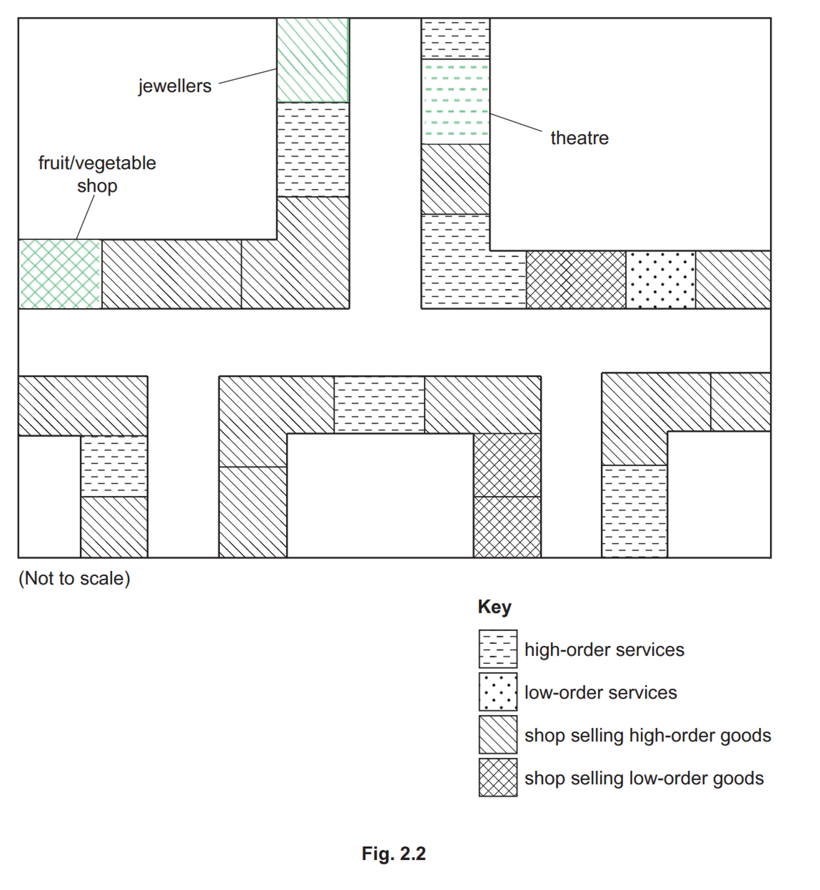

# Mark Schemes — Settlements & Service Provision
**Population & Settlement** · Cambridge (CIE) IGCSE geography (0460 & 0976)

## Paper 1 (34 questions)

### Q1
The main changes that have taken place in Llanelli between 1850 and 2000 are the increase of the built-up area **[1 mark].**
The smaller settlements such as Pwll and Pemberton have been swallowed up by urban sprawl to become part of the main Llanelli urban area **[1 mark].** Secondary industrial sites, such as the car component factory and Trostre tin plate works, have taken the place of primary coal mines that have closed **[1 mark].**

> **[mark-scheme]**
> - 1 mark for each idea up to a maximum of 3 marks.
> 
> **Alternative content**
> 
> The answer above is just one example of a response to this question. Other information that could be used in the answer includes:
> 
> - Llanelli has better access due to the M4 motorway and additional roads connecting settlements and industries.
> - There has been a shift and increase in the high-class residential area. It has grown in size and moved north and west of Felinfoel.

### Q2
The growth of settlements in the rural-urban fringe impacts local people in various ways, such as the loss of green spaces like woodlands, reducing areas for leisure activities such as dog walking **[1 mark]**. There is also a loss of farmland, which affects local farming and food production, which can lead to food insecurity **[1 mark]**. New developments bring more job opportunities, shops, and services, but also put pressure on local resources, like water supply **[1 mark]**. Construction and traffic increase noise pollution, disrupting the peace of rural areas and increase air pollution, causing breathing problems **[1 mark]**.

> **[mark-scheme]**
> - 1 mark for each idea and consequence up to a maximum of 4 marks.
> - The development of the answer is important, along with the use of geographical terms.
> 
> **Alternative content**
> 
> - The answer above is just one example of a response to this question. Other information that could be used in the answer includes:
> 
>   - visual impact.
>   - increase in out-of-town developments.
>   - draws business outwards from urban centres.
>   - increases traffic congestion.

### Q3
1. Sphere of influence.

  1. **High-order services have a larger sphere of influence than low-order services** **[1 mark].**
2. Threshold population.

  1. **Low-order services will have a small threshold population compared to high-order services ****[1 mark].**
3. Frequency of use.

  1. **Low-order services are used regularly, even daily, compared to high-order services that tend to be used less frequently, such as monthly or fortnightly** **[1 mark].**
4. Range.

  1. T**he range is large for high-order services because it is used by people living further away that have to travel to a central area. Whereas low-order services are usually local** **[1 mark].**

> **[mark-scheme]**
> 1 mark for each comparative difference up to 4 marks max.
> 
> The question is clear: a comparison is needed to receive full marks.
> 
> - Avoid repeating the same response (high-order services have a large sphere of influence but low-order services don't).

### Q4
**Urban sprawl is the uncontrolled expansion of urban areas into rural land and can lead to loss of biodiversity and habitat destruction** **[1 mark].**

**More cars and longer commutes increase air pollution and higher greenhouse gas emissions, contributing to increased global warming** **[1 mark].**

** Expanding urban areas often use agricultural land, reducing the availability of locally grown food and affecting food security ****[1 mark].**

**Urban sprawl can increase costs for local governments due to the need for new infrastructure and services. It can also reduce property values in older urban areas, leading to economic decline ****[1 mark].**

> **[mark-scheme]**
> Marks are awarded for well-developed ideas up to 4 marks max.
> 
> This can be 4 individual ideas or 2 well-developed suggestions.
> 
> Answers will need to show understanding of why urban sprawl would increase traffic flow or why loss of farmland is an issue.
> 
> **Alternative content**
> 
> - The answer above is just one example of a response to this question. Other information that could be used in the answer includes:
> 
>   - deforestation.
>   - loss of areas of recreational value.
>   - water and/or air pollution.
>   - any other valid reason.

### Q5
Levels marking

| **Level 1 (1–3 marks)** | **Level 2 (4–6 marks)** | **Level 3 (7 marks)** |
|---|---|---|
| Statements including limited detail which describe and/or explain the service provision. | Uses named example. More developed statements which describe and/or explain the service provision. (**Note**: Max 5 if no named or inappropriate example) | Uses named example. Comprehensive and accurate statements which describe and explain the service provision, with some place specific reference. |

**Content Guide:**

<u>Examples include:</u>

Any size settlement and explanations can be chosen

Population size / market,
Threshold population,
Spheres of influence,
Nearby competition

Simple descriptions of services are likely to refer to examples of types of services, however more developed ones should refer to order of services.

<u>Place specific examples include:</u>

Population size,
Locational details,
Specific details/names of the services,
Other nearby settlements

### Q6
| **Indicative content** | **General guidance** |
|---|---|
| - Health - Transport - Leisure - Worship - Commercial | The command word ‘describe’ requires you to give some information about the services and then you need to give reasons for them  7 mark questions are level marked rather than point marked.  You should refer to specific locations and examples, you need to do more than name a town  If you do not name an example you can only score 5 marks maximum  The top level is achieved by including  comprehensive and accurate statements including some place specific reference |

| **Model Answer** | **Commentary** |
|---|---|
| Reading is a town with a population of 163,000 people.  It has a range of services.  Reading has a variety of places of worship, with many churches and mosques.  There is also a synagogue and two Buddhist temples.  This is because the population of Reading is 40% Christian and 5% Muslim.  Reading town centre has two shopping centres, The Oracle and Broad Street Mall.  The town has high order shops including John Lewis and an Apple Store.  This is because the average wage for Reading residents is £42,000 which is above the national average.  The residents will have a high disposable income.  On the outskirts of town there is an IKEA superstore.  It is located here due to the easy access to the M4 motorway.  The median age of Reading is 35 years, and there is a large number of 20 to 55 year olds.  This accounts for a range of leisure facilities around the area, with gyms, golf courses and a 24,000 capacity Football Stadium, The Madejski.  Transport in Reading is good, with many bus routes and train lines linking to the mainline station.  Many residents of Reading commute to London and so require a fast and efficient transport system.  The increasing population in Reading requires education provision and healthcare. Reading has many primary and secondary schools.  There is also a College and University.  The Royal Berkshire Hospital has 800 inpatient beds and employs 5000 people. | **Marks awarded 7/7**  This is one possible way to answer this question – your answer does not have to be exactly the same  There must be specific reference to the strategies used.  Try to describe a range of impacts  This answer scores level 7 because it includes:  - Detailed statements - Place specific examples |

### Q7
**Note**: Focus should be on one land use change, so mark highest scoring idea only if more than one is stated.

| **Level 1 (1–3 marks)** | **Level 2 (4–6 marks)** | **Level 3 (7 marks)** |
|---|---|---|
| Statements including limited detail which describe a new land use and/or explain why this has caused problems.  e.g. new shopping mall =L1 Busier roads/traffic congestion =L1 Air pollution = L1 | Uses named example.  More developed statements which describe a change (before and after) in land use and/or explain why this has caused problems.  E.g. terraced housing replaced by shopping mall E.g. more traffic congestion so local people are late for work E.g. more air pollution so people have breathing difficulties/asthma  (Note: Max 5 if no named or inappropriate example) | Uses named example. Comprehensive and accurate which describes a change in land use and explains why this has caused problems with some place specific reference. Note: Must refer to the change and the problems, but one of these can be at L1. |

**Content Guide:**

<u>Examples include:</u>

New housing development
Building of a new industry
Road building
Building of a new shop/supermarket
Closing industry
Urban fringe development Shanty towns etc.

Any change in land use with its associated problems due to the change in land use will be accepted.

### Q8
| **Indicative content** | **General guidance** |
|---|---|
| - Name settlement types - Population - Services provided up the hierarchy | The command word ‘describe’ requires you to say what the settlements look like in terms of size and services offered  7 mark questions are level marked rather than point marked.  You should refer to specific locations and examples, you need to do more than name an area and towns  If you do not name an example you can only score 5 marks maximum  The top level is achieved by including  comprehensive and accurate statements including some place specific reference  You might want to consider including a sketch map of your area. |

| **Model Answer** | **Commentary** |
|---|---|
| In West Cumbria, settlements range from hamlets of 3 houses to the city of Carlisle which has a population of 75,000.  Middletown is a hamlet on the west coast of Cumbria, situated between St Bees and Egremont.  There are no services, just three houses.  St Bees is a small coastal village with a population of 1000.  It has a primary school, a post office and three pubs.  There is a train station that offers local service on weekdays only.  5 miles to the North is the town of Whitehaven, with a population of 24,000. Here there are more shops, restaurants and transport links.  There are three supermarkets, including Tesco, Morrisons and Aldi. There are lots of primary schools and two secondary schools.  Carlisle is the only city in west Cumbria with a population of 78,000 and this is where Cumbria County Council have their offices.  There is a Cathedral in the centre of the city. There is also a football stadium, Brunton Park,  for Carlisle United, a League One football team. There is a shopping arcade called The Lanes which has a range of fashion shops including Primark and high-end services such as Toni and Guy hairdressers.  As well as having primary and secondary schools, Carlisle also has a campus of The University of Cumbria.  The train station in Carlisle has frequent services to major cities such as Edinburgh to the North and London to the South. | **Marks awarded 7/7**  This is one possible way to answer this question – your answer does not have to be exactly the same  There must be specific reference to the places within the hierarchy  This answer scores level 7 because it includes:  - Detailed statements - Place specific examples |

### Q9
| **Indicative content** | **General guidance** |
|---|---|
| - Types of industry - Names of companies - Investment over time | The command word ‘describe’ requires you to say how the function has changed  7 mark questions are level marked rather than point marked.  You should refer to specific locations and examples, you need to do more than name a town  If you do not name an example you can only score 5 marks maximum  The top level is achieved by including  comprehensive and accurate statements including some place specific reference |

| **Model Answer** | **Commentary** |
|---|---|
| Reading is a large town in the South East of England, approximately 40 miles west of London.  Originally Reading was known for the 3 Bs; beer, bulbs and biscuits.  The opening of the Great Western Railway made the town attractive to industry  The brewing industry developed in Reading because the land surrounding the town was good for growing barley.  Sutton Seeds was set up by a local farmer.  There was a lot of demand for fruit and vegetable seeds due to the many farmers and large estates in the area.  Suttons were seed suppliers to the Queen.  The organisation moved to Devon in 1976. Huntley and Palmers biscuit factory was located on King’s Road and at its peak employed nearly 1000 people  Reading’s current function is as a commuter town and a centre of hi-tech industry. Green Park is a major business park located in Reading, just off junction 11 of the motorway.  Companies such as Virgin Media, Huawei and Three have located there and Reading has been named as one of the best towns for the tech industry in the UK the hi-tech industry provides 60,000 jobs in the town.  There has been significant investment in Reading’s transport, with £850 million spent on a recent train station improvement.  The town is the western start of the new Elizabethan Line that runs to Paddington and then east to Abbey Wood.  The road network around Reading is well-developed with the M4 motorway and A33.  National Express coaches also stop in Reading.  These features mean that transport is an important function of Reading and many of its residents work in London, commuting daily. | **Marks awarded 7/7**  This is one possible way to answer this question – your answer does not have to be exactly the same  There must be specific reference to the types of jobs that people have been employed in and how these have changed over time.  This answer scores level 7 because it includes:  - Detailed statements - Place specific examples |

### Q10
Levels marking

**Note**: Statistics can be used as development to a maximum of 1 × L2 – **[4]** marks. This applies to all levels-marked questions.

| **Level 1 (1–3 marks)** | **Level 2 (4–6 marks)** | **Level 3 (7 marks)** |
|---|---|---|
| Statements including limited detail which describe or explain the service provision. | Uses named example. More developed statements which explain service provision. (NB Max 5 if no named or inappropriate example) | Uses named example. Comprehensive and accurate statements which describe and explain service provision with some place specific reference. |

**Content Guide:**

Any size settlement and explanations can be chosen

<u>Examples include:</u>

Population size/market,
Threshold population,
Spheres of influence,
Order of service e.g. low order
Nearby competition
Needs of population e.g. lots of hotels (L1) because tourists go there (L1) etc.

<u>Place specific examples include:</u>

Population size,
Locational details,
Specific details/names of the services,
Other nearby settlements etc.

### Q11
Levels marking

**Note**: Statistics can be used as development to a maximum of 1 × L2 – **[4]** marks. This applies to all levels-marked questions.

| **Level 1 (1–3 marks)** | **Level 2 (4–6 marks)** | **Level 3 (7 marks)** |
|---|---|---|
| Statements including limited detail which describe the hierarchy of services. | Uses named example. More developed statements which describe the hierarchy of services. (Note: Maximum 5 marks if no named or inappropriate example) | Uses named example. Comprehensive and accurate with some place-specific reference. Note: The example can be a named area of any size. Development is of the description. If the answer focuses on a city rather than an area, then award a maximum of 5 marks. |

**Content Guide:**

<u>Examples include:</u>

Number of services;
Specific types/examples of services;
Order of services - high/middle/low or convenience/comparison/specialist

Place specific examples include:

Named settlements - *Houston, Galveston, Brookshire, and Katy, all within a 60 mile radius in Texas*
Locational details of services 
Named shops and services etc. - *Houston has a population of 2 million and provides a range of high order services placing Houston on the top of the service hierarchy. Houston has plenty of high order shops and services such as universities, medical centres, theatres and sporting venues. With a 30 minute drive, on the western edge of Houston with a population of approx. 20,000 sits the town of Katy. It has its own out of town shopping centre called Katy Mills, high schools and general shops, but most of the population uses Houston for other services. 10 miles west of Katy is Brookshire, which is a large village, but only has basic services that meets the need of its local population such as local shops and schools. Unusually, Galveston, which is 60 miles south of Houston with a population of 50,000, has more services that would be expected for its population size. This is because tourism is its main function and services such as water parks, restaurants and museums need to be available to visiting tourists...*

- *Remember that the number of shops and services within a settlement depends on the minimum number of people need by a shop/service to make a profit - called the **threshold population. **Shops and services are classified according to their threshold population, the distance people are willing to travel and how often they use the service.*
- *Low order *$\rightarrow$*frequent use *$\rightarrow$*short distance = local shop with a threshold population of 200 *
- *Middle order *$\rightarrow$* used often *$\rightarrow$* next town = bank and multiple shops with a threshold population of 15,000 *
- *High order *$\rightarrow$*infrequent use *$\rightarrow$*at a distance = department stores/malls with a threshold population of 350,000*

### Q12
Levels marking

**Note**: Statistics can be used as development to a maximum of 1 × L2 – **[4]** marks. This applies to all levels-marked questions.

| **Level 1 (1–3 marks)** | **Level 2 (4–6 marks)** | **Level 3 (7 marks)** |
|---|---|---|
| Answer identifies function of the settlement and/or simple statements to explain the functions. | Uses named example. Answer identifies a function (s) of the settlement and gives reasons using more developed statements to explain the function(s) of the urban settlement. (Note: Max 5 if no named or inappropriate example) | Uses named example. Answer identifies a function(s) of the settlement. Comprehensive and accurate statements which give reasons for the functions of the urban settlement, including some place specific reference. |

**Content Guide:**

<u>Examples include:</u>

Tourist resort
Port
Market town
Administrative centre
Industrial town
Mining settlement

<u>Additional functions which apply to many settlements would also be valid such as:</u>

Residential
Shopping centre
Provision of education
Provision of health care etc

Note: Reason should relate to the functions stated.

Place specific reference is likely to consist of:

<u>Place specific examples include:</u>

Named parts of the chosen settlement/ detail of functions/statistics etc. Examples can be MEDC/LEDC city/town in any country.

### Q13
Levels marking

**Note**: Statistics can be used as development to a maximum of 1 × L2 – **[4]** marks. This applies to all levels-marked questions.

| **Level 1 (1–3 marks)** | **Level 2 (4–6 marks)** | **Level 3 (7 marks)** |
|---|---|---|
| Statements including limited detail which explain why the population size has changed.  E.g. Migration/pull factor/push factor = L1 | Uses named example. More developed statements which explain why the population size has changed.  (Note: Max 5 if no named or inappropriate example)  E.g. Migration/move there plus a simple reason such as better schools = L2. | Uses named example. Comprehensive and accurate statements which explain why the population size has changed, with some place specific reference. |

- *Other push/pull factors then have to be well developed for credit at L2 to the this same stem/idea of migration.* *E.g. Move for jobs in tourism =L1 and so can feed family =L2.*
- *E.g. Birth Rate >Death Rate or DR > BR = L1* *But writing BR > DR due to better hospitals and medical care moves the answer up to L2.*

**Content Guide:**

<u>Examples include:</u>

Migration, 
Economic growth or 
Economic growth decline, 
Natural population growth or
Natural population decline

<u>Place specific examples include:</u>

Locational details,
Specific details of the rural area chosen etc

### Q14
Levels marking

**Note**: Statistics can be used as development to a maximum of 1 × L2 – **[4]** marks. This applies to all levels-marked questions.

| **Level 1 (1–3 marks)** | **Level 2 (4–6 marks)** | **Level 3 (7 marks)** |
|---|---|---|
| Statements including limited detail which describe the causes and/or effects of a problem faced by people living there. | Uses named example. More developed statements which describe the causes and/or effects of a problem faced by people living there (NB Max 5 if no named or inappropriate example) | Uses named example. Comprehensive and accurate statements which describe the causes and the effects of a problem faced by people living there, including some place specific reference. |

**Content Guide:**

<u>Examples include:</u>

Traffic congestion
Unemployment
Lack of housing/squatter settlements
High crime rates
Air pollution etc.

<u>Place specific examples include:</u>

Named parts of the chosen settlement/ detail of problems/statistics etc. Examples can be MEDC/LEDC city/town in any country.

### Q15
**A place where homes are spread over a wide area ****[1 mark].**

> **[mark-scheme]**
> **Alternative content**
> 
> - The answer above is just one example of a response to this question. Other information that could be used in the answer includes:
> 
>   - an area with large areas of land between buildings/homes.
>   - an area with isolated buildings/homes.
>   - an area with a wide spread of homes, farms, and/or buildings.
**Rural settlement: ****Village ****[1 mark].**

**Urban settlement: ****Town**** ****[1 mark].**

> **[mark-scheme]**
> **Alternative content**
> 
> - The answer above is just one example of a response to this question. Other information that could be used in the answer includes:
> 
>   - Hamlet or dispersed settlement for rural settlement.
>   - City or conurbation for urban settlement.
**One typical land use in the rural-urban fringe is the building of new housing estates** **[1 mark]**. **Another is building roads to bypass urban areas using ring roads** **[1 mark]**. **Lastly is building industrial estates and business parks to move polluting industry out of inner cities** **[1 mark]**.

> **[mark-scheme]**
> 1 mark for each identified land use at the rural-urban fringe.
> 
> **Alternative content**
> 
> - The answer above is just one example of a response to this question. Other information that could be used in the answer includes:
> 
>   - agriculture.
>   - airports.
>   - retail and leisure parks.
>   - golf courses.
>   - any other suitable response.

### Q16
**The Oldwalls map shows the settlement as linear** **[1 mark].**

> **[mark-scheme]**
> 1 mark for linear, hamlet or village settlement.
Two characteristics of dispersed settlements are that they are widely spaced **[1 mark]** and are usually separated by farmland **[1 mark]**.

> **[mark-scheme]**
> Alternative content includes:
> 
> - The settlement is surrounded by fields.
> - No obvious pattern
> - Sparse or low population density.
A nucleated settlement is characterised by the grouping of buildings around a central point **[1 mark]**. Therefore, Penrice qualifies as a nucleated settlement due to its central location between the castle and church **[1 mark]**, its location around a road junction where roads meet **[1 mark]**, and its closeness to a water supply **[1 mark]**.

> **[mark-scheme]**
> - 1 mark for the definition of nucleated settlement.
> - 3 further marks for identifying features.

### Q17
**The term is a way of ranking settlements into an order depending on their size, services offered and population** **[1 mark].**

> **[mark-scheme]**
> 1 mark for identifying ranking/ordering settlements based on size, population and services.
**The larger the population size, the smaller the number of settlements there are. E.g. there are fewer cities than villages** **[1 mark]**.

**The smaller the settlement, the lower the order of services provided. E.g. there are few hospitals in villages ****[1 mark]**.

> **[mark-scheme]**
> 1 mark per relationship.
> 
> The command word 'describe' need s answers that provide an outline
> 
> **Alternative content**
> 
> - Lots of small settlements and few larger settlements.
> - Large settlements have high-order services.
> - Small settlements have low-order services.
> - The smaller the population size, the more settlements there are.
> - Negative correlation.

> **[exam-tip]**
> A settlement is an area where people live that can have one house or be a megacity.
> 
> The larger the settlement, the bigger and better the services usually are.
> 
> The smaller the settlement, the more low-order services are provided. There are more small independent shops selling essentials such as milk, tea, sugar, etc. in villages than in cities.
1. **Village** **[1 mark].**
2. **Capital city** **[1 mark].**
3. **Hamlet ****[1 mark].**

> **[mark-scheme]**
> 1 mark per identified settlement up to 3 marks max.

### Q18
**Linear or in a line** **[1 mark].**
**Buildings are separated from each area** **[1 mark].**

**There tends to be a low population or building density** **[1 mark].**

> **[mark-scheme]**
> 1 mark for each valid characteristic of a dispersed settlement.
> 
> **Alternative content**
> 
> - The answer above is just one example of a response to this question. Other information that could be used in the answer includes:
> 
>   - Buildings are scattered.
>   - Buildings are surrounded or separated by farmland, woodland, rural land or open spaces.
Settlement Z sits around the junction of roads that meet at its centre; this has formed a nucleated element of the settlement around the central junction **[1 mark]. **The railway has divided the settlement and a simple linear pattern has developed along the road leading to the main centre so people can still access the settlement **[1 mark]. **The settlement is close enough to the city with excellent access so people can easily travel to work there but still live in a rural space **[1 mark].**

> **[mark-scheme]**
> 1 mark for each valid suggestion on the development of settlement Z.
> 
> It is necessary to explain how the growth of settlement Z is the way it is.

### Q19
**A settlement is a place where people live** **[1 mark].**
**X is nucleated or clustered ****[1 mark]. **

**Y is dispersed or scattered** **[1 mark].**
**The figure indicates there may be growth along roads, making the settlement linear as a result** **[1 mark]**.

**The presence of valleys and open farmland will restrict outward nucleated growth by the high land and agriculture ****[1 mark].**

**There could be growth along rivers, which encourages linear development of settlements along their banks to allow access to water** **[1 mark].**

> **[mark-scheme]**
> 1 mark for each valid suggestion as to why settlements develop in a linear way.
> 
> The command word 'suggest' requires some development to the reason for linear growth.
> 
> The figure is not detailed enough to be specific as to the reasons for linear growth, and suggestions would need to be drawn from one's own knowledge.

### Q20
**The correct answer is retail** **[1 mark].**

> **[mark-scheme]**
> The command word ‘identify’ requires you to name the function.
> 
> The photograph shows a range of shops.

### Q21
1. **Closeness to water sources.** The settlement of Aliano is near the Agri River and the Sàuro River, which would have given important water for drinking, farming, and other daily needs **[1 mark].**
2. **Potential for farming.** The surrounding area has crops, vines, and olive trees, which shows that the ground is fertile and suitable for farming. This would have helped the settlement's economy and food production **[1 mark].**
3. **Strategic location. **Aliano's location in a valley close to both minor and major roads would have made trade and communication with other areas easier, which would have helped the town grow and progress **[1 mark].**

> **[mark-scheme]**
> 1 mark for each developed suggestion for the original growth.
> 
> Answers must focus on the original settlement and why it developed.
> 
> **Alternative content**
> 
> - The answer above is just one example of a response to this question. Other information that could be used in the answer includes:
> 
>   - Defensive site.
>   - Above the flood levels of the river.

### Q22
The main features are that the settlement is nucleated with buildings tightly packed together **[1 mark].** It is in a low, relatively flat rural valley and surrounded by mountains and farmland **[1 mark].** There are some buildings with extensions along the roads and buildings are mostly white with red roofs **[1 mark].**
People are likely to settle in areas with fertile land for agriculture, as seen with the terracing on the slopes that are green **[1 mark]**. Farming is essential in rural areas, so living near good soil is important **[1 mark]**. The settlement is also south-facing, which provides the most sunlight and, therefore, light and heat throughout the year **[1 mark]**.

The low valley offers sheltered land that is suitable for building homes **[1 mark]**. The main settlement is accessible via roads and there is a main road close by **[1 mark]**.

### Q23
(i)

Examples such as:

Fig. 2.3 = port **[1]**
Fig. 2.4 = retail **[1]**
Fig. 2.5 = tourist resort **[1]**

(ii)

Examples such as:

E.g. port: **[1]**
Located alongside an estuary; **[1]**
Flat land for building warehouses/storage; **[1]**
Deep water channel; **[1]**
Sheltered anchorages; **[1]**
Large hinterland producing products for export/agricultural products/manufactured goods; **[1]**
Good rail/road communications etc. **[1]**

### Q24
Urban areas have a larger sphere of influence and offer more services, especially high-order services like shopping centres, hospitals, universities, and airports, so people will travel further to use them. In contrast, rural settlements offer basic services, including food shops, primary schools, and healthcare **[1 mark]**.

Urban areas have better infrastructure, such as roads and public transportation, making services more accessible and profitable due to a greater threshold population. Services may be limited in rural areas due to infrastructure issues **[1 mark]**.

More businesses and investments move to cities, which concentrate services. In rural places, on the other hand, it may be hard to keep providing a wide range of services that are profitable **[1 mark]**.

Urban areas have specialised services like theatres, private clinics, and financial services and are generally available throughout the day and week. This is rarely found in rural settlements due to insufficient population size and demand **[1 mark]**.

### Q25
1. **Regional centre**** [1 mark].**
2. **Large town**** [1 mark].**
3. **Small town** **[1 mark].**

> **[mark-scheme]**
> The command word ‘**identify**’ requires naming the type of settlement, choosing from the hierarchy diagram.
> 
> 1 mark for each correctly identified settlement.
Villages have low-order services because their sphere of influence is small **[1 mark] **and they do not need a large population to support them **[1 mark]** **.** Low-order shops sell convenience goods that are bought frequently **[1 mark].**

> **[mark-scheme]**
> The command word ‘**explain**’ requires reasons for the answer.
> 
> 1 mark for each identified and reasoned point.

### Q26
Wykeham is further away and north/north east of the river but East Heslerton is on higher land south of the river **[1 mark]**.
East Heslerton is higher. Wykeham is within the 30 m line above sea level but East Heslerton is above the 30 m line **[1 mark].**
East Heslerton is on A64 but Wykeham is on A170 **[1 mark]**.

> **[mark-scheme]**
> There must be a comparison between the two areas to gain the marks.
> 
> - 1 mark for each clearly identified comparison up to a max of 3 marks.

> **[exam-tip]**
> When asked to compare, you need to make sure you clearly state the comparison. Don't make individual statements about the settlements and assume that is enough, or you will miss out on marks.
The distribution of settlements in the area shows they are all along roads and this enables easier access for people and goods **[1 mark]**.

Both settlements are 30 m above sea level and therefore avoid future flooding **[1 mark]**; however, the river is close enough to supply water for irrigation and drinking **[1 mark]**.

The settlements are built on gently sloping land **[1 mark]**, which can help with water drainage and erosion control, which can reduce the need for costly drainage systems **[1 mark]**.

> **[mark-scheme]**
> 1 mark for each idea or development.
> 
> Answers should show an understanding of how places, environments, and processes are connected.
> 
> **Alternative content**
> 
> The answer above is just one example of a response to this question. Other information that could be used in the answer includes:
> 
> - Both settlements are close to fertile land available on the flood plain, which will provide nutrients to grow food and reduce the costs for additional fertilisers**.**

> **[exam-tip]**
> Many students confuse the command words **explain **and **describe**. Describe is to say or write what something is like with no added detail. Whereas, explain is to give a reason why something is there.
> 
> For example, the settlements are along roads or along the 30 m contour line. This would be a descriptive response.
> 
> To explain, the answer would also need to say why the settlements are found there, such as for the transport of goods and to avoid flooding, etc.
> 
> - The settlements are along roads, as this provides good access for transport of goods and people.

### Q27
Overall, the figure shows there is a positive relationship as the population size increases the more services there are **[1 mark]** The figure shows that hamlets have fewer services than towns or cities, which have larger populations **[1 mark].**
The figure shows some anomalies and the relationship is not perfect. **[1 mark]**
There is a relationship between settlement size and the number of services provided because larger settlements, such as cities, have a higher population and thus greater demand for a wider variety of services **[1 mark]**.

Larger populations mean there is enough economic activity to support high-order services, like hospitals and department stores, which require more customers to remain profitable. In contrast, smaller settlements, such as villages, can only support low-order services like convenience stores **[1 mark]**.

Bigger settlements also act as regional hubs, attracting people from surrounding smaller settlements to access specialised services, such as universities or airports **[1 mark]**.

In addition, large settlements have better infrastructure, such as transportation networks, which makes them suitable for more diverse and complex services **[1 mark]**.

Finally, the availability of jobs and opportunities in larger settlements encourages population growth, further increasing the demand for and viability of more services **[1 mark]**.

> **[mark-scheme]**
> To gain full marks, the answer must be developed.
> 
> 1 mark for each developed idea up to a maximum of 5 marks.
> 
> **Alternative content**
> 
> The answer above is just one example of a response to this question. Other information that could be used in the answer includes:
> 
> - Larger settlements have a larger sphere of influence.
> - Many people will travel to work in larger settlements and use their services.

### Q28
Llanelli developed in an area rich in coal, which was an important resource during the Industrial Revolution because it provided energy to businesses like making iron and steel. This made the town an ideal location for heavy industry **[1 mark].**

Iron and steel were important for making tools and machines, and later they were used to manufacture tin plate and car parts. The abundance of these natural resources meant that Llanelli became a centre for manufacturing **[1 mark].**

Llanelli’s position on the coast has provided excellent access to ports. This allowed for the easy import of additional raw materials and the export of finished goods **[1 mark].**

Industrial growth was helped by the abundance of skilled workers. Llanelli has become an industrial town thanks to the people who have moved there to work in its factories and coal mines **[1 mark].**

Llanelli has strong transport links, including good main roads, motorway access and railway. This makes it easier and cheaper to transport goods to and from the town, helping industries to thrive **[1 mark].**

> **[mark-scheme]**
> There needs to be a discussion that identifies at least five reasons why Llanelli functions as an industrial town.
> 
> - 1 mark for each reason identified from the two maps.
> 
> **Alternative content**
> 
> The answer above is just one example of a response to this question. Other information that could be used in the answer includes:
> 
> - Flat or low land for construction.
> - Availability of water for development and industry.
> - Fuel smelting and powering of machinery.
> - Plenty of space and cheap land.
> - An abundant and/or skilled workforce.
> - Available market.
> - The cost of transporting raw materials and/or components is low.

> **[exam-tip]**
> With questions like these, it is important to remember to provide some detail as well. Identifying that Llanelli is on the coast but not how that contributes to making it an industrial town will restrict the available marks. Always think, 'so what does that mean?' Make a statement and then justify it.

### Q29
Areas become retail centres if there is a large enough population **[1 mark]** which provides a customer market for the goods **[1 mark]** and good transport links mean they are accessible **[1 mark].**

Settlements with flat land **[1 mark] **will be easier to build the shops on **[1 mark].**

> **[mark-scheme]**
> The command word ‘explain’ requires reasons for the development of retail in an area.
> 
> 1 mark for each explained factor that could lead to a retail function developing.

### Q30
(i) Examples such as:

Less people work on farms/declining importance of agriculture; **[1]**
Mechanization of agriculture; **[1]**
Lack of work/to find jobs/get more pay; **[1]**
Movement of people to urban areas; **[1]**
For education/universities; **[1]** For health care/hospitals; **[1] ** Transport network may be poor/winding roads etc **[1]**

### Q31
The homes in Fig. 2.2 are concentrated in more accessible, resource-rich areas, with fewer homes in isolated, remote locations **[1 mark]**.

Homes are unevenly distributed and are clustered around larger settlements such as Langali and Mgeta **[1 mark]**.

These areas have larger groups of houses and are near important roads and junctions **[1 mark]**. There are smaller clusters of houses near rivers **[1 mark]**.

There are some isolated homes scattered across the map, particularly in the scrubland and forested areas **[1 mark]**.

> **[mark-scheme]**
> 1 mark for each valid observation of the distribution of homes in Fig. 2.2.
> 
> The command word is '**describe' **and answers should focus on this and not explain why they are positioned there.
> 
> **Alternative content**
> 
> The answer above is just one example of a response to this question. Other information that could be used in the answer includes:
> 
> - Schools, markets, and other facilities are generally in larger settlements.
Most homes are in clustered settlements so people can live in communities for mutual protection **[1 mark]. **Larger groups of houses tend to be located near main roads and junctions, which provides better access and transport links **[1 mark].**

Many homes are located close to rivers, like the R. Mzinguu and R. Mindu, as these provide a reliable water supply for drinking, farming, and other daily activities **[1 mark]**. The river floodplains provide fertile land for agriculture, in contrast with the scrubland, where the land is less productive **[1 mark]**. The valleys around rivers also offer sheltered land that is more suitable for building homes **[1 mark]**.

> **[mark-scheme]**
> Answers should explain some of the reasons why houses are built in the locations in Fig. 2.2.
> 
> 1 mark for each developed idea up to a maximum of 5 marks.
> 
> **Alternative content**
> 
> The answer above is just one example of a response to this question. Other information that could be used in the answer includes:
> 
> - Larger settlements, such as Langali, have markets, schools, and hospitals that attract people because of their services.
> - People settle where resources and services are most accessible.
> - Homes in open spaces away from dense forests may be safer from wild animals.
> - Proximity to forests for wood as fuel and building material.

### Q32
(i)

Fig. 2.2 = Tourism/resort/holidays **[1]** 
Fig. 2.3 = Industry/industrial town/manufacturing **[1]**
Fig. 2.4 = Port/harbour **[1]**

(ii)

Examples such as:

There are lots of people living there; **[1]**
There is a high demand/more people want to shop/eat; **[1]**
They are profitable/make a large profit; **[1]**
High order services need large threshold populations; **[1]**
Large sphere of influence; **[1]** People travel from a long distance; **[1]**
Good transport links/easily accessible to many people; **[1]**
Will be used by tourists/workers; **[1]**
Sell comparison goods/people can compare different shops/items/prices **[1]** etc.

### Q33
1. **High-order shop** **[1 mark].**
2. **High-order service** **[1 mark].**
3. **Low-order shop** **[1 mark].**

> **[mark-scheme]**
> The sketch must have the correct shading to gain each mark.
Low-order goods and services are basic items that are needed frequently and purchased regularly, such as bread and milk in local stores. They are usually cheaper goods and have a small sphere of influence, meaning people travel short distances to access them **[1 mark]. **

High-order goods and services, on the other hand, are luxury or specialised items that are purchased less often, such as furniture, cars or hospitals. These are usually more expensive, specialised and have a larger sphere of influence because people will travel further to buy or use them **[1 mark]. **

Low-order goods are found in small settlements like villages, while high-order goods are often located in larger settlements, such as cities **[1 mark]. **

High-order services need a higher population threshold to remain profitable compared to low-order services. **[1 mark]. **

Finally, high-order services cater to a broader range of needs, whereas low-order services address basic, everyday necessities. **[1 mark]. **

> **[mark-scheme]**
> 1 mark per identified comparison. Answers must compare between low-order and high-order goods and services.
