# Exam Questions — Settlements & Service Provision
**Population & Settlement** · Cambridge (CIE) IGCSE geography (0460 & 0976)
> Source: [https://www.savemyexams.com/igcse/geography/cie/20/topic-questions/](https://www.savemyexams.com/igcse/geography/cie/20/topic-questions/) · 33 questions across 1 sets

## Paper 1 (34 questions)

### Q1 — easy — 3 marks

**Q1** [3 marks]

Study Figs. 2.2 and 2.3, which show information about Llanelli, an urban settlement in the UK, in 1850 and 2000.

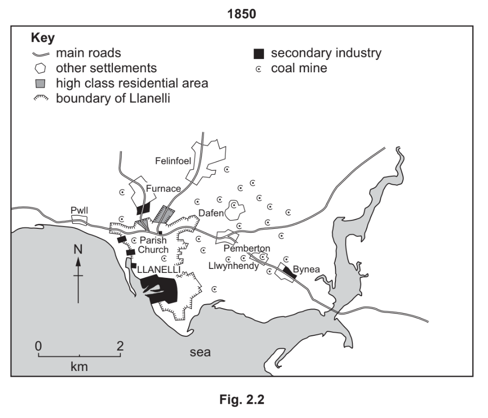

*Fig. 2.2*

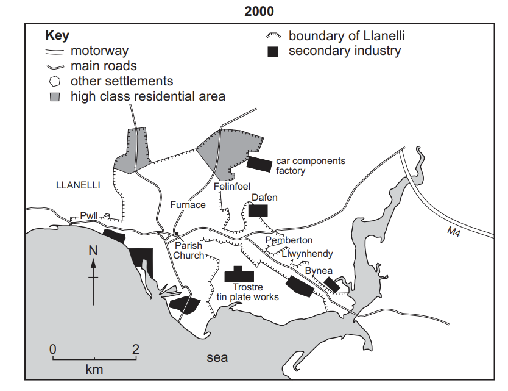

*Fig. 2.3*

Using evidence from Figs. 2.2 and 2.3 **only**, describe the main changes that have taken place in Llanelli between 1850 and 2000.

[3]

*Source: Spec 2020 0460/01 Q2B I*

### Q2 — medium — 4 marks

**Q2** [4 marks]

Study Fig. 2.1, which shows an area in an MEDC.

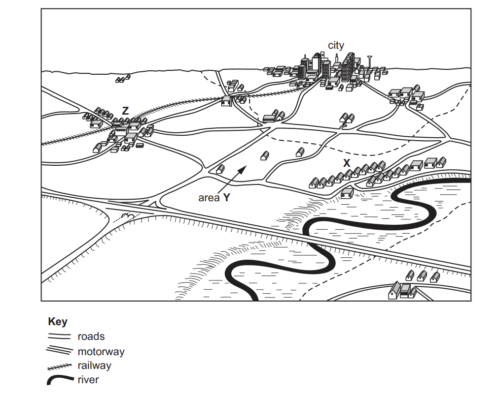

**Fig. 2.1**

Describe the impacts on local people of the growth of settlements in the rural-urban fringe.

[4]

*Source: June 2021 0460/13 Q2AIV*

### Q3 — medium — 4 marks

**Q3** [4 marks]

Study Fig. 2.1, which is a diagram showing a settlement hierarchy.

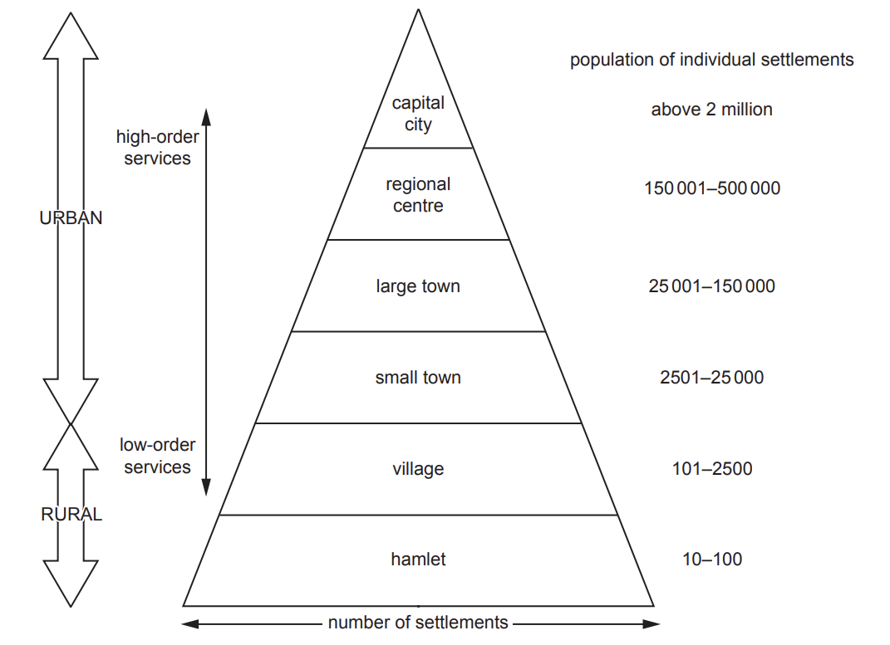

*Fig. 2.1*

Describe four differences between low-order and high-order services using the following headings:

sphere of influence

....................................................

threshold population

....................................................

frequency of use

....................................................

range.

....................................................

[4]

*Source: May/June 2021 0460/11 Q2AIV*

### Q4 — medium — 4 marks

**Q4** [4 marks]

Describe the problems caused by urban sprawl.

[4]

*Source: 2020 May/June 0460/11 Q2AIV*

### Q5 — hard — 7 marks

**Q5** [7 marks]

For a named settlement you have studied, describe and explain the service provision. You should refer to the type and order of services, and their spheres of influence. Name of settlement ....................................

*Source: 2020 May/June 0460/11 Q2C*

### Q6 — hard — 7 marks

**Q6** [7 marks]

For an urban area you have studied, describe and explain the service provision

### Q7 — hard — 7 marks

**Q7** [7 marks]

For a named urban area you have studied, describe **one change in land use** and explain why this change in land use has caused problems.

Name of urban area ..............................................

*Source: June 2021 0460/13 Q2C*

### Q8 — hard — 7 marks

**Q8** [7 marks]

For a named area you have studied, describe the settlement hierarchy with reference to service provision.

### Q9 — hard — 7 marks

**Q9** [7 marks]

For an urban area you have studied, describe how its function has changed over time

### Q10 — hard — 7 marks

**Q10** [7 marks]

Describe and explain the service provision in a named settlement you have studied.

Name of settlement

*Source: Nov 2020 0460/13 Q2C*

### Q11 — hard — 7 marks

**Q11** [7 marks]

For a named area you have studied, describe the hierarchy of service provision. Name of area ..............................

*Source: Spec 2020 0460/01 Q2C*

### Q12 — hard — 7 marks

**Q12** [7 marks]

The function of a settlement is its purpose, such as:
– a port – a tourist resort
– administration
– manufacturing.

For a named settlement you have studied, state its function(s) and explain why this/these function(s) developed there.

Name of settlement .........................................................
Function(s) .......................................................................

*Source: March 2021 0460/12 Q2C*

### Q13 — hard — 7 marks

**Q13** [7 marks]

For a named settlement you have studied, explain why the population size has changed.

Name of settlement ..........................

*Source: Nov 2019 0460/11 Q2C*

### Q14 — hard — 7 marks

**Q14** [7 marks]

For a named urban settlement you have studied, describe the causes and effects of one problem faced by the people living there.

Name of settlement ...............................

Problem ...............................

*Source: June 2021 0460/11 Q2C*

### Q15 — easy — 6 marks

**Q15** [1 mark]

Study Fig. 2.1, which shows information about rural and urban settlements.

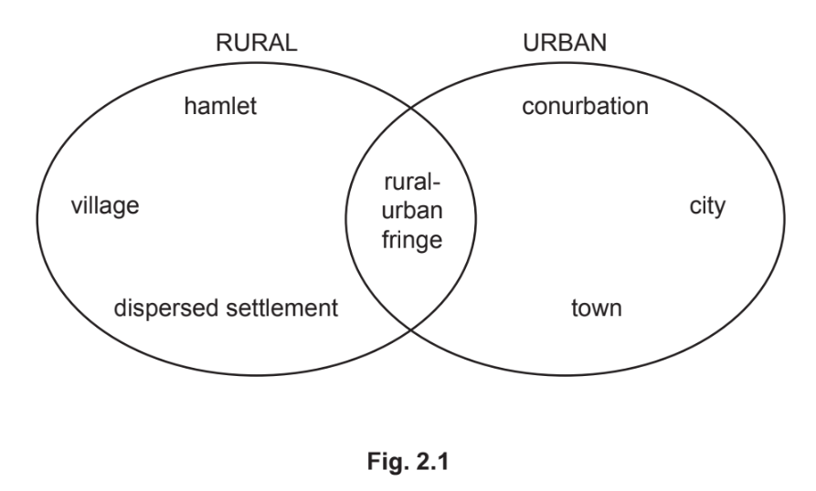

What is meant by the term **dispersed **settlement?

[1]

*Source: 2020 May/June 0460/11 Q2AI*

**Q15** [2 marks]

Identify from Fig. 2.1 a type of:

- rural settlement ................................................

- urban settlement ..............................................

[2]

*Source: 2020 May/June 0460/11 Q2AII*

**Q15** [3 marks]

State three typical land uses in the rural-urban fringe.

[3]

*Source: 2020 May/June 0460/11 Q2AIII*

### Q16 — easy — 7 marks

**Q16** [1 mark]

Study **Fig. 2.1** (below) shows three rural settlements in Wales (an MEDC).

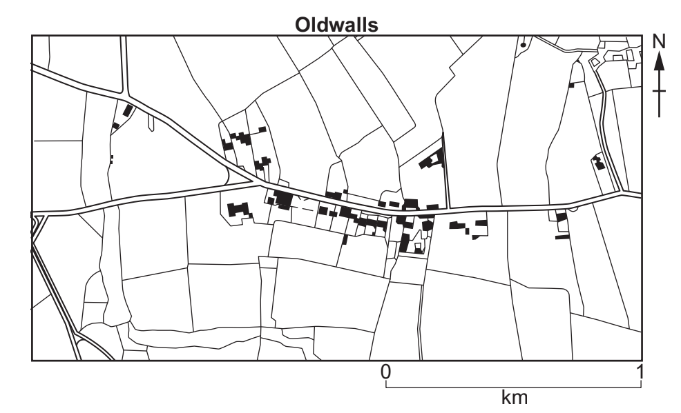

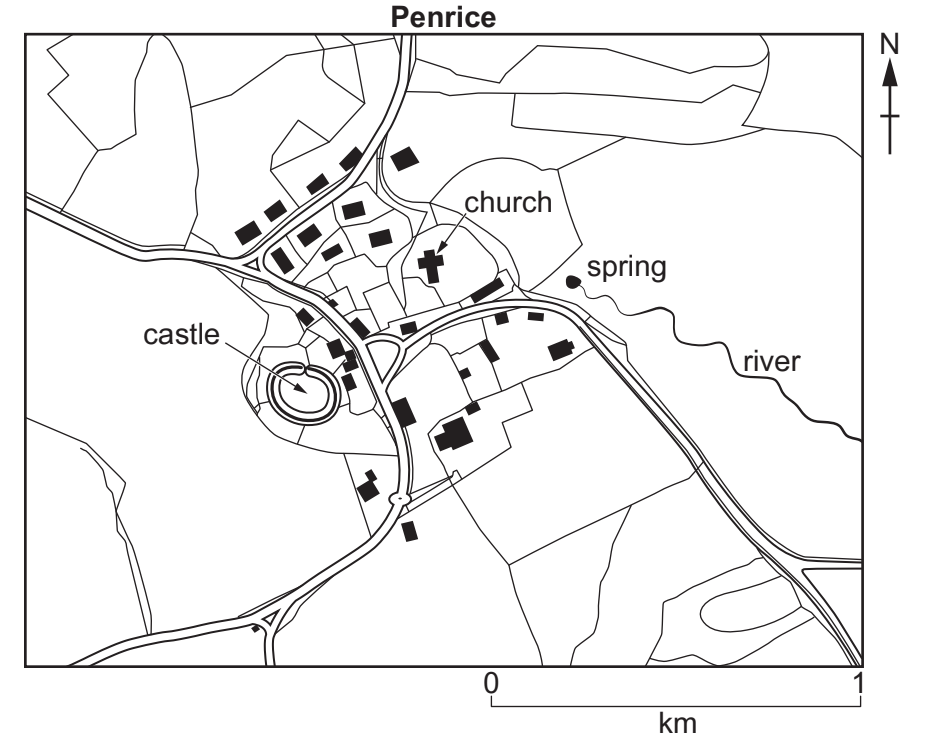

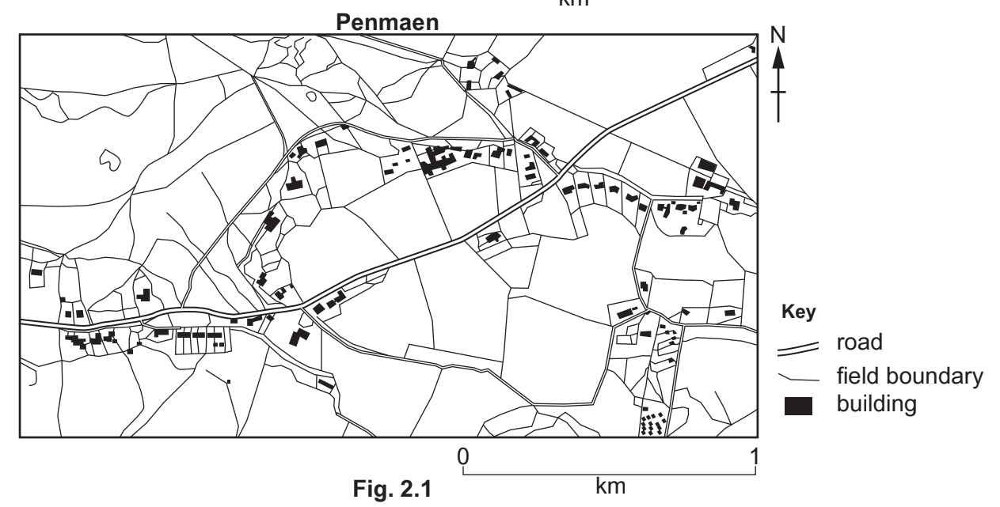

What type of settlement does the Oldwalls map show?

[1]

*Source: Nov 2020 0460/13 Q2A*

**Q16** [2 marks]

**Extract:**

Study Fig. 2.1 (below) shows three rural settlements in Wales (an MEDC).

Map of Penmaen, showing roads, field boundaries, and buildings. Key indicates symbols for roads, field boundaries, and buildings. North is marked.

Describe **two **characteristics of dispersed settlements such as Penmaen.

[2 marks]

**Q16** [4 marks]

**Extract:**

Study **Fig. 2.1** (below) shows three rural settlements in Wales (an MEDC).

Map of Penrice showing roads, buildings, a church, castle, spring, and river. Includes a scale of 0-1 km and a north-pointing compass.

Using evidence from **Fig. 2.1** only, give three reasons why Penrice is a nucleated settlement.

[4 marks]

### Q17 — easy — 6 marks

**Q17** [1 mark]

Study Fig. 2.1, which is a diagram showing a settlement hierarchy.

**Fig. 2.1**

What is meant by the term *hierarchy* of settlements?

**[1 mark]**

*Source: June 2021 0460/11 Q2AI*

**Q17** [2 marks]

**Extract:**

Study Fig. 2.1, which is a diagram showing a settlement hierarchy.

Describe the relationship between:

The population size and number of settlements

....................................................

The size of settlements and the order of services they provide.

....................................................

[2]

*Source: June 2021 0460/11 Q2A II*

**Q17** [3 marks]

**Extract:**

Study Fig. 2.1, which is a diagram showing a settlement hierarchy.

Fig. 2.1

Using Fig. 2.1, identify the type of settlement described in each of the following:

1. A small settlement with a primary school that is surrounded by farmland.
2. A large settlement with headquarters of many large businesses and national government buildings.
3. A settlement that has a few houses and no services.

[3]

*Source: June 2021 0460/11 Q2AIII*

### Q18 — easy — 6 marks

**Q18** [1 mark]

Study Fig. 2.1, which shows an area in an MEDC.

**Fig. 2.1**

Identify the settlement pattern at **X.**

[1]

*Source: June 2021 0460/13 Q2AI*

**Q18** [2 marks]

Area **Y** is an area of dispersed settlement. Describe **two** characteristics of dispersed settlement.

1 .....................................................

2 .....................................................

[2]

*Source: June 2021 0460/13 Q2AII*

**Q18** [3 marks]

**Extract:**

Study Fig. 2.1, which shows an area in an MEDC.

Fig. 2.1

Explain the growth of settlement **Z.**

[3]

*Source:  0460/13 Q2AIII*

### Q19 — easy — 6 marks

**Q19** [1 mark]

Study Fig. 2.1, which shows a map of settlements in the Osijek-Baranja region of Croatia (an MEDC in Europe).

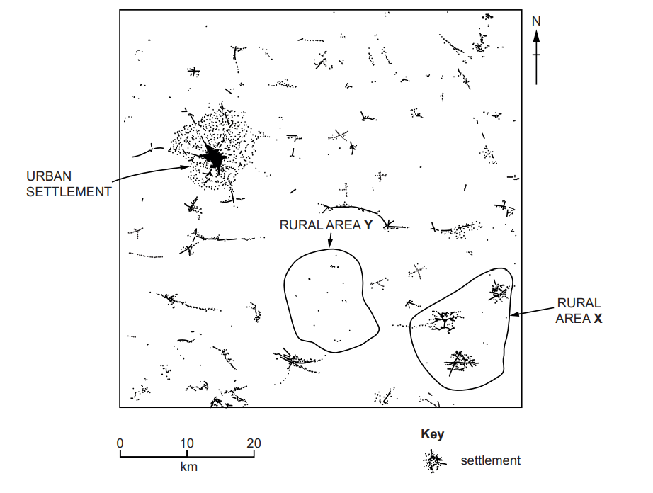

**Fig. 2.1**

What is meant by the term **settlement***?*

[1]

*Source: March 2021 0460/12 Q2A*

**Q19** [2 marks]

Identify the settlement patterns in the **two** rural areas labelled **X** and **Y** in Fig. 2.1. **X **.................................................................................................... **Y **....................................................................................................

[2]

*Source: March 2021 0460/12 Q2AII*

**Q19** [3 marks]

**Extract:**

Study Fig. 2.1, which shows a map of settlements in the Osijek-Baranja region of Croatia (an MEDC in Europe).

Map depicting urban and rural settlements. Urban area on left, rural areas X and Y on the right. Scale bar and north arrow included.

Fig. 2.1

Suggest **three** factors that may have resulted in the growth of linear settlement patterns in parts of the area shown in Fig. 2.1.

[3 marks]

*Source: March 2021 0460/12 Q2AIII*

### Q20 — easy — 1 marks

**Q20** [1 mark]

Study Fig 1, Which shows an area of a settlement

Identify the function of the settlement shown in the photograph below

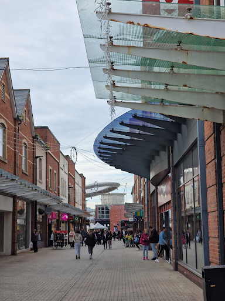

Fig 1 - Settlement

### Q21 — easy — 3 marks

**Q21** [3 marks]

Study Fig. 2.2, which is a map showing the location of Aliano, a settlement in a rural part of Southern Italy (an MEDC in Europe).

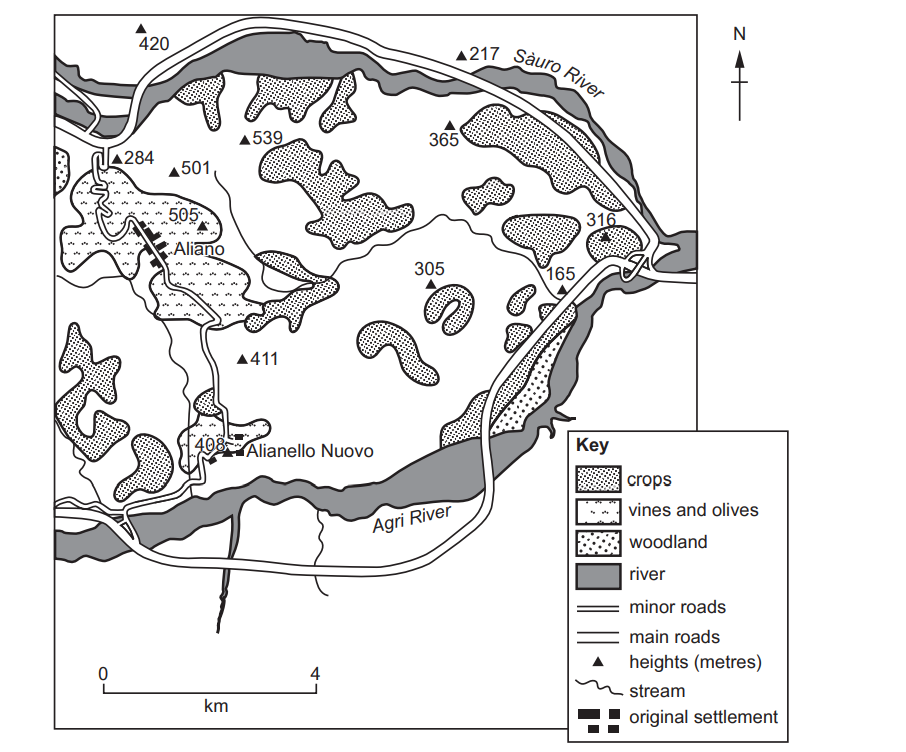

**Fig. 2.2**

Suggest reasons for the original growth of a settlement at Aliano.

*Source: March 2021 0460/12 Q2B*

### Q22 — medium — 8 marks

**Q22** [3 marks]

Study Fig. 2.2 (below), which is a photograph showing an area in Almeria, Spain (an MEDC).

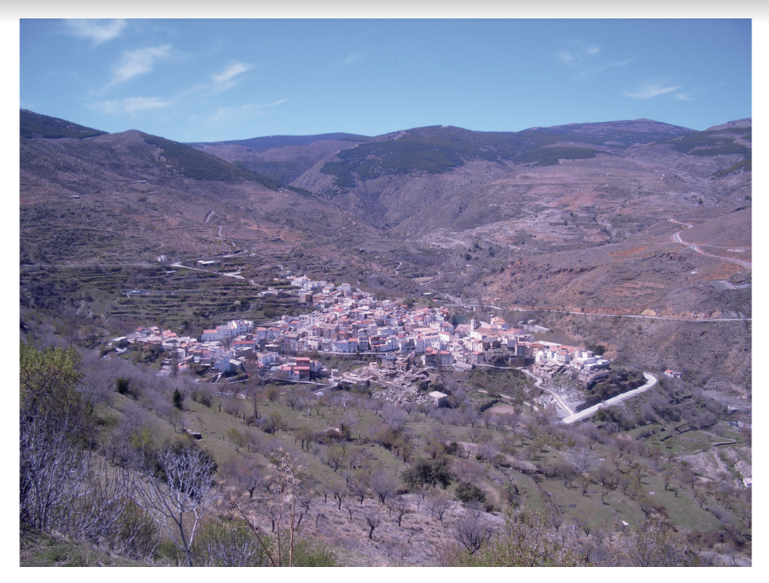

Describe the main features of the settlement shown in Fig. 2.2.

[3]

*Source: Nov 2019 0460/11  Q2B I*

**Q22** [5 marks]

**Extract:**

Study Fig. 2.2 (below), which is a photograph showing an area in Almeria, Spain (an MEDC).

Suggest reasons for the location of the settlement shown in Fig. 2.2.

[5]

*Source: Nov 2019 0460/11  Q2B II*

### Q23 — medium — 8 marks

**Q23** [8 marks]

Study Fig. 2.2, which shows information about the functions of settlements, along with Figs. 2.3, 2.4 and 2.5 (Insert), which are photographs of different settlements.

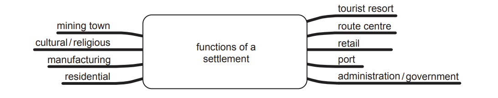

**Fig. 2.2**

(i)

Identify the function of the settlement shown in each of Figs. 2.3, 2.4 and 2.5. For each photograph you should choose a different function listed in Fig. 2.2.

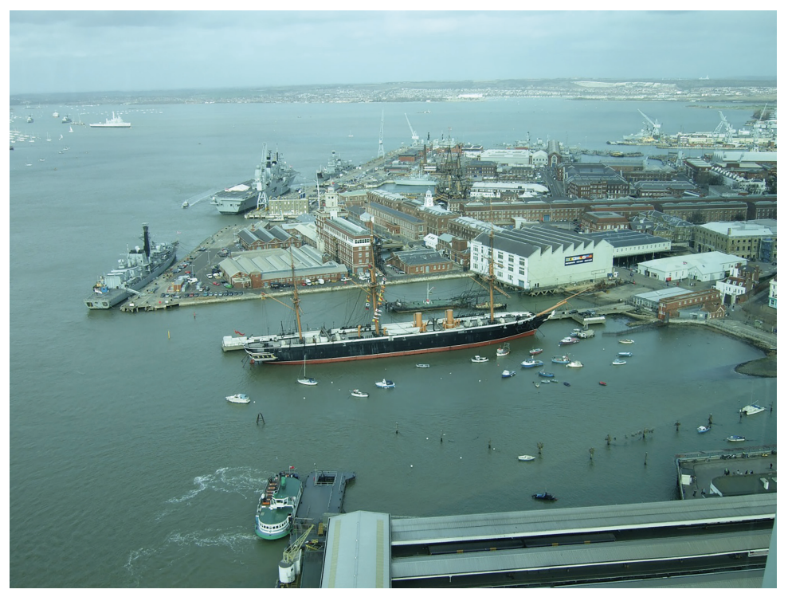

**Fig. 2.3**

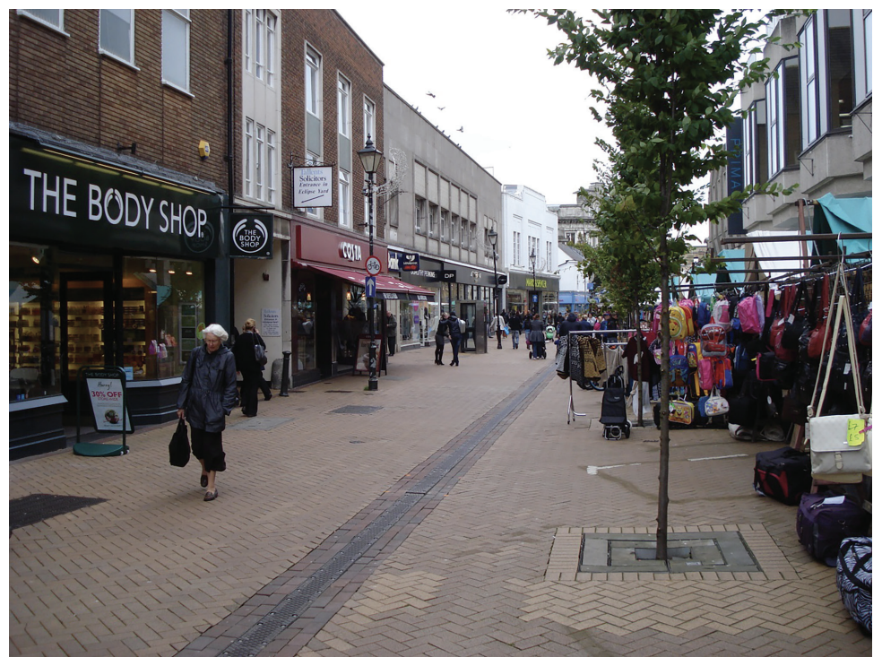

**Fig. 2.4**

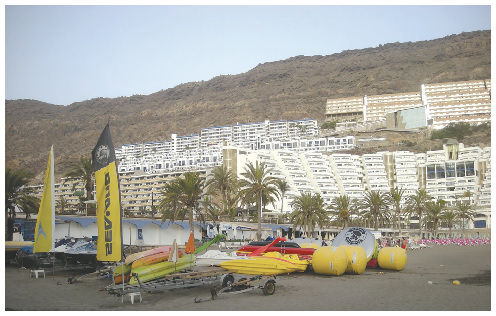

**Fig. 2.5**

[3]

(ii)

Choose one of the functions listed in Fig. 2.2. Explain why some settlements have that function. Function ....................................... Explanation .......................................

[5]

*Source: June 2021 0460/11 Q2B*

### Q24 — medium — 4 marks

**Q24** [4 marks]

Study Fig. 2.1, which shows a map of settlements in the Osijek-Baranja region of Croatia (an MEDC in Europe).

**Fig.2.1**

Suggest likely differences in service provision between the urban and rural settlements shown in Fig. 2.1.

*Source: March 2021 0460/12 Q2A*

### Q25 — easy — 6 marks

**Q25** [3 marks]

Study Fig. 1, which is a diagram showing a settlement hierarchy

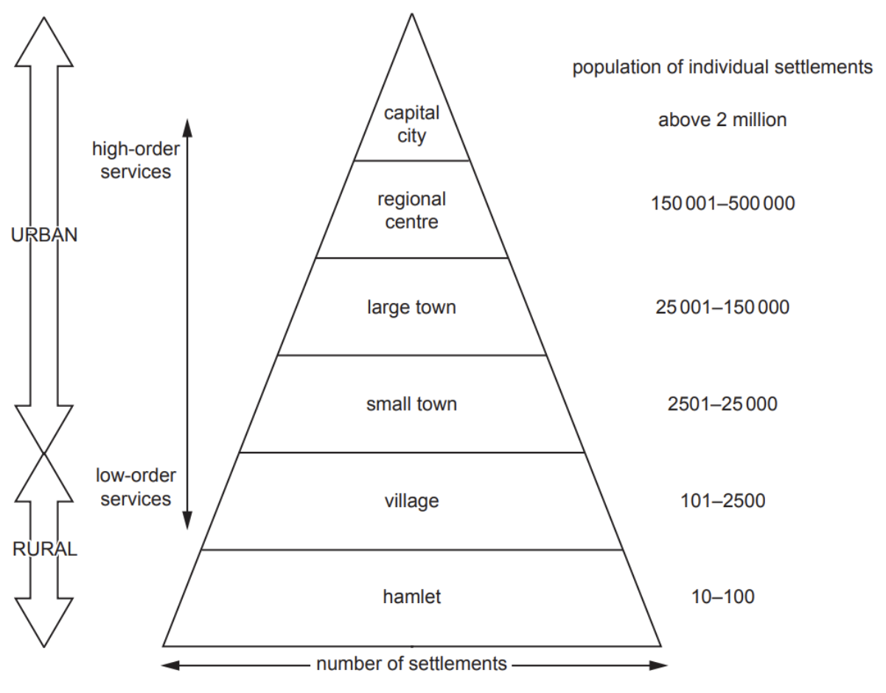

**Fig 1**

Using Fig. 1, identify the type of settlement described in each of the following:

1. a larger settlement with the council head office.
2. a large settlement with a bus and train station and sports team, but no airport.
3. a settlement with services such as groceries, restaurants, and basic stores.

[3]

**Q25** [3 marks]

Explain why villages have low-order services.

[3]

### Q26 — medium — 8 marks

**Q26** [3 marks]

Study **Fig. 2.2**, which is a map of a rural area in north-east England

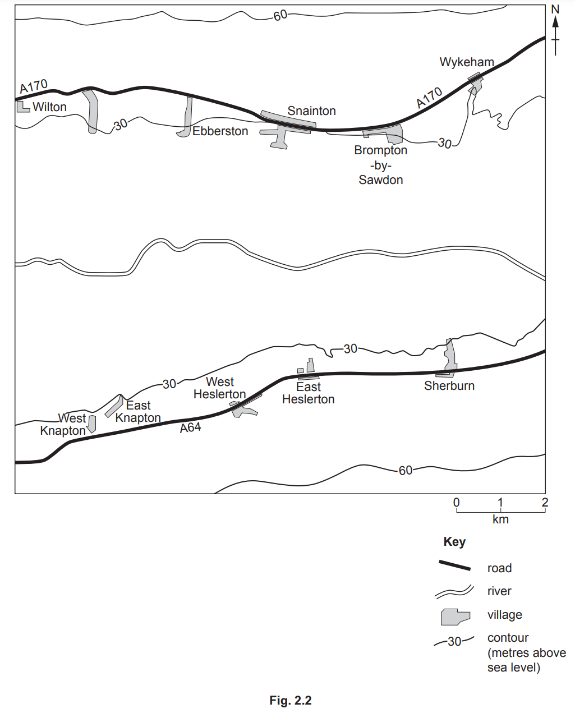

Describe **three **differences between the locations of East Heslerton and Wykeham.

[3]

*Source: Nov 2020 0460/13 Q2BI*

**Q26** [5 marks]

**Extract:**

Study Fig. 2.2, which is a map of a rural area in north-east England

Map showing roads A170 and A64, villages including Snainton and East Heslerton, rivers, and contour lines indicating elevation. Scale is 2 km.

Explain the distribution of settlements in the area shown in Fig. 2.2.

[5]

*Source: Nov 2020  0460/13 Q2B II*

### Q27 — medium — 8 marks

**Q27** [3 marks]

Study Fig. 2.4, which shows information about the relationship between settlement size and the number of services in them.

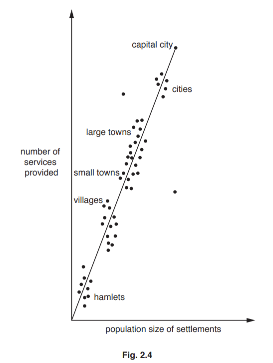

Describe the relationship shown by Fig. 2.4. Refer to different types of settlement in your answer.

[3]

*Source: Nov 2019 0460/12  Q2B I*

**Q27** [5 marks]

Explain why there is a relationship between settlement size and the number of services provided.

[5]

*Source: Nov 2019 0460/12 Q2B II*

### Q28 — medium — 5 marks

**Q28** [5 marks]

Study Figs. 2.2 and 2.3, which show information about Llanelli, an urban settlement in the UK, in 1850 and 2000.

*Fig. 2.2*

*Fig. 2.3*

Using evidence from Figs. 2.2 and 2.3, suggest reasons for Llanelli’s function as an industrial town.

[5]

*Source: Spec 2020 0460/01 Q2BII*

### Q29 — medium — 5 marks

**Q29** [5 marks]

Study Fig. 1, which shows an area of a settlement.

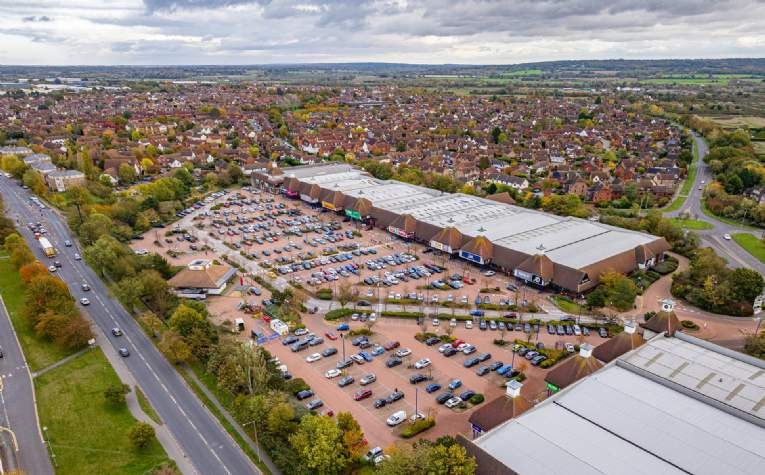

Explain why some settlements have a retail function.

### Q30 — medium — 5 marks

**Q30** [5 marks]

Study Fig. 2.2, which is a map showing the location of Aliano, a settlement in a rural part of Southern Italy (an MEDC in Europe).

**Fig.2.2**

The population of Aliano is now less than 1000 people.

Explain why the population has declined in settlements in some rural areas in MEDCs.

*Source: March 2021 0460/12 Q2B*

### Q31 — medium — 8 marks

**Q31** [3 marks]

Study Fig. 2.2, which is a map showing the rural area around Langali in Tanzania.

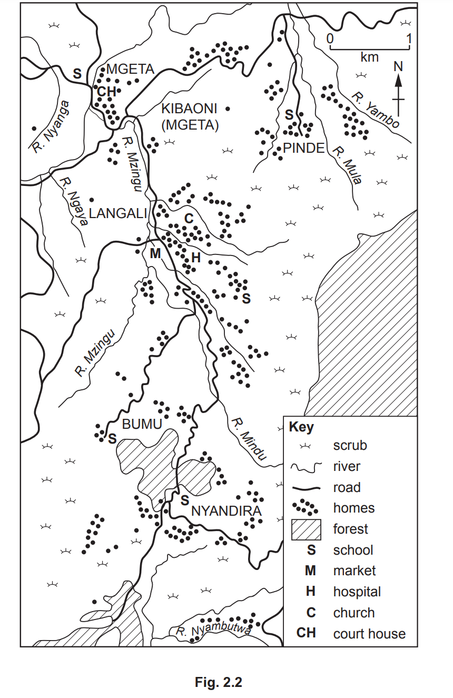

Describe the distribution of homes in the area shown in Fig. 2.2.

[3]

*Source: 2020 May/June 0460/11  Q2B I*

**Q31** [5 marks]

**Extract:**

Study Fig. 2.2, which is a map showing the rural area around Langali in Tanzania.

Suggest reasons for the distribution of homes in the area shown in Fig. 2.2.

[5]

*Source: 2020 May/June 0460/11  Q2B II*

### Q32 — medium — 8 marks

**Q32** [8 marks]

Study Figs. 2.2, 2.3 and 2.4, which are photographs taken in three different urban settlements.

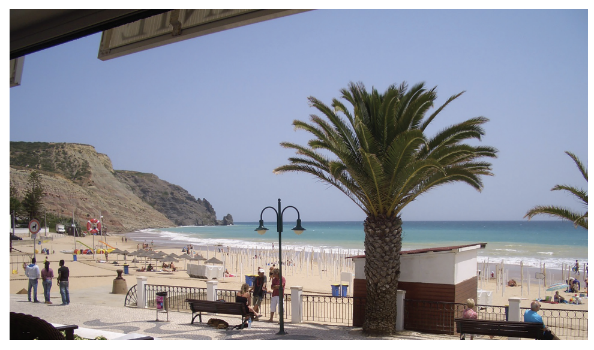

**Fig. 2.2**

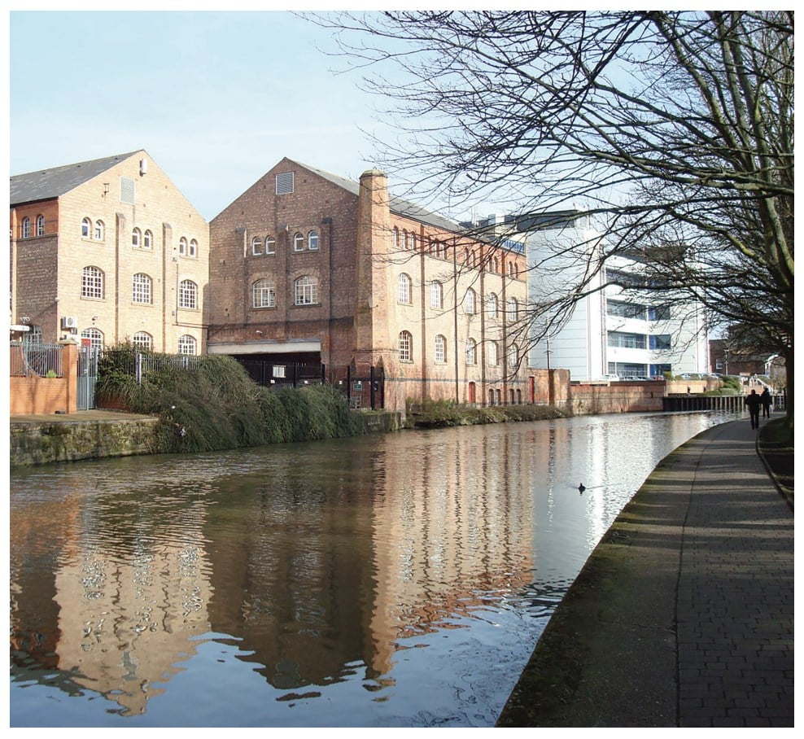

**Fig. 2.3**

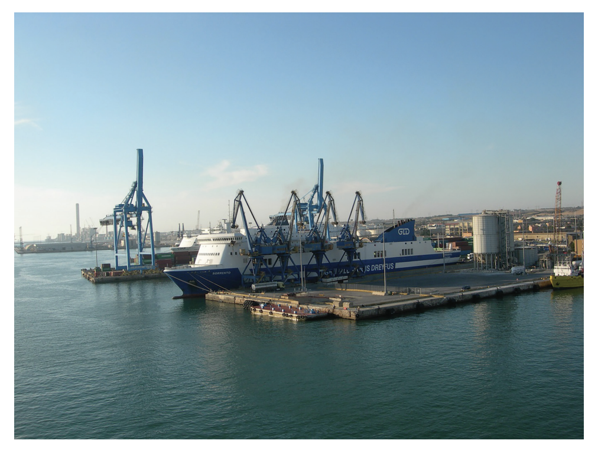

**Fig. 2.4**

(i)

State the functions of the urban settlements which are shown in Figs. 2.2, 2.3 and 2.4.

Fig. 2.2 .................................................................

Fig. 2.3 .................................................................

Fig. 2.4 .................................................................

[3]

(ii)

Explain why there are many high-order shops and services in large urban settlements such as those shown in Figs. 2.2, 2.3 and 2.4.

[5]

*Source: June 2021 0460/13 Q2B*

### Q33 — medium — 13 marks

**Q33** [8 marks]

Study Fig. 2.2, which is a land use map showing part of a CBD.

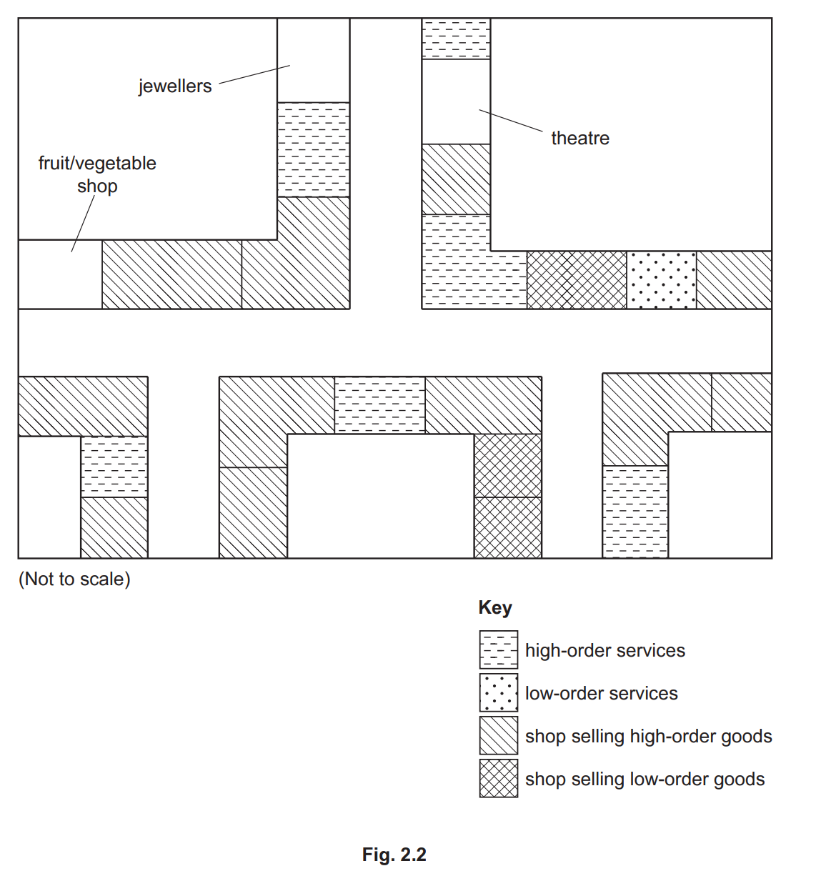

In Fig. 2.2, use the key provided to complete and shade in the following shops and services:

1. jewellers
2. theatre
3. fruit/vegetable shop [3]

*Source: 2020 May/June 0460/13  Q2B I*

**Q33** [5 marks]

Describe the differences between low-order and high-order goods and services.

[5]

*Source:  2020 May/June 0460/13 Q2B II*

