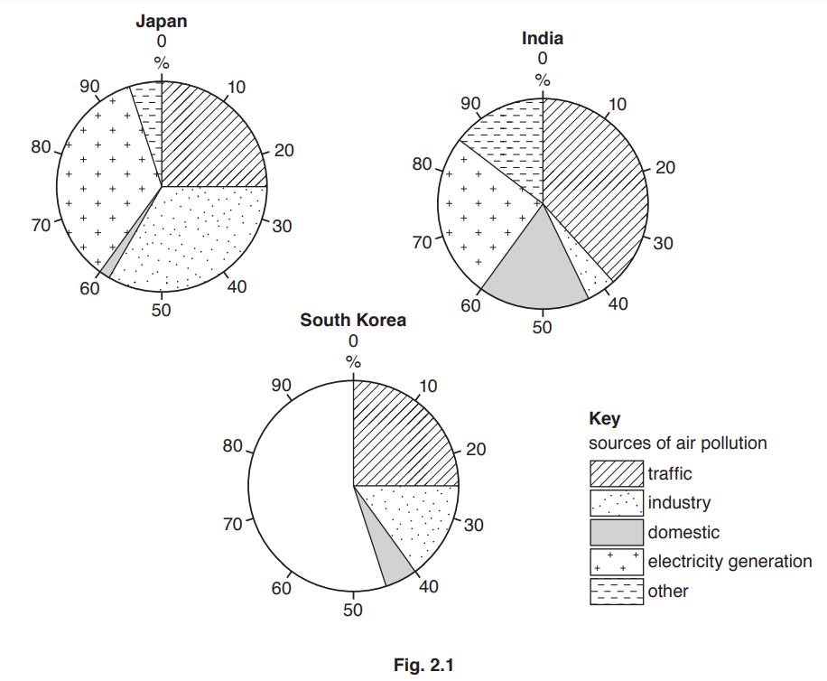
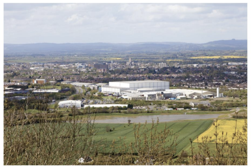
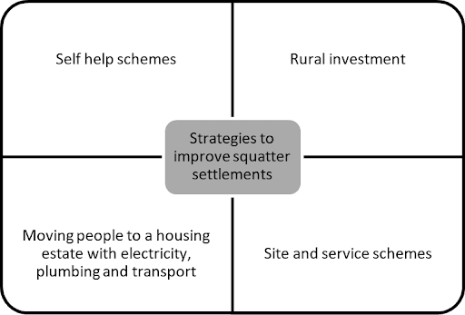
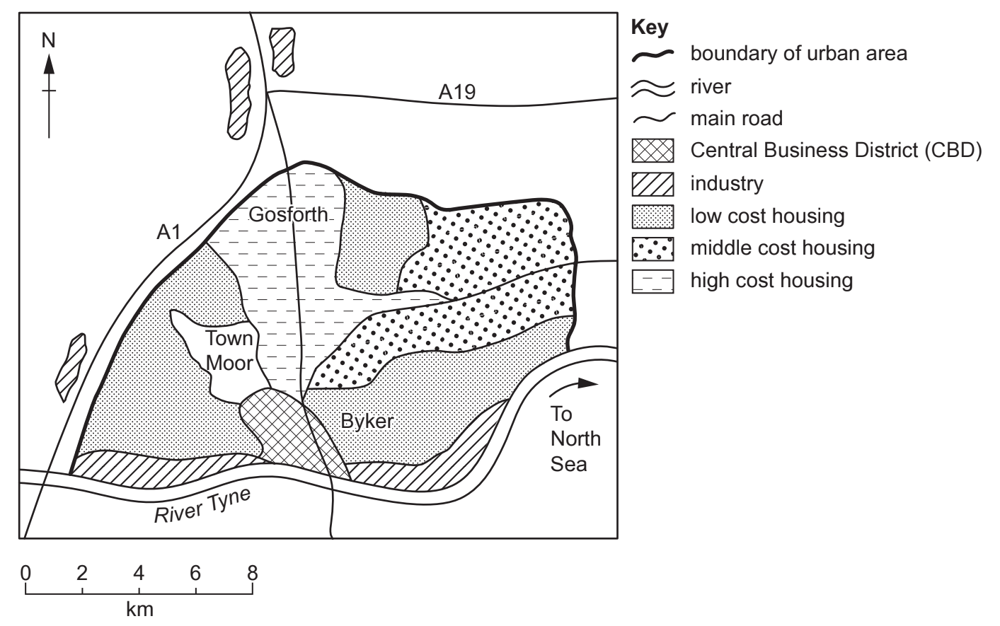
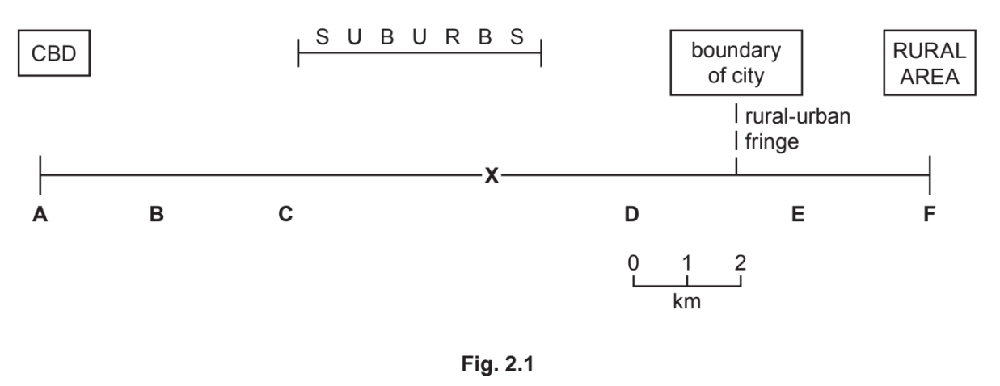
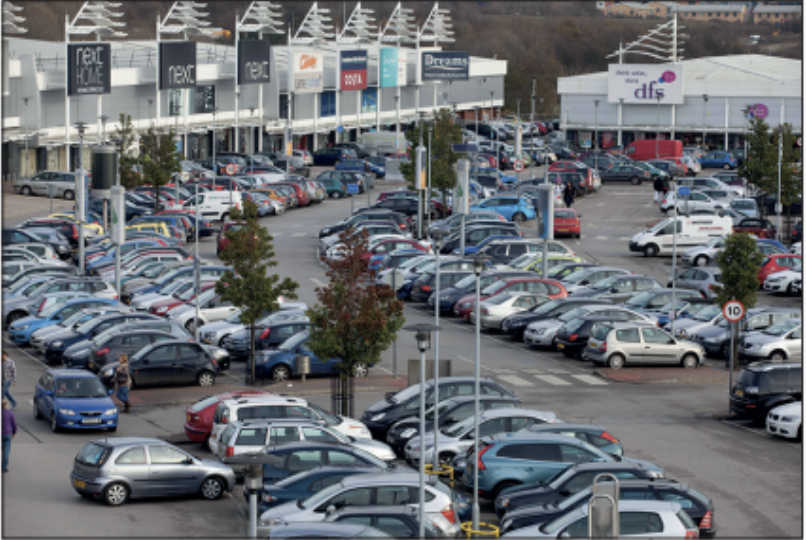
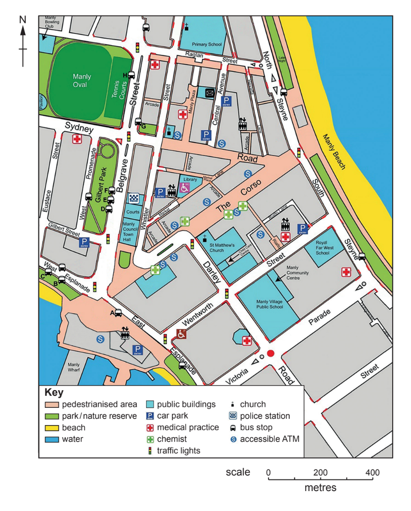
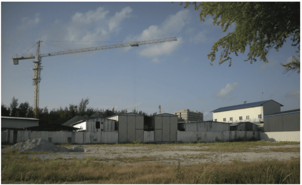
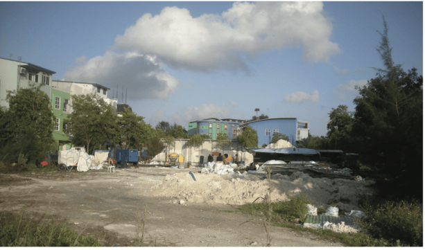

# Exam Questions — Urban Settlements
**Population & Settlement** · Cambridge (CIE) IGCSE geography (0460 & 0976)
> Source: [https://www.savemyexams.com/igcse/geography/cie/20/topic-questions/](https://www.savemyexams.com/igcse/geography/cie/20/topic-questions/) · 19 questions across 1 sets

## Paper 1 (19 questions)

### Q1 — easy — 3 marks

**Q1** [3 marks]

In MEDCs, suburbanisation and counterurbanisation are taking place.

State **three **reasons why people move from cities to the suburbs or rural areas in MEDCs

### Q2 — hard — 7 marks

**Q2** [7 marks]

For a named urban area you have studied, describe and explain the characteristics of the Central Business District (CBD).

Name of urban area ..............

*Source: May/June 2020 0460/12 Q2C*

### Q3 — hard — 7 marks

**Q3** [7 marks]

For a named urban area you have studied, describe the problems of urban sprawl

### Q4 — hard — 7 marks

**Q4** [7 marks]

For an urban area that you have studied, describe how the environment has been improved

### Q5 — hard — 7 marks

**Q5** [7 marks]

For a named urban area you have studied, describe a change in land use and explain why it has caused conflict.

Name of urban area ........................................

*Source: Nov 2019 0460/13 Q2C*

### Q6 — hard — 7 marks

**Q6** [7 marks]

For a named urban area you have studied, describe the solutions to urban sprawl

### Q7 — hard — 7 marks

**Q7** [7 marks]

For a named urban area you have studied, describe how traffic problems have been managed.

Name of urban area .................................................................

*Source: 2020 May/June 0460/13 Q2C*

### Q8 — hard — 7 marks

**Q8** [7 marks]

For an urban area you have studied, describe how traffic congestion is being managed

### Q9 — easy — 10 marks

**Q9** [10 marks]

Study Fig. 2.1, which shows information about the sources of air pollution in urban areas in Japan, India and South Korea.

(i)

What is an *urban* area?

[1]

(ii)

**Complete the graph for South Korea** by plotting the following information:

– electricity generation = 45 %                
– other = 10 %

[2]

(iii)

Identify the main differences between the sources of air pollution in India and Japan.

[3]

(iv)

Explain how air pollution causes problems for people who live in urban areas.

[4]

*Source: Nov 2019 0460/13 Q2A*

### Q10 — easy — 1 marks

**Q10** [1 mark]

Which urban land use zone is shown in the photograph?

A: CBD

B: Inner city

C Rural Urban fringe

### Q11 — easy — 2 marks

**Q11** [2 marks]

Study Fig 1, which shows strategies which can be used to improve squatter settlements.

Fig 1 - Strategies to improve squatter settlements

Choose any** two** of the strategies shown in Fig 1  For each strategy explain its meaning

### Q12 — easy — 10 marks

**Q12** [10 marks]

Study Fig. 2.1, which is a map showing selected land uses in Newcastle-upon-Tyne, an urban area in the UK (an MEDC).

***Figure 2.1 Land use in Newcastle-upon-Tyne***

(i)

Identify the main land use in Newcastle-upon-Tyne. Circle your answer below.

CBD                   housing                  industry

[1]

(ii)

Town Moor is an area of open space. Give **two **reasons why areas of open space are important within urban areas.

[2]

(iii)

Suggest the likely differences between the housing at Byker and Gosforth.

[3]

(iv)

Suggest reasons for the distribution of industry shown in Fig. 2.1.

[4]

*Source: Oct/Nov 2020 0460/11 Q2A*

### Q13 — medium — 4 marks

**Q13** [4 marks]

Increased urbanisation can cause problems in cities.  Explain two problems that can occur.

### Q14 — medium — 10 marks

**Q14** [10 marks]

Study Fig. 2.1, which is a transect across a city in Belgium, an MEDC in Europe.

(i)

What is the distance from the CBD to the boundary of the city?

........................km

[1]

(ii)

Identify from Fig. 2.1 the letter which represents:

– an area of traditional industry where redevelopment is taking place

– an area where a ring road and business park have recently been built on greenfield sites

[2]

(iii)

State **three** likely differences between residential areas **C** and **D** in the MEDC city shown in Fig. 2.1.

[3]

(iv)

Give **two** examples of low-order services which are likely to be located close to residential areas such as in area X in Fig. 2.1.

Explain why many of the services in this area are likely to be low-order services.

Example 1 ......................................

Example 2 .......................................

Explanation .......................................

[4]

*Source: June 2020  0460/12 Q2A*

### Q15 — medium — 4 marks

**Q15** [4 marks]

Study Fig 1, which shows a retail park

**Fig 1 - Retail Park**

With reference to the photograph, suggest why many new shopping centers locate out of town

### Q16 — medium — 8 marks

**Q16** [8 marks]

Study Fig. 2.2, which is information about traffic congestion in Gauteng, a province in South Africa.

**Fig 2.2**

| According to Ismail Vadi, a member of the Executive Council for Roads and Transport in Gauteng, traffic congestion is likely to increase in the next 25 years. The number of vehicles is expected to double and cause average speed in urban areas during peak hours to drop from the current 48 km/h to 10 km/h.  He recently released the Integrated Transport Master Plan (ITMP25), which shows that the province’s population will increase from 12.4 million to 18.7 million and its working population will grow to 8.6 million, increasing rush hour passenger journeys to 25 million a day. ITMP25 plans to prioritise the use of public transport, particularly the rail network, which has lacked investment in the last 20 years. If nothing is done there will be a severe impact on the built and natural environment and the quality of lives of residents will deteriorate. |
|---|

(i)

Using Fig. 2.2 only, give three reasons why urban areas in Gauteng will experience increased traffic congestion.

[3]

(ii)

Using Fig. 2.2 and your own knowledge, suggest how traffic problems could be reduced in urban areas in Gauteng.

[5]

*Source: Nov 2019 0460/13 Q2B*

### Q17 — medium — 10 marks

**Q17** [10 marks]

Study Fig. 2.1 (below), which is a map of the CBD of Manly, Australia (an MEDC).

(i)

What is meant by the initials CBD?

C............................B............................D............................

[1]

(ii)

Identify from Fig. 2.1:

- a street which is pedestrianised
- a form of public transport which serves Manly CBD.

[2]

(iii)

Explain why there are high-rise buildings in the CBD of many urban areas.

[3]

(iv)

Explain why some shops and services are being located in shopping malls in the rural-urban fringe.

[4]

*Source: 2020 May/June 0460/13 Q2A*

### Q18 — medium — 5 marks

**Q18** [5 marks]

Study Fig 1, which shows strategies which can be used to improve squatter settlements.

**Fig 1 - Strategies to improve squatter settlements**

Which strategy shown in Fig 1, do you consider to be the best one to improve the lives of people living in squatter settlements?  Justify your answer by referring to the advantages of the strategy you have chosen. Reference to examples may help your answer

### Q19 — medium — 8 marks

**Q19** [8 marks]

**Figure 2.2**

**Figure 2.3**

Study Figs. 2.2 and 2.3, which are photographs taken in an area which is being developed in the rural-urban fringe a small town.

(i)

Suggest **three** reasons why the rural-urban fringe shown in Figs. 2.2 and 2.3 is being developed.

[3]

(ii)

Suggest why some people may agree with the development of the area shown in Figs. 2.2 and 2.3 but other people may oppose it.

[5]

*Source: Oct/Nov 2020 0460/11 Q2B*

