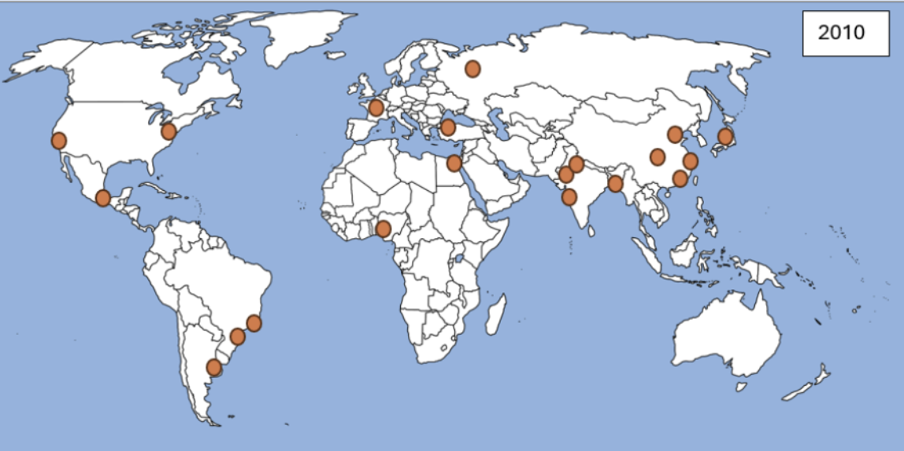
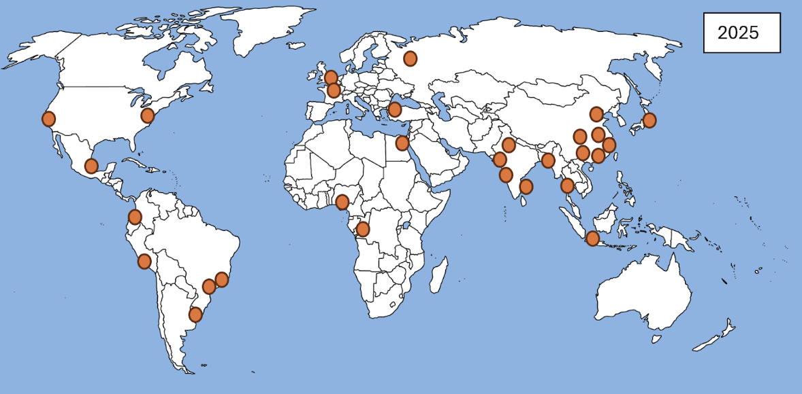
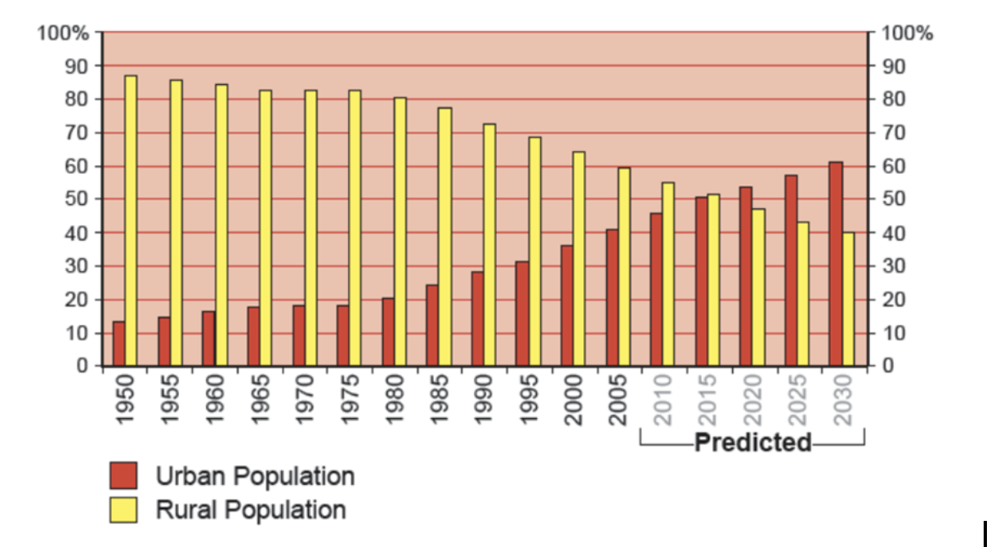
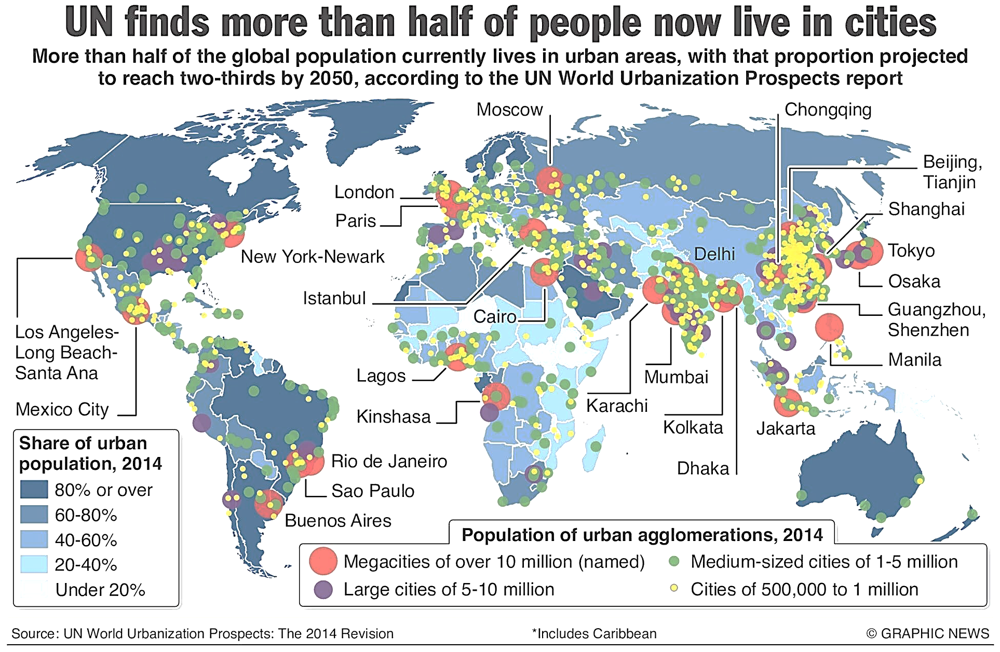
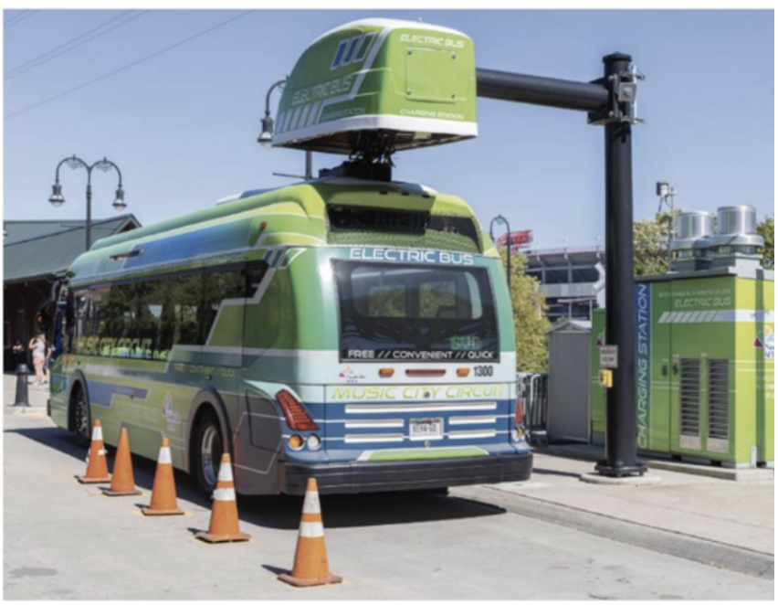
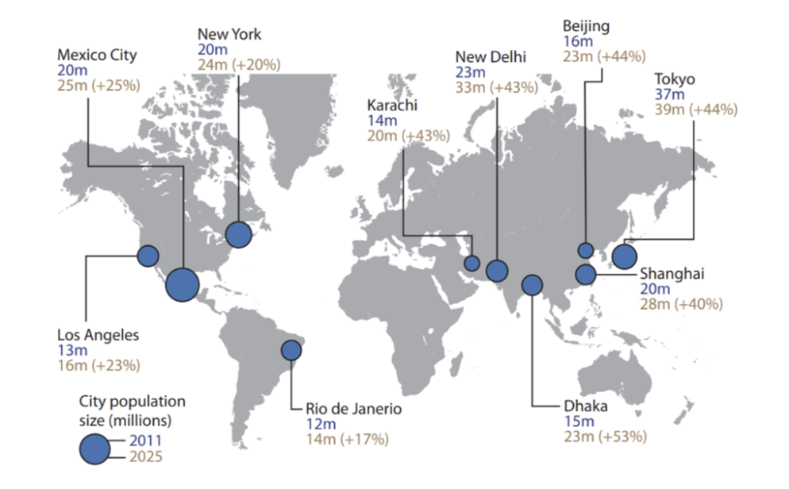
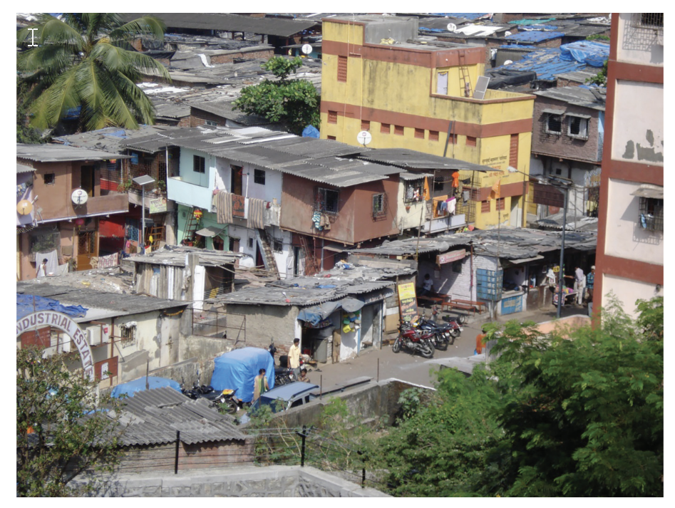
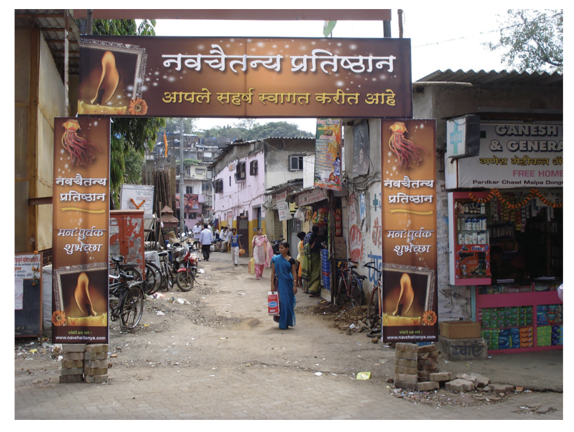
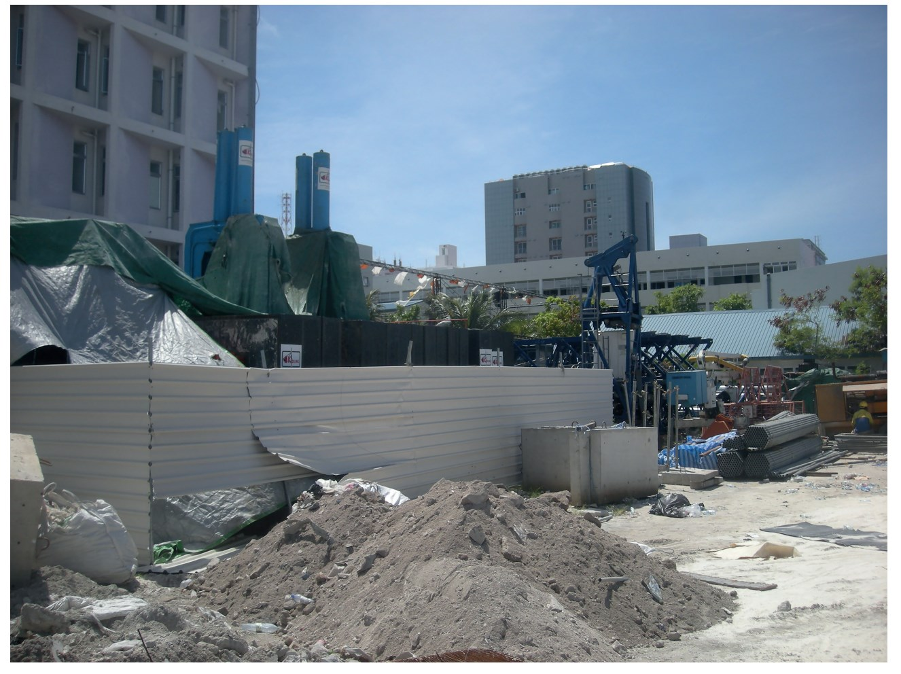

# Exam Questions — Urbanisation
**Population & Settlement** · Cambridge (CIE) IGCSE geography (0460 & 0976)
> Source: [https://www.savemyexams.com/igcse/geography/cie/20/topic-questions/](https://www.savemyexams.com/igcse/geography/cie/20/topic-questions/) · 17 questions across 1 sets

## Paper 1 (17 questions)

### Q1 — medium — 4 marks

**Q1** [4 marks]

Suggest reasons for the location of the megacities in 2025

### Q2 — hard — 7 marks

**Q2** [7 marks]

For a named settlement in a LEDC country, describe the social challenges brought about by urban growth.

### Q3 — medium — 5 marks

**Q3** [5 marks]

Explain the environmental impacts of urban sprawl on the rural–urban fringe.

### Q4 — easy — 6 marks

**Q4** [1 mark]

Fig 2.1 shows the location of megacities around the world in 2010 and 2025.

*Figure 2.1 showing megacities around the world 2010 and 2025*

Complete the following;

A megacity has at least …..........… inhabitants

**Q4** [2 marks]

State **one **push factor that leads to the growth of megacities and **one **pull factor that leads to the growth of megacities.

**Q4** [3 marks]

Describe the changes in the locations of megacities shown in the maps in **Figure 2.1.**

Include data in your answer

### Q5 — hard — 7 marks

**Q5** [7 marks]

For a named urban area you have studied, describe what has been done to reduce the problems caused by urban growth.

Name of urban area ................................

*Source: June 2021 0460/12 Q2C*

### Q6 — hard — 7 marks

**Q6** [7 marks]

For a named urban area you have studied, describe what has been done to improve quality of life in a squatter settlement

### Q7 — hard — 7 marks

**Q7** [7 marks]

For a named urban area, describe the causes of a problem faced by the residents and explain how the authorities in that urban area are attempting to solve it.

Name of urban area .....................

*Source: Nov 2019 0460/12 Q2C*

### Q8 — hard — 7 marks

**Q8** [7 marks]

For an urban area you have studied, describe the impact of urbanisation on people who live there.

### Q9 — easy — 2 marks

**Q9** [2 marks]

Increased urbanisation can cause social and environmental challenges.  Suggest one cause for each:

- Social challenge
- Environmental challenge

### Q10 — easy — 2 marks

**Q10** [2 marks]

Fig 1 - Percentage of China’s population living in urban and rural areas

Study Fig 1, which shows China’s urban and rural population

(i)

What percentage of the population lived in urban areas in 1985?

[1]

(ii)

By how much is China’s urban population predicted to grow between 2020 and 2030?

[1]

### Q11 — easy — 10 marks

**Q11** [10 marks]

Study Fig. 2.1, which shows information about urbanisation.

**Fig. 2.1**

(i)

Define the term *urbanisation.*

[1]

(ii)

Using Fig. 2.1 only, name:

-        the continent which **has **most cities with a population of 10 million or more

-        the continent where there are **no** cities with a population of over 5 million.

[2]

(iii)

Using Fig. 2.1 **only,** describe the distribution of areas with over 80% of their population living in urban areas.

[3]

(iv)

Explain why the percentage of the total population living in cities in LEDCs is likely to continue growing rapidly.

[4]

*Source: June 2021 0460/12 Q2A*

### Q12 — easy — 2 marks

**Q12** [2 marks]

Urban areas have many problems.  Using the photograph Fig 1, explain how this improves an urban area

Fig 1 - An electric bus

### Q13 — easy — 1 marks

**Q13** [1 mark]

| **Country** | **% living in urban areas in 2019** | **% living in urban areas in 2050 (projected)** |
|---|---|---|
| UK | 84 | 90 |
| China | 60 | 80 |
| India | 35 | 53 |
| Nigeria | 51 | 70 |

Which country will have the greatest increase in the % living in urban areas?

### Q14 — easy — 6 marks

**Q14** [6 marks]

Study Fig 1, which shows the world's megacities

**Fig 1**

(i)

Define a megacity

[1]

(ii)

Describe the location of the megacities shown on the map

[3]

(iii)

Suggest two reasons for the location of the megacities shown

[2]

### Q15 — medium — 8 marks

**Q15** [8 marks]

Study Figs. 2.2 and 2.3, which are photographs taken in part of the urban area of Mumbai, India (an LEDC).

**Fig. 2.2**

**Fig. 2.3**

(i)

Describe **three** features of the buildings in the area shown in **Fig. 2.2.**

1 ............................................... 
2 ............................................... 
3 ...............................................

[3]

(ii)

Explain why the quality of life of some people who have moved to areas like those shown in **both Figs. 2.2 and 2.3** may be worse than in the rural areas they moved from.

[5]

*Source: June 2021 0460/12 Q2B*

### Q16 — medium — 8 marks

**Q16** [8 marks]

Study Fig. 2.2 (below), which is a photograph of part of an urban area in an LEDC which is being redeveloped.

(i)

Describe **three** features of the buildings in the redevelopment shown in Fig. 2.2.

[3]

(ii)

The land being redeveloped in Fig. 2.2 was previously used for a squatter settlement.

Suggest how this change in land use is likely to have both benefits and problems.

[5]

*Source: June 2020 0460/12 Q2B*

### Q17 — medium — 4 marks

**Q17** [4 marks]

Describe the problems caused when urban areas expand into rural areas
