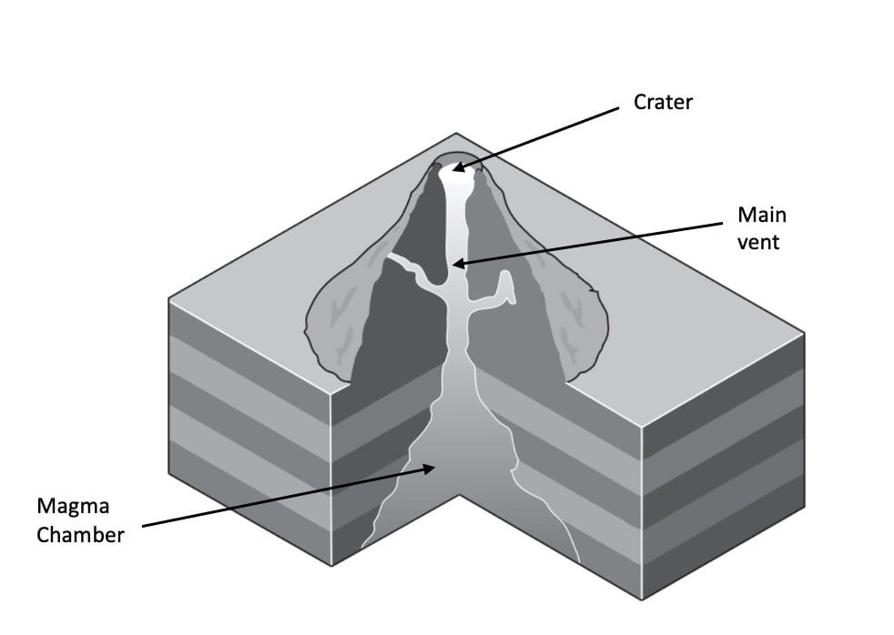
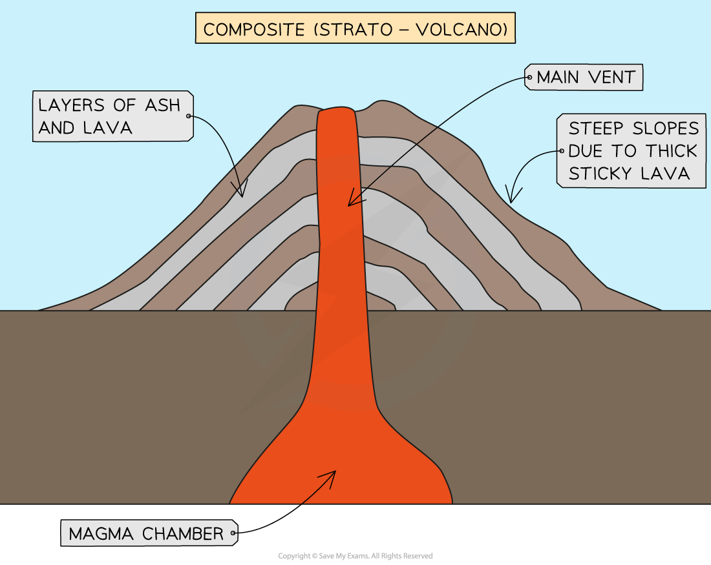

# Mark Schemes — Earthquakes & Volcanoes
**The Natural Environment** · Cambridge (CIE) IGCSE geography (0460 & 0976)

## Paper 1 (32 questions)

### Q1
Levels marking

| **Level 1 (1–3 marks)** | **Level 2 (4–6 marks)** | **Level 3 (7 marks)** |
|---|---|---|
| Statements including limited detail which explain the causes of a volcanic eruption. | Uses named example. More developed statements which explain the causes of a volcanic eruption.  **Max 5 **if no named or inappropriate example  Note: Names of plates is place specific but not L2. | Comprehensive and accurate statements including place specific information. |

<u>Content Guide:</u>

Answers are likely to refer to: 
Location on plate boundary; 
Plate movement; 
Destructive margin or constructive margin processes; Subduction; 
Pressure; Release of magma; 
Hot spots;

<u>Place specific reference is likely to consist of:</u> 
Locational details; 
Specific details of the areas affected/date; 
Plate names; etc.

<u>Place specific examples include:</u>

- *Locational details - plate boundaries, La Palma*
- *Specific details -*

  - *Volcanoes occur at hot spots, divergent and convergent boundaries *
  - *There are 33 volcanoes across the Canary Islands and 10 on La Palma*
  - *The Cumbre Viejo volcano on La Palma began to erupt in September 2021*
  - *The eruption was 2 or 3 on the VEI*
- *La Palma and the other Canary Islands are located on the African plate but they are not on a plate boundary. In September 2021 the Cumbre Viejo volcano began to erupt. The eruption lasted until December 2021 and the eruptions reached 2 and 3 on the VEI. No one was killed in the eruptions but many homes and other buildings were destroyed and 7000 people were evacuated.*
- *The causes of the volcanic eruption is that the volcano lies on a hot spot. A hot spot occurs where a magma plume breaks through the crust. A magma plume is an area of superheated material. As the plate moves eastwards away from the mid Atlantic trench the plate passes over the plume. This creates an archipelago, which is a chain of islands.*

### Q2
| **Indicative content** | **General guidance** |
|---|---|
| Advantages could include  - Minerals/mining - Tourism - Agriculture - Geothermal power  Leading to job creation, increased crop yield  Risks could include  - Eruptions – lava and ash - Tsunamis - Landslides - Lahars - Earthquakes  Resulting in loss of life, loss of farmland, reduction of income, costs of repair | The command word ‘explain’ requires you to say why something is an advantage or a risk  7 mark questions are level marked rather than point marked.  You should refer to specific locations and examples, you need to do more than name a volcano or plate boundary  If you do not name an example you can only score 5 marks maximum  The top level is achieved by including  comprehensive and accurate statements including place specific reference |

| **Model Answer** | **Commentary** |
|---|---|
| Iceland is a tectonically active area where the Eurasian and North American plate are moving apart.  The capital of Iceland, Reykjavik has a population of 140,000.  The movement of plates creates hazards including earthquakes, volcanoes and jokulhaups.  In 2010 the E15 volcano erupted causing a huge ash cloud, 7 miles into the atmosphere.  This caused widespread economic damage as European airspace was closed.  Some locals experienced health problems from breathing the ash.  Although no one died in the eruption, heat from the eruption melted ice water and this caused local rivers to flood roads.  Hundreds of people had to be evacuated.  Crops and livestock can be killed as a result of the ash and this severely impacted the livelihood of farmers. In Iceland, sheep farmers were affected most.  Iceland is a HIC and so can predict eruptions, meaning that many people are willing to live close to the volcano and plate boundary since risks are thought to be minimal. Every year, 2 million tourists visit Iceland to see the geysers e.g. Strokkur, to tour the volcanos and bathe in the Blue Lagoon geothermal pool.  Tourism is an important industry, generating \$3.5 billion/year and this is an advantage of living in tectonically active areas because jobs are created for locals.  There are 5 geothermal plants in Iceland and geothermal energy generates 66% of Iceland’s energy.  The plentiful supply of energy means that it is cheaper for locals.  Land close to volcanoes is fertile due to the lava and ash.  This means that crop yields will be higher, often 3 times higher, than areas far away. Tectonically active areas do pose a risk but with improved monitoring and prediction, many locals believe that the advantages of living in a tectonically active area outweigh the disadvantages.  Tectonically active areas do pose a risk but with improved monitoring and prediction, many locals believe that the advantages of living in a tectonically active area outweigh the disadvantages. | **Marks awarded 7/7**  This is one possible way to answer this question – your answer does not have to be exactly the same  There must be a specific reference to the places, advantages and disadvantages  This answer scores level 7 because it includes:  - Detailed statements - Place specific examples |

### Q3
Levels marking

| **Level 1 (1–3 marks)** | **Level 2 (4–6 marks)** | **Level 3 (7 marks)** |
|---|---|---|
| Statements including limited detail which explain the causes of an  earthquake. | Uses named example. More developed statements which explain the causes of an earthquake.  (**Max 5 **if no named or inappropriate example) | Uses named example. Comprehensive and accurate statements which explain the causes of an earthquake, including some place specific reference. |

<u>Content Guide:</u>

Answers can refer to conservative or destructive margin: Location on plate boundary 
Convection currents 
Plate movement (slide alongside each other/together) 
Pressure build up friction pressure release
Seismic waves/vibrations travel through crust, etc.

<u>Place specific reference is likely to consist of:</u> 
Locational details/named areas within earthquake zone,
Plate names (if not credited for L2) 
Specific details of earthquake/date/time/magnitude 
Statistical information

<u>Place specific examples include:</u>

- *Locational details - plate boundaries, Nepal *
- *Specific details -*

  - *Earthquakes occur at all plate boundaries*
  - *Shallow earthquakes are more likely at divergent boundaries*
  - *Stronger earthquakes tend to occur at convergent, collision and transform boundaries*
  - *Most earthquakes occur around the Pacific Ring of Fire - approximately 90%*
- *Examples of paragraphs which could be included in an answer to achieve Level 3:*

  - *Earthquakes occur as a result of plate movement. As the plates move friction is created and they can stick. This is particularly the case at convergent, collision and transform boundaries where the plates are moving past or towards each other. Nepal is on a collision boundary which means that two continental plates, the Indo-Australian and Eurasian plates, are moving towards each other. In April 2015 a 7.8 earthquake occurred, the epicentre was at Gorkha to the north west of Kathmandu the capital.*
  - *As the plates move towards each other they stick and pressure builds. Eventually the plates jolt free and the energy that has built up is released as seismic waves travelling through the crust. This is the earthquake*

<u>Content Guide:</u> 
Answers can refer to conservative or destructive margin: Location on plate boundary 
Convection currents 
Plate movement (slide alongside each other/together) 
Pressure build up friction pressure release 
Seismic waves/vibrations travel through crust, etc.

<u>Place specific reference is likely to consist of:</u> 
Locational details/named areas within earthquake zone, 
Plate names (if not credited for L2) 
Specific details of earthquake/date/time/magnitude 
Statistical information

**Note:** 
Conservative margin = 2 × L1 
Subduction = L1 
Conservative margin where plates slide past each other = L2 
The boundary of plates X and Y (plate names must correctly match example) = L2 
Subduction of plate X under plate Y (as above)

**Note:** Only credit plate names once as development for L2

### Q4
Levels marking

| **Level 1 (1–3 marks)** | **Level 2 (4–6 marks)** | **Level 3 (7 marks)** |
|---|---|---|
| Statements including limited detail which explain the causes of a volcanic eruption. | Uses named example. More developed statements which explain the causes of a volcanic eruption.  **Max 5 **if no named or inappropriate example  Note: Names of plates is place specific but not L2. | Comprehensive and accurate statements including place specific information. |

<u>Content Guide:</u>

Answers can refer to constructive or destructive margin: Location on plate boundary 
Convection currents 
Plate movement (apart or together) 
Subduction 
Destruction of plate 
Build up of magma 
Pressure 
Creation of gap 
Release of magma etc.

<u>Place specific reference is likely to consist of:</u> 
Locational details/named areas within/around the volcano, Specific details of eruption/date/time/magnitude 
Statistical information deaths 
Do not accept plate names as place specific, as allowed within L2 statements.

<u>Place specific examples include:</u>

- *Locational details - plate boundaries, Mount Merapi, Indonesia*
- *Specific details -*

  - *Volcanoes occur at hot spots, divergent and convergent boundaries *
  - *Indonesia has over 120 volcanoes, approximately 80 are considered to be active*
  - *Erupted October - November 2010*
  - *VEI 4*
- *Examples of paragraphs which could be included in an answer to achieve Level 3:*

  - *The volcano of Mount Merapi is located on the island of Java, Indonesia. Indonesia has around 80 active volcanoes and is one of the most tectonically active countries in the world*
  - *From October until November 2010 Mount Merapi erupted peaking at 4 on the VEI. Over 350 people died as a result of the eruption and 350,000 people were displaced*
  - *Indonesia lies on a destructive plate boundary where the Eurasian plate and the Indo-Australian plates come together. The oceanic plate (Indo-Australian plate) is heavier and subducts below the continental plate (Eurasian plate)*
  - *At the subduction zone there is friction and heat which destroys the crust forming magma. As the magma builds up it rises to the surface through cracks in the crust. As pressure builds the magma erupts as lava on the surface causing a volcanic eruption*

### Q5
Levels marking

| **Level 1 (1–3 marks)** | **Level 2 (4–6 marks)** | **Level 3 (7 marks)** |
|---|---|---|
| Statements including limited detail which explain the causes of a volcanic eruption. | Uses named example. More developed statements which explain the causes of a volcanic eruption.  **Max 5 **if no named or inappropriate example  Note: Names of plates is place specific but not L2. | Comprehensive and accurate statements including place specific information. |

<u>Content Guide:</u>

Answers can refer to constructive or destructive margin: Location on plate boundary 
Plate movement (apart or together) 
Subduction 
Destruction of plate 
Build up of magma 
Pressure 
Creation of gap 
Release of magma etc.

<u>Place specific reference is likely to consist of:</u> 
Locational details/named areas within/around the volcano, Specific details of eruption/date/time/magnitude 
Statistical information deaths

<u>Place specific examples include:</u>

- *Locational details - plate boundaries, Mount Merapi, Indonesia*
- *Specific details -*

  - *Volcanoes occur at hot spots, divergent and convergent boundaries *
  - *Indonesia has over 120 volcanoes, approximately 80 are considered to be active*
  - *Erupted October - November 2010*
  - *VEI 4*

- *Examples of paragraphs which could be included in an answer to achieve Level 3:*

  - *The volcano of Mount Merapi is located on the island of Java, Indonesia. Indonesia has around 80 active volcanoes and is one of the most tectonically active countries in the world*
  - *From October until November 2010 Mount Merapi erupted peaking at 4 on the VEI. Over 350 people died as a result of the eruption and 350,000 people were displaced*
  - *Indonesia lies on a destructive plate boundary where the Eurasian plate and the Indo-Australian plates come together. The oceanic plate (Indo-Australian plate) is heavier and subducts below the continental plate (Eurasian plate)*
  - *At the subduction zone there is friction and heat which destroys the crust forming magma. As the magma builds up it rises to the surface through cracks in the crust. As pressure builds the magma erupts as lava on the surface causing a volcanic eruption*

### Q6
Levels marking

| **Level 1 (1–3 marks)** | **Level 2 (4–6 marks)** | **Level 3 (7 marks)** |
|---|---|---|
| Statements including limited detail which explain the causes of an  earthquake. | Uses named example. More developed statements which explain the causes of an earthquake.  (**Max 5 **if no named or inappropriate example) | Uses named example. Comprehensive and accurate statements which explain the causes of an earthquake, including some place specific reference. |

<u>Content Guide:</u>

Answers are likely to refer to: 
Plate movement, 
On/close to plate boundaries/lines of weakness/where plates meet; 
Where plates move (in relation to each other)/one under another/subduction/slide past; 
Friction / plates stick; 
Pressure build up/tension; 
Energy released/plates jerk apart Etc.

<u>Place specific reference is likely to consist of:</u> 
Locational details, 
Date / time / Richter Scale measurement named plates

<u>Place specific examples include:</u>

- *Locational details - plate boundaries, Nepal *
- *Specific details -*

  - *Earthquakes occur at all plate boundaries*
  - *Shallow earthquakes are more likely at divergent boundaries*
  - *Stronger earthquakes tend to occur at convergent, collision and transform boundaries*
  - *Most earthquakes occur around the Pacific Ring of Fire - approximately 90%*
- *Examples of paragraphs which could be included in an answer to achieve Level 3:*

  - *Earthquakes occur as a result of plate movement. As the plates move friction is created and they can stick. This is particularly the case at convergent, collision and transform boundaries where the plates are moving past or towards each other. Nepal is on a collision boundary which means that two continental plates, the Indo-Australian and Eurasian plates, are moving towards each other. In April 2015 a 7.8 earthquake occurred, the epicentre was at Gorkha to the north west of Kathmandu the capital.*
  - *As the plates move towards each other they stick and pressure builds. Eventually the plates jolt free and the energy that has built up is released as seismic waves travelling through the crust. This is the earthquake*

### Q7
Levels marking

| **Level 1 (1–3 marks)** | **Level 2 (4–6 marks)** | **Level 3 (7 marks)** |
|---|---|---|
| Statements including limited detail which explain the causes of an  earthquake. | Uses named example. More developed statements which explain the causes of an earthquake.  (**Max 5 **if no named or inappropriate example) | Uses named example. Comprehensive and accurate statements which explain the causes of an earthquake, including some place specific reference. |

<u>Content Guide:</u>

Answers are likely to refer to: 
Location on plate boundary (do not accept constructive margin) Plate movement, 
Friction, 
Build up of pressure, 
Pressure release/jolting, 
Shockwaves/vibrations, etc.

Place specific reference is likely to consist of: 
Locational details/dates/times, 
Names of plates, etc.

<u>Place specific examples include:</u>

- *Locational details - plate boundaries, Nepal *
- *Specific details -*

  - *Earthquakes occur at all plate boundaries*
  - *Shallow earthquakes are more likely at divergent boundaries*
  - *Stronger earthquakes tend to occur at convergent, collision and transform boundaries*
  - *Most earthquakes occur around the Pacific Ring of Fire - approximately 90%*
- *Examples of paragraphs which could be included in an answer to achieve Level 3:*

  - *Earthquakes occur as a result of plate movement. As the plates move friction is created and they can stick. This is particularly the case at convergent, collision and transform boundaries where the plates are moving past or towards each other. Nepal is on a collision boundary which means that two continental plates, the Indo-Australian and Eurasian plates, are moving towards each other. In April 2015 a 7.8 earthquake occurred, the epicentre was at Gorkha to the north west of Kathmandu the capital.*
  - *As the plates move towards each other they stick and pressure builds. Eventually the plates jolt free and the energy that has built up is released as seismic waves travelling through the crust. This is the earthquake*

### Q8
(i)

Ideas such as the flow from Mokuaweoweo: 
Did not last for as many days **[1]** 
Travelled a shorter distance/10 km cf 25 km/covered a smaller area **[1]** 
Did not descend as far down/to 3500 metres cf 900 metres **[1]** Does not split into several flows like the one from Pu`u Ula`ula **[1]**

- *The answer can be written as the flow from Pu`u Ula`ula instead but no double credit *
- *This means that you cannot write the flow from Mokuaweoweo did not last for many days and then write that the flow from Pu`u Ula`ula lasted for days and get marks for both*

Both flows were in a north east/east north east direction  **[1] **Mokuaweoweo flows to SW/SSW as well as NE/ENE but Pu`u Ula`ula only flows NE/ENE/ Mokuaweoweo spread in two directions rather than one  **[1]**

- *Similarities can be included in the answer but they have to mention both eruptions not just one*

### Q9
(i)

A fracture of the rocks which make up the earth’s crust **[1]**

- *Large slowly moving slabs of rock are tectonic plates*
- *The point at the surface of the Earth where the earthquake occurs is the epicentre*
- *Waves that transmit the energy released by an earthquake are seismic waves*

(ii)

P = epicenter **[1]**
Q = focus **[1]**

(iii)

Ideas such as:

On/close to plate boundaries/lines of weakness/where plates meet **[1]**
Where plates slide past each other **[1]**
Friction/plates stick **[1]**
Pressure build up/tension **[1]**
Energy released/plates jerk apart **[1]**
Vibrations/seismic waves released **[1]**

- *It is important in this answer to only use the information from fig 3.1 *
- *Marks will not be awarded for information about earthquakes at convergent or divergent boundaries*

### Q10
(i)

The distance underground(how deep) the earthquake occurs/starts/rocks break/source of seismic waves

How deep the point where the earthquake starts is  **[1]** 
The point under the surface where the seismic waves start 
**[1]**
How deep the earthquake is  **[1]**

- *In this answer it is essential to reword the terms depth and focus - you can use the term deep *

(ii)

Depth of focus becomes deeper/increases (further to the east/further from plate boundary/closer to B/from A-B/from ocean to land/from left to right)  **[1]** 
E.g. less than 50 <u>km</u> in the west <u>and</u> 100 <u>km</u> further east  **[1] **– or other statistics which illustrate change in depth

- *The answer to this question needs to show that the depth of focus increases with distance from the plate boundary, though this can be described in a number of ways*

(iii)

Ideas such as:
Plates converge  **[1]** 
Nazca/oceanic Plate/crust is subducted  **[1]** 
Because it is denser/heavier  **[1]** 
The plate sinks more/it gets deeper/subduction zone gets deeper towards the east/as it moves to the east/from A–B  **[1]**

- *For this question it is important to understand he plate boundary is not a single line but a zone*
- *The line shows the point on the surface where the subduction zone starts, the depth of the subduction zone increases with distance from that line*

### Q11
(i)

Graph completion (no need to shade) **[1]**

- *Remember it is important to be accurate when completing graphs*
- *In this task each of the small squares is 1%*

(ii)

Ideas such as:

(Lack of) shelter **[1]**
(Shortage of) food **[1]**

- *Remember to use the graph to answer the question*
- *Marks will not be awarded for general answers not taken from the graph*

### Q12
(i)

Diagram C **[1]**

- *A conservative plate boundary occurs where two plates are moving past each other *

(ii)

Ideas such as:
Fluid/thin/runny lava **[1]**
Low (height to width ratio) **[1]**
Gentle slopes **[1]**
Gentle eruption **[1]**
Frequent eruptions **[1]**

- *Shield volcanoes are low and flat they have gentle slopes because the lava is thin and runny *
- *The runny lava means that the eruptions tend to be more gentle *

### Q13
Ideas such as: 
Clustered** [1]** 
Linear/lines ** [1]** 
Close to plate boundaries ** [1]** 
Around Pacific Ring of Fire ** [1]** 
More in northern hemisphere/North of equator ** [1] **E.g. South East/Southern Asia ** [1]** 
Middle East ** [1]** 
Southern Europe ** [1]** 
Caribbean/Central America ** [1]** 
Western South America ** [1]** 
Mediterranean ** [1]**

- *Country names can be used in this answer but only 1 mark will be awarded for country names. For example, if you mention Italy and Turkey only one mark would be awarded not 2*
- *When writing about distribution it is key to use the following:*

  - *Continent names or parts of continents*
  - *Known areas/regions 'Middle East'*
  - *Proximity to the equator*
  - *Compass directions*
  - *Known locations 'Ring of Fire'*

### Q14
Ideas such as:

People need clean water supply/water to drink/to live/survive/prevent dehydration **[1]**
Water/sewage pipes/water treatment stations will be cut off/damaged/broken **[1]** 
No running water **[1]**
People cannot wash/bath/shower **[1]**
No flush toilets **[1] s**ewage will spill out/contaminate (water supplies/area) **[1]**
Disease/germs from dirty/polluted water or people sick from dirty **[1] w**ater/waterborne diseases/examples of such as cholera **[1]**

- *Remember for a three mark question it is important to develop the answer to gain full marks *
- *It is not sufficient to say 'for hygiene' the answer needs to link hygiene to keeping people free from disease *

### Q15
Any three ideas from:

Kobe earthquake killed fewer people/Port au Prince killed more people
Kobe earthquake injured fewer people/Port au Prince injured more people 
Kobe earthquake made fewer people homeless/Port au Prince made more people homeless
Kobe earthquake caused more (financial) damage/Port au Prince EQ caused less (financial) damage** **
Do not accept comparative statistics without description, however ‘only’ is acceptable 
XXX killed in Port au Prince but only YYY in Kobe

- *In this answer it is essential to make a comparison between the two earthquakes using the terms 'more' or 'fewer'*
- *The places must be named, marks will not be awarded for stating the 'first earthquake' or the 'MEDC earthquake' *

**[3 marks]**

### Q16
(i)

Ideas such as: Bookshelf/wardrobe/closet/table/cupboard/furniture bolted to wall/doors closed** [1]** 
Light attached directly to ceiling/not hanging/will not swing** [1]** Bed not close to/under window/bookshelf ** [1]** Table/chair not on wheels etc ** [1]**

Wardrobe/light/wardrobe/bookshelf less likely to fall ** [1]** 
Bed not near anything that falls ** [1]** 
Table and chair won’t move ** [1]**

- *It is important in this answer to use information from B to show how this is safer*
- *Answers which only include evidence from room A  such as 'the bed is under objects which may fall' will not be awarded marks *

### Q17
Labels on Fig. 3.2** [3]**

### Q18
| **Indicative content** | **General guidance** |
|---|---|
| Destructive (1) or Convergent **[1]** | The command word ‘state’ means that you should just name the type of boundary.  In this case the arrows are shown moving towards each other and so this is a destructive/convergent boundary |

### Q19
(i)

Ideas such as:

Stronger/more powerful/higher on Richter scale in Indonesia/or statistics **[1]**
Shallower focus in Indonesia/or statistics **[1]**
It caused a tsunami in Indonesia/a tsunami did not occur in Venezuela **[1]**

- *It is important in this answer to only use the information from Fig 3.2 *
- *Marks for general statements about factors which cause more deaths such as the quality of buildings will not be awarded marks*
- *Try to include information from all parts of fig 3.2 do not focus on just on aspect such as the tsunami *

### Q20
(i)

Constructive/divergent **[1]**

- *In a constructive/divergent boundary the plates are moving apart/away from each other*

(ii)

X = convection currents **[1]**
Y = direction of plate movement **[1]**

(iii)

Hazards such as:

Lava  **[1]**
Ash **[1]**
Volcanic bombs **[1]**
(Poisonous) Fumes/gases  **[1]**

- *Remember to only use information given on figure 4.1 in your answer*
- *General answers about volcanic hazards will not be awarded marks*

### Q21
(i)

Divergent **[1]**

- *Conservative boundaries occur where plates move past each other*
- *Convergent boundaries are where plates move towards one another*

(ii)

Ideas such as;
(Edges of) the plates/crust destroyed **[1]**
Rock is melted/turned into magma/lava/goes into the mantle/crumpled **[1]**

- *This question refers to the destruction of the Earth's crust in the subduction zone not the destruction of the environment and/or buildings*

(iii)

Ideas such as:
Gap/space created/opens up **[1]**
Magma/lava fills the gap/passes through cracks/fissures **[1]** Magma/lava rises to surface/escapes/is released **[1]**
New land/islands/ocean floor/crust created/lava solidifies **[1]**

- *Remember in this answer to mention that once the lava erupts, on to the surface through the gaps created as the plates move apart, it cools and it is this which forms the volcano*

### Q22
Ideas such as:

Money from/work in tourist industry (or example) **[1]** 
Fertile soils/high yields of crops/good for farming **[1]** 
Scenic beauty **[1]** 
To study volcanoes **[1]** 
Geothermal power/renewable energy/hot water **[1]** Quarrying/mining/ extraction of minerals (or example – sulphur/diamonds, building materials) **[1]**

### Q23
Ideas such as: 
Work in tourist industry **[1] e**.g. Tourist guides / selling souvenirs **[1]**
Mining / quarrying **[1] e**.g. Pumice/Sulphur **[1]** 
Fertile soils **[1] **high yields of crops **[1]** 
Geothermal power **[1]** 
Renewable energy supplies **[1]**
Hot springs **[1]**

- *This answer needs to include four opportunities that volcanoes provide or two developed reasons that people live near volcanoes despite the dangers*
- *These opportunities need to be related to the volcano and not just generic such as 'nice environment to live'*

### Q24
(i)

Pressure on living space **[1]** 
Cannot afford to move **[1]** 
Friends/family live there **[1]**
Lived there all their lives/born there/sentimental attachment **[1]** Work is there **[1]**
Education is there **[1]**
Confidence in precautions **[1]**
Prepared to take the risk/earthquakes don’t happen very often/don’t know when or if an earthquake will occur [**1]**

Benefits of living in areas where earthquakes occur;
Cheap land/housing **[1]**
Study earthquakes **[1]**

- *Most of the reasons why people live in areas vulnerable to earthquakes are reasons that they can't or choose not to move away. However, there are also benefits of living in areas vulnerable to earthquakes*

### Q25
Ideas such as:

Variation in quality/cost of buildings/poorer quality buildings in LEDCs  **[1]** 
Variation in emergency services/rescue teams/health care/will be better in MEDCs **[1]** depth of focus/shallow depth of focus more destructive **[1]** time of day/if people are at work/in schools there is likely to be less deaths **[1]** 
Variation in population density/if high there will be more impact **[1]** 
Variation in amount of education/awareness about earthquake survival/evacuation plans/First Aid kits **[1]** 
Variation in access to area/roads (for rescue services) **[1]** Variation in availability of international aid **[1]**
Variation in access to food/water **[1]**
Variation in ability to monitor/study faultline movements **[1]** Impacts will depends on physical characteristics of location or e.g. impacts will be worse if settlements are built on former lake beds/sediment/on a steep slope **[1]**
There may be more impacts if an earthquake causes a tsunami/availability of tsunami warning/tsunami defences  **[1]**

- *In this answer it is essential that the variation between locations is the focus *
- *The answer does not need to give the impact, just explain what the variation is*

### Q26
Ideas such as:

Observe/monitor the volcano **[1]** 
Create an exclusion zone around the volcano **[1]** 
Evacuation **[1]** 
Spray water on lava **[1]**
 Dig diversion channels for lava **[1]** 
Strengthen roofs of houses **[1]** 
Wear masks to protect from ash **[1]** 
Train emergency services **[1]**
 Educate residents on action to take if the volcano erupts **[1]** Store emergency provisions **[1]**

- *Ensure that in this answer you only refer to volcanic eruptions and not all tectonic hazards*
- *The answer needs to give four separate strategies that can be used*

### Q27
Ideas such as: 
Build deep/stronger/sturdier foundations/base **[1]** Reinforce/use concrete/bricks for buildings/walls/roofs **[1]** 
Use metal/steel/aluminium beams **[1]** Use diagonal bracing **[1]** Flexible building materials **[1]** 
Use dampers/shock absorbers in base of building **[1]** 
Computers controlled weights/counter balances on roof/weight on roof **[1]** 
Automatic window shutters **[1]** 
Shatter proof/strong/reinforced glass **[1]**
Use fire resistant materials **[1]**
Build low building/do not build high rise **[1]**
Use automatic cutoff for gas pipes/electricity cables **[1]**

- *During an earthquake it is the collapse of buildings which causes most deaths and injuries*
- *In this answer you need to outline four separate ways in which buildings can be designed to reduce the chances of them collapsing, catching fire or sections breaking off*

### Q28
Ideas such as:
Volcanoes give warnings/earthquakes cannot be so easily predicted **[1]** 
People have time to evacuate/escape before volcano erupts/lava moves slowly/earthquakes happen quickly **[1]** Earthquakes can affect a large area/volcano only affects those areas close to it **[1]**
Relatively few people live close enough to volcanoes to be affected by them/earthquakes can affect very densely populated areas **[1]**
Earthquakes are much more common than volcanic eruptions **[1]**

- *This answer can be five separate points or a couple of developed answers*

### Q29
One mark for showing typical strato-volcano shape (pyramid/triangle shape with steep sides) [**1]**

Three further marks to be awarded for labelling of features such as: 
Crater **[1]** 
Parasitic cone/secondary cone [**1]** 
Layers of lava and ash **[1]** 
Magma chamber [**1****]** 
Vent/(magma) pipe [**1]**

- *Diagrams in the exam should be basic outlines*
- *The key to gaining marks is to label them accurately and clearly*

### Q30
(i)

Ideas such as:
Volcanoes give warnings/earthquakes cannot be so easily predicted **[1] **so people have time to evacuate/escape before volcano erupts/lava moves slowly **[1 or Dev]** 
Earthquakes can affect a large area/volcano only affects those areas close to it **[1]** 
Relatively few people live close enough to volcanoes to be affected by them/earthquakes can affect very densely populated areas **[1]** 
Earthquakes are much more common than volcanic eruptions **[1]**

- *This answer can be five separate points or a couple of developed answers*

### Q31
(i)

Ideas such as:

Variation in quality/cost of buildings/poorer quality buildings in LEDCs **[1] e.**g. deeper foundations/pyramid shape etc  **[1]** Variation in emergency services/rescue teams **[1]** 
Variation in health care/will be better in MEDCs **[1]** 
Variation in amount of education/awareness about earthquake survival/earthquake drills **[1]** 
Variation in evacuation planning/evacuation routes **[1]** MEDC more likely to use better land use zoning/not build strategic buildings on fault lines **[1]** 
Variation in access to area/roads (for rescue services) **[1]** Variation in access to food/water/1st Aid kits **[1]** 
Variation in ability to monitor/study faultline movements **[1]** MEDCs may have tsunami warning system/tsunami defences **[1]**

- *Remember to either refer to the variation for example 'there is variation in how prepared emergency/rescue teams are' or refer specifically to MEDCs/LEDCs for example 'in MEDCs the emergency/rescue services are better prepared'*
- *The answer requires 4 examples of why earthquakes cause more deaths/injuries in LEDCs*

(ii)

Ideas such as:
Employment **[1]**
Children are educated there **[1]** 
They have lived there all their lives/birthplace/ sentimental/ tradition **[1]** 
Friends and family live in the areas **[1]**
Pressure on land/nowhere else to go **[1]**
Cant afford to move **[1]**
Confidence in protection methods **[1]**
Don’t think it will happen **[1]**

- *These need to be reasons relating to earthquakes rather than tectonic hazards generally*

### Q32
(i)

Ideas such as: 
Some areas have more/bigger/stronger/higher intensity earthquakes **[1]**
Dependent on proximity to a plate boundary/only found on plate boundaries/fewer deaths away from plate boundaries/no deaths away from plate boundaries **[1]** 
Whether boundary is destructive/conservative/constructive (impacts numbers)/the type of movement taking place at the plate boundary **[1]** 
Some areas are more densely populated/higher population/more live there/higher density buildings **[1]** 
Some countries can invest in earthquake proofing/earthquake proof buildings or examples of Lack of/quality of rescue services **[1]** 
Quality of health care **[1]**
Earthquake planning/education about what to do in an earthquake/Earthquake Day or other examples **[1]** Monitoring/warning/evacuation planning/creating safe areas (to go to in the event of an earthquake **[1]**
Some cause tsunamis **[1]**

- *This answer can either focus on the areas where deaths are highest or where there are fewer deaths *
- *There is no need to compare the two*
