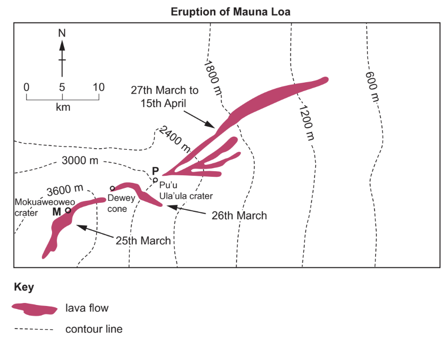
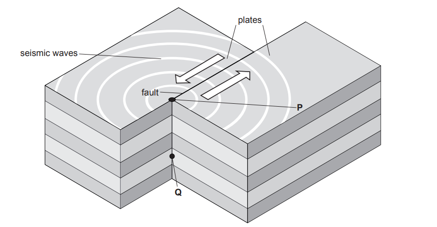
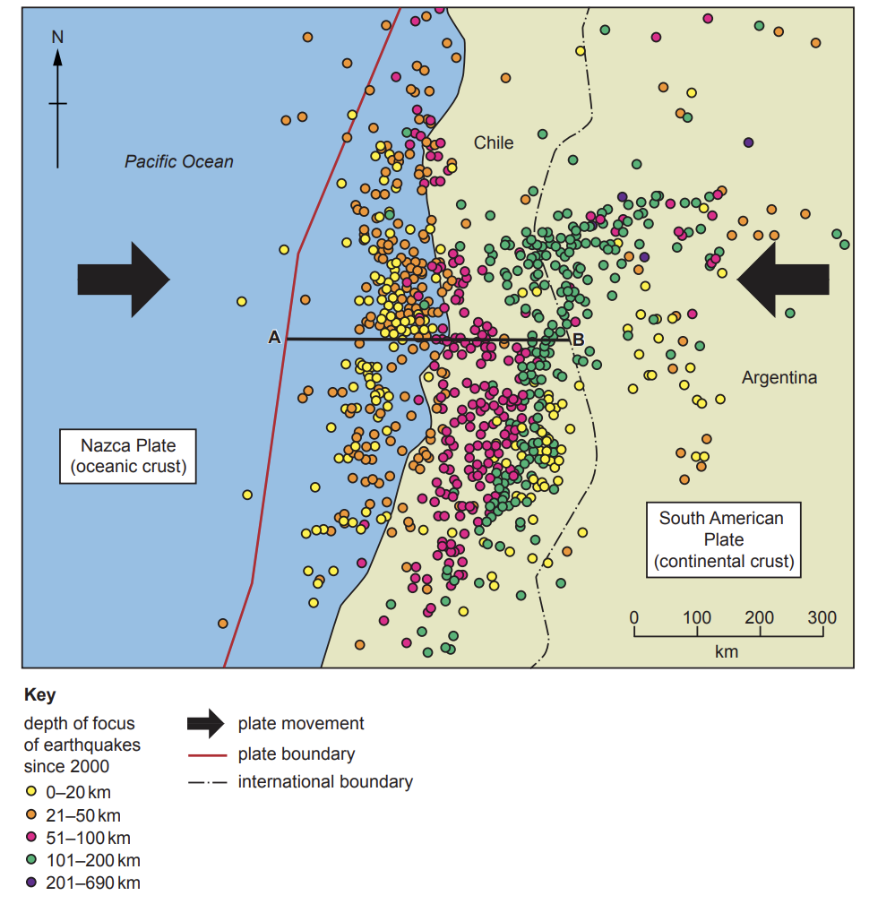
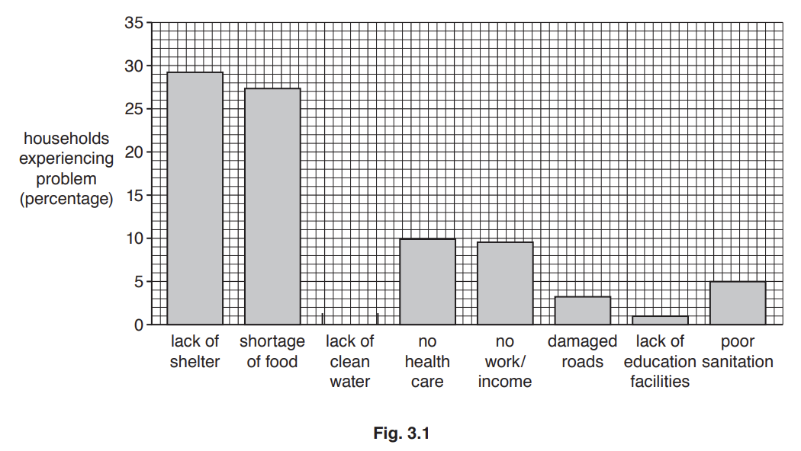
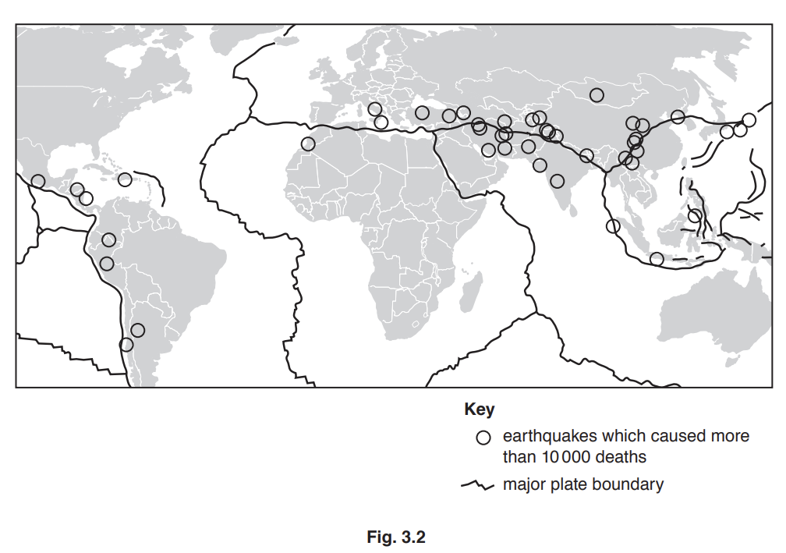
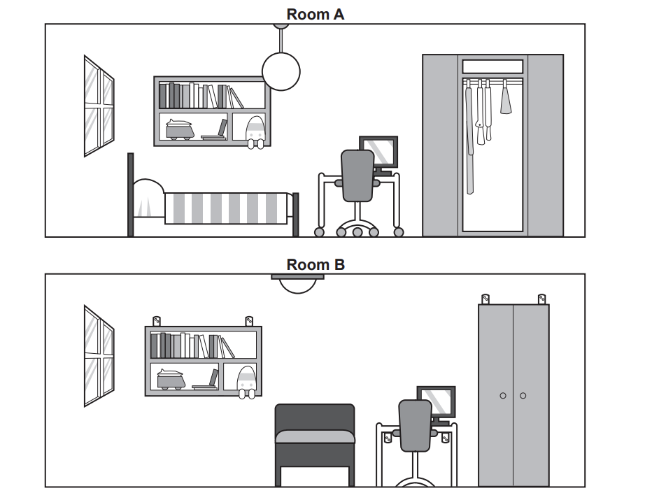
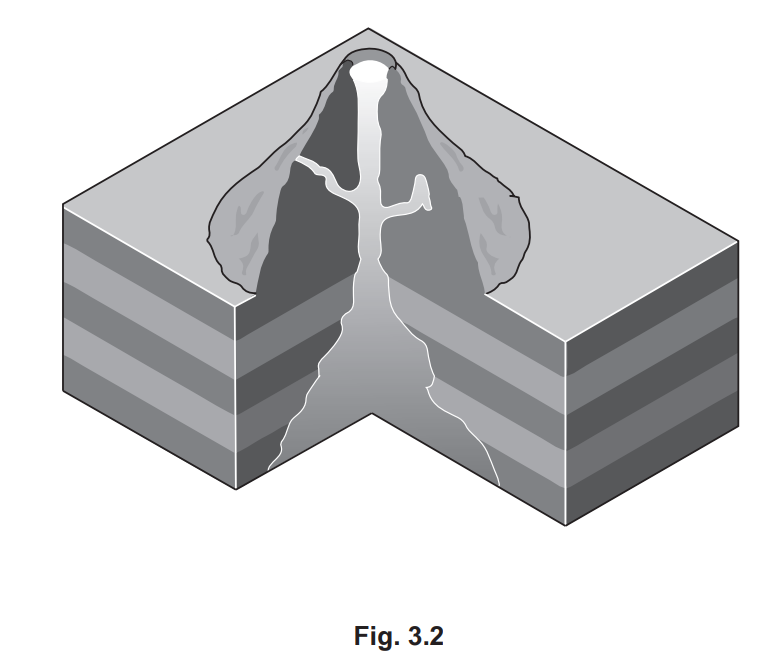
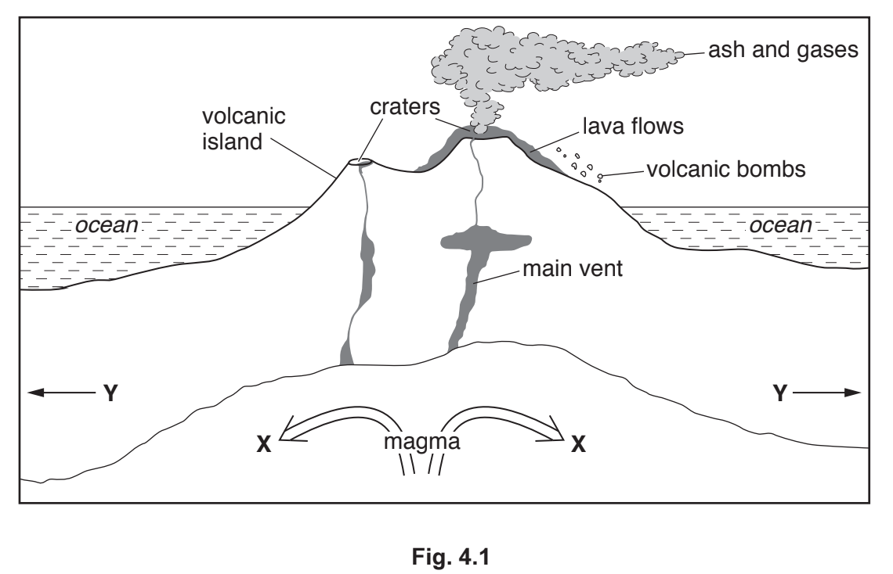
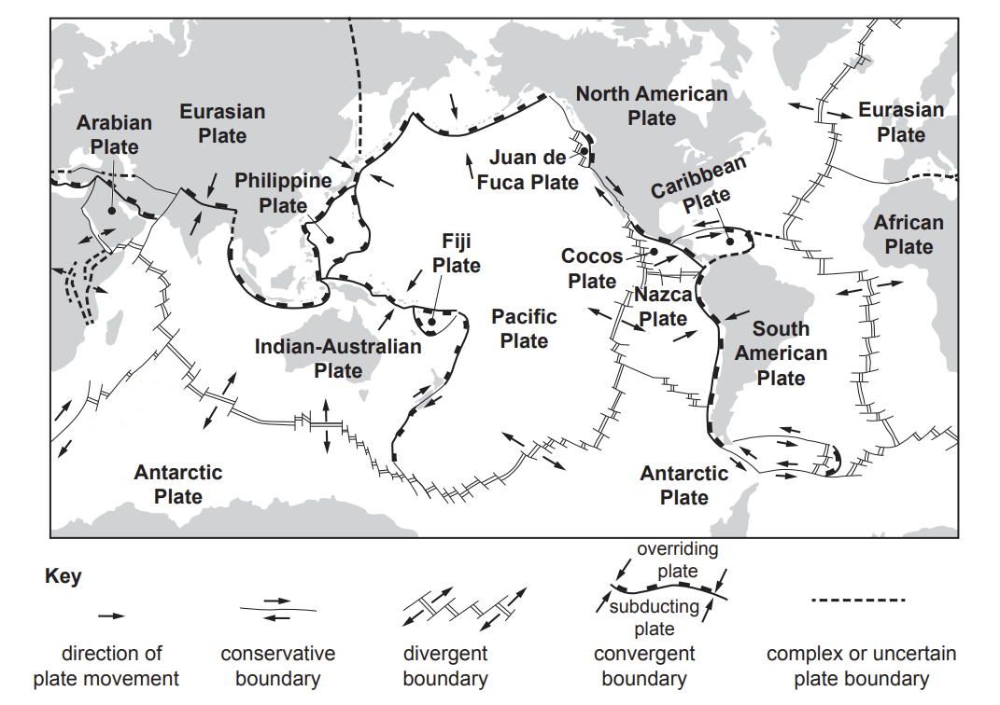

# Exam Questions — Earthquakes & Volcanoes
**The Natural Environment** · Cambridge (CIE) IGCSE geography (0460 & 0976)
> Source: [https://www.savemyexams.com/igcse/geography/cie/20/topic-questions/](https://www.savemyexams.com/igcse/geography/cie/20/topic-questions/) · 32 questions across 1 sets

## Paper 1 (32 questions)

### Q1 — hard — 7 marks

**Q1** [7 marks]

Volcanic eruptions are another tectonic hazard.

For a named volcano you have studied, explain the causes of a volcanic eruption.

Name of volcano ..................................................

*Source: Nov 2019 0460/13 Q3C*

### Q2 — hard — 7 marks

**Q2** [7 marks]

With reference to a place you have studied, explain how living close to a tectonically active area can have advantages as well as risks

### Q3 — hard — 7 marks

**Q3** [7 marks]

For a named area which you have studied, explain the causes of an **earthquake**.

Name of area ..............................

*Source: June 2021 0460/12 Q3C*

### Q4 — hard — 7 marks

**Q4** [7 marks]

Explain the causes of the eruption of a named **volcano. **

Name of volcano ....................................

*Source: June 2021 0460/13 Q4C*

### Q5 — hard — 7 marks

**Q5** [7 marks]

For a named **volcano** you have studied, explain the causes of an eruption.

Name of volcano ................................................

*Source: March 2021 0460/12 Q3C*

### Q6 — hard — 7 marks

**Q6** [7 marks]

Explain why an earthquake occurred in a named area you have studied.

Name of area ..............................................

*Source: 2020 May/June 0460/11 Q3C*

### Q7 — hard — 7 marks

**Q7** [7 marks]

For a named example you have studied, explain the causes of an earthquake.

Name of example ..........................................

*Source: Nov 2020 0460/12 Q4C*

### Q8 — easy — 3 marks

**Q8** [3 marks]

Study Fig. 3.2, which shows information about an eruption of Mauna Loa volcano in Hawaii.

**Fig. 3.2**

Compare the flow of lava from Mokuaweoweo crater (labelled **M** on Fig. 3.2) with the flow from Pu’u Ula’ula crater (labelled **P**).

*Source: June 2021 0460/12 Q3B*

### Q9 — easy — 6 marks

**Q9** [6 marks]

Study Fig. 3.1, which shows information about an earthquake.

**Fig.3.1**

(i)

Tick (**✓**) the **one** statement in the table below which is the correct definition of a fault.

|   | **tick (✓)** |
|---|---|
| a fracture of the rocks that make up the Earth’s crust |   |
| large slowly moving slabs of rock |   |
| the point at the surface of the Earth where the earthquake occurs |   |
| waves that transmit the energy released by an earthquake |   |

[1]

(ii)

Identify the points labelled **P **and **Q** in Fig. 3.1

**P** ......................................................................................................
**Q **......................................................................................................

[2]

(iii)

Using evidence from Fig. 3.1, explain why earthquakes occur.

[3]

*Source: March 2021 0460/12 Q3A*

### Q10 — easy — 6 marks

**Q10** [6 marks]

Study Fig. 4.1, which is a map of earthquakes in part of South America in the 21st century.

**Fig. 4.1**

(i)

What is meant by *depth of focus*?

[1]

(ii)

Describe how the depth of focus of the earthquakes shown in Fig. 4.1 changes along line **A–B**. Use data in your answer.

[2]

(iii)

Explain why the depth of focus changes from **A** to **B** in Fig. 4.1.

[3]

*Source: June 2021 0460/13 Q4A*

### Q11 — easy — 3 marks

**Q11** [3 marks]

Study Fig. 3.1, which shows information about the problems faced by households after an earthquake in Port-au-Prince, Haiti.

(i)

Complete Fig. 3.1 by plotting the following information: 13% of households were affected by lack of clean water after the earthquake.

[1]

(ii)

Identify the two main problems caused by the earthquake in Haiti.
1 ............................................................................... 
2 ...............................................................................

[2]

*Source: Nov 2019 0460/13 Q3A*

### Q12 — easy — 3 marks

**Q12** [3 marks]

Study Fig. 3.1, which shows three different types of plate boundary.

(i)

Which diagram, **A**, **B** or **C**, shows a conservative plate boundary?

[1]

(ii)

Shield volcanoes are often formed on constructive (divergent) plate boundaries. Describe **two **characteristics of a shield volcano.
1 .......................................................................................................

2 .......................................................................................................

[2]

*Source: 2020 May/June 0460/11 Q3A*

### Q13 — easy — 3 marks

**Q13** [3 marks]

Study Fig. 3.2, which is a map showing information about earthquakes which caused more than 10 000 deaths in different parts of the world (1900-2011).

The distribution of earthquakes is uneven. Describe the distribution of the areas where earthquakes caused more than 10 000 deaths between 1900 and 2011.

*Source: Nov 2019 0460/13 Q3B*

### Q14 — easy — 3 marks

**Q14** [3 marks]

Study Fig. 3.1, which shows information about the problems faced by households after an earthquake in Port-au-Prince, Haiti.

Explain why it is necessary to provide clean water and sanitation after an earthquake.

*Source: Nov 2019 0460/13 Q3A*

### Q15 — easy — 3 marks

**Q15** [3 marks]

Study Fig. 4.2, which shows information about two earthquakes, one which occurred in an MEDC and one in an LEDC.

| Location | Kobe (in an MEDC) | Port-au-Prince (in an LEDC) |
|---|---|---|
| time of day | 05:46 | 16:53 |
| depth of focus | 16km | 12km |
| magnitude (Richter scale) | 7.2 | 7.2 |
| deaths | 6434 | 220000 |
| injured | 40000 | 300000 |
| homeless people | 316000 | 895000 |
| cost of damage | US\$220 billion | US\$11 billion |

**Fig. 4.2**

Describe the differences in the impacts of the earthquakes at Kobe and Port-au-Prince.

*Source: Nov 2020 0460/12 Q4B*

### Q16 — easy — 3 marks

**Q16** [3 marks]

Study Fig. 4.2, which shows information about how to make a room safer in an earthquake.

**Fig. 4.2**

Give **three** ways that Room **B** is likely to be safer in an earthquake than Room **A**.

1 .............................................

2 .............................................

3 .............................................

*Source: June 2021 0460/11 Q4B*

### Q17 — easy — 3 marks

**Q17** [3 marks]

Study Fig. 3.2, which is a diagram of a volcano.

Use labelled arrows to show the following features in Fig. 3.2:

- crater
- main vent
- magma chamber

*Source: 2020 May/June 0460/11 Q3B*

### Q18 — easy — 1 marks

**Q18** [1 mark]

Study Fig 1, which shows the distribution of earthquakes

State the type of plate boundary at X

### Q19 — easy — 3 marks

**Q19** [3 marks]

Study Fig. 3.2, which shows information about two earthquakes which occurred in 2018.

| Venezuela 21 August 2018  The August 2018 Venezuela earthquake measured 7.3 on the Richter scale and was one of the largest earthquakes ever to strike Venezuela. It occurred at a depth of 154 kilometres and was felt as far away as Bogotá, Colombia and Paramaribo, Suriname. The earthquake killed five people. |
|---|

| Indonesia 28 September 2018  Following the earthquake in Indonesia measuring 7.5 on the Richter scale, at a depth of 20kilometres, a tsunami occurred. This had a height of around 5 to 7 metres, and flooded the settlements of Palu, Donggala and Mamuju. At least 2256 people were confirmed killed, with hundreds more missing. |
|---|

**Fig.3.2**

Using information from Fig. 3.2 **only,** state **three** reasons why the earthquake in Indonesia caused more deaths and injuries than the earthquake in Venezuela.

1 ....................................................................................................

2 ....................................................................................................

3 ....................................................................................................

*Source: March 2021 0460/12 Q3B*

### Q20 — easy — 6 marks

**Q20** [6 marks]

Study Fig. 4.1, which is a cross section through a volcano.

(i)

What type of plate boundary is shown in Fig. 4.1?

[1]

(ii)

Choose the correct labels for features X and Y shown in Fig. 4.1. Choose from the list below:
- convection currents 
- direction of plate movement
- lava escaping from the volcano
- new crust created - subduction.

X  ....................................................................................................

Y ....................................................................................................

[2]

(iii)

Using Fig. 4.1, identify three different hazards caused by a volcanic eruption which may cause injuries, deaths and damage.

[3]

*Source: Nov 2020 0460/12 Q4A*

### Q21 — easy — 6 marks

**Q21** [6 marks]

Study Fig. 3.1, which shows the Earth’s tectonic plates and their boundaries.

**Fig. 3.1**

(i)

At which type of plate boundary do plates move away from each other? Circle your answer.

| Conservative | Convergent (Destructive) | Divergent (Constructive) |
|---|---|---|

[1]

(ii)

Explain why boundaries where plates move **towards** each other are known as destructive boundaries.

[2]

(iii)

Explain why volcanoes form at places where plates move **away from** each other.

[3]

*Source: June 2021 0460/12 Q3A*

### Q22 — medium — 4 marks

**Q22** [4 marks]

Describe the benefits of living near volcanoes.

*Source: Nov 2020 0460/12 Q4A*

### Q23 — medium — 5 marks

**Q23** [5 marks]

Explain how volcanoes offer opportunities to the people who live close to them.

*Source: 2020 May/June 0460/11 Q3B*

### Q24 — medium — 4 marks

**Q24** [4 marks]

Study Fig. 4.1, which is a map of earthquakes in part of South America in the 21st century.

**Fig. 4.1**

Explain why many people live in areas where earthquakes occur.

*Source: June 2021 0460/13 Q4A*

### Q25 — medium — 5 marks

**Q25** [5 marks]

Explain why earthquakes of the same magnitude may have different impacts.

*Source: Nov 2020 0460/12 Q4B*

### Q26 — medium — 4 marks

**Q26** [4 marks]

Explain what can be done to reduce the impacts of eruptions on people who live near volcanoes.

*Source: 2020 May/June 0460/11 Q3A*

### Q27 — medium — 4 marks

**Q27** [4 marks]

Explain how new buildings can be earthquake-proofed, so that they are less likely to be damaged in an earthquake.

*Source: Nov 2019 0460/13 Q3A*

### Q28 — medium — 5 marks

**Q28** [5 marks]

Study Fig. 4.2, which shows information about how to make a room safer in an earthquake.

**Fig. 4.2**

Explain why earthquakes are likely to cause more injuries and deaths than volcanic eruptions.

*Source: June 2021 0460/13 Q4B*

### Q29 — medium — 4 marks

**Q29** [4 marks]

Draw a diagram of a strato-volcano (composite cone) in the box below and label its main features.

*Source: June 2021 0460/12 Q3A*

### Q30 — medium — 5 marks

**Q30** [5 marks]

Study Fig. 3.2, which shows information about an eruption of Mauna Loa volcano in Hawaii.

**Fig. 3.2**

Explain why more deaths and injuries are caused by earthquakes than by volcanic eruptions.

*Source: June 2021 0460/12 Q3B*

### Q31 — medium — 9 marks

**Q31** [9 marks]

Study Fig. 3.2, which shows information about two earthquakes which occurred in 2018.

| Venezuela 21 August 2018  The August 2018 Venezuela earthquake measured 7.3 on the Richter scale and was one of the largest earthquakes ever to strike Venezuela. It occurred at a depth of 154 kilometres and was felt as far away as Bogotá, Colombia and Paramaribo, Suriname. The earthquake killed five people. |
|---|

| Indonesia 28 September 2018  Following the earthquake in Indonesia measuring 7.5 on the Richter scale, at a depth of 20kilometres, a tsunami occurred. This had a height of around 5 to 7 metres, and flooded the settlements of Palu, Donggala and Mamuju. At least 2256 people were confirmed killed, with hundreds more missing. |
|---|

**Fig.3.2**

(i)

Explain why large earthquakes are likely to cause more deaths and injuries in LEDCs than in MEDCs.

[4]

(ii)

Explain why many people live in areas which are at risk from earthquakes.

[5]

*Source: March 2021 0460/12 Q3B*

### Q32 — medium — 5 marks

**Q32** [5 marks]

Study Fig. 3.2, which is a map showing information about earthquakes which caused more than 10 000 deaths in different parts of the world (1900-2011).

Explain why the distribution of the areas where large numbers of deaths have been caused by earthquakes is uneven.

*Source: Nov 2019 0460/13 Q3B*

