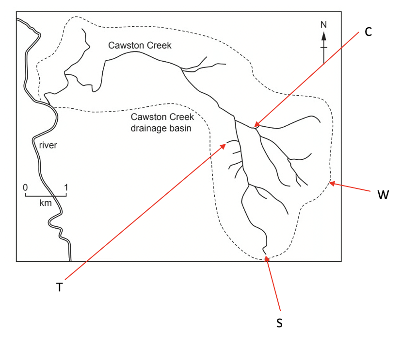
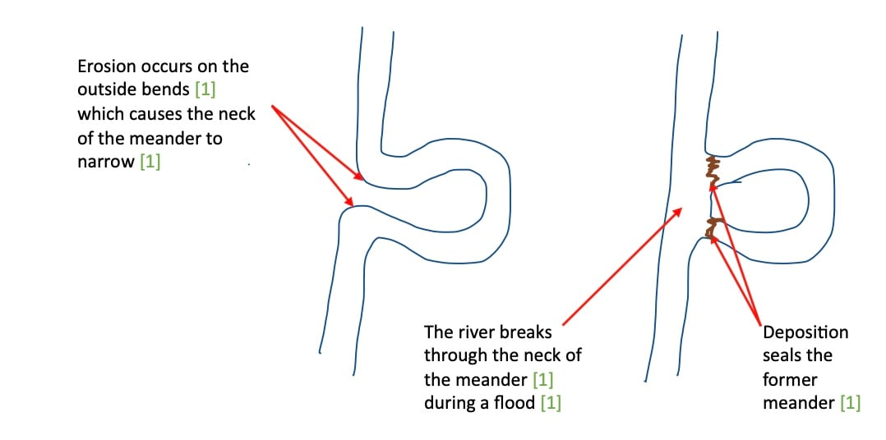

# Mark Schemes — Rivers
**The Natural Environment** · Cambridge (CIE) IGCSE geography (0460 & 0976)

## Paper 1 (46 questions)

### Q1
The River Nile is the longest river in the world and flows through eleven countries.  The river has helped agricultural production in Egypt. **[KU] **When the river floods, silt is deposited on the banks, which makes the soil fertile. **[KU]**** **Water can flow into irrigation basins where it is stored and can be used for irrigation. **[KU]** The Nile Valley is one of the world's most fertile regions; as a result of the floods, crops such as wheat, rice and cotton **[KU]** are grown

The Aswan Dam **[KU]** has been built across the Nile, and this generates hydroelectric power, which is used for homes and businesses. The dam produces 10 billion GWh **[KU]** of power each year.  There are also guided tours for tourists at the dam and this creates employment for locals. **[KU]**

Many tourist cruises follow the Nile, starting in Luxor and going on to visit Edfu and Aswan. **[KU]**** ** Tourism creates jobs and brings money to the area. In 2023, 1.5 million tourists took a Nile River cruise. **[KU]**

> **[mark-scheme]**
> **Mark allocation**
> 
> This is a 'level of response' answer. Each point made in the answer does not equal a mark.
> 
> AO focus = AO1 **[KU]**
> 
> - A top-level 3 **[7 marks]** answer will include specific examples that show:
> 
>   - Knowledge of a range of opportunities created by a river
>   - Specific place detail
> 
> **Alternative content**
> 
> The answer above is just one example of how to respond to this question. Additional information that could be used in the answer includes:
> 
> - Any alternative river
> - Source of food
> - Flat land for construction

### Q2
Impermeable rock such as granite** [1]** will increase runoff **[1]**, meaning that discharge will be higher.  Coniferous trees will intercept more water during the course of a year compared to deciduous trees **[1]****,** and so less rain will reach the ground, and so discharge will be lower. **[1]****  **Circular basins move water to the river faster than elongated basins, and so discharge is higher**. ****[1]**

> **[mark-scheme]**
> The command word 'explain' means that the answer should include supporting details and explanations for the reason that each factor affects discharge
> 
> **Mark allocation**
> 
> - **One mark** for each simple point [1]
> - **One mark** for each development of the simple point [1]
> 
> **[5 marks]**
> 
> Answers can be either:
> 
> - Five simple points
> - One developed point plus three simple points
> - Two points which are developed plus one simple point
> 
> **Alternative content**
> 
> The answer above is just one example of how to respond to this question. Additional information that could be used in the answer includes:
> 
> - * *Relief
> - Geology
> - Shape
> - Vegetation
> - Size
> - Temperature

### Q3
The vegetation will increase the level of interception, reducing runoff. **[1]**** **Permeable paving will increase infiltration, which also reduces runoff **[1]****, **and the raised area  increases the capacity of the river. **[1]**

> **[mark-scheme]**
> The command word ‘suggest’ requires you to apply your knowledge and understanding to outline relevant possible ways flooding can be reduced.
> 
> **Mark allocation**
> 
> - **One mark** for each valid point.
> 
> **[3 marks]**
> 
> **Alternative content**
> 
> The answer above is just one example of how to respond to this question. Additional information that could be used in the answer includes:
> 
> - Vegetation may increase infiltration

### Q4
> **[mark-scheme]**
> Any **four **from:
> 
> - Plunge pool is a deep area of turbulent water found at the bottom of the waterfall
> - Overhang - a layer of hard rock is unsupported
> - Vertical drop - water falls a significant distance
> - Different rock types - hard rock lies on top of softer rock
> - Velocity - high local river velocity
> 
> **[4 marks]**

### Q5
> **[mark-scheme]**
> The term for the point where a tributary joins the main river is the **confluence. ****[1 mark]**
> **[mark-scheme]**
> Any** two **from:
> 
> - Traction
> - Saltation
> - Solution
> - Suspension
> 
> **[2 marks]**
As the river moves downstream, it gets wider and deeper **[1],** and so a smaller proportion of the river water is affected by friction on the bed and banks** ****[1]****, **meaning that the water can move faster due to less friction. **[1]**

> **[mark-scheme]**
> The command word is 'explain', which means that the answer needs to include supporting details and outline the processes to explain why speed increases.
> 
> **Mark allocation**
> 
> - **One mark** for each valid point
> 
> **[3 marks]**
> 
> **Alternative content**
> 
> The answer above is just one example of how to respond to this question. Additional information that could be used in the answer includes:
> 
> - Bedload decreases in size downstream and this means there are fewer obstacles in the river to slow the flow

> **[exam-tip]**
> It is a common misconception that river flow is fastest in the upper course of the river because it often looks like it is moving faster.
> 
> Remember the Bradshaw model, as it clearly shows that the speed of water flow increases with distance downstream.

### Q6
Levels marking

| **Level 1 (1–3 marks)** | **Level 2 (4–6 marks)** | **Level 3 (7 marks)** |
|---|---|---|
| Simple statements which describe the river and valley processes and/or landforms at stated locations between source and mouth. | Developed or linked statements which describe or clearly imply the changes in processes and/or landforms which occur along a river and its valley from source to mouth. | Accurate statements which describe the changes which occur along a river and its valley from source to mouth with reference to processes and landforms. |

<u>Content Guide:</u>

Answers are likely to refer to: 
Width 
Depth 
volume 
Long profile 
Cross section 
Discharge 
Velocity 
Load Erosion....transportation...deposition 
Named landforms in different parts of the course, etc.

- *Examples of paragraphs which could be included in an answer to achieve Level 3:*

  - *There are a number of changes which occur along a river's course from its source to the mouth. In the upper course of the river the channel is narrow and shallow, the dominant erosion is vertical cutting downwards into the landscape. This can lead to the formation of v-shaped valleys as the steep sides created by vertical erosion collapse. The upper course of the river is also where waterfalls form due to the more rapid erosion of softer rock. This can lead to the formation of steep sided gorges as the river retreats upstream. The load in the upper course is large stones and rocks.*
  - *As the river moves into the middle course it becomes wider and deeper as lateral erosion increases and more tributaries join the main channel increasing the amount of discharge. The reduction in friction as less of the water is in contact with the banks and bed increases the velocity of the river. The middle section is also where meanders form as the river migrates across the river valley with erosion on the outside of the bends and deposition on the inside of the bends. As the river moves downstream the load is getting smaller as a result of erosion.*
  - *The lower course of the river is where it is at its widest and deepest as more tributaries have joined the river. The bedload is now fine sediment as it has been eroded through abrasion and attrition.*

### Q7
Levels marking

| **Level 1 (1–3 marks)** | **Level 2 (4–6 marks)** | **Level 3 (7 marks)** |
|---|---|---|
| Statements including limited detail which describe the attempts to manage flooding. | Uses named example. More developed statements which describe the attempts to manage flooding. (Note: Max 5 if no named or inappropriate example) | Uses named example. Comprehensive and accurate statements which describe the attempts to manage flooding including some place specific reference. |

<u>Content Guide:</u>

Answers are likely to refer to: 
dredging, 
channel straightening, 
raising / strengthening banks / levees, 
overflow channels/ spillways, 
dams/reservoirs, 
afforestation 
Etc.

<u>Place specific reference is likely to consist of:</u> 
Locational details, 
Places along river, 
Specific details/costs of methods etc.

<u>Place specific examples include:</u>

- *Locational details - Ganges River*
- *Specific details -*

  - *The **Ganges** is 2,510km long*
  - *It flows through India and Bangladesh where it becomes the River Padma and joins with the Brahmaputra River*
  - *The population living within the area drained by the Ganges is over 650 million people*
  - *The Ganges has its source in the Himalayan Mountains and the river waters enter the sea in the Bay of Bengal*
- *Examples of paragraphs which could be included in an answer to achieve Level 3:*

  - *Bangladesh is an LEDC which means that the country lacks the money for large schemes which would reduce the impact of flooding. The **Flood Action Plan (**FAP)was funded by the World Bank and a number of MEDCs. The methods used to reduce flooding include monitoring of flood levels and the construction of levées/embankments which increase the capacity of the river and reduce the risk of flooding.*
  - *The FAP also included building 5000 flood shelters which reduces the impact on people as they are able to go to a place out of the flood waters reducing deaths, injuries and sickness.*
  - *Many parts of the project were never completed including the dams and floodwater storage areas due to inadequate funding and corruption and 8 million people were forced to move to accommodate the FAP constructions. The alterations to the channel upstream meant that areas downstream suffered more from flooding*

### Q8
Levels marking

| **Level 1 (1–3 marks)** | **Level 2 (4–6 marks)** | **Level 3 (7 marks)** |
|---|---|---|
| Statements including limited detail which describe the hazards/difficulties of living close to a river. | Uses named example. More developed statements which describe the hazards/difficulties of living close to a river. (Max 5 if no named or inappropriate example) | Comprehensive and accurate statements which describe the hazards/difficulties of living close to a river including some place specific details. |

<u>Content Guide:</u>

Answers are likely to refer to: 
River erosion 
Marsh land 
Mosquitoes 
Difficulty of crossing river

Flooding and its issues such as: 
Transport problems 
Contaminated water 
Homes destroyed 
Deaths etc.

Place specific reference is likely to consist of: Locational details, Named places alongside river, etc.

<u>Place specific examples include:</u>

- *Locational details - Ganges Basin*
- *Specific details -*

  - *The **Ganges** is 2,510km long*
  - *It flows through India and Bangladesh where it becomes the River Padma and joins with the Brahmaputra River*
  - *The population living within the area drained by the Ganges is over 650 million people*
  - *The Ganges has its source in the Himalayan Mountains and the river waters enter the sea in the Bay of Bengal*
- *Examples of paragraphs which could be included in an answer to achieve Level 3:*

  - *The Ganges/Brahmaputra drainage basin is home to over 650 million people. Those who live nearest to the river regularly experience floods including most recently in May 2022. The floods lead to the destruction of homes and farmland. The floods can lead to the contamination of water with sewage and industrial waste. This impacts on people's health with diseases such as cholera spreading rapidly. *
  - *In 1998 75% of Bangladesh was flooded over 30 million people were made homeless, over 1000 people died and over 700,000 hectares of crops were destroyed. This led to an increase in food prices because demand exceeded supply. It also led to food shortages which meant that people became malnourished and unwell. Flooding of transport routes meant that it was difficult to access the areas to supply people with aid*
- *Remember the answers for this question must be related to how the river is hazardous to people*

### Q9
Levels marking

| **Level 1 (1–3 marks)** | **Level 2 (4–6 marks)** | **Level 3 (7 marks)** |
|---|---|---|
| Statements including limited detail which describe the opportunities provided for people by a river. | Uses named example. More developed statements which describe the opportunities provided for people by a river.  (Max 5 marks if no named example) | Uses named example. Comprehensive and accurate statements which describe the opportunities provided for people by a river, including place specific information. |

<u>Content Guide:</u>

Answers are likely to refer to: 
Water supply 
Fishing 
Navigation 
Work in tourist industry 
Agriculture on flood plain 
Transport routes along valley

<u>Place specific examples include:</u>

- *Locational details - Ganges Basin*
- *Specific details -*

  - *The **Ganges** is 2,510km long*
  - *It flows through India and Bangladesh where it becomes the River Padma and joins with the Brahmaputra River*
  - *The population living within the area drained by the Ganges is over 650 million people*
  - *The Ganges has its source in the Himalayan Mountains and the river waters enter the sea in the Bay of Bengal*
- *Examples of paragraphs which could be included in an answer to achieve Level 3:*

  - *The Ganges provides many opportunities for the people who live along its 2510km length. The drainage basin of the river is home to over 650 million people and there are many cities including New Delhi and Agra along the Ganges which take their water supplies from the river. As well as water the river is also a source of food. The regular flooding in the drainage basin leaves deposits of alluvium which are rich in nutrients and ideal for growing crops such as rice and jute. The rivers provide water for irrigation and for the flooding of rice fields and fish from the river provide food and jobs for local people*
  - *Other opportunities include culture and tourism. The Ganges is sacred to Hindus and is worshipped as the goddess Ganga. Three sites which are holy to Hindus lie on the banks of the Ganges (Haridwar, Allahabad and Varanasi) this leads millions of pilgrims to visit each year. Rafting and river cruises are also increasingly popular. Tourism provides jobs and income to the local economies*

### Q10
Levels marking

| **Level 1 (1–3 marks)** | **Level 2 (4–6 marks)** | **Level 3 (7 marks)** |
|---|---|---|
| Statements including limited detail which explain the causes of a flood. | Uses named example. Developed statements which explain the causes of a flood. (NB Max 5 if no named or inappropriate example. Credit country names to max.5) | Comprehensive and accurate statements including some place specific reference. |

<u>Content Guide:</u> 
Answers are likely to include the following ideas: 
Large amount of rainfall 
Intense rainfall/over short period of time 
Snow melt 
Saturation of soil/permeability 
Deforestation 
Urbanization 
Waste in river 
Dam collapse 
Lack of/failure of river management etc.

<u>Place specific reference is likely to consist of:</u> 
Locational details/named areas around the river, 
Specific details of flood/date/time/depth 
Statistical information

### Q11
Levels marking

| **Level 1 (1–3 marks)** | **Level 2 (4–6 marks)** | **Level 3 (7 marks)** |
|---|---|---|
| Statements including limited detail which explain how a delta is formed. | More developed statements which explain how a delta is formed. | Comprehensive and accurate statements including fully labelled diagram. |

<u>Content Guide:</u> 
Answers are likely to refer to: 
River carries large amount of load; 
River slows/loses strength/can’t carry sediment 
Flocculation, 
Deposition, 
Formation of distributaries/new channels, 
Build up of new land, 
Colonization by vegetation, 
Lack of strong currents etc

### Q12
Levels marking

| **Level 1 (1–3 marks)** | **Level 2 (4–6 marks)** | **Level 3 (7 marks)** |
|---|---|---|
| Statements including limited detail which describe the benefits of living on a flood plain or delta. | Uses named example. More developed statements which describe the benefits of living on a flood plain or delta. | Uses named example. Comprehensive and accurate statements, including some place specific details. |

<u>Content Guide:</u>

Answers are likely to refer to: 
Fertile soils, 
Transport routes, 
Flat land, 
Domestic water supply, 
Irrigation, 
Fishing, 
Jobs in tourism, 
Jobs in industry, etc.

Place specific reference is likely to consist of: 
Locational details, 
named places alongside river/country name/area, etc.

<u>Place specific examples include:</u>

- *Locational details - Ganges Basin*
- *Specific details -*

  - *The **Ganges** is 2,510km long*
  - *It flows through India and Bangladesh where it becomes the River Padma and joins with the Brahmaputra River*
  - *The population living within the area drained by the Ganges is over 650 million people*
  - *The Ganges has its source in the Himalayan Mountains and the river waters enter the sea in the Bay of Bengal*
- *Examples of paragraphs which could be included in an answer to achieve Level 3:*

  - *The Ganges provides many opportunities for the people who live along its 2510km length. The drainage basin of the river is home to over 650 million people and there are many cities including New Delhi and Agra along the Ganges which take their water supplies from the river. As well as water the river is also a source of food. The regular flooding in the drainage basin leaves deposits of alluvium which are rich in nutrients and ideal for growing crops such as rice and jute. The rivers provide water for irrigation and for the flooding of rice fields and fish from the river provide food and jobs for local people*
  - *Other opportunities include culture and tourism. The Ganges is sacred to Hindus and is worshipped as the goddess Ganga. Three sites which are holy to Hindus lie on the banks of the Ganges (Haridwar, Allahabad and Varanasi) this leads millions of pilgrims to visit each year. Rafting and river cruises are also increasingly popular. Tourism provides jobs and income to the local economies*

### Q13
| **Indicative content** | **General Guidance** |
|---|---|
| Ideas such as  - Meanders are bends in the river - Middle and lower course - Lateral erosion  On the outside:  - Water is deeper/faster flowing - There is more energy leading to erosion - Erosional processes such as hydraulic action, abrasion, solution - Erosion digs into the bed / undercuts the bank creating a river cliff - The riverbank collapses and the edge of the meander moves further out  On the inside:  - Water is shallower/slower flowing - There is less energy so the river’s load is deposited - Deposited material builds up to form a slip-off slope | - The command word ‘describe’ requires you to state key characteristics of a meander - The command word ‘explain’ means to give reasons why a meander might form - This is a levelled response answer. It is important to remember that each point does not equate to a mark. The examiner will read your whole answer and make a decision about which level your answer fits into - Need description and explanation to be awarded 7 marks. |

| **Model Answer** | **Commentary** |
|---|---|
| A meander is a bend or curve in a river that usually forms in the middle or lower course. They usually form where the land is quite flat and there is more lateral erosion rather than vertical erosion.  Initially the river flows in a relatively straight line, though the river might encounter an obstacle such as hard rock which it goes around. The water travels fastest on the outside of the bend, leading to erosion, with processes such as hydraulic action and abrasion cutting into the river bank. This creates a river cliff and over time the river curves more as the river bank collapses.  On the inside bend, the water flows more slowly and the water does not have enough energy to transport its load through saltation, so sediment is deposited. This builds up to form a slip-off slope. Over time the processes of erosion and deposition reshape the meander and make the river more and more curved. | **Marks 7/7**  - This is one possible way to answer this question – your answer does not have to be exactly the same - You need to include both description and explanation in order to gain 7 marks - Using phrases such as ‘this leads to’ and ‘this could cause’ will help you extend your explanation - You may find it easier to draw and label a diagram to explain, but don’t just repeat what is in the text as you will not be credited twice - This answer starts by describing the shape and location of meanders - The answer is developed by using key terms and processes to explain how a meander is formed in detail |

### Q14
| **Indicative content** | **General Guidance** |
|---|---|
| Ideas may include:  - Loss of land/crops - Loss of jobs - Damage to property/homelessness - Damage to possessions - Damage to transport routes/bridges - Economic losses | - The command word ‘describe’ requires you to state the key hazards caused by erosion - This is a levelled response answer. It is important to remember that each point does not equate to a mark. The examiner will read your whole answer and make a decision about which level your answer fits into - If you do not name a river, or the river you choose is not appropriate, you will be awarded a maximum of 5 marks |

| **Model Answer** | **Commentary** |
|---|---|
| Named river: Ganges  The Ganges River flows through India and Bangladesh. Erosion is very common along the river banks with up to 5% of the floodplain in Bangladesh directly affected by erosion.  Up to 200m of land is lost every year, destroying homes and infrastructure such as roads and bridges. This has a huge economic impact, costing up to \$250 million per year. Due to erosion, incomes are lost and money has to be spent to repair or replace the damaged infrastructure which is very costly.  Agriculture is the main source of employment in Bangladesh, with almost 40% of the population working in farming. Erosion leads to the loss of fertile land and crops meaning that farmers lose their livelihoods and food security is threatened. This can lead to an increase in food prices which can cause social unrest and worsen poverty.  Sometimes entire communities and villages are forced to leave their homes, leading to a loss of culture and tradition. If people move to a city such as the capital Dhaka, they often struggle to find jobs and homes and end up living in informal settlements. This can have huge psychological impacts as well as lead to increased poverty and disease. | **Marks 7/7**  - This is one possible way to answer this question – your answer does not have to be exactly the same - You need to refer to a named river in your answer - You also need to include place specific details such as named places along the river, statistics or specific details of hazards in order to gain 7 marks - Using phrases such as ‘this leads to’ and ‘this could cause’ will help you extend your explanation - This answer outlines several hazards caused by erosion - The answer is developed by naming located examples and quoting supporting facts and evidence |

### Q15
Levels marking

| **Level 1 (1–3 marks)** | **Level 2 (4–6 marks)** | **Level 3 (7 marks)** |
|---|---|---|
| Statements including limited detail which explain how a delta is formed and/or labelling of features on diagram. | More developed or linked statements which explain how a delta is formed | Comprehensive and accurate answer using appropriate terminology, which explains how a delta is formed and labels of features on diagram. |

<u>Content Guide:</u> 
Diagram is likely to include labelling of distributaries, shape of delta, flat land, sea, fertile soil, etc.

<u>Explanation:</u> 
Erosion of materials from upstream;
Transportation of load;
Reduction in speed of flow,
Excess of sediment load cannot be carried further,
Deposition,
Flocculation,
Lack of tides to remove materials,
Colonisation by vegetation, etc.

### Q16
Ideas such as: 
Steep valley sides [**1]** 
V shaped valley [**1]** 
Bare rocks on the valley side/cliff [**1]** 
Scree **[1]** 
Landslip scar **[1]** 
Uneven long profile** [1]** 
Narrow river **[1]** 
Winding river [**1]** 
Interlocking spurs **[1]** 
Rocks in channel [**1]** 
Shallow** [1]**

### Q17
Ideas such as: 
Steep/vertical **[1]** 
Layers of rock **[1]** 
Stepped** [1]** 
White water** [1]** 
Plunge pool** [1]** 
High/long drop** [1]** 
water is at one side of channel only/does not occupy entire channel **[1]**

### Q18
Ideas such as:
Close to/on flood plains/flat land around Sungari/Ussuri/Amur rivers **[1]** 
Land below 200 metres **[1]** 
In/close to Harbin City/Khabarovsk **[1]** 
Downstream of/close to/around confluence/joining of rivers **[1]**

- *Remember for this answer you need to give the location of the areas which flood not the reasons why they flood*

### Q19
Characteristics such as: 
Curved/horseshoe/crescent/semi-circle/backward C **[1]** 
North–south orientation **[1]** 
Long and thin **[1]** 
Width approximately 0.5 to 1 km **[1]** 
Length approximately 10–16 km **[1]** 
Small island **[1]** 
Wider in middle/south/narrower at ends **[1]**

- *Marks will not be awarded for stating that Lake Mary is an ox-bow lake, as this is stated in the question*
- *It is important in your answer that you only describe characteristics of Lake Mary and not of the Mississippi River or the tributary stream*

### Q20
Similarities – both;

Are narrow/thin/small; have rocks (in channel) **[1]** 
Flow in a valley **[1]** 
Shallow **[1]**

Near the source/upper course **[1]**

Differences: 
3.3/1st one has a waterfall/steeper long profile but 3.4 does not **[1]** 
The long profile of 3.4/2nd one is more regular **[1]** 
3.3 has more turbulent water/white water **[1]**

3.4 has meanders/is more winding **[1]**

- *To achieve full marks on this question you need to give both similarities and differences*
- *When describing the differences your answer needs to compare the two rivers*
- *Marks will not be awarded for saying '3.3 has turbulent water' the answer needs to include 'more' or 'less'*

### Q21
(i)

26–28 hours** [1] **(ii)

Ideas such as:

**Throughflow **– water flow through the soil ** [1]** 
**Groundwater flow **– water flow through the rock ** [1] **(iii)

Ideas such as:

Water is not able to soak into soil/rock ** [1]** 
Surfaces are impermeable ** [1]** 
Trees have been removed ** [1]** 
Less interception/transpiration ** [1]** 
More overland flow **[1]** 
Artificial drains move water rapidly to rivers** [1]**

- *All these factors related to urbanisation increases the speed at which water reaches the river, which then leads to an increase in discharge*

### Q22
(i)

Diagram B** [1]**

(ii)

Diagram A **[1]**

There is the largest amount of water in the river **[1]** 
The flood plain/river/valley is widest/more flat land near river **[1]** Meandering/oxbow lake **[1]**

- *1 mark is reserved for the diagram and 1 mark for the reason*

(iii)

Ideas such as: 
Hydraulic action/bed and bank material loosened by power of water **[1]** 
Corrosion/rocks like limestone dissolved by acids in river water **[1]** 
Corrasion/river picks up loose materials and uses them to grind the bed and banks **[1]** 
Attrition/materials reduced in size as they hit each other when being carried or moved around by river **[1]** 
Vertical erosion in B/in the hills/near source **[1]** 
Lateral in A/near mouth **[1]** 
Erosion on outside of meanders **[1]**

- *In this answer you can refer to any of the four types of erosion but you need to explain how they erode*
- *Lateral and vertical erosion can also be included in the answer because they refer to the main direction of erosion (sideways or downwards)*

### Q23
(i)

St Louis is at the confluence of the Mississippi and Missouri **[1]**

- *Quincy is located alongside the main channel but the source is much further upstream*
- *The Meramec is a tributary of the Mississippi rather than the other way around*
- *The Kaskaskia river is a tributary of the Mississippi it does not have a mouth where it flows into a sea/ocean/lake*

(ii)

Ideas such as: 
It is (further) downstream/at/nearer mouth **[1]** 
Several tributaries have joined the Mississippi by then **[1]** Urbanisation in St Louis will increase overland flow and the discharge in the river **[1]**

It is likely to have a large flood plain/flat/low land around the river **[1]**

- *The number of tributaries joining the Mississippi before Cape Girardeau means that the discharge will have increased significantly *

(iii)

Impacts such as: 
Roads/railways/bridges flooded/impassable/destroyed **[1]** Farmland flooded/loss of crops/food shortages/soil eroded **[1]** Farm animals die/drown/need to be rescued **[1]** 
Loss of lives/people drown **[1]** 
Electricity supply disrupted **[1]** 
Water supply contaminated/waterborne diseases or example **[1]** Homes/buildings/villages/settlements/personal possessions destroyed/flooded **[1]** 
Natural vegetation/trees/habitats/wildlife destroyed **[1]** 
Fertile soils/land **[1]**

- *The command word in the question is 'describe' which means no explanation is needed *
- *The answer simply requires three statements of impacts*

### Q24
(i)

C **[1]**

- *Waterfalls tend to occur where hard rock overlays softer rock*
- *The only location on harder rock is C*

(ii)

X = Plunge pool **[1]**
Y = Overhang/outcrop/ledge/hard rock layer **[1]**

(iii)

Ideas such as:

Wearing of soft rock/undercutting of hard rock layer **[1]** 
Collapse of overhang/hard rock **[1]** 
Retreat of waterfall **[1]** 
Gorge remains where waterfall was previously **[1]**

- *Gorges form as a result of the waterfall retreating upstream so the answer needs to explain how that retreat occurs*

### Q25
(i)

The changing of water to water vapour by plants/evaporation of water by plants/trees **[1]**

(ii)

From place to place – different amounts/types of plants/vegetation/trees (or examples) **[1]**

Different times of year – many plants/vegetation/trees will not have leaves all year/plants/vegetation/trees may grow only during certain seasons **[1]**

- *Where there are extremes of climate desert/polar regions the lack of vegetation will mean that there is less transpiration than in rainforests or temperate areas where there is lots of vegetation*
- *In many areas vegetation loses its leaves in autumn and winter reducing the amount of transpiration*

(iii)

X = Overland flow/surface run off **[1]**

Y = Throughflow **[1]**

Z = Ground(water) flow/base flow **[1]**

### Q26
(i)

An area of land drained by a river (and its tributaries) / the catchment area of a river / the area within the watershed of a river [**1] **

(ii)

Groundwater flow moves water through the rocks [**1]** 
Infiltration occurs when water soaks into the soil [**1]**

- *Overland flow moves over the surface*
- *Percolation is the movement of water down through the soil rather than from the surface into the soil*
- *Through flow is the movement of water through the soil*
- *Interception is when water is prevented from reaching the surface by plants and trees*

(iii)

Ideas such as:

Precipitation exceeds infiltration **[1]**
Heavy rainfall** [1]** 
Saturation of rock/soil** [1]** 
Melting snow/ice** [1]** 
Water within the rock/soil could be frozen** [1]** 
After deforestation** [1]** 
When an area is covered by concrete/tarmac** [1]**

- *This question is asking you to explain some of the reasons that water does not infiltrate but runs over the surface*

### Q27
Characteristics such as: 
South/south east facing **[1]** 
Adjacent to/flows into/meets/next to/on the coast of South China Sea/Lingding Bay **[1]** 
Many distributaries/small rivers **[1]** 
Width approximately 70–120 km **[1]** 
Length approximately 100–150 km **[1]** 
Islands in channel **[1]** 
Bird's foot type **[1]**

- *Remember to only use information from fig 4.2 in your answer*
- *When describing characteristics from a map it is essential to use the scale and compass provided to measure characteristics such as the width and length of the delta, as well as direction*
- *On a delta the channels branching off the main channel are distributaries not tributaries*

### Q28
Agriculture/grazing/farmland/fertile soils/growing crops/cultivation/keeping animals **[1]**
Fishing/fish market/fish farming **[1]**
Transportation/moving cargo/imports/exports **[1]**
Tourism **[1]** 
Industry **[1]** 
Flat land for building **[1]**

- *In this answer you must only use evidence from the three images, marks will not be awarded for benefits which are not shown here or general ideas such as 'availability of jobs'*

### Q29
(i)

Meander **[1]**

(ii)

Ideas such as: 
It is flat/gently sloping **[1]** 
It is made from fine materials/ small stones/mud/sediment/soil **[1]** 
It is just above the level of the river **[1]**

- *Remember in this question you are only being asked to describe the characteristics not explain how it has formed*

(iii)

Ideas such as: 
Water flows quickly **[1]** 
Lateral erosion **[1]** 
Water erodes bank/wears away side **[1]** 
Hydraulic action/abrasion (or description) **[1]** 
Undercutting **[1]** 
Collapse **[1]**  
Helicoidal/helical flow **[1]**

- *Ensure that if you use the term helicoidal flow that you understand what it means and how it is linked to erosion - it is the corkscrew type motion of the water which transports material from the outside of one bend and deposits it on the inside of another bend*

### Q30
(i)

| **Indicative content** | **General Guidance** |
|---|---|
| - A = (river) mouth / estuary **[1]** - B = river / main channel **[1]** - C = tributary **[1]** | **Marks 3/3**  - The command word ‘identify’ requires you to name the correct river feature, no explanation or description is required |

(ii)

| **Indicative content** | **General Guidance** |
|---|---|
| - 1 = evaporation **[1]** - 2 = transpiration **[1]** | **Marks 2/2**  - The command word ‘identify’ requires you to name the correct process, no explanation or description is required |

### Q31
| **Indicative content** | **General Guidance** |
|---|---|
| **Any four ideas such as:**  - Amount / intensity of rainfall **[1]** - Duration of rainfall **[1]** - Amount/density of vegetation **[1]** - Rock type **[1]** - Thickness/type of soil **[1]** - Angle of slope **[1]** - Ground could be frozen/baked due to temperature **[1]** | - The command word ‘suggest’ requires you to apply your knowledge and understanding to outline relevant possible reasons for the amount of infiltration varying |

| **Model Answer** | **Commentary** |
|---|---|
| There might be less infiltration because the rain is very heavy **[1]** or the storm lasts a long time **[1]**. There might be more infiltration if there are a lot of trees **[1]** or the soil is sandy and thick **[1]**. | **Marks 4/4**  - This is one possible way to answer this question – your answer does not have to be exactly the same - One mark is awarded for each of the four correct reasons that infiltration varies |

### Q32
Ideas such as: 
Build a dam/reservoir (upstream) **[1]** Levees/embankments/barriers **[1]**
Sandbags **[1]**
Dredging **[1]**
Overflow channels **[1]** 
Use sluice gates/spreading areas upstream **[1]** 
Straighten the river/line with concrete **[1]** 
Tree planting/reduce deforestation **[1]** Monitoring/prediction/early warning/alarms/evacuation **[1]** 
Land use zoning/keep grassy areas near rivers **[1]** 
Build on stilts/housing design **[1]**

- *This question can be answered with 4 separate ways of reducing the flood risk*
- *Remember to be specific, vague answers such as 'build a wall' will not gain marks*

### Q33
Any two methods of flood reduction can be used such as:

Dredging **[1]** 
Raise banks / artificial levees **[1]** 
Dams / reservoirs **[1]** Straighten rivers **[1]** 
Concrete banks/beds **[1]** 
Diversionary spillways **[1]** 
Afforestation / planting trees **[1]** 
Allow farmland upstream to flood **[1]**

- *Two marks will be awarded for the methods of flood reduction and two marks for the explanation of how it works*
- *For example:*

  - *Dredging ***[1] ***increases the depth of the river and enables more water to flow within its banks ***[1]**
  - *Dams ***[1]*** enable the discharge of the river downstream to be controlled ***[1]**

### Q34
| **Indicative content** | **General Guidance** |
|---|---|
| Causes might include:  - Deforestation **[1]** - Urbanisation **[1]** - Channelisation/straightening of the river **[1]** - Dam collapse **[1]** - Building on floodplains **[1]** - Climate change / global warming **[1]** - Lack of / failure of river management **[1]** - Waste in the river **[1]** | - The command word ‘describe’ requires you to state human causes of flooding - The answer must outline human and not physical/natural causes of flooding - These can either be two points which are developed or four separate points |

| **Model Answer** | **Commentary** |
|---|---|
| One human cause of flooding is when people build houses on floodplains. **[1]** The more urban areas there are, the higher the flood risk **[1]**. Other human causes include deforestation **[1]** and global warming **[1]** | **Marks 4/4**  - This is one possible way to answer this question – your answer does not have to be exactly the same - Two marks are awarded for urbanisation and deforestation and two further marks for developing the answer |

### Q35
| **Indicative content** | **General Guidance** |
|---|---|
| Methods might include:  - Building dams/reservoirs **[1]** - Planting trees/afforestation / reduce deforestation **[1]** - Dredging/deepening the channel **[1]** - Widening the river **[1]** - Build levees/flood walls **[1]** - Land use zoning / reduce construction in floodplains **[1]** - Warning/monitoring systems **[1]** - Home insurance/aid **[1]** | - The command word ‘describe’ requires you to state methods of flood management - This question requires you to give 4 separate points |

| **Model Answer** | **Commentary** |
|---|---|
| There are a number of different ways to manage floods for example planting trees **[1] **and building levees **[1]**. The river can also be dredged **[1]** or widened **[1]** | **Marks 4/4**  - This is one possible way to answer this question – your answer does not have to be exactly the same - In the answer four methods of flood defences are listed |

### Q36
Ideas such as: 
Erosion by river **[1]** 
Hydraulic action/abrasion **[1]** 
Hard rock layer **[1]** 
Softer rock underlying hard rock **[1]** 
Hard rock resistant to erosion **[1]** 
Overhang develops **[1]** 
Undercutting of soft rock **[1]** 
Collapse of hard rock **[1]** Retreat of waterfall **[1]**

- *Remember to include all the steps of waterfall formation in your answer*
- *Waterfalls usually occur where a layer of soft rock lies under a layer of hard rock ***[1] ***the soft rock erodes more rapidly undercutting the hard rock ***[1]*** this causes an overhang to develop ***[1] ***Eventually the overhang collapses into the plunge pool ***[1] ***the waterfall retreats upstream and the process starts again ***[1]**

### Q37
Ideas such as: River carries large amount of load **[1]** 
River slows/loses strength/can’t carry sediment **[1]** 
Flocculation **[1]** 
Deposition **[1]** 
Formation of distributaries/new channels/finds new routes **[1]** Build up of islands/new land **[1]** 
Colonization by vegetation **[1]** 
Lack of strong currents **[1]**

- *The answer to this can be in the form of a diagram but it must have clear and detailed annotations*

### Q38
Ideas such as: Hydraulic action **[1]**
Pressure of water/air pressurized in cracks **[1]** Corrasion/abrasion **[1] **
Sandpaper action of rocks carried by water on bed/banks **[1]** Corrosion/solution **[1] **
Rocks dissolved by water/chemical action of water on rocks **[1]** Attrition **[1] **
Rocks carried by water (reduced in size) as they hit each other **[1]**

- *To gain full marks in this question you need to be able to state types of erosion and explain how they erode the banks and bed*
- *Vague statements about 'wearing away' will not be awarded marks*

### Q39
Ideas such as: 
River could become more sinuous/winding/meandering/tighter/more pronounced **[1]** Outer bank retreats/moves outwards/goes out further **[1]** 
Slip off slope moves inwards/builds up **[1]** 
Neck of meander narrows/reduces in size/narrow neck will be formed **[1]** 
Cut across/river becomes shorter/straighter **[1]** 
Meander sealed (by deposition) **[1]** 
Formation of oxbow lake **[1]**

- *It is important in this answer that as well as stating how the river might change - meander migration and formation of an oxbow lake that you explain the stages that the river goes through and the processes involved*
- *For example:*

  - *The neck of the meander may become narrower ***[1]*** due to erosion on the outer banks ***[1] ***during a flood event the river may break through become straighter ***[1]*** leading to the formation of an oxbow lake ***[1]**

### Q40
Ideas such as: 
Flooding/floods **[1]** 
People die/drown **[1]** 
Crocodiles/snakes **[1]** 
Damage to/destruction of property/homes/possessions **[1]** Damage to business or example **[1]** 
Loss of earnings/jobs **[1]** 
Disruption to transport/flooding of road/railways **[1]** Erosion threatens farmland/homes **[1]** 
Reduce food production/crops washed away/farm animals/livestock killed **[1]** 
The area may have mosquitos/threat of malaria/dengue fever **[1]** Waterborne disease e.g. typhoid **[1]**

- *Remember answers need to have developed ideas to be awarded full marks for example;*
- *Areas near rivers are vulnerable to flooding*** [1]*** this means that people may drown ***[1] ***or attacked by snakes and crocodiles in the water ***[1]***. The flood also damages businesses ***[1]*** which leads to the loss of jobs and income ***[1]**

### Q41
Ideas such as: 
River is carrying large amount of sediment **[1]** 
River slows/stops **[1]** 
Loses/does not have energy(to move all the load)/cannot carry load **[1]** 
Occurs on inner bends of meanders **[1]** 
River may flood **[1]** 
Sediment seals the neck of the oxbow lake **[1]**

- *Answers can include any reason that the river deposits sediment in the middle/lower course*

### Q42
(i)

Ideas such as:
Lack of/removal of vegetation/deforestation **[1]** 
Large amount of/heavy rainfall **[1]** 
Rainfall over a long period of time **[1]** 
Saturated soil/rock/marshland **[1]** 
Steep slopes/rapid run off **[1]** 
Snow melt **[1]** 
Urban areas/impermeable areas **[1]** 
Land (alongside river) is flat/flood plain **[1]**
Joining of tributaries results in more volume of water **[1]** large/mountainous catchment area **[1]** 
lack of river management or example (e.g. dams) **[1]**

(ii)

Ideas such as: 
Build dams/reservoirs **[1] **to hold back water from downstream **[Dev]** 
Build/raise levees/banks/use sandbags **[1] **to deepen the river channel** [Dev]** 
Afforestation/reduce deforestation/grow mangroves **[1] ** Diversion channels/spillways **[1]** 
Dredging/deepening channel **[1]** 
Flooding of meadow land/land use zoning **[1]** 
Flood barriers/sluice gates **[1]** 
Straightening river/canalization **[1]**

- *In this answer any development points must be about the method used rather than an explanation*

### Q43
Processes such as: 
Hydraulic action **[1] **
Power of water wears away bed and banks releasing air compressed in cracks **[1]** 
Abrasion **[1] **
Material carried by river grinds bed and banks/sandpaper action **[1]** 
Corrosion / solution **[1] **
Rocks dissolved by chemical reactions; Attrition **[1] **
Load reduced in size as particles hit each other when being carried by water **[1]** 
Vertical erosion **[1]**

- *The methods of erosion need to be stated together with the processes by which they erode*
- *Vertical erosion can be included as this is the dominant erosion in upland areas*

### Q44
On outline map

- *If you mark multiple examples of one feature on to the map the mark will only be awarded if all are correct*
- *Remember the tributary has to be less than 1km long so it is important to use the scale on the map as a guide*

### Q45
Ideas such as when it moves away from the source it becomes:

Wider **[1]** 
Deeper **[1]** 
Faster flowing **[1]** 
More gentle/even long profile **[1]**

### Q46
Ideas such as: 
River flows around a meander/formed from meander **[1]** 
Erosion on outer bends **[1]**  
Due to faster flowing water **[1]** 
Hydraulic action/abrasion (or description of process) **[1]** Helicoidal/helical flow **[1]** 
Deposition on inside bends **[1]** 
Due to slower flowing water **[1]** 
River becomes more sinuous/winding/extreme meander **[1]** Neck of meander reduced in thickness **[1]** 
Eventually river erodes across neck/river flows straight on/cuts off meander **[1]** 
During time of flood **[1]** 
Deposition seals former meander **[1]**

- *An annotated diagram will gain marks for this question but to gain marks the annotations need to be clear and detailed*

