# Exam Questions — Rivers
**The Natural Environment** · Cambridge (CIE) IGCSE geography (0460 & 0976)
> Source: [https://www.savemyexams.com/igcse/geography/cie/20/topic-questions/](https://www.savemyexams.com/igcse/geography/cie/20/topic-questions/) · 46 questions across 1 sets

## Paper 1 (46 questions)

### Q1 — hard — 7 marks

**Q1** [7 marks]

For a named river, describe the opportunities it presents.

### Q2 — medium — 5 marks

**Q2** [5 marks]

Explain how the **physical** features of a drainage basin affect river discharge

### Q3 — easy — 3 marks

**Q3** [3 marks]

Study **Figure 3.2**, showing river management in Nanning, China.

Use the labels on the photograph to suggest how the risk of flooding is being reduced.

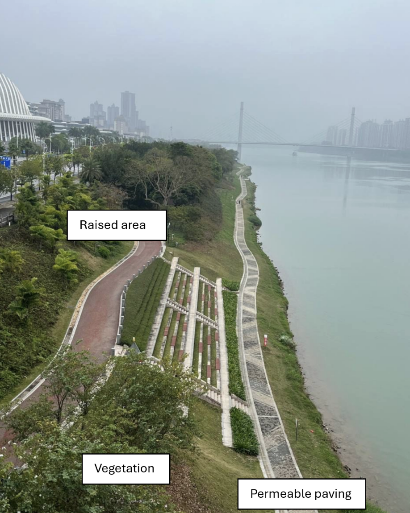

*Fig. 3.2. River management in China*

### Q4 — medium — 4 marks

**Q4** [4 marks]

A waterfall is formed by erosion.

Describe the main features of a waterfall.

### Q5 — easy — 6 marks

**Q5** [1 mark]

Study Fig. 3.1, which shows one river joining another.

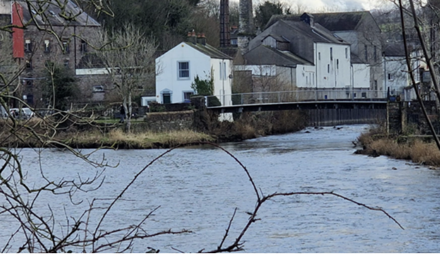

*Figure 3.1 - Photograph showing one river joining another*

What is the term for the point where a tributary joins the main river?

**Q5** [2 marks]

Name** two** processes by which a river transports its load

**Q5** [3 marks]

Explain why the speed of a river is generally faster in the lower course than the upper course.

### Q6 — hard — 7 marks

**Q6** [7 marks]

Describe the changes which occur along a river and its valley from its source to its mouth. You should refer to processes and landforms.

*Source: June 2021 0460/12 Q4C*

### Q7 — hard — 7 marks

**Q7** [7 marks]

For a named river you have studied, describe attempts to manage flooding.

Name of river .................................................................

*Source: 2020 May/June 0460/13 Q3C*

### Q8 — hard — 7 marks

**Q8** [7 marks]

For a named river you have studied, describe the hazards and difficulties of living close to it.

Name of river .............................................

*Source: Nov 2019 0460/13 Q4C*

### Q9 — hard — 7 marks

**Q9** [7 marks]

Describe the opportunities provided for local people by a named river you have studied.

Name of river ..............................................

*Source: 2020 May/June 0460/11 Q4C*

### Q10 — hard — 7 marks

**Q10** [7 marks]

For a named river you have studied, explain the causes of flooding.

Name of river ..............................

*Source: June 2021 0460/11 Q3C*

### Q11 — hard — 7 marks

**Q11** [7 marks]

Explain how a delta is formed. Include a fully labelled diagram or diagrams.

*Source: Nov 2019 0460/11 Q3C*

### Q12 — hard — 7 marks

**Q12** [7 marks]

For a named river you have studied, describe the benefits of living on or close to its flood plain or delta.

Name of river .........................

*Source: Oct/Nov 2019 0460/12 Q4C*

### Q13 — hard — 7 marks

**Q13** [7 marks]

Describe and explain the formation of a meander. You may include a labelled diagram or diagrams.

### Q14 — hard — 7 marks

**Q14** [7 marks]

For a named river you have studied, describe hazards for people caused by erosion

Named river……………..

### Q15 — hard — 7 marks

**Q15** [7 marks]

Draw a labelled diagram to show the features of a river delta. Explain how a river delta is formed.

*Source: Nov 2020 0460/12 Q3C*

### Q16 — easy — 3 marks

**Q16** [3 marks]

Study Fig. 4.2, which is a photograph of a river in an upland area.

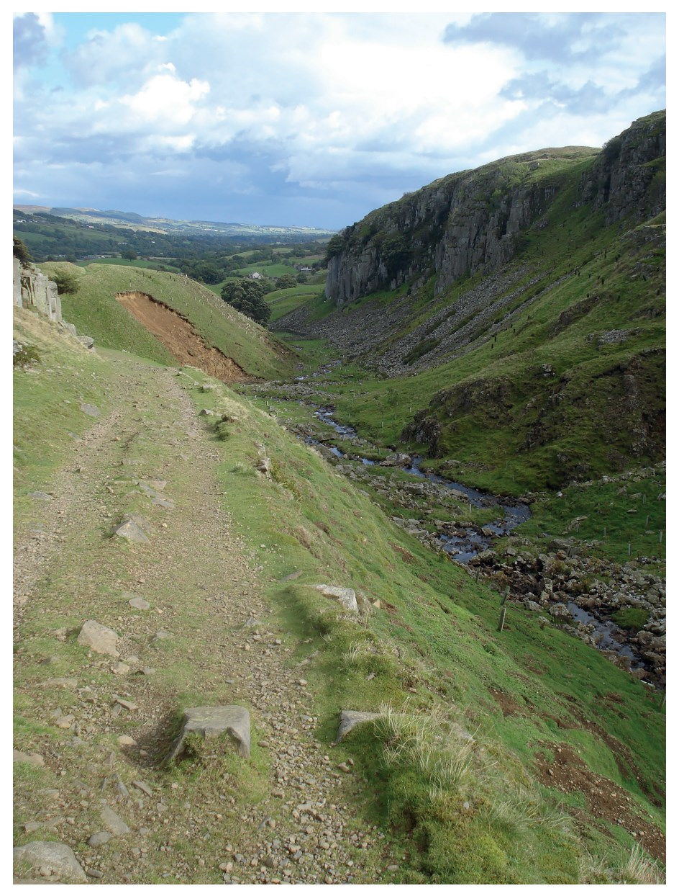

**Fig 4.2**

Describe the main characteristics of the river and valley shown in Fig. 4.2.

*Source: 2020 May/June 0460/11 Q4B*

### Q17 — easy — 3 marks

**Q17** [3 marks]

Study Fig. 3.2, which is a photograph showing a waterfall.

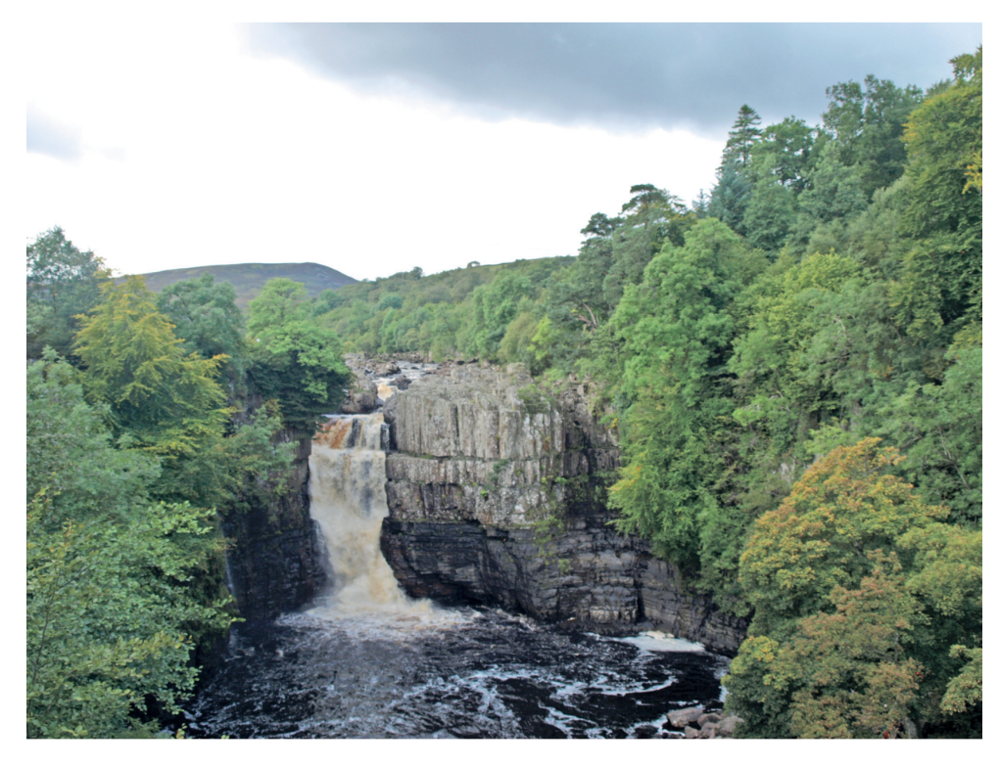

***Figure 3.2 High Force, River Tees***

Describe three features of the waterfall shown in Fig. 3.2.

1 ....................................................................................................... 2 ...................................................................................................... 3 .......................................................................................................

*Source: 2020 May/June 0460/13 Q3B*

### Q18 — easy — 3 marks

**Q18** [3 marks]

Study Fig. 4.3, which is a map of an area in Asia where river flooding occurred.

**Fig. 4.3**

Describe the location of the areas shown in Fig. 4.3 where flooding occurred.

*Source: June 2021 0460/12 Q3B*

### Q19 — easy — 3 marks

**Q19** [3 marks]

Study Fig. 4.2, a map of Lake Mary, an oxbow lake next to the Mississippi River.

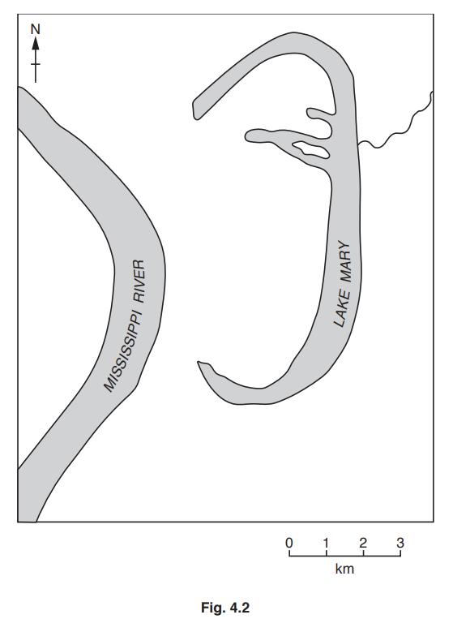

Using Fig. 4.2 only, describe the characteristics of Lake Mary.

*Source: Nov 2019 0460/12 Q4B*

### Q20 — easy — 3 marks

**Q20** [3 marks]

Study Figs. 3.3 and 3.4, which are photographs showing two different rivers and their valleys.

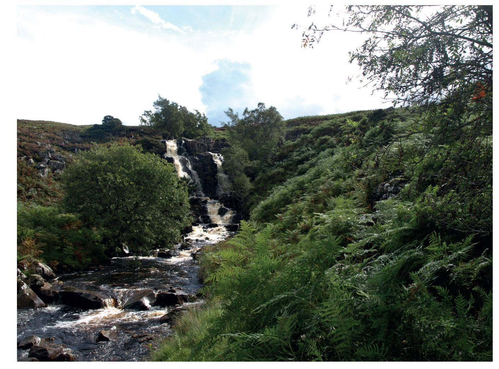

**Fig 3.3**

**Fig 3.4**

Describe the similarities and differences between the rivers shown in Figs. 3.3 and 3.4.

*Source: Nov 2020 0460/12 Q3B*

### Q21 — easy — 6 marks

**Q21** [6 marks]

Study Fig. 4.1, which is a hydrograph of a river after a rain storm.

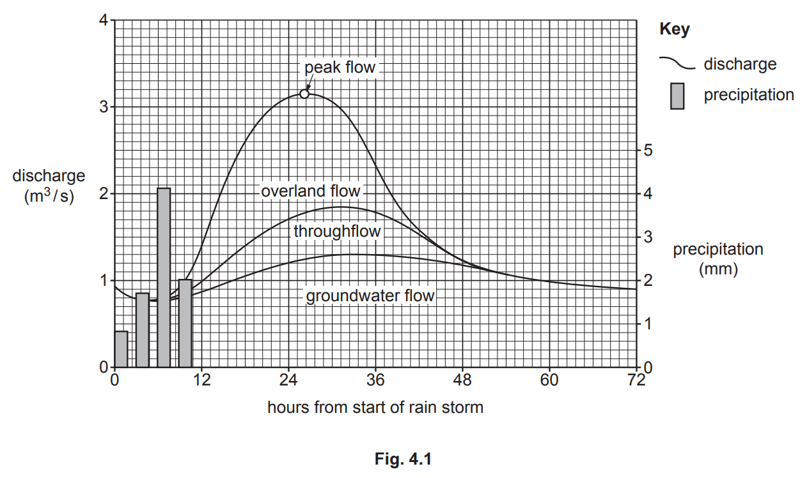

(i)

How long after the start of the rain storm is the peak flow?

..................................................................... hours

[1]

(ii)

Explain how water reaches a river from:

- throughflow 
...........................................................................................

- groundwater flow ...........................................................................................

[2]

(iii)

Explain why the building of large settlements on or close to a flood plain increases the discharge of a river after heavy rain.

[3]

*Source: 2020 May/June 0460/11 Q4A*

### Q22 — easy — 6 marks

**Q22** [6 marks]

Study Fig. 3.1, which shows different parts of a river and its valley.

(i)

In which diagram, A, B or C, does the river valley have the steepest sides and narrowest valley floor?

[1]

(ii)

Which diagram is closest to the mouth of the river?

Give a reason for your answer.

Diagram chosen ....................

Reason for choice .....................

[2]

(iii)

Explain how erosion will take place along the river shown in Fig. 3.1.

[3]

*Source: Nov 2019 0460/11 Q3A*

### Q23 — easy — 6 marks

**Q23** [6 marks]

Study Fig. 4.1, which is information about flooding which was predicted for the area around the Mississippi River, USA, in December 2015.

(i)

Which of the following statements is true about the area shown in Fig. 4.1?

Tick **one** answer in the table below:

| Quincy is at the source of the Mississippi |   |
|---|---|
| St Louis is at the confluence of the Mississippi and the Missouri |   |
| The Mississippi is a tributary of the Meramec |   |
| The mouth of the Kaskaskia river is at Cape Girardeau |   |

[1]

(ii)

Suggest **two** reasons why most of the major flooding predicted was at Cape Girardeau.

[2]

(iii)

Describe **three** likely impacts of flooding in the rural areas between St Louis and Cape Girardeau.

[3]

*Source: Nov 2019 0460/12 Q4A*

### Q24 — easy — 6 marks

**Q24** [6 marks]

Study Fig. 4.1, which shows a map of an upland area, and Fig. 4.2, which is a photograph of a waterfall.

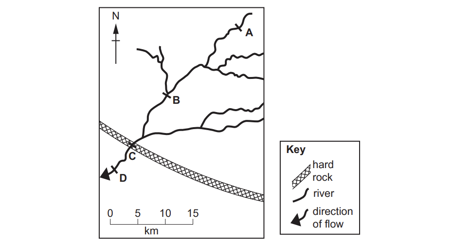

**Fig. 4.1**

**Fig. 4.2**

(i)

Which location **A, B, C** or **D** is the most likely position of the waterfall shown in Fig. 4.2?

[1]

(ii)

Identify features **X** and **Y** in Fig. 4.2.

**X** .............................................

**Y **.............................................

[2]

(iii)

Explain why a gorge may form downstream of a waterfall.

[3]

*Source: June 2021 0460/12 Q4A*

### Q25 — easy — 6 marks

**Q25** [6 marks]

Study Fig. 3.1, which shows information about flows through a drainage basin.

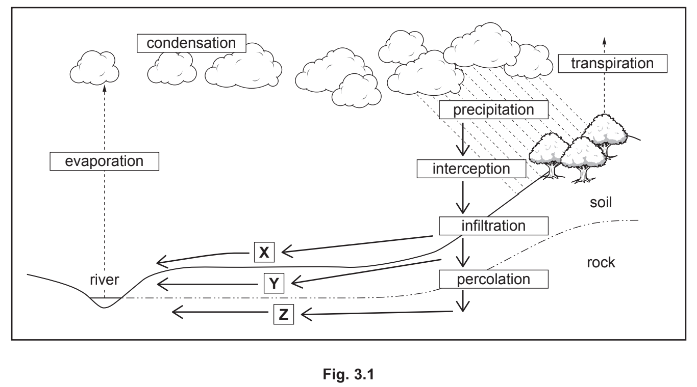

(i)

What is meant by transpiration?

[1]

(ii)

Explain why the amount of interception varies: 
-  from place to place
-  at different times of the year.

[2]

(iii)

Identify the processes which take place at X, Y and Z in Fig. 3.1.

X ...................................................................................................... Y ...................................................................................................... Z .......................................................................................................

[3]

*Source: Nov 2020 0460/12 Q3A*

### Q26 — easy — 4 marks

**Q26** [4 marks]

Study Fig. 3.1, which is a flow diagram showing processes in a drainage basin.

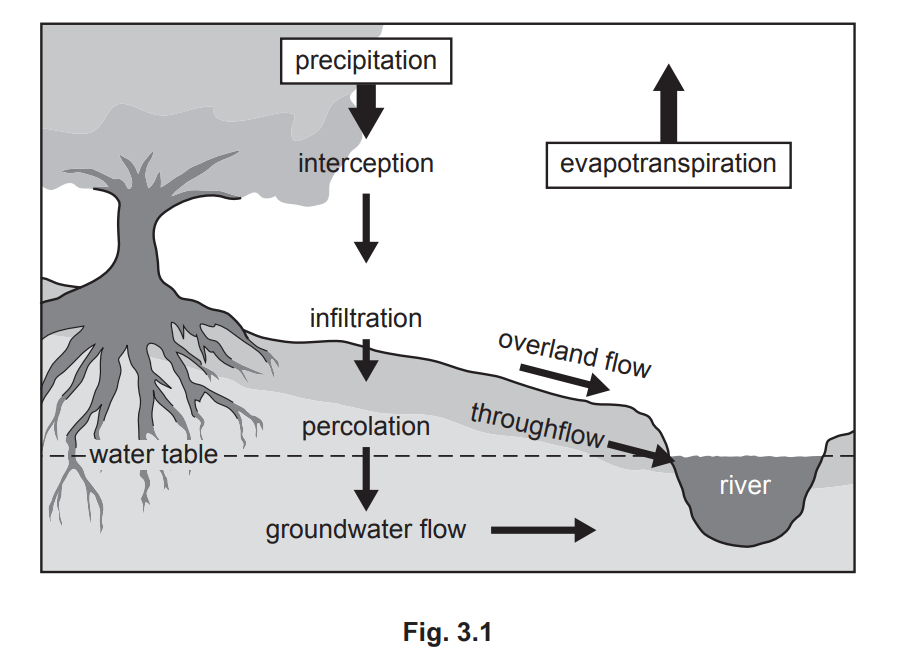

(i)

What is a drainage basin?

[1]

(ii)

Which of the following statements are correct?

[2]

Tick (✓) two statements in the table below:

|   | Tick (✓) |
|---|---|
| Overland flow occurs under the surface of the land. |   |
| Water percolates from the surface into the soil. |   |
| Groundwater flow moves water through the rocks. |   |
| Water flows to the river on the surface by throughflow. |   |
| Interception occurs when water vapour is evaporated. |   |
| Infiltration occurs when water soaks into the soil. |   |

(iii)

Explain why overland flow may occur in a drainage basin.

[3]

*Source: 2020 May/June 0460/13 Q3A*

### Q27 — easy — 3 marks

**Q27** [3 marks]

Study Fig. 4.2, which is a map of the delta of the Pearl River in China.

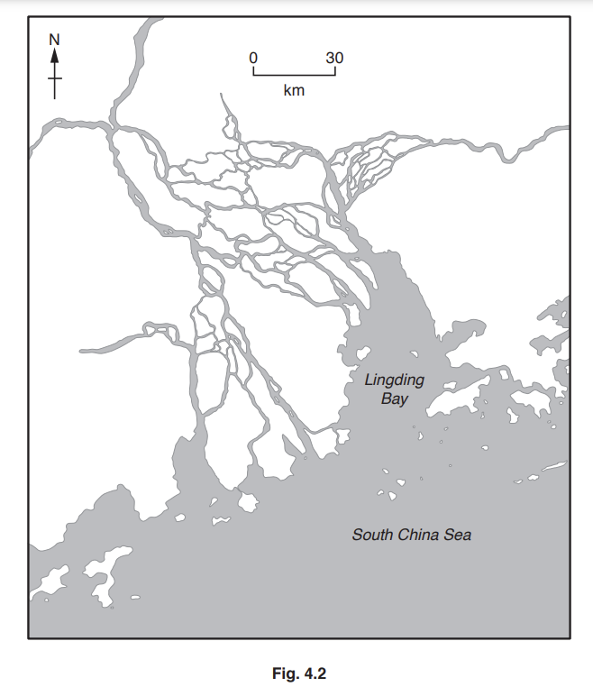

Using Fig. 4.2 only, describe the characteristics of the Pearl River delta.

*Source: Nov 2019 0460/13 Q4B*

### Q28 — easy — 3 marks

**Q28** [3 marks]

Study Figs. 3.2, 3.3 and 3.4, which are photographs of three different rivers.

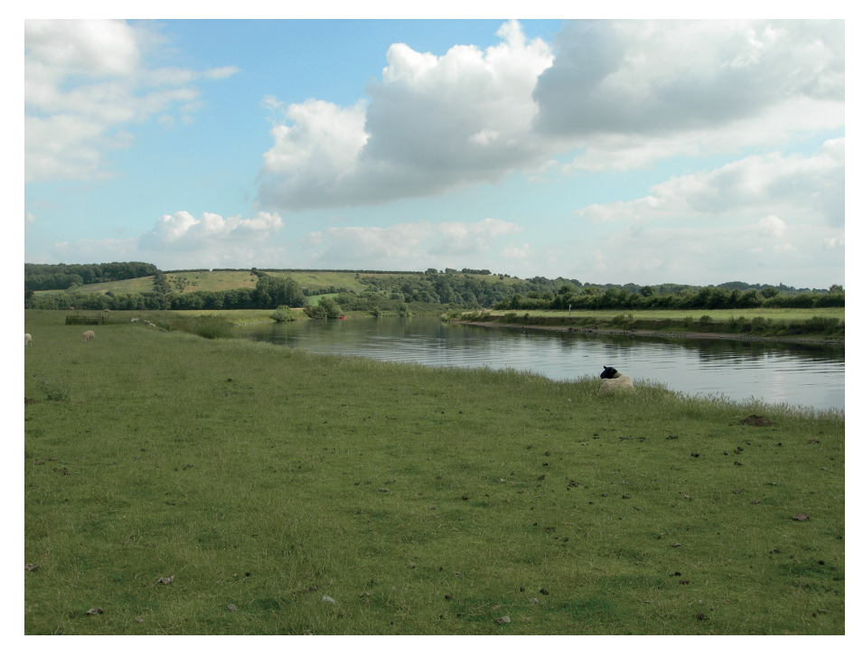

**Fig 3.2**

**Fig 3.3**

**Fig 3.4**

Using evidence from Figs. 3.2, 3.3 and 3.4 **only**, describe **three** different benefits of living near a river.

*Source: Nov 2019 0460/11 Q3B*

### Q29 — easy — 6 marks

**Q29** [6 marks]

Study Fig. 4.1, which is a photograph of part of a river.

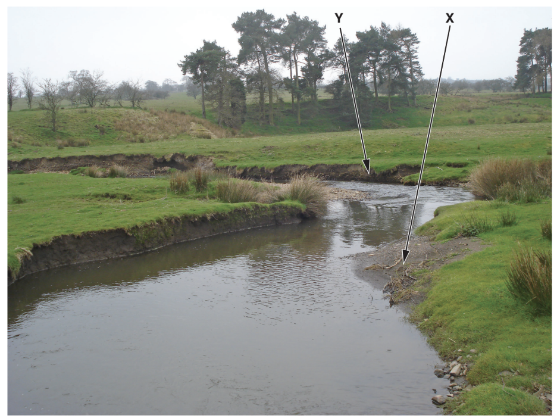

**Figure 4.1 **

(i)

What river feature is shown in Fig. 4.1? Underline **one** answer in the list below: confluence    meander    potholes    source

[1]

(ii)

Describe two characteristics of the feature labelled X on Fig. 4.1.

1 ........................................................ 
2 ........................................................

[2]

(iii)

Explain how the feature labelled Y on Fig. 4.1 was formed.

[3]

*Source: Nov 2019 0460/13 Q4A*

### Q30 — easy — 5 marks

**Q30** [5 marks]

Study Fig. 3.1, which shows a river drainage basin.

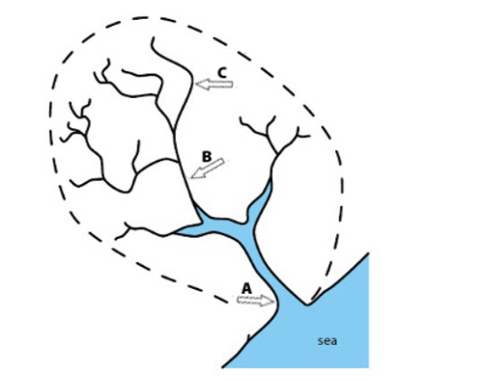

**Fig. 1**

(i)

Using Fig. 1, identify the following river features:

**A **= …………………………… [1]

**B** = …………………………… [1]

**C** = …………………………… [1]

(ii)

Identify the following hydrological processes which operate in a drainage basin. Choose your answers from the list below:

evaporation

condensation

precipitation

interception

transpiration

**1 – **the change of water from a liquid to a gas (water vapour) due to heat from the sun ……………………………….

[1]

**2 – **when plants release water vapour from their leaves ……………………………….

[1]

### Q31 — easy — 4 marks

**Q31** [4 marks]

Suggest reasons why the amount of infiltration may vary

### Q32 — medium — 4 marks

**Q32** [4 marks]

Study Fig. 4.1, which is information about flooding which was predicted for the area around the Mississippi River, USA, in December 2015.

Suggest how the urban area of St Louis could be protected from flooding.

*Source: Nov 2019 0460/12 Q4A*

### Q33 — medium — 4 marks

**Q33** [4 marks]

State two different methods to reduce river flooding. For each method explain how it works.

Method 1 .........................................................................................

Explanation ....................................................................................

Method 2 ........................................................................................

Explanation .....................................................................................

*Source: 2020 May/June 0460/11 Q4A*

### Q34 — medium — 4 marks

**Q34** [4 marks]

Describe the human causes of flooding

### Q35 — medium — 4 marks

**Q35** [4 marks]

Describe methods used to manage the impacts of river flooding

### Q36 — medium — 5 marks

**Q36** [5 marks]

Study Fig. 3.2, which is a photograph showing a waterfall.

***Figure 3.2 High Force, River Tees***

Suggest how the waterfall shown in Fig. 3.2 was formed.

*Source: 2020 May/June 0460/13 Q3B*

### Q37 — medium — 5 marks

**Q37** [5 marks]

Study Fig. 4.2, which is a map of the delta of the Pearl River in China.

Explain how a delta is formed. You may include a labelled diagram.

*Source: Nov 2019 0460/13 Q4B*

### Q38 — medium — 5 marks

**Q38** [5 marks]

Explain how rivers erode their valleys.

*Source: Nov 2020 0460/12 Q3B*

### Q39 — medium — 4 marks

**Q39** [4 marks]

Study Fig. 4.1, which is a photograph of part of a river.

**Figure 4.1 **

Suggest how the course of the river shown in Fig. 4.1 may change in the future as a result of natural processes.

*Source: Nov 2019 0460/13 Q4A*

### Q40 — medium — 5 marks

**Q40** [5 marks]

Study Figs. 3.2, 3.3 and 3.4, which are photographs of three different rivers.

**Fig 3.2**

**Fig 3.3**

**Fig 3.4**

Explain why living on a delta or near a river may be hazardous for people.

*Source: Nov 2019 0460/11 Q3B*

### Q41 — medium — 4 marks

**Q41** [4 marks]

Study Fig. 3.1, which shows different parts of a river and its valley.

Explain why deposition is likely to take place in the area shown in A in Fig. 3.1.

*Source: Nov 2019 0460/11 Q3A*

### Q42 — medium — 9 marks

**Q42** [9 marks]

Study Fig. 4.3, which is a map of an area in Asia where river flooding occurred.

**Fig. 4.3**

(i)

Suggest reasons why the rivers flooded in the areas shown in Fig. 4.3.

[4]

(ii)

Suggest the methods which could be used in the area shown in Fig. 4.3 to prevent flooding.

[5]

*Source: June 2021 0460/12 Q3B*

### Q43 — medium — 5 marks

**Q43** [5 marks]

Study Fig. 4.2,  which is a photograph of a river in an upland area.

**Fig 4.2**

Explain how the river shown in Fig. 4.2 is likely to carry out erosion.

*Source: 2020 May/June 0460/11 Q4B*

### Q44 — medium — 4 marks

**Q44** [4 marks]

Cawston Creek is a small river in Canada. On the outline map, Fig. 3.2 below, mark with

arrows and label the following:    
- a source (label S)    
- a confluence (label C)    
- a tributary which is less than 1km long (label T)    
- the watershed (label W)

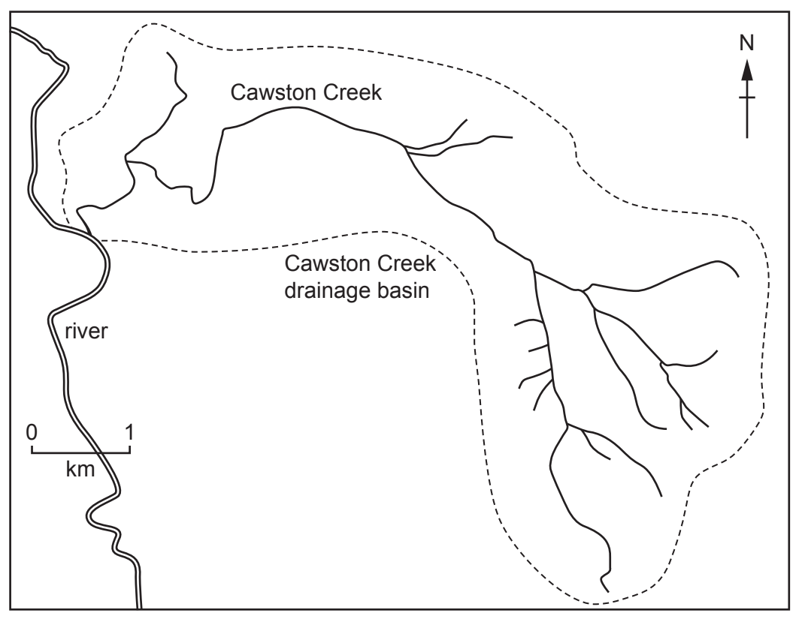

*Source: Nov 2020 0460/12 Q3A*

### Q45 — medium — 4 marks

**Q45** [4 marks]

Describe the changes in the characteristics of a river from its source to its mouth using the following headings:

width ...............................................................................................

depth .............................................................................................

speed of flow ..................................................................................

gradient ...........................................................................................

*Source: 2020 May/June 0460/13 Q3A*

### Q46 — medium — 5 marks

**Q46** [5 marks]

Study Fig. 4.2, a map of Lake Mary, an oxbow lake next to the Mississippi River.

Explain how an oxbow lake is formed. You may include a labelled diagram or diagrams.

*Source: Nov 2019 0460/12 Q4B*

