# Exam Questions — Coasts
**The Natural Environment** · Cambridge (CIE) IGCSE geography (0460 & 0976)
> Source: [https://www.savemyexams.com/igcse/geography/cie/20/topic-questions/](https://www.savemyexams.com/igcse/geography/cie/20/topic-questions/) · 28 questions across 1 sets

## Paper 1 (28 questions)

### Q1 — hard — 7 marks

**Q1** [7 marks]

For a named coastal area you have studied, describe the impacts of a tropical storm.

Name of coastal area .........................

*Source: Oct/Nov 2019 0460/12 Q3C*

### Q2 — hard — 7 marks

**Q2** [7 marks]

For a named coastal area you have studied, explain how coastal erosion has affected the people who live there.

Name of coastal area .................................................................

*Source: 2020 May/June 0460/13 Q4C*

### Q3 — hard — 7 marks

**Q3** [7 marks]

For a named area of coast you have studied, explain what is being done to manage coastal erosion. Name of area ............................

[7]

*Source: Spec 2020 0460/01 Q3C*

### Q4 — hard — 7 marks

**Q4** [7 marks]

Describe the features of a sand spit and explain how it has been formed. You may include a labelled diagram.

*Source: Nov 2020 0460/13 Q3C*

### Q5 — hard — 7 marks

**Q5** [7 marks]

For a named coastal area you have studied, describe how it is being protected from coastal erosion.

Name of area ..........................................

*Source: May/Jun 2020 0460/12 Q3C*

### Q6 — hard — 7 marks

**Q6** [7 marks]

For a named coastal area you have studied, describe attempts to manage erosion.

Name of coastal area.........

*Source: Oct/Nov 2020 0460/11 Q3C*

### Q7 — hard — 7 marks

**Q7** [7 marks]

For a named area of coastline you have studied, explain how it provides opportunities for people.

Area of coastline ................................................

*Source: March 2021 0460/12 Q4C*

### Q8 — easy — 10 marks

**Q8** [10 marks]

Study Fig. 4.1, which shows information about beaches at a coastal area in Norfolk, UK.

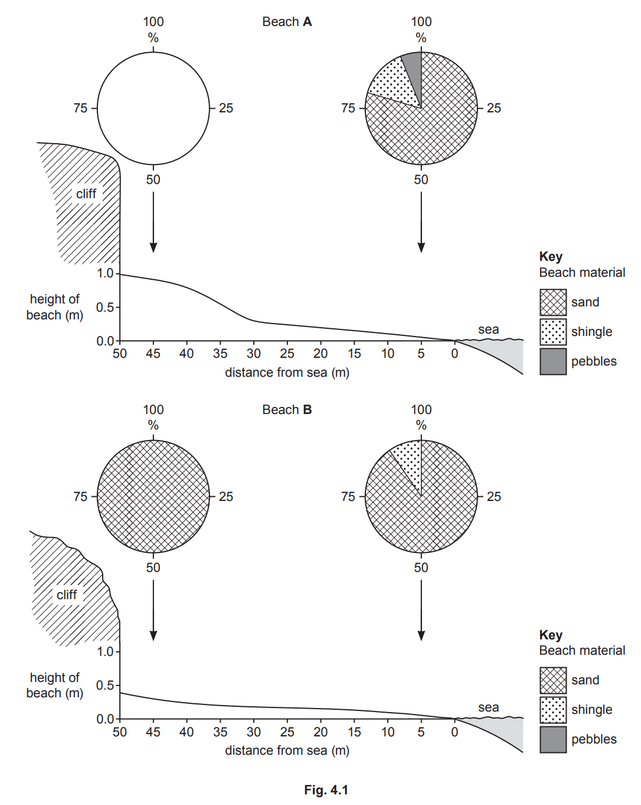

(i)

**Complete Fig. 4.1** to show the following information:

Beach **A** has 50% shingle and 50% pebbles next to the cliff.

[1]

(ii)

Compare the **material **of Beach **A** and Beach **B**.

[3]

(iii)

Identify two differences between the cross sections of Beach A and Beach B.

1 ....................................................................................................... 2 ......................................................................................................

[2]

(iv)

Explain why beaches consist of different materials.

[4]

*Source: 2020 May/June 0460/13 Q4A*

### Q9 — easy — 10 marks

**Q9** [10 marks]

Study Photograph 3.1, which shows a beach where coastal deposition is taking place.

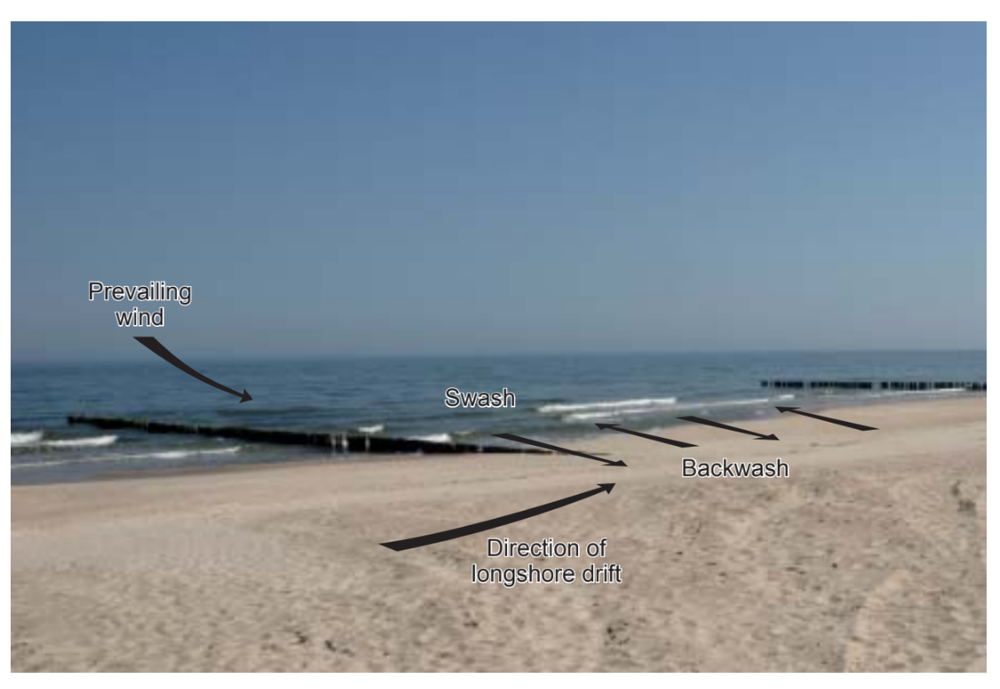

(i)

What is meant by coastal deposition?

[1]

(ii)

The waves shown on Photograph 3.1 are constructive waves. Describe two characteristics of constructive waves.

[2]

(iii)

Use the labelling on Photograph 3.1 to explain how longshore drift occurs.

[3]

(iv)

Spits are formed by longshore drift.

Describe the main features of a spit.

[4]

*Source: Spec 2020 0460/01 Q3A*

### Q10 — easy — 3 marks

**Q10** [3 marks]

Study Fig. 3.2,** **which is a photograph showing an area of coastline in the northwest of England.

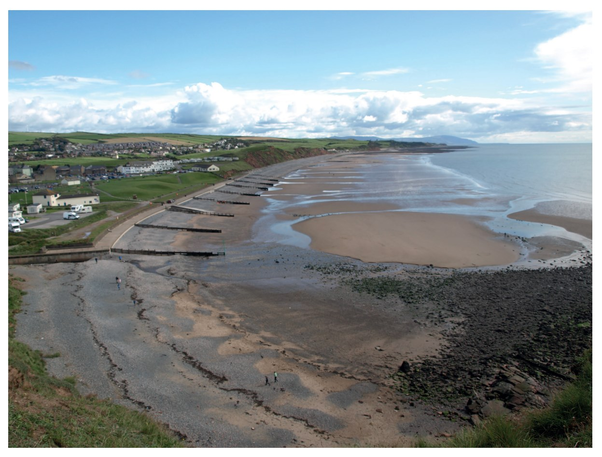

Describe and suggest reasons for the variation in beach material in the bay.

*Source: Nov 2020 0460/13 Q3B*

### Q11 — easy — 3 marks

**Q11** [3 marks]

Study Photograph 3.2 (below), which shows an area where coastal erosion is taking place.

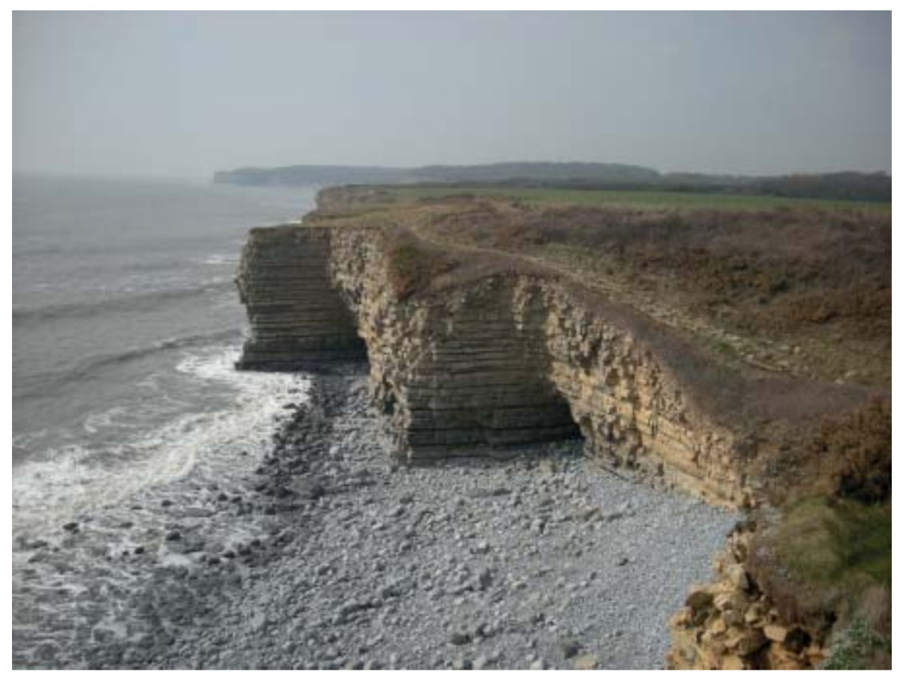

Give three pieces of evidence that coastal erosion has occurred in the area shown by Photograph 3.2.

*Source: Spec 2020 0460/01 Q3C*

### Q12 — easy — 10 marks

**Q12** [1 mark]

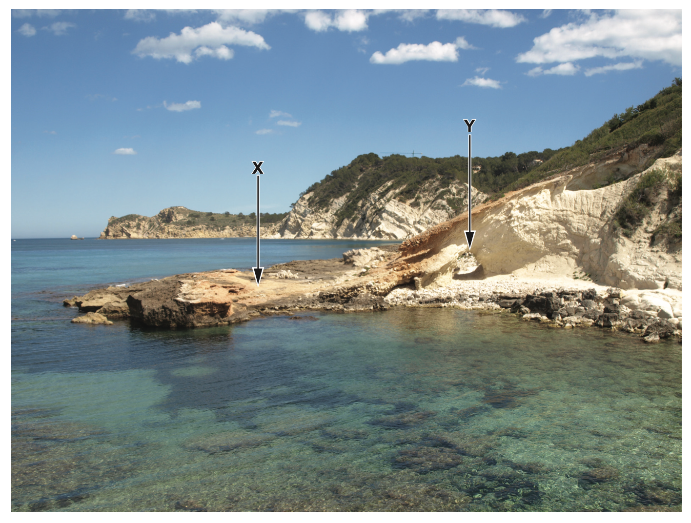

**Figure 3.1**

Study Fig. 3.1, which is a photograph of a coastal area in Spain.

What coastal landform is marked by an **X **in Fig. 3.1?

[1]

*Source: Oct/Nov 2020 0460/11 Q3A (I)*

**Q12** [2 marks]

Describe **two **characteristics of coastal landform **X**.

*Source: Nov 2020 0460/11 Q3A (II)*

**Q12** [3 marks]

Explain how the natural arch, marked **Y **in Fig. 3.1, was formed by coastal erosion.

*Source: Nov 2020 0460/11 Q3A (III)*

**Q12** [4 marks]

Suggest reasons why the coastline shown in Fig. 3.1 is **not **straight.

*Source: Nov 2020 0460/11 Q3A (IV)*

### Q13 — easy — 3 marks

**Q13** [3 marks]

Study Fig. 3.2 (below), which is a photograph showing an area of mangroves.

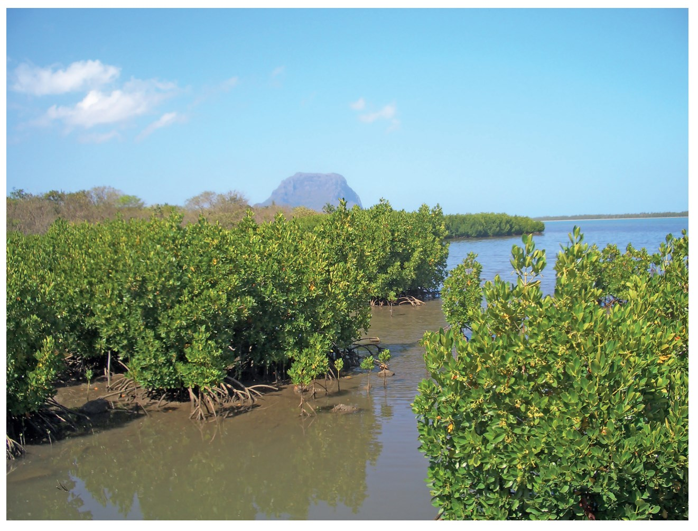

Describe three characteristics of the mangroves shown in Fig. 3.2.

*Source: June 2020 0460/12 Q3B*

### Q14 — easy — 3 marks

**Q14** [3 marks]

Study Fig. 3.2, a map of Tobago, in the Caribbean, which shows coral reefs.

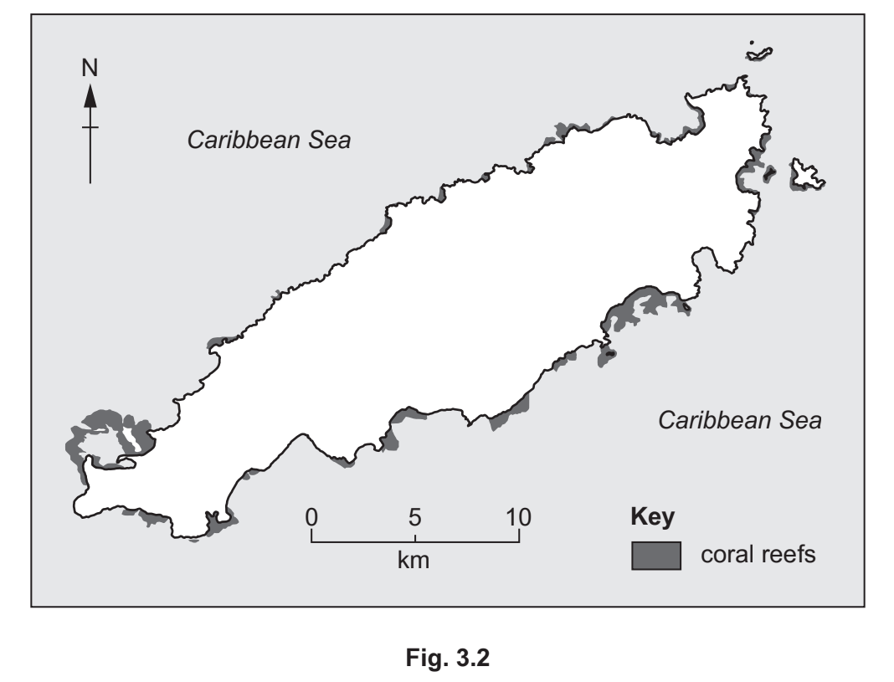

Describe the distribution of coral reefs shown in Fig. 3.2.

*Source: Oct/Nov 2020 0460/11 Q3B*

### Q15 — easy — 6 marks

**Q15** [6 marks]

Study Fig. 4.1, which shows Golden Bay on New Zealand’s South Island.

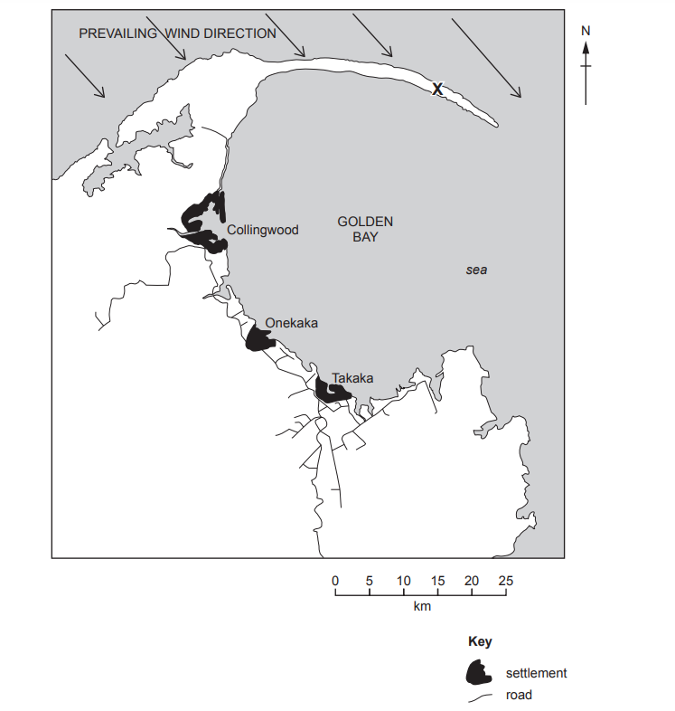

**Fig.4.1**

(i)

Which type of coastal landform is labelled **X**?

[1]

(ii)

What is the distance (measured in a straight line) and the direction from Onekaka to the eastern end of coastal landform **X**?

Distance ................................................................. km 
Direction .......................................................................

[2]

(iii)

Suggest how coastal landform **X** was formed by coastal processes.

[3]

*Source: March 2021 0460/12 Q4A*

### Q16 — easy — 2 marks

**Q16** [2 marks]

State two differences between constructive and destructive waves

### Q17 — easy — 10 marks

**Q17** [10 marks]

Study Fig. 3.1 (below), which is a photograph showing an area where coastal erosion has taken place.

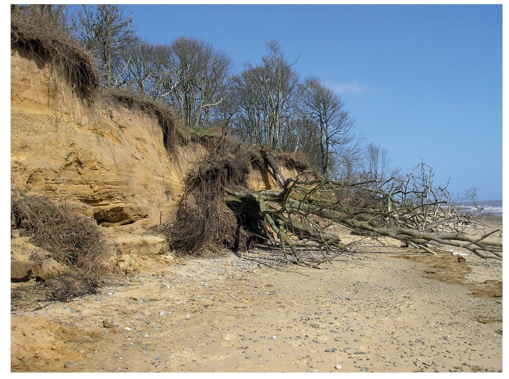

(i)

Give one piece of evidence from Fig. 3.1 that the cliff has been eroded.

[1]

(ii)

Explain how hydraulic action is likely to have eroded the cliff shown in Fig. 3.1.

[2]

(iii)

Name **one** other process of coastal erosion. Explain how it is likely to have eroded the cliff shown in Fig. 3.1.

Process of coastal erosion ............................

Explanation ...........................

[3]

(iv)

Managed retreat is a strategy where the coast is allowed to erode.

Suggest reasons why the authorities decided to allow managed retreat to occur along the section of coastline shown in Fig. 3.1 rather than protecting it from erosion.

[4]

*Source: June 2020 0460/12 Q3A*

### Q18 — easy — 6 marks

**Q18** [6 marks]

Study Fig. 3.1, which is a map showing the location of coral reefs around Martinique (an LEDC in the Caribbean).

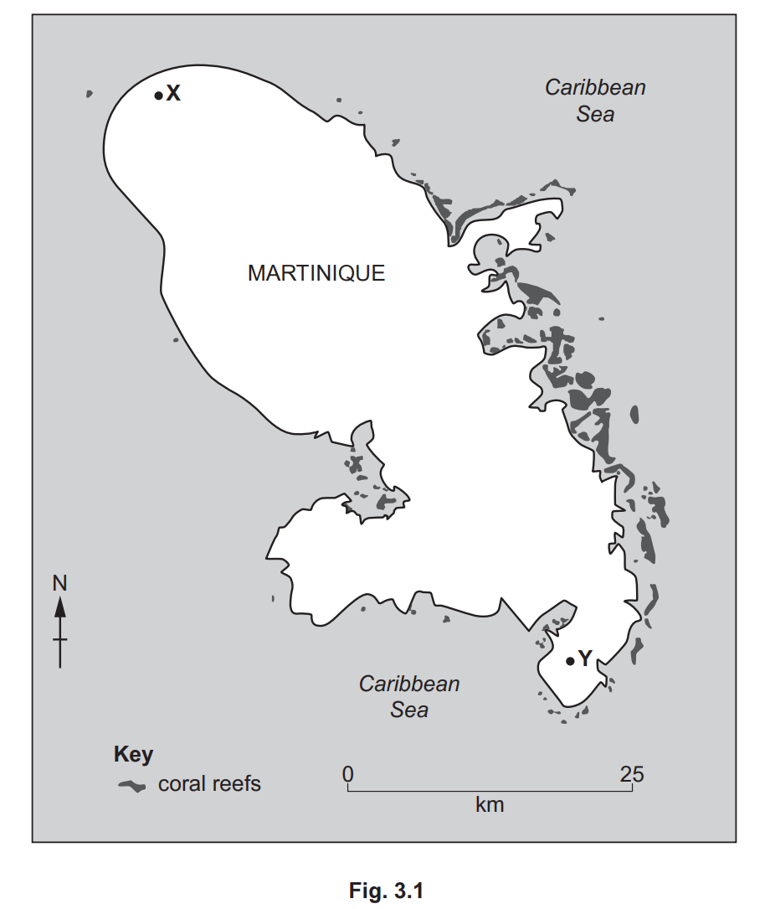

(i)

What is the length of Martinique from X to Y? ...................................................... km

[1]

(ii)

Describe the distribution of coral reefs shown in Fig. 3.1.

[2]

(iii)

Describe three conditions required for the growth of coral reefs.

[3]

*Source: Nov 2020 0460/13 Q3A*

### Q19 — easy — 3 marks

**Q19** [3 marks]

Study Figs. 4.2, 4.3 and 4.4 (Insert), which are photographs which show different features formed on a headland.

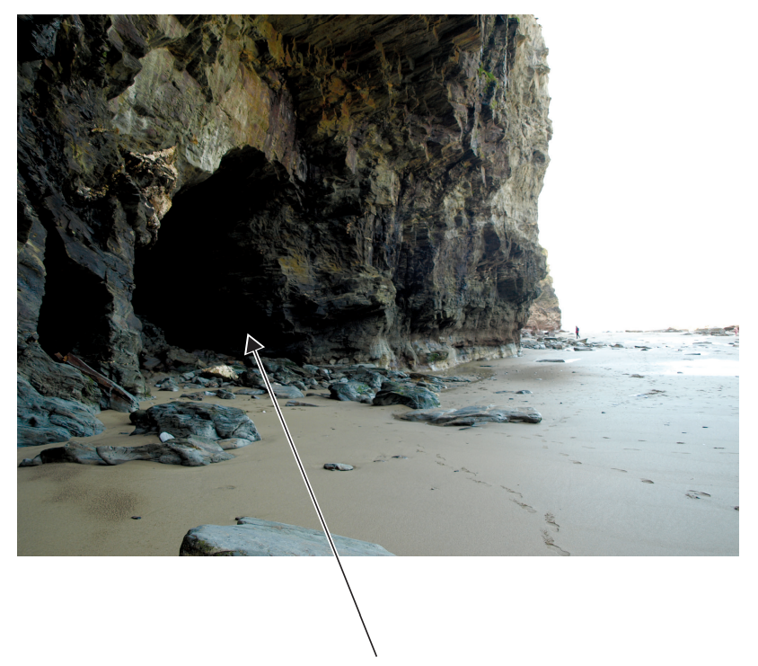

**Fig.4.2**

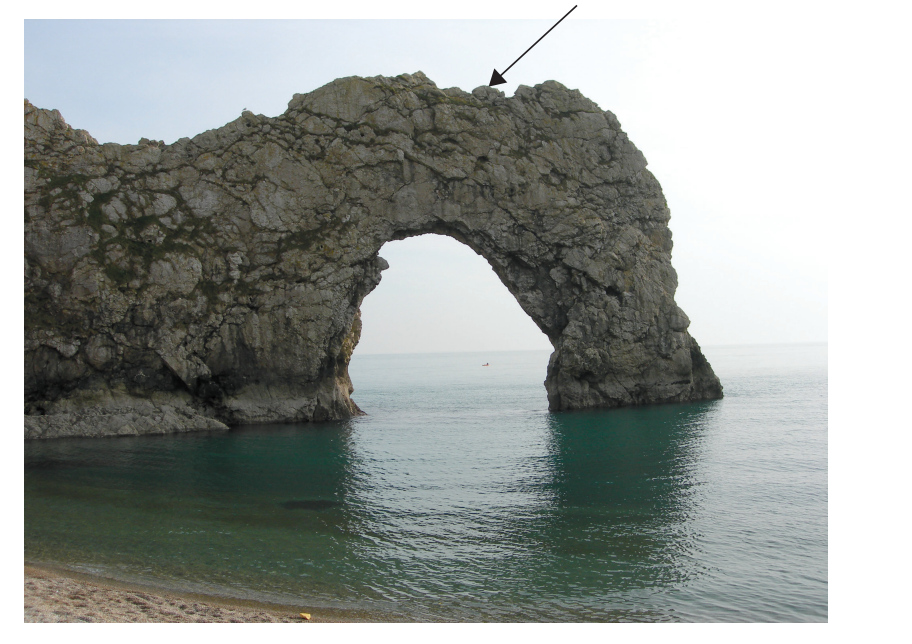

**Fig.4.3**

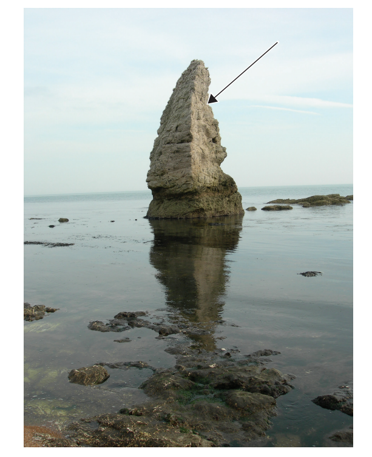

**Fig.4.4**

Identify the coastal landform shown by the arrows in each of Figs. 4.2, 4.3 and 4.4.

Fig. 4.2 .......................................................................................

Fig. 4.3 .......................................................................................

Fig. 4.4 .......................................................................................

*Source: March 2021 0460/12 Q4B*

### Q20 — medium — 4 marks

**Q20** [4 marks]

Study Fig. 4.1, which shows Golden Bay on New Zealand’s South Island.

**Fig.4.1**

Suggest reasons why there are many beaches in Golden Bay.

*Source: March 2021 0460/12 Q4A*

### Q21 — medium — 5 marks

**Q21** [5 marks]

Study Photograph 3.2 (below), which shows an area where coastal erosion is taking place.

Explain why coastal erosion is much more rapid on some coasts than others.

*Source: Spec 2020 0460/01 Q3B*

### Q22 — medium — 5 marks

**Q22** [5 marks]

Study Fig. 3.2 (below), which is a photograph showing an area of mangroves.

Describe the conditions which are required for the development of a mangrove swamp.

*Source: June 2020 0460/12 Q3B*

### Q23 — medium — 5 marks

**Q23** [5 marks]

Study Figs. 4.2, 4.3 and 4.4 (Insert), which are photographs that show different features formed on a headland.

**Fig.4.2**

**Fig.4.3**

**Fig.4.4**

Explain how coastal landforms on a headland, such as those shown in Figs. 4.2, 4.3 and 4.4, are formed by coastal erosion.

*Source: March 2021 0460/12 Q4B*

### Q24 — medium — 5 marks

**Q24** [5 marks]

Study Fig. 4.2 (below), which is a photograph of an area of coastal sand dunes.

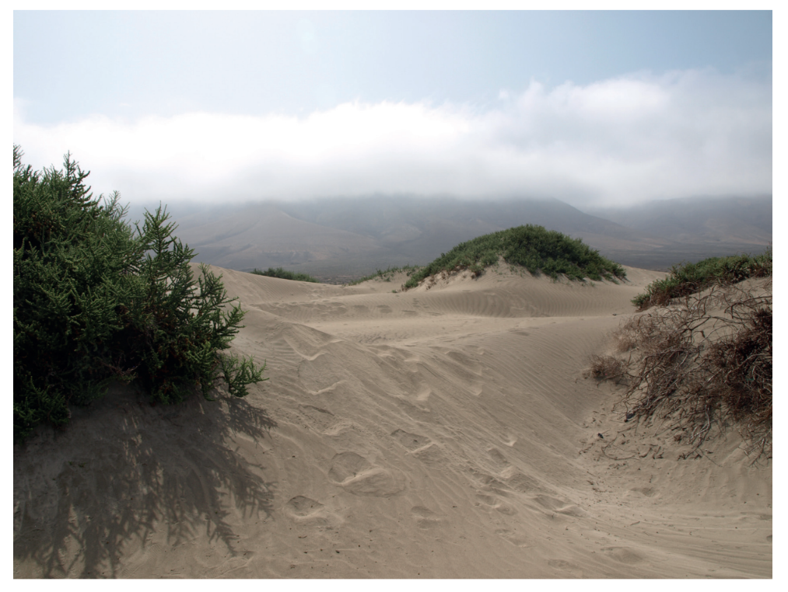

Suggest how the coastal sand dunes shown in Fig. 4.2 were formed.

*Source: 2020 May/June 0460/13 Q4B*

### Q25 — medium — 5 marks

**Q25** [5 marks]

Study Fig. 3.2,** **which is a photograph showing an area of coastline in the northwest of England.

Using evidence from Fig. 3.2, explain how coastal erosion has been managed.

*Source: Nov 2020 0460/13 Q3B*

### Q26 — medium — 5 marks

**Q26** [5 marks]

Explain how a wave cut platform is formed

### Q27 — medium — 5 marks

**Q27** [5 marks]

Study Fig. 3.2, a map of Tobago, in the Caribbean, which shows coral reefs.

Describe the conditions required for the development of coral reefs.

*Source: Oct/Nov 2020 0460/11 Q3B*

### Q28 — medium — 5 marks

**Q28** [5 marks]

Study Fig. 3.2,** **which is a photograph showing an area of coastline in the northwest of England.

Suggest why bays and headlands have formed along the coastline shown in Fig. 3.2.

*Source: Nov 2020 0460/13 Q3B*

