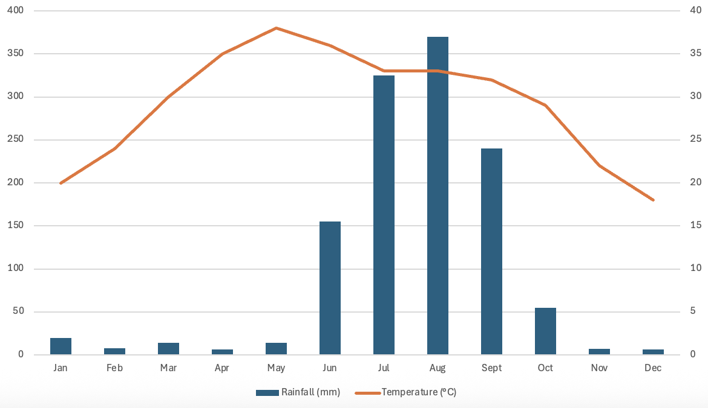

# Mark Schemes — Weather
**The Natural Environment** · Cambridge (CIE) IGCSE geography (0460 & 0976)

## Paper 1 (13 questions)

### Q1
The white reflects the sun's rays **[1]**, which ensures that the heat does not affect the temperature readings. **[1]**

Sides are slatted so that air can circulate **[1]**, ensuring that the temperature reading is accurate. **[1]**

> **[mark-scheme]**
> The command word 'explain' means that the answer needs to outline why the feature is needed to ensure accurate readings.
> 
> **Mark allocation**
> 
> - **One mark** for each valid explanation (up to a maximum of 2 marks)
> - **One mark** for the development of each explanation (up to a maximum of 2 marks)
> 
> **[4 marks]**

### Q2
> **[mark-scheme]**
> The term 'climate'. refers to:
> 
> **The average weather conditions taken over a period of 30 years. ****[1 mark]**

*Fig.3.3. Completed graph*

> **[mark-scheme]**
> **Mark allocation**
> 
> - **One mark** for the correct plotting of temperature
> - **One mark** for the correct plotting of precipitation
> 
> **[2 marks]**
There is a wet season between June and September** ****[1]** where rainfall peaks at 360 mm. **[1]**  The temperature ranges from 18 to 38 degrees and is warmest in May. **[1]**

> **[mark-scheme]**
> **Mark allocation**
> 
> - **One mark** for each valid response
> 
> **[3 marks]**
> 
> **Alternative content**
> 
> The answer above is just one example of how to respond to this question. Additional information that could be used in the answer includes:
> 
> - The lowest rainfall are April, November and December
> - The lowest temperature is in December: 18°C

### Q3
(i)

Wind vane **[1]**

(ii)

<u>Examples:</u> 
Look at direction arrow is pointing/arrow points to SW**[1]** 
Wind is blowing from that direction **[1]**

(iii)

<u>Examples:</u> 
On a roof/on top of a pole; **[1]** 
So it is higher than surrounding buildings/features; **[1]** 
So there is nothing to block the wind **[1]** 
Any other suitable response

(iv)

Examples: 
Easy to read/quick; **[1]**
 More accurate/less errors; **[1]**
 Collects data automatically/no need for people to check; **[1]** Collects data continuously; **[1]** 
Linked to computer; **[1]** 
Provides immediate results/graphs results automatically **[1]** 
Any other suitable response

### Q4
(i)

C is a barometer **[1]**

(ii)

Atmospheric pressure = 992 mb **[1]** 
Maximum temperature = 23/24°C **[1]**

(iii)

<u>Examples;</u>

Read off wet and dry bulb temperatures; **[1]** 
Work out difference between wet and dry bulb; **[1]** 
Use humidity table/chart; **[1]** 
Observe where dry bulb temperature and difference between wet and dry bulb temperatures intersect on humidity table, **[1]**

### Q5
(i)

Rainfall **[1]**

(ii)

A wet and dry (bulb) thermometer/hygrometer is used to measure humidity.**[1]** 
A wind vane/weather vane/wind cock/windsock is used to measure wind direction **[1]**

(iii)

Any three from examples such as:

- Use a rain gauge/digital rain gauge;**[1] **
- Collecting jar with funnel/linked to computer; **[1]**
- Water poured into a measuring cylinder/water is read from jar/measured using a scale; **[1]**
- Put out in the open/area which is not sheltered by trees/buildings/buried in the ground (maximum one site); **[1]**
- Take measurements every 24 hours/fixed period/same time of day etc. **[1]**

### Q6
Any four from examples such as:

- Screen is painted white so that it reflects heat or sunlight/reduces direct heating by the sun/does not absorb sunlight; **[1]**
- Sides have slats/louvres/have spaces/gaps/not solid so that air can circulate; **[1]**
- Screen/box is made of wood so that heat is not conducted into it; **[1]**
- Roof is made of a double layer of wood so that air space maintains a constant temperature; **[1]**
- Screen stands more than 1m/raised on legs above the ground so that instruments are not affected by heat from the ground; **[1]**
- Door opens to the north in the northern hemisphere/to the south in the southern hemisphere to avoid sun’s rays.
- *To gain maximum marks, the feature and its reason is needed*
- *You can draw a diagram and annotate to gain full marks, but there must be a reason for the feature*

### Q7
- *Remember to take a ruler, pencil, rubber and sharpener with you to the exam*
- *Remember the rules of geographical sketching*

  - *In a box, with a title*
  - *Arrows to the feature and never cross the arrows*
  - *Draw in pencil and use a ruler for straight lines*
  - *Labels/annotations are horizontal to the arrow and written in pen*
  - *Use shading and colour to enhance the diagram*

Diagram of wind vane/wind sock **[1]** 
Compass points: N,S,E,W. **[1]** 
Labelling of arrow/pointer; **[1]** 
Labelling of pole/roof/chimney/church or similar (showing wind vane is above ground level) **[1]**

### Q8
(i)

Barometer **[1]**

(ii)

<u>Examples</u>:

They are more accurate/reliable/precise; **[1]** 
It is quicker/easier/faster to use/read them; **[1]** 
There is less chance of human error; **[1]** 
They can automatically plot results, etc. **[1]**

(iii)

<u>Examples:</u>

Wooden construction; **[1]** 
Painted white; **[1]** 
Slatted/louvres/air holes/ventilation; **[1]** 
Insulated roof/2 layers on roof; **[1]** 
Above ground level/on legs/1.25–2 metres. **[1]**

(iv)

<u>Examples:</u>

Away from buildings/in the open/not sheltered; **[1]** 
Away from trees/in the open/not sheltered (only credit ‘in the open’ and ‘not sheltered’ once); **[1]** 
On grass/not on concrete/ground type; **[1]** 
Security/fence around; **[1] ** 
Doors open away from sun/direction doors face. **[1]**

<u>Explanations include:</u>

So, it is not sheltered; **[1]**
So is not shaded; **[1]** 
To avoid ground radiation; **[1]** 
So, don’t block wind; **[1]** 
So not tampered with, etc. **[1]**

**1 mark** for stating the **factor**, and another **mark **for explaining **why **it is important **Note: No mark for explanation without factor.**

### Q9
(i)

<u>Examples include:</u>

Painted white to reflect sun’s rays/heat/absorbs less heat **[1]** 
On legs so it is not affected by ground temperatures **[1]** 
Made from wood so it does not absorb heat/retain heat/does not conduct heat **[1]**

(ii)

<u>Examples include:</u>

In the open/away from buildings;    
So that it is not affected by heat from buildings; [**1]**
To avoid being in the shade/shadow of the building during parts of the day **[1]** 
Away from trees;
So that it is not sheltered/avoid being in the shade/shadow; **[1]** On grass;
Which does not absorb heat;**[1]** 
Away from the general public;
To avoid tampering/vandalism, etc. **[1]**

### Q10
(i)

<u>Examples include:</u>

Locate above level of buildings/locate on a roof/high up **[1]** 
Do not locate under trees/plants/vegetation; **[1]** 
Do not locate between buildings/in shelter of buildings; **[1]** 
Put **[1]** them in the open/not sheltered/not in shade (allowed as alternative to point two or three, no other credit for those two lines);

- *With questions like these, it is important not to duplicate your answer by wording it slightly differently*

(ii)

<u>Examples include:</u>

Greater accuracy; **[1]** 
Human errors are eliminated; **[1]** 
More precise readings/exact readings/readings to several decimal points; **[1]** 
No need to read the instruments/automatic recording/saves time/faster/easier to read; **[1]** 
Data obtained is continuous/no dates are omitted; **[1]** 
Data can instantly be processed/stored/logged on computer; **[1]** 
Instant analysis/graphing by computer; **[1]** 
Instruments are always in position/no need to handle instrument/less likely to break instruments **[1]**

### Q11
(i)

<u>Explanation includes:</u>

**[1]** mark reserved for stating (Campbell Stokes) or sunshine recorder

Insert/replace card/paper; **[1] **
Leave for/check after 24 hours/set period of time; **[1]** Measure/record/see/observe length of burn line on card, etc. **[1]** **[2] marks available for e**xplanation even if name of instrument is incorrect

(ii)

<u>Examples include:</u>

Choose set/the same times during the day/at a given time/examples of times; **[1]** 
Observe at several times each day/e.g. early morning, midday and late afternoon; **[1]** 
Look up at the sky; **[1]** 
Identify cloud types using an identification chart/looking at vertical extent/shape of clouds; **[1]** 
Estimate cover/use a grid to look through; **[1]** 
Record names/cover of cloud types in table/chart/diary; **[1]** Record cloud cover in oktas/eighths, etc. **[1]** 
Note: Marks for development must be for what the student does, not for naming cloud types.

### Q12
(i)

<u>Examples include:</u>

Both fluctuate; **[1]** 
Generally higher at 09:00/lower at 15:00; **[1]** 
With exceptions; **[1]**    e.g. 10 August; 
Statistics supporting any of the above **[1]**

(ii)

<u>Examples include:</u>

Observe at set times each day; **[1]**
Use wet and dry bulb thermometer/hygrometer; **[1]** 
Observe temperatures on both thermometers; **[1]** 
Work out difference between wet and dry bulb temperatures; **[1]** Use a relative humidity table; **[1]** 
Read off value where dry bulb temperature intersects with difference between wet and dry bulb **[1]** 
Etc.

### Q13
(i)

7 (oktas) **[1]**

(ii)

Most rainfall = 11th (Oct) **[1]  **smallest range of temperature = 4th (Oct ) **[1]**

(iii)

<u>Examples include -</u> on the 19th Oct there was:

More cloud cover; **[1]** 
More rainfall; **[1]** 
Higher <u>minimum</u> temperature; **[1]** 
Lower <u>maximum</u> temperature; **[1]** 
Smaller temperature range. **[1]**

NB Accept reverse answers but no double credit.

- *Make sure to read the question fully, as in this instance it states not to use statistics and therefore, you would gain no marks for adding temperatures etc. *

(iv)

**[2]** marks for weather characteristics and **[2]** for correctly linked instruments such as:

Humidity **[1] measured using a w**et and dry (bulb) thermometer/hygrometer; **[1]** (Campbell Stokes) sunshine recorder **[1]** measures <u>hours</u> of sunshine/sunlight; **[1]** 
Wind direction **[1] **measured with a wind sock or vane from the direction of wind travel; **[1] **
Wind speed **[1]**  measured with an anemometer; **[1]** Air/atmospheric pressure** [1] measured** with a barometer **[1]** Etc.

<u>NB</u> Instrument must be credited first

- *The second mark will only be given if the instrument is named*
