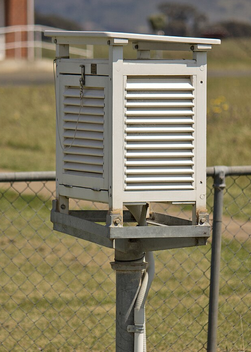
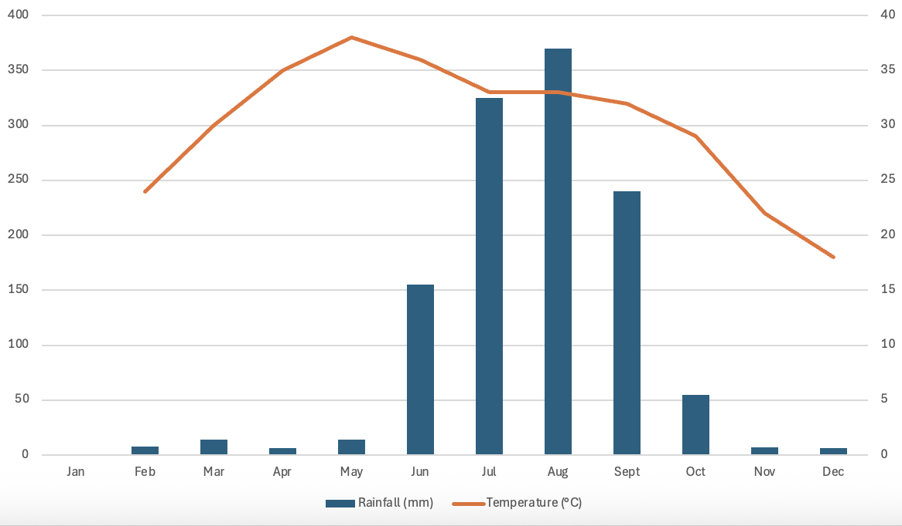
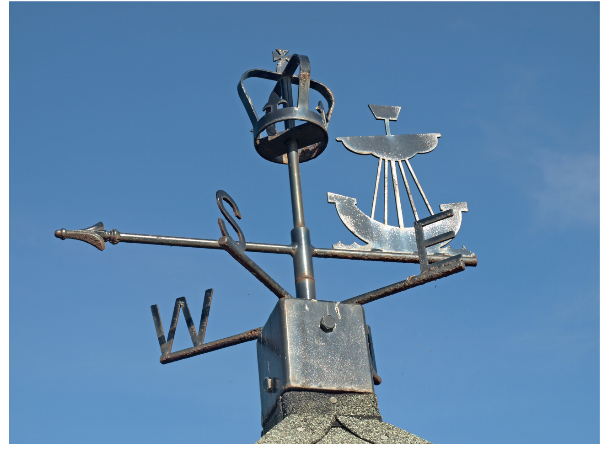
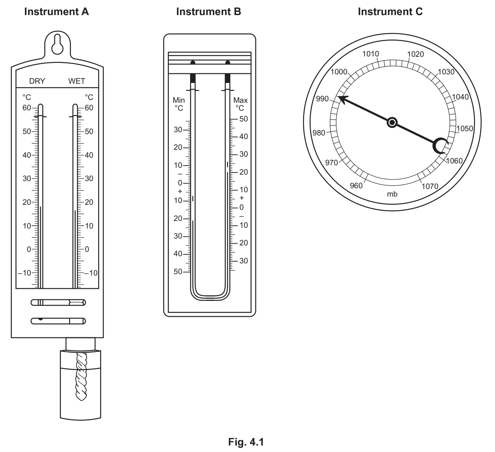
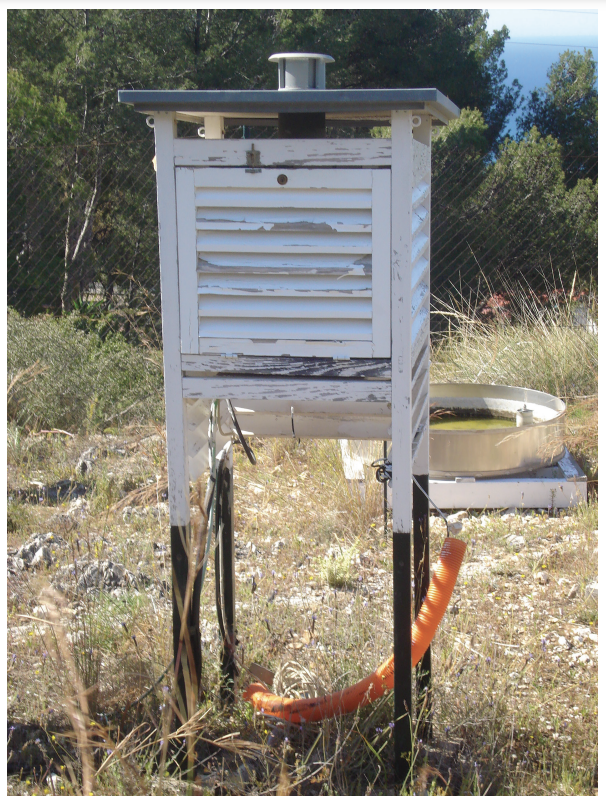
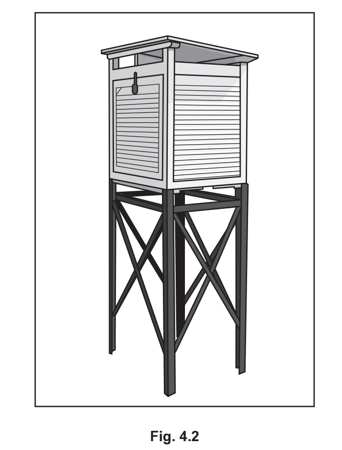
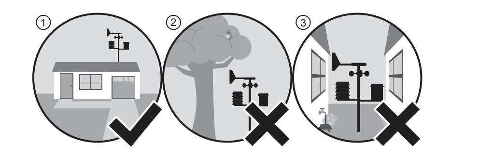
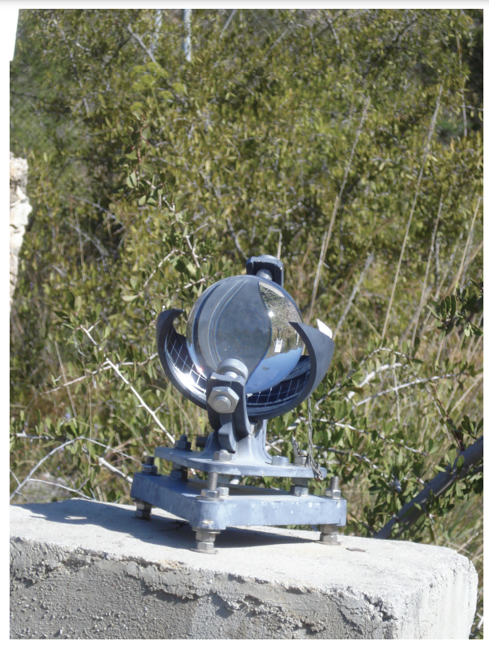
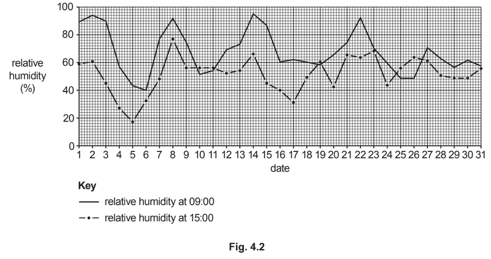
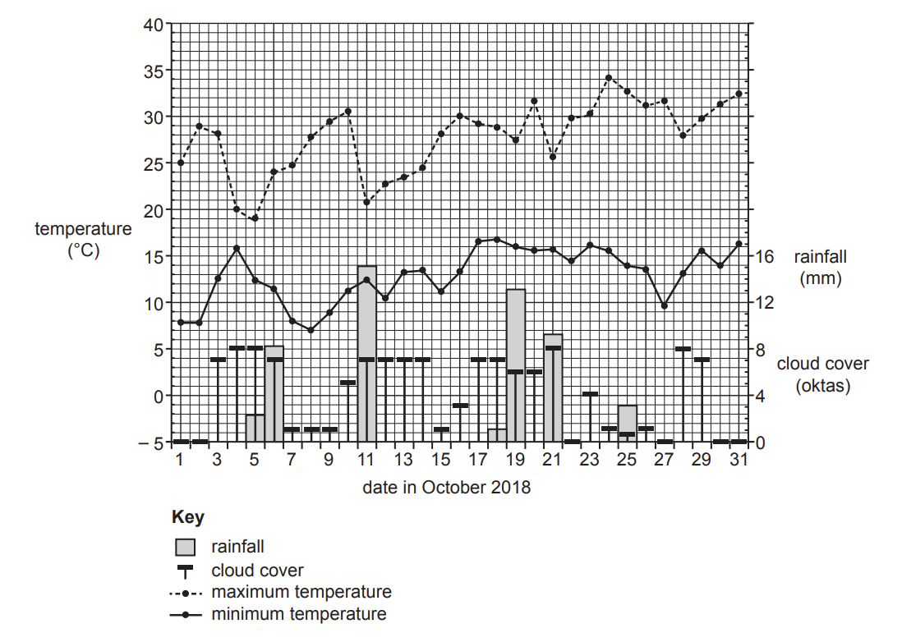

# Exam Questions — Weather
**The Natural Environment** · Cambridge (CIE) IGCSE geography (0460 & 0976)
> Source: [https://www.savemyexams.com/igcse/geography/cie/20/topic-questions/](https://www.savemyexams.com/igcse/geography/cie/20/topic-questions/) · 13 questions across 1 sets

## Paper 1 (13 questions)

### Q1 — medium — 4 marks

**Q1** [4 marks]

Study **Figure 3.4**, which shows a Stevenson screen, used to house equipment that measures the weather.

*Fig. 3.4 A Stevenson Screen*

Explain why

-          The Stevenson screen is painted white

-          The sides are slatted

### Q2 — easy — 6 marks

**Q2** [1 mark]

Define the term climate.

**Q2** [2 marks]

Study **Figure 3.3,** which shows a climate graph for Ghosi, India

*Fig.3.3. Climate graph for Ghosi, India*

Complete the graph with the following data

- January temperature: 20°C
- January precipitation: 20 mm

**Q2** [3 marks]

Using the graph, describe the main features of the climate in Ghosi. Include statistics in your answer.

### Q3 — easy — 10 marks

**Q3** [10 marks]

Study Fig. 4.1, which is a photograph of a weather instrument.

**Fig 4.1**

(i)

Identify the weather instrument shown in Fig. 4.1.

[1]

(ii)

Explain how readings are taken from the weather instrument shown in Fig. 4.1.

[2]

(iii)

Describe and explain the ideal location of the weather instrument shown in Fig. 4.1.

[3]

(iv)

Explain why many weather stations now use digital instruments rather than traditional ones.

[4]

*Source: June 2020 0460/12 Q4A*

### Q4 — easy — 6 marks

**Q4** [6 marks]

Study Fig. 4.1, which shows three traditional weather instruments.

(i)

Which diagram, **A**, **B **or **C**, shows a barometer?

[1]

(ii)

Using Fig. 4.1, state:

– the atmospheric pressure

– the maximum temperature

[2]

(iii)

Explain how the instrument labelled **A **in Fig. 4.1 is used to work out relative humidity.

[3]

*Source: Oct/Nov 2020 0460/11 Q4A*

### Q5 — easy — 6 marks

**Q5** [6 marks]

Study Fig. 4.1, which shows information collected in June 2012 and June 2013 at a weather station in Maleny, Australia.

|   | **2012** | **2013** |
|---|---|---|
| Rainfall (mm) | 267.2 | 164.6 |
| Days with rainfall | 16 | 14 |
| Evaporation (mm) | 40.4 | 58.1 |
| Humidity (%) | 77 | 78 |
| Minimum temperature (°C) | 5.8 | 5.0 |
| Maximum temperature (°C) | 21.2 | 21.8 |
| Wind direction | SSW | SSW |
| Sunshine hours (per month) | 85 | 80 |

**Fig. 4.1**

(i)

Using evidence from Fig. 4.1, underline the weather element in the list below which showed the greatest difference between June 2012 and June 2013.

| rainfall | sunshine hours | temperature | wind direction |
|---|---|---|---|

[1]

(ii)

Which weather instrument is used to measure:

| Humidity |   |
|---|---|
| Wind direction |   |

[2]

(iii)

Describe how information about the amount of rainfall is collected at a weather station.

[3]

*Source: Spec 2020 0460/01 Q4A*

### Q6 — easy — 4 marks

**Q6** [4 marks]

Some weather instruments are kept in a Stevenson screen.

Explain how the features of the Stevenson screen ensure that the information collected by these instruments is accurate.

*Source: Spec 2020 0460/01 Q4AIV*

### Q7 — easy — 4 marks

**Q7** [4 marks]

Draw and label the traditional weather instrument which is used to measure wind direction.

*Source: Oct/Nov 2020 0460/11 Q4AIV*

### Q8 — easy — 10 marks

**Q8** [10 marks]

Study Fig. 3.1, which is a photograph of a Stevenson screen.

**Fig 3.1**

(i)

Which of the following weather instruments is kept in a Stevenson screen?

Circle one of the answers below.

| **anemometer** | **barometer** | **rain gauge** | **wind vane** |
|---|---|---|---|

[1]

(ii)

Some instruments kept in a Stevenson screen are digital. Give two advantages of using digital weather instruments rather than traditional ones.

[2]

(iii)

Describe three features of a Stevenson screen which ensure that the information collected is reliable.

[3]

(iv)

State two factors which should be considered when deciding on the site of a Stevenson screen.

For each factor explain why it is important.

[4]

*Source: Nov 2019 0460/12 Q3A*

### Q9 — medium — 8 marks

**Q9** [8 marks]

Study Fig. 4.2, which shows a Stevenson Screen.

(i)

Explain how the following features of a Stevenson Screen make sure that the instruments inside give accurate readings:

– it is painted white

– it is on legs

– it is made from wood

[3]

(ii)

Describe and explain the ideal location of a Stevenson Screen.

[5]

*Source: Oct/Nov 2020 0460/11 Q4B*

### Q10 — medium — 8 marks

**Q10** [8 marks]

Study Fig. 3.2, which shows part of the instructions for siting a digital weather recording instrument.

**Fig. 3.2**

(i)

Using the diagrams in Fig. 3.2 only, give three pieces of advice about the location of the weather recording instrument.

1 ..............................................

2 ..............................................

3 ..............................................

[3]

(ii)

Explain the advantages of using digital weather recording instruments rather than traditional instruments.

[5]

*Source: June 2021 0460/11 Q3B*

### Q11 — medium — 8 marks

**Q11** [8 marks]

Study Fig. 3.2, which is a photograph of an instrument used in a weather station.

**Fig 3.2 **

(i)

Name the instrument shown in Fig. 3.2 and explain how it is used to collect weather data.

Name of instrument ...........................

How it is used ................................

[3]

(ii)

Explain how a student could observe and record **cloud types and amounts** at his school over a period of one week.

[5]

*Source: Nov 2019 0460/12 Q3B*

### Q12 — medium — 8 marks

**Q12** [8 marks]

Study Fig. 4.2, which shows the relative humidity at Carnarvon Airport, Western Australia, during August 2017.

(i)

Compare the pattern of relative humidity at 09:00 and at 15:00 during August 2017 at Carnarvon Airport. Use statistics in your answer.

[3]

(ii)

Explain how a traditional weather instrument can be used to obtain data on relative humidity such as that shown in Fig. 4.2.

[5]

*Source: May/Jun 2020 0460/12 Q4A*

### Q13 — medium — 10 marks

**Q13** [10 marks]

Study Fig. 3.1, which shows information about the weather recorded in Manilla, Australia, in October 2018.

**Fig. 3.1**

(i)

What was the cloud cover at Manilla on 12 October?

.............................. oktas

[1]

(ii)

Identify from Fig. 3.1: 
the date which had most rainfall ................................ the date with the smallest range of temperature. ..................................

[2]

(iii)

Using Fig. 3.1 only, compare the weather at Manilla on 19 and 25 October. Do not use statistics in your answer.

[3]

(iv)

State two other characteristics of weather that can be measured at a weather station. 
For each characteristic, name the instrument used to measure it.

Weather characteristic 1 ................................... 
Instrument ........................................................ 
Weather characteristic 2 .................................. 
Instrument ........................................................

[4]

*Source: June 2021 0460/11 Q3A*

