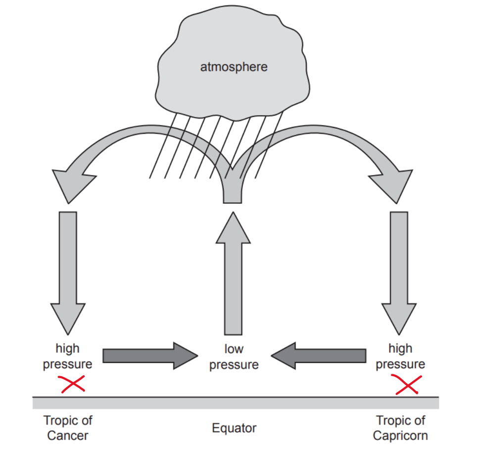

# Mark Schemes — Climate & Natural Vegetation
**The Natural Environment** · Cambridge (CIE) IGCSE geography (0460 & 0976)

## Paper 1 (26 questions)

### Q1
In the Amazon rainforest, plants grow in layers. Emergent trees, such as the kapok tree, are the tallest at 40 metres. **[KU]** The canopy is found at 30 metres, then the under canopy is at 20 metres.  The shrub layer is closest to the ground. **[KU] **Trunks are straight, and branches only appear higher up in the tree** ****[KU]**** **because this is where the leaves can reach the sunlight. **[KU]** The bark is smooth and thin so that rainwater can run off quickly. **[KU]**  Plants are evergreen because the climate allows year-round growth. **[KU]**

The leaves of plants have drip tips **[KU]** to shed excess water so the leaves do not break.  The emergent trees have large roots called 'buttress roots'** ****[KU]** to help support them.  Some plants, known as epiphytes, grow on trees higher up to reach sunlight, as it is too dark in the shrub layer. **[KU] **Some plants have bendy stems that allow them to follow the sun.  The leaves on plants in the shrub layer are broad enough to catch as much sun as possible. **[KU]**

> **[mark-scheme]**
> The command word is '**explain**'  means that the answer needs to describe the vegetation characteristics and outline how this means they are suited to the rainforest.
> 
> **Mark allocation**
> 
> This is a 'level of response' answer. Each point made in the answer does not equal a mark.
> 
> AO focus = AO1** ****[KU]**
> 
> - A top-level 3 **[7 marks]** answer will include specific examples that show:
> 
>   - Knowledge of the vegetation characteristics
>   - Understanding of how this shows their adaptations to the rainforest
> 
> **Alternative content**
> 
> The answer above is just one example of how to respond to this question. Additional information that could be used in the answer includes:
> 
> - Lianas use the tall trees to reach the sunlight

### Q2
The temperature at the equator is constant **[1]** all year at 27 degrees Celsius, and so this means plants can grow for twelve months of the year.**[1]** The area also receives lots of sunlight**,** which helps plants grow.**[1]**  Rainfall is 2000mm/year **[1]**and this is important for photosynthesis to occur and means that plants have water all year.  In tropical rainforests, the air is humid and this also encourages plant growth.**[1]**

> **[mark-scheme]**
> The command word 'explain' means that the answer should include supporting details and explanations for the reason vegetation growth is fast
> 
> **Mark allocation**
> 
> - **One mark** for each simple point
> - **One mark** for each development of the simple point
> 
> **[5 marks]**
> 
> Answers can be either:
> 
> - Five simple points
> - One developed point plus three simple points
> - Two points which are developed plus one simple point

### Q3
> **[mark-scheme]**
> Any **three** from:
> 
> - Near the equator
> - In Brazil/Indonesia/central Africa,/south east Asia
> - Between the tropics
> - West coast of Africa
> - The north of South America
> 
> **[3 marks]**

### Q4
Levels marking
Level 1 (1–3 marks) 
Statements including limited detail which explain why the amount of rainfall in a hot desert is low. 
Level 2 (4–6 marks) 
More developed statements which explain why the amount of rainfall in a hot desert is low. 
Level 3 (7 marks) 
Uses named example 
Comprehensive and accurate statements which explain why the amount of rainfall in a hot desert is low, including place specific information. 
Content Guide: 
Answers are likely to refer to: 
Proximity to tropics, 
Inland location, 
Air pressure, 
Hadley Cell, 
Descending air, 
Lack of water sources, 
Wind direction / Trade Winds, 
Rain shadow effect, 
Cold ocean currents 
Etc.

### Q5
Levels marking

| **Level 1 (1–3 marks)** | **Level 2 (4–6 marks)** | **Level 3 (7 marks)** |
|---|---|---|
| Statements including limited detail which describe the impacts of deforestation on the local natural environment. | Uses named example.  More developed statements which describe the impacts of deforestation on <u>the local natural</u> environment. (NB Max 5 if no named or inappropriate example) | Comprehensive and accurate statements including some place specific reference. |

<u>Content Guide:</u>

Answers are likely to refer to: 
Loss of biodiversity 
Loss of habitat 
Extinction of species Impacts on food chain/ecosystems 
Soil erosion 
Leaching 
Increased overland flow 
Flooding etc.

<u>Place specific reference is likely to consist of:</u> 
Locational details, 
Named places 
Specific details of loss of species 
Statistics etc.

<u>Place specific detail</u>

- *Locational details - Malaysia*
- *Specific details -*

  - *Almost 70% of Malaysia is covered by tropical rainforest*
  - *It is estimated that Malaysia has the fastest rate of deforestation in the world*
  - *Since 2000 an average of over 140,000 hectares of forest has been felled and cleared each year*

- *Examples of paragraphs which could be included in an answer to achieve Level 3:*

  - *Deforestation has a range of impacts many of which are* *environmental. Areas that have been deforested are often planted with monoculture which reduces habitats and therefore reduces biodiversity and can lead to the extinction of species. Palm oil plantations in Malaysia have lead to a 35% reduction in species, orangutans, pygmy elephants, Sumatran Rhino and Malayan tigers are all endangered. Deforestation also leads to interception and infiltration decreasing which reduces evapotranspiration and as a result precipitation decreases*
  - *Deforestation also increases overland flow this leads to soil erosion because the land is bare and exposed to the heavy rainfall which occurs in the rainforest. The soil then washes into the rivers leading to sedimentation which decreases their capacity because sediment builds up on riverbeds reducing their capacity and increasing the flood risk*
  - *Deforestation leads to local climate change because reduced transpiration and evaporation leads to a decrease in precipitation and an increase in temperatures. This means that rainfall patterns become less reliable and more extreme*
- *Remember that the question specifies the local natural environment. This means that answers referring to global climate change will not be awarded marks nor will impacts on local people *

### Q6
Levels marking

| **Level 1 (1–3 marks)** | **Level 2 (4–6 marks)** | **Level 3 (7 marks)** |
|---|---|---|
| Statements including limited detail which explain why deforestation of tropical rainforests threatens the <u>**global natural**</u> environment. | Uses named example Developed or linked statements which explain why deforestation of tropical rainforests threatens the <u>**global natural**</u> environment.  (Note: Max 5 if no named or inappropriate example.) | Comprehensive and accurate statements including <u>one</u> reference to a place impacted. |

<u>Content Guide:</u>

Causes and/or impacts. Impacts <u>must be </u><u>**global natural**</u> <u>environment</u> 
Answers are likely to include the following ideas: 
Less carbon dioxide used by trees 
Build up of Carbon dioxide/created by burning 
Forms layer/blanket 
Increase in temperatures/greenhouse effect/global warming 
Melting ice/glaciers 
Loss of species which live <u>in impacted area</u> e.g. polar bears Rising sea level 
Flooding of coastal lowlands, 
Loss of mangroves 
Changes to climatic patterns, e.g. drought etc.

<u>Place reference is likely to consist of:</u> 
Names of places threatened 
E.g. Antarctica, Maldives, Alps, Andes

<u>Place specific detail</u>

- *Locational details -  Antarctica, Arctic and Maldives*
- *Specific details - *

  - *Increase in rate of ice melting in Antarctica - 150 billion tons a year*
  - *In Greenland 270 billion tons a year lost*
  - *Maldives predicted by one study to be uninhabitable by 2050*

- *Examples of paragraphs which could be included in an answer to achieve Level 3:*

  - *Deforestation leads to a significant reduction in the number of trees. This means that less CO**2** is taken in by the trees as part of photosynthesis. This increases carbon dioxide concentrations in the atmosphere and as this is a greenhouse gas this increases human induced climate change. Use of fire for clearance also increases carbon dioxide emissions*
  - *Global warming has increased the average global temperature leading to increased melting of areas in the Arctic and Antarctic with a loss of 150 billion tons of ice melting per year. The rising sea levels threatens island nations such as the Maldives which some predictions state will be uninhabitable by 2050 if sea levels continue to rise at the current rate *
- *Remember that the question specifies the global environment this means that reference to the impacts on local people or local natural environment will not be awarded marks*

### Q7
Levels marking

| **Level 1 (1–3 marks)** | **Level 2 (4–6 marks)** | **Level 3 (7 marks)** |
|---|---|---|
| Statements including limited detail which describe the impacts of deforestation. | More developed or linked statements which describe the impacts of deforestation. | Comprehensive and accurate statements which describe the impacts of deforestation including place references, including named place(s). |

<u>Content Guide:</u>

Impact on people or natural environment 
Answers are likely to refer to: 
Soil erosion, 
Loss of biodiversity, 
Loss of habitat, 
Extinction of species, 
Increase in likelihood of flooding, 
Loss of land for indigenous peoples, 
Medicines

<u>Place specific detail</u>

- *Locational details - Malaysia*
- *Specific details -*

  - *Almost 70% of Malaysia is covered by tropical rainforest*
  - *It is estimated that Malaysia has the fastest rate of deforestation in the world*
  - *Since 2000 an average of over 140,000 hectares of forest has been felled and cleared each year*

- *Examples of paragraphs which could be included in an answer to achieve Level 3:*

  - *Deforestation has a range of impacts many of which are* *environmental. Areas that have been deforested are often planted with monoculture which reduces habitats and therefore reduces biodiversity and can lead to the extinction of species. Palm oil plantations in Malaysia have lead to a 35% reduction in species, orangutans, pygmy elephants, Sumatran Rhino and Malayan tigers are all endangered. Deforestation also leads to interception and infiltration decreasing which reduces evapotranspiration and as a result precipitation decreases*
  - *Deforestation also increases overland flow this leads to soil erosion because the land is bare and exposed to the heavy rainfall which occurs in the rainforest. The soil then washes into the rivers leading to sedimentation which decreases their capacity because sediment builds up on riverbeds reducing their capacity and increasing the flood risk*
  - *Deforestation means that indigenous communities* *such as the **Orang Asli and Temiar** have been forced off land. In addition the pollination of fruits has reduced due to a decrease in pollinating insects and animals such as bats which has reduced the available food sources. In Kuala Koh village 2019 at least 15 indigenous **Batek** died after an outbreak of disease possibly transmitted by loggers working near to the village*
- *Remember that the question specifies local people and local natural environment. This means that answers referring to global climate change will not be awarded marks*

### Q8
Levels marking

| **Level 1 (1–3 marks)** | **Level 2 (4–6 marks)** | **Level 3 (7 marks)** |
|---|---|---|
| Statements including limited detail which describe the impacts of deforestation. | More developed or linked statements which describe the impacts of deforestation. | Comprehensive and accurate statements which describe the impacts of deforestation including place references, including named place(s). |

<u>Content Guide:</u>

Local/global 
Impact on people or natural environment 
Answers are likely to refer to: 
Soil erosion, 
Loss of biodiversity, 
Loss of habitat, 
Extinction of species, 
Climate change, 
Increase in likelihood of flooding, 
Loss of land for indigenous peoples, 
Global warming 
Medicines

<u>Place specific detail</u>

- *Locational details - Malaysia*
- *Specific details -*

  - *Almost 70% of Malaysia is covered by tropical rainforest*
  - *It is estimated that Malaysia has the fastest rate of deforestation in the world*
  - *Since 2000 an average of over 140,000 hectares of forest has been felled and cleared each year*

- *Examples of paragraphs which could be included in an answer to achieve Level 3:*

  - *Deforestation has a range of impacts many of which are* *environmental. Areas that have been deforested are often planted with monoculture which reduces habitats and therefore reduces biodiversity and can lead to the extinction of species. Palm oil plantations in Malaysia have lead to a 35% reduction in species, orangutans, pygmy elephants, Sumatran Rhino and Malayan tigers are all endangered. Deforestation also leads to interception and infiltration decreasing which reduces evapotranspiration and as a result precipitation decreases*
  - *Deforestation also increases overland flow this leads to soil erosion because the land is bare and exposed to the heavy rainfall which occurs in the rainforest. The soil then washes into the rivers leading to sedimentation which decreases their capacity because sediment builds up on riverbeds reducing their capacity and increasing the flood risk*
  - *Deforestation means that indigenous communities* *such as the **Orang Asli and Temiar** have been forced off land. In addition the pollination of fruits has reduced due to a decrease in pollinating insects and animals such as bats which has reduced the available food sources. In Kuala Koh village 2019 at least 15 indigenous **Batek** died after an outbreak of disease possibly transmitted by loggers working near to the village*

### Q9
(i)

Ideas such as:

Sparse vegetation/no trees** [1]** 
Large amounts of bare soil/rocky/sand **[1]** 
Plants with thin leaves** [1]** 
Shrubs/grasses/ low level plants** [1]** 
No surface water/water sources** [1]**

- *In this answer you must only use evidence from figure 4.2 *

### Q10
(i)

Ideas such as:

Forest has been<u> </u>illegally logged/their territory is being invaded/forests/habitat destroyed by loggers/ranchers** [1]** 
Diseases to which they are not resistant/or influenza ** [1]** 
Lack of food/hunger/starvation** [1]** 
They may be killed by/conflict with loggers/plantation owners** [1]**

- *The answers to this question must only come from figure 3.2 *

### Q11
| **Indicative content** | **General guidance** |
|---|---|
| 27.5 **[1]** | The command word ‘calculate’ means that you need to use the data to work out an answer.  In this case, add up all the monthly temperatures and divide by 12 |

### Q12
(i)

X marked on Fig. 4.1

- *The X can be in either area of high pressure *
- *In these areas the air is sinking so there is no cloud formation, no precipitation leading to arid conditions*

(ii)

Ideas such as:

Low latitudes/close to Equator/between tropics/tropical areas [**1]** 
Sun is overhead/direct/concentrated sunlight/high angle of sun [**1]** 
High insolation [**1]**

(iii)

Ideas such as:

Long way from source of moisture/from sea/no water to be evaporated/no water source** [1]** 
Prevailing winds blow over large areas of land** [1]** 
Winds are dry when they reach the desert/rain falls before the winds reach the desert** [1]** 
They may be in areas of rain shadow** [1]**

- *In this answer it is important to focus on why inland areas are dry rather than why desert areas overall are dry *

### Q13
(i)

61/63 metres **[1]**

(ii)

**In the canopy:** 
Toucan, Spider Monkey, Ocelot and Iguana** [1]** 
**Ground level:** 
Tapir/Agouti/anaconda** [1]**

- *Examples of animals must come from figure 4.1*

(iii)

Ideas such as: 
Some are able to climb/fly** [1]** 
Some need shelter/protection** [1]** 
Food supplies available (in canopy/at ground level)** [1]** 
Different habitats/nesting areas** [1]**

### Q14
(i)

Ideas such as: 
Uneven/clustered** [1]** 
More deforestation in southern part/south of Equator** [1]** More/lots/mainly in Brazil** [1]** 
In North/North East/West (Brazil)/near (border of) Bolivia/Peru** [1]** Lots of deforestation close to roads/less deforestation in remote areas** [1]** 
Lots of deforestation close to coast/sea/smaller amounts inland** [1]**

- *When writing about distribution you need to include:*

  - *Compass directions *
  - *Country names*
  - *Proximity to the coast*

### Q15
(i)

600 mm** [1]**

(ii)

Temperature range of 14C = D **[1]** 
Average temperature of 23 °C = C** [1]**

(iii)

Climate Graph A **[1]**

- *If you do not select the correct graph then marks will not be awarded for any of your answer*

Reasons such as: 
Low rainfall/less than 250 mm annually/per year/110–120 mm annually** [1]** 
High (summer/average) temperatures** [1]** 
Seasonal variation in temperature/hot in summer <u>and </u>cool in winter **[1]**

### Q16
(i)

3 (°C) **[1]**

- *The highest monthly average is 30**o**C and the lowest average temperature is 27**o**C *
- *This means the temperature range is 3**o**C*

(ii)

Hot deserts = E (on and around the Tropics of Cancer and Capricorn)** [1]** 
Tropical rainforests = C (on and around the Equator) **[1]**

(iii)

Ideas such as: 
Air is descending** [1]** 
It heats up/does not cool** [1]** 
Condensation does not occur/clouds do not form **[1]** Precipitation is low/does not occur/drier/only has e.g. 250 mm per annum **[1]**

### Q17
Ideas such as: 
They both increase (overall)** [1]** 
SE Asia rises but South America rises then falls/South America falls but SE Asia rises (in 2010/after 2005) **[1]** 
Largest increase (overall) is in SE Asia/smallest increase is in South America **[1]** 
SE Asia has the largest (sudden) increase in growth/spikes/increase in growth was more rapid (after 1995/from 2000) **[1]**

SE Asia has more deforestation than South America at the beginning/to 1960/changes by 1965 ** [1]** 
South America is higher in the middle/from 1965–2005/after 1960 ** [1]** 
SE Asia has more deforestation than South America at the end/from 2005 ** [1]**

- *In this answer it is essential that you make a comparison between the two areas*

### Q18
Ideas such as:

Loss of vegetation/protection of vegetation/stop land becoming bare/trees cut down **[1]** 
Loss of habitat/habitat is retained **[1]** 
Food chain disrupted/to avoid disruption to food chain **[1]** 
Threat of extinction/death of species/biodiversity lost/no threat of extinction **[1]** 
Soil erosion/leaching/soil fertility lost/no threat of soil erosion **[1]** Flooding/flooding prevented **[1]** 
River pollution/eutrophication/river pollution prevented **[1]** 
Less infiltration/more overland flow/maintains infiltration/less overland flow **[1]** 
More siltation/siltation is less likely **[1]** 
Air pollution/smoke from burning/no threat of air pollution **[1]**

- *This question is specifically asking about the impact on the local environment rather than the impact on the tribe or the international/national environment*
- *Remember you can write about either the impact or why it is important to avoid the impact*

### Q19
| **Indicative content** | **General guidance** |
|---|---|
| - Air pressure - Latitude - Altitude - Convectional rainfall | The command word ‘explain’ means that you need to give reasons.  You must include both temperature and rainfall in your answer to score full marks |

| **Model Answer** | **Commentary** |
|---|---|
| Tropical rainforests are located at low latitudes, close to the equator. This means the sun is high in the sky all year** [1]** this results in high temperatures **[1]** Low pressure is found at the equator where the Hadley cells meet and so as air rises **[1]** water vapour condenses to form cloud and rain **[1]** | **Marks awarded 4/4**  This is one possible way to answer this question – your answer does not have to be exactly the same |

### Q20
(i)

Any three from ideas such as: 
Hot and dry** [1]** Temperatures vary from 13 to 33°C/range of 20°C** [1]** 
Hottest months are June/July/August or coldest months are December/January/February (or one from each) – need two months** [1]** 
Rainfall varies from 0 to 18mm monthly/range of 18mm** [1]** Wettest months are December/January/February or driest months are April/May/June (or one from each) – need two months** [1]** 
Annual rainfall of approx. 91mm (accept 80–100mm)** [1]** 
Hot and dry in summer and cooler and wetter in winter** [1]**

- *In this answer you need include statistics and only include information from Figure 4.2 *
- *Remember rainfall is shown as a bar graph and temperature is shown as a line graph*
- *It is important to ensure that you are reading the units from the correct axis*

(ii)

Any five from ideas such as: 
Overhead sun/high angle of sun/only a small area to heat up/sun’s rays are More concentrated **[1]** 
High air pressure** [1]** 
Descending air** [1]** 
Air heats as it descends** [1]** 
Therefore no condensation** [1]** 
Little or no surface water** [1]** 
Little or no evaporation** [1]** 
Little or no transpiration/evapotranspiration** [1]** 
Wind direction over large areas of land/trade winds** [1]** 
Rain shadow effect** [1]** 
Cold ocean currents** [1]** Distant from sea/landlocked **[1]**

### Q21
(i)

Ideas such as:

Can survive for a long time without water/food/can store water **[1]** 
They eat succulent plants/get water from plant **[1]** 
Large feet <u>t</u>o stop sinking into sand **[1]** 
Large ears with many blood vessels to give off excess heat **[1]** They stay in burrows/bury themselves in the sand during the hot days **[1]** 
They are nocturnal **[1]** 
Their kidneys concentrate urine so that they excrete less water **[1]** 
Some (or e.g.) have a thick outer covering which reduces moisture loss **[1]** 
Some excrete urine on their legs which cools them by evaporation **[1]**

Circulate the cooled blood back through the body **[1]**

- *The command word for this question is 'explain' this means that no marks will be awarded for describing the features such as 'large ears with many blood vessels' . You have to explain how this helps the animal to survive in the hot desert*
- *Remember the question is asking specifically about animal adaptations so no marks will be awarded for plant adaptations*

### Q22
Overhead/high angle of sun/direct/concentrated/intense sunlight **[1]**
High pressure **[1]** 
Descending air/air does not rise **[1]** 
In rain shadow/leeward side of mountains **[1]** 
Cold ocean currents **[1]** 
Wind blows over large areas of land/long distance from sea/dry winds/offshore winds **[1]**

### Q23
Ideas such as: 
Population growth **[1] w**hich leads to increased clearance of land for agriculture** [Dev]** 
For economic growth to take place/country/government to make money/to repay debt **[1]** 
Exploitation of land by TNCs **[1]** 
Weak legislation/corruption **[1]**
Lumbering/export of timber/logging/e.g. such as furniture **[1]** Mining/quarrying **[1]** 
Road building **[1]** 
HEP generation/dams/reservoirs **[1]** 
Agriculture/ranching/e.g. such as cattle/palm oil/slash and burn **[1]** 
Urbanisation/building settlements/housing/places for people to live **[1]** 
Industrialisation/building manufacturing industry **[1]** Tourism/hotels **[1]** 
Firewood **[1]**

- *This question can either be answered as five separate points or as fewer points which are then developed*

### Q24
Processes such as: 
Heating/heats up **[1]** 
Evaporation of water **[1]** 
Transpiration** [1] **

(Evapotranspiration as alternative to evaporation and transpiration) **[1]** 
Rising air/convection **[1]** 
Cooling **[1]** 
Condensation **[1]** 
Saturation **[1]** 
Clouds form **[1]** 
Hot **[1]**

- *Remember to ensure that you are referring to the processes which take place in convectional rainfall any answers which refer to relief or frontal rainfall will receive a maximum of 2 marks*

### Q25
(i)

Ideas such as: 
There are large amounts of water sources/rivers/swamps** [1]** 
Low pressure** [1]** 
Overhead sun/direct sunlight** [1]** 
It’s hot/temperatures are high/heat water** [1]** 
Large amounts of evaporation** [1]** 
Large amounts of transpiration** [1]** 
Air/water vapour rises/convection** [1]** 
Condensation occurs/clouds form/build up/droplets form** [1]** Saturation/clouds cannot hold any more water **[1]** 
Repeated everyday/daily pattern/no seasons/all year round** [1]**

### Q26
Ideas such as:

Close to equator/in tropics **[1]** 
Overhead/direct/high angle of sun **[1]** 
Low pressure **[1]** 
Ascending/rising air **[1]** 
Cooling/condensation/saturation **[1]** 
Large amounts of evaporation/transpiration **[1]** 
Convectional rainfall **[1]**
