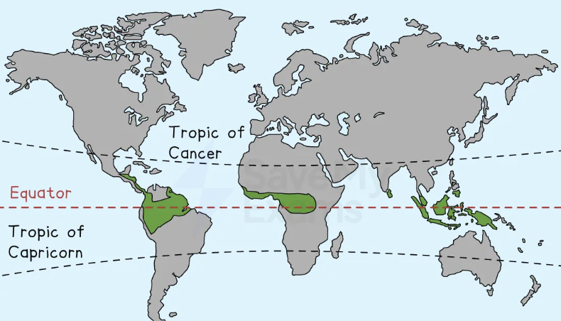
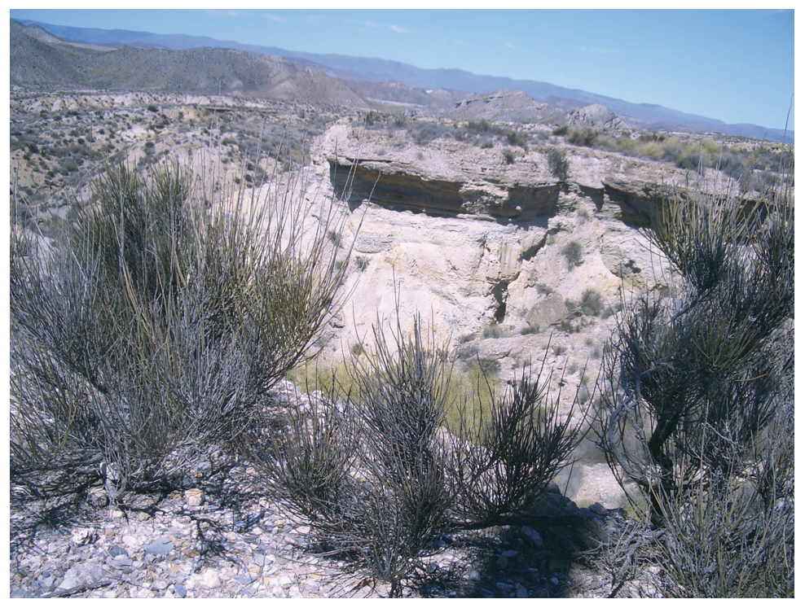
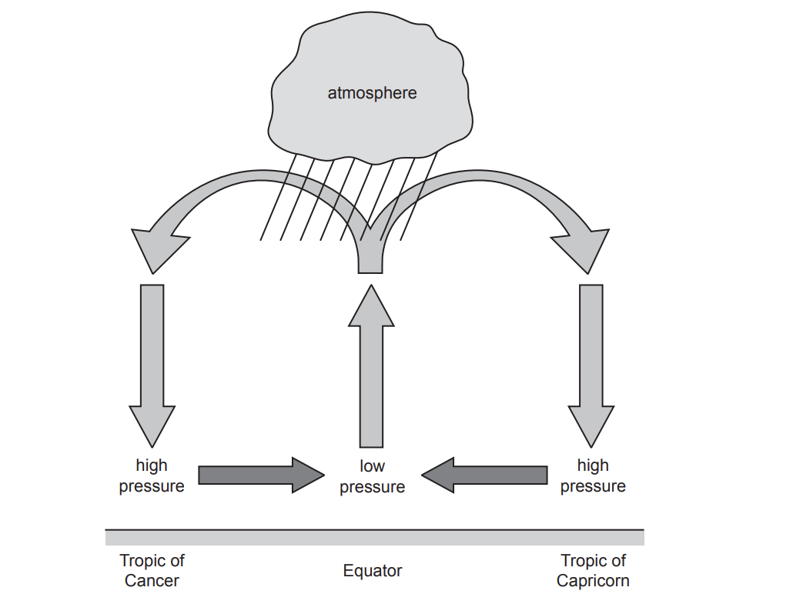
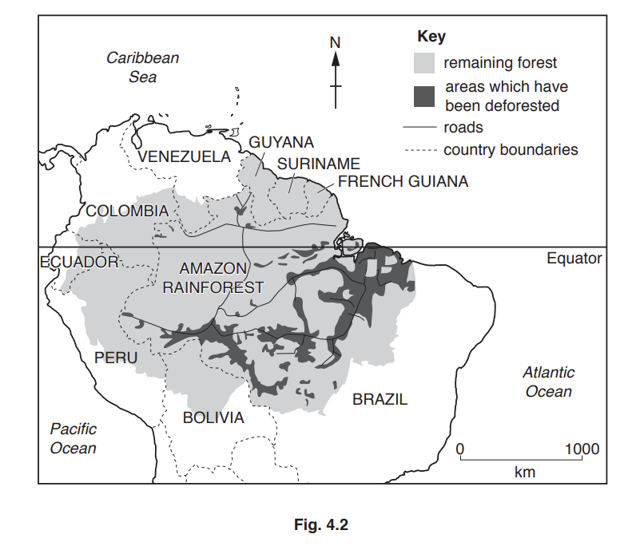
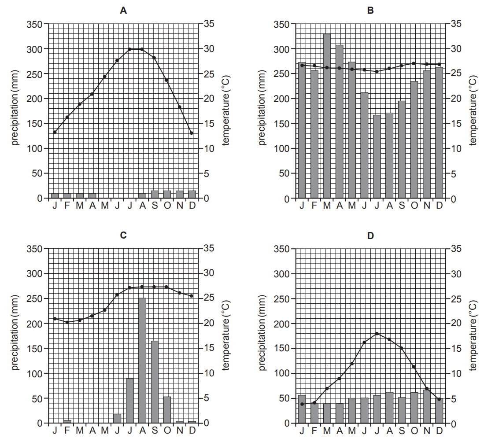
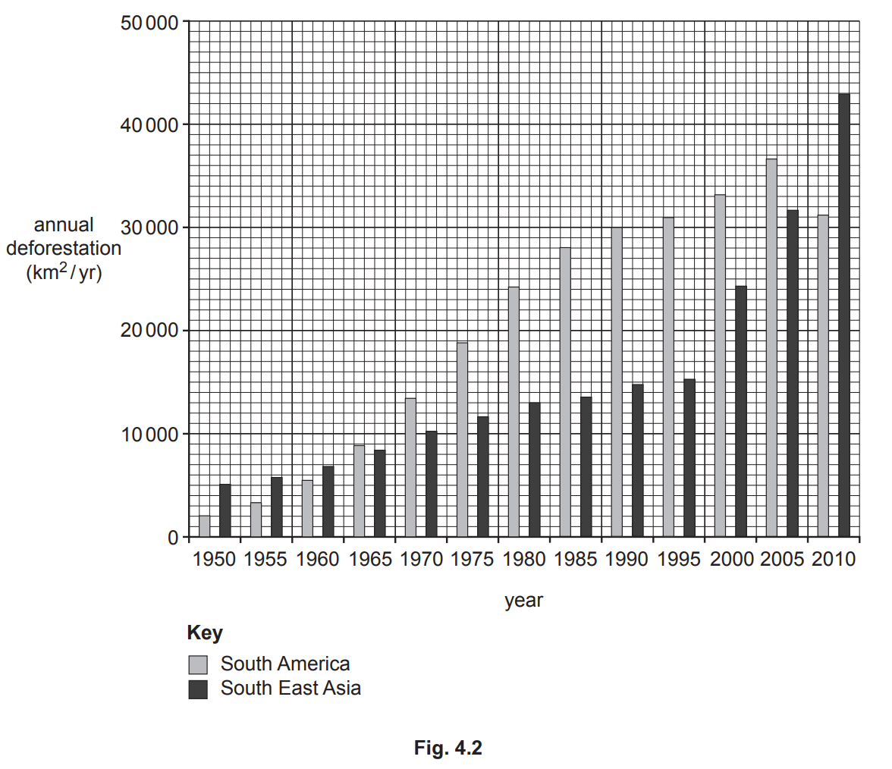
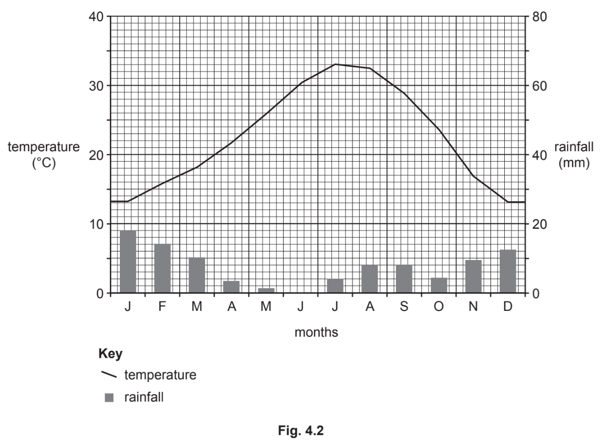

# Exam Questions — Climate & Natural Vegetation
**The Natural Environment** · Cambridge (CIE) IGCSE geography (0460 & 0976)
> Source: [https://www.savemyexams.com/igcse/geography/cie/20/topic-questions/](https://www.savemyexams.com/igcse/geography/cie/20/topic-questions/) · 26 questions across 1 sets

## Paper 1 (26 questions)

### Q1 — hard — 7 marks

**Q1** [7 marks]

For a named tropical rainforest you have studied, describe and explain the characteristics of its natural vegetation.

### Q2 — medium — 5 marks

**Q2** [5 marks]

Explain why tropical rainforests are found close to the equator.

### Q3 — easy — 3 marks

**Q3** [3 marks]

Study **Figure 3.4,** which shows the distribution of the tropical rainforest.

*Fig 3.4. Distribution of tropical rainforest*

Describe the distribution of tropical rainforests.

### Q4 — hard — 7 marks

**Q4** [7 marks]

For a named hot desert you have studied, explain why the amount of rainfall in this area is low.

Name of hot desert ...................

*Source: May/June 2020 0460/12 Q4C*

### Q5 — hard — 7 marks

**Q5** [7 marks]

For a named area of **tropical rainforest** you have studied, describe the impacts of deforestation on the **local** natural environment.

Name of area ............................................

*Source: June 2021 0460/11 Q4C*

### Q6 — hard — 7 marks

**Q6** [7 marks]

Explain why large scale deforestation of tropical rainforests threatens the **global** natural environment.

You should refer to named places.

*Source: June 2021 0460/13 Q3C*

### Q7 — hard — 7 marks

**Q7** [7 marks]

For a named area of tropical rainforest you have studied, describe the impacts of deforestation on the local people and local natural environment.

Name of area of tropical rainforest ...........................

*Source: Nov 2019 0460/11 Q4C*

### Q8 — hard — 7 marks

**Q8** [7 marks]

With reference to named examples, describe the impacts of deforestation.

*Source: Nov 2020 0460/13 Q4C*

### Q9 — easy — 3 marks

**Q9** [3 marks]

Study Fig. 4.2 (Insert), which is a photograph which was taken in an area of hot desert.

**Fig. 4.2**

Give three pieces of evidence to suggest that Fig. 4.2 was taken in an area of hot desert.

1 ...........................................

2 ...........................................

3 ...........................................

*Source: June 2021 0460/11 Q4B*

### Q10 — easy — 3 marks

**Q10** [3 marks]

Study Fig. 3.2, which shows information about the Awa-Guajá tribe who live in the Amazon rainforest.

| The Awa-Guajá tribe are one of the most threatened cultures on Earth and one of the last two surviving nomadic hunter-gatherer tribes in Brazil.  It was only recently that the tribe were first contacted in order to move them into a reserve intended to protect them. Loggers in the area, however, have refused to retreat from their territory and the Awa-Guajá tribe face extinction.  According to a recent report, 31% of the forest in the area has already been illegally logged. As the tribe come in contact with outsiders, they are likely to suffer from diseases which could be fatal, like influenza, as they have no resistance to them.  The tribe are also short of food due to the loss of their habitat, causing hunger and starvation. Loggers and ranchers continue to destroy their forests, creating situations that result in violent conflict with the Awa-Guajá. Some reports even suggest that plantation owners have offered money to those who kill a member of a local tribe. |
|---|

**Fig. 3.2**

Using Fig. 3.2 **only,** give **three** reasons why the Awa-Guajá tribe face extinction.

1 ...........................................

2 ...........................................

3 ...........................................

*Source: June 2021 0460/13 Q3B*

### Q11 — easy — 1 marks

**Q11** [1 mark]

Study Fig 1, which shows climate data for an area of tropical rainforest

|   | **Jan** | **Feb** | **Mar** | **Apr** | **May** | **Jun** | **Jul** | **Aug** | **Sep** | **Oct** | **Nov** | **Dec** |
|---|---|---|---|---|---|---|---|---|---|---|---|---|
| **Average monthly temperatures (°C)** | 26 | 27 | 28 | 28 | 29 | 28 | 28 | 28 | 27 | 27 | 27 | 27 |
| **Total monthly rainfall (mm)** | 229 | 175 | 196 | 194 | 173 | 173 | 168 | 198 | 180 | 212 | 257 | 258 |

Calculate the average temperature

### Q12 — easy — 10 marks

**Q12** [10 marks]

Study Fig. 4.1, which is a cross-section showing the circulation of the atmosphere in tropical areas.

**Fig. 4.1**

(i)

On Fig. 4.1, mark an X to show the position of one area of hot desert.

[1]

(ii)

Explain why temperatures are high in areas of equatorial and hot desert climate.

[2]

(iii)

Many deserts are inland. Explain why this results in low amounts of rainfall.

[3]

*Source: June 2021 0460/11 Q4A*

### Q13 — easy — 6 marks

**Q13** [6 marks]

Study Fig. 4.1, which is a diagram showing information about a tropical rainforest ecosystem in an area of equatorial climate.

(i)

State the maximum height of the emergents shown in Fig. 4.1.

.................. metres

[1]

(ii)

Identify from Fig. 4.1, one example of:

–    wildlife which lives in the canopy

–    wildlife which lives in the ground cover.

[2]

(iii)

Suggest reasons why some animals live in the canopy but others live in the ground cover in a tropical rainforest.

[3]

*Source: Nov 2019 0460/11 Q4A*

### Q14 — easy — 3 marks

**Q14** [3 marks]

Study Fig. 4.2, a map of the Amazon Basin, an area of tropical rainforest.

Using Fig. 4.2 **only**, describe the distribution of the areas where deforestation has taken place in the Amazon Basin.

*Source: Nov 2019 0460/11 Q4B*

### Q15 — easy — 6 marks

**Q15** [6 marks]

Study Fig. 3.1, which shows climate graphs for four places.

**Fig. 3.1**

(i)

Estimate the average annual precipitation shown by climate graph **C**.

Circle your answer below.

| 250mm | 600mm | 1050mm | 1600mm |
|---|---|---|---|

[1]

(ii)

Identify the climate graph which shows:

-   a place with an annual temperature range of 14°C

...............................................................

-   a place with an annual average temperature of 23°C.

...............................................................

[2]

(iii)

Identify the graph which shows a hot desert climate. Give **two** reasons for your choice.

Climate graph .......................

Reason 1 ......................................................

Reason 2 ......................................................

[3]

*Source: June 2021 0460/13 Q3A*

### Q16 — easy — 6 marks

**Q16** [6 marks]

Study Fig. 4.1, which shows information about hot deserts and tropical rainforests.

|   | Latitude | Highest monthly average temperature | Lowest monthly average temperature | Annual rainfall | Atmospheric pressure |
|---|---|---|---|---|---|
| Hot deserts |   | 35 °C | 18 °C | Less than 250 mm | High |
| Tropical rainforests |   | 30 °C | 27 °C | Over 2000 mm | Low |

**Fig. 4.1**

(i)

Using Fig. 4.1, calculate the annual average temperature range in tropical rainforests. ............................. °C

[1]

(ii)

Complete the column labelled ‘Latitude’ in Fig. 4.1. You should choose the letters of the correct labels from the list below. 
– on and around the Arctic and Antarctic Circles (A) 
– between the Tropic of Cancer and the Equator (B) 
– on and around the Equator (C) 
– only between the Tropics of Cancer and Capricorn (D) 
– on and around the Tropics of Cancer and Capricorn (E)

[2]

(iii)

Explain how high atmospheric pressure influences the climate of hot deserts.

[3]

*Source: Nov 2020 0460/13 Q4A*

### Q17 — easy — 3 marks

**Q17** [3 marks]

Study Fig. 4.2, which shows information about deforestation of tropical rainforests in South America and South East Asia between 1950 and 2010.

Using Fig. 4.2, compare the change in annual deforestation in South America and South East Asia.

*Source: Nov 2020 0460/13 Q4B*

### Q18 — medium — 5 marks

**Q18** [5 marks]

Study Fig. 3.2, which shows information about the Awa-Guajá tribe who live in the Amazon rainforest.

| The Awa-Guajá tribe are one of the most threatened cultures on Earth and one of the last two surviving nomadic hunter-gatherer tribes in Brazil.  It was only recently that the tribe were first contacted in order to move them into a reserve intended to protect them. Loggers in the area, however, have refused to retreat from their territory and the Awa-Guajá tribe face extinction.  According to a recent report, 31% of the forest in the area has already been illegally logged. As the tribe come in contact with outsiders, they are likely to suffer from diseases which could be fatal, like influenza, as they have no resistance to them.  The tribe are also short of food due to the loss of their habitat, causing hunger and starvation. Loggers and ranchers continue to destroy their forests, creating situations that result in violent conflict with the Awa-Guajá. Some reports even suggest that plantation owners have offered money to those who kill a member of a local tribe. |
|---|

**Fig. 3.2**

Explain why protecting the rainforest from deforestation is also important for the **natural environment** in the area where the Awa-Guajá tribe live.

*Source: June 2021 0460/13 Q3B*

### Q19 — medium — 4 marks

**Q19** [4 marks]

Study Fig 1, which shows climate data for an area of tropical rainforest

|   | **Jan** | **Feb** | **Mar** | **Apr** | **May** | **June** | **July** | **Aug** | **Sep** | **Oct** | **Nov** | **Dec** |
|---|---|---|---|---|---|---|---|---|---|---|---|---|
| **Average monthly temperatures (°C)** | 26 | 27 | 28 | 28 | 29 | 28 | 28 | 28 | 28 | 27 | 27 | 27 |
| **Total monthly rainfall (mm)** | 229 | 175 | 196 | 194 | 173 | 173 | 168 | 198 | 180 | 212 | 257 | 258 |

Explain why tropical rainforests have a hot and wet climate

### Q20 — medium — 8 marks

**Q20** [8 marks]

Study Fig. 4.2, a climate graph for Indian Wells, an area of hot desert in California, United States.

(i)

Using Fig. 4.2 only, describe the main features of the climate of Indian Wells. Include statistics in your answer.

[3]

(ii)

Explain why there are hot desert climates in some areas close to the Tropics of Cancer and Capricorn.

[5]

*Source: Spec 2020 0460/01 Q4B*

### Q21 — medium — 5 marks

**Q21** [5 marks]

Study Fig. 4.2 (Insert), which is a photograph which was taken in an area of hot desert.

**Fig. 4.2**

Explain how wildlife (animals) are able to survive in a hot desert environment.

*Source: June 2021 0460/11 Q4B*

### Q22 — medium — 4 marks

**Q22** [4 marks]

Study Fig. 3.1, which shows climate graphs for four places.

**Fig. 3.1**

Explain why some places have a hot desert climate.

*Source: June 2021 0460/13 Q3A*

### Q23 — medium — 5 marks

**Q23** [5 marks]

Study Fig. 4.2, a map of the Amazon Basin, an area of tropical rainforest.

Explain why deforestation of tropical rainforests has taken place.

*Source: Nov 2019 0460/11 Q4B*

### Q24 — medium — 4 marks

**Q24** [4 marks]

Study Fig. 4.1, which is a cross-section showing the circulation of the atmosphere in tropical areas.

**Fig. 4.1**

Describe the processes which result in large amounts of rainfall in areas of equatorial climate.

*Source: June 2021 0460/11 Q4A*

### Q25 — medium — 4 marks

**Q25** [4 marks]

Study Fig. 4.1, which shows information about hot deserts and tropical rainforests.

|   | Latitude | Highest monthly average temperature | Lowest monthly average temperature | Annual rainfall | Atmospheric pressure |
|---|---|---|---|---|---|
| Hot deserts |   | 35 °C | 18 °C | Less than 250 mm | High |
| Tropical rainforests |   | 30 °C | 27 °C | Over 2000 mm | Low |

**Fig. 4.1**

Explain why tropical rainforests have an average of over 2000 mm of rainfall per year.

[4]

*Source: Nov 2020 0460/13 Q4A*

### Q26 — medium — 4 marks

**Q26** [4 marks]

Study Fig. 4.1, which is a diagram showing information about a tropical rainforest ecosystem in an area of equatorial climate.

Explain why the equatorial climate is hot and wet.

*Source: 2019 0460/11 Q4A*

