# Exam Questions — Development
**Economic Development** · Cambridge (CIE) IGCSE geography (0460 & 0976)
> Source: [https://www.savemyexams.com/igcse/geography/cie/20/topic-questions/](https://www.savemyexams.com/igcse/geography/cie/20/topic-questions/) · 26 questions across 1 sets

## Paper 1 (26 questions)

### Q1 — hard — 7 marks

**Q1** [7 marks]

For a country you have studied, describe the positive and negative impacts of a named transnational corporation being located there.

Name of country ..............................

Name of transnational corporation ..................................

*Source: 2020 0460/01 Q5C*

### Q2 — hard — 7 marks

**Q2** [7 marks]

For a named example of a transnational corporation you have studied, describe its impacts at a local and national scale.

Name of transnational corporation ................................................

*Source: 2020 May/June 0460/13 Q6C*

### Q3 — hard — 7 marks

**Q3** [7 marks]

Explain the causes of globalisation. You should refer to examples which you have studied.

*Source: June 2021 0460/11 Q5C*

### Q4 — hard — 7 marks

**Q4** [7 marks]

For a named transnational corporation (TNC) you have studied, explain why it operates in many countries.

Name of transnational corporation (TNC) ......................................

*Source: March 2021 0460/12 Q5C*

### Q5 — hard — 7 marks

**Q5** [7 marks]

For a named transnational corporation (TNC) you have studied, describe the advantages and disadvantages it brings for people at a **local scale.**

Name of transnational corporation

*Source: June 2021 0460/11 Q5C*

### Q6 — easy — 3 marks

**Q6** [3 marks]

Study Fig. 5.2, which shows the Human Development Index (HDI) in different countries in Africa.

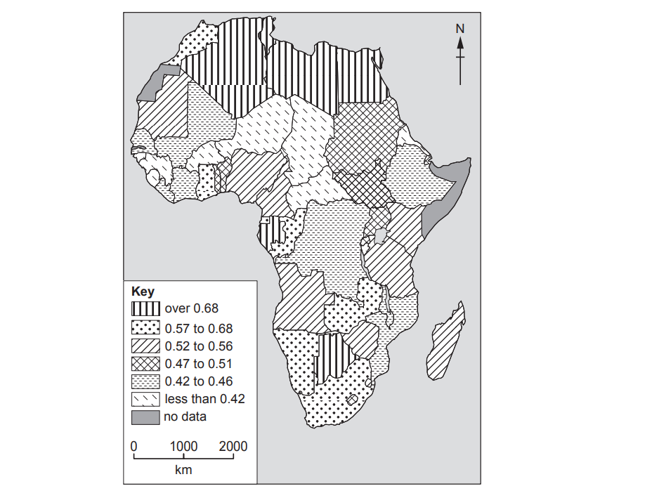

**Fig.5.2**

Using Fig. 5.2 **only,** compare the distribution of the countries with the highest (over 0.68) and lowest (less than 0.42) HDI within Africa.

*Source: March 2021 0460/12 Q5B*

### Q7 — easy — 6 marks

**Q7** [6 marks]

Study Fig. 5.1, which is a diagram showing development indicators for four countries.

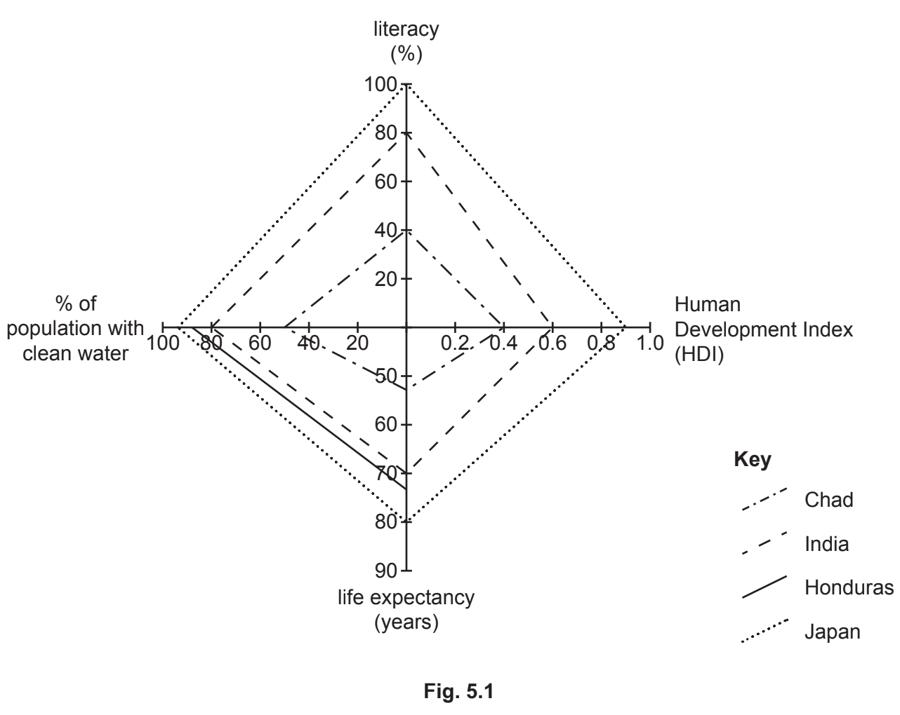

(i)

Identify the country shown in Fig. 5.1 which has the shortest life expectancy.

[1]

(ii)

Complete Fig. 5.1 by plotting the following information: - 90% of the population of Honduras are literate. - the Human Development Index (HDI) of Honduras is 0.63.

[2]

(iii)

Explain why the Human Development Index (HDI) is a good method of comparing development between countries.

[3]

*Source: Nov 2020 0460/12 Q5A*

### Q8 — easy — 10 marks

**Q8** [10 marks]

Study Fig. 5.1, which is a map showing the HDI of Nigeria’s states. Nigeria is an LEDC in Africa.

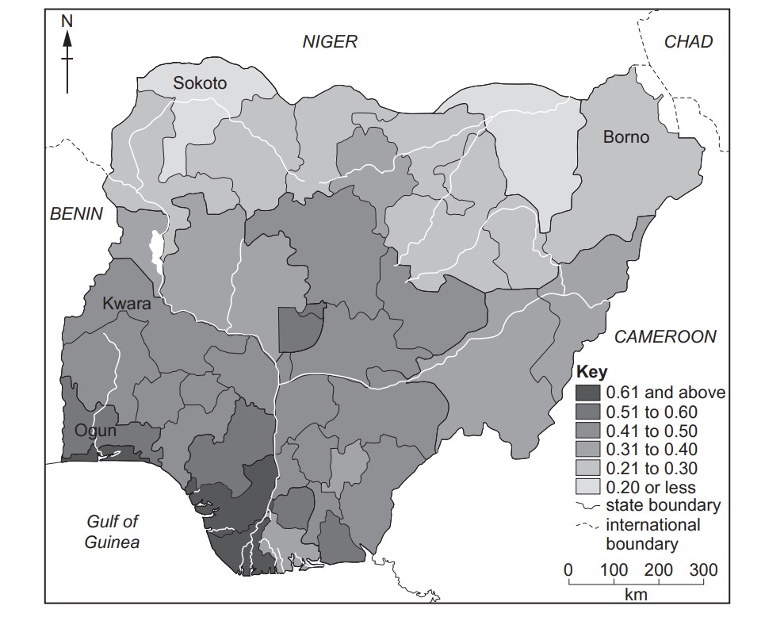

**Fig. 5.1**

(i)

What is meant by the initials HDI?

H............................ D............................. I............................

[1]

(ii)

Put the following states in rank order according to their HDI.

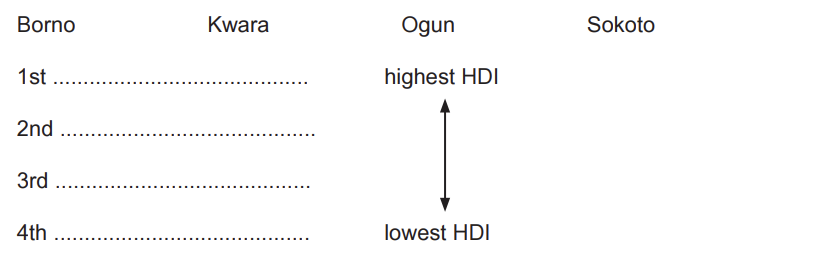

[2]

(iii)

Suggest three reasons why some states of Nigeria have a higher HDI than other states.

1  ............................

2  ............................

3  ............................

[3]

(iv)

Explain why HDI is considered to be a better indicator of the level of development of a country than its Gross National Product (GNP).

[4]

*Source: June 2021 0460/11 Q5A*

### Q9 — easy — 6 marks

**Q9** [6 marks]

Study Fig. 5.1, which shows information about the relationship between two indicators of development.

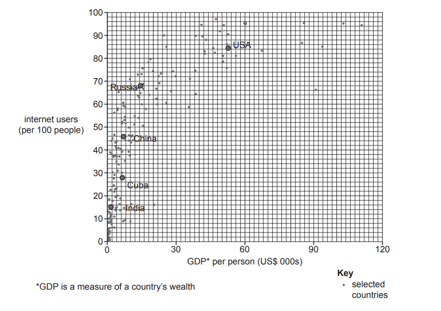

**Fig. 5.1**

(i)

Identify the named country which has a GDP per person of US\$15000 and 68 internet users per 100 people.

[1]

(ii)

To what extent does Fig. 5.1 show that there is a relationship between GDP per person and internet users per 100 people?

[2]

(iii)

Suggest why there is a relationship between GDP per person and internet users per 100 people.

[3]

*Source: March 2021 0460/12 Q5A*

### Q10 — easy — 10 marks

**Q10** [10 marks]

Study Fig. 5.1, which is information about the changes in the employment structure of Australia (an MEDC) between 1950 and 2015.

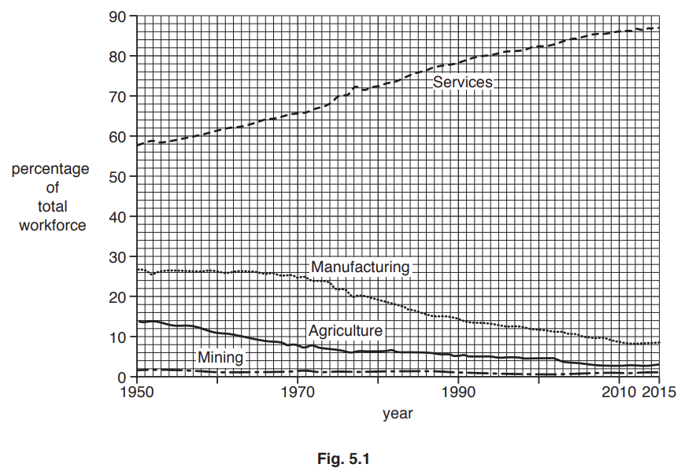

(i)

What is meant by the term employment structure?

[1]

(ii)

Give **one** example of each of the following:

-   a manufacturing industry

-   a job in the service sector

[2]

(iii)

Describe the main changes which have taken place in Australia’s employment structure between 1950 and 2015.

[3]

(iv)

Suggest reasons for the changes which have taken place in Australia’s employment structure between 1950 and 2015.

[4]

*Source: 2019 0460/12 Q5A*

### Q11 — easy — 10 marks

**Q11** [10 marks]

Study Fig. 6.1, which is a map showing the locations of three different factories in an area in Italy (an MEDC in Europe).

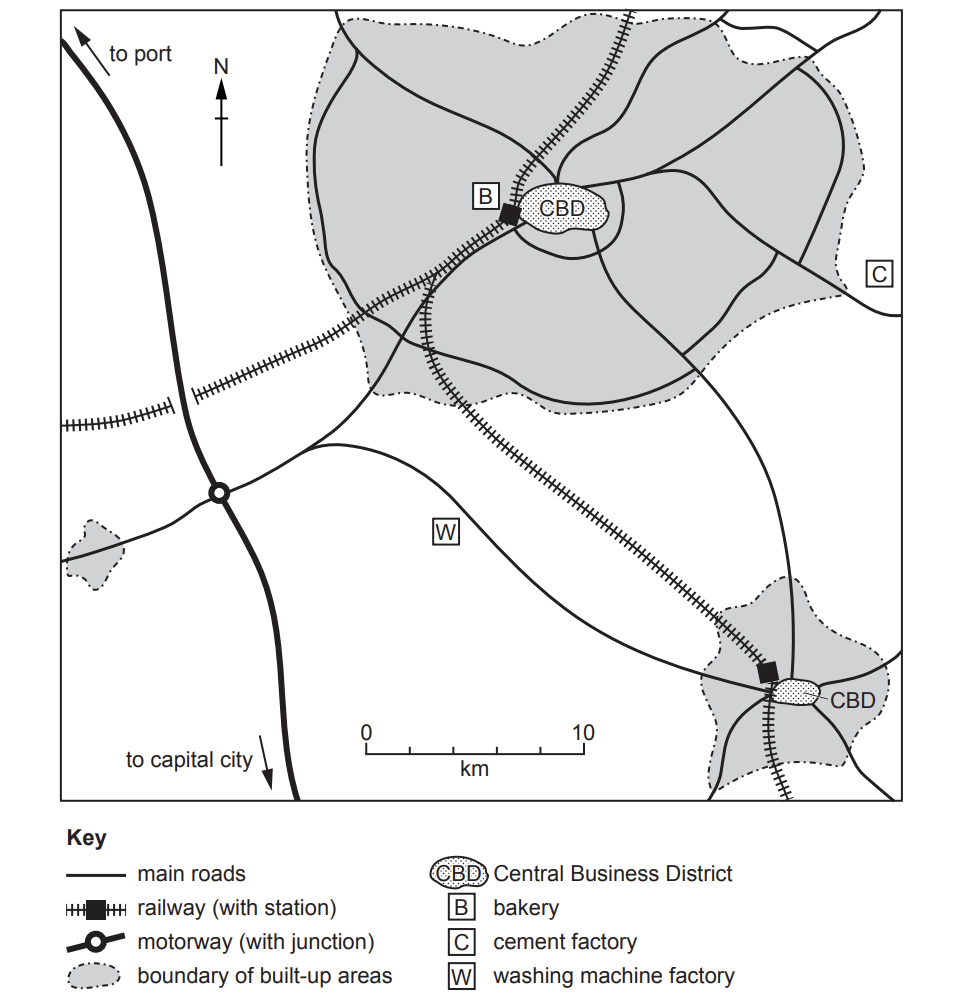

**Fig. 6.1**

(i)

Identify the factory shown in Fig. 6.1 which is an example of assembly industry.

[1]

(ii)

Using Fig. 6.1, state two differences between the locations of the bakery and the cement factory.

1 ...................................................

2 ...................................................

[2]

(iii)

Explain why a location close to a market was chosen by the owners of the bakery.

[3]

(iv)

Explain two advantages of the location of the washing machine factory, which was built in 2018.

1 ...................................................

2 ...................................................

[4]

*Source: June 2021 0460/11 Q6A*

### Q12 — easy — 10 marks

**Q12** [10 marks]

Study Fig. 6.1, which shows the employment structure of Germany (an MEDC) and Egypt (an LEDC) in 1960, 1985 and 2010.

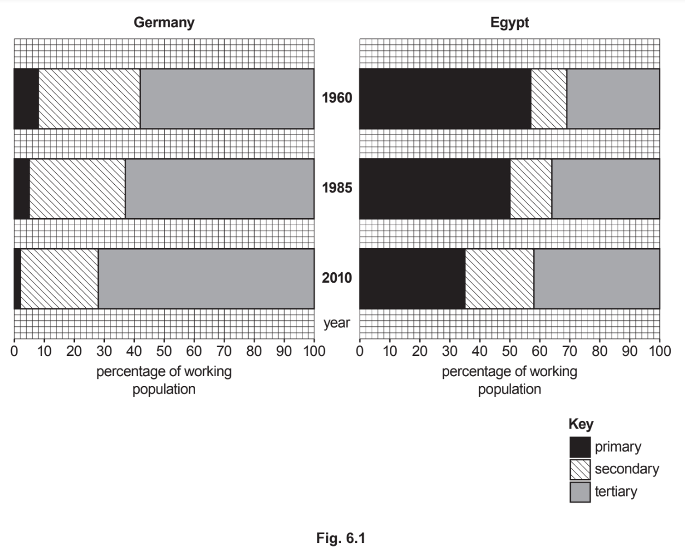

(i)

What percentage of the working population was employed in the primary sector in Egypt in 1960?

[1]

(ii)

Identify one similarity and one difference between the employment structures of Germany and Egypt in 2010.

Similarity .......................

Difference .........................

[2]

(iii)

Suggest reasons for the decline of employment in secondary industry in Germany since 1985.

[3]

(iv)

Suggest reasons for the growth of tertiary employment in Egypt between 1960 and 2010.

[4]

*Source: June 2020 0460/12 Q6A*

### Q13 — easy — 10 marks

**Q13** [10 marks]

Study Fig. 5.1, which shows information about the relationship between two indicators of development.

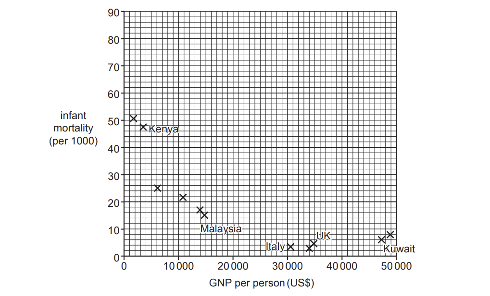

**Fig. 5.1**

(i)

**Draw a best-fit line** on Fig. 5.1.

[1]

(ii)

Use examples of two of the countries labelled in Fig. 5.1 to show that there is an inverse (negative) relationship between infant mortality rate and GNP per person. Use statistics in your answer.

[2]

(iii)

Explain why there is an inverse (negative) relationship between GNP per person and infant mortality rate.

[3]

(iv)

The Human Development Index (HDI) is another indicator of development. Tick (`✓`) the four correct statements about HDI in the table below.

|   | **tick (**`✓`**)** |
|---|---|
| All countries with high HDI have small populations. |   |
| HDI figures are measured per 1000 of the population. |   |
| HDI is a composite indicator of development. |   |
| HDI is the same as GDP per person. |   |
| HDI scores for every country are between 0 and 1. |   |
| Most people who live in a country with a high HDI will be poor. |   |
| Many people who live in a country with a low HDI will not have completed secondary education. |   |
| The lower the HDI, the shorter the life expectancy is likely to be. |   |
| There will be more people per doctor where HDI is higher. |   |

[4]

*Source: June 2021 0460/11 Q5A*

### Q14 — easy — 6 marks

**Q14** [6 marks]

Study Fig. 5.1, a map showing the Human Development Index (HDI).

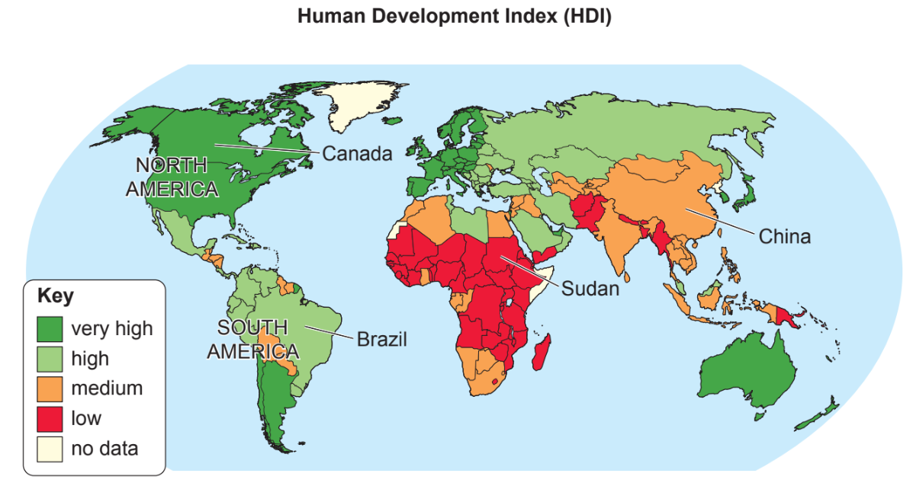

(i)

Put the following countries in rank order according to their HDI.

| Brazil |   |
|---|---|
| Canada |   |
| China |   |
| Sudan |   |

[1]

(ii)

Describe the main differences in HDI between North and South America.

[2]

(iii)

Explain why HDI is a good measure of development.

[3]

*Source: 2020 0460/01 Q5A*

### Q15 — easy — 10 marks

**Q15** [10 marks]

Study Fig. 5.1, which shows information about the employment structure of Cameroon, Italy and Japan.

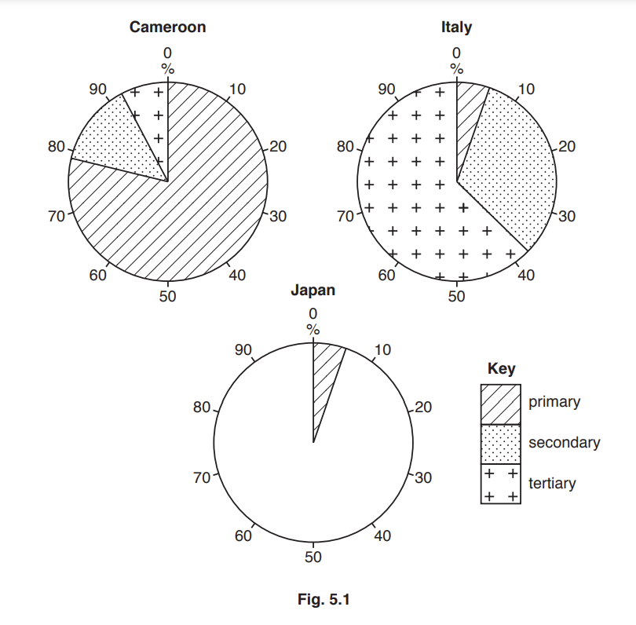

(i)

Give **one** example of a worker in the tertiary sector.

[1]

(ii)

**Complete the pie graph** in Fig. 5.1 to show the following information for Japan:

Secondary employment = 25%

Tertiary employment = 70%

[2]

(iii)

Describe **three** differences between the employment structure of Cameroon and Italy.

[3]

(iv)

Explain why the percentage of the population employed in the primary sector reduces as a country develops.

[4]

*Source: 2019 0460/11 Q5A*

### Q16 — easy — 8 marks

**Q16** [8 marks]

Study Fig. 6.1, which shows information about two indicators of development, literacy and life expectancy, in five parts of the world.

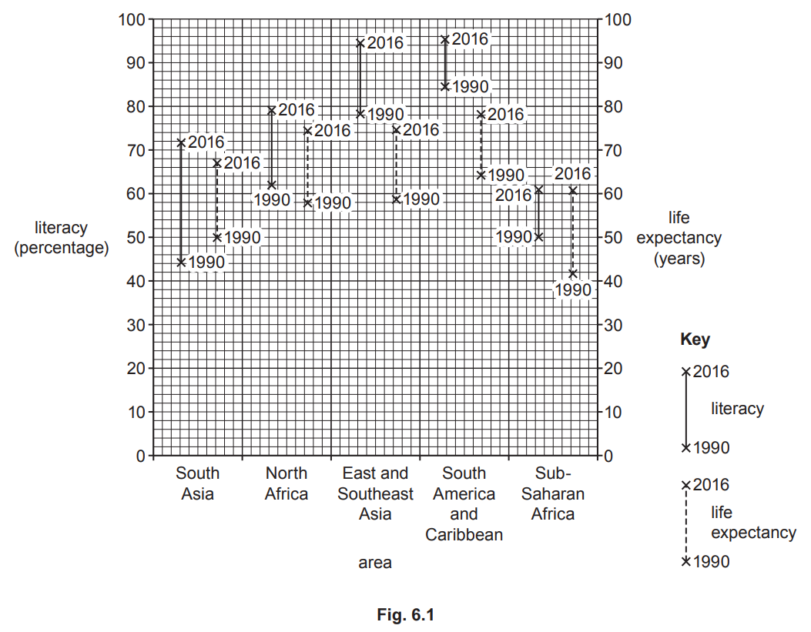

(i)

What is meant by literacy?

[1]

(ii)

Identify the following from Fig. 6.1:    - the area with the highest life expectancy in 1990    - the increase in the literacy percentage in South Asia between 1990 and 2016.    ........................ %

(iii)

Explain why life expectancy varies in countries at different levels of economic development.

[3]

(iv)

State two other indicators of development. For each one, explain why it is a useful indicator of the level of development of a country.

Indicator 1 .........................................................................................................................

Indicator 2 .........................................................................................................................

[4]

*Source: 2020 May/June 0460/13 Q6A*

### Q17 — medium — 5 marks

**Q17** [5 marks]

Explain how changes in technology have enabled globalisation to occur.

*Source: 2020 May/June 0460/13 Q6B*

### Q18 — medium — 8 marks

**Q18** [8 marks]

Study Figs. 5.2, 5.3 and 5.4, which are photographs of different places where people are employed.
 
(i)

For each of Figs. 5.2, 5.3 and 5.4 state the sector of production which is shown.

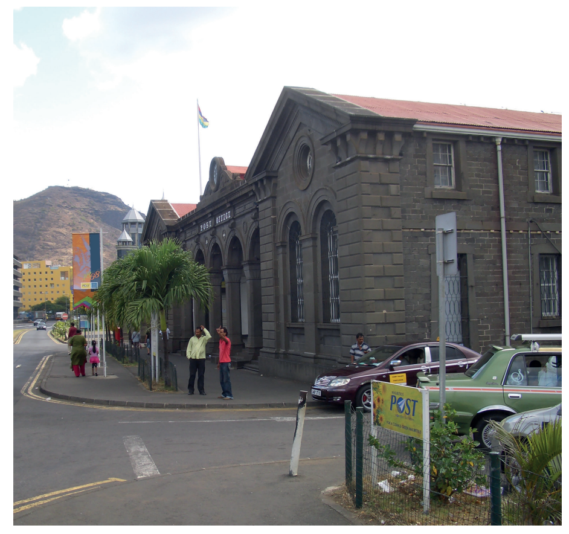

**Fig 5.2**

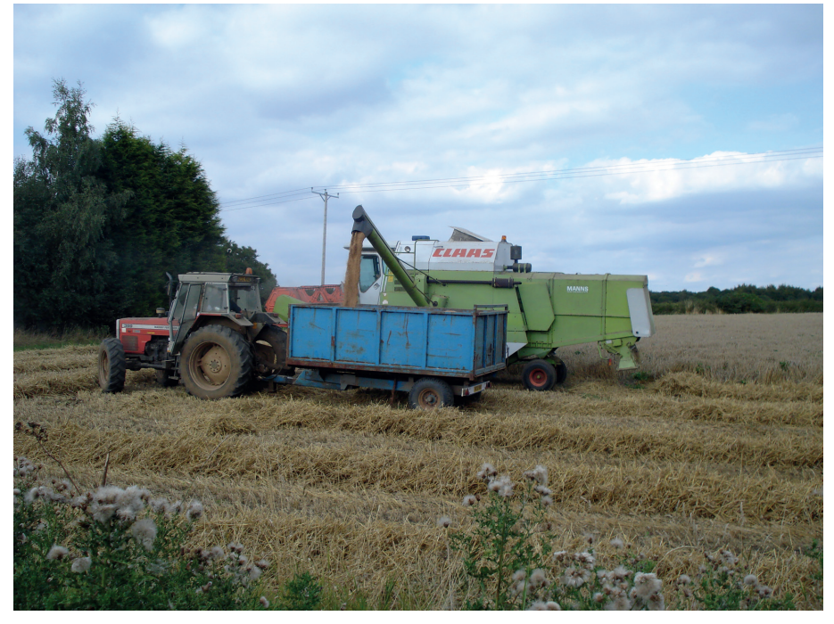

**Fig 5.3**

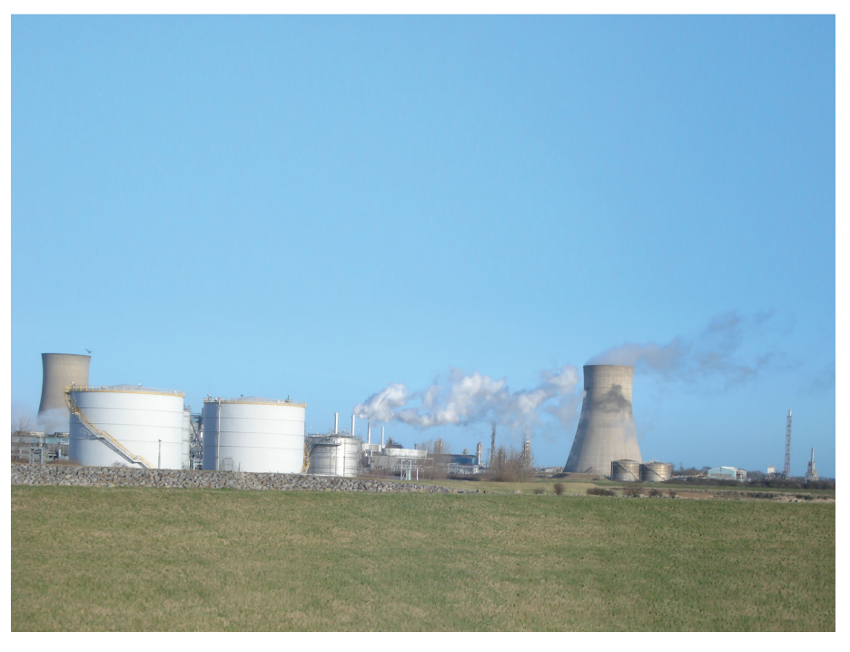

**Fig 5.4**

Choose from the following:

Primary                Secondary                  Tertiary                   Quaternary

Fig. 5.2 ................................................................. 
Fig. 5.3 ................................................................. 
Fig. 5.4 .................................................................

[3]

(ii)

Describe and explain the changes which occur in the percentage of primary, secondary and tertiary employment as a country becomes more developed.

[5]

*Source: 2020 May/June 0460/11 Q5B*

### Q19 — medium — 8 marks

**Q19** [8 marks]

Study Fig. 5.2, which shows indicators of development for selected countries in Africa.

| Country | Life expectancy (years) | Energy use per person (kg. of oil equivalent) | Number of doctors (per 100 000 people) | Adult literacy (percentage) |
|---|---|---|---|---|
| Angola | 55 | 606 | 8 | 67 |
| Egypt | 73 | 735 | 212 | 58 |
| Ethiopia | 61 | 299 | 3 | 43 |
| Kenya | 64 | 494 | 13 | 85 |
| South Africa | 50 | 2587 | 69 | 87 |
| Tanzania | 61 | 465 | 2 | 78 |
| Uganda | 54 | 776 | 5 | 70 |

**Fig. 5.2**

(i)

Identify the country which:

- has the lowest percentage of people who can read and write;

- is likely to have the poorest access to a doctor;

- has the lowest energy use per person.

[3]

(ii)

Which country, listed in Fig. 5.2, do you consider has the highest level of development?

Justify your answer.

Country ................................

Justification ....................................

[5]

*Source: 2020 0460/01 Q5B*

### Q20 — medium — 8 marks

**Q20** [8 marks]

Study Fig. 5.2, which shows four plans that the government of an LEDC in Africa is considering.

| **Plan 1**  Build more schools in rural areas and allow all children up to the age of 16 to attend free of charge. |
|---|
| **Plan 2**  Build a multi-purpose dam across a major river which flows through the centre of the country. |
| **Plan 3**  Offer financial incentives to attract transnational corporations which manufacture electrical goods. |
| **Plan 4**  Build one large coastal tourist resort and another resort close to a national park in the mountains. |

**Fig. 5.2**

(i)

Suggest three reasons why the government is considering Plan 1.

[3]

(ii)

Choose Plan 2, 3 or 4. Explain why the plan which you have chosen will result in development in the country. Plan chosen

[5]

*Source: Nov 2020 0460/12 Q5B*

### Q21 — medium — 4 marks

**Q21** [4 marks]

Study Fig. 5.1, which is a diagram showing development indicators for four countries.

Explain why there may be inequalities in levels of development within a country.

*Source: Nov 2020 0460/12 Q5A*

### Q22 — medium — 5 marks

**Q22** [5 marks]

Study Fig. 5.2, which shows the Human Development Index (HDI) in different countries in Africa.

**Fig.5.2**

Explain why there are inequalities in wealth between countries.

*Source: March 2021 0460/12 Q5B*

### Q23 — medium — 8 marks

**Q23** [8 marks]

Study Figs. 5.2, 5.3 and 5.4, which are photographs showing different employment sectors.

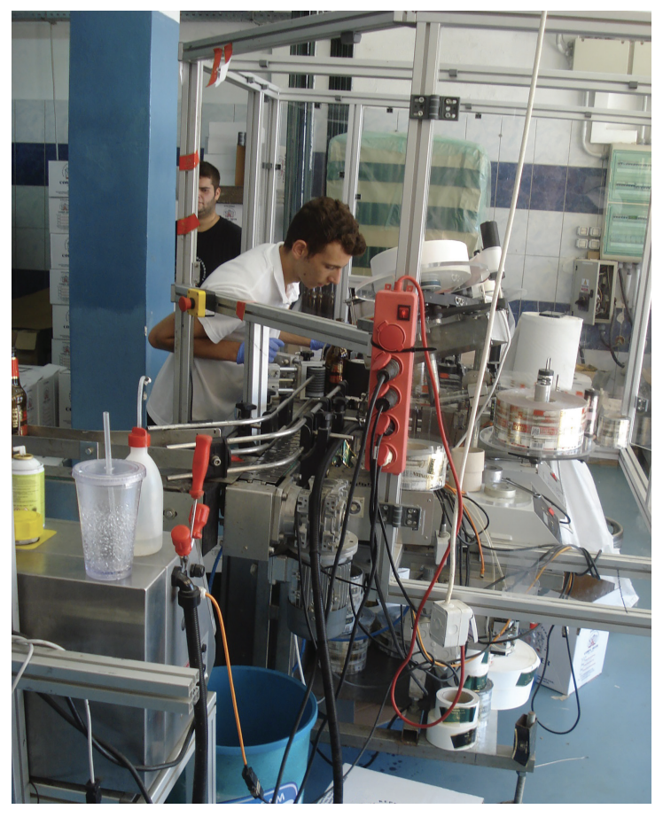

**Fig. 5.2**

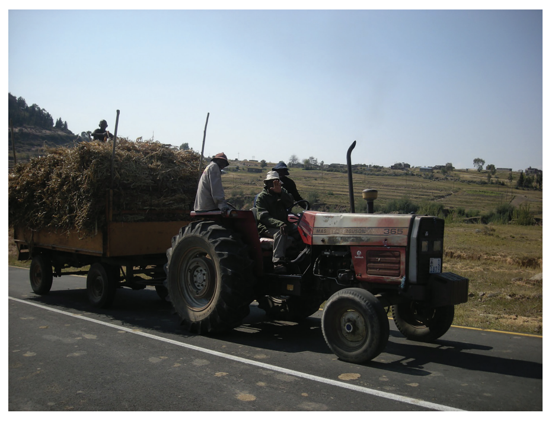

**Fig. 5.3**

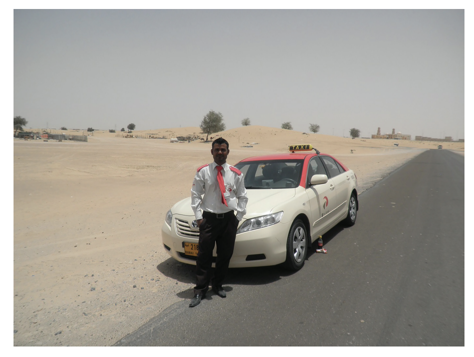

**Fig. 5.4**

(i)

Identify the employment sectors shown in each of Figs. 5.2, 5.3 and 5.4.

Fig. 5.2 .............................................

Fig. 5.3 .............................................

Fig. 5.4 .............................................

[3]

(ii)

Explain why the employment structure of a country is a good indicator of its level of development.

[5]

*Source: June 2021 0460/11 Q5B*

### Q24 — medium — 4 marks

**Q24** [4 marks]

Study Fig. 5.1, a map showing the Human Development Index (HDI).

Explain why there are differences in levels of development between countries.

*Source: 2020 0460/01 Q5A*

### Q25 — medium — 4 marks

**Q25** [4 marks]

Study Fig. 5.1, which shows information about the relationship between two indicators of development.

**Fig. 5.1**

Another indicator of development is employment structure.

Describe the changes in the employment structure of a country as its GDP per person increases.

*Source: March 2021 0460/12 Q5A*

### Q26 — medium — 8 marks

**Q26** [8 marks]

Study Fig. 5.2, which is a table showing information about GDP per person, access to improved water sources and life expectancy in five LEDCs. GDP per person is a measure of wealth.

|   | GDP per person (US \$) | access to improved water sources (%) | life expectancy (years) |
|---|---|---|---|
| Mexico | 18900 | 96 | 76 |
| Paraguay | 9400 | 98 | 77 |
| Philippines | 7700 | 92 | 69 |
| Thailand | 16800 | 98 | 75 |
| Venezuela | 15100 | 93 | 76 |

**Fig. 5.2**

(i)

Which country, listed in Fig. 5.2, has the lowest level of development? Justify your answer.

Country .....................

Justification .....................

[3]

(ii)

Explain why there is a relationship between GDP per person and life expectancy.

[5]

*Source: 2019 0460/11 Q5B*

