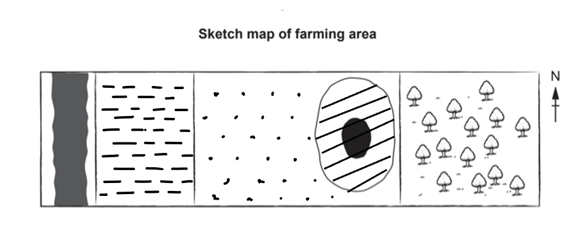

# Mark Schemes — Food Production
**Economic Development** · Cambridge (CIE) IGCSE geography (0460 & 0976)

## Paper 1 (23 questions)

### Q1
Malawi is a landlocked country in Africa, and it is experiencing food shortages due to social, environmental, and economic factors. **[KU]** Malawi experiences droughts and floods, and the situation is made worse by climate change. **[KU] **As a  country heavily reliant on rain for agriculture, any change in the weather directly impacts food security **[KU]**. In 2016, Malawi experienced a drought, which led to a 30% decrease in maize production, the country’s main food. **[KU]**** **Flooding in 2015 destroyed many of the country’s crops. **[KU]**

Pests and diseases have also caused food shortages. **[KU] **In 2017, an infestation of the fall armyworm and the spread of the maize streak virus impacted production. **[KU]**

The growing human pressure on the land is a major cause of food shortages. Malawi’s population is growing rapidly and is expected to reach 38 million by 2030. **[KU]** This population growth puts stress on land, leading to smaller farms that cannot produce enough food for a single household. **[KU]**

> **[mark-scheme]**
> **Mark allocation**
> 
> This is a 'level of response' answer. Each point made in the answer does not equal a mark.
> 
> AO focus = AO1 **[KU]**
> 
> - A top-level 3 **[7 marks]** answer will include specific examples that show:
> 
>   - Knowledge of a range of opportunities created by a river
>   - Specific place detail
> 
> **Alternative content**
> 
> The answer above is just one example of a response to this question. Other information that could be used in the answer includes:
> 
> - Poor farming techniques have led to soil degradation
> - Dependence on subsistence farming
> - Little money to invest in modern farming techniques or fertilisers

### Q2
The relief is high and steep, meaning that it would be difficult to grow crops because machinery would also be hard to use. **[1] **The area is better for pastoral farming, where fields do not need to be ploughed. **[1]****  **Sheep do not need fertile soil, and they can survive well in highland areas**. ****[1]** Often, where it is hilly, the climate can be cool and wet, making it ideal for grazing sheep rather than growing crops that need warmer temperatures. **[1]**  Hilly land is also hard to build settlements on and so there is plenty of land available for extensive pastoral farming**. ****[1]**

> **[mark-scheme]**
> The command word 'explain' means that the answer should include supporting details and explanations for the reason that each factor affects discharge
> 
> **Mark allocation**
> 
> - **One mark** for each simple point
> - **One mark** for each development of the simple point
> 
> **[5 marks]**
> 
> Answers can be either:
> 
> - Five simple points
> - One developed point plus three simple points
> - Two points which are developed plus one simple point
> 
> **Alternative content**
> 
> The answer above is just one example of a response to this question. Other information that could be used in the answer includes:
> 
> - The soil is not very deep, so not suitable for crops

### Q3
> **[mark-scheme]**
> Answers need to be one from each section.
> 
> **Input** any **one** from:
> 
> - Land
> - Capital
> - Labour
> - Livestock
> - Feed
> 
> **Process** any **one** from:
> 
> - Feeding
> - Shearing
> - Dipping
> - Lambing
> 
> **Output** any **one** from:
> 
> - Meat
> - Wool
> - Dairy products (milk, cheese)
> 
> **[3 marks]**

### Q4
Levels marking

Level 1 **(1–3 marks) **
Statements including limited detail which describe and/or explain the land use of a farm or agricultural area. 
E.g. rice = L1. Fertile soil = L1.

Level 2 **(4–6 marks) **
Uses named example. 
More developed statements which describe and/or explain the land use of a farm or agricultural area.

**Note: **Don’t combine a simple description and explanation to create a developed L2 statement. 
(**Note:** Max 5 if no named or inappropriate example)

Level 3 **(7 marks)** Uses named example. 
Comprehensive and accurate statements, which describe and explain the land use of a farm or agricultural area including some place specific reference.

Content Guide: 
Answers can describe any type of agricultural land use and are likely to refer to: 
Relief; 
Climate; 
Soil; 
Access to market; 
Capital; 
Demand/price; 
Personal preference, etc.

Place specific reference is likely to consist of: 
Locational details/named areas close by (e.g. markets) 
Specific details of farm, e.g. soil type, 
Statistics, etc.

### Q5
| **Indicative content** | **General Guidance** |
|---|---|
| Effects could include:  - Malnutrition / undernutrition - Disease - Lower life expectancy - High infant mortality - Low productivity / underdevelopment - Poverty - Rising food prices - Social unrest - Migration - Soil erosion and desertification  Solutions could include:  - Food aid - Irrigation - GM crops - High Yield Varieties - Education of farmers - Mechanisation - Fertilisers / pesticides - Appropriate technology | - The command word ‘describe’ requires you to state the effects of food shortages and outline the solutions being used to tackle them - This is a levelled response answer. It is important to remember that each point does not equate to a mark. The examiner will read your whole answer and make a decision about which level your answer fits into - If you do not name a country or region, or the country or region you name is not appropriate, you will only gain a maximum of 5 marks |

| **Model Answer** | **Commentary** |
|---|---|
| Named country: Yemen  The World Bank estimates that 17 million people or around 60% of Yemen’s population are suffering from food shortages. This causes a range of negative effects and has resulted in a number of solutions to try to tackle the problem.  One effect of food shortages is economic decline. In 2016, it was estimated that farm produce losses in Yemen totalled \$964.5 million. This resulted in loss of income and jobs for local people. Approximately 50% of the population working in agriculture have lost their jobs. Yemen is now dependent on imports for 90% of its grain supplies, with prices rising as a result of the Russian invasion in Ukraine. Shortages have led to food prices increasing by between 30-70% making it even more difficult to afford a healthy diet. This is having terrible impacts on health and life expectancy with acute malnutrition threatening over 50% of children under 5.  There are a number of solutions to tackle the food shortages in Yemen, with billions being sent in aid through organisations such as UNICEF and Red Cross. For example, The World Food Programme provides 13 million people with food assistance through rations, vouchers and cash transfers. Another solution is to try to rehabilitate the agricultural sector by providing supplies and equipment such as fertilisers, animal feed and irrigation systems. Training is also being provided to help farmers increase crop yields and improve household incomes. These strategies will help to increase food production and reduce food shortages in the long-term. | **Marks 7/7**  - This is one possible way to answer this question – your answer does not have to be exactly the same - You need to refer to a named country or region in your answer - You need to include named examples and evidence in your answer such as named places, statistics or specific details of effects and solutions in order to gain 7 marks - Using phrases such as ‘this resulted in’ and ‘this is having’ will help you extend your explanation - This answer outlines several effects and solutions and develops them by quoting supporting facts and evidence |

### Q6
Levels marking 
<u>Level 1</u>                             **  (1–3 marks) **
Statements including limited detail which explain the causes of food shortages.

<u>Level 2 </u>                             ** (4–6 marks) **
Uses named example. 
More developed statements which explain the causes of food shortages. (Note: Max 5 if no named or inappropriate example)

<u>Level 3    </u>                         **  (7 marks) **
Uses named example. 
Comprehensive and accurate statements which explain the causes of food shortages, including some place references.

<u>Content Guide:</u> 
Answers are likely to refer to: 
drought, 
flooding, 
tropical storms, 
pests, 
disease, 
infertile soils, 
war/civil unrest, 
political issues, 
uneven distribution of food, 
Focus on and export of cash crops 
Etc.

### Q7
| **Indicative content** | **General Guidance** |
|---|---|
| Natural factors could include:  - Infertile soil - Lack of rainfall/drought - Excess rainfall/flood - Tropical storm - Natural climate change - Disease - Pests  Human factors could include:  - War/conflict - Rising food prices - Human-induced global warming - Lack of investment - Lack of transport - Lack of storage - Corruption - Rapid population increase - Soil erosion/desertification - Overgrazing/over-cultivation | - The command word ‘describe’ requires you to state the natural and human factors - The command word ‘explain’ requires you to say how these factors cause food shortages - This is a levelled response answer. It is important to remember that each point does not equate to a mark. The examiner will read your whole answer and make a decision about which level your answer fits into - If you do not name a country or region, or the country or region you name is not appropriate, you will only gain a maximum of 5 marks |

| **Model Answer** | **Commentary** |
|---|---|
| Named country: Yemen  The World Bank estimates that 17 million people or around 60% of Yemen’s population are suffering from food shortages. This is caused by a range of natural and human factors.  Natural factors include droughts and floods. Yemen is a hot and arid country, with summer temperatures reaching 40°C and very little rainfall. In recent years, the main crop growing areas have received only a third to a half of the usual precipitation., significantly reducing crop yields and food production. Yemen can also be hit by intense storms and tropical cyclones that can lead to flash floods, causing landslides and crop damage. Examples include Cyclone Chapala and Cyclone Luban. Another natural factor is pests. In 2019, locust swarms destroyed crops in Yemen, further threatening food supplies.  Human factors include conflict and war. In 2015, civil war broke out after years of internal conflict. More than 4 million Yemenis have been displaced internally leading to shortages of workers on farms and high poverty rates. This means that less food is produced, leading to higher prices that people are unable to afford. Damage to roads have also disrupted movement of food around the country making it difficult to get food to areas that need it. Corruption means that food aid is often taken by those involved in the fighting and those in power so it doesn’t reach the people that need it most. | **Marks 7/7 **  - This is one possible way to answer this question – your answer does not have to be exactly the same - You need to refer to a named country or region in your answer - You also need to include place specific detail such as named locations, statistics or specific details of natural and human factors in order to gain 7 marks - Using phrases such as ‘can lead to’ and ‘this means that’ will help you extend your explanation - This answer outlines natural and human factors and develops them by quoting supporting facts and evidence and explaining how they affect food shortages |

### Q8
| **Indicative content** | **General Guidance** |
|---|---|
| Solutions could include:  - Food aid - Irrigation - GM crops - High Yield Varieties - Education of farmers - Mechanisation - Fertilisers / pesticides - Appropriate technology  Benefits could include:  - Saves lives - Increase crop yields - Increased incomes - Low costs - Reduced losses  Disadvantages could include:  - Creates dependence - Expensive - Impacts on local farmers - Impacts on environment - Impacts on health | - The command word ‘describe’ requires you to state the benefits and disadvantages of solutions to food shortages - The command word ‘explain’ requires you to give reasons why these are beneficial or problematic and support with relevant evidence - This is a levelled response answer. It is important to remember that each point does not equate to a mark. The examiner will read your whole answer and make a decision about which level your answer fits into - You will need to include named examples and evidence in your answer in order to be awarded 7 marks |

| **Model Answer** | **Commentary** |
|---|---|
| Around 800 million people worldwide suffer food shortages. There are several solutions, but each one has both benefits and disadvantages.  One solution is Food Aid. Organisations like the World Food Programme (WFP) distribute food aid in countries such as Yemen where they support 13 million people. This delivers life-saving food during emergencies and reduces malnutrition and disease. WFP sources three quarters of the food they buy from developing countries and smallholder farmers. This saves time and money on transport costs and helps to boost local economies.  However, there are disadvantages. For example, some countries become dependent on food aid which could discourage agricultural development. It can also force local farmers out of business e.g. in Haiti, American food aid undermined farmers who were unable to sell their rice and corn. Some argue these problems increase food shortages in the long-term.  Another solution is the Green Revolution which is the use of technology to increase food production. High Yield Varieties (HYVs) such as IR8 increased rice yields by up to 10 times. It was used throughout India and is thought to have saved millions of lives. Use of tractors and other machines made tasks like ploughing and harvesting more efficient, enabling farmers to bring more land into cultivation and increase production.  However, there are disadvantages such as the cost of HYVs and machinery which some farmers are unable to afford. Also, use of machines reduces the need for labour which could lead to job losses. There is also a negative environmental impact with use of fertilisers and pesticides reducing biodiversity and negatively affecting people’s health. | **Marks 7/7**  - This is one possible way to answer this question – your answer does not have to be exactly the same - You need to include named examples and evidence in your answer such as named places, statistics or specific details of benefits and disadvantages in order to gain 7 marks - Using phrases such as ‘for example’ and ‘where they’’ will help you extend your explanation - This answer outlines several benefits and disadvantages and develops them by quoting supporting facts and evidence |

### Q9
Levels marking

**  (1–3 marks)**

Level 1

Statements including limited detail which identify natural factors which have caused food shortages to occur. Little rainfall = L1

**(4–6 marks)**

Level 2

More developed statements which explain how natural factors have caused food shortages to occur (Note: Max 5 if no named or inappropriate example) Little rainfall so crops don’t grow = L2

**(7 marks)**

Level 3

Comprehensive and accurate statements which explain how natural factors have caused food shortages to occur, including some place references.

Content Guide: 
Answers are likely to refer to: 
Drought, 
Floods, 
Soil infertility, 
Soil erosion, 
Pests (or example, e.g. locusts), 
plant disease; 
Example of natural disaster – e.g. tsunami, volcanic eruption, etc.

Place specific reference is likely to consist of: 
Locational details, 
Named places 
Specific details/statistics about natural events 
Specific plant diseases or pests

**Note:** Do not credit identical development points for more than one L2 idea (e.g. crops die).

### Q10
Both increased; 
Larger increase in production than in harvested area/little change in harvested area **[1]** 
Increase in harvested area fluctuates/goes up and down and less so for increase in production/is steady/does not alter much [**1]**

Stats: 1900 2014 
55000 – 195000 (production) 
35000 – 56/57000 (area)

- *Remember to achieve full marks on this question it is essential to include supporting statistics which need to be comparative and must use `tonnes’ and `hectares’ somewhere in answer *

### Q11
(i)

Ideas such as:

Building a well will enable farmers to irrigate/water crops (more effectively) **[1]** 
Putting electric fences around fields will prevent theft by people or trampling by animals/stop animals eating them **[1]** 
Using land to graze goats will provide manure/provide milk and meat/vary the diet of the farmer/increase food supplies **[1]**

- *Take care to read the questions carefully 'well' was misread by a number of candidates as 'wall'*
- *When writing each recommendation it is essential to state how it would increase food supply*

### Q12
(i)

(Farming) to sell/for profit [**1]**

(ii)

Ideas such as: 
Crops are being grown/land cultivated/cultivation [**1]** Animals/cows are grazing/pasture [**1]**

- *Remember a mixed farm is one with both livestock/animals and crops*

(iii)

Inputs: pesticides, water  Processes: ploughing, harvesting Outputs: wheat, milk 
3 marks if all are correct** [3]** 
2 marks if 4 or 5 are correct** [2]** 
1 mark if 2 or 3 are correct [**1]**

### Q13
(i)

(Farming which) produces food for farmers own use/use of family/tribe** [1]**

(ii)

On Fig. 6.1

All 3 correct =** [2]** 1/2 correct = **[1]**

- *Remember on this question to check the key and use the type of shading shown on the key*

(iii)

Ideas such as:

Vegetables need much more (regular) attention **[1]** 
They can be protected from thieves/wild animals **[1]** 
They do not need to be close to the river (like the rice does)/rice grows on **[1]** 
Flood plain/rice needs more water/vegetables will not be flooded by the river **[1]** 
They don’t need as much land/large fields **[1]** 
Vegetables are harvested/picked more regularly **[1]** 
The soil is well drained **[1]**

### Q14
Ideas such as: 
More wheat is produced than rice [**1]** 
Both have increased over the time period/both highest in 2013 **[1]** 
There is more fluctuation/goes up and down/instability in the production of wheat than rice [**1]**

Statistics: (millions of tonnes) 
1980                   2013 
260/263    462/465 rice 
425/430    657/660 wheat

- *Remember the answer needs to refer to statistics and give the unit of measurement (millions of tonnes)*

### Q15
(i)

Producing/growing food/crops/produce/animals for their family/tribe/personal use **[1]** 
Producing/growing food/crops/produce/animals that is not for sale/profit **[1]** 
Note: however allow idea of sale in the first idea if they are only selling the surplus **[1]**

(ii)

Ideas such as: 
Crops/maize or ploughed/cultivated **[1]** Livestock/cattle/goats/sheep or grazing/grassland/pasture **[1]** Mixed farming **[1] ***this answer will only be awarded marks if you have not mentioned the features in the two lines above* 
Fruit trees/dates/coconuts/oil palms [**1]** 
Clearing/surrounded by trees [**1]**

(iii)

Inputs: seeds, water 
Processes: weeding, harvesting 
Outputs: milk, maize 
Note: **3 marks** if all correct [**3]** 
**2 marks** if 4 or 5 correct [**2]** 
**1 mark** if 2 or 3 correct  **[1]**

### Q16
(i)

11 (million hectares)** [1]**

- *In 1950 the total area of arable land is 14 million hectares by 2020 it is 25 million hectares*
- *This is a growth of 11 million hectares*

(ii)

Ideas such as:

Decreased from 66% to 45%/by 21% ** [1]**

(iii)

Any three of the following: 
Irrigation** [1]** 
Conversion of pasture to arable land [**1]** 
Terracing hillsides [**1]** 
Use of machinery** [1]** 
Deforestation** [1]** 
HYV crops [**1]**

### Q17
Ideas such as: 
Plots of land are small [**1]** 
Output is small / no surplus to sell [**1]** 
They are too poor to buy fertilizers/machines [**1]** 
Farmers use traditional methods/follow the practices of their ancestors [**1]** 
It is the only way they can provide food for their families [**1]** 
Many live in areas which are remote/isolated/poor road networks [**1]** 
There is no market for crops produced [**1]**

### Q18
Ideas such as: 
Variation in rainfall amounts/drought/flood [**1]** 
Temperature differences/or example, e.g. late frost may damage crop one year [**1]** 
Variation in amounts of sunshine [**1]** 
Variation in seed quality/development of high yielding varieties [**1]** 
Use of fertilizer/pesticides/insecticides [**1]** 
Use of irrigation [**1]** 
Mechanisation or examples of [**1]** 
Market demand/price [**1]** 
Grants/quotas/subsidies [**1]** 
Crop disease/pests [**1]** 
War **[1]** 
Change in land use area or example, e.g. fell trees/fill ponds/urban growth/urbanisation  **[1]**

### Q19
Ideas such as: 
Too poor to buy food/have large families so need lots of food [**1]** Do not have transport/can’t get to market/live in remote/isolated areas/too far from markets [**1]** 
Small areas of land/can’t afford large areas **[1]** 
Do not produce enough (surplus) to sell/do not produce a surplus/only produce enough for themselves [**1]** 
Tradition **[1]** 
Vicious circle of poverty [**1]** 
Lack of/can’t afford machinery [**1]** 
Lack of/can’t afford fertilisers/pesticides [**1]** 
Lack of/can’t afford good quality seed/GM/or such as IR8 [**1]** Lack of education about, e.g. use of pesticides [**1]**

### Q20
Flat land [**1]** 
Soil fertility [**1]** 
Amount of precipitation [**1]** 
Temperatures **[1]** 
Length of growing season [**1]** 
Demand for/price of products [**1]** 
Amount of land available [**1]** 
Capital availability/grants etc  **[1]**

- *In this answer two marks are available for each factor and one mark for reference to each photograph* *Flat land for crops * **[1] ***and cattle * **[1]** *Fertile soil for growing crops*  **[1]** *and grass for cattle/cattle on less fertile/fertile enough to grow grass for cattle* **[1]**
- *Remember the following factors will not be awarded marks as they are not related to the way that the farmer uses the land*

  - *Labour*
  - *Natural disasters/acid rain*
  - *Climate*
  - *Closeness to farmhouse*
  - *Land value*
  - *Chemicals/fertilizer*

### Q21
Ideas such as:

It provides/there will no longer be a supply of firewood **[1]** 
It provides/there will no longer be a supply of building materials **[1]** 
It provides/no longer areas to hunt/gather fruit/berries/food from the woodland **[1]** 
It provides/the farm will lose the shelter from the wind/storms **[1]** Soil erosion/mudslides may occur/it prevents soil erosion **[1]** More run off leads to floods **[1]** 
Increased siltation reduced water supply for irrigation/leads to more regular flooding **[1]**

- *Remember it is important to refer to people and not the effects on the natural environment in this answer*

### Q22
Ideas such as: 
Farm the land more intensively [**1]** 
Use fertilizers/manure [**1]** 
Irrigation/water supply to crop [**1]** 
Pesticides/herbicides [**1]** 
Use of better quality seeds/GM crops [**1]** 
More mechanization/or examples such as tractors [**1]** 
Wind breaks/contour ploughing (to prevent soil erosion) [**1]** Increase in amount of land used/deforestation/plant in larger area [**1]** 
Crop rotation [**1]** 
Terracing **[1]** 
Grow e.g. wheat rather than cattle [**1]**

### Q23
Ideas such as:

Use of fertilizers/manure [**1]** 
Pesticides/herbicides **[1] **which reduce the loss of crops due to pests and weeds, increasing yields** [Dev]** 
Crop rotation/fallowing [**1]** 
GM crops **[1] **which have higher yields per acre** [1]** 
Better quality seeds/hybrid seeds (or example, e.g. IR8 rice) [**1]** Selective breeding of livestock/vaccination of livestock [**1]** 
Use irrigation or example (e.g. Persian Wheel, sprinklers, build bunds, etc.)  **[1]** 
Terrace hillsides [**1]** 
Introduce machinery (or example, e.g. ploughs, harvesters) [**1]** Land reform/consolidation of holdings [**1]** Greenhouses/glasshouses/cloches/covering crops with plastic [**1]** 
Nets to keep off birds/scarecrows [**1]** 
Intercropping **[1]** 
Mulching **[1]** 
Large scale growth of cash crops/plantations or example, e.g. sugar cane, oil palm [**1]** 
Education about improved techniques (or example) [**1]** 
Farming cooperatives **[1]** 
Contour ploughing [**1]** 
Wind breaks; use natural predators to kill pests [**1]**

- *This question can be answered using 5 separate points or a couple of developed points*
