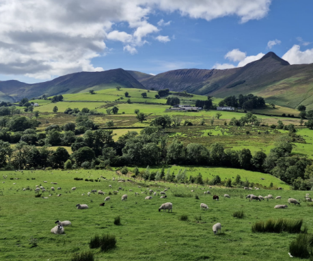
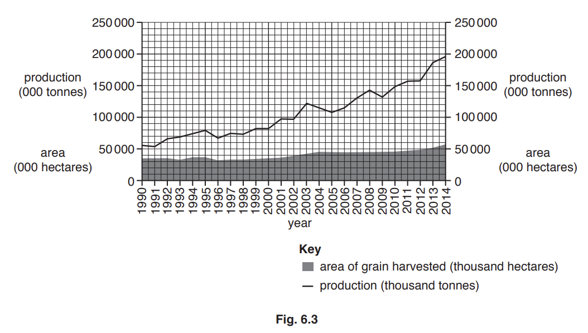
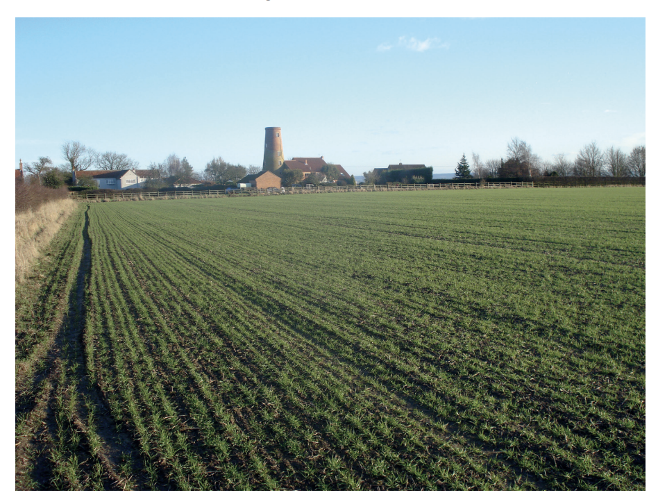
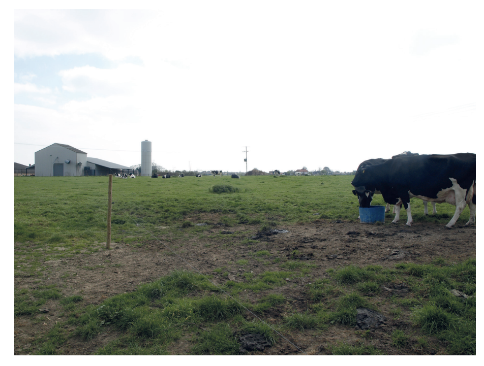
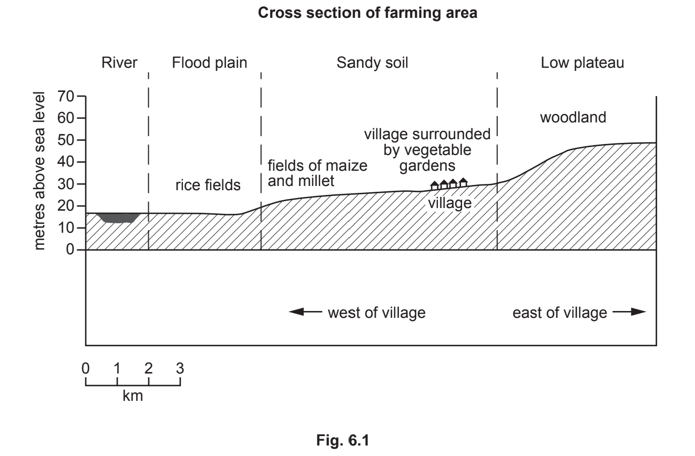
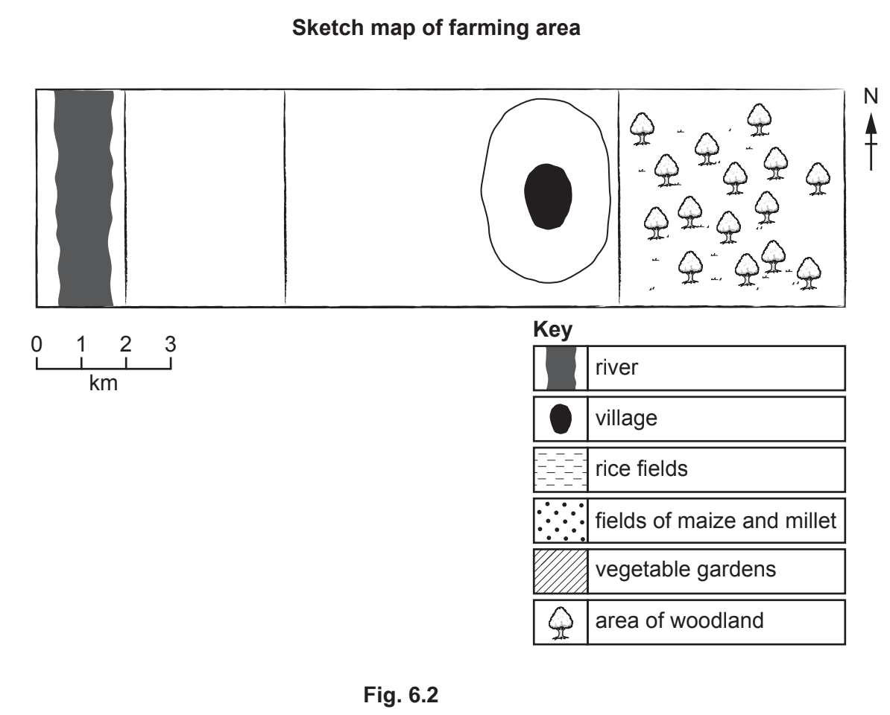
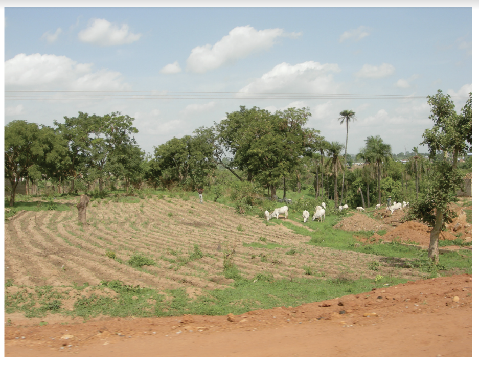
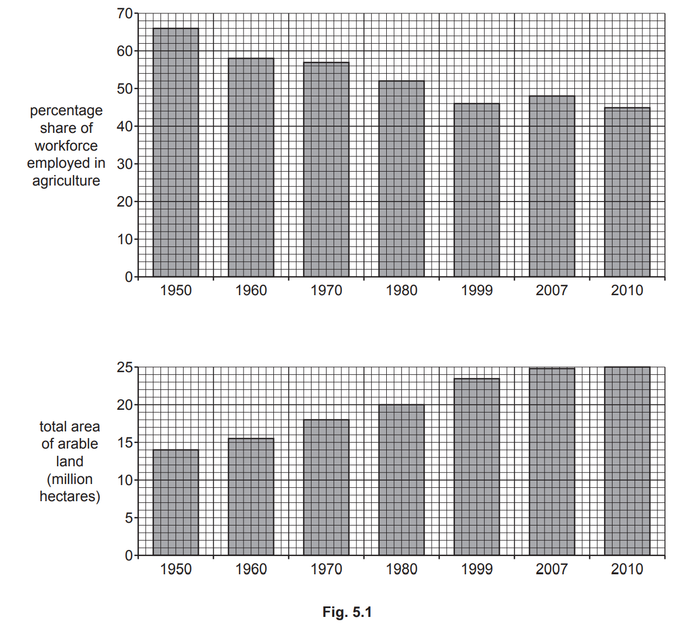

# Exam Questions — Food Production
**Economic Development** · Cambridge (CIE) IGCSE geography (0460 & 0976)
> Source: [https://www.savemyexams.com/igcse/geography/cie/20/topic-questions/](https://www.savemyexams.com/igcse/geography/cie/20/topic-questions/) · 23 questions across 1 sets

## Paper 1 (23 questions)

### Q1 — hard — 7 marks

**Q1** [7 marks]

For an area you have studied, explain the causes of food shortages.

### Q2 — medium — 5 marks

**Q2** [5 marks]

Suggest why this area might be suitable for pastoral farming.

### Q3 — medium — 3 marks

**Q3** [3 marks]

Study **Figure 5.2**, which shows a pastoral farm.

*Fig. 5.2. A pastoral farm*

For the pastoral farm shown in** Figure 5.2**, state  one

- Input
- Process
- Output

### Q4 — hard — 7 marks

**Q4** [7 marks]

For an example you have studied, describe and explain the land use of a farm or agricultural area.

Name of farm or agricultural area ...............................

*Source: Nov 2019 0460/13 Q5C*

### Q5 — hard — 7 marks

**Q5** [7 marks]

For a named country or region you have studied, describe the effects of food shortages and the solutions being used to tackle them

### Q6 — hard — 7 marks

**Q6** [7 marks]

For a named country or area you have studied, explain the causes of food shortages.

Name of country or area .............................

*Source: 2020 May/June 0460/11 Q5C*

### Q7 — hard — 7 marks

**Q7** [7 marks]

For a named country or region you have studied, describe and explain the natural and human factors that cause food shortages

### Q8 — hard — 7 marks

**Q8** [7 marks]

Describe and explain the benefits and disadvantages of solutions to food shortages.

### Q9 — hard — 7 marks

**Q9** [7 marks]

For a named country or region you have studied, explain how natural factors have caused food shortages.

Name of country or region ..............................................

*Source: Nov 2020 0460/12 Q6C*

### Q10 — easy — 3 marks

**Q10** [3 marks]

Study Fig. 6.3, which shows information about grain production in Brazil between 1990 and 2014.

Compare the change in grain production in Brazil with the change in the area of land planted with grain and harvested between 1990 and 2014.

You should refer to years and use statistics in your answer.

*Source: 2019 0460/11 Q6B*

### Q11 — easy — 3 marks

**Q11** [3 marks]

Study Fig. 6.3, which shows recommendations which agricultural experts have given to subsistence farmers in areas such as the one shown in Fig. 6.1.

| **Recommendation 1**  Build a covered, concrete-lined well close to the farm. |
|---|
| **Recommendation 2**  Put electric fences around the fields of maize and millet. |
| **Recommendation 3**  Use some of the land to graze a small herd of goats. |

**Fig. 6.3**

(i)

Explain how each of the three recommendations in Fig. 6.3 may increase the farmers’ food supply.

-Build a covered, concrete-lined well close to the farm

-Put electric fences around the fields of maize and millet

-Use some land to graze a small herd of goats

[3]

*Source: Nov 2020 0460/12 Q6B*

### Q12 — medium — 6 marks

**Q12** [6 marks]

Study Figs. 6.1 and 6.2, which are photographs of a commercial farm.

**Fig 6.1**

**Fig 6.2**

(i)

What is meant by a commercial farm?

[1]

(ii)

What evidence in Figs. 6.1 and 6.2 suggests that the farm shown is a mixed farm?

[2]

(iii)

Insert the following words into the table below to show examples of inputs, processes and outputs of the farm shown in Figs. 6.1 and 6.2.

Choose from the words below.

milk                                wheat                            harvesting 
ploughing                            water                           pesticides

| inputs | processes | outputs |
|---|---|---|
|   |   |   |
|   |   |   |

[3]

*Source: 2019 0460/11 Q6A*

### Q13 — medium — 6 marks

**Q13** [6 marks]

Study Figs. 6.1 and 6.2, which show information about a subsistence farming area in The Gambia (an LEDC in Africa).

(i)

What is meant by subsistence farming?

[1]

(ii)

Use the key to complete the sketch map, Fig. 6.2, which shows land use in the farming area by shading:    
- the rice fields    
- the vegetable gardens    
- the fields of maize and millet.

[2]

(iii)

Suggest three reasons why the vegetable gardens are closer to the village than the rice fields.

[3]

*Source: Nov 2020 0460/12 Q6A*

### Q14 — easy — 3 marks

**Q14** [3 marks]

Study Fig. 5.2, which is a graph showing information about the world production of wheat and rice between 1980 and 2013.

Compare the world production of wheat and rice between 1980 and 2013. You should use statistics in your answer.

*Source: Nov 2019 0460/13 Q5B*

### Q15 — medium — 6 marks

**Q15** [6 marks]

Study Fig. 5.1, which is a photograph of an area where subsistence farming takes place.

**Fig 5.1**

(i)

What is meant by subsistence farming?

[1]

(ii)

Using evidence from Fig. 5.1 only, describe two features of farming in the area shown. 
1 .......................................................................................... 
2 ...........................................................................................

[2]

(iii)

Insert the following words into the table below to show examples of inputs, processes and outputs of the subsistence farmers who work in the area shown in Fig. 5.1. 
Choose from the words below.

harvesting    milk    water 
            maize           seeds    weeding

| Inputs | Processes | Outputs |
|---|---|---|
|   |   |   |
|   |   |   |

[3]

*Source: Nov 2019 0460/13 Q5A*

### Q16 — medium — 6 marks

**Q16** [6 marks]

Study Fig. 5.1, which shows information about agriculture in Pakistan, an LEDC in Asia.

(i)

Calculate the area by which arable land increased in Pakistan between 1950 and 2010
. ..................................................... million hectares

[1]

(ii)

Describe how the percentage of the workforce employed in agriculture in Pakistan changed between 1950 and 2010. Use statistics in your answer.

[2]

(iii)

Suggest three ways that farmers in Pakistan were able to increase the area of arable land in the country between 1950 and 2010. 
1............................................................................................................ 
2............................................................................................................. 
3.............................................................................................................

[3]

*Source: 2020 May/June 0460/11 Q5A*

### Q17 — medium — 4 marks

**Q17** [4 marks]

Study Fig. 5.1, which shows information about agriculture in Pakistan, an LEDC in Asia.

Explain why many farmers in LEDCs, such as Pakistan, are subsistence farmers.

*Source: 2020 May/June 0460/11 Q5A*

### Q18 — medium — 5 marks

**Q18** [5 marks]

Study Fig. 5.2, which is a graph showing information about the world production of wheat and rice between 1980 and 2013.

Explain why the amount of crops produced on a farm, (e.g. wheat and rice), varies from year to year.

*Source: Nov 2019 0460/13 Q5B*

### Q19 — medium — 4 marks

**Q19** [4 marks]

Study Fig. 5.1, which is a photograph of an area where subsistence farming takes place.

**Fig 5.1**

Explain why many farmers in LEDCs are subsistence farmers.

*Source: Nov 2019 0460/13 Q5A*

### Q20 — medium — 4 marks

**Q20** [4 marks]

Study Figs. 6.1 and 6.2, which are photographs of a commercial farm.

**Fig 6.1**

**Fig 6.2**

Explain two factors which are likely to affect the way in which the farmer uses the land on the farm shown in Figs. 6.1 and 6.2.

*Source: 2019 0460/11 Q6A*

### Q21 — medium — 4 marks

**Q21** [4 marks]

Study Figs. 6.1 and 6.2, which show information about a subsistence farming area in The Gambia (an LEDC in Africa).

Describe the problems which may be caused for local people if the area of woodland to the east of the village was cleared to grow more maize and millet.

*Source: Nov 2020 0460/12 Q6A*

### Q22 — medium — 5 marks

**Q22** [5 marks]

Study Fig. 6.3, which shows information about grain production in Brazil between 1990 and 2014.

Suggest how farmers were able to increase the production of grain in Brazil between 1990 and 2014.

*Source: 2019 0460/11 Q6B*

### Q23 — medium — 5 marks

**Q23** [5 marks]

Study Fig. 6.3, which shows recommendations which agricultural experts have given to subsistence farmers

| **Recommendation 1**  Build a covered, concrete-lined well close to the farm. |
|---|
| **Recommendation 2**  Put electric fences around the fields of maize and millet. |
| **Recommendation 3**  Use some of the land to graze a small herd of goats. |

**Fig. 6.3**

Describe other methods farmers in LEDCs can use to increase their agricultural output.

*Source: Nov 2020 0460/12 Q6B*

