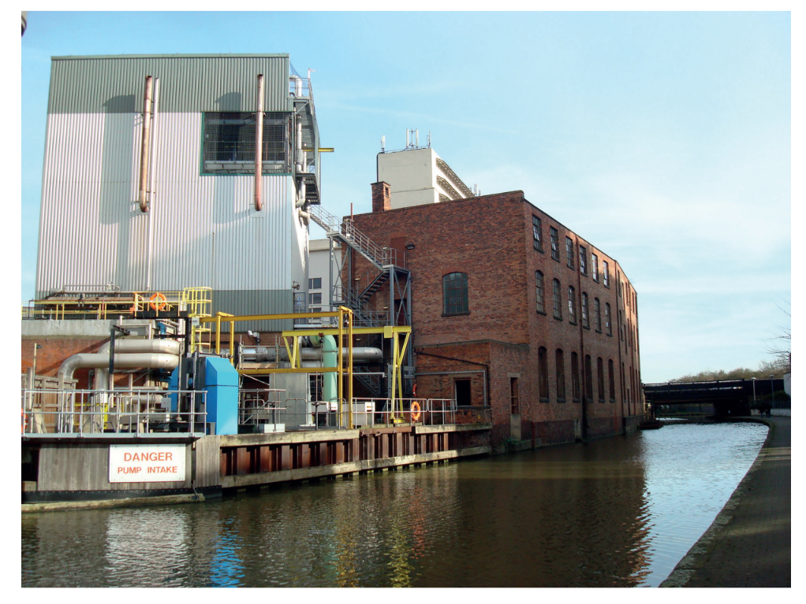
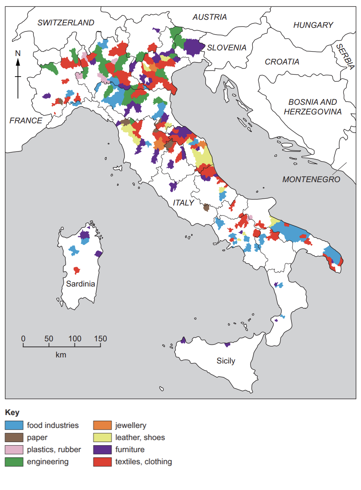
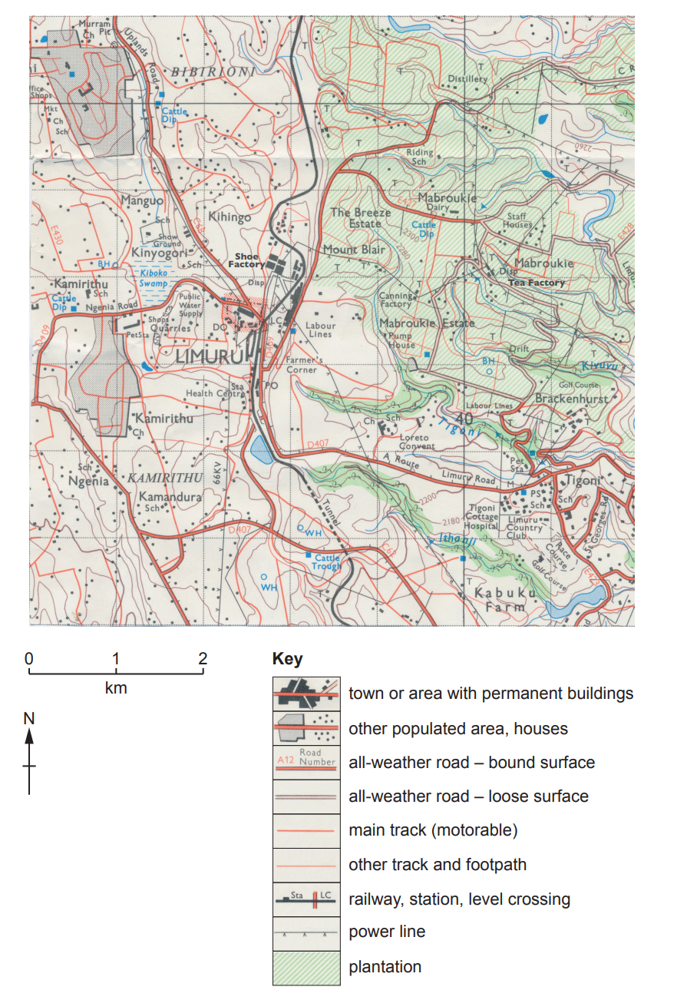
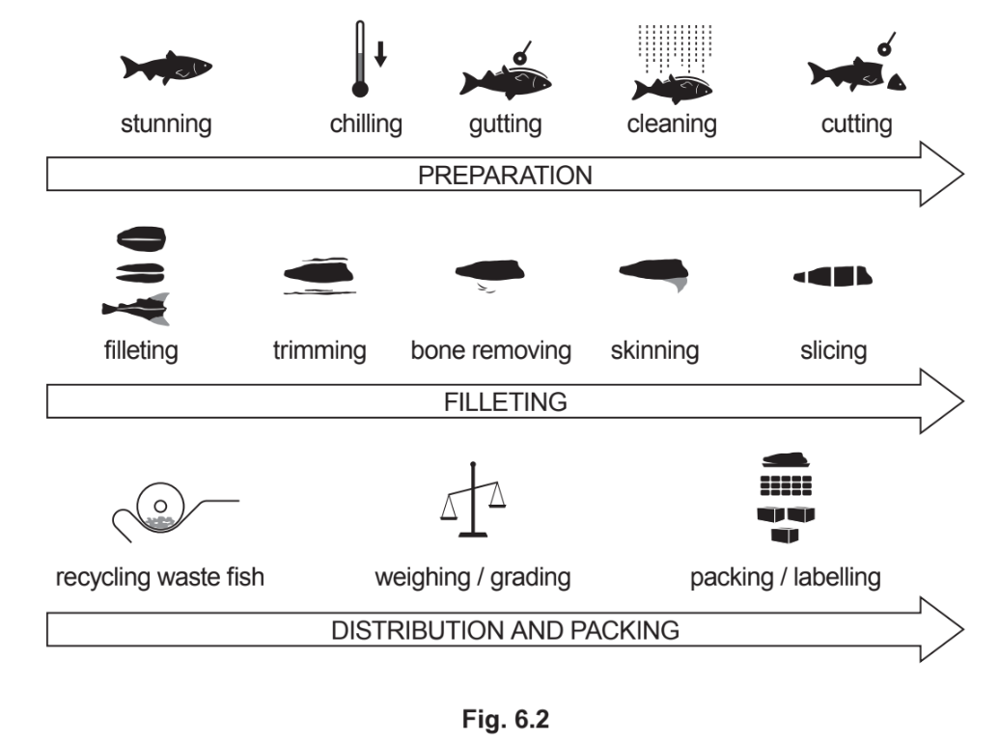

# Exam Questions — Industry
**Economic Development** · Cambridge (CIE) IGCSE geography (0460 & 0976)
> Source: [https://www.savemyexams.com/igcse/geography/cie/20/topic-questions/](https://www.savemyexams.com/igcse/geography/cie/20/topic-questions/) · 5 questions across 1 sets

## Paper 1 (5 questions)

### Q1 — hard — 7 marks

**Q1** [7 marks]

For a named example you have studied, describe and explain the location of a factory or industrial zone.

Name of factory or industrial zone .............................

*Source: May/Jun 2020 0460/12 Q6C*

### Q2 — easy — 10 marks

**Q2** [10 marks]

Study Fig. 5, which is a photograph of a factory.

**Fig 5.1 **

(i)

The factory shown in Fig. 5.1 puts together components for machines which are then used in other industries. What type of industry is this?

Circle one answer from the words below:

| assembly | high technology | processing | service |
|---|---|---|---|

[1]

(ii)

Suggest **two **reasons why the factory was located close to the canal.

1 ........................................................................................ 
2 .........................................................................................

[2]

(iii)

In which sector, primary, secondary, tertiary or quaternary, would the following people who are employed by the factory shown in Fig. 5.1 work?

- workers who carry out research and use it to design new machines

- drivers of lorries transporting products from the factory

- people operating machines in the factory

[3]

(iv)

Explain how the location of manufacturing industry may be influenced by political factors.

[4]

*Source: 2020 May/June 0460/13 Q5A*

### Q3 — medium — 8 marks

**Q3** [8 marks]

Study Fig. 6.2 (Insert), which shows information about the location of selected manufacturing industries in Italy.

**Fig. 6.2**

(i)

Compare the importance of manufacturing industry in north and south Italy.

[3]

(ii)

Explain how manufacturing industry may increase the rate of global warming.

[5]

*Source: June 2021 0460/11 Q6B*

### Q4 — medium — 8 marks

**Q4** [8 marks]

Study Fig. 5.2, which shows the area around Limuru, Kenya.

(i)

Suggest why the tea factory four kilometres east of Limuru is located close to the tea plantations.

[3]

(ii)

Using evidence from Fig. 5.2 **only**, suggest reasons for the location of the shoe factory one kilometre north of Limuru.

[5]

*Source: 2020 May/June 0460/13 Q5B*

### Q5 — medium — 8 marks

**Q5** [8 marks]

Study Fig. 6.2, which shows information about the fish processing industry.

(i)

Complete the table below by inserting the following words to show examples of inputs, processes and outputs of the fish processing industry shown in Fig. 6.2.

| electricity | removing bones | weighing portions |
|---|---|---|
| packets of frozen fish | fish skin | water |

| **Inputs** | **Processes** | **Outputs** |
|---|---|---|
| ............................... | ............................... | ............................... |
| ............................... | ............................... | ............................... |

[3]

(ii)

Explain how the local natural environment may be at risk from industries such as fish processing.

[5]

*Source: June 2020 0460/12 Q6B*

