# Exam Questions — Tourism
**Economic Development** · Cambridge (CIE) IGCSE geography (0460 & 0976)
> Source: [https://www.savemyexams.com/igcse/geography/cie/20/topic-questions/](https://www.savemyexams.com/igcse/geography/cie/20/topic-questions/) · 19 questions across 1 sets

## Paper 1 (19 questions)

### Q1 — medium — 4 marks

**Q1** [4 marks]

Explain **two** reasons why tourism has grown rapidly over the last 50 years.

### Q2 — easy — 5 marks

**Q2** [2 marks]

Study **Figure 6.1** below, which shows an electric vehicle used at a hotel in the Lake District.

Outline how this is sustainable.

*Fig 6.1 - Electric vehicle used at a hotel in the Lake District*

**Q2** [3 marks]

Suggest **three **other ways that tourism can be made sustainable.

### Q3 — easy — 1 marks

**Q3** [1 mark]

Define the term 'tourist'.

### Q4 — hard — 7 marks

**Q4** [7 marks]

For a named area you have studied, explain how the tourist industry is being developed without destroying the natural environment.

Name of area ..................................................................................

*Source: Nov 2020 0460/13 Q5C*

### Q5 — hard — 7 marks

**Q5** [7 marks]

For a named area you have studied where tourism is important, explain how it is managed so that the risks to the natural environment are reduced.

Name of area ............................................................

*Source: May/Jun 2020 0460/12 Q5C*

### Q6 — hard — 7 marks

**Q6** [7 marks]

For a named area you have studied, explain how tourism is managed in order for it to be sustainable.

Name of area...............................................

*Source: 2020 May/June 0460/11 Q6C*

### Q7 — hard — 7 marks

**Q7** [7 marks]

For a named tourist area you have studied, explain how the tourist industry may cause problems for local people.

Name of tourist area ....................................

*Source: June 2021 0460/11 Q6C*

### Q8 — hard — 7 marks

**Q8** [7 marks]

For a named country or area you have studied, describe the different methods which are used to manage tourism.

Name of country or area......................

*Source: Oct/Nov 2020 0460/11 Q5C*

### Q9 — hard — 7 marks

**Q9** [7 marks]

For a named area where tourism is important, describe and explain how it has negative impacts for both people and the environment.

### Q10 — easy — 10 marks

**Q10** [10 marks]

Study Fig. 6.1, which shows information about the Kafue National Park in Zambia, an area where the tourist industry is important. Zambia is an LEDC in Africa.

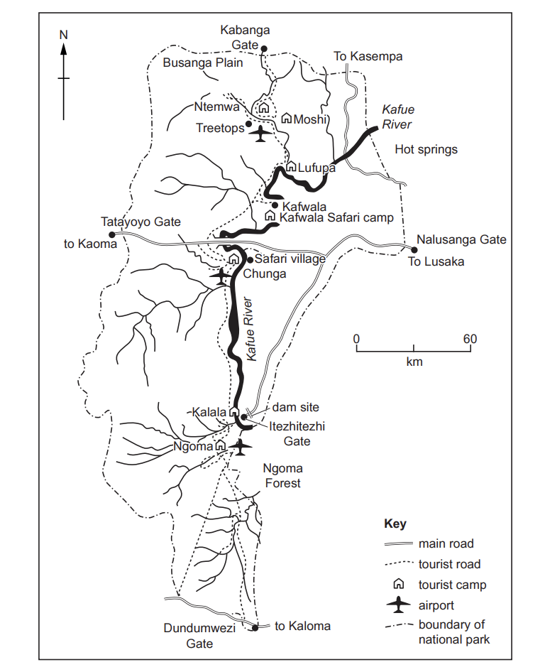

**Fig. 6.1**

(i)

Estimate the area of Kafue National Park in square kilometres.

Circle the correct answer below.

| 1000 | 6000 | 22000 | 100000 |
|---|---|---|---|

[1]

(ii)

Many tourists enter Kafue National Park at Nalusanga Gate and drive through it to Tatayoyo Gate.

What is the distance and direction along the main road from Nalusanga Gate to Tatayoyo Gate?

Distance ............................................... km

Direction ..............................................

[2]

(iii)

Using Fig. 6.1 **only,** identify **three** things that have been done in Kafue National Park to attract tourists.

[3]

(iv)

Suggest reasons why the government of Zambia is encouraging tourism.

[4]

*Source: June 2021 0460/13 Q6A*

### Q11 — easy — 10 marks

**Q11** [10 marks]

Study Fig. 5.1, which shows a map of the island of Gran Canaria, a Spanish island off the coast of Africa. Fig. 5.2, is a photograph of the tourist resort of Taurito in Gran Canaria.

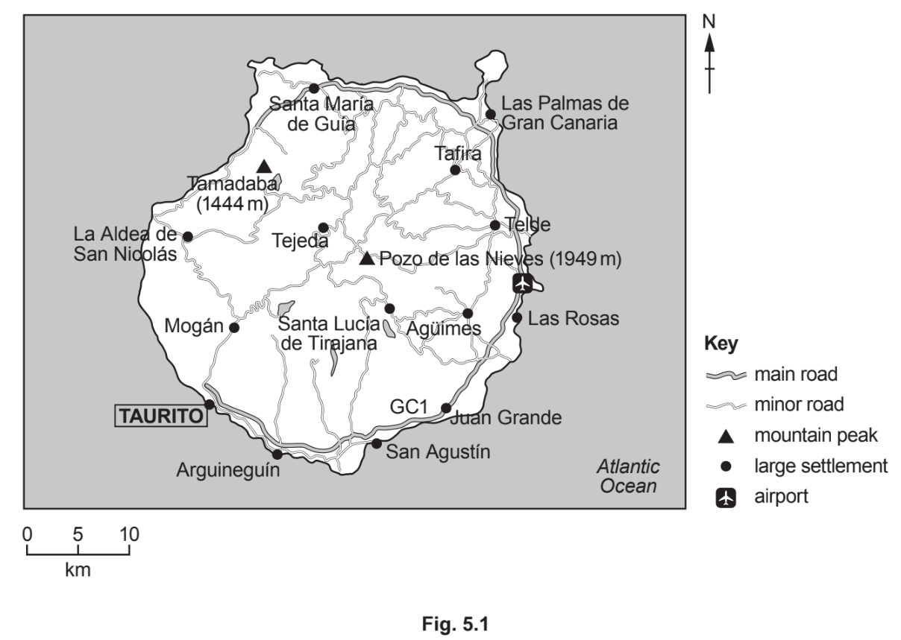

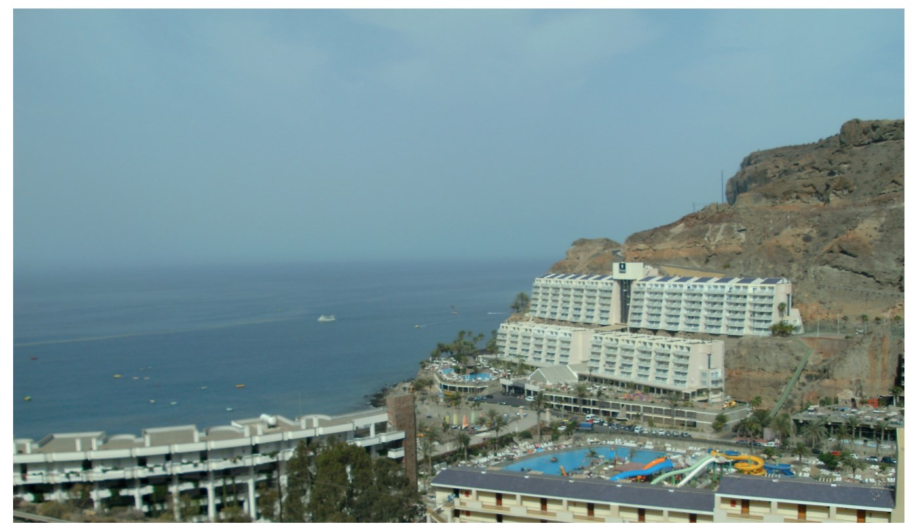

**Fig 5.2**

(i)

What is the compass direction from the airport to Taurito?

[1]

(ii)

Use the scale to measure the distance along the GC1 road from the airport to Taurito.

.........................km

[2]

(iii)

Using Fig. 5.2 only, explain how the natural environment has encouraged the development of a tourist resort at Taurito.

[3]

(iv)

Suggest two benefits and two disadvantages of tourism for the people who live in Gran Canaria.

Benefit 1 ...........................

Benefit 2 ...........................

Disadvantage 1 ................................

Disadvantage 2 .................................

[4]

*Source: june 2020 0460/12 Q5A*

### Q12 — easy — 10 marks

**Q12** [10 marks]

Study Fig. 5.1, which is information about the climate of the Maldives (an LEDC). The Maldives is a group of islands on the Equator in the Indian Ocean, which are important for tourism.

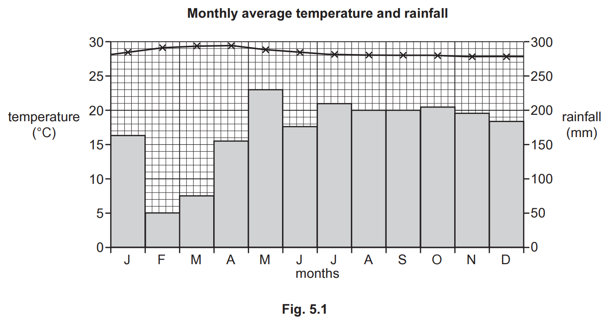

(i)

Use Fig. 5.1 to estimate the total annual rainfall in the Maldives.

Circle your answer below.

| 950 mm | 1750 mm | 2050 mm | 3250 mm |
|---|---|---|---|

[1]

(ii)

Describe the attractions of the climate of the Maldives for tourists.

[2]

(iii)

Describe the characteristics of the **physical landscape** of small tropical islands, such as the Maldives, which have encouraged the growth of the tourist industry.

[3]

(iv)

Suggest ways in which the tourist industry is likely to benefit local communities in the Maldives.

[4]

*Source: Oct/Nov 2020 0460/11 Q5A*

### Q13 — easy — 10 marks

**Q13** [10 marks]

Study **Fig. 5.1**, a map showing tourist attractions in Mauritius, an LEDC in the Indian Ocean.

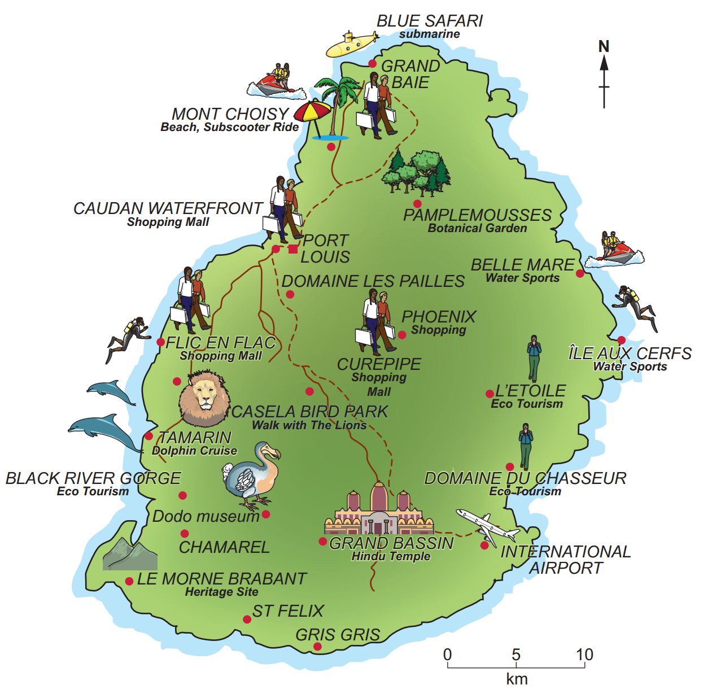

**Fig 5.1**

(i)

Name the river gorge in the south west of Mauritius.

[1]

(ii)

Describe the location of the tourist resort of Grand Baie.

[2]

(iii)

Identify three attractions of the human landscape for tourists in Mauritius.

[3]

(iv)

Explain how the tourist industry may benefit the people who live on the island of Mauritius.

[4]

*Source: Nov 2020 0460/13 Q5A*

### Q14 — easy — 10 marks

**Q14** [10 marks]

Study Fig. 6.1, which shows how the number of tourists to Acapulco, a tourist destination on the coast of Mexico, has changed between 1920 and 2010.

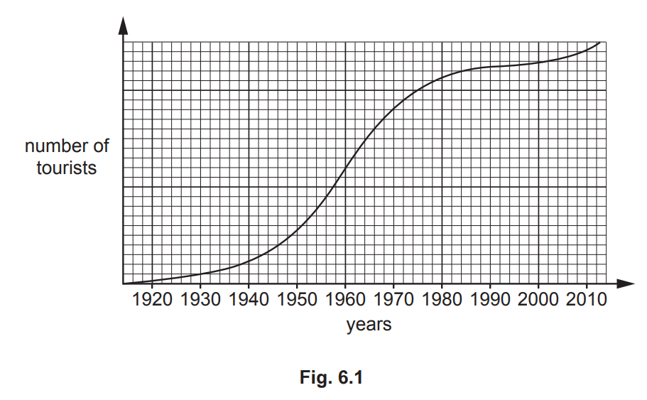

(i)

The table below lists six tourist attractions in Acapulco.   Tick the two which are physical attractions.

|   | Tick (✓) |
|---|---|
| Acapulco City market |   |
| La Quebrada cliffs |   |
| Lucha Libre Mexican wrestling show |   |
| Our Lady of Solitude Cathedral |   |
| Palma Sola archaeological site |   |
| Playa Condesa beach |   |

(ii)

Suggest two ways in which the infrastructure of Acapulco is likely to have improved as it developed as a tourist destination. 
1 ................................................................................................ 
2 ................................................................................................

[2]

(iii)

Suggest why the growth of tourism in the Acapulco area may have had both positive and negative effects on local fishermen.

[3]

(iv)

Using Fig. 6.1 only, describe the changes in the number of tourists in Acapulco between 1920 and 2010.

[4]

*Source: 2020 June 0460/11 Q6A*

### Q15 — medium — 8 marks

**Q15** [8 marks]

Study Figs. 5.2 and 5.3, which are photographs that were taken in Grand Baie, Mauritius.

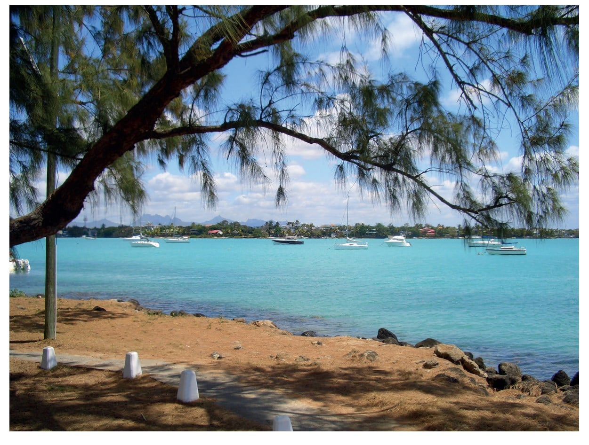

**Fig 5.2**

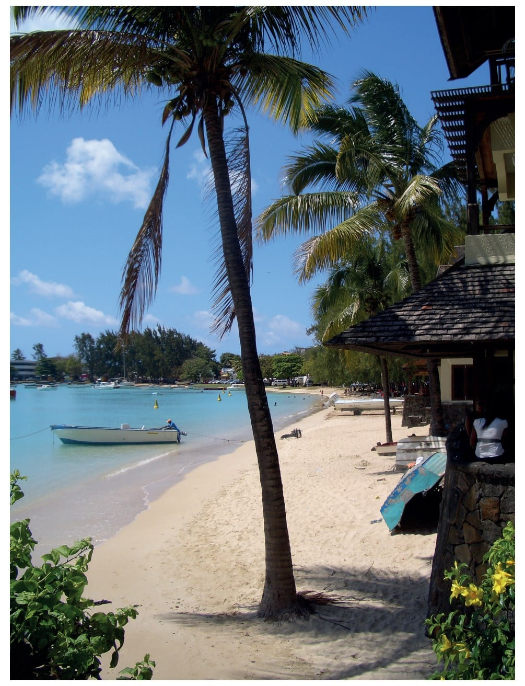

**Fig 5.3**

(i)

Using evidence from Figs. 5.2 and 5.3 only, describe the natural attractions of Grand Baie for tourists.

[3]

(ii)

Suggest how tourism in Grand Baie may have negative impacts on local people and the natural environment.

[5]

*Source: Nov 2020 0460/13 Q5B*

### Q16 — medium — 8 marks

**Q16** [8 marks]

Study Fig. 6.2, which is an advert for a tourist resort in the Silvassa Forest region in India (an LEDC).

**Fig 6.2**

(i)

State three different types of job which are likely to have been created by tourism in the Silvassa Forest region. 
1 ....................................................................................................... 2 ...................................................................................................... 3 .......................................................................................................

[3]

(ii)

Explain how the local natural environment may be at risk from tourist resorts such as the one shown in Fig. 6.2.

[5]

*Source: 2020 May/June 0460/11 Q6B*

### Q17 — medium — 8 marks

**Q17** [8 marks]

Study Fig. 5.2, a map of Hulhumalé, an island in the Maldives, and Fig. 5.3 which shows a new hotel being built.

The new hotel is located at **X** in Fig. 5.2.

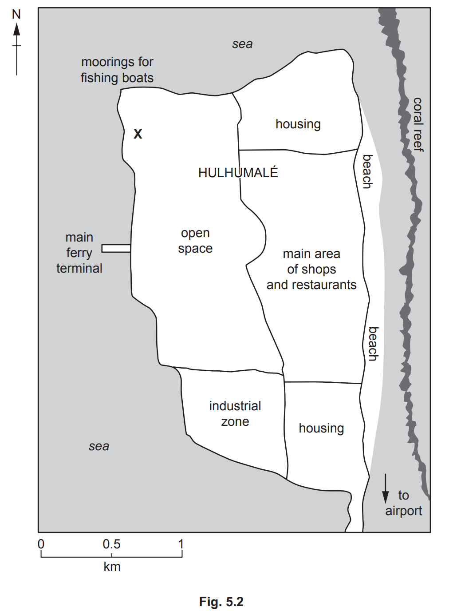

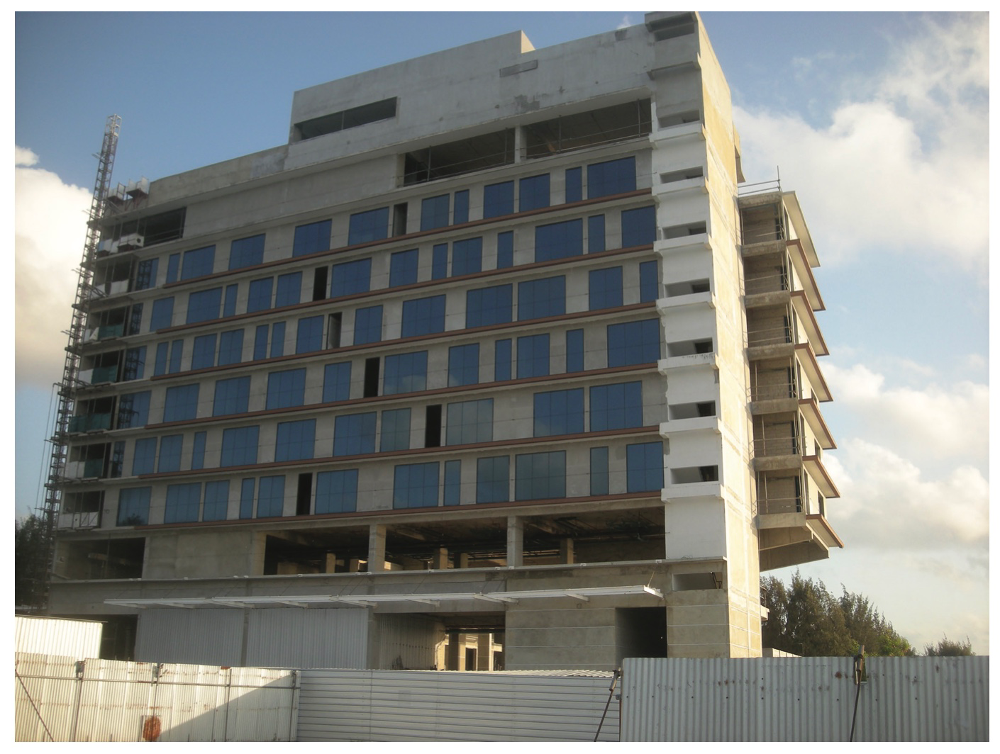

**Figure 5.3 **

(i)

To what extent is **X **an ideal location for a new hotel? Give reasons for your answer.

[3]

(ii)

Suggest reasons why many people who live on Hulhumalé may **not **agree with the building of the new hotel.

[5]

*Source: Oct/Nov 2020 0460/11 Q5B*

### Q18 — medium — 8 marks

**Q18** [8 marks]

Study Figs. 6.2 and 6.3 (Insert), which are photographs taken in national parks.

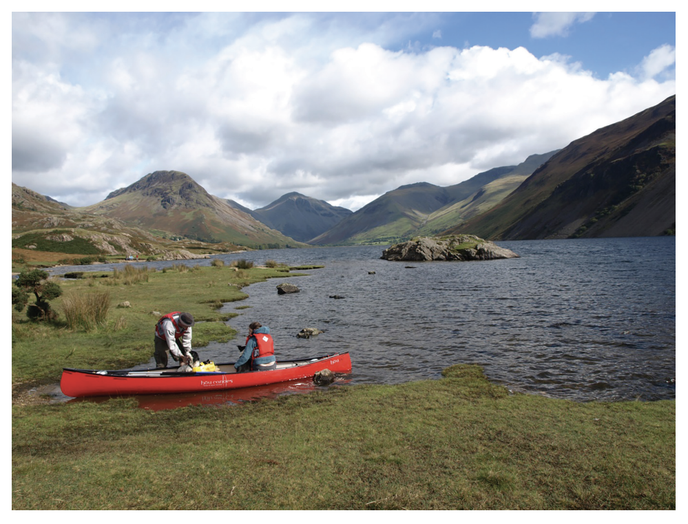

**Fig. 6.2**

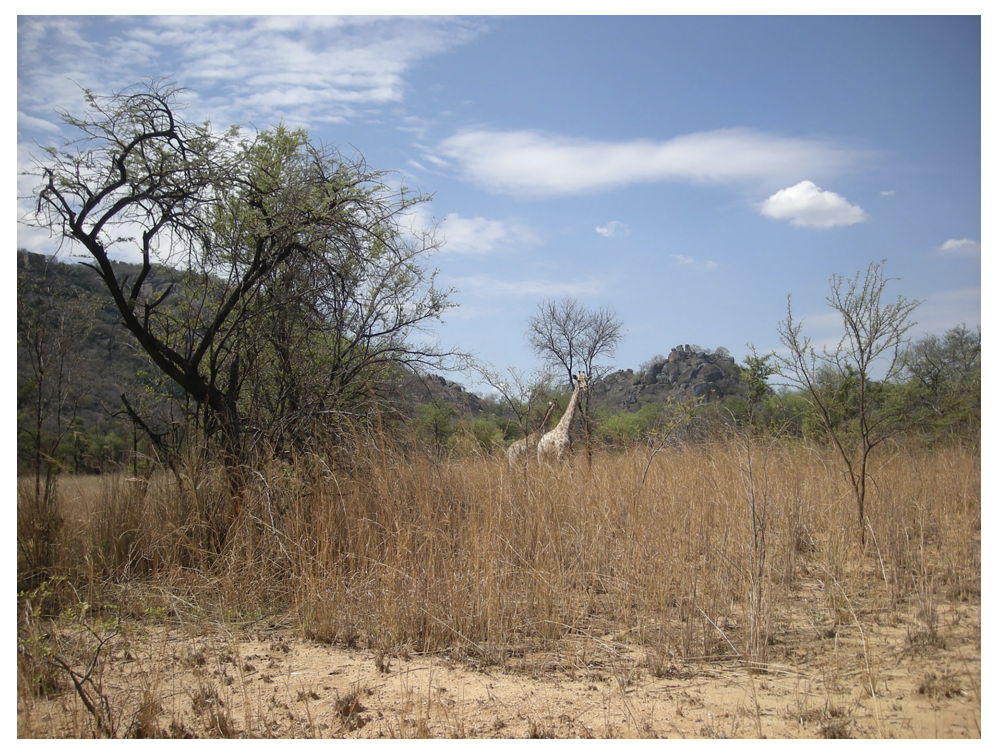

**Fig. 6.3**

Fig. 6.2 was taken in the Lake District National Park in the UK. 
Fig. 6.3 was taken in the Matopos National Park in Zimbabwe.

(i)

Describe the natural attractions of the Lake District and Matopos National Parks which are shown in Figs. 6.2 and 6.3.

Fig. 6.2 ........................................

Fig. 6.3 ........................................

[3]

(ii)

Explain how national parks, such as those in Figs. 6.2 and 6.3, manage tourism.

[5]

*Source: June 2021 0460/13 Q6B*

### Q19 — medium — 8 marks

**Q19** [8 marks]

Study Fig. 5.3, which shows an island in the Indian Ocean before and after the construction of tourist facilities.

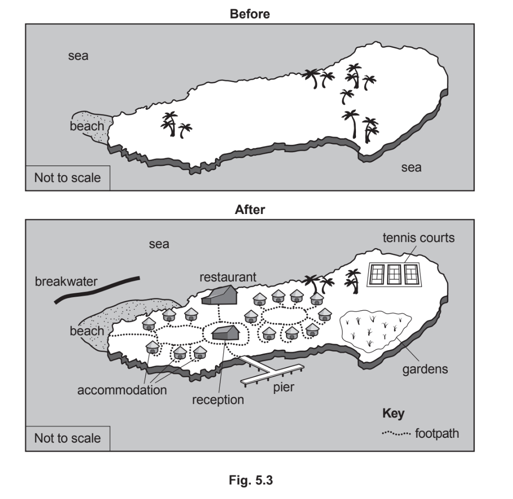

(i)

Using Fig. 5.3 only, identify three changes on the island as a result of the construction of the tourist facilities.

[3]

(ii)

Suggest how the local natural environment of the island shown in Fig. 5.3 may be at risk from tourism.

[5]

*Source: June 2020 0460/12 Q5B*

