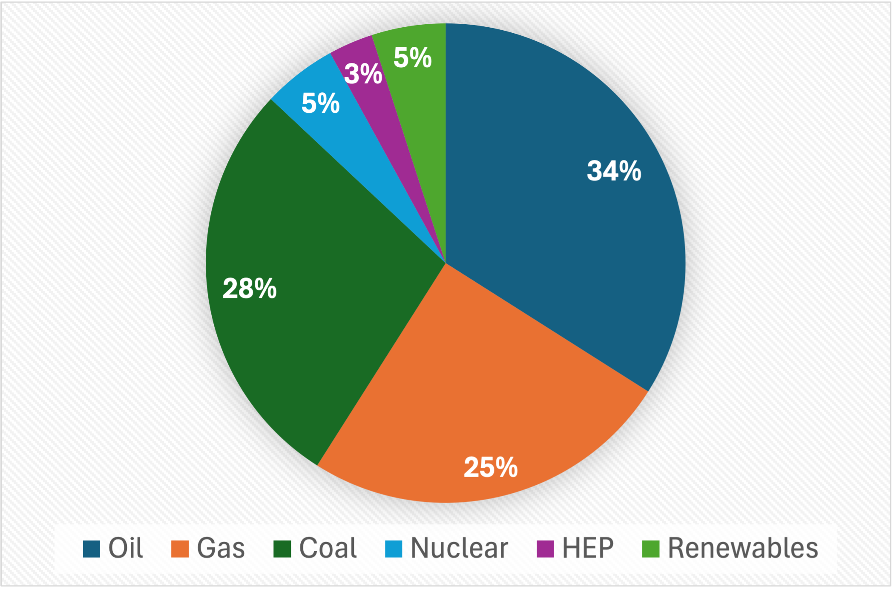
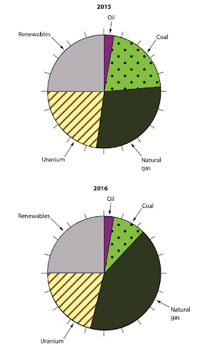
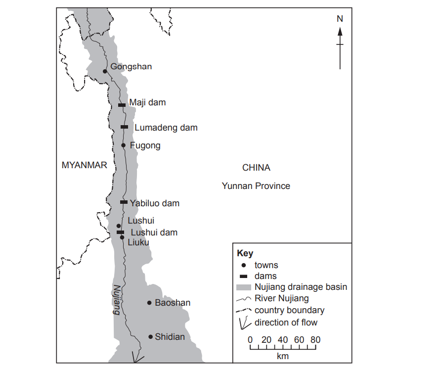
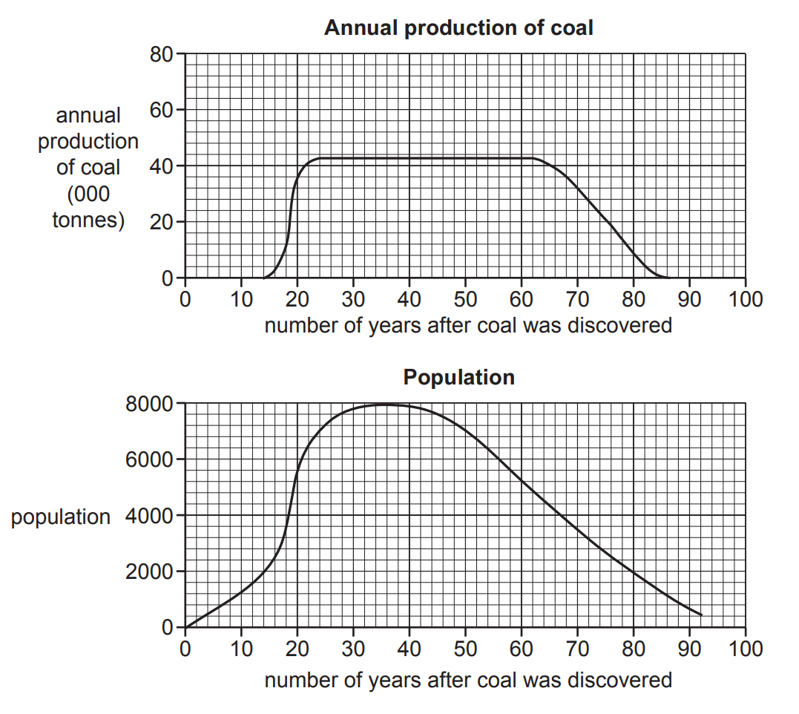
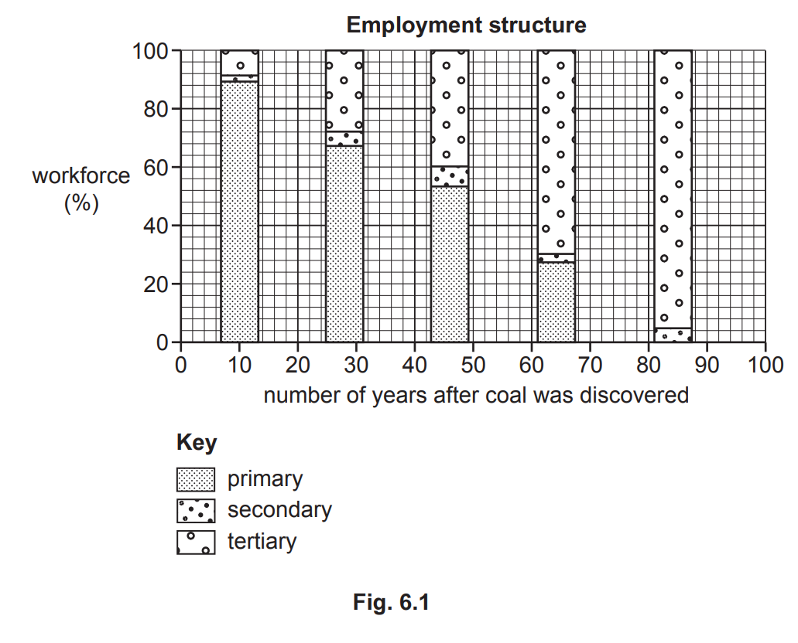
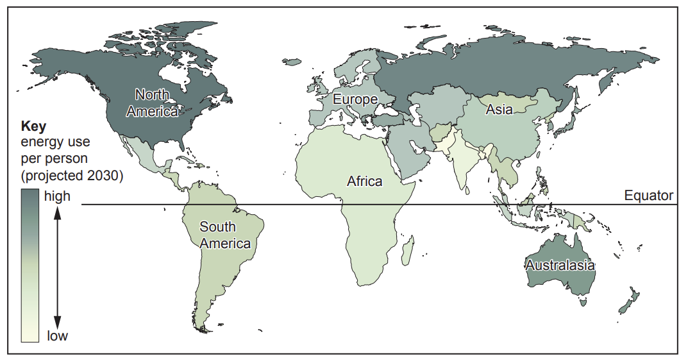
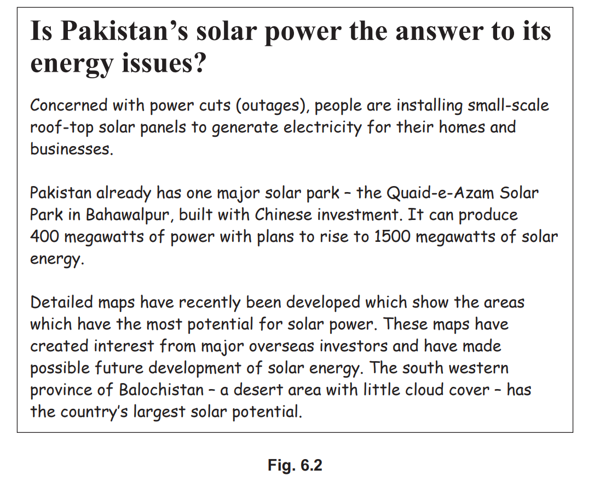
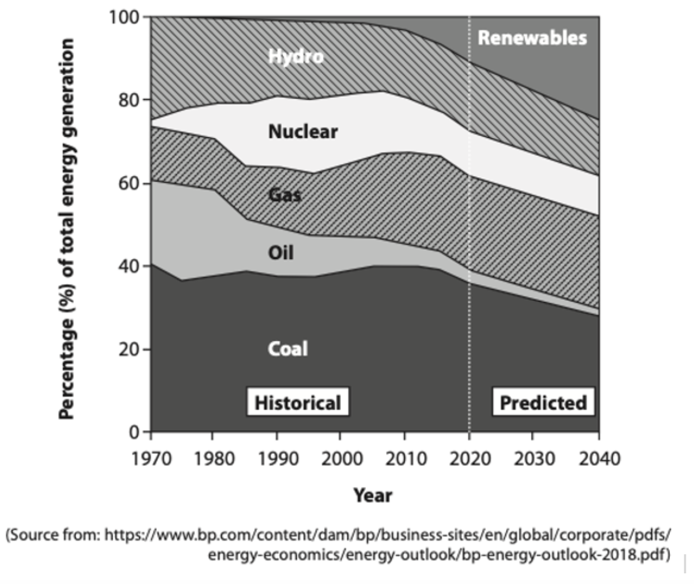

# Exam Questions — Energy
**Economic Development** · Cambridge (CIE) IGCSE geography (0460 & 0976)
> Source: [https://www.savemyexams.com/igcse/geography/cie/20/topic-questions/](https://www.savemyexams.com/igcse/geography/cie/20/topic-questions/) · 24 questions across 1 sets

## Paper 1 (24 questions)

### Q1 — hard — 7 marks

**Q1** [7 marks]

For a country you have studied, describe the importance of different energy sources.

### Q2 — medium — 5 marks

**Q2** [5 marks]

Fuelwood is an example of biomass.

Describe the effects of using fuelwood as an energy source on people and the environment

### Q3 — easy — 3 marks

**Q3** [3 marks]

Study **Figure 6.2**, which shows the global energy mix by source.

Describe the  global energy mix.

*Fig. 6.1. Global Energy Mix*

### Q4 — hard — 7 marks

**Q4** [7 marks]

For a named country or area you have studied, describe and explain the importance of different sources of energy.

Name of country or area ...........................

*Source: Nov 2019 0460/11 Q5C*

### Q5 — hard — 7 marks

**Q5** [7 marks]

For a named country or area you have studied, describe how energy is supplied.

Name of country ............................

*Source: Spec 2020 0460/01 Q6C*

### Q6 — hard — 7 marks

**Q6** [7 marks]

For a named country or area you have studied, describe the different methods which are used to supply energy.

Name of country or area .................................................................

*Source: 2020 May/June 0460/13 Q5C*

### Q7 — hard — 7 marks

**Q7** [7 marks]

Describe and explain the benefits and disadvantages of nuclear power.

### Q8 — hard — 7 marks

**Q8** [7 marks]

Energy is another important resource.

For a named country or area you have studied, describe and explain the importance of different sources of **energy**.

Name of country or area .....................

*Source: Nov 2019 0460/12 Q5C*

### Q9 — hard — 7 marks

**Q9** [7 marks]

For a country or area you have studied, describe and explain the advantages and disadvantages of its methods of energy supply.

### Q10 — hard — 7 marks

**Q10** [7 marks]

Describe and explain the benefits and disadvantages of renewable energy sources.

### Q11 — easy — 3 marks

**Q11** [3 marks]

Study Fig. 1.1, which shows the proportion of energy resources used to generate electricity in the UK, 2015-2016.

**Fig. 1.1**

Using Fig. 1.1. **only**, describe the changes in the proportion of coal and natural gas used to generate electricity in the UK in 2015 and 2016. Use data to support your answer.

### Q12 — easy — 6 marks

**Q12** [6 marks]

Study Fig. 6.1, which shows a map of the Nujiang River in Yunnan Province, China, showing the location of four dams built to generate hydro-electric power (HEP).

**Fig. 6.1**

(i)

Tick (**✓**) the **one** statement in the table below which describes how HEP is generated.

|   | Tick (**✓**) |
|---|---|
| Atoms of uranium are split to create electricity. |   |
| Coal is burnt to produce steam which is used in the power station. |   |
| Running water turns a turbine to generate power. |   |
| Strong winds blow turbines to produce electricity. |   |
| Turbines are turned when the tide goes in and out. |   |

[1]

(ii)

Identify the following dams shown in Fig. 6.1: – the dam which is nearest to the source of the river ..............................................................................

– the dam which is 100km north-north west (NNW) of Baoshan. ..............................................................................

[2]

(iii)

Give **three** different reasons why some countries generate a greater proportion of their energy from HEP than other countries. 
1 ..............................................................................

2 ..............................................................................

3 ..............................................................................

[3]

*Source: March 2021 0460/12 Q6A*

### Q13 — easy — 6 marks

**Q13** [6 marks]

Study Fig. 6.1, which shows information about changes over time in a coal mining settlement in Germany.

(i)

Coal is a fossil fuel. What is meant by *fossil fuel*?

[1]

(ii)

Describe the relationship, shown in Fig. 6.1, between the production of coal and the size of the population in the settlement in the 20 years after coal was discovered. Use statistics in your answer.

[2]

(iii)

Describe how the following sectors of employment have changed over the period of time shown in Fig. 6.1.

Primary ............................................................

Secondary ......................................................

Tertiary .............................................................

[3]

*Source: Oct/Nov 2020 0460/11 Q6A*

### Q14 — easy — 3 marks

**Q14** [3 marks]

Study Fig. 6.2, which shows information about the four dams on the Nujiang River which are labelled in Fig. 6.1.

| **dam** | **height of** **dam** **(metres)** | **area of** **reservoir** **(km****2****)** | **annual value** **of electricity** **generated** **(billion RMB*)** | **total** **construction** **cost** **(billion RMB)** | **number of** **people made** **homeless** |
|---|---|---|---|---|---|
| Lumadeng | 165 | 11 | 3.2 | 9.1 | 6 092 |
| Lushui | 175 | 19 | 4.0 | 8.8 | 6 190 |
| Maji | 300 | 66 | 5.9 | 18.4 | 19 830 |
| Yabiluo | 133 | 9 | 2.9 | 6.0 | 3 982 |

*RMB is the currency of China.

**Fig. 6.2**

Using the information in Fig. 6.2 **only,** describe **three** differences between the Maji and Yabiluo dams.

*Source: March 2021 0460/12 Q6B*

### Q15 — easy — 3 marks

**Q15** [3 marks]

Study Fig. 5.2, which shows a prediction for energy use per person in different parts of the world in 2030.

**Fig. 5.2**

Using Fig. 5.2 only, describe the predicted variation in the use of energy per person in the world.

*Source: June 2021 0460/11 Q5B*

### Q16 — easy — 3 marks

**Q16** [3 marks]

Study Fig. 6.2, which is an extract from a newspaper about the development of solar energy in Pakistan.

Using Fig. 6.2 **only**, explain why Pakistan is expected to develop solar energy.

*Source: Oct/Nov 2020 0460/11 Q6B*

### Q17 — easy — 2 marks

**Q17** [2 marks]

Study Fig.1, which shows the past and predicted changes in the global energy mix, 1970-2040.

**Fig 1**

Using Fig. 1 only:

(i)

State the energy source which is predicted to see the largest increase ……………………………

[1]

(ii)

State the energy source which is predicted to see the largest decrease …………………………….

[1]

### Q18 — medium — 5 marks

**Q18** [5 marks]

Study Fig. 6.2, which is an extract from a newspaper about the development of solar energy in Pakistan.

Explain why renewable sources do **not **provide large amounts of energy in many countries.

*Source: Oct/Nov 2020 0460/11 Q6B*

### Q19 — medium — 4 marks

**Q19** [4 marks]

Study Fig. 6.1, which shows a map of the Nujiang River in Yunnan Province, China, showing the location of four dams built to generate hydro-electric power (HEP).

**Fig. 6.1**

Explain why the proportion of energy generated from renewable sources is likely to increase in the future.

*Source: March 2021 0460/12 Q6A*

### Q20 — medium — 4 marks

**Q20** [4 marks]

Study Fig. 1, which shows the proportion of energy resources used to generate electricity in the UK, 2015-2016.

**Fig. 1**

Suggest reasons for the changing proportion of coal used to generate electricity between 2015 and 2016.

### Q21 — medium — 5 marks

**Q21** [5 marks]

Study Fig. 5.2 (Insert), which shows a prediction for energy use per person in different parts of the world in 2030.

**Fig. 5.2**

Explain why some parts of the world use large amounts of energy per person.

*Source: June 2021 0460/11 Q5B*

### Q22 — medium — 5 marks

**Q22** [5 marks]

Study Fig. 6.2, which shows information about the four dams on the Nujiang River which are labelled in Fig. 6.1.

| **dam** | **height of** **dam** **(metres)** | **area of** **reservoir** **(km****2****)** | **annual value** **of electricity** **generated** **(billion RMB*)** | **total** **construction** **cost** **(billion RMB)** | **number of** **people made** **homeless** |
|---|---|---|---|---|---|
| Lumadeng | 165 | 11 | 3.2 | 9.1 | 6 092 |
| Lushui | 175 | 19 | 4.0 | 8.8 | 6 190 |
| Maji | 300 | 66 | 5.9 | 18.4 | 19 830 |
| Yabiluo | 133 | 9 | 2.9 | 6.0 | 3 982 |

*RMB is the currency of China.

**Fig. 6.2**

Suggest why the building of dams to generate HEP along the Nujiang River may cause problems for people and the natural environment in the area.

*Source: March 2021 0460/12 Q6B*

### Q23 — medium — 4 marks

**Q23** [4 marks]

Study Fig.1, which shows the past and predicted changes in the global energy mix, 1970-2040.

**Fig 1**

Suggest reasons for changes to renewables

### Q24 — medium — 4 marks

**Q24** [4 marks]

Study Fig. 6.1, which shows information about changes over time in a coal mining settlement in Germany.

Explain why a country should **not **rely completely on fossil fuels as a source of energy.

*Source: Oct/Nov 2020 0460/11 Q6A*

