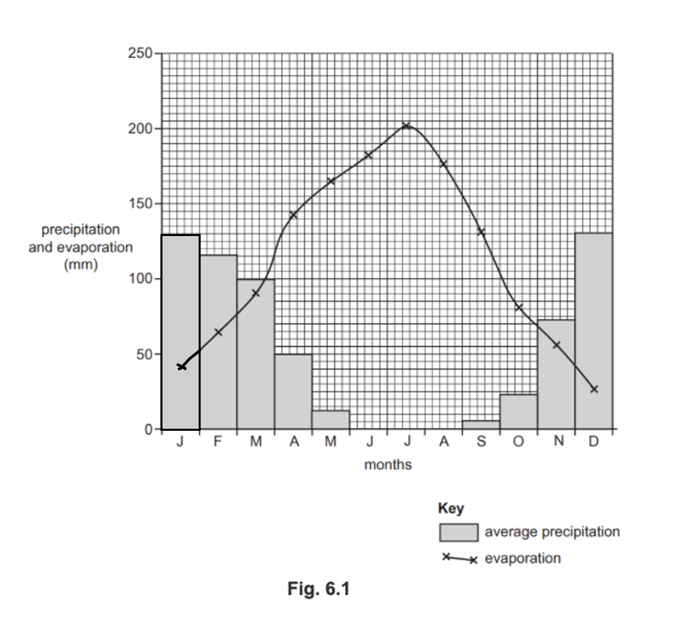

# Mark Schemes — Water
**Economic Development** · Cambridge (CIE) IGCSE geography (0460 & 0976)

## Paper 1 (13 questions)

### Q1
Clean water supplies mean that people do not have to drink polluted **[1]** water, and so the risk of diseases such as cholera is reduced**. ****[1]**

Better access means that people do not have to buy water from street sellers **[1]**,** **which is usually very expensive.  Families have more money to spend on other things. **[1]**

> **[mark-scheme]**
> **Mark allocation**
> 
> The command word is '**explain**'  means that the answer needs to outline ways clean water can improve lives.
> 
> - **One mark** for each valid way access improves lives (up to a maximum of 2 marks)
> - **One mark** for further explanation of how their lives are better (up to a maximum of 2 marks)
> 
> **[4 marks]**
> 
> **Alternative content**
> 
> The answer above is just one example of a response to this question. Other information that could be used in the answer includes:
> 
> - Children will spend less time collecting water and so can attend school, meaning literacy improves
> - Crops can be irrigated, meaning that food shortages are reduced

### Q2
> **[mark-scheme]**
> Any **one **from:
> 
> - Borehole
> - Dams
> - Reservoirs
> 
> **[3 marks]**
Spread of waterborne disease **[1]**

Lack of water to grow crops **[1]**

> **[mark-scheme]**
> **Mark allocation**
> 
> - **One mark **for each valid response
> 
> **Alternative content**
> 
> The answer above is just one example of a response to this question. Other information that could be used in the answer includes:
> 
> - Habitat loss
> - Increased migration
> - Conflict
> - Children miss school to collect water
> - Food shortages
Tagus-Segura scheme

The scheme was expensive to build. **[1]**** **The reservoirs  built as part of the scheme flooded large areas of land, destroying habitats.** ****[1]**** **

> **[mark-scheme]**
> **Mark allocation**
> 
> - **One mark** for each valid answer.
> 
> **[2 marks]**
> 
> **Alternative content**
> 
> The answer above is just one example of a response to this question. Other information that could be used in the answer includes:
> 
> - Floods large areas behind the dam
> - Reduces flooding downstream, which is needed for agriculture
> - Interrupts fish migration
> - Traps sediment behind the dam

### Q3
Levels marking

Level 1 **(1–3 marks)** 
Statements including limited detail which describe methods used to supply clean drinking water.

Level 2 **(4–6 marks) **
More developed statements which describe methods used to supply clean drinking water.

(**Note: **Max 5 if no named or inappropriate example)

Level 3 **(7 marks)** 
Comprehensive and accurate statements which describe methods used to supply clean drinking water, including some place references.

Content Guide: 
Answers are likely to refer to: 
Reservoirs/dams, 
Pipelines, 
Wells, 
Pumping water from aquifer, 
Water transfer/importing water, 
Desalination, 
Water treatment plants, etc. 
Bottled water, 
Rain harvesting, etc.

Place specific reference is likely to consist of: 
Locational details, 
Named places/reservoirs, 
Specific details of supply networks/schemes, etc.

### Q4
Levels marking

<u>Level 1</u> **(1–3 marks) **
Statements including limited detail which explain how <u>clean</u> drinking water is supplied.

<u>Level 2</u> **(4–6 marks) **
More developed statements which explain how <u>clean</u> drinking water is supplied.

<u>Level 3</u> **(7 marks) **
Comprehensive and accurate statements which explain how <u>clean</u> drinking water is supplied including some place reference.

<u>Content Guide:</u> 
Answers are likely to refer to: 
Reservoirs/dams 
Use of aquifer 
Rainfall harvesting 
Road tankers 
Water tanks 
Wells 
Bottled water 
Pipelines/pumps 
Water treatment plants 
Water transfer schemes 
Desalination 
Import water etc.

<u>Place specific reference is likely to consist of:</u> 
Names of places and details of schemes to be credited as place specific and not L2 e.g. length or number of dams.

### Q5
<u>Content Guide:</u> 
Answers are likely to refer to: 
Reservoirs 
Pipes 
Groundwater/aquifer Wells 
Desalination 
Purification/treatment works, 
Rainwater harvesting 
Springs 
Importing water 
Bottled water etc.

<u>Place specific reference is likely to consist of:</u> 
Locational details; 
Names of places within chosen area 
Specific details/statistics of schemes 
Statistics.

**Levels marking **

<u>Level 1 (1–3 marks)</u> 
Statements including limited detail which explain how clean water is supplied for domestic use.

<u>Level 2 (4–6 marks)</u> 
Uses named example. 
More developed statements which explain how clean water is supplied for domestic use.

**(Note:** Max 5 if no named or inappropriate example)

<u>Level 3 (7 marks)</u> 
Uses named example. 
Comprehensive and accurate statements including some place specific reference.

### Q6
(i)

Z **[1]**

- *This is the area with a severe water shortage*

(ii)

Ideas such as:
On/around the Equator/low latitude **[1]** 
Up to around 10N/S **[1]** 
Western side **[1]** 
West coast **[1]**

(iii)

Ideas such as; 
Low rainfall/arid/desert **[1]** 
Seasonal rainfall/long period of drought **[1]** 
No rivers/rivers have dried up/lower water table/aquifer low **[1]** No/cannot afford water pipelines/water supply system/supply infrastructure **[1]** 
Little investment/lack of technology for reservoirs or other examples of storage/access/treatment e.g. wells **[1]**

### Q7
Ideas such as: 
Mainly/most in Africa **[1]** 
Except Egypt and South Africa/except in North and South **[1]** 
A few/some in Asia **[1]** 
Near/on equator/mainly in tropics/between Tropics of Cancer and Capricorn **[1]**

Central Africa/sub-Saharan Africa **[1]**

Uneven/clustered **[1]**

- *Remember do not use the words 'above' or 'below' when describing distribution*
- *Use place or feature names and compass points*

### Q8
Ideas such as:

On/close to/near border of Thailand and Laos/near to Thailand border **[1]** 
Next to/near Mekong River **[1]** 
Inside a meander of the Mekong River **[1]** 
South of Vientiane **[1]** 
6–12 km from Vientiane/capital city **[1]** 
In the west of Laos **[1]**

- *When describing location ensure that you use the scale, compass points, place names and landforms as reference points*

### Q9
(i)

Bar plotted on Fig. 6.1

- *The bar does not have to be shaded to be awarded a mark*
- *Accuracy is essential, a ruler should be used *
- *Each small square on the graph is 5mm precipitation and evaporation*

(ii)

April/May/June/July/August/September/October **[1]**

November/December/January/February/March **[1]**

(iii)

Ideas such as: 
Precipitation is low (decreasing) when evaporation is high (increasing)/Precipitation exceeds evaporation in the winter months (December–February) **[1]** 
Precipitation is high (increasing) when evaporation is low (decreasing)/evaporation exceeds precipitation in the summer months (April–September) **[1]** 
Overall there is more evaporation than precipitation during the year **[1]**

- *Statistics must be accurate and refer to both precipitation and evaporation and state the month/season – for season statistics need to be added up.*

### Q10
Ideas such as: 
Poor water supply is likely to slow down/hinder development **[1]** Dehydration **[1]** 
Many people will have water borne diseases** **E.g. cholera/typhoid/bilharzia **[1] **People will not be able to work/be educated **[Dev]** 
Money will be spent on treating disease/dehydration **[1]** 
There may be a lack of water for use in agriculture/irrigation **[1] **
Yields of crops/livestock will be low/lack of food **[Dev]** 
There will be little surplus for sale/export **[Dev]** 
There will be insufficient water for development of some manufacturing industries **[1]** 
Insufficient water for HEP **[1]** 
Pay to import water/cost of reservoirs/buy bottled water, etc **[1]** Conflict over water supplies **[1]**

- *Remember it is important in this answer not just to state the impact of poor water supply but to include explanation of how it affects development*

### Q11
Ideas such as: 
Use of reservoirs/dams **[1]** 
Store water in tanks **[1]** 
Transfer of water from areas of surplus **[1]** 
Use of water from underground/aquifer/wells/boreholes **[1]** Importing of water supplies **[1]** 
Desalination **[1]** 
Use of bottled water **[1]** 
Use of grey water for gardens/irrigation **[1]** 
Clean/filter/treat water **[1]** 
Conservation measures (or examples) **[1]** 
Educate people about recycling/water conservation **[1]** 
Water rationing/limit use of water **[1]** 
Use more efficient methods of irrigation or example (e.g. drip irrigation) **[1]** 
Cloud seeding **[1]**

### Q12
Ideas such as:

Pumping stations will pump water out of the river **[1]** 
Can be irrigated/there are irrigation canals **[1]** 
Fields can be flooded when needed **[1]** 
Crops grow well/yields/crop production will increase **[1]** 
Excess water can be drained back to river/taken away by drainage channels **[1]** 
Soils/farmland will not be waterlogged/flooded **[1]** 
And farmland more accessible for farmers/machinery **[1]** 
Fertility of the soil will be maintained **[1]** 
Increases farming area **[1]**

- *It is important in this answer that the focus is on agricultural production*
- *Marks will not be awarded for reference to the benefits of clean water for drinking*

### Q13
Ideas such as:
Water is a basic need/needed for drinking/washing **[1]** 
Needed for cooking food **[1]** 
Reduces (water borne) disease/death rate/people live longer **[1]** Reduces likelihood of cholera/typhoid **[1]** 
Reduces pressure on healthcare **[1]** 
People need water to be fit to work/be productive **[1]** 
Water is needed for good sanitation/hygiene/toilets **[1]** 
Reduces need to walk a long way for water **[1]**
