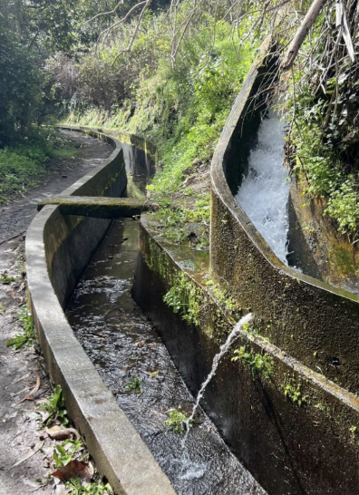
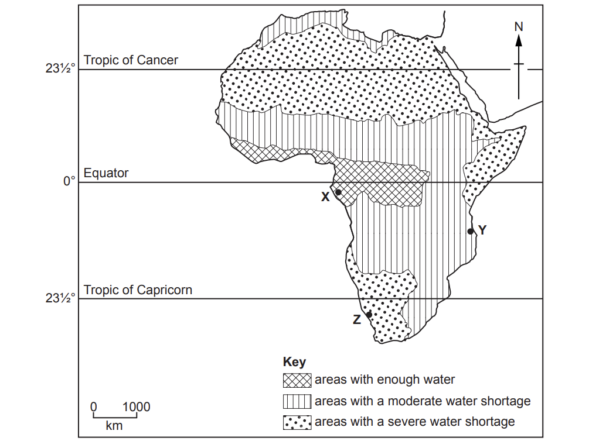
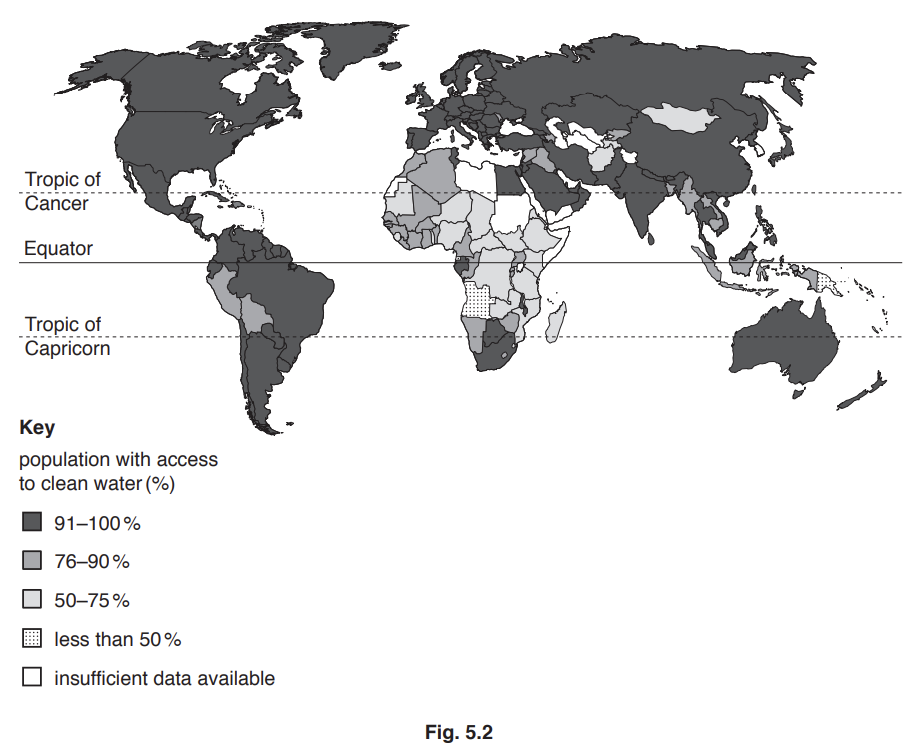
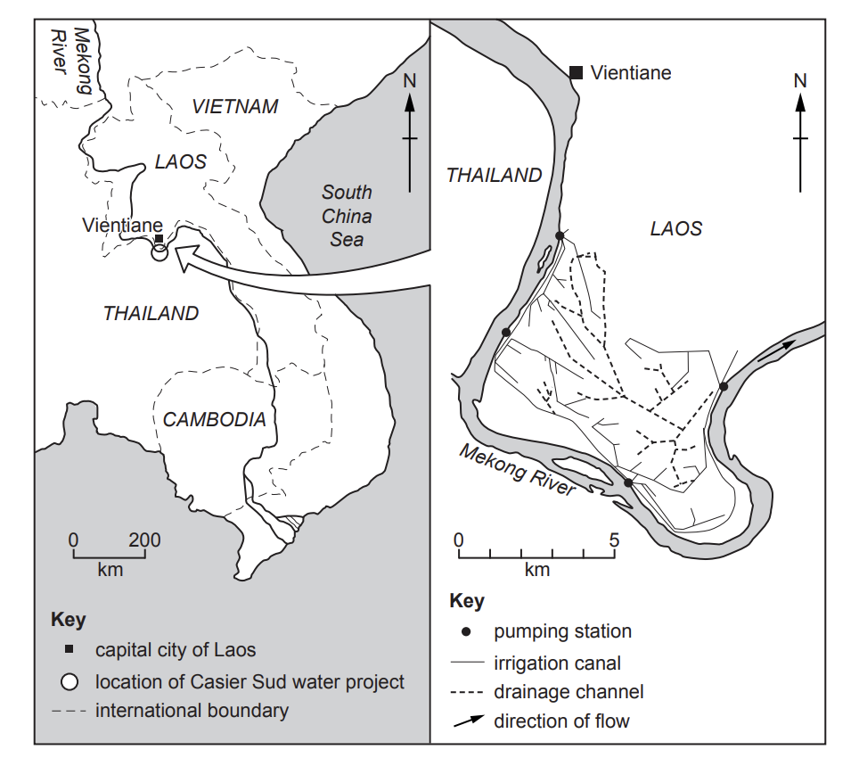
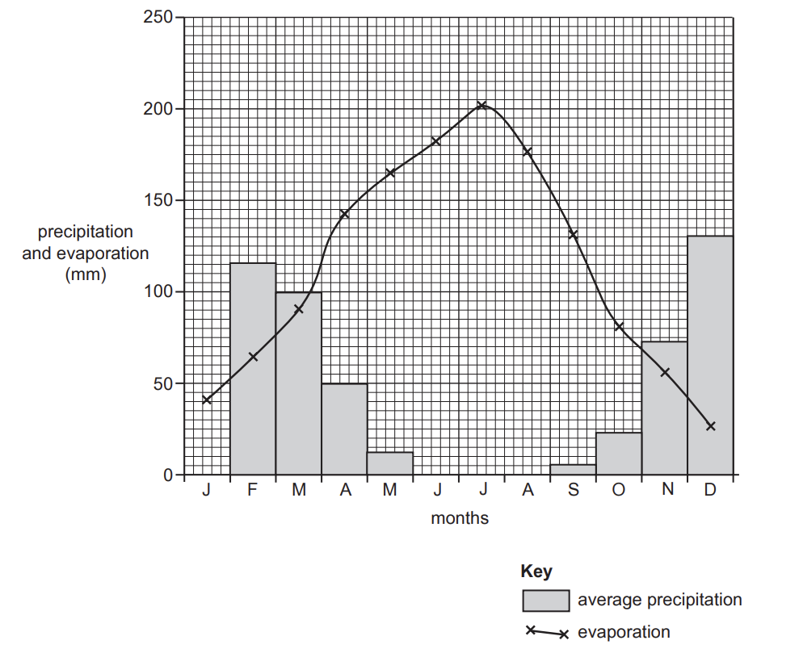

# Exam Questions — Water
**Economic Development** · Cambridge (CIE) IGCSE geography (0460 & 0976)
> Source: [https://www.savemyexams.com/igcse/geography/cie/20/topic-questions/](https://www.savemyexams.com/igcse/geography/cie/20/topic-questions/) · 13 questions across 1 sets

## Paper 1 (13 questions)

### Q1 — medium — 4 marks

**Q1** [4 marks]

Explain **two** ways in which improving access to clean water can improve the quality of life in LEDCs.

### Q2 — easy — 5 marks

**Q2** [1 mark]

Study **Figure 5.1 ** below which shows a water transfer system used in Madeira.

*Fig 5.1 A water transfer system *

Name **one** other method of increasing water supplies to an area

**Q2** [2 marks]

State **two** problems faced by countries with limited access to clean water.

**Q2** [2 marks]

Suggest **two** disadvantages of a named scheme used to improve water supplies.

### Q3 — hard — 7 marks

**Q3** [7 marks]

For a named country or area you have studied, describe different methods used to supply clean drinking water to the population.

Name of country ......................................

*Source: Oct/Nov 2020 0460/11 Q6C*

### Q4 — hard — 7 marks

**Q4** [7 marks]

For a named country or area you have studied, explain how clean drinking water is supplied.

Name of country or area ......................................

*Source: June 2021 0460/13 Q5C*

### Q5 — hard — 7 marks

**Q5** [7 marks]

For a named country or area you have studied, explain how clean water is supplied for domestic use.

Name of country or area................................................

*Source: March 2021 0460/12 Q6C*

### Q6 — easy — 6 marks

**Q6** [6 marks]

Study Fig. 5.1, which is a map showing information about water supply in Africa.

**Fig. 5.1**

(i)

Identify from Fig. 5.1 the area which is likely to experience the most difficulty supplying water to its population.

Circle the correct answer below.

| **X** | **Y** | **Z** |
|---|---|---|

[1]

(ii)

Describe the distribution of areas in Africa with enough water.

[2]

(iii)

Explain why many rural areas in LEDCs have a **shortage** of water.

[3]

*Source: June 2021 0460/13 Q5A*

### Q7 — easy — 3 marks

**Q7** [3 marks]

Study Fig. 5.2, which is a map showing information about the percentage of the population in each country with access to clean drinking water.

Describe the distribution of countries where 75% or less of the population have access to clean drinking water.

*Source: Nov 2019 0460/12 Q5B*

### Q8 — easy — 3 marks

**Q8** [3 marks]

Study Fig. 5.2, which is a map showing information about the Casier Sud water project in Southeast Asia.

**Fig. 5.2**

Describe the location of the Casier Sud water project.

*Source: June 2021 0460/13 Q5B*

### Q9 — easy — 6 marks

**Q9** [6 marks]

Study Fig. 6.1, which shows information about precipitation and evaporation in Los Gatos, an area in California, USA (an MEDC).

**Fig. 6.1**

(i)

Complete Fig. 6.1 by plotting the following:

The average precipitation in January is 130mm.

[1]

(ii)

Using Fig. 6.1 only, name:

– a month when irrigation will be needed ....................................

– a month when soils may be waterlogged. ....................................

[2]

(iii)

Using Fig. 6.1 only, describe how the relationship between average precipitation and evaporation varies during the year. Use statistics to support your answer.

[3]

*Source: June 2021 0460/12 Q6A*

### Q10 — medium — 5 marks

**Q10** [5 marks]

Study Fig. 5.2, which is a map showing information about the percentage of the population in each country with access to clean drinking water.

Explain how poor water supply may affect the development of a country.

*Source: Nov 2019 0460/12 Q5B*

### Q11 — medium — 4 marks

**Q11** [4 marks]

Study Fig. 6.1, which shows information about precipitation and evaporation in Los Gatos, an area in California, USA (an MEDC).

**Fig. 6.1**

Suggest how water supply can be managed in areas such as California to ensure that it is available all year round.

*Source: June 2021 0460/12 Q6A*

### Q12 — medium — 5 marks

**Q12** [5 marks]

Study Fig. 5.2, which is a map showing information about the Casier Sud water project in Southeast Asia.

**Fig. 5.2**

Explain how the Casier Sud water project is likely to improve agricultural production in the area.

*Source: June 2021 0460/13 Q5B*

### Q13 — medium — 4 marks

**Q13** [4 marks]

Study Fig. 5.1, which is a map showing information about water supply in Africa.

**Fig. 5.1**

Explain why it is important to increase the supply of **clean** water in rural areas in LEDCs.

*Source: June 2021 0460/13 Q5A*

