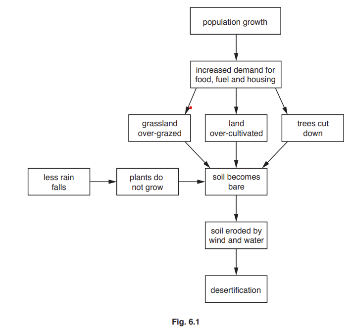
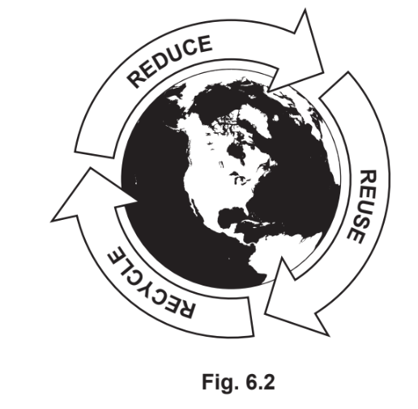
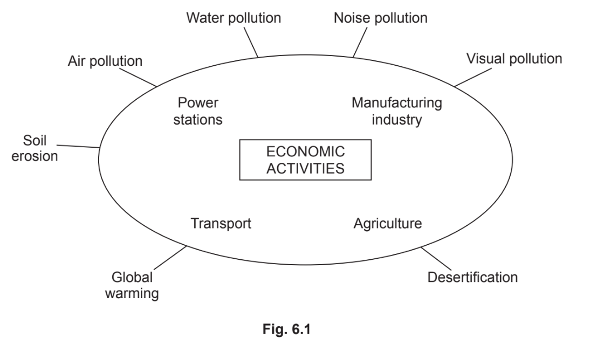
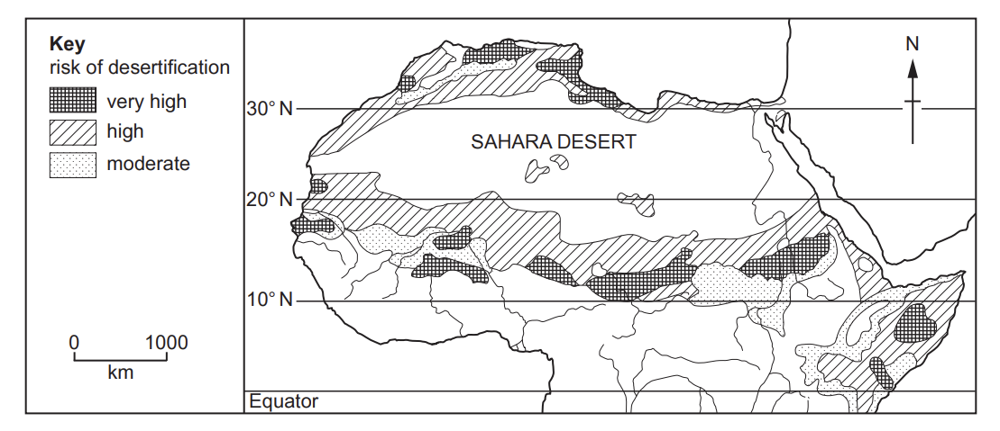
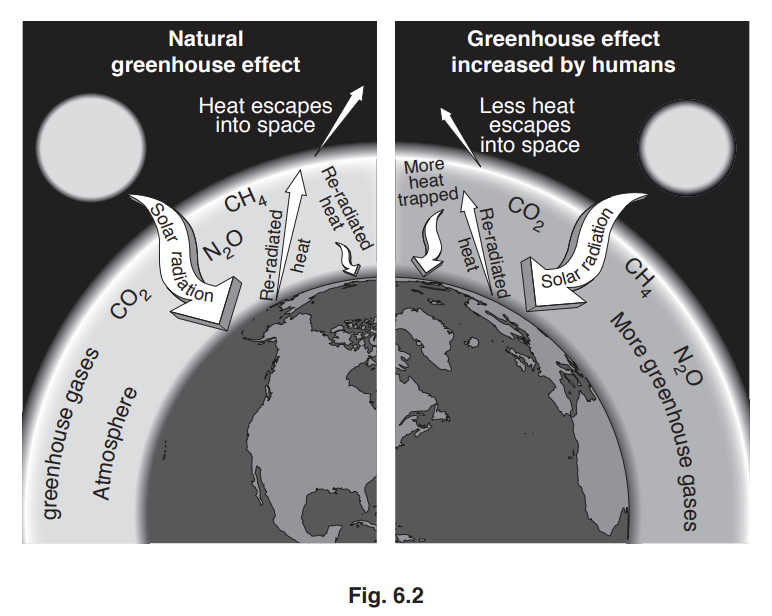
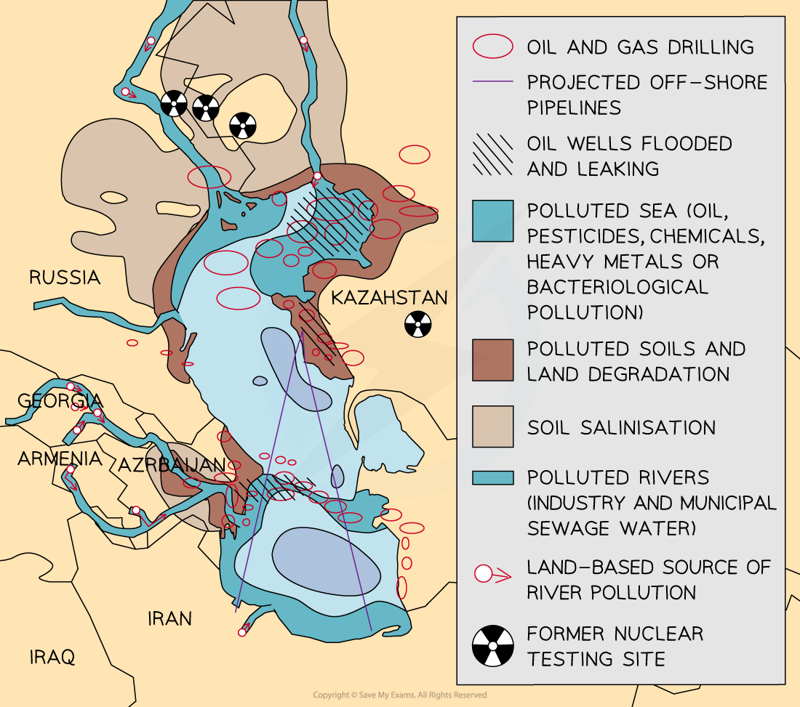
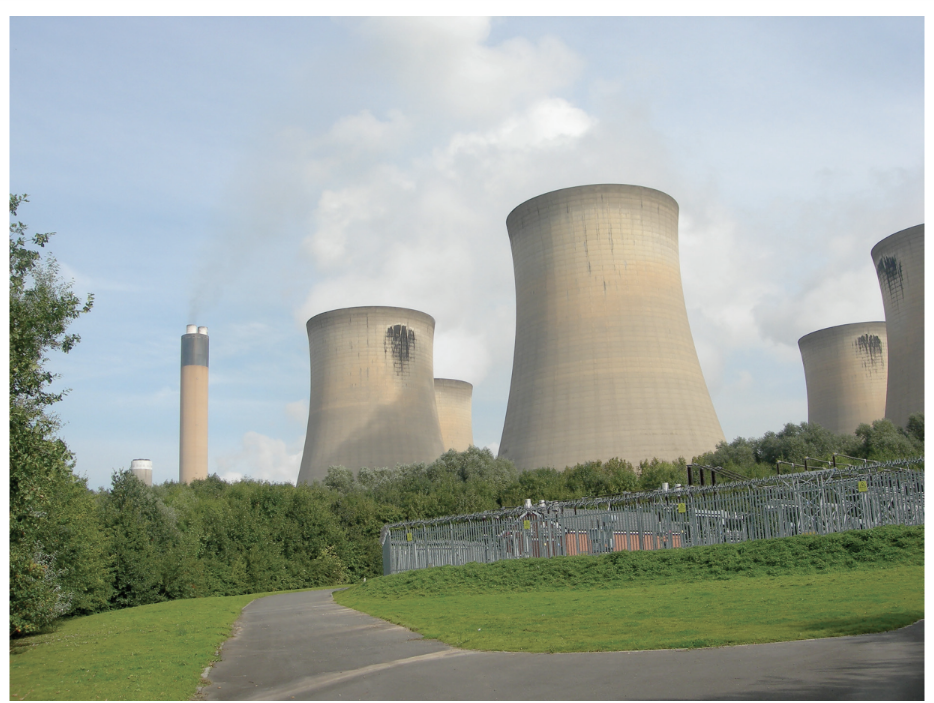

# Exam Questions — Environmental Risks of Economic Activity
**Economic Development** · Cambridge (CIE) IGCSE geography (0460 & 0976)
> Source: [https://www.savemyexams.com/igcse/geography/cie/20/topic-questions/](https://www.savemyexams.com/igcse/geography/cie/20/topic-questions/) · 18 questions across 1 sets

## Paper 1 (18 questions)

### Q1 — hard — 7 marks

**Q1** [7 marks]

For a named area you have studied, explain how economic activity is causing the local natural environment to be at risk.

Name of area ...........................................

Economic activity ...........................................

[7]

*Source: June 2021 0460/12 Q6C*

### Q2 — hard — 7 marks

**Q2** [7 marks]

Describe the problems caused by the increase in the greenhouse effect (global warming).

You should refer to named areas affected.

*Source: Nov 2019 0460/12 Q6C*

### Q3 — hard — 7 marks

**Q3** [7 marks]

For a named area you have studied, describe how economic development is damaging the natural environment.

Name of area....................................................

*Source: Nov 2020 0460/12 Q5C*

### Q4 — hard — 7 marks

**Q4** [7 marks]

For a named area you have studied, explain how economic activity is managed to reduce the risks to the natural environment.

Name of area .............................................

Economic activity .............................................

*Source: June 2021 0460/11 Q6C*

### Q5 — hard — 7 marks

**Q5** [7 marks]

Describe the threats caused by global warming. You should refer to named areas affected.

*Source: Nov 2019 0460/13 Q6C*

### Q6 — easy — 6 marks

**Q6** [6 marks]

Study Fig. 6.1, which shows information about desertification.

(i)

What is meant by desertification?

[1]

(ii)

Using information from Fig. 6.1 **only**, explain how the following can cause desertification.

A Climate change ........................

[2]

B Population growth ......................

[3]

*Source: Nov 2019 0460/12 Q6A*

### Q7 — easy — 3 marks

**Q7** [3 marks]

Study Fig. 6.2, which shows advice about conservation of natural resources.

Explain how following the advice given in Fig. 6.2 can help to conserve natural resources.

*Source: Spec 2020 0460/01 Q6B*

### Q8 — easy — 6 marks

**Q8** [6 marks]

Study Fig. 6.1, which shows information about economic activities and threats to the natural environment.

(i)

What is meant by visual pollution?

[1]

(ii)

Suggest two ways in which agriculture may cause soil erosion.

[2]

(iii)

Name three different economic activities shown in Fig. 6.1 and explain how each one may pollute water.

Economic activity 1 ........................................

Economic activity 2 ........................................

Economic activity 3 ........................................

[3]

*Source: Spec 2020 0460/01 Q6A*

### Q9 — easy — 3 marks

**Q9** [3 marks]

Study Fig. 6.2, which shows information about desertification in Northern Africa.

**Fig. 6.2**

Describe the distribution of the areas in Northern Africa where the risk of desertification is very high.

*Source: June 2021 0460/12 Q6B*

### Q10 — easy — 3 marks

**Q10** [3 marks]

Study Fig. 6.2, which shows information about human influence on the greenhouse effect.

Using Fig. 6.2 only, explain how humans are influencing the natural greenhouse effect.

*Source: Nov 2019 0460/12 Q6B*

### Q11 — easy — 3 marks

**Q11** [3 marks]

Study Figs. 6.2, 6.3 and 6.4, which are photographs of economic activities which increase greenhouse gases in the atmosphere.

**Fig 6.2 **

**Fig 6.3**

**Fig 6.4**

Explain how each of the economic activities shown in Figs. 6.2, 6.3 and 6.4 increase greenhouse gases in the atmosphere. 
Fig. 6.2 .................................................................................... 
Fig. 6.3 .................................................................................... 
Fig. 6.4 .....................................................................................

*Source: Nov 2019 0460/13 Q6B*

### Q12 — medium — 4 marks

**Q12** [4 marks]

Study Fig. 6.1, which shows information about desertification.

State **two** methods which people in rural areas of LEDCs could use to reduce desertification.

For each of your chosen methods, explain why you think it will be successful.

*Source: Nov 2019 0460/12 Q6A*

### Q13 — medium — 4 marks

**Q13** [4 marks]

Study Fig. 6.1, which shows information about economic activities and threats to the natural environment.

Explain how the economic activities shown in Fig. 6.1 may cause global warming.

*Source: Spec 2020 0460/01 Q6A*

### Q14 — medium — 5 marks

**Q14** [5 marks]

Study Fig. 6.2, which shows information about desertification in Northern Africa.

**Fig. 6.2**

Describe the impacts of desertification on local people.

*Source: June 2021 0460/12 Q6B*

### Q15 — medium — 4 marks

**Q15** [4 marks]

Study Fig. 6.1, which shows information about threats to the natural environment in the Caspian Sea.

**Fig 6.1**

Suggest why it is difficult to reduce water pollution in the Caspian Sea.

*Source: Nov 2019 0460/13 Q6A*

### Q16 — medium — 5 marks

**Q16** [5 marks]

Study Figs. 6.2, 6.3 and 6.4, which are photographs of economic activities which increase greenhouse gases in the atmosphere.

**Fig 6.2**

**Fig 6.3**

**Fig 6.4**

Explain how an increase in greenhouse gases in the atmosphere is causing global warming.

*Source: Nov 2019 0460/13 Q6B*

### Q17 — medium — 5 marks

**Q17** [5 marks]

Study Fig. 6.2, which shows advice about conservation of natural resources.

Explain the importance of conserving natural resources and the natural environment.

*Source: Spec 2020 0460/01 Q6B*

### Q18 — medium — 5 marks

**Q18** [5 marks]

Study Fig. 6.2, which shows information about human influence on the greenhouse effect.

Explain why greenhouse gases are building up in the atmosphere.

*Source: Nov 2019 0460/12 Q6B*

