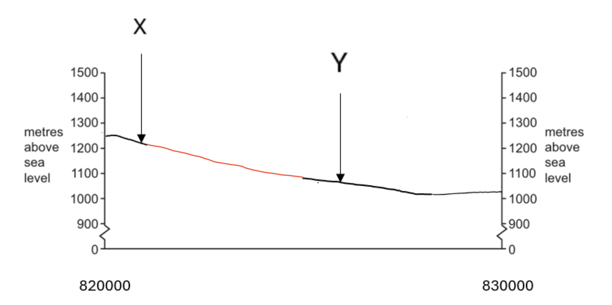
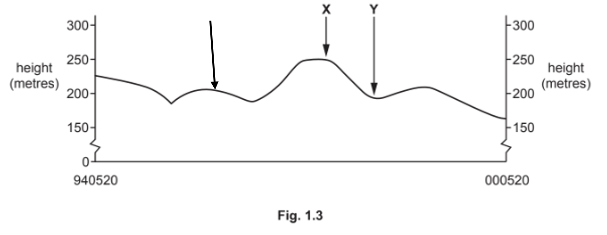

# Mark Schemes — Geographical Skills
**Geographical Skills** · Cambridge (CIE) IGCSE geography (0460 & 0976)

## Paper 2 (16 questions)

### Q1
There is steeper land to the NW.** ****[1]**

The land to NW is higher **[1]****, 1330 m **in the NW compared to 1085 in SE** ****[1]**

SE-facing slope** ****[1]:**** **There are small river(s)/stream(s) in the NE and SW. **[1]**

Large river in SE.** ****[1]**

> **[mark-scheme]**
> **Mark allocation**
> 
> - **One mark** for each valid point made about relief or drainage
> 
> **[6 marks]**
> 
> **Alternative content**
> 
> The answer above is just one example of how to respond to this question. Additional information that could be used in the answer includes:
> 
> - In the north and west there are areas prone to flooding
> - There is a steep slope running from the NE to SW

> **[exam-tip]**
> When a 6-mark question asks you about two factors, you must note a minimum of two things for each factor and then add another two to total 6.

### Q2
The bearing of the road to Collanges at the fork (836005) is  **76 degrees ****[1 mark]**
The distance  is **300 metres**** [1 mark]**
**The correct answer is B: 0m**** [1 mark]**
**Footpath/road under construction ****[1 mark]**
**Main road ****[1 mark]**

*Fig. 1.2 completed*

A smooth line with no sudden changes in gradient

**[1 mark]**
> **[mark-scheme]**
> Any** three **from:
> 
> - North-south or moves north to south, with an eastwards curve at 8703
> - Winding/bends/curves
> - In valley;
> - On lowlands/avoids hills; On flatter/gentler/avoids steeper land;
> - Passes le Monteil//goes to le Monteil/a settlement in 8604/passes by/near/to the east of Collanges
> - Follows course of river/along/near river
> 
> **[3 marks]**

### Q3
Feature A is a **main road**** [1 mark]**
River B is** Santoire**** [1 mark]**
Land use at C is **coniferous woodland ****[1 mark]**
Feature D is a** leisure area ****[1 mark]**
The height above sea level of the spot height at E is **1150 (metres)**** [1 mark]**

### Q4
(i)

regional/main/D/D119,

(ii)

tennis,

(iii)

mixed forest,

(iv)

open forest,
campsite, 
museum/musée, 
tourist information centre, 
seaside resort, 
casino, 
hiking trail, 
notable monument/(diverse) place of interest, 
sports ground,
|   | Area in Fig. 1.2 at St-Colomban | Area in Fig. 1.3 near Kermario | Both these areas | Neither of these areas |
|---|---|---|---|---|
| a dam |   | `✓` |   |   |
| land over 25 m above sea level |   | `✓` |   |   |
| a bathing place | `✓` |   |   |   |
| a railway |   |   |   | `✓` |
(i)

2875 metres,

(ii)

SE/ESE,

(iii)

123–126°,

(iv)

932704/5,
bay/cove, 
headland/point/promontory/peninsula/cape, 
spit, 
estuary/inlet/creek, 
beach/sand/mud, 
<u>tidal mud flats,</u> 
flat rock, 
lake/lagoon, 
island, 
intermittent water course, 
marsh, 
forest, 
tombolo,

### Q5
(i)

National main **[1] **

(ii)

Motorway **[1] **

(iii)

270 (metres) **[1] **

(iv)

(railway) Station **[1] **

(v)

Cemetery **[1] **
|   | Area **A** | Area **B** | Both these areas | Neither of these areas |
|---|---|---|---|---|
| river flowing from south to north |   |   |   | `✓` |
| meandering river | `✓` |   |   |   |
| river flowing from north to south |   | `✓` |   |   |
| either flat or gently sloping |   |   | `✓` |   |
| steep slopes |   |   |   | `✓` |
| plateau |   |   |   | `✓` |
(i)

(other) Road **[1] **

(ii)

(V. ne) dei Sieli **[1] **

(iii)

Position of Motta S. Anastasia shown with an arrow between 54 mm and 69 mm from the left hand margin **[1] **

(i)

7700–8100 (metres) **[1] **

(ii)

East **[1] **

(iii)

91–94° **[1] **

(iv)

945/6 458/9 **[1] **

- *Remember to bring a ruler and compass to the exam so that you can give the answers accurately *
(i)

Dispersed **[1] **

- *The houses in these grid squares are scattered around which means they are dispersed*

(ii)

Dendritic **[1] **

- *A dendritic pattern is where the rivers and streams follow the slope of the landscape*

### Q6
(i)

(secondary) road, (allow spot height)

(ii)

(mixed) woodland,

(iii)

250 metres,

(iv)

railway,

(v)

tunnel,

(vi)

church,
994879,
(i)

flat valley floor, (just above) 200 m,

(ii)

correct position of river,
(i)

7780 m,

(ii)

north east,

(iii)

33–37°

(iv)

winding, follows valley, keeps low, keeps level, crosses river,
the highest point is over 550 m, 
it is an area of deeply cut relief, 
there is a V-shaped valley, 
Deduct one mark for every tick more than three.
road junction, 
(more) gentle slope, 
services/two named services, 
dry point site, 
woodland for fuel,

### Q7
(i)

(secondary) road

(ii)

250 metres

(iii)

church

(iv)

deciduous trees

(v)

high voltage line
radial/meet in centre/meet in Ouffet, main road E–W and secondary road SSW–NNE,
(i)

8500 m

(ii)

east-south east

(iii)

109–113

(iv)

801890
(i)

correct position of river, 
correct position of Chat. De Renal,

(ii)

section continuing to rise but not reaching 300m,
it is meandering, 
it has a flood plain of varying width, 
it is 50–100 m wide,
(on valley floor,) 
(on valley side,) in valley alone = 1 
west side/east facing, 
road junction, 
bridge point, 
railway, 
services/2 named services, 
river for water, 
woodland for fuel,

### Q8
75 (million tonnes) **[1] **

- *Each small square is 5 million tonnes*
(i)

In the centre **[1] **

(ii)

Wind further west/water further east **[1] **
(i)

Wind in drier areas/water in wetter areas **[1] **

(ii)

In dry areas soil is loose/in wet areas soil is sticky/heavy **[1] ** 
In dry areas soil is bare/exposed/in wet areas there is vegetation cover **[1] ** 
In wet areas more surface runoff/in dry areas there is less surface runoff **[1] **

### Q9
(i)

public road, (ignore width)

(ii)

church

(iii)

mast

(iv)

33 (m)

(v)

100 (m)
| flat land |   | `✓` |   |   |
|---|---|---|---|---|
| steep land |   |   |   | `✓` |
| gentle slopes | `✓` |   |   |   |
| mostly forest | `✓` |   |   |   |
| mostly arable land |   | `✓` |   |   |
(i)

public road 28–32 mm from left hand margin, river 97–101 mm from left hand margin

(ii)

land continuously rising to the left hand margin, highest point over 100 m but not more than 112 m
bathing, 
leisure/second homes, 
camp site/camping, 
roads give access to sea, 
dunes, 
cycle path(s)
(i)

ENE/NE

(ii)

63–67°

(iii)

438 855 = 2 
43_85_ = (correct square) 1

### Q10
(i)

(main) road/D3,

(ii)

liable to flood,

(iii)

brushwood,

(iv)

1246 (metres), (allow 1248)
(i)

3850 metres,

(ii)

south east,
(i)

river/stream/canal,

(ii)

one correctly located position of road either 29–31 mm or 42–44 mm from right hand margin, rise–fall–rise from north,

(iii)

summit plotted between 8 mm and 16 mm from left hand margin,
highest point is above 1400 m,

it is a mountainous area,

there are seasonal rivers,
(i)

in valley, 
near river/lake/canal/body of water, 
slightly higher than river, 
along (D139) road, 
gentle slope/avoids steep/ flat qualified, 
sheltered, 900–1000 <u>m</u>,

(ii)

parking, 
leisure area, 
tennis, 
campsite, 
swimming pool,
footpath(s),

### Q11
(i)

turning place,

(ii)

other/open (land),

(iii)

<u>deciduous </u>forest,

(iv)

25 <u>m</u>

(v)

(municipality) boundary,
(i)

5–7,

(ii)

radial/route centre/nodal point/focus on town/branch out from town,
(i)

2000–2200,

(ii)

SSE/SE,
at least 6 m wide, 
flows east, 
braided/island/splits and re-joins, 
meanders, 
cut-off/oxbow, (4025) 
straightened, (3826) 
gentle gradient, 
<u>two/few/small </u>tributary/ies, 
dam,
(i)

in valley(s) 
near river(s), 
on low(er) land/land below 25 m (any figure below)/avoids high(er) land, 
on gentle(r) slopes/on flat(ter)/avoids steep(er) slopes,

(ii)

steep(er) slopes,

high(er) land/hills/any figure between 25 m and 74 m, (more) in the west/south/<u>less</u> in the east/north,
(i)

marsh (liable to flooding),

(ii)

nature reserve,
(i)

railway/R 76–80 mm from the western edge,

(ii)

river Kälan/K 24–27 mm from the western edge,

### Q12
(i)

Trentino Alto Adige,

(ii)

Calabria,

(iii)

Calabria,
higher in the north/lower in the south, increases to the north/decreases to the south, positive in the north <u>and</u> negative in the south,
(i)

4.2 (per thousand)

(ii)

–1.7 (per thousand)
jobs/higher wages, family/friends live there, shops, leisure/entertainment, medical care, education, wealthy area/higher GDP/higher standard of living,

### Q13
(i)

main road

(ii)

Santoire

(iii)

coniferous woodland

(iv)

leisure area

(v)

1150 (metres)
(i)

north west

(ii)

1350–1650 (metres)

(iii)

102 (metres)
|   | **square 8802 at Lac de Sauvages** | **square 8902 at Peyre del Cayre** | **both these areas** | **neither of these** |
|---|---|---|---|---|
| **parking** |   |   | `✓` |   |
| **steep slopes** | `✓` |   |   |   |
| **area liable to flooding** |   |   | `✓` |   |
| **land over 1200 m above sea level** |   |   | `✓` |   |
| **church** |   |   |   | `✓` |
(i)

(main) road/D3

(ii)

Lac de Sauvages/lake/body of water

(iii)

rising to above 1200 m then falling
low/in valley, gentle/flat qualified, above lowest land/flooding, road junction, bridge point, river for water supply/transport, skiing, footpath for tourism/monument for tourism, woodland for fuel/construction, refuge hut/overnight stop/gite.

### Q14
(i)

(secondary) road

(ii)

high voltage line

(iii)

water tower

(iv)

castle

(v)

258 (m)

(vi)

200 (m)
(i)

2300–2400 m

(ii)

south east/east-south east

(iii)

111–113°

(iv)

752/3967
(i)

correct position of N633 road, 
correct position of railway,

(ii)

land rising to a summit below 250 m,
it is an area of steep and gently sloping relief, the land is below 300 m, there are few rivers,
on valley floor, on valley side, in valley alone = 1 
junction of valleys, 
accessibility (dev.), 
road junction, 
bridge point, 
railway, 
water from river, 
woodland for fuel,

### Q15
(i)

railway,

(ii)

place of interest,

(iii)

rock escarpment,

(iv)

reservoir,

(v)

deciduous woodland,

(iv)

1224 (metres),
(i)

road labelled 23–25 mm from right hand edge of section,

(ii)

rises and falls from left hand edge of section, 
peak more than 1150 m and less than 1200 m,
(i)

north west,

(ii)

2300 (metres),

(iii)

steep slopes, deciduous woodland,

(iv)

316–326 (degrees),
<u>Relief: </u>
high/mountains/hills, 
steep, 
valley(s), 
V shaped valley(s), 
1236 <u>metres, </u>
(rock) escarpment/bare rock, 
higher in north/north west/lower in south, 
spur(s)/ridge(s), 
concave/convex slopes,

<u>Drainage: </u>
<u>narrow/small</u> streams/rivers/cascades, 
seasonal rivers, 
flow south, 
3 streams/rivers/cascades, 
parallel, 
Reserve 1 mark for each part.

### Q16
(i)

(V. ne di) Licodia,

(ii)

317 (metres),

(iii)

church,

(iv)

cemetery,

(v)

(national main) road,
| Feature | Area P | Area Q | Both these areas | Neither of these areas |
|---|---|---|---|---|
| a railway | `⩗` |   |   |   |
| dispersed settlement |   |   | `⩗` |   |
| dense settlement |   | `⩗` |   |   |
| land over 900m above sea level |   | `⩗` |   |   |
