# Exam Questions — Geographical Skills
**Geographical Skills** · Cambridge (CIE) IGCSE geography (0460 & 0976)
> Source: [https://www.savemyexams.com/igcse/geography/cie/20/topic-questions/](https://www.savemyexams.com/igcse/geography/cie/20/topic-questions/) · 16 questions across 1 sets

## Paper 2 (16 questions)

### Q1 — medium — 6 marks

**Q1** [6 marks]

**Figure 1.3** shows an area towards the south of the [map. ](https://www.savemyexams.com/igcse/geography/cie/past-papers/paper/ppr_Y7tmRCvRrnZYSyYr/?pdf=https%3A%2F%2Fpastpapers.co%2Fcie%2FIGCSE%2FGeography-0460%2F2021-March%2F0460_m21_i2_22.pdf&type=resource&resourceIndex=1)

Describe the relief and drainage of this area.

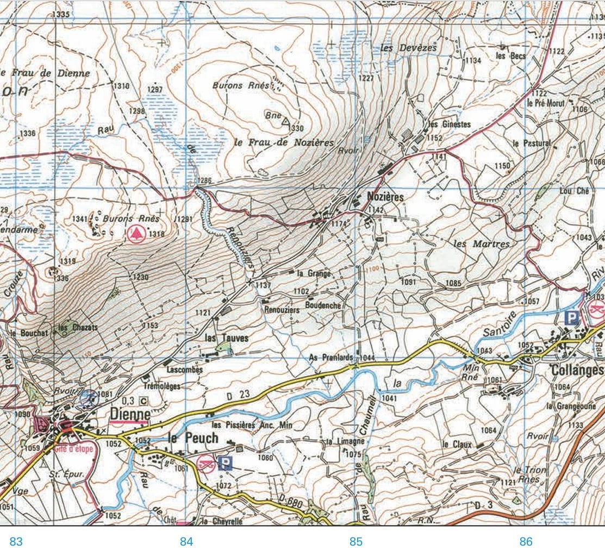

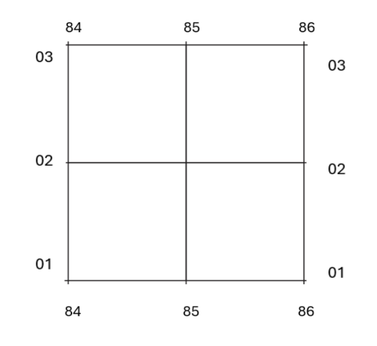

*Fig. 1.3 *

### Q2 — easy — 9 marks

**Q2** [1 mark]

A person travels on the D23 road east of Dienne (836005) to Collanges (862011).

What is the bearing of the road to Collanges at the fork (836005)

**Q2** [1 mark]

What distance does the person travel from the centre of Dienne to join the D23 at the fork in the road (836005)?

**Q2** [1 mark]

What is the difference in height between the fork in the road and the road as it enters Collanges at 860010?

Identify the correct answer.

**Q2** [1 mark]

**Figure 1.2** is a cross-section along northing 83 from 710830 to 740830.

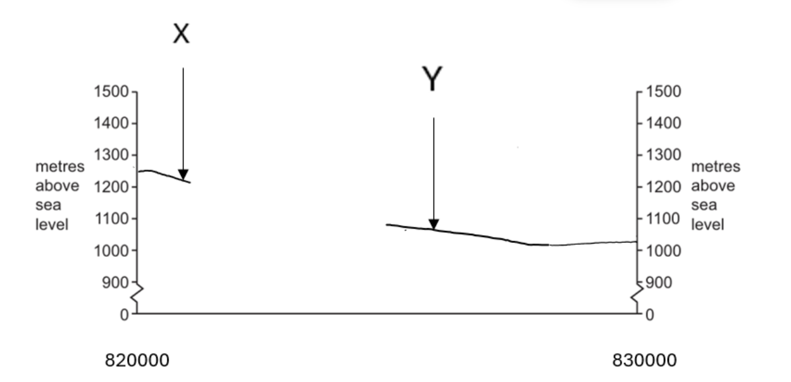

*Fig 1.2.*

Identify the feature at **X**

**Q2** [1 mark]

Identify the feature at **Y.**

**Q2** [1 mark]

The cross-section shown in **Figure 1.2** is incomplete.

Using information from the [map extract](https://www.savemyexams.com/igcse/geography/cie/past-papers/paper/ppr_Y7tmRCvRrnZYSyYr/?pdf=https%3A%2F%2Fpastpapers.co%2Fcie%2FIGCSE%2FGeography-0460%2F2021-March%2F0460_m21_i2_22.pdf&type=resource&resourceIndex=1), draw a line on **Figure 1.2** to complete the cross-section

**Q2** [3 marks]

Find the **D3 main road**, which crosses the [map](https://www.savemyexams.com/igcse/geography/cie/past-papers/paper/ppr_Y7tmRCvRrnZYSyYr/?pdf=https%3A%2F%2Fpastpapers.co%2Fcie%2FIGCSE%2FGeography-0460%2F2021-March%2F0460_m21_i2_22.pdf&type=resource&resourceIndex=1).

Describe the route of this road.

### Q3 — easy — 5 marks

**Q3** [1 mark]

Study the [map extract for Fortunies](https://www.savemyexams.com/igcse/geography/cie/past-papers/paper/ppr_Y7tmRCvRrnZYSyYr/?pdf=https%3A%2F%2Fpastpapers.co%2Fcie%2FIGCSE%2FGeography-0460%2F2021-March%2F0460_m21_i2_22.pdf&type=resource&resourceIndex=1).  The scale is 1:25,000

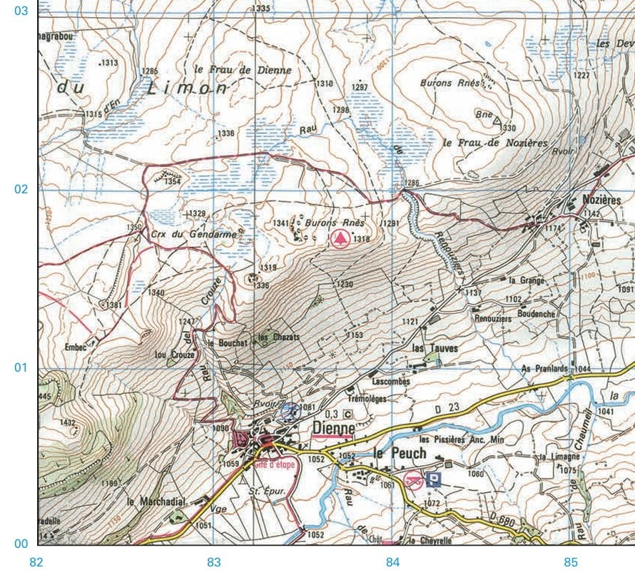

*Fig. 1.1 *

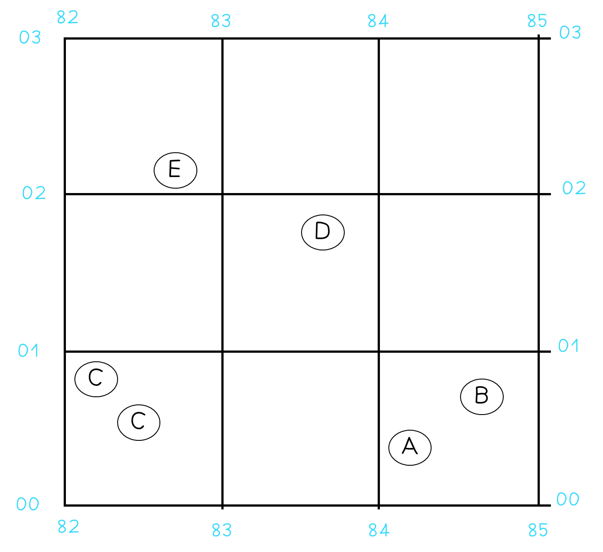

Using the map extract, identify the following features shown in **Figure 1. 1**

Feature A

*Source: March 2021 0460/22 Q1A (I)*

**Q3** [1 mark]

The name of river B

*Source: Mar 2021 0460/22 Q1A (II)*

**Q3** [1 mark]

Land use at C

*Source: Mar 2021 0460/22 Q1A (III)*

**Q3** [1 mark]

Feature D

*Source: Mar 2021 0460/22 Q1A (IV)*

**Q3** [1 mark]

The height above sea level of the spot height at E

*Source: Mar 2021 0460/22 Q1A (V)*

### Q4 — medium — 20 marks

**Q4** [4 marks]

Study the [map extract ](https://cdn.savemyexams.com/uploads/2023/05/RznCj7fQ_0460-m21-i2-22.pdf)for Carnac, France. The scale is 1:25000.

Fig. 1.1 shows some of the features near Cité du Runell in the north of the map extract. Study Fig. 1.1 and the map extract, and answer the questions below.

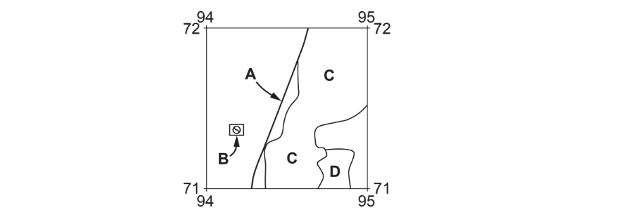

**Fig. 1.1**

Using the map extract, identify the following features shown in Fig. 1.1:

(i)

the type of road at **A**

[1]

(ii)

the leisure activity at **B**

[1]

(iii)

the land use at **C**

[1]

(iv)

the land use at **D**.

[1]

*Source: June 2021 0460/22 Q1A*

**Q4** [3 marks]

**Extract:**

Study the map extract for Carnac, France. The scale is 1:25000.

The central point of the main settlement at Carnac is at 940700. Identify **three** services  provided for tourists within 1km of the centre of Carnac.

1 ........................................

2 ........................................

3 ........................................

*Source: June 2021 0460/21 Q1B*

**Q4** [4 marks]

**Extract:**

Study the map extract for Carnac, France. The scale is 1:25000.

https://cdn.savemyexams.com/uploads/2023/05/RznCj7fQ_0460-m21-i2-22.pdf

Fig. 1.2 shows an area in the south west of the map at St-Colomban. Fig. 1.3 shows an area  in the north east of the map near Kermario. Study the two areas and answer the questions  below.

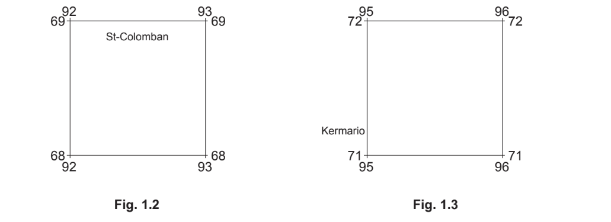

**                   **

The table below compares the features of the two areas. Complete the table by putting ticks (✓) in the correct **four** boxes. Use only **one** tick for each row.

| **feature** | **area in Fig. 1.2** **at St-Colomban** | **area in Fig. 1.3** **near Kermario** | **both these** **areas** | **neither of** **these areas** |
|---|---|---|---|---|
| a dam |   |   |   |   |
| land over 25m above sea level |   |   |   |   |
| a bathing place |   |   |   |   |
| a railway |   |   |   |   |

*Source: June 2021 0460/22 Q1C*

**Q4** [4 marks]

Look at the part of the straight D781 road that runs between the settlements at Plouharnel and Carnac.

(i)

What is the distance along the straight part of the road? Tick **(✓) one **box below.

|   | **tick (✓)** |
|---|---|
| 287 metres |   |
| 387 metres |   |
| 2875 metres |   |
| 3875 metres |   |

[1]

(ii)

What is the compass direction along the road **from** Plouharnel **to** Carnac?

[1]

(iii)

Measure the bearing along the road **from** Plouharnel **to** Carnac.

.................................. degrees

[1]

(iv)

Find the roundabout (circle) part way along the road at Kergouillard. Give the six-figure grid reference of this roundabout (circle).

[1]

*Source: June 2021 0460/21 Q1D*

**Q4** [5 marks]

**Extract:**

Study the [map extract](https://cdn.savemyexams.com/uploads/2023/05/RznCj7fQ_0460-m21-i2-22.pdf) for Carnac, France. The scale is 1:25000.

Describe the natural features of the coast shown on the map.

*Source: June 2021 0460/22 Q1E*

### Q5 — medium — 20 marks

**Q5** [5 marks]

Study the [map extract](https://cdn.savemyexams.com/uploads/2022/09/0460_w20_i2_21_survey-map.pdf) for Misterbianco, Italy. The scale is 1:50000.

Fig. 1.1 shows some of the features around the main settlement at Misterbianco in the north east of the map extract. Study Fig. 1.1 and the map extract, and answer the questions below.

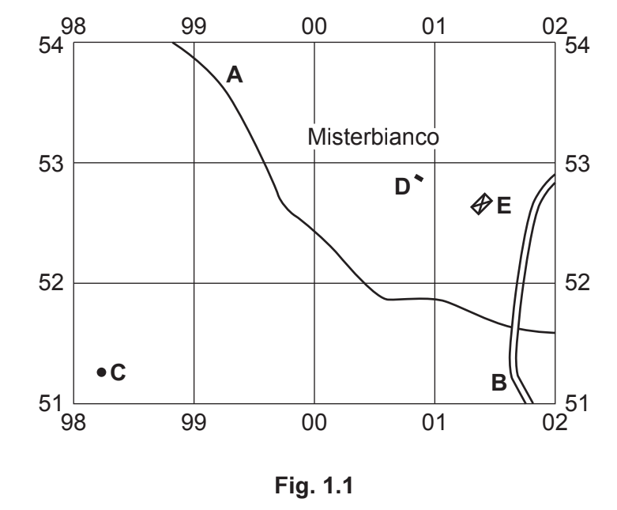

Using the map extract, identify the following features shown in Fig. 1.1:

(i)

the type of road at **A**

[1]

(ii)

the type of road at **B**

[1]

(iii)

the height above sea level of the spot height at **C **................................ metres

[1]

(iv)

feature **D**

[1]

(v)

feature **E**.

[1]

*Source: 2020 2 Q1A*

**Q5** [6 marks]

Fig. 1.2 shows two areas, **A **and **B**, in the south west of the [map extract](https://cdn.savemyexams.com/uploads/2022/09/0460_w20_i2_21_survey-map.pdf). Study the two areas and answer the questions below.

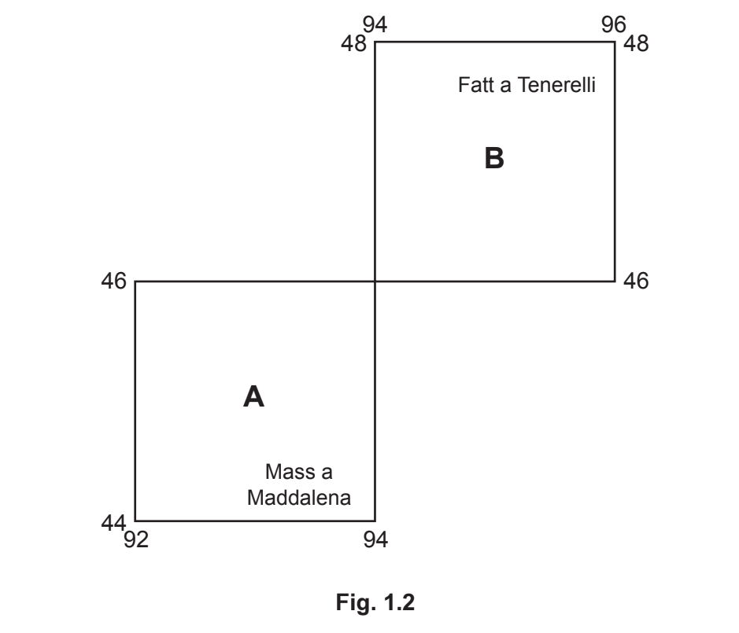

The table below compares the features of the two areas. Complete the table by putting ticks in the correct **six **boxes. Use only **one **tick (3) for each row.

| Feature | Area **A** | Area **B** | Both these areas | Neither of these areas |
|---|---|---|---|---|
| river flowing from south to north |   |   |   |   |
| meandering river |   |   |   |   |
| river flowing from north to south |   |   |   |   |
| either flat or gently sloping |   |   |   |   |
| steep slopes |   |   |   |   |
| plateau |   |   |   |   |

*Source: 2020 2 Q1B*

**Q5** [3 marks]

**Extract:**

Study the map extract for Misterbianco, Italy. The scale is 1:50000.

Map extract link: https://cdn.savemyexams.com/uploads/2022/09/0460_w20_i2_21_survey-map.pdf

Fig. 1.3 is a cross section through the settlement of Motta S. Anastasia, along northing 52, from 940520 to 000520.

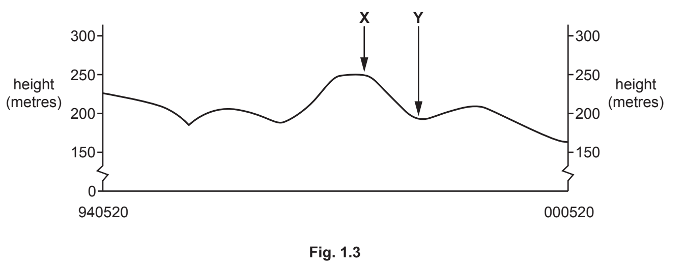

(i)

Identify the feature **X**.

[1]

(ii)

Name the river at **Y**.

[1]

(iii)

In Fig. 1.3, **use a labelled arrow** to show the position of the settlement of Motta S. Anastasia.

[1]

*Source: 2020 2 Q1C*

**Q5** [4 marks]

A railway in the southern part of the [map extract](https://cdn.savemyexams.com/uploads/2022/09/0460_w20_i2_21_survey-map.pdf) is shown by a thin black line. Find where the railway crosses a wide river near Staz.di Motta S. Anastasia.

(i)

What is the distance along the railway, from where it crosses the wide river, to the eastern edge of the map? Give your answer in metres.

.............................................. metres

[1]

(ii)

What is the compass direction **from **where the railway crosses the wide river, **to **where the railway meets the eastern edge of the map?

[1]

(iii)

Measure the bearing **from **where the railway crosses the wide river, **to **where the railway meets the eastern edge of the map.

.............................................. degrees

[1]

(iv)

Give the six-figure grid reference of the point where the railway crosses the wide river.

[1]

**Q5** [2 marks]

Fig. 1.4 shows two areas, area **P **in the north west of the [map extract](https://cdn.savemyexams.com/uploads/2022/09/0460_w20_i2_21_survey-map.pdf) and area **Q **in the north east of the map extract just south of Misterbianco.

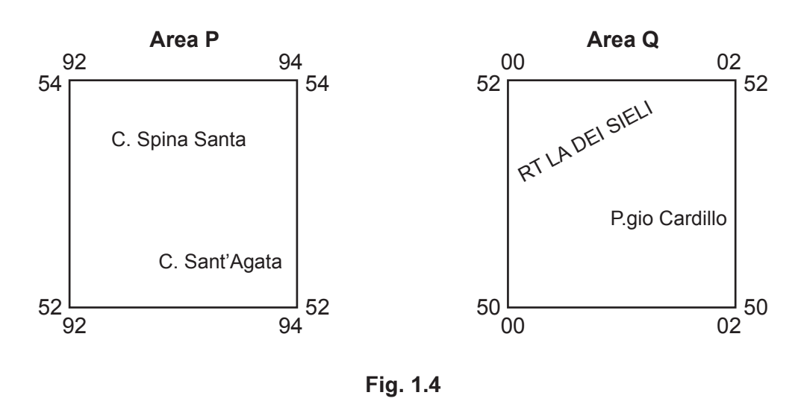

Identify:

(i)

the **settlement **pattern in area **P**

[1]

(ii)

the **stream **pattern in area **Q**.

[1]

*Source: 2020 2 Q1E*

### Q6 — medium — 20 marks

**Q6** [6 marks]

Study the [map extract](https://cdn.savemyexams.com/uploads/2022/09/0460-s20-i2-21.pdf) for Stoumont, Belgium. The scale is 1:50000.

Fig. 1.1 shows some of the features around the main settlement at Stoumont. Study Fig. 1.1 and the map extract, and answer the questions below.

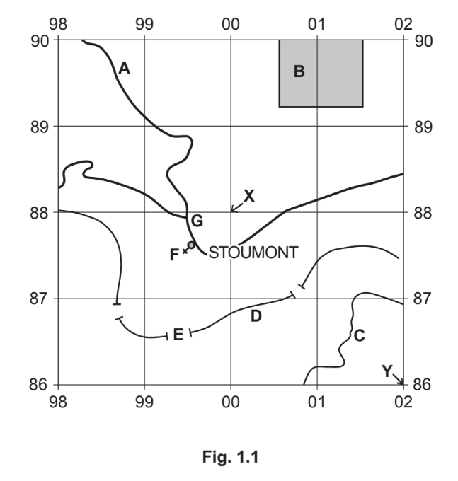

Using the map extract, identify the following features shown in Fig. 1.1:

(i)

feature **A**

[1]

(ii)

the land use at **B**

[1]

(iii)

the height above sea level of the contour at **C**

.............. metres

[1]

(iv)

feature **D**

[1]

(v)

feature **E**

[1]

(vi)

feature **F**

[1]

*Source: 2020 0460/21 Q1A*

**Q6** [1 mark]

**Extract:**

Study the map extract for Stoumont, Belgium. The scale is 1:50000.

Fig. 1.1 shows some of the features around the main settlement at Stoumont. Study Fig. 1.1 and the map extract, and answer the questions below.

What is the six-figure grid reference of the junction at point **G** in Fig. 1.1?

*Source: 2020 2 Q1B*

**Q6** [3 marks]

**Extract:**

Study the map extract for Stoumont, Belgium. The scale is 1:50000.

Fig. 1.1 shows some of the features around the main settlement at Stoumont. Study Fig. 1.1 and the map extract, and answer the questions below.

Fig. 1.2 is a cross section from point X to point Y in Fig. 1.1.

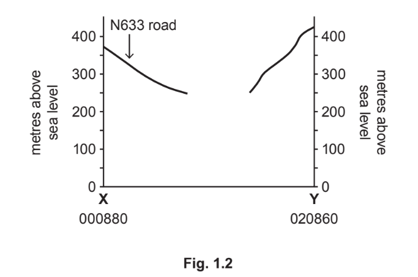

(i)

The cross section shown in Fig. 1.2 is incomplete. Using information from the [map extract,](https://cdn.savemyexams.com/uploads/2022/09/0460-s20-i2-21.pdf) draw a line on Fig. 1.2 to **complete the cross section.**

[2]

(ii)

In Fig. 1.2, **use a labelled** **arrow** to show the position of the L’Amblève river.

[1]

*Source: 2020 0460/21 Q1C*

**Q6** [6 marks]

**Extract:**

Study the [map extract](https://cdn.savemyexams.com/uploads/2022/09/0460-s20-i2-21.pdf) for Stoumont, Belgium. The scale is 1:50000.

Find the N645 road that runs from near the settlement of Chevron in the south west of the [map extract](https://cdn.savemyexams.com/uploads/2022/09/0460-s20-i2-21.pdf) to the bridge over the L’Amblève river.

(i)

What is the distance along the road from the south edge of the map to the bridge over the L’Amblève river? Tick (`✓`) **one** box below.

|   | Tick (`✓`) |
|---|---|
| 3780 metres |   |
| 4780 metres |   |
| 5500 metres |   |
| 7780 metres |   |

[1]

(ii)

What is the compass direction **from** the point where the road meets the south edge of the map **to** the bridge over the L’Amblève river?

[1]

(iii)

Measure the bearing **from** the point where the road meets the south edge of the map to the bridge over the L’Amblève river.

.............................. degrees

[1]

(iv)

Describe the route of the N645 road.

[3]

*Source: 2020 2 Q1D*

**Q6** [3 marks]

Fig. 1.3 shows an area in the north east of the [map extract.](https://cdn.savemyexams.com/uploads/2022/09/0460-s20-i2-21.pdf)

Which three of the following statements describe the relief of the area shown in Fig. 1.3? Tick (`✓`) only three boxes below.

|   | Tick (`✓`) |
|---|---|
| The highest point is over 550m. |   |
| It is an area of gentle slopes. |   |
| It is lowest in the north. |   |
| The lowest land is below 200m. |   |
| It is an area of deeply cut relief. |   |
| There is a river flood plain. |   |
| There is a plateau in the south. |   |
| The slopes face north. |   |
| There is a V-shaped valley. |   |
| It is a mountainous area. |   |

*Source: 2020 2 Q1E*

**Q6** [1 mark]

Look at the main settlement on the [map extract ](https://cdn.savemyexams.com/uploads/2022/09/0460-s20-i2-21.pdf)at Stoumont. Give one reason for the growth of the settlement.

*Source: 2020 2 Q1F*

### Q7 — medium — 20 marks

**Q7** [5 marks]

Study the [map extract](https://cdn.savemyexams.com/uploads/2022/09/0460-s20-i2-22.pdf) for Hamoir, Belgium. The scale is 1:50000.

Fig. 1.1 shows some of the features around the settlement at Ouffet in the north west of the map extract. Study Fig. 1.1 and the map extract, and answer the questions below.

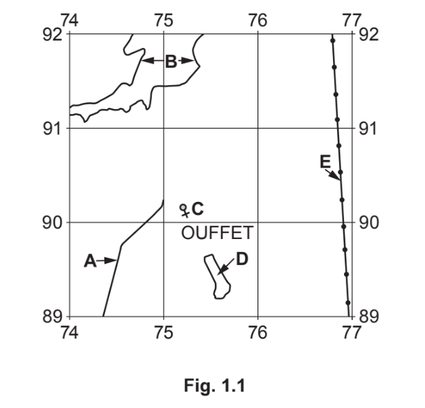

Using the map extract, identify the following features shown in Fig. 1.1:

(i)

feature **A**

[1]

(ii)

the height above sea level of the contour at **B**

............................. metres

[1]

(iii)

feature **C**

[1]

(iv)

the land use at** D**

[1]

(v)

feature **E.**

[1]

*Source: June 2020 0460/22 Q1A*

**Q7** [1 mark]

**Extract:**

Study the map extract for Hamoir, Belgium. The scale is 1:50000.

Fig. 1.1 shows some of the features around the settlement at Ouffet in the north west of the map extract.

Describe the pattern of main and secondary roads in the area shown on Fig. 1.1.

*Source: June 2020 0460/22 Q1B*

**Q7** [4 marks]

**Extract:**

Study the map extract for Hamoir, Belgium. The scale is 1:50000.

Look at the part of the N66 road that runs from the bridge over the river at Hamoir to the east edge of the [map extract.](https://cdn.savemyexams.com/uploads/2022/09/0460-s20-i2-22.pdf)

(i)

What is the distance along the road from the bridge over the river at Hamoir to the east edge of the map extract? Tick **one** box below.

|   | **Tick** **(✓)** |
|---|---|
| 6500 metres |   |
| 7500 metres |   |
| 8500 metres |   |
| 9500 metres |   |

[1]

(ii)

What is the compass direction** from** the bridge over the river at Hamoir **to** where the N66 road meets the east edge of the map extract?

[1]

(iii)

Measure the bearing **from** the bridge over the river at Hamoir **to** where the N66 road meets the east edge of the map extract.

............................................... degrees

[1]

(iv)

Give the six-figure grid reference of the bridge over the river at Hamoir.

[1]

*Source: June 2020 0460/22 Q1C*

**Q7** [3 marks]

**Extract:**

Study the map extract for Hamoir, Belgium. The scale is 1:50000.

Fig. 1.2 is a cross section along northing 90 from 770900 to 830900.

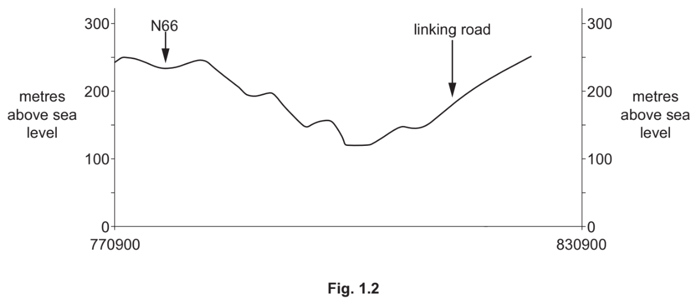

(i)

On Fig. 1.2, **use labelled arrows to show** the position of:

• the main river 
• the Chat. de Renal (shown by a symbol for a castle)

[2]

(ii)

The cross section shown on Fig. 1.2 is incomplete. Using information from the map extract, draw a line on Fig. 1.2 to **complete the cross section**.

[1]

*Source: June 2020 0460/22 Q1D*

**Q7** [3 marks]

**Extract:**

Study the map extract for Hamoir, Belgium. The scale is 1:50000.

Look at the part of the N66 road that runs from the bridge over the river at Hamoir to the east edge of the map extract.

Fig. 1.2 is a cross section along northing 90 from 770900 to 830900.

On Fig. 1.2, use labelled arrows to show the position of:
• the main river
• the Chat. de Renal (shown by a symbol for a castle)

Which **three** of the following statements describe the main river on the map extract? Tick only **three** boxes below.

|   | **Tick (✓)** |
|---|---|
| Its valley has gentle sides. |   |
| It is meandering. |   |
| It has no tributaries. |   |
| It is always to the east of the railway. |   |
| It has a flood plain of varying width. |   |
| There is no settlement on its banks. |   |
| It is a braided river. |   |
| It flows from east to west. |   |
| It is about 50m wide. |   |
| It is about 150m wide. |   |

*Source: June 2020 0460/22 Q1E*

**Q7** [4 marks]

**Extract:**

Study the map extract for Hamoir, Belgium. The scale is 1:50000.

Look at the settlement at Hamoir. Describe the site and give reasons for the growth of the settlement.

*Source: June 2020 0460/22 Q1F*

### Q8 — medium — 6 marks

**Q8** [1 mark]

Fig. 5.1 shows information about the states most affected by soil erosion in one year in the USA. Information is shown for two types of soil erosion: by wind and by water.

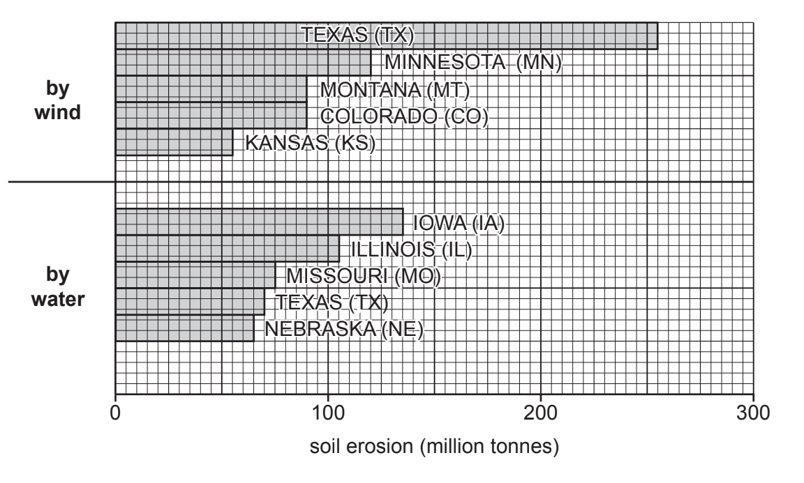

How much soil was eroded by water in Missouri?

.............................................. million tonnes

*Source: 2020 2 Q5A*

**Q8** [2 marks]

**Extract:**

Fig. 5.1 shows information about the states most affected by soil erosion in one year in the USA. Information is shown for two types of soil erosion: by wind and by water.

Fig. 5.2 shows the location of the states listed in Fig. 5.1.

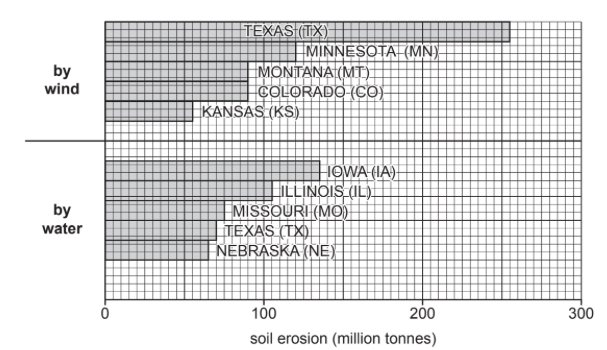

**Fig. 5.1 **

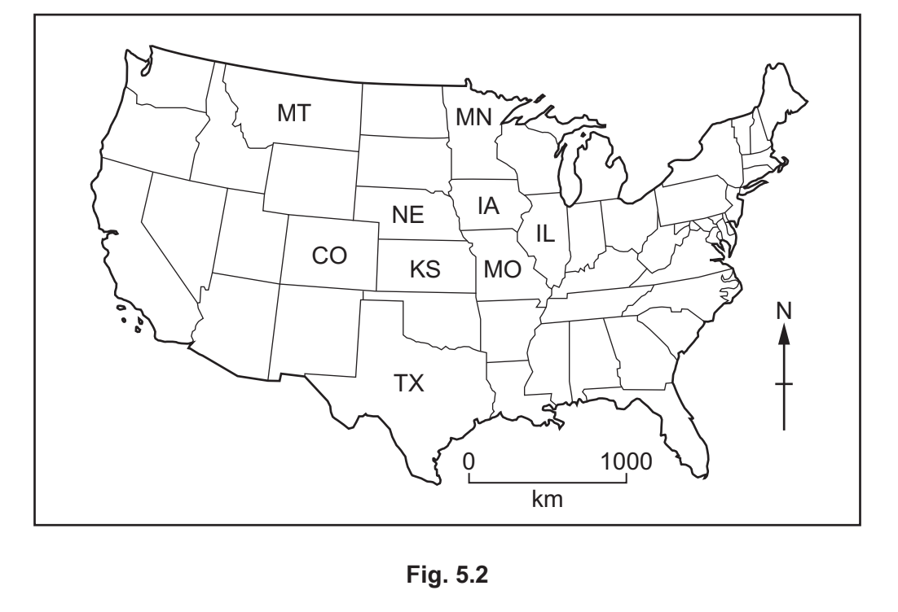

(i)

Which of the following statements describes the location of the states in Fig. 5.2? Tick **one **box below.

|   | Tick (`✓`) |
|---|---|
| mostly in the centre |   |
| mostly in the south |   |
| mostly in the west |   |

(ii)

Using Figs. 5.1 and 5.2, give **one **difference between the distribution of the states with soil erosion by wind and the distribution of the states with soil erosion by water.

*Source: 2020 2 Q5B*

**Q8** [3 marks]

**Extract:**

Fig. 5.1 shows information about the states most affected by soil erosion in one year in the USA. Information is shown for two types of soil erosion: by wind and by water.

Fig. 5.2 shows the location of the states listed in Fig. 5.1.

Fig. 5.3 shows the rainfall of the states shown in Figs. 5.1 and 5.2.

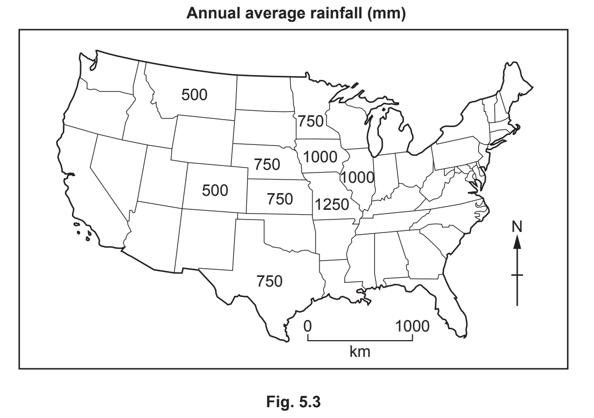

(i)

Using Figs. 5.1, 5.2 and 5.3, describe how the amount of rainfall affects whether soil erosion is by wind or by water.

[1]

(ii)

Explain why the amount of rainfall affects whether soil erosion is by wind or by water.

[2]

*Source: 2020 2 Q5C*

### Q9 — medium — 20 marks

**Q9** [5 marks]

Study the [map extract](https://cdn.savemyexams.com/uploads/2022/09/0460-w19-i2-22.pdf) for Degeberga, Sweden. The scale is 1:50000.

Fig. 1.1 shows some features in the west of the map extract around the main settlement of Degeberga.

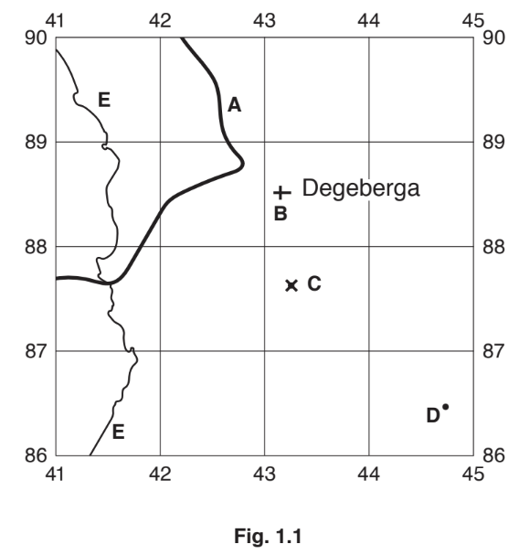

Using the map extract, identify the following features shown on Fig. 1.1:

(i)

feature **A**

[1]

(ii)

feature **B**

[1]

(iii)

feature **C**

[1]

(iv)

the height above sea level at spot height **D**

.................... metres

[1]

(v)

the height above sea level of contour **E.**

..................... metres

[1]

*Source: 2019 0460/22 Q1A*

**Q9** [5 marks]

Fig. 1.2A shows an area in the north west of the [map extract ](https://cdn.savemyexams.com/uploads/2022/09/0460-w19-i2-22.pdf)and Fig. 1.2B shows an area in the south east of the map extract. Study the two areas and answer the questions below.

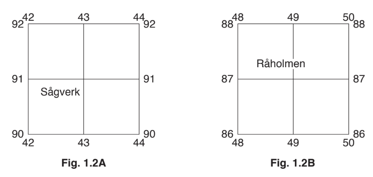

The table below compares the features of the two areas. Complete the table by putting ticks in the correct five boxes. Use only one tick for each row.

|   | Area in Fig. 1.2A | Area in Fig. 1.2B | Both these areas | Neither of these areas |
|---|---|---|---|---|
| Example: motorway |   |   |   | `✓` |
| flat land |   |   |   |   |
| steep land |   |   |   |   |
| gentle slopes |   |   |   |   |
| mostly forest |   |   |   |   |
| mostly arable land |   |   |   |   |

*Source: 2019 2 Q1B*

**Q9** [4 marks]

**Extract:**

Study the map extract for Degeberga, Sweden. The scale is 1:50000.

Fig. 1.3 shows a cross section along northing 86 from 440860 to 510860.

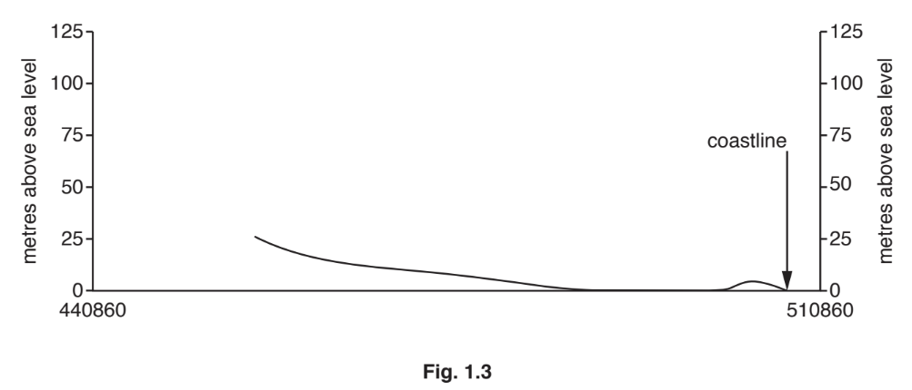

(i)

On Fig. 1.3, **use labelled arrows and the letter** **shown** to show the positions of:

public road 19 **(X)**

the Segesholmsån river **(Y).**

[2]

(ii)

On Fig. 1.3, **complete the cross section.**

[2]

*Source: 2019 2 Q1C*

**Q9** [2 marks]

Look at the coastal settlement around Nyehusen and Furuboda. Give map evidence that suggests that this is a tourist settlement.

*Source: 2019 2 Q1D*

**Q9** [4 marks]

**Extract:**

Study the map extract for Degeberga, Sweden. The scale is 1:50000.

Find the following two triangulation points:

the 22m triangulation point south of Nyehusen

the 129m triangulation point near Norrlia, south of Degeberga.

(i)

Give the compass direction **from** the 129m triangulation point **to** the 22m triangulation point.

[1]

(ii)

Measure the bearing **from** the 129m triangulation point **to** the 22m triangulation point.

........................ degrees

[1]

(iii)

What is the six-figure grid reference of the 129m triangulation point near Norrlia?

[2]

*Source: 2019 2 Q1E*

### Q10 — medium — 20 marks

**Q10** [4 marks]

Study the [map extract](https://cdn.savemyexams.com/uploads/2023/05/0460-s21-i2-21.pdf) for Laveissière, France. The scale is 1:25000.

Fig. 1.1 shows some of the features in the north east of the map extract. Study Fig. 1.1 and the map extract and answer the questions below.

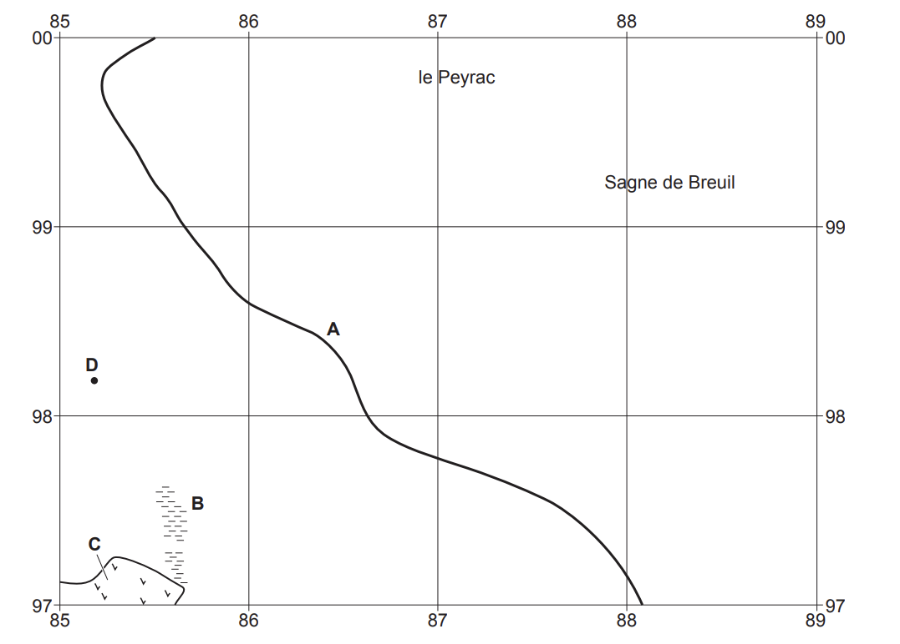

**Fig. 1.1**

Using the map extract, identify the following features shown in Fig. 1.1:

(i)

feature **A**

[1]

(ii)

type of area at **B**

[1]

(iii)

land use at **C**

[1]

(iv)

the height above sea level of the spot height at **D**.

.................................. metres

[1]

*Source: June 2021 0460/21 Q1A*

**Q10** [2 marks]

**Extract:**

Study the map extract for Laveissière, France. The scale is 1:25000.

A person travels along the road from the northern edge of the map to the junction with the D139 at la Chevade.

(i)

How far do they travel? Circle your answer in the list below.

| 3250m | 3850m | 4150m | 4750m |
|---|---|---|---|

[1]

(ii)

In which compass direction does the person travel?

[1]

*Source: June 2021 0460/21 Q1B*

**Q10** [4 marks]

**Extract:**

Study the map extract for Laveissière, France. The scale is 1:25000.

A person travels along the road from the northern edge of the map to the junction with the D139 at la Chevade.

Fig. 1.2 is a north to south cross-section along easting 860 from 860980 to 860950.

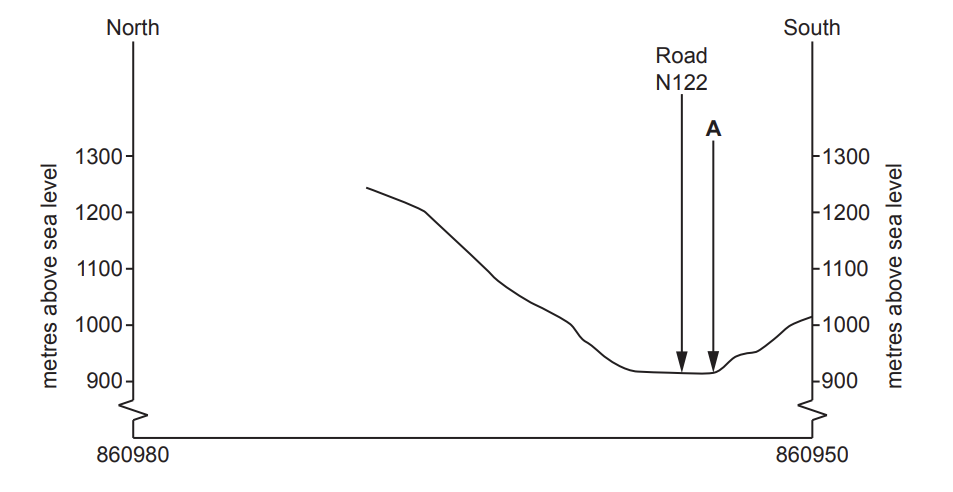

**Fig. 1.2**

(i)

Name the feature at **A.**

[1]

(ii)

On Fig. 1.2, **use a labelled arrow** to show a position of the D139 road.

[1]

(iii)

The cross-section shown on Fig. 1.2 is incomplete. Using information from the map extract, draw a line on Fig. 1.2 to **complete the cross-section.**

[2]

*Source: June 2021 0460/21 Q1C*

**Q10** [3 marks]

Fig. 1.3 is an area in the north of the [map extract](https://cdn.savemyexams.com/uploads/2023/05/0460-s21-i2-21.pdf).

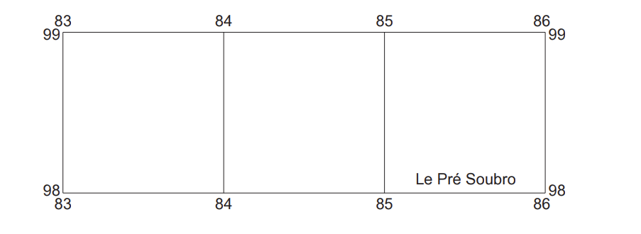

**Fig. 1.3**

Which **three** of the following statements describe the relief and drainage of the area shown on Fig. 1.3? Tick (`✓`) only three boxes below.

|   | **Tick **(`✓`) |
|---|---|
| it is flat land |   |
| it has south-facing slopes |   |
| there are many rivers |   |
| it is a mountainous area |   |
| it has gentle slopes |   |
| highest point is above 1400 metres |   |
| there is a large lake |   |
| there are seasonal rivers |   |

*Source: June 2021 0460/21 Q1D*

**Q10** [7 marks]

Laveissière is a settlement in the south of the [map extract](https://cdn.savemyexams.com/uploads/2023/05/0460-s21-i2-21.pdf).

(i)

Describe the site of the settlement of Laveissière.

[4]

(ii)

Identify the services provided for tourists in the settlement of Laveissière.

[3]

*Source: June 2021 0460/21 Q1E*

### Q11 — medium — 20 marks

**Q11** [5 marks]

Study the [map extract](https://cdn.savemyexams.com/uploads/2022/09/0460-w19-i2-23.pdf) for Knislinge, Sweden. The scale is 1:50000.

Fig. 1.1 shows some of the features in the west of the map extract.

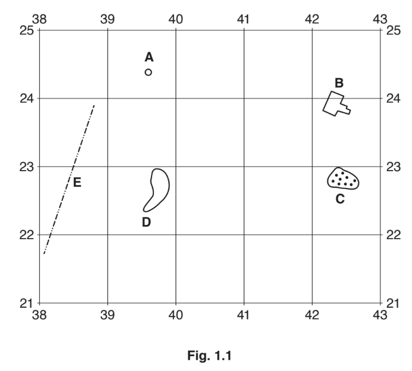

Using the map extract, identify the following features shown in Fig. 1.1:

(i)

feature **A**

[1]

(ii)

the type of land at **B**

[1]

(iii)

the type of natural vegetation at **C**

[1]

(iv)

the height of the contour **D**

[1]

(v)

feature **E.**

[1]

*Source: 2019 Oct/Nov 0460/23 Q1A*

**Q11** [2 marks]

**Extract:**

Study the map extract for Knislinge, Sweden. The scale is 1:50000.

Fig. 1.2 shows the area around the town of Knislinge.

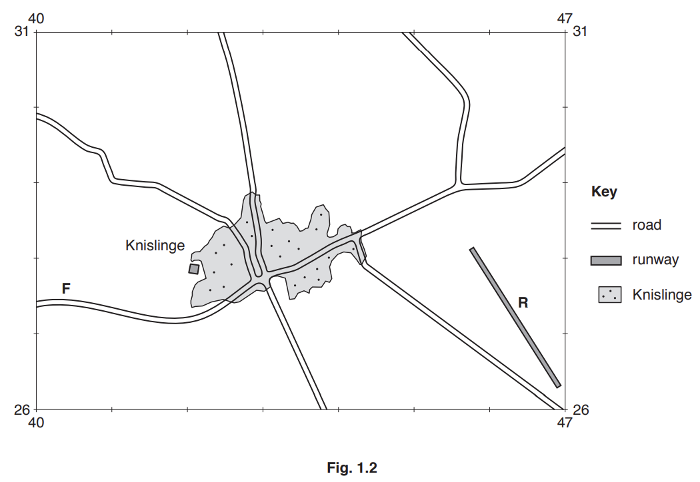

(i)

State the width of the road labelled F.

.................................................... metres

[1]

(ii)

Describe the general pattern of the main roads shown on Fig. 1.2.

[1]

*Source: 2020 Oct/Nov 0460/23 Q1B*

**Q11** [2 marks]

**Extract:**

Fig. 1.2 shows the area around the town of Knislinge.

A runway to the east of Knislinge is labelled** R** on Fig. 1.2. Find this runway on the [map extract.](https://cdn.savemyexams.com/uploads/2022/09/0460-w19-i2-23.pdf)

(i)

Measure the length of the surfaced section of the runway. Give your answer in metres
. .................................................... metres

[1]

(ii)

Give the compass direction along the surfaced runway from the end near Sigfridssten to the other end near Bivarödsmölla.

[1]

*Source: 2019 Oct/Nov 0460/23 Q1C*

**Q11** [4 marks]

Describe the features of the river between the western edge of the [map extract ](https://cdn.savemyexams.com/uploads/2022/09/0460-w19-i2-23.pdf)at 380260 and its confluence with the river Helge å in grid square 4425.

*Source: 2019 Oct/Nov 0460/23 Q1D*

**Q11** [3 marks]

Fig. 1.3 shows the area around the town of Hanaskog.

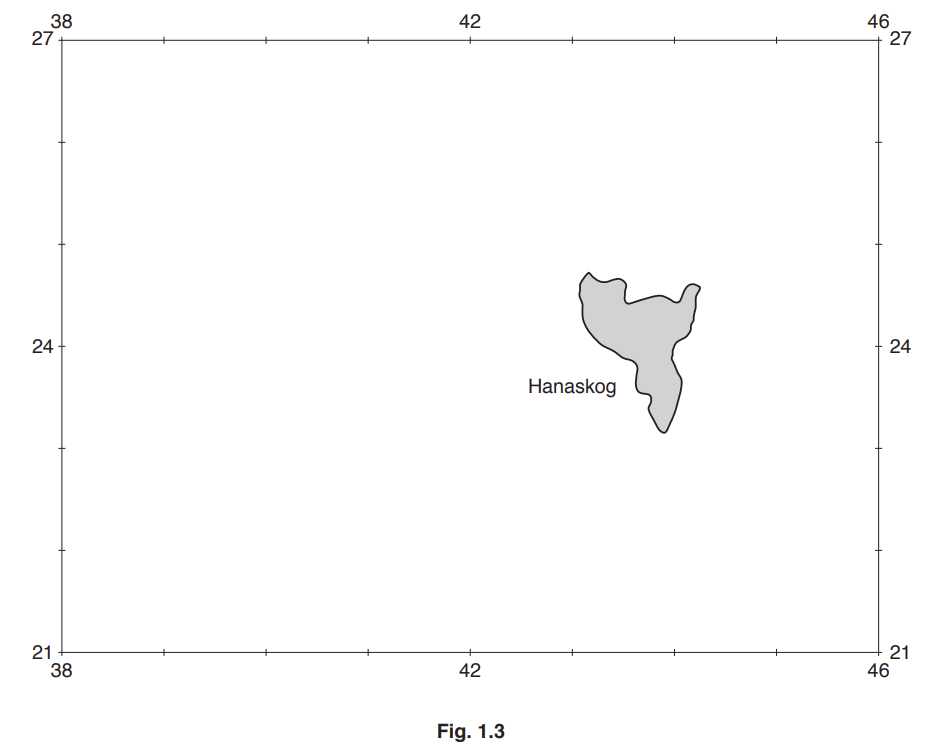

(i)

Using the [map extract](https://cdn.savemyexams.com/uploads/2022/09/0460-w19-i2-23.pdf), describe the distribution of the arable land in the area shown on Fig. 1.3.

[2]

(ii)

Using the map extract, state one way in which the distribution of woodland in the area shown on Fig. 1.3 differs from that of the arable land.

[1]

*Source: 2019 Oct/Nov 0460/23 Q1E*

**Q11** [2 marks]

Find the lake called Araslövssjön in the south east of the [map extract](https://cdn.savemyexams.com/uploads/2022/09/0460-w19-i2-23.pdf).

(i) 
Name the type of vegetation on the edges of the lake.

[1]

(ii) 
State one way in which the lake is used.

[1]

*Source: 2019 Oct/Nov 0460/23 Q1F*

**Q11** [2 marks]

Fig. 1.4 is a cross section along northing 23 from 400230 to 470230.

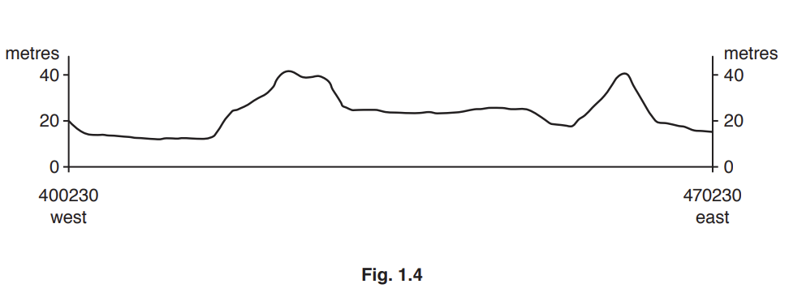

On Fig. 1.4, using labelled arrows, mark the positions of: **(i)** a railway (**R**)  **(ii)** the river Kälan (**K**).

*Source: 2019 Oct/Nov 0460/23 Q1G*

### Q12 — medium — 8 marks

**Q12** [3 marks]

Fig. 2.1 gives information about population change in four regions in Italy (an MEDC) in 2017. Study Fig. 2.1 and answer the following questions.

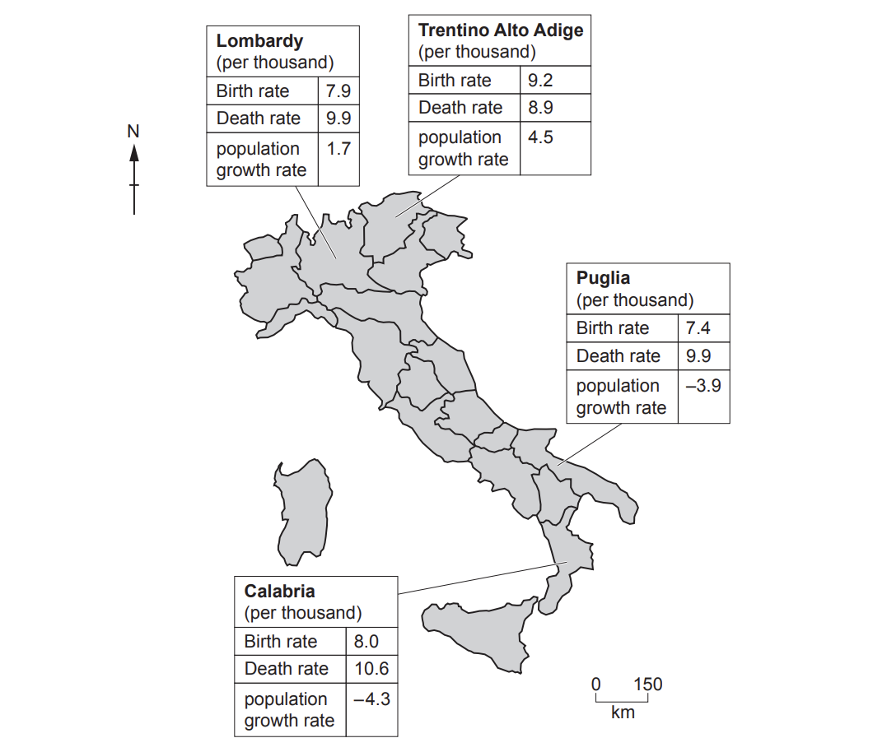

**Fig. 2.1**

(a)

Which of the four regions had:

(i)

the highest birth rate

[1]

(ii)

the highest death rate

[1]

(iii)

the largest population decline?

[1]

*Source: June 2021 o460/22 Q2A*

**Q12** [1 mark]

**Extract:**

Fig. 2.1 gives information about population change in four regions in Italy (an MEDC) in 2017.

(b)

Compare the population growth in the northern and southern regions.

[1]

*Source: June 2021 0460/22 Q2B*

**Q12** [2 marks]

**Extract:**

Fig. 2.1 gives information about population change in four regions in Italy (an MEDC) in 2017.

(c)

Study the following calculation for population growth:

Population growth rate = birth rate +/– death rate +/– migration

Calculate the migration rate for the following regions:

(i)

Trentino Alto Adige

...................................... per thousand

[1]

(ii)

Calabria.

...................................... per thousand

[1]

*Source: June 2021 0460/22 Q2C*

**Q12** [2 marks]

**Extract:**

Fig. 2.1 gives information about population change in four regions in Italy (an MEDC) in 2017.

(d)

Suggest **two** pull factors attracting people to the northern regions of Italy (an MEDC).

1 .............................................

2 .............................................

[2]

*Source: June 2021 0460/22 Q2D*

### Q13 — medium — 20 marks

**Q13** [5 marks]

Study the [map extract](https://cdn.savemyexams.com/uploads/2023/05/0460-m21-i2-22.pdf) for Fortuniès, France. The scale is 1:25000.

Fig. 1.1 shows some of the features around the settlement of Collanges in the south of the map extract. Study Fig. 1.1 and the map extract and answer the questions below.

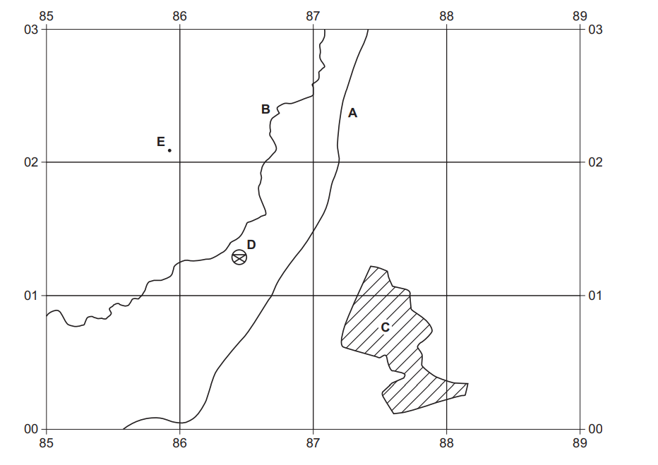

**Fig. 1.1**

Using the map extract, identify the following features shown in Fig. 1.1:

(i)

feature A

[1]

(ii)

the name of river B

[1]

(iii)

land use at C

[1]

(iv)

feature D

[1]

(v)

the height above sea level of the spot height at E.

............................................... metres

[1]

*Source: Mar 2021 0460/22 Q1A*

**Q13** [3 marks]

**Extract:**

Study the [map extract](https://cdn.savemyexams.com/uploads/2023/05/0460-m21-i2-22.pdf) for Fortuniès, France. The scale is 1:25000.

A person travels on the footpath from the north of the river outside Collanges (863013) to the junction with the footpath south east of les Ginestes (855022).

(i)

In which overall compass direction does the person travel?

[1]

(ii)

What distance does the person travel along the footpath?

............................................... metres

[1]

(iii)

How many metres does the person climb? Circle one correct answer below.

| 802m | 902m | 102m | 112m |
|---|---|---|---|

[1]

*Source: Mar 2021 0460/22 Q1B*

**Q13** [5 marks]

Fig. 1.2 shows the location of two grid squares in the east of the [map extract](https://cdn.savemyexams.com/uploads/2023/05/0460-m21-i2-22.pdf). These are square 8802 at Lac de Sauvages and square 8902 at Peyre del Cayre. Study the two areas and answer the question below.

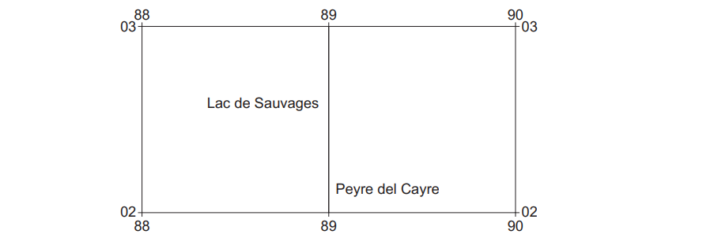

**Fig. 1.2**

The table below compares the features of the two areas. Complete the table by putting ticks () in the correct **five** boxes. Use only **one** tick for each row.

|   | **square 8802 at Lac de Sauvages** | **square 8902 at Peyre del Cayre** | **both these areas** | **neither of these** |
|---|---|---|---|---|
| **parking** |   |   |   |   |
| **steep slopes** |   |   |   |   |
| **area liable to flooding** |   |   |   |   |
| **land over 1200 m above sea level** |   |   |   |   |
| **church** |   |   |   |   |

[5]

*Source: Mar 2021 0460/22 Q1C*

**Q13** [3 marks]

**Extract:**

Study the map extract for Fortuniès, France. The scale is 1:25000.

Fig. 1.3 is a cross-section along northing 025 from 860025 to 890025, passing through the village of Sauvages.

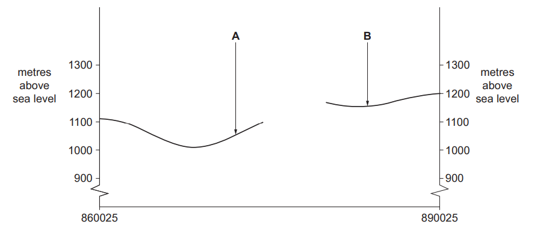

**Fig. 1.3**

(i)

Identify the feature at A.

[1]

(ii)

Identify the feature at B.

[1]

(iii)

The cross-section shown on Fig. 1.3 is incomplete. Using information from the map extract, draw a line on Fig. 1.3 to complete the cross-section.

[1]

*Source: Mar 2021 0460/22 Q1D*

**Q13** [4 marks]

Find the settlement of Dienne in the south west of the map extract. Using the[ map extract](https://cdn.savemyexams.com/uploads/2023/05/0460-m21-i2-22.pdf), describe the site and give reasons for the growth of the settlement.

*Source: Mar 2021 0460/22 Q1E*

### Q14 — medium — 20 marks

**Q14** [6 marks]

Study the [map extract](https://cdn.savemyexams.com/uploads/2022/09/0460-s20-map-23.pdf) for Esneux, Belgium. The scale is 1:50000.

Fig. 1.1 shows some of the features in the north west of the map extract. Study Fig. 1.1 and the map extract, and answer the questions below.

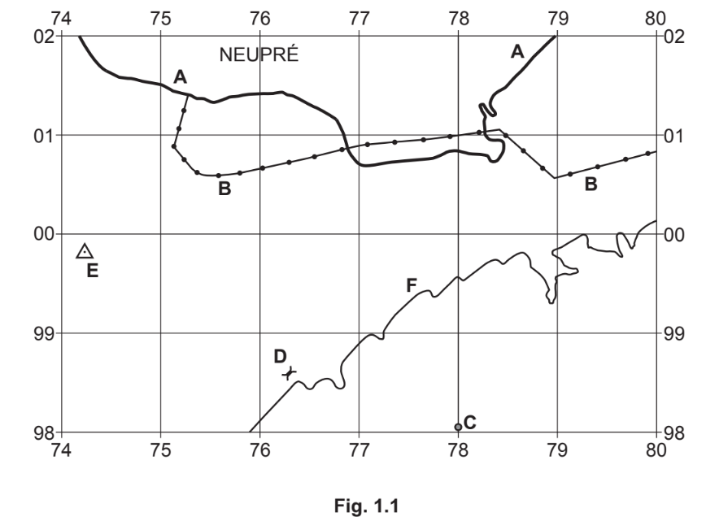

Using the map extract, identify the following features shown in Fig. 1.1:

(i)

feature **A**

[1]

(ii)

feature **B**

[1]

(iii)

feature **C**

[1]

(iv)

feature **D**

[1]

(v)

the height above sea level of the geodetic (trigonometric) point at **E** .......................................................... metres

[1]

(vi)

the height above sea level of the contour at **F** .......................................................... metres

[1]

*Source: June 2020 0460/23 Q1A*

**Q14** [4 marks]

**Extract:**

Study the map extract for Esneux, Belgium. The scale is 1:50000.

Find the small settlements at Tavier and Hody in the south west of the [map extract](https://cdn.savemyexams.com/uploads/2022/09/0460-s20-map-23.pdf). Both settlements have a church.

(i)

What is the straight-line distance from the church at Tavier to the church at Hody? Give your answer in metres.

.......................................................... metres

[1]

(ii)

What is the compass direction **from** the church at Tavier** to** the church at Hody?

[1]

(iii)

Measure the bearing **from** the church at Tavier **to** the church at Hody. .......................................................... degrees

[1]

(iv)

Give the six-figure grid reference of the church at Tavier.

[1]

*Source: June 2020 0460/23 Q1B*

**Q14** [3 marks]

**Extract:**

Study the map extract for Esneux, Belgium. The scale is 1:50000.

Fig. 1.2 is a cross section along northing 00 from 810000 to 860000.

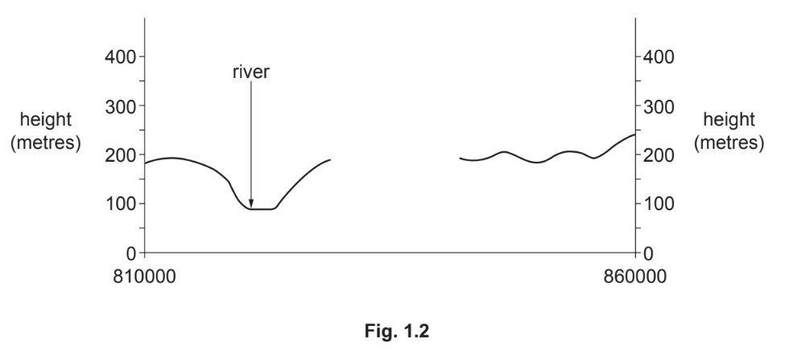

(i)

In Fig. 1.2, **use labelled arrows to show** the position of:

• the N633 road 
• the railway

[2]

(ii)

The cross section shown in Fig. 1.2 is incomplete. Using information from the map extract, draw a line in Fig. 1.2 to **complete the cross section**.

[1]

*Source: June 2020 0460/23 Q1C*

**Q14** [3 marks]

Fig. 1.3 shows an area in the south of the [map extract](https://cdn.savemyexams.com/uploads/2022/09/0460-s20-map-23.pdf).

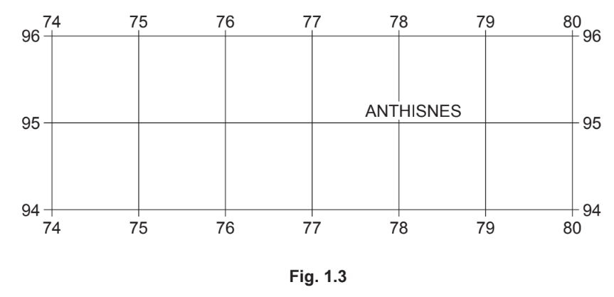

Which **three** of the following statements describe the relief and drainage of the area shown in Fig. 1.3? Tick only **three** boxes below.

|   | Tick (✓) |
|---|---|
| It is an area of steep and gently sloping relief |   |
| It is a mountainous area |   |
| It is flat land |   |
| The highest point is 250m |   |
| The area is all steeply sloping |   |
| There is a flood plain |   |
| The land is below 300m |   |
| There are few rivers |   |
| There is a large river |   |
| There is swamp or marsh |   |

*Source: June 2020 0460/23 Q1D*

**Q14** [4 marks]

Find the settlement of Douxflamme in the south east of the [map extract](https://cdn.savemyexams.com/uploads/2022/09/0460-s20-map-23.pdf). Describe the site and reasons for the growth of the settlement.

*Source: June 2020 0460/23 Q1E*

### Q15 — medium — 18 marks

**Q15** [4 marks]

Study the [map extract](https://cdn.savemyexams.com/uploads/2023/05/0460-s21-i2-23.pdf) for Thiezac, France. The scale is 1:25000.

Fig. 1.1 shows some of the features around the settlement of le Croizet in the south of the map extract. Study Fig. 1.1 and the map extract, and answer the questions below.

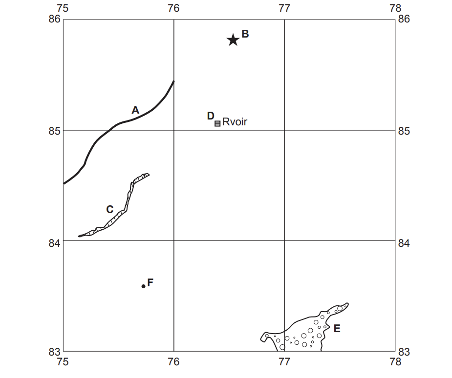

**Fig. 1.1**

Using the map extract, identify the following features shown in Fig. 1.1:

(i)

feature **A**

[1]

(ii)

feature **B**

[1]

(iii)

feature **C**

[1]

(iv)

feature **D**

[1]

(v)

land use at **E**

[1]

(vi)

the height above sea level of the spot height at **F.**

.................................... metres

[1]

*Source: June 2021 0460/22 Q1A*

**Q15** [3 marks]

**Extract:**

Study the map extract for Thiezac, France. The scale is 1:25000.

Fig. 1.2 is a cross-section along northing 85 from 720850 to 750850.

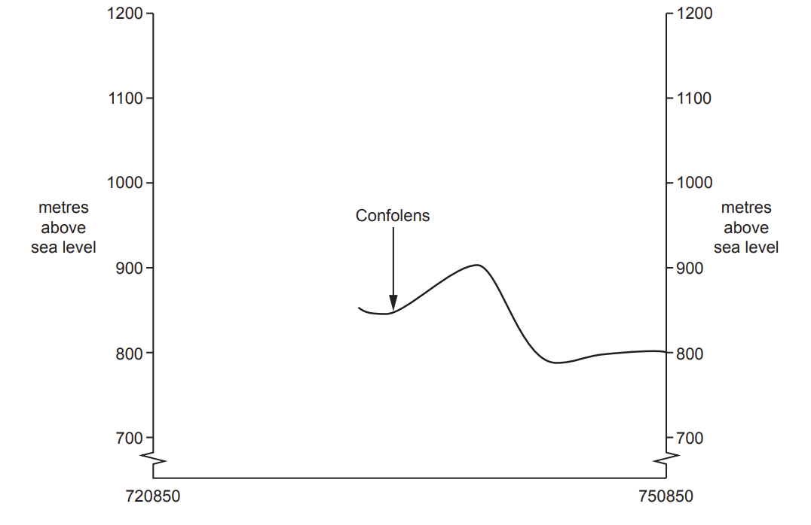

**Fig. 1.2**

(i)

On Fig. 1.2, **use a labelled arrow** to show the position of the N122 road.

[1]

(ii)

The cross-section shown on Fig. 1.2 is incomplete. Using information from the map extract, draw a line on Fig. 1.2 to **complete the cross-section.**

[2]

*Source: June 2021 0460/22 Q1B*

**Q15** [5 marks]

Fig. 1.3 shows an area in the west of the[ map extract](https://cdn.savemyexams.com/uploads/2023/05/0460-s21-i2-23.pdf).

A person walks on the footpath (shown by a red line) **from** Lagat (730856), north west of Thiezac, **to** Cascade de Faillitoux (722866), east of the river north-north east of Lasmolineries.

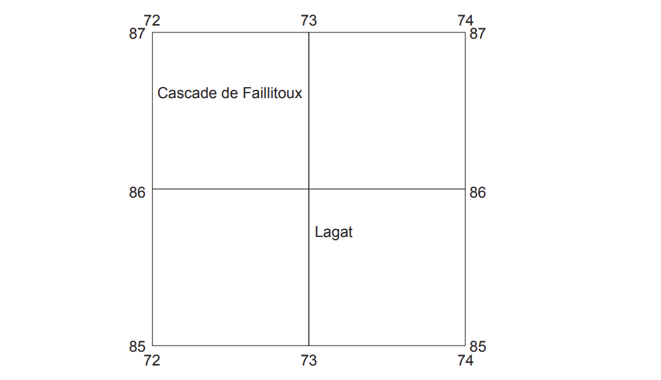

**Fig. 1.3**

(i)

In which overall direction does the person travel? Tick (`✓`) **one** box below.

|   | **tick (**`✓`**)** |
|---|---|
| south east |   |
| south west |   |
| north west |   |
| north east |   |

[1]

(ii)

What is the distance travelled along the footpath **from** Lagat **to** Cascade de Faillitoux?

Tick (`✓`) **one** box below.

|   | tick (`✓`) |
|---|---|
| 1010 metres |   |
| 1600 metres |   |
| 2010 metres |   |
| 2300 metres |   |

[1]

(iii)

The table below shows the features in the area. Which **two** features will the person pass on the footpath? Complete the table by putting ticks (`✓`) in the correct two boxes.

|   | **tick (**`✓`**)** |
|---|---|
| steep slopes |   |
| lake |   |
| reservoir |   |
| deciduous woodland |   |
| coniferous woodland |   |

[2]

(iv)

Measure the bearing **from** the spot height of 1096 metres at Lagat (730856) **to** Cascade de Faillitoux (722866).

.......................................................... degrees

[1]

*Source: June 2021 0460/22 Q1C*

**Q15** [6 marks]

Fig. 1.4 shows the location of two grid squares in the west of the[ map extract](https://cdn.savemyexams.com/uploads/2023/05/0460-s21-i2-23.pdf). These are square 7085 at la Rochere and 7185 at Lasmolineries. Study the area and answer the questions on the next page.

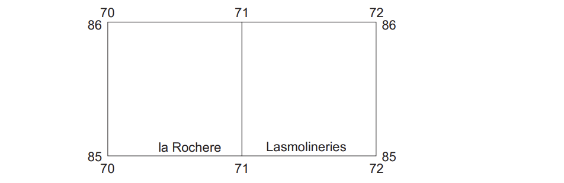

**Fig. 1.4**

Describe the relief and drainage of this area.

Relief

...................................

Drainage

...................................

*Source: June 2021 0460/22 Q1D*

### Q16 — medium — 8 marks

**Q16** [4 marks]

Study the [map extract](https://cdn.savemyexams.com/uploads/2022/09/0460_w20_i2_22.pdf) for Biancavilla, Italy. The scale is 1:50000.

Fig. 1.1 shows some of the features around the settlement at S. Maria di Licodia in the south east of the map extract. Study Fig. 1.1 and the map extract, and answer the questions below.

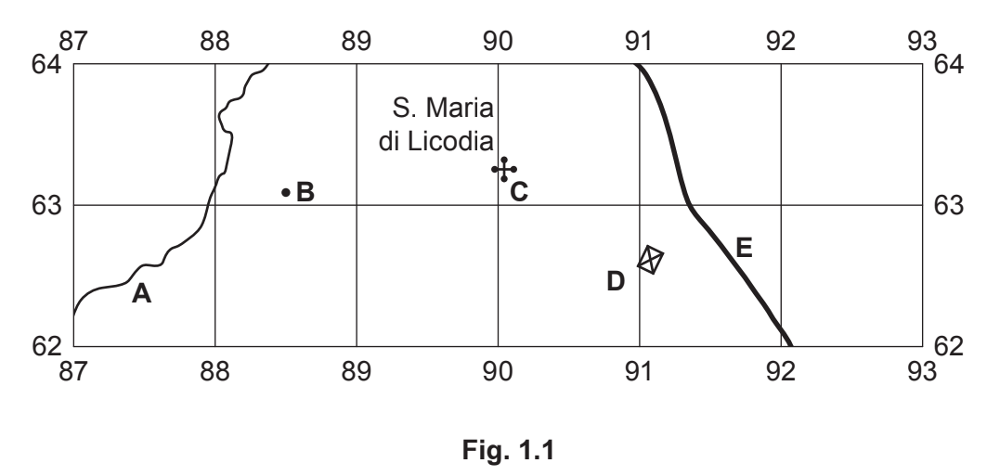

Using the map extract, identify the following features shown in Fig. 1.1:

(i)

the name of river A

[1]

(ii)

the height above sea level of the spot height at B

.................................... metres                                                                                                               [1]

(iii)

feature C

[1]

(iv)

feature D

[1]

(v)

feature E.

[1]

*Source: Nov 2020 0460/22 Q1A*

**Q16** [4 marks]

Fig. 1.2 shows two areas, P in the south west of the [map extract ](https://cdn.savemyexams.com/uploads/2022/09/0460_w20_i2_22.pdf)and Q, in the north east of the map extract. Study the two areas and answer the questions below.

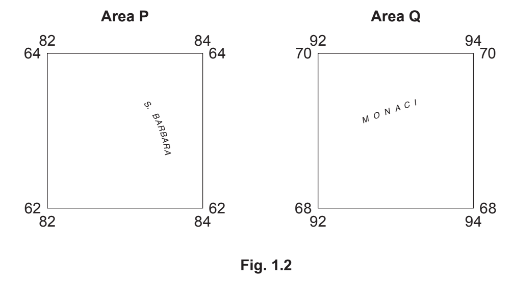

The table below compares the features of the two areas. Complete the table by putting ticks in the correct four boxes. Use only one tick (`⩗`) for each row.

| Feature | Area P | Area Q | Both these areas | Neither of these areas |
|---|---|---|---|---|
| a railway |   |   |   |   |
| dispersed settlement |   |   |   |   |
| dense settlement |   |   |   |   |
| land over 900m above sea level |   |   |   |   |
