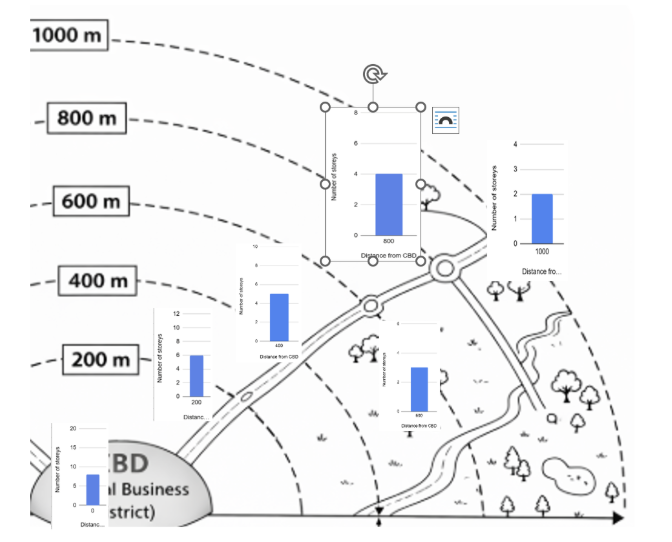
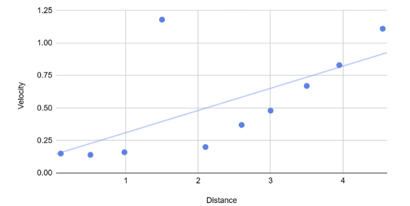
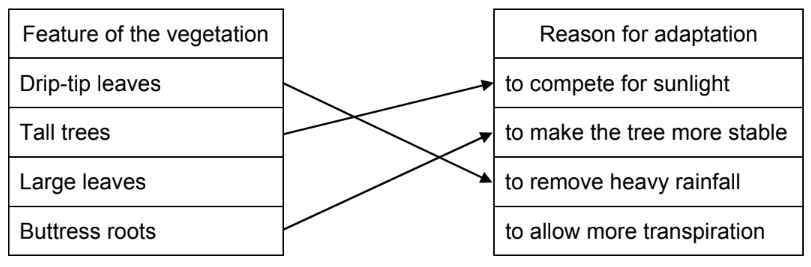
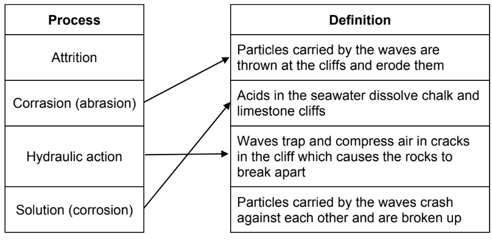

# Mark Schemes — Fieldwork
**Fieldwork** · Cambridge (CIE) IGCSE geography (0460 & 0976)

## Paper 4 (28 questions)

### Q1
Students could stand in one place and count the number of people walking past** ****[1]**** **in one direction** ****[1]**** **for an agreed period of time.** ****[1]**** **This will be recorded in a tally chart. **[1]** It should be completed for the same length of time at each location** ****[1]**** **and more than one person should be recording to avoid errors** ****[1]**

> **[mark-scheme]**
> **Mark allocation**
> 
> - **One mark** for each valid part of the data collection process
> 
> **[6 marks]**
> 
> **Alternative content**
> 
> The answer above is just one example of how to respond to this question. Additional information that could be used in the answer includes:
> 
> - Count in both directions
> - Take an average of each group member's results
> - Complete at the same time of day

### Q2
> **[mark-scheme]**
> Any** two** from:
> 
> - Shorter travel time
> - Opportunity to revisit
> - Knowledge of risks
> - Opportunity to use local knowledge
> - More familiar area
> 
> **[2 marks]**
> **[mark-scheme]**
> Any **two **from:
> 
> - Breathing in fumes from traffic
> - Falling off a kerb
> - Risk of crime
> - Traffic and risk of crossing roads
> - Getting lost
> 
> **[2 marks]**
**Data that includes numbers**** [1 mark]**
**Primary data**** [1 mark]**
**Systematic ****[1 mark]**
It ignores areas between each 200-metre interval **[1]** where data could be different, leading to inaccurate results** ****[1]**

> **[mark-scheme]**
> **Mark allocation**
> 
> - **One mark** for a valid disadvantage
> - **One mark** for outlining why it is a disadvantage
> 
> **[2 marks]**
> 
> **Alternative content**
> 
> The answer above is just one example of how to respond to this question. Additional information that could be used in the answer includes:
> 
> - It is more biased than random sampling because the student chooses the distance between sites
Draw a transect line on a map and walk along the transect. **[1]**** **Count each retail unit **[1]**** **and record on a tally chart. **[1]**

> **[mark-scheme]**
> **Mark allocation**
> 
> - **One mark** for each valid part of the data collection method
> 
> **[3 marks]**
> **[mark-scheme]**
> Any **one **from:
> 
> - There may be different uses on different floors
> - It is difficult to tell what the uses are without entering each building
> - There may be more than one retail unit on a floor
> 
> **[1 mark]**
**Located bar graph**** [1 mark]**

*Fig 2.2 completed*

> **[mark-scheme]**
> **Mark allocation**
> 
> - **One mark **for correct completion of the 800m graph to 4
> 
> **[1 mark]**
> **[mark-scheme]**
> Any **two** from:
> 
> - Building height decreases with distance from the CBD
> - There is an increase at 800 m
> - There are 4 times as many storeys in the CBD compared to 1000 m
> 
> **[2 marks]**

> **[exam-tip]**
> It is important in this answer to only refer to the height of buildings because Fig. 2.2 shows height, not the number of retail units.
The site is at a junction of two main roads, and so the area might cost more/be more accessible**. ****[1]**

> **[mark-scheme]**
> **Mark allocation**
> 
> - **One mark **for any valid reason that there is an increase in storeys
> 
> **[1 mark]**
> 
> **Alternative content**
> 
> The answer above is just one example of how to respond to this question. Additional information that could be used in the answer includes:
> 
> - This location may be a local shopping centre
**Advantage **– the information on the map may help with understanding the reasons for the results. **[1]**

**Disadvantage** – the graphs have different scales, so it is not easy to compare. **[1]**

> **[mark-scheme]**
> **Mark allocation**
> 
> - **One mark **for each valid advantage and disadvantage
> 
> **[2 marks]**

### Q3
Maps of the river and the surrounding area **[1]** can be used to help them identify suitable sites for data collection. **[1]**

> **[mark-scheme]**
> **Mark allocation**
> 
> - **One mark** for a valid example of secondary data
> - **One mark** for outlining how it is useful
> 
> **[2 marks]**
> 
> **Alternative content**
> 
> The answer above is just one example of how to respond to this question. Additional information that could be used in the answer includes:
> 
> - Weather forecast
> - Previous river data collected
> - Information from organisations like the Environment Agency
> - Old photographs
> - Newspaper articles
> - Websites

> **[exam-tip]**
> Students often get confused about primary and secondary data. Remember, primary data is data you collect yourself and secondary data is anything that someone else has collected.
**Bradshaw model.**** ****[1 mark]**
**Systematic ****[1 mark]**
There is a risk of slipping on wet rocks. **[1]** This could be reduced by wearing footwear with good grips. **[1]**

> **[mark-scheme]**
> **Mark allocation**
> 
> - **One mark** for a valid example of a risk
> - **One mark** for outlining how the risk can be reduced
> 
> **[2 marks]**
> 
> **Alternative content**
> 
> The answer above is just one example of how to respond to this question. Additional information that could be used in the answer includes:
> 
> - Getting wet or cold – wear warm, waterproof clothing
> - Risk of infection – cover any grazes or cuts
> - Risk of getting lost – work in groups

### Q4
Rocks from the river are compared to the shape shown** ****[1]****, **and the category which best represents the rock shape is recorded. **[1]**

> **[mark-scheme]**
> **Mark allocation**
> 
> - **One mark** for a valid response
> - **One mark** for developing the answer
> 
> **[2 marks]**
**It is subjective, so different people will choose different classes.**** [1 mark]**
> **[mark-scheme]**
> Any **one** from:
> 
> - More than one person to decide
> - Always the same person to decide
> 
> **[1 mark]**
**Pie chart** **[1 mark]**

> **[exam-tip]**
> A triangular graph is useful when there are 3 sets of data.  An isoline map is used when continuous data is displayed.  A scattergraph is used when plotting the correlation between two sets of data.
Students would measure a set distance **[1]** and time how long it took a float to travel that distance. **[1]**

> **[mark-scheme]**
> **Mark allocation**
> 
> - **One mark** for valid methods that students could use
> 
> **[2 marks]**
> 
> **Alternative content**
> 
> The answer above is just one example of how to respond to this question. Additional information that could be used in the answer includes:
> 
> - Drop the cork into the water and time
> - Repeat the process to give an average
> - Repeat at the banks and in the middle
**Scattergraph** **[1 mark]**

*Fig 1.2 completed*

**[1 mark]**

*Fig 1.2 completed*

**[1 mark]**
> **[mark-scheme]**
> **Mark allocation**
> 
> - **One mark **for identifying the plot at 1.5 distance and 1.2 velocity.
> 
> **[1 mark]**
> **[mark-scheme]**
> Any **one** from:
> 
> - Add units to the axis labels
> - Label the sites
> 
> **[1 mark]**
Velocity was lowest closest to the source and increased at every site from 2 km onwards**. ****[1]**** **This is because there is less friction** ****[1]** as the river becomes wider and deeper downstream. **[1]**

> **[mark-scheme]**
> **Mark allocation**
> 
> - **One mark** for a valid point
> - **One mark** for developing the point to outline why it is a valid conclusion
> 
> **[3 marks]**
> **[mark-scheme]**
> Any **one** from:
> 
> - Width
> - Depth
> - Gradient
> - Wetted Perimeter
> - Discharge
> 
> **[1 mark]**
**Width **– hold a tape measure (tight) from one side of the river to the other **[1]** ensure that the tape is above the water and record the measurement from one bank to the other. **[1]**

> **[mark-scheme]**
> **Mark allocation**
> 
> - **One mark** for a valid data collection method
> - **One mark** for developing the description of that method
> 
> **[2 marks]**
> 
> **Alternative content**
> 
> The answer above is just one example of how to respond to this question. The answer will depend on the river characteristic given in 2(l). Additional information that could be used in the answer includes:
> 
> - Depth – place a meter ruler on the riverbed at several places along the river channel and record the value
> - Wetted Perimeter – Lay a chain from the water on one bank across the river be and up the opposite bank and record the value
> - Gradient – measure a set distance e.g. 10 metres; use ranging poles at 0 m and 10m and then point a clinometer from the same height of the pole to the other
Width will increase downstream **[1]**** **because as the river enters the lower course, lateral erosion increases** **due to faster flow **[1]** and  so the river width will increase**. ****[1]**

> **[mark-scheme]**
> **Mark allocation**
> 
> - **One mark** for a valid hypothesis
> - **Two marks** for outlining why they would make the prediction
> 
> **[3 marks]**
> 
> **Alternative content**
> 
> The answer above is just one example of how to respond to this question. The answer will depend on the river characteristic given in 2(l). Additional information that could be used in the answer includes:
> 
> - Depth will increase downstream because the water is flowing faster and so has more energy to erode through the process of abrasion/hydraulic action
> - The wetted perimeter will increase
> - The gradient will decrease downstream because the river switches from vertical erosion to lateral erosion.  This is because the river is closer to sea level  so there is less of a height difference to overcome

### Q5
(i)

3 correct = 2 marks 1 or 2 correct = 1 mark

(ii)

Push factors: reasons / something / negative factors which make / encourage people to leave / go away from an area / country / emigrate 
Pull factors: reasons / something / positive factors which attract people / make people want to come to an area / country / immigrate 
No credit for words ‘push’ and ‘pull’
(i)

Use random number tables to generate order to ask people / pick numbers out of a hat 
Choose people who fit the sequence identified 
OR 
Ask anybody / next person / no pattern / don’t consider age / sex (for **1 mark**)

(ii)

Safety of students / dangerous place 
Migrants may be reluctant to answer questions / not talk to strangers / will not cooperate 
Migrants won’t answer truthfully / may lie 
Migrants may be illegal immigrants 
Migrants are concerned about information being reported to authorities / scared / feel threatened 
Language difficulties / people cannot understand questionnaire / do not speak the local language / English / cannot read and write / illiterate
(i)

Plot bar for Eritrea = 6

(ii)

Hypothesis is true – **1 mark** reserve 
27 migrants from Africa and 13 from Asia OR 
27 out of 40 from Africa / 67.5% from Africa 
No credit for Hypothesis is false 
If no hypothesis conclusion credit evidence

(iii)

collected by self or students / collected before / not first-hand / second hand / obtained previously

(iv)

Need comparison e.g. Earlier year there are most migrants from Europe and later year there are most migrants from Africa 
Earlier year there are highest number of migrants from Romania and later year there are highest number of migrants from Syria (or any two countries) 
Earlier year there are migrants from 9 countries and later year there are migrants from 11 countries / (2) more countries in later year 
Earlier year there are more from Europe 
Earlier year migrants came from Europe and later year none / they didn’t 
Earlier year fewer from Africa / more in later year More in later year from Asia / fewer in earlier year 
Earlier year there were migrants from Albania and none in later year (accept individual countries) 
Credit comparable statistics as alternatives e.g. earlier year 3 from Africa and later year 27 from Africa / 24 more in later year Accept before / then / 5 years ago / secondary data / Table 1.2 / 2nd table as earlier Accept now / newer / students’ data / Table 1.1 / 1st table as later
(i)

Plot push factors on divided bar graph

| War or terrorism | 14 |
|---|---|
| Racial or religious intolerance | 7 |
| Natural hazard or famine | 3 |
| High crime rate | 1 |

**2 marks** for accurate dividing lines at 14/21/24/25 
1 or 2 correct = **1 mark**, 3 or 4 correct = **2 marks **
If 1st line at 14 is wrong credit **1 mark** for other dividing lines if appropriate **1 mark** for labels **2 marks** maximum if plotted from ‘top down’ – **1 mark **for lines and 1 mark for labels

(ii)

**No** / Hypothesis is **false** – **1 mark** reserve 
Push factors are more important / there are more answers about push factors / more migrants identify push factors / push factors affect more than pull factors 
Highest scoring factor is war on terrorism which is a push factor Top push factor is more than top pull factor 
Total push factors = 25 (62.5%) and pull factors = 15 (37.5%) / 10 more people give push factors in their answer 
Most suggested / most common / top push factor is war / terrorism = 14 and most suggested / most common / top pull factor is employment / higher wages = 8 
Credit **1 mark** for statement and **1 mark** for statistics which **must support statement** 
No credit if Hypothesis is true 
If no hypothesis conclusion then credit evidence
(i)

Plot Germany = 11, France = 4

(ii)

Somalia to Italy to United Kingdom

(iii)

Transport available to nearest country 
Can’t afford / too expensive for them to travel further / raise funds to travel further / earn money to move on / cheaper to go to nearest country 
Don’t know their destination
Advantages 
Bigger work force / more workers / will do jobs other people won’t do 
Lower cost / lower wages / willing to work long hours 
Skilled workers 
Migrants set up businesses 
Migrants spend money in country 
Migrants pay taxes 
Bring different culture / traditions

Disadvantages 
Competition for jobs with local people / higher unemployment Racial / religious / cultural conflict / extremist views Pressure on / not enough schools / hospitals 
Shortage of housing / create camps / homelessness / not enough places to live 
Money earned by migrants is sent to home country / remittances Specific problem related to migrants speaking different languages e.g. cost of translating documents into many languages

### Q6
(i)

Clothes and shoe shop

(ii)

Bank labelled Fi in box Y on Fig 2.1.

(iii)

Entertainment

(iv)

<u>Examples</u>

Mainly in the south; 
Mainly west/south west of the main road OR Forest Street/south of Finn Lane. 
<u>NOT</u>: At bottom of map, to left of road.

(v)

<u>Examples:</u>

food shops are more clustered/two clusters; 
specialist non-food shops are more spread out/dispersed. <u>Needs to be a comparison.</u>
(i)

Secondary source

(ii)

Graph completion; **1 mark** per bar.

Food shops –7 
Entertainment +4

(iii)

Hypothesis is <u>true</u>.

**1 mark** reserved for hypothesis conclusion plus 3 further marks for supporting evidence including statistics of change.

<u>Evidence:</u> 
overall shop numbers have gone down/from 60 to 48; 
decrease in clothes/food/specialist non-food shops/from 8 to 5/20 to13/29 to 26; 
overall number of services has gone up/from 33 to 34; 
increase in entertainment/from 5 to 9; 
decrease in finance/from 9 to 7; 
decrease in total number of shops and services/from 93 to 82; decrease in offices/from 2 to 1; 
only <u>other services</u> stayed same at 17 each year.
(i)

<u>Examples:</u>

young people/under 16 at school; 
working people/20 to 60 age group are at work so cannot shop; over 60s/retired can go shopping during the day; 
used random/systematic sampling system/did not use stratified.

(ii)

<u>Examples:</u>

repeated survey before/after working day/school hours; repeated survey on non-working days/weekends; 
keep a check of number in different age groups as they do the survey/limit numbers in each age group; 
stratified sampling targeting equal age totals.
(i)

Completion of pie graph:

- once a month: 20;
- less than once a month: 17.

Dividing line drawn at 83% = 1 mark

Shading in order of key/table = 1 mark

If dividing line is wrongly located at 20% from top, only give shading mark if the two slices are shaded correctly i.e. largest slice once a month.

### Q7

(i)

Could work out an average 
Remove / show an anomaly / make anomaly less significant Repeat test if there is a measuring error or mistake / reduces effect of error / less chance of an erro(ii)

(ii)

Quadrat (iii)

Change of colour is subjective so result of timing may vary between

students / tests 
Hard to get the exact time 
Rain turns it pink / alters time needed to change

(iv)

Push tube / bottomless measuring cylinder **into / in **ground

Use a mallet to knock into ground 
Measured / fixed amount of water poured into tube / cylinder / poured onto ground 
Time how long it takes water to infiltrates / sinks into ground / disappear Repeat **and** take average
(i)

Site C

(ii)

Site C, measurement number 2 (need both)

(iii)

25 + 35 + 21 + 48 + 52 = 181              $\frac{25+35+21+48+52}{5}$

181 / 5  = 36.2 (seconds)
(i)

Plot 80% vegetation cover and 20% bare ground (dividing line at 20) 
Plot 125 seconds 
Plot 30 seconds

(ii)

Hypothesis is **false **/ incorrect – **1 mark** reserve

Humidity is greatest / greater where vegetation cover is least / lower OR 
Humidity is least / less where vegetation cover is greatest / greater e.g. at site A highest humidity but lowest vegetation cover 
Credit 1 mark for paired data **A – B** or **A – C **to support statements 
Site A vegetation cover = 24.2% and humidity measurement = 52.6 secs 
Site B vegetation cover = 44.2% and humidity measurement = 132.8 secs 
Site C vegetation cover = 68.4% and humidity measurement = 97.6 secs (need 2 % stats and 2 time stats – only average)

No credit for Hypothesis is correct / partially correct If no hypothesis conclusion then credit evidence

(iii)

Short(est) infiltration time / quick(est) infiltration **at site C** where high(est)

percentage of vegetation cover 
Long(est) infiltration time / slow(est) infiltration **at site A** where low(est) percentage of vegetation cover 
Credit use of paired data for **any 2 sites** for **1 mark **
Site C = 68.4 % vegetation cover and 25 secs infiltration 
Site A = 24.2% vegetation cover and 47.6 secs infiltration 
Site B = 44.2% vegetation cover and 36.2 secs infiltration (need 2 % and 2 time stats – only credit average data)
Site A:
 Tourist development / tourists go there / e.g. car park or footpath 
Tourists compact the ground surface / tourists make ground less permeable 
Tourism removes forest vegetation

Site C: 
Less people so less forest removal / more vegetation cover Little human impact so soil is less compact / makes ground more permeable

Allow the following as **development **of statements above but not standalone 
Water cannot soak into ground as quickly / longer infiltration time at site A OR water can soak in more quickly / shorter infiltration time at site C
(i)

Bar graph

(ii)

Species have been removed for **tourist / development** 
**Tourists **destroys vegetation species 
Vegetation removed for coffee plantation 
Climate differences or e.g. such as humidity 
Soil differences or 
e.g. Relief / slope differences or 
e.g. Altitude differences or 2 figures from sites

### Q8
(i)

Quick / saves time / easy to read / instant measurement 
Gives exact / precise reading / accurate / reliable 
Less / no chance of human error 
No need to take measurements manually during night / don’t have to be there all the time

(ii)

Atmospheric pressure = barometer 
Temperature = thermometer 
Wind direction = Wind vane

3 correct = **2 marks**, 1 or 2 correct = **1 mark**

(iii)

Diagram of traditional rain gauge: 
**1 mark **maximum for diagram which includes funnel & collecting jar

**2 marks** maximum for labels: 
Measuring jar / container / cylinder / collecting jar 
Funnel 
Outer casing 
Scale / measurement / mm 
Put in / partially in ground

No credit if diagram is a ‘home-made’ gauge or pluviometer

(iv)

Away from people / animals (D); so that rain gauge is not interfered with (E) 
Away from trees / clear of buildings / away from shelter / on open ground (D) so that there is no interception of rainfall / so trees / buildings don’t block rain / to avoid drips from leaves (E) 
On grass / above ground level (D); so that rain doesn’t splash into funnel (E) 
Accessible location (D) ; so measurements can be obtained (E) On flat / level ground (D) so won’t fall over (E)

**2 marks** for description & 2 marks for explanation

(v)

Wind pushes the arrow or pointer / wind makes arrow or pointer spin / rotate / turn 
Arrow points to / shows the direction the wind is coming** from** N, E, S, W points allow direction to be worked out / show compass direction / compass points are fixed / don’t move
(i)

Plotting rainfall bar 2.8 mm at 07.00 on day 2

(ii)

Highest pressure = 1017 
Lowest pressure = 997 
Need both for 1 mark

(iii)

No / hypothesis is** incorrect **– **1 mark **reserve (✓HA)

Rainfall decreases when atmospheric pressure rises / rainfall increases when AP falls

Most rainfall recorded when AP below 1000 / 1001mb 
No rainfall when AP is 1010mb or higher

Credit **1 mark** for supporting data to show pattern e.g. 4.6 mm of rain = 997mb & 0.2 mm of rain = 1007 (need 4 figures)

No credit for Hypothesis is correct / partially correct 
If no hypothesis conclusion then credit evidence
(i)

Completion of ESE temperature graph 12° (measurement 4) & 10° (measurement 5)

(ii)

North north west / NNW

(iii)

Temperatures are high / higher when wind blows (from) south / south east / SSE / ESE

Temperatures are low / lower when wind blows (from) north west / NNW / N

Temperatures 9° or more / 9 – 13° when winds from SE sector etc & 10° or below / 3 – 10° when winds from north west sector etc.

Credit paired data to **1 mark** maximum e.g. 11° / 13° when wind from SE & 7° when wind from NW (need 2 stats & 2 directions from different sectors)

Temperatures are higher when winds are from south **than **when winds are from the north = 2 marks

No hypothesis mark
(i)

Sunshine / wind **speed** / relative humidity / cloud **cover** / **type**

(ii)

Use a sunshine recorder / Campbell-Stokes recorder 
Sunshine recorder is placed south facing in northern hemisphere Put sunshine recorder in open space / not affected by shade / exposed to sun’s rays / top of building / on a pedestal or stand Insert / replace card (paper) / put card (paper) into sunshine recorder 
Measure / record / see length of burn line 
Leave for / check after 24 hours / set period of time

Use an anemometer 
Put anemometer in an open area / roof / top of building 
Read dial / meter 
Repeat / check reading regularly 
Record wind speed results in table / diary / chart / km or miles per hour

Use a wet and dry (bulb) thermometer / hygrometer 
Put in Stevenson Screen 
Measure air temperature with a dry bulb thermometer 
Measure temperature shown by wet bulb thermometer OR 
Read the **temperatures** 
Calculate the temperature of the wet bulb minus the temperature of the dry bulb (depression of the wet bulb) 
Use relative humidity table to work out the relative humidity Record humidity results in table / diary / chart / percentage

Digital hygrometer 
Read figures from screen 
Reset the instrument 
Record the results in table / diary / chart / percentage

Choose the same time / examples of times 
Look up at the sky Identify cloud types using an identification chart / looking at shape / height of clouds 
Estimate the amount of cloud cover / use a home-made quadrat Measure / record cover in oktas / eighths 
Record names of cloud types / oktas in diary / table / chart

If description does not match named weather element, credit description if appropriate

### Q9
Central Business District
(i)

Recording sheet should include: 
Street name / location / place / sample point / site / space for lots of points **[1]** 
Tally of pedestrians / space to do tally / amount / count **[1]** 
Total number / result of tally **[1]**

(ii)

Credit** 1 mark** for each idea; can be all planning or all carrying out.

Examples 
Planning When to do count **[1]**
Where to do count / location of counting points **[1]**
How long to do each count for **[1]**
How many different counting points to have **[1]**
Number of students per group **[1]**
How many times to do count per day **[1]**
Whether to do count on more than one day **[1]**

Carrying out 
Tally method / ‘clicker’ **[1]**
Timing of count / watch**[1]** 
Jobs of student in each group, e.g. two students do each count / count people going in different directions **[1]** 
Credit either planning or carrying out – no reserve

(iii)

Completion of isoline in two places. 
Line between 182 and 209 **[1]** 
Line between 156 and 270 **[1]**
Advantage 
Easy / quick to count number of storey (than measure height) **[1]**
Difficult to measure actual height of tall buildings **[1]**
Each storey is approximately same height so more storeys the higher the building will be**[1]**

Disadvantage 
Difficult to count number of storeys on high buildings **[1]**
Storeys may be different heights**[1]**
Note: no double *credit with advantage* Students select buildings / no systematic sampling method **[1]**
Examples 
Bus lanes **[1]**
One way streets **[1]**
Parking restrictions / yellow lines / tow-away zones / no parking **[1]** 
Cycleways **[1]**
No heavy vehicle access **[1]**
Access for delivery vehicle / authorised vehicle / taxi / buses only (rising bollards idea) **[1]**
Tidal flow scheme **[1]**
Number plate permits **[1]**
Congestion charge **[1]**
Building height area is bigger than more than 300 pedestrians area **[1]**
Building height area is bigger than traffic restrictions area **[1]**
Examples 
Mark on base map what each building is used for **[1]**
Classify / use a key to show different shops and services / use of buildings **[1]**
Shade in map using classification / key **[1]**
Decide what land uses should be included in CBD **[1]**
(i)

Drawing bar on map (site 12 = 17). Ignore shading.

(ii)

Hypothesis is **true** / correct – 1 mark reserve

Evidence such as 
Score increases towards centre of CBD **[1]**
Score is higher in pedestrianised areas **[1]**

**1 mark** reserve and max. for paired statistics to show variation, e.g. Site 2 away from CBD 13 but site 8 in centre of CBD 30 **[1]**

No credit for Hypothesis is incorrect / partially correct 
If no hypothesis conclusion then credit evidence

(iii)

Examples 
Survey more shops **[1]** 
Survey greater spread of shops, not just along main street **[1]**
More students do the survey and compare results / get average **[1]** 
Discuss each score within the group of students **[1]**
Examples 
Redevelopment of old buildings / regeneration **[1]**
Demolition of old buildings **[1]**
Clearance of unofficial / illegal buildings **[1]**
Construction of new shopping centre **[1]** 
Construction of new office blocks **[1]**
Development of new bus station / train station / metro / tram system **[1]**
CBD will expand / shrink / change shape / change location / donut **[1]**
Building height will increase / more high rise buildings **[1]**
No vehicle / pedestrian zone will be enlarged / any change in traffic restriction **[1]**
Change in land use of building or example / business moves out **[1]**
Presence of anti-terrorism structures **[1]**

### Q10
Source Mouth
(i)

Examples 
check measurement by repeating process and take average;
another student/pair checks the measurement; 
make sure the tape is taut/stretched out/tight/flexed; 
make sure the tape is at right angles/straight across the river.

(ii)

Plot width of 7.6 at site 6.

(iii)

**One mark** is available for a diagram that shows measuring depth of river or a cross-section.

**Three marks** maximum for labeling. Diagram to show labels in correct context:

measuring stick/pole/ruler (must be labelled and in the water); vertical; 
equal distance apart; 
pole/ruler touches bed; 
water level/river/water named; 
measure section which is wet; 
tape measure across river; 
one ranging pole on each bank.

(iv)

Two correct plots at site 4.  
Plot at 6.4/0.4;  
Plot at 8.0/0.32;  
Shade in cross-sectional area.

(v)

2.4 × 0.27 i.e. width × average depth.

Accept international conventions i.e. [**·**] instead of [**×**] and [**,**] instead of decimal point. Ignore any calculated figure they provide.

(vi)

‘partially’ – **1 mark **is available.

Supports: Area increases from site 1 to site 5/increases from 0.65sqm to 5.93sqm (**1 mark** maximum); 
Does not support: Area at site 6 is smaller than/decreases from site 5;/ decreases to 3.57sqm at site 6 from 5.93sqm at site 5 (1 mark maximum).

If candidates state that site 6 is anomaly, they need to give a reason why.
(i)

Candidates need to mention each piece of equipment once for each mark; 1 mark maximum for each piece of equipment.

Examples 
put poles/sticks/rods at fixed distance/>5 up to 10 metres along river/at start and end of fixed distance; 
use tape measure to measure a fixed distance/10 metres; 
put orange in river at start of measured distance; 
start stopwatch/timer/watch when orange/ball is put in river/ stopwatch/timer/watch measures time it takes to travel the measured distance/ 
stop stopwatch/timer/watch when orange reaches end of measured distance.

(ii)

Complete bar plot at 0.67 for site 6. No credit for shading.

(iii)

Examples of evidence that does NOT support hypothesis. Can refer to any two sites that provide relevant evidence:

velocity at sites 1 and 2 are identical/both are 0.29m/s; 
velocity at site 3 faster than site 4/with 0.58m/s compared to 0.46m/s; 
velocity is slowest at site 5/being the lowest figure of 0.21m/s all others are 0.29m/s or higher.

One mark is available for paired data.

Note: there is no hypothesis mark here as the choice decision is given in the stem.
(i)

Plot data of 3.57sqm (Area) and 0.67m/sec for site 6 on scatter graph. Plot must be an x with 6 written by it.

(ii)

<u>Evidence for partial relationship</u>

<u>Credit paired data (need four figures) to show positive relationship.</u>

There is a <u>positive</u> correlation between results <u>at four sites</u> OR refers to relationship at any <u>three of sites</u> 1, 2, 3 or 6 that supports hypothesis.

e.g. site 2 area 1.15sqm and velocity 0.29m/s both increase at site 6 to 3.57sqm and 0.67m/s

Site 5, however, is an anomaly <u>because</u> it has the largest area but lowest velocity. One mark maximum is available for anomaly.

(iii)

<u>Examples: </u>

large area so less water is in contact with sides/bed of channel so there is less friction to slow river down;

small area so more water is in contact with sides/bed of channel so more friction/rocks slow water down.

### Q11
(i)

High order = airport 
Middle order = fire station 
Low order = bus stop

(ii)

A service which is frequently used

### Q12
(i)

Method 1:

Divide river in sections or 5–10 m / use a specific distance** [1] **
Use poles to mark out each section / start + finish points **[1] **Measure the distance with a tape measure **[1] ** 
Put orange / dog biscuit / float / into river at starting point / by first pole **[1] **
Time float moving from start to finish **[1] ** 
Repeat across the river channel / repeat and calculate average time **[1] **
Calculate velocity by dividing distance by time **[1] **

(ii)

Method 2:

Put velocity meter / propeller below surface of river / in river / submerge **[1] **
Propeller must be facing upstream **[1] **
Nothing in front of / blocking flow past the propeller / stand behind it **[1] **
Read / look at digital / velocity reading / display / reading on screen **[1] **
Take more readings across river channel / at different depths and calculate average **[1] ** 
Repeat at same site and take average **[1] **
(i)

Plot 1.2 m / sec at site 6 and 2.0 m/sec at site 7. Plots must be crosses.

(ii)

Should answer with positives of velocity meter but credit answers which do opposite and focus on negatives of floats. Avoid double credit though.

<u>Examples</u> 
Simpler equipment to set up and use **[1] **
Less errors in calculating / timing / measurement using a velocity meter **[1] **
More accurate results / readings / more precise / exact **[1] **
Meter is not affected by wind (unlike floats) **[1] **
Meter measures velocity below surface / at different depths **[1] **Floats get stuck in channel / hit objects / vegetation in channel** [1] **
Floats do not move in a straight line downstream **[1] **Measurements not easy to take at different points across river **[1] **Difficult to have accurate start / finish times **[1] **
Floats affected by wind **[1] **

(iii)

**NOTE : Question requires Method 2 data only.**

Hypothesis is** true** / velocity does become faster downstream – **1 mark** reserve (`✓`HA) 
**1 mark** for **average** velocity data from **any two** sites showing increase. e.g. site 1 = 0.7 m/sec and site 7 = 2.1 m/sec **[1] ** 
1 mark for **other comparative** data from **any two** sites showing increase. e.g. right side at site 1 = 0.6 and at site 7 = 2.0 **[1] **

Hypothesis is false / partly true then no credit If no hypothesis conclusion then credit evidence
(i)

Examples

Use tape measure to measure certain distance / 10 m (5 m or more) **[1] **
Students hold / put poles / rods at either end of measured distance **[1] ** 
Put two poles / rods vertically/straight on river bed **[1] **
Student holds clinometer next to top / at certain height on pole **[1] **
Lines up identified position / top of other pole **[1] **
Student uses clinometer to measure angle / read off angle / read off degrees **[1] **

(ii)

Site 6

(iii)

Plot and draw angle of slope line (8o) for site 5

(iv)

Hypothesis is **false **– **1 mark** reserve

Angle of slope varies / fluctuates / is not uniform between different sites downstream / there is no relationship / is random / decreases + increases **[1] **

Credit 1 reserve mark for paired **average** data for **three** sites to show the slope fluctuates e.g. 7° at site 1, 4° at site 2 and 9° at site 6 (1RD)

Hypothesis is false / partly true then no credit If no hypothesis conclusion then credit evidence
No credit for data 
Overall a positive relationship / velocity increases as slope is steeper / greater the angle of slope the higher the velocity **[1] **
A few anomalies / outliers to the general pattern / site 1 or site 3 are anomalies **[1] **
<u>Examples</u>

Choose same 7 sites / choose different sites / repeat at sites downstream **[1] ** 
Put poles / students on each bank / either side of river **[1] ** 
Put rope from one bank / pole to the other / across river **[1] ** 
Put tape measure from one bank / pole to the other / across the river **[1] ** 
Keep tape measure OR rope taut / horizontal / stretched / above water **[1] **
Measure the rope with tape measure OR read off tape measure **[1] **
Measure perpendicular / at right angles to banks **[1] **
Record measurement of width **[1] ** 
Repeat measurements at same site and calculate the average width **[1] **

### Q13
(i)

410 / 418 
194 / 195 / 198

(ii)

183

(iii)

Open landscape / rural / open space 
Lake / river Grassland / green areas 
Trees / woodland 
Modern / new building / office 
Lot of glass / windows 
**Three** storeys high 
Grey building
(i)

Distributed throughout the industrial area / scattered / dispersed / spread out / in all parts of industrial area 
Uneven 
On edge / perimeter / outskirts/ border

(ii)

Share information / ideas / opinions 
Share research facilities / laboratories / materials / products / inputs for others 
Possible location near to universities 
(Have the same requirements) – green site / transport links / cheap land / open land/ space for parking / accessibility 
Can ‘headhunt’ staff from other companies more easily

(iii)

Completion of pie graph – technical consulting (8%) & others (10%) 
**1 mark** for dividing line at 90% & **1 mark** for shading
(i)

Plotting change for bio-medical (-7) and computer / telecommunications (+10) sectors

(ii)

Hypothesis is **true** / correct - 1 mark reserve (✓HA)

Evidence such as: 
Most / almost all (sectors / industries) / 5 out of 8 decreased Decrease in bio-medical / energy / environmental / technical consulting / other industries 
Increase in computer telecommunications / financial business

**1 mark** reserve for paired statistics to show change e.g. computer / telecommunications increased from 7 to 17 / by 10

Hypothesis is incorrect / partially correct should not be credited If no hypothesis conclusion do credit evidence

(iii)

(General factors such as) cheap land / space for parking / transport links / green site / accessibility 
Customers / income from nearby companies

**1 mark **max for any of the following: 
Workers use (health club / gym) **for** exercise / before or after work / in free time OR 
Workers use (nursery) **for** children during the day OR 
Workers use (restaurant) **for** meals
(i)

Completion of divided bar graph – university degree (23) & higher university degree (19) 
**1 mark** for dividing line at 31 & 1 mark for shading

(ii)

Most / majority employees / 42 out of 50 / 84% had a degree OR 23 out of 50 / 46% had a university degree OR 19 out of 50 / 38% had a higher university degree 
Most / majority / 90% of employees / 45 out of 50 think that they are highly skilled 
Most / majority / 34 out of 50 / 68% are able to give advice (accept any quote from reasons with number of answers) / the main reason is they receive a lot of training.

(iii)

**High** salary / job is **well-paid **
Good working conditions / modern workplace 
Mixing with skilled / academic colleagues 
Pleasant environment in which to work 
Job satisfaction / status / respect / recognition 
Learn new skills 
Fringe / company benefits or e.g. such as healthcare
Links to universities in the local area Road, rail and air transport links make the area accessible

### Q14
(i)

Maximum-minimum thermometer would need to be left in square / impractical to leave thermometer in square / impractical to put Stevenson Screen in square 
Likely to be taken / damaged / tampered with / interfered with / confiscated 
Students are not measuring maximum / minimum temperatures / need temperatures at midday / early evening

(ii)

Give instant readings / saves time / faster results 
Easy / clear to read / large digital readout / shows temperature clearly 
Don’t need to know how to read a thermometer 
Exact figures / accurate / precise 
No chance of making mistake / misreading / less chance of human error 
Portable / easy to carry round 
Can be used at more than one site / no need to reset 
Can download to computer / store data / data can be logged / records data itself 
Safe if dropped / will not break / less fragile 
Do not need comparison
(i)

3 correct plots = **2 marks** 
1 or 2 correct plots = 1 mark 
Plot 22.5, 26.0, 27.2 on correct day lines 
Line is not needed

(ii)

Hypothesis is **partly true / false **– 1 mark reserve 
**Partly true** 
**A** has highest / higher temperatures than D / E / other sites 
B sometimes has higher temperatures / equal to / lower temperatures than D / E 
OR 
**C** has lowest / lower temperatures than D / E / other sites 
**False** 
**B sometimes** has higher temperatures / equal to / lower temperatures than D / E 
**C** has lowest / lower temperatures than D / E / other sites 
Credit 1 mark (reserve) for data to show difference between two sites 
Credit highest temperature / range of temperatures / average temperature / any two individual temperatures which support statement 
e.g. 
A highest temperature = 28.2° and E highest temperature = 24.5° C temperatures vary between 17.5° and 22.4° and D temperatures vary between 18.8° and 24.3° 
A average temperature = 24.9° and D average temperature = 22.2° At A = 27.1° and at D = 23.4° 
Don’t need reference to day in stats 
Accept list of temperature stats if relevant to statement 
No credit for hypothesis is true 
If no hypothesis conclusion credit evidence
(i)

Reference to any two appropriate sites 
Sites B / C are higher than A / D / E (or vice versa) 
Site A is higher than site E (or vice versa)

(ii)

Reference to any two days 
Answer can be general or specific to one site 
e.g. 
Days 1 / 2 / 3 are higher than days 4 / 5 / 6 
Temperature falls from day 4 to day 5 at site A 
Temperatures increase from day 4 to day 7 
Temperature drops to day 4 then rises
(i)

Wind vane

(ii)

Plot South = 3, West = 2 at site B

(iii)

Cups / disks / wings revolve / spin / rotate / wind pushes cups Meter / screen / scale / dial / numbers counts / records number of revolutions / shows wind speed

(iv)

Plot 5 km/hr on day 1, 14 km/hr on day 7, 
Plots must be on site B line. 
If no day numbers on plots = 1 max if plots are correct

(v)

Wind speed varies more at site C than site E – **1 mark **reserve (`✓`HA) 
Wind speed varies from 2 to 24 / by 22 km/h at C and from 10 to 22 / by 12 km/h at E 
Wind direction from W, NW, E / 3 compass points / directions at C and from SW, W, N, E, SE, S / 6 compass points / directions at site E 
No credit for wind direction varies more at site C than site E 
If no hypothesis conclusion credit evidence
Temperature: 
**Shade** / in **shadows reduces** temperature 
**Heat** from buildings increases temperature 
**Tarmac** / footpath / pavement increases temperature 
**Garden reduces** temperature 
Wind: 
(Funnels through) **gaps** between buildings increases speed Swirls around **buildings** and changes direction 
Shelter by **buildings / trees / obstacles** decrease speed / trees/buildings / obstacles / objects in the way block the wind / wind slowed down by buildings / trees / obstacles / objects in the way 
**1 mark** reserve for temperature and wind
(i)

The amount of moisture in the air as a percentage of the total moisture it could hold at that temperature.

(ii)

Credit how it is used 
**Put** it in Stevenson Screen 
**Read** temperatures on dry and wet bulb thermometers / both thermometers 
**Calculate / measure** difference in temperature / temperature depression (dry bulb temp minus wet bulb temp) 
**Use** relative humidity table to calculate RH % / RH table shows dry bulb temperature and temperature depression

### Q15
(i )

760 000

(ii)

2008 and 2009 2007 and 2009

(iii)

More flights / development of airports / cheaper flights / budget airlines

Advertising 
Development of / more tourist facilities in LEDCs / e.g. hotels / more investment in tourism 
Increased incomes / more disposable income 
More **paid** holidays / more leisure time 
Healthier / more active retirees / older people 
People can book / research holidays on internet 
Wish to visit new / unspoilt destinations
(i)

To find out if person is a tourist or resident

Students only want to ask tourists / questionnaire is for tourists Don’t want to ask locals 
Not waste people’s time / own time 
Residents’ answers would be irrelevant / make survey unreliable

(ii)

Most / over half / majority / highest number / more tourists come from Europe 
More come from Europe / Asia / Africa than N America (maximum **1 mark** for comparing two continents) 
Few / fewest / least come from Australasia / S America 
Number from Asia = number from Africa, Australia and S America

(iii)

Bar graph completion

Casela bird park = 34, Grand Bassin temples = 45

(iv)

Pie chart completion

1 mark for dividing line at 58%, 1 mark for shading in chart and key

(v)

Hypothesis is **true **– 1 mark reserve

More **visits **are made to physical attractions / more tourists attracted by physical attractions 
Three most visited attractions are physical 
Four out of the five least visited attractions are human 
2 marks maximum, 1 reserve for stats 
290 visits to physical attractions and 204 **visits **to human attractions / 86 more 
Highest physical attraction is 67 visits **and **highest human attraction is 45 visits 
58% of tourists prefer physical **compared with **42% prefer human / 16% more

No credit for Hypothesis is incorrect / partially correct If no hypothesis conclusion then credit evidence
Stratified: 
Gender / age balance / different age groups / different genders Appropriate to population of island / socio-economic status / reflects total population

Systematic: 
Regular intervals / regular pattern 
Every tenth person

Random: 
Ask anybody / next person / no pattern 
Use random number tables / pick numbers out of a hat to generate order to ask people, e.g. if number 6 selected ask the 6th person

**1 mark **for name, 2 marks for description If no name / incorrect name of method, credit appropriate description
(i)

Plotting improved transport (70) and air pollution (122) scores on graph

(ii)

Overall people think the benefits of tourism are greater than the

disadvantages.
(i)

More cars / buses / coaches / taxi / vehicles / people travelling on island 
Seasonal increase in traffic / more visitors in one part of year than another 
Roads not designed to cope with vehicle numbers 
More movement of goods / lorries 
Tourists take time to sort out the route / stop to admire scenery

(ii)

Do a traffic survey / count – **1 mark**

Credit details such as: 
Which locations to do the count / do it on main roads 
When to do count /<u> start and finish time</u> / start at same time / do between 10 and 11 
How <u>long </u>to do each count / same time period / do it for 30 mins How <u>many times</u> in a day / weekday and weekend 
Classify vehicles / put vehicles into groups 
One traffic count in tourist season and one out of season Method of counting, e.g. tally / clicker / counter 
Organisation of groups / get into groups / pairs 
Organisation of tasks at counting sites, e.g. two students do each count, one to count and one to record

Questionnaire / interview – **1 mark **
Ask drivers / pedestrians / local officials / local people – **1 mark**

Credit questions to 2 maximum such as: 
Where is traffic congestion worst? 
When is traffic congestion worst? 
Is your journey to work / school delayed? 
How has traffic congestion affected you? 
How long do you spend in traffic each day?

Can credit more than one method

No credit for sampling technique / table of results / averages / graphs / safety issues

### Q16
Wood **[1] **
Planks fastened to posts (1) Located perpendicular to sea / across beach **[1] ** 
Located within area of pebbles / not on the sandy beach **[1] **
<u>Examples</u> 
Stay in designated area **[1] ** Keep away from base of cliff / overhang **[1] **
Avoid slippery rocks / slippery wood (1) Work in pairs / groups **[1] ** Wear sensible shoes / waterproofs **[1] ** Use phone / whistle in emergency **[1] ** 
Don’t go in the sea **[1] ** 
Arrange meeting points / agree time to meet **[1] **
Tell teacher / adult where you are going **[1] **
(i)

Complete measurements of width = **65mm **& depth = **28mm**

(ii)

Average measurement = $\frac{71+65+28}{3}$ = $\frac{164}{3}$ =** 54.7/54.66mm**

Only credit final answer; working is not needed. Error carried forward if **2(c)(i)** measurements are incorrect
(i)

Plot measurement **53 mm** on bar graph; ignore shading.

(ii)

Pebble **19**
(i)

Hypothesis is **true **/ **correct **/ **supported** / **yes** – **1 mark** reserve (✓HA)

All <u>three</u> sets of measurements decrease in size / get smaller towards sea **[1] **

**Credit 1 MAX/RESERVE for data** that shows decrease; three possibilities. 
Must give all three measurements. 
e.g. U1 = 84, M1 = 62, L1 = 44 
e.g. U2 = 94, M2 = 58, L2 = 38 
e.g. U3 = 102, M3 = 87, L3 = 36

Hypothesis is false / partly true = 0 (XHA) If no hypothesis conclusion ^HA and credit evidence

(ii)

<u>Examples </u>
More powerful swash / strong waves / big waves / storm waves take all sizes of material up the beach **[1] ** 
Less powerful backwash/ water going back carries smaller material down the beach **[1] ** 
Erosion more rapid close to the sea where more frequent water movement **[1] ** 
Rock falls from cliff provide larger material at back of beach **[1] **
(i)

‘The conclusion is true for sites L1, L2 and L3’

(ii)

Pebble sizes are **44 mm** at L1, **38 mm** at L2, **36 mm** at L3

(iii)

**EITHER** Pebble sizes are **62 mm** at M1, **58 mm** at M2, **87 mm** at M3 **OR** Pebble sizes are** 84 mm** at U1, **94 mm** at U2, **102 mm** at U3
(i)

<u>Examples </u>
Wind sock / streamer / material held up / throw grass into the air / wet finger / / observe features blown by wind **[1] ** 
Use compass to see direction wind is blowing **[1] **

(ii)

**If they draw a diagram only credit new labels that match the examples below; some may copy the one from the insert for no credit. **

<u>Examples</u> 
Wind drive waves / wave move in direction of prevailing wind (1) Waves come to the beach at an angle / oblique **[1] ** 
Swash carries material up the beach **[1] ** 
Backwash takes material back down the beach / at right angles / under gravity / perpendicular to beach **[1] ** 
Process is repeated with each wave (1) Materials move along beach in zig-zag manner **[1] ** 
Materials move along beach in direction of prevailing wind **[1] **
<u>Examples</u> 
Put tape measure out along transect line / to create a transect line **[1] ** 
Put one pole at edge of sea / back of beach / start of profile**[1] **Put poles at equal distance OR put ranging poles at breaks of slope **[1] ** 
Ensure poles are vertical **[1] ** 
Measure with tape measure 5–10 m if using equal distance **[1] ** Measure with tape measure distance between ranging poles if using break of slope **[1] ** 
Rest poles on surface / equal depth into sand / equal height above sand **[1] ** 
Student holds clinometer next to top / at agreed height on ranging pole / at eye level **[1] ** 
Sight other ranging pole at top / same height (1) Read angle / measure angle / record angle **[1] ** 
**NOT** gradient Move poles along beach / along profile to next site **[1] **
Repeat measurements until the profile is finished **[1] **

### Q17
(i)

Examples 
Put in Stevenson Screen / open space / outside **[1] **
Read the temperatures every 24 hours / fixed period of time / at same time / every day / each day **[1] **
Read both scales / read / take / record / check / obtain min. and max. temps **[1] ** 
Read off the bottom of each index **[1] **
Read at eye level **[1] ** 
Reset (indices) **[1] **

(ii)
Plot 80 max temperature for 13th November. Mark plot; ignore line.

(iii)

21 (November)
(i)

Barometer 1

(ii)

Examples

To get comparable / fair / consistent / reliable reading **[1]** 
So results not affected by change in AP during the day / it varies during the day / AP varies at different times **[1]** 
Keeps time variable constant / the same **[1]**

(iii)

Hypothesis is **false** - **1 mark** reserve

No relationship/pattern between AP & temperature (1R)

AP stays same but temp change **[1]** 
e.g. AP 1010 = max. temp 6 / 8 / 9 °C (need 2 temps) (1RD) 
e.g. AP 1012 = min. temp 3 / 6 °C (need both temps) (1RD)

**OR** Temp. stays same but AP changes (1)

e.g. Max temp of 8 °C = AP of 1008 / 996 / 993 / 1010 (1RD) 
e.g. Min temp of 3 °C = AP of 1007 / 993 / 1006 / 1012 (1RD)

No credit for hypothesis is true/ partially true 
If no hypothesis conclusion credit evidence
(i)

Examples 
Fasten instrument to post **[1]**
Rain falls into / collected in the funnel or container / cylinder / jar **[1]**
Measure water level in container / bottom of meniscus / at eye level read level on scale / read amount of rainfall**[1]**
Measure in mm **[1]** 
Measure every day / every 24 hours / same time / specific time **[1]**
Empty container **[1]**

(ii)

Examples of Factors and Explanations

Can give E if F not OK. 
Do not double credit (F). Do not credit F if on the E line. 
Can give 2 × F on the same F line e.g. open space **[1]** and away from trees **[1]** 
(F) Clear of buildings / on open ground **[1]** 
(E) All rainfall can enter instrument / instrument not sheltered / rain not blocked / nothing stops rain falling in **[1]**
(F) Clear of trees / on grassland **[1]**
(E) To prevent interception / water dripping from leaves / leaves don’t block the funnel / to allow collection of all rainfall**[1]** 
(F) Clear of people / animals / fenced off **[1]**. 
(E) To prevent instrument being emptied / interfered with **[1]** 
**[1]**
(F) Position off the ground **[1]** 
(E) Easier to read at height **[1]** 
(F) Instrument should be accessible **[1]** 
(E) So it can be checked and emptied each day **[1]** **NOT**: (F) Proximity to trees /buildings; bare land/ not in shade / flat land / hard surface / vertical.

(iii)

Plot 9.5 mm on 13th November. Ignore shading.

(iv)

It is a negative relationship / inversely proportional / inverse (1R)

As AP rises / high / more = less / low rainfall **OR** 
As AP falls / low / less = more / high rainfall **[1]**

Credit **1 mark** MAX for supporting paired data: e.g. AP = 1009 mb and rainfall = 2.2 mm but AP = 993 and rainfall 12.8 mm **[1]**
(i) 
Wind speed: 
Use an anemometer **[1]**
Place on top of building / hold high **[1]** 
Cups / discs revolve / spin / rotate / / turn / pushed by wind **[1]**
Read / look at reading displayed on screen / meter below **[1]** Shows reading as kms or miles per hour or knots **[1]**
Wind direction: Use a wind vane / weather cock / wind sock **[1]**
Wind exerts force on pointer/back of pointer **[1]**
Arrow / pointer points to the direction the wind is coming from – **vane** **[1]** 
Sock points to direction wind is blowing to –** sock ****[1]** 
Larger surface area catches the wind **[1]** 
N, E, S, W / compass points allow direction to be worked out **[1]**

(ii) 
Plot 4 days from South

(iii) 
Higher / highest / fastest wind speeds when wind is blowing from SSW (Not South) 
**OR** 
Lower / lowest / slowest wind speed when wind is blowing from E/SE **[1]**
**OR** 
High wind speed from SSW and low wind speed from E/SE **[1]**

**1 mark** for comparative stats 
e.g. wind from SSW = 21 / 16 / 15 km/hr and wind from E/SE = 7 km/hr (1D) av. speed SSW is 16.75 km/hr and from E/SE is 7 km/hr (1D)

### Q18
(i)

<u>Examples</u> 
Impossible / impractical to give the questionnaire to all residents **[1] **
Would take too much time / saves time / need too many researchers **[1] **
Would be too much data to analyse **[1] **

(ii)

<u>Examples</u> 
Collected by researchers themselves **[1] ** 
Not obtained from another source **[1] ** 
Data that has not been collected before (1)

(iii)

<u>Examples</u> 
It is only using the questionnaires with mothers **[1] ** 
It does not take answers / opinions from males / other females **[1] **
It will probably be used only with mothers of children at the school **[1] ** 
Using only local school location **[1] ** 
Answers may be biased / not typical of the whole population **[1] **
It may produce a narrow range of answers (1)

(iv)

**1 mark Reserve for stating one of these three methods. If not stated can credit valid statements up to 2 max.**

**Stratified (1R):** 
Find out gender or age balance of residents **[1] **
Ask a balanced number or proportionate number of residents of different age group and gender **[1] **
Sample would be similar to structure of the whole population / not biased **[1] **

**Systematic (1R):** 
Choose residents at regular intervals**[1] ** 
Every nth / tenth resident who passes them (1) Avoids asking people who are together / from same group / family **[1] ** 
Not biased**[1] **

**Random (1R):** 
Use random number table / similar method to produce random numbers **[1] ** 
Use numbers to identify person to ask / ask 4th/6th/10th etc. **[1]** Not biased **[1] **
(i)

Plot **42** for typhoid in unplanned housing area

(ii)

Hypothesis is **true** – 1 mark reserve

<u>Examples of evidence</u> 
There are more diseases overall in unplanned housing area **[1] **There is more cholera / diarrhoea / typhoid (tuberculosis / diabetes) / respiratory disease in unplanned housing area **[1] **

Credit** 1 mark **MAX/RESERVE for paired data 
e.g. 233 illnesses in unplanned and only 162 in planned **[1] ** 
61 cholera and only 26 in planned **[1] **

If no hypothesis conclusion and credit evidence
(i)

Complete pie graph of permanent housing area

**1 mark **for line at 26% clockwise. 
**1 mark** for correct shading to match key.

(ii)

**NOTE**: the decision **incorrect** has been given to candidates.

<u>Examples of evidence</u> 
More / most / majority residents in both areas use private medical sources **[1] ** 
Government sources 2nd most used behind private sources **[1] **

**1 mark RESERVE/MAX for comparative data** 
e.g. 58% private and 36% government in unplanned area **[1] ** 
e.g. 74% private and 21% government in permanent area **[1] **
(i)

<u>Examples </u>
Would have given an opportunity to test questions / see if the answers were as expected **[1] ** 
Would save time as students would have checked questionnaire works / improved questionnaire **[1] **
Might have suggested that an extra question could be added to questionnaire **[1] ** 
Would save time going back to the areas to ask the extra question **[1] **

(ii)

Complete divided bar graph.

**1 mark** for plotting lines at 88 and 98 from left. **[1] ** 
**1 mark **for correct shading using key **[1] **
<u>Examples</u> 
Build more hospitals / clinics **[1] ** 
Train / provide more doctors / nurses / staff (1) Improve water supply / piped / clean water **[1] **
Improve sanitation / drainage **[1] ** 
Refuse / rubbish collection **[1] **
Education about health / preventing illness **[1] ** 
NGO / charities provide more healthcare facilities **[1] **
**Credit development of ideas related to various methods up to 2 max.**

<u>Examples</u> 
Talk to people who live in the two areas / interview them / survey **about** .... (**not questionnaire**) **[1] ** 
Observe / look at / make notes on / write a description of / walk round **something** e.g. housing conditions **[1] ** 
Take photos of different houses to show varying conditions **[1] **Collect secondary data from internet / local government records / census **[1] **
Make a podcast / video to show housing conditions **[1] **
Draw field sketches (of houses) and label them to show conditions **[1] ** 
Do a housing quality survey / bi-polar survey **[1] **
Count / tally different types of building materials / number of brick-built houses **[1] **

### Q19
Rural-urban fringe
(i)

Linear/long and thin 
Nucleated 
Y-shaped/P-shaped (or appropriate shape)

(ii)

To the west south west/south of the **main** road 
To the south/south east/south west/north west (of the original village) 
To the north/east of woodland 
Away from the roads/further out from road/spread out/towards woodland /along the road/on outskirts/around original village

(iii) 
People moving from the city/urban-rural movement/escape from city 
Attraction of more land/houses spread out/space for garden Increase in car ownership 
Growth of commuting to work 
Attraction of living in countryside/peaceful/less polluted/better living conditions /attractive scenery 
People move to live around the city/rural to urban (fringe) migration
(i) 
Obtained from another source/from internet/already available Not collected by students themselves/collected by other people 
Refined/collated/organised data

(ii) 
Plot 9400 in 2017 (need line)
(i)

Credit appropriate day and time 

Weekend/non-working day Friday/Saturday/Sunday/holiday 

Any appropriate time between 09.00 and 18.00

If a workday is suggested credit if appropriate time  e.g. Monday at 17.00/between 12.00 and 13.00/any time after 16.00/before 09.00

(ii)

People will not be at work/working age group will not be available on working days/lunch time/people out shopping/more time to answer

(iii)

Things to do: 2, 3, 4

Things not to do: 1, 5, 6

Credit **1 mark** for each column – Things to do and Things not to do
(i)

Ask the people if they lived in the town/which area do you live in

(ii)

Systematic
(i)

Plot 19% 30–39 years and 6 % 40 and over **1 mark **for dividing line at 94% and 1 mark for shading

(ii)

Hypothesis is **false/incorrect** – **1 mark **reserve

Most people/majority/over 50%/over half have lived in the settlement for 20 years or more/more than 20 years

53% have lived there for 20 years or more/more than 20 years or 47% have lived there for less than 20 years

No credit for Hypothesis is true/correct.

If no hypothesis conclusion then credit evidence

(iii)

Plot 27% at 21–30 km (ignore shading)

(iv)

**Yes**/hypothesis is **true/correct** – **1 mark** reserve

57% travel more than 20 km or 43% travel 20 km or less

No credit for No/hypothesis is incorrect/partially correct.

If no hypothesis conclusion then credit evidence
Low crime rate 
convenient public transport 
routes nearby countryside is good for relaxation

Accept 4,5,2 if candidate numbers them in table

Credit 2 max if used correct numbers only (4,5,2)
More customers for local services/shops 
More active local community/decrease in community spirit 
Rise in house prices/rent 
Increase in traffic/traffic noise/congestion/parked cars 
Noisy residents/noise from school 
Farmers sell land/loss of farmland/destruction of fields Better/more public transport 
More shops open/local school opens 
More jobs in shops/building houses 
Litter 
Specified crime 
Loss of amenity value if specified (e.g. picnic spots) 
Impact on scenic beauty/spoils scenery ^ = more jobs/economy grows 
More customers 
More noise 
More transport 
More services/facilities/amenities 
More demand for water/food/electricity 
More busy/more crowded 
More houses built 
Destruction/loss of vegetation/woods/less green space 
Loss of habitats/reduction in wildlife/loss of biodiversity 
Air pollution/traffic fumes 
Noise scaring animals/disturbs wildlife 
NOT: more trees planted 
Higher flood risk due to impermeable concrete/river pollution Deforestation **1 mark** reserve for people and natural environment

### Q20
Student safety 
To divide up the tasks within each group 
Collect more data / get wider range of results / pool the results of different groups / cover wider area 
Check that recording / fieldwork is done accurately / results are reliable 
Compare results 
Work faster / study all 6 transects at the same time
Advantages 
To get even coverage along the transect 
An easy method to use 
No bias caused by student selecting land use to record 
Will show major changes in land use along transect

Disadvantages 
Will require a lot of recording 
Might miss a typical land use / get an anomaly 
Land use on upper floor may be different to ground floor 
One side of the road may be different to the other side
Entertainment 
Residential 
Public building
Commercial (shops)  7 
Entertainment  3 
Public building  2 
Open space       2 
Transport           0 
Services (offices)  2

Need both tally marks and number for each category 
All correct = **2 marks **
4 or 5 correct = **1 mark**
(i)

801–1000 (m)

(ii)

80 (%)

(iii)

Residential is main land use at 1800–2000 m but no residential at 0–200 m 
Industrial / open space are at 1800–2000 m but not at 0–200 m Commercial is main land use at 0–200 m but no commercial at 1800–2000 m 
Entertainment / public building / transport at 0–200 m but not at 1800–2000 m

(iv)

Residential is dominant land use at 6 distances / not dominant at 4 distances 
Residential is dominant at 800 m outwards / not dominant up to 800 m

Credit 1 mark for % residential and distance e.g. 
No residential / 0% at 0–200 m 
65% residential at 1401–1600 m

(v)

City has grown outwards/developed over time 
Access to transport – road / rail / air / river 
Competition for land / bid rent 
Cost of land / land is cheaper out of city centre 
Availability of land / amount of space / more land available away from city centre 
Flat land / flood plain 
Residential away from industry / air pollution 
Planning policy 
Close to raw material for industry

(vi)

Hypothesis is **partly true** – 1 mark reserve

True up to 1200 m / 1st six sections 
Commercial increases / exceptions at 1401–1600 / 1601–1800

Credit paired data to agree with hypothesis e.g. 65% at 0 – 200 and 5% at 1001–1200 m 
Credit data to show exception e.g. 25% at 1601–1800 m If no hypothesis conclusion and credit evidence
Method such as environmental quality / litter /air pollution /noise pollution / vegetation survey / traffic survey 
Credit **1 mark** maximum for possible method

Techniques such as 
Select different sections / distances along transect 
Carry out bi-polar survey 
Use questionnaires 
Interview people **[1] **
Credit details of techniques up to **3 marks**

### Q21
Water soaking into the soil from the ground
(i)

Push pipe into ground 
Amount of water poured into pipe / water poured into pipe up to 120 mm 
Use scale to measure changing height of water in pipe 
Use stopwatch to time until water infiltrates / sinks into ground

(ii)

Complete site 4 measurements 
**2 marks** if 3 plots correct 
**1 mark** if 1 or 2 plots correct

(iii)

Water level falls less at site 1 / more at site 5 
Falls 25 mm at site 1 and 118 mm at site 5

(iv)

$\frac{120-48}{10}$ OR $\frac{72}{10}$

(v)

Plot 3.5 mm (A) and 15.0 mm (C) at site 6

(vi)

Transect line B supports hypothesis - **1 mark** reserve 
Infiltration rate increases at each site away from the lake Increases from 1.5 at site 1 to 17.1 at site 6 
Transect line A fluctuates OR 
Transect line C fluctuates but overall decreases 
If no hypothesis conclusion credit evidence
(i)

Put tape measure out along transect line 
Measure distance between ranging poles 
Put poles at equal distance put ranging poles at six sites on transect 
Ensure poles are vertical Rest poles on surface 
Student holds clinometer next to top / at agreed height on ranging pole / at eye level 
Sight other ranging pole at top / same height 
Read angle / measure angle / record angle

(ii)

Plot point for site 6 (9° and 15 mm)

(iii)

Hypothesis is **false** – **1 mark r**eserve

No relationship between rate of infiltration & slope 
Credit 1 mark for paired data e.g.

Highest infiltration / 20 mm = 4° slope and lowest infiltration / 13.3 mm = 10° Infiltration rate of 13.3 mm = slopes of 2° and 10°

If no hypothesis conclusion credit evidence
Infiltration is more where there is more vegetation 
Highest infiltration = dense grass / papyrus / bushes 
Lowest infiltration = bare soil / scrub grass

Credit **1 mark** for paired data to show contrast (need infiltration rate and vegetation at two contrasting sites
People compress / compact the ground / ground hardens 
Water cannot soak into the ground as quickly / less gaps in soil Lowers infiltration rate / slows down infiltration / harder to infiltrate 
Impermeable footpaths may be built for tourists reducing infiltration

### Q22
330 km
(i)

Tertiary

(ii)

Completion of pie graph: services 59% and transport 16% 
1 mark for dividing line at 59% 
1 mark for shading 
Credit 1 mark for dividing line at 16% if shading is correct
Manual work / rely on labour 
Work done using simple / hand held tools 
Rock is broken up by pick 
Rock is sifted into powder / rock is sieved / rock is thrown onto sieve using a spade or shovel Allow net 
Both men and women work at quarry
(i)

Systematic sampling 
Ask every eighth or nth person (must be more than 5) / regular pattern Avoid bias / fair test quick method / reliable 
OR 
Random sampling 
Use random numbers to identify people / ask next person they meet / no pattern / order to choosing people 
Avoid bias / quick method / fair test / reliable 
OR 
Stratified / quota 
Ask appropriate age / gender to balance / get representative sample 
Avoids bias / fair test / reliable 
If wrong method named or method does not match description, credit **1 mark** max for method and description

(ii)

**20** – 40 (or reasonable alternative between 35 – 40) 41 (or reasonable alternative) – **60** Accept reasonable ranges if not overlapping

(iii)

Plot 4 males 12 females from Senegal 
If order of bars is reversed credit **1 mark **if shading is correct 
If bars are not shaded but correct order credit **1 mark** 
If bars are not shaded and wrong order credit 0

(iv)

Hypothesis is **false** – 1 mark reserve (`✓`HA) 
Most / more / over half workers are female OR less than half workers are male 
Most / more / over half workers are from other countries OR less than half workers are from The Gambia 
Most / more / over half workers are female and not from the Gambia / from other countries 
OR 
Less than half workers are male and from The Gambia = **2 marks **Credit **1 mark** for data: 
24 males and 26 females / 24 out of 50 are males / 48% workers are male 18 from The Gambia and 32 from other countries / 18 out of 50 are from The Gambia / 36% workers are from The Gambia and 72% from other countries 11 out of 50 / 22% are males from The Gambia 
11 out of 24 are male 
No credit for hypothesis is true 
If no hypothesis conclusion credit evidence

(v)

Plot 14% - 3 or 4 years and 12% - more than 4 years on divided bar graph 
**1 mark **for dividing line at 88% 
**1 mark **for shading 
Credit **1 mark** for dividing line at 86% if shading is correct
Quarry work is better paid than farm work 
Earn money at the quarry when there is no work on the farm in the dry season 
Send money to my family back home
(i)

**Interview / talk** to worker / manager / person in charge 
Credit e.g. of questions for 1 mark such as ‘Do you think the quarry is a dangerous place to work?’ OR ‘What safety equipment are you given?’ 
**Take photos / observe** workers doing their jobs / observe the quarry and note the working conditions 
**Research** secondary data / internet for health and safety records / number of accidents recorded at quarry 
Do a **bi-polar survey to** judge the working conditions themselves 
**Record / count /tally** how many workers have safety equipment

(ii)

Manager will not want to give the information 
Students are stopped by manager / manager may not allow students to go in / students don’t have permission to go in or interview 
Worker may not want to give information / be interviewed / afraid of being fired People may lie 
Manager / workers / people are too busy / don’t have time (Health and safety) records may not exist / are inaccurate / there is no information on-line 
Manager wants to put on a show which gives wrong impression Students may not speak same language as manager / workers

(iii)

Must leave their family / work away from family / work away from home 
Long working hours 
Dirty job Dangerous / unsafe work / risk of injury / risk of getting hurt / danger of being hit by falling rock / no safety equipment / quarry face may collapse / risk of accidents Low wages / poorly paid / exploitation 
Breathing problems / dust inhalation / eye irritation

### Q23
(i)

A: Stevenson screen 
B: Sunshine recorder

(ii)

Screen is painted white ...so that it reflects heat or sunlight / reduces direct heating by the sun / does not absorb sunlight Sides are made of slats / louvres / have spaces / gaps / not solid ...so that air can circulate 
Screen / box is made of wood.... so that heat is not conducted into it 
Roof is made of a double layer of wood .... so that airspace provides insulation 
Screen stands more than 1m / raised on legs above the ground ... so that instruments are not affected by heat from the ground
(i)

Barometer

(ii)

Gauge stood firmly / dug in ground 
Funnel and jar placed in casing / gauge 
Rain enters gauge / jar through funnel / collects in jar / collects in rain gauge 
Water poured into measuring cylinder 
Reading taken every day / at same time reach day / fixed time period 
Measuring cylinder is emptied after measuring

(iii)

Arrow / pointer turns / spins round / pushed by wind 
Points to N/E/S/W / compass direction (from which wind is blowing)
(i)

Complete line graph of AP – 1011, 1013, 1014

(ii)

Draw rainfall bar – 4 mm at 16.00 hours on day 2

(iii)

Day 3 at 01.00 hours
(i)

Hypothesis is **true** – 1 mark reserve

As AP falls rainfall increases / as AP rises rainfall decreases

Highest rainfall = low AP OR No rainfall / 0 mm of rain = highest AP

Credit 1 reserve mark for supporting data to show contrast e.g. 7.5 mm of rain = 997 mb and 0 mm of rain = 1014 mb (need 4 figures) 4.1 mm of rain = 996 mb and 0.1 mm of rain = 1008 MB

If no hypothesis conclusion credit evidence

(ii)

Evidence comparing AP and wind direction e.g. True Winds mainly from NE (quadrant) when higher AP / winds mainly from NW (quadrant) = lower AP Winds from NE when AP between 995 & 1003 / lower than 1004 or 1005 Winds from NW when AP is between 1005 & 1016 / higher than 1004 1005

False AP = 1002 and wind comes from NNE, NE and NNW AP = 1000 and wind comes from N and NE AP of 1002 and 1008 = wind comes from NNW AP of 1000 / 1006 / 1008 / 1011 = winds from N

1 mark reserve for true & false
(i)

7 oktas 3 oktas

(ii)

A: cumulus B: cirrus C: altostratus / stratus

### Q24
(i)

Central Business District

(ii)

Industrial estate
(i)

Shade President hotel = 6 storeys, Tswana house = 2 storeys

(ii)

Draw bars 6 storeys at 2 km and 1 storey at 4 km. No credit for shading.

(iii)

Hypothesis is **true / correct **–** 1 mark** reserve (`✓`HA)

Buildings in the CBD are taller on all four transects / less at all other sites / taller than all other sites / in every direction (1)

Credit 1 reserve mark for paired data on one transect comparing number of storeys in CBD and away from CBD. **Must state transect if use one. Should compare CBD with either 2 or 4 km; no need for both**

e.g. North transect: In CBD = 7.5 storeys high but 4 km away = 1 storey. (1RD) 
e.g. CBD 6.3/10.3 storeys but away ranges from 1–6 storeys (1RD) 
e.g. CBD storeys at least 4.3 higher than any other transect (1RD) e.g. CBD min 6.3 but max 6 at other sites (1!RD)

Hypothesis is false / partly true then no credit If no hypothesis conclusion then credit evidence

(1HA + 1 + 1RD)

(iv)

Examples

Demand for land can vary **[1] **
Value of land / price of land / cost of land **[1]** 
Less space for building means they have to be high OR more space so buildings are lower **[1]**  
Government / planning rules limiting height / zoning laws **[1]** Different land uses / examples of **two** land uses requiring different heights **[1]** 
Nature of foundations/ground may vary **[1]**
(i)

Examples

Have a bigger range of scores / more scores **[1] **
Have more precise / detailed descriptions / less subjective / more objective / less vague **[1] **

Include more features / categories in survey / credit example e.g. water pollution **[1] **

(ii)

**1 mark** for two correct bottom lines 2–2/2–3 (1)

**1 mark** for joining the 3–3 plots up **[1] ** NOTE ECF issue if above wrong

(iii)

Hypothesis is** false / incorrect** – **1 mark **reserve (`✓`HA) 
Quality is better/ greater score 2 km away from the CBD **[1] **

Credit reserve data mark for paired data comparing **total scores** in CBD and away from CBD. Must refer to transect if used. e.g. 9 in CBD and 12 at 2 km away on north transect. (1 RD) e.g. Average total 9.5 in CBD but 12.5 at 2 km (1RD)

Credit 1 reserve data mark for comparing scores of one feature in CBD and 2 km away from CBD on east transect.. e.g. Litter and vandalism = 2 in CBD and 3 at 2 km away (1 RD) e.g. Total scores 10 in CBD but 13 at 2 km (1RD)

Hypothesis is false / partly true then no credit If no hypothesis conclusion then credit evidence
(i)

Shading in bank (crosses) (1) and hotel (dashed horizontal lines) (1)

(ii)

<u>Examples</u>

Better access / more transport routes **[1] ** 
Larger sphere of influence / people come from larger area **[1] ** More customers in CBD / higher <u>threshold</u> population / demand **[1] ** 
More chance to make money / profit / income(1) Shops / hotels / restaurants attract tourists **[1] ** 
Centre of economic activity so banks **[1] **

(iii)

<u>Examples</u>

Building A is taller / has more storeys than building B / 2 storeys more (1) 
Building A has leisure / tourism / hotel and building B has workplace /offices (1) 
1 MAX for specific comparisons just listing types. 
e.g. Building A has a hotel and building B has financial / insurance / education offices (1M) 
e.g. Building A has gift shop and building B has car showroom (1M) 
e.g. Building A has a gym and building B has finance offices.(1M)
Planning: 
When to do count / several times in a day **[1] **
How long to do each count for **[1] **
All start to count at same time **[1] ** 
Count for same length of time **[1] ** 
Decide where to count / location of counting points / along transects / choose sites **[1] **
How many different counting points to have **[1] ** 
Do it as a group / pairs** [1] ** 
Count on more than one day / weekdays and weekends / different days **[1] **
Use a recording sheet **[1] **
Carrying out Timing of count / watch **[1] **
Tally method / ‘clicker’**[1]** Jobs of student in each group e.g. two students do each count / count people going in different directions **[1]** 
Credit either planning or carrying out – no reserve

### Q25
Headland
Movement of material up and down the beach is repeated with each wave. 
Prevailing wind influences the direction of longshore drift movement. 
Waves approach the coastline at an angle.
(Create a transect)

Create transect line up beach/use a rope/tape measure to make a line

Pick up a piece of shingle at regular distance/every 10th piece of shingle /pick up piece of shingle every metre

Select beach material touching tape

OR 
(Use quadrat) 
Put quadrat on beach/throw onto ground 

Sample shingle within each quadrat

Use random numbers to identify a square in quadrat/pick shingle from different squares

Repeat at regular/equal intervals up beach

OR

Pick up 10 pieces of shingle **at random **
(i)

Put piece of shingle into ‘teeth’/prongs/gap (of callipers/micrometer)/adjust callipers to hold piece of shingle

Measure length on the scale/read or look at the number on scale/measure gap between ‘teeth’/measure length with ruler

(ii)

Plot 6.4 cm at 600 m

(iii)

Best-fit line on Fig. 1.4 
At least 6 plots on one side of the line (can include one plot on the line)

(iv) 
Hypothesis is** true/correct** – **1 mark** reserve

Measurements/length of shingle decrease (along beach/from south west to north east)/negative correlation 

1 mark for paired data to show decrease e.g. site 1/0 m = 8.4 cm and site 15/1680 m = 5.1 cm OR decrease by 3.3 cm between site 1 and site 15 

Credit any two sites which show a decrease 

No credit for anomalies No credit for Hypothesis is incorrect/partially correct. 

If no hypothesis conclusion credit evidence
(i)

Index score 3 4 12 0 5 0 Total index score = 24 1 mark for correct index scores, 1 mark for correct total

(ii)

Index scores are subjective/compared with diagram/measured by eye /estimated Long axis results are **measured**/use callipers/uses equipment

(iii)

Plot site 15 = 41 on graph

(iv)

**No**/hypothesis is **incorrect/not supported **– 1 mark reserve 

There is no clear pattern/degree of roundness varies/fluctuates along beach /no correlation/no relationship/increases and decreases/no clear trend 

Credit **1 mark** for evidence which disproves hypothesis e.g. 
Site 4/360 m = 58 and site 12/1320 m = 31 Site 7/720 m = 31 and site 12/1320 m = 31

No credit for Yes/hypothesis is correct/partially correct.

If no hypothesis conclusion credit evidence
Traps pebbles or beach material or sand/prevents movement of material along beach/encourages deposition 
To make the beach wider 
To slow down/reduce longshore drift/stop/prevent longshore drift 
Protect the beach
Count number of waves breaking/going up beach/hitting object or person /coming into beach/coming into shore/float rises and falls 

Clicker/tally chart to count waves 

Count for specified time period/certain time/1–10 minutes Use a stopwatch to measure time 

Repeat **and** work out average

### Q26
Distance from work / shops / services 
Access to schools 
Price of property / ability to afford property 
Quiet / peaceful 
Amount of air pollution 
Presence of amenities / water / gas / electricity 
Family live in the area
(i)

Stratified: 
Find out gender or age balance of residents Ask a balanced number or proportionate number of residents of different age group and gender

Systematic: 
Choose residents at regular intervals / every tenth resident who passes them

Random 
Use random number table or similar method

(ii)

Tally method / tally chart / tallying
(i)

Draw flow lines for Formby (10) and Kirkby **[2]**

(ii)

Shade Prescot** [15]**

(iii)

Fig. 1.3 Flow line map – **1 mark** 
Shows exact / precise numbers 
Easy to compare different places 
Visual / clear / detailed  
OR
Fig. 1.4 Choropleth map – **1 mark **
Shows overall pattern 
Easy to identify similar areas / pick out groups 
Visual / clear / detailed

(iv)

Pictogram

(v)

Hypothesis is true / yes / agree – 1 mark reserve

R&D employees mainly live in areas further from factory / assembly workers mainly live in areas nearer factory 
Most R&D workers from Southport, most assembly work employees from Liverpool

Credit **2 marks **for comparative data e.g. 
From Southport: 16 R&D employees, 1 assembly work employee 16 R&D workers from Southport & 23 assembly workers from Liverpool

If no hypothesis conclusion credit evidence
(i)

Complete pie graph 
**2 marks** for dividing lines, 
**1 mark **for shading

(ii)

Hypothesis is true for one group of employees – **1 mark **reserve True for R & D employees

Credit data for 2 marks e.g. 
172 / 200 or 86% of R&D employees agree with hypothesis, and 27 / 200 or 13% of assembly work employees agree 
68 / 200 or 34% assembly work employees think that social disorder is a main disadvantage

If no hypothesis conclusion credit evidence
(i)

Air pollution 
Difficult for emergency services to get through 
Lateness to work / loss of working time 
Frustration / anger / ‘road rage’

(ii)

Population growth in urban areas / migration to urban areas / many people live in urban areas 
Road network not designed for large numbers of vehicles / roads are too narrow / not enough roads 
Growth in car ownership / many more people have cars 
Many people commute / travel to work at the same time / rush hour many people work in the city centre 
Inadequate public transport / cycles lanes etc. 
Roadworks / accidents 
Many HGVs / delivery vehicles ion the roads

### Q27
Increase 
Amount of load carried by river 
River discharge 
Decrease 
Size of individual load particles 
3 correct = **2 marks**, 1 or 2 correct = **1 mark**
(i)

Accessibility /easy to get to / not private land 
Distance between sites / distance between sites should be equal / sites should be in different sections of river 
Away from human impact / buildings / houses / towns / people Depth / width / not too deep / not too wide 
Velocity / not fast flowing / strength of current / not strong current 
Safety regarding dangerous animals / pollution / not in areas with dangerous animals
 Presence of waterfalls / not near / away from waterfalls / rapids

(ii)

Discharge / velocity / depth / width / amount of water in river may change / so they remain constant 
Weather / rainfall might change / on same day should stay the same
(i)

Use **tape measure **to measure fixed / certain distance / 10 m along river (more than 5m) / measure distance travelled by float / measure distance between poles Put **ranging poles** to mark out certain distance / 10 m distance (more than 5 m) / at start and end of fixed distance 
OR 
‘put the ranging poles in the river 10m apart using a tape measure’ = 2 marks 
Put **float** (into river) at start of measured distance / at first pole / travels from starting point to finish / travels between two poles / travels the measured distance 
Start **stopwatch** when float is put in river and stop stopwatch when float reaches end of measured distance / reaches second pole / stopwatch measures time taken to travel measured distance 
Credit **1 mark** for each piece of equipment. Don’t need name of equipment.

(ii)

Plot site 5 = 0.64 m/s and site 6 = 0.25 m/s

(iii)

Hypothesis is false – 1 mark reserve 
No pattern / relationship is shown / pattern varies / is random / decrease in velocity / velocity goes lower then higher / velocity goes higher then goes down / velocity fluctuates / uneven velocity / lowest velocity or slowest at site 6 / lowest velocity is furthest downstream 
1 mark for paired data from two sites that show velocity is slower at some sites downstream – e.g. 0.82 m/s at site 2 and 0.25 m/s at site 6 
No credit for upstream / downstream – must include number of site 
No credit for Hypothesis is correct / partly correct 
If no hypothesis conclusion then credit evidence
(i)

(Use tape measure) to measure certain distance / 10 m (more than 5 m) 
Hold / put (ranging) poles at either end of measured distance / 10 m apart 
Put two (ranging) poles vertically on river bed 
Put measuring tape at same height / top on each pole / use tape to create a line between poles 
Holds clinometer / measuring tool / gun next to top / at certain height on (ranging) pole / where tape is on the ranging pole 
Line up identified position / top on the other pole / look along the tape measure 
Use clinometer to measure angle / read off angle / read off degrees

(ii)

Draw site 5 = 6°

(ii)

Hypothesis is **false **– **1 mark** reserve 
Gradient **varies **/ fluctuates / changes downstream / decreases then increases / changes randomly 
e.g. Gradient = 7° at site 1, 2° at site 4 and 7° at site 6 (to show variation) 
Gradient is **the same** at sites 1 (upstream) and 6 (downstream) 
e.g. Gradient = 7° at site 1 and 7° at site 6 (to show equal) Gradient **increases between** **sites** downstream 
e.g. Gradient = 4° at site 2 and 7° at site 6 (to show increase) Credit 1 mark for paired data to support a statement 
Need number of site and gradient 
If there is no valid statement credit **1 mark** for any two statistics which **don’t** show a decrease 
No credit for Hypothesis is true or partly true 
If no hypothesis conclusion then credit evidence
Take more measurements to check accuracy / calculate an average 
Take measurements at more sites along the river 
Get another student to check measurements / compare measurements in pairs 
Take measurements at different points across river cross-section 
Do a pilot study / practice measurement technique before starting fieldwork 
Repeat investigation on different days / month / season to compare results Use a flowmeter
Channel width 
Put poles either side of river / on both banks / one student on either bank 
(Stretch) tape measure across river / from bank to bank / side to side / pole to pole 
Keep tape measure taut/ horizontal / stretched / tight 
Measure perpendicular / at right angles to banks / straight across / directly opposite 
Measure where tape touches the bank 
Channel depth – either using a ruler or stone attached to rope Rest ruler / measuring stick / stone on river bed / bottom of channel 
Measure vertically / perpendicular to surface 
Measure where water level is / wet part of ruler or rope / where the water reaches on ruler / rope 
Measure at points across channel / at the sides and in the middle Credit metre = ruler, but not measuring tape 
**1 mark **reserve for width and depth

### Q28
(i)

Hypothermia (from getting cold and wet)

(ii)

Credit 1 mark max in each category

Examples

Cliff collapse 
Stay away from the base / top of the cliffs / wear a hard hat **[1] **

Hypothermia from getting cold and wet 
Wear warm / waterproof clothes / layers of clothes **[1] **

Getting lost or isolated Stay in groups / carry a cell (mobile) phone **[1] **
(i)

(ii)

Examples 
Y is protected by beach / X is exposed to the waves **[1] **
Groynes help to protect cliffs through build-up of beach deposits / Y is protected by sea wall **[1] **
Wave-cut platform do not stop waves reaching the cliff **[1] **
(i)

Examples

Equipment mark from photograph: Ranging pole / clinometer (1 mark maximum / reserve) for stating one of these.

Measuring the profile 
Lay tape measure on beach to create a transect **[1] **
Poles put at break of slope / at equal distances apart  **[1] **
Poles must be vertical  **[1] **
Poles rest on surface / to equal depth in sand  **[1] ** 
Angle is read from lower pole (nearer to sea) to upper pole (further from sea)  **[1] **
Student holds clinometer at top / at marked height on ranging pole  **[1] ** 
Allow clinometer to adjust to angle  **[1] ** 
Read / measure angle / degrees (1) Credit description even if it is not shown on Fig. 2.2

(ii)

Hypothesis is **true** –** 1 mark** reserve 
Evidence must be based on data Beach increases 2 – 2.2 m / just over 2 m in 19 m  **[1] **
Wave-cut platform increases 0.9 / just less than 1 m in 24 m  **[1] ** 
No credit for Hypothesis is incorrect / partially correct 
If no hypothesis conclusion then credit evidence
(i)

Plotting above 3 results on Beach graph (58 and 85 mm)

(ii)

Hypothesis 2 is ***correct (1)***

(iii)

Examples 
Water level decreases more quickly on beach **[1] ** 
Comparison of paired data, e.g. decreases by max amount of 120 mm on beach and only 12 mm max on wave-cut platform **[1] **

(iv)

| *Groynes prevent longshore drift so sand and shingle build up a beach which water infiltrates through quickly.* | *The wave-cut platform made of clay is at the surface due to the removal of beach material, and water infiltrates slowly.* |
|---|---|
(i)

Completion of divided bar graph (rip rap = 13%, sea wall = 29%) Dividing line = 1 mark, shading = **1 mark**

(ii)

Completion of pie graph (residents = 11%, visitors = 19%) Dividing line at 71% from left = 1 mark Shading in correct order / style using key = 1 mark

(iii)

Looking for 4 conclusions from 5 questions. No credit for use of data.

Results show: 
Most / majority of people are aware that the cliffs are being eroded [**1] **
Most / majority of people think the cliffs should be protected [**1] **Most / majority of people are in favour of spending the money [**1] **Groynes are the most popular protection method [**1] **NOT majority. 
Most / majority of people think that the national government should pay for the protection work [**1] **
