# Exam Questions — Fieldwork
**Fieldwork** · Cambridge (CIE) IGCSE geography (0460 & 0976)
> Source: [https://www.savemyexams.com/igcse/geography/cie/20/topic-questions/](https://www.savemyexams.com/igcse/geography/cie/20/topic-questions/) · 28 questions across 1 sets

## Paper 4 (28 questions)

### Q1 — medium — 6 marks

**Q1** [6 marks]

To extend the study, students investigated how accessible each area was by carrying out a pedestrian count.

Describe how the students would carry out a pedestrian count, ensuring that the results were as reliable as possible

### Q2 — easy — 20 marks

**Q2** [2 marks]

Suggest **two** reasons why students conducted research in their local area.

**Q2** [2 marks]

Identify **two **risks associated with carrying out fieldwork in an urban location.

**Q2** [1 mark]

The students planned to collect quantitative data.

What is quantitative data?

**Q2** [1 mark]

What is the name for data collected by the students themselves first-hand?

**Q2** [1 mark]

The students recorded the following results

| Distance from CBD | Number of retail units | Number of storeys |
|---|---|---|
| 0 | 24 | 8 |
| 200 | 18 | 6 |
| 400 | 12 | 5 |
| 600 | 8 | 3 |
| 800 | 10 | 4 |
| 1000 | 2 | 2 |

What type of sampling did the students use?

**Q2** [2 marks]

Outline **one **disadvantage associated with this type of sampling strategy.

**Q2** [3 marks]

Describe a method the students could have used to record the number of retail units.

**Q2** [1 mark]

Why might there be inaccurate results when counting the number of retail units in an area?

**Q2** [1 mark]

Data was presented as shown in **Figure 2.2**

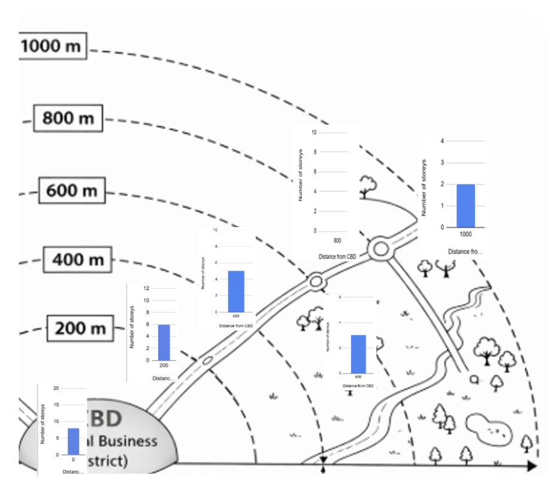

*Fig 2.2*

Name this method of data presentation.

**Q2** [1 mark]

Complete the data for 800m.

**Q2** [2 marks]

Describe the results shown in **Fig 2.2.**

**Q2** [1 mark]

Using **Fig. 2.2**, suggest a reason for the result of storey height at 800 metres?

**Q2** [2 marks]

With reference to **Fig. 2.2,** suggest one advantage and one disadvantage of **Fig. 2.2** for showing this data.

### Q3 — easy — 6 marks

**Q3** [2 marks]

When planning the field trip, students used secondary data to help them.

Give an example of secondary data that might be useful when planning this trip

**Q3** [1 mark]

The students tested the following hypotheses:

**Hypothesis 1**: Pebbles become rounder downstream

**Hypothesis 2**: Velocity increases downstream.

Which model could they use to test their hypothesis against?

**Q3** [1 mark]

Which sampling strategy is most appropriate for testing these hypotheses?

**Q3** [2 marks]

Outline **one **risk students should be aware of when conducting fieldwork at a river and how it can be reduced.

### Q4 — easy — 21 marks

**Q4** [2 marks]

To investigate Hypothesis 1: Pebbles become more rounded downstream, the students used the Power Roundness Index shown in Fig 1.1

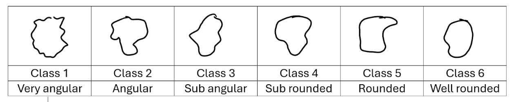

*Fig 1.1*

Describe how this chart is used to measure the roundness of pebbles.

**Q4** [1 mark]

Suggest why this could lead to inaccurate results.

**Q4** [1 mark]

Suggest **one **way students could make the results more accurate.

**Q4** [1 mark]

Which of the following methods would be appropriate for showing pebble roundness data?

**Q4** [2 marks]

Students investigated **hypothesis 2**: Velocity increases downstream.

Describe how they would use a cork and a stopwatch to measure velocity at each site.

**Q4** [1 mark]

The results of the students’ measurements are shown below in Fig 1.2. The graph shows velocity against distance downstream.

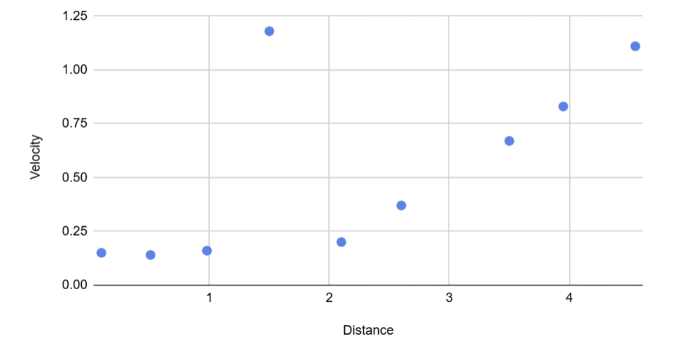

*Fig 1.2*

Name this type of graph

**Q4** [1 mark]

Add a plot for the following result: velocity 0.5 and distance 3

**Q4** [1 mark]

Add a line of best fit.

**Q4** [1 mark]

Identify the anomalous result.

**Q4** [1 mark]

Suggest one way the graph could be improved

**Q4** [3 marks]

The students concluded that the hypothesis ‘velocity increases downstream’ was true.

Using **Figure 1.2 **explain their results

**Q4** [1 mark]

State** one** other river characteristic that the students could investigate.

**Q4** [2 marks]

Describe a method they could use to carry out this investigation.

**Q4** [3 marks]

Suggest their hypothesis for this characteristic and explain the reasons they would make this prediction

### Q5 — medium — 30 marks

**Q5** [4 marks]

Students in Italy were studying population migration. They decided to do a fieldwork investigation about migration into their country.

Before they began their fieldwork they revised key terms to do with migration.

(i)

Match the types of migrant with the correct description. One has been completed for you.

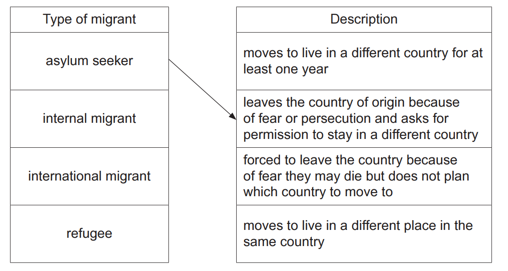

[2]

(ii)

Explain the difference between *push *and *pull *migration factors.

[2]

*Source: 2020 4 Q1A*

**Q5** [5 marks]

The students visited a local town on the coast near Rome to use a questionnaire with 40 migrants who had recently arrived in Italy. The questionnaire is shown in Fig. 1.1 (below).

(i)

They used a random sampling method to select people to complete the questionnaire. Describe this method of sampling.

[2]

(ii)

Suggest **three **difficulties of using the questionnaire with migrants.

[3]

*Source: 2020 4 Q1B*

**Q5** [6 marks]

The students wanted to test the following hypotheses:

**Hypothesis 1: ***Most migrants come from Africa.*

**Hypothesis 2:** *Pull factors affect the decision to migrate more than push factors.*

The answers to Question 1 in the questionnaire (*In which country were you born and brought up?*) are shown in Table 1.1 (below).

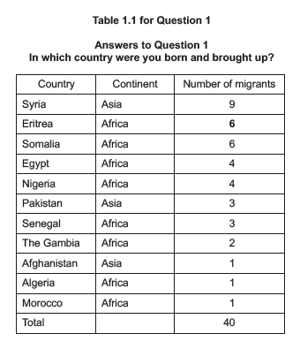

(i)

Use the results to **draw the bar** for Eritrea in Fig. 1.2 below.

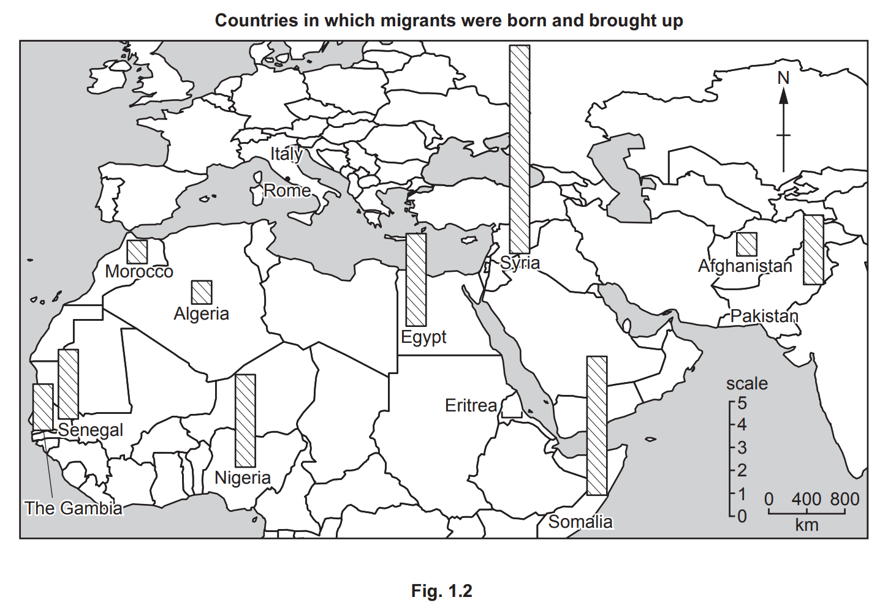

[1]

(ii)

What conclusion would the students make about **Hypothesis 1**: *Most migrants come from Africa?* Support your answer with evidence from Fig. 1.2 and Table 1.1.

[2]

(iii)

The students compared their results to Question 1 with secondary data collected five years earlier. What is meant by *secondary data*?

[1]

(iv)

The earlier results are shown in Table 1.2 (below). Identify **two **differences between the results in the different years.

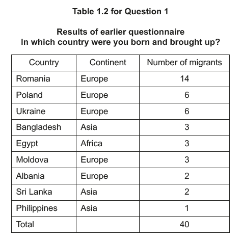

[2]

*Source: 2020 4 Q1C*

**Q5** [6 marks]

**Extract:**

(ii)

Explain the difference between *push *and *pull *migration factors.

The students wanted to test the following hypotheses:

**Hypothesis 1: ***Most migrants come from Africa.*

**Hypothesis 2:** *Pull factors affect the decision to migrate more than push factors.*

(i)

Table 1.3 (below) shows the results of Question 2 in the questionnaire (*Which one is the most important reason why you migrated to Italy?*).

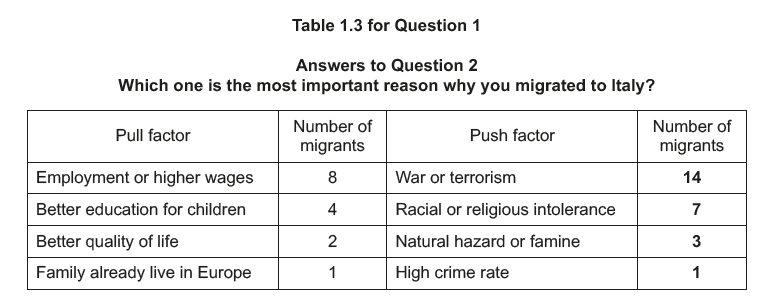

Use the results from Table 1.3 to **draw and label the divided bar graph** for the push factors in Fig. 1.3 below.

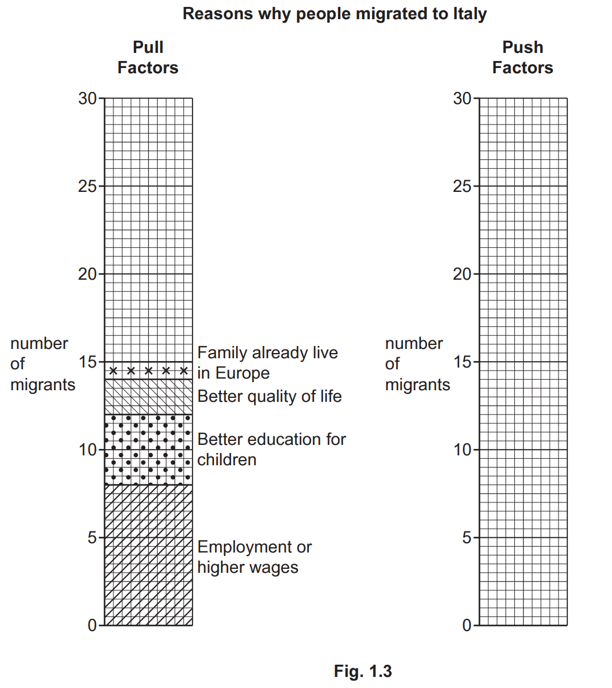

[3]

(ii)

Do you agree with **Hypothesis 2:** *Pull factors affect the decision to migrate more than push factors?* Use evidence from Fig. 1.3 and Table 1.3 to support your decision.

[3]

*Source: 2020 4 Q1D*

**Q5** [5 marks]

**Extract:**

The answers to Question 1 in the questionnaire (In which country were you born and brought up?) are shown in Table 1.1 (below).

(i)

Use the results to draw the bar for Eritrea in Fig. 1.2 below.

(i)

The results of Question 3 in the questionnaire (*Which country is your final intended destination?*) are shown in Table 1.4 (below).

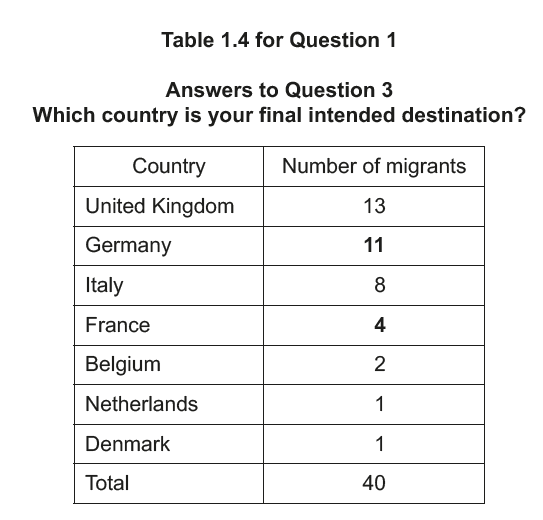

Use the results to **plot the data** for Germany and France in Fig. 1.4 below.

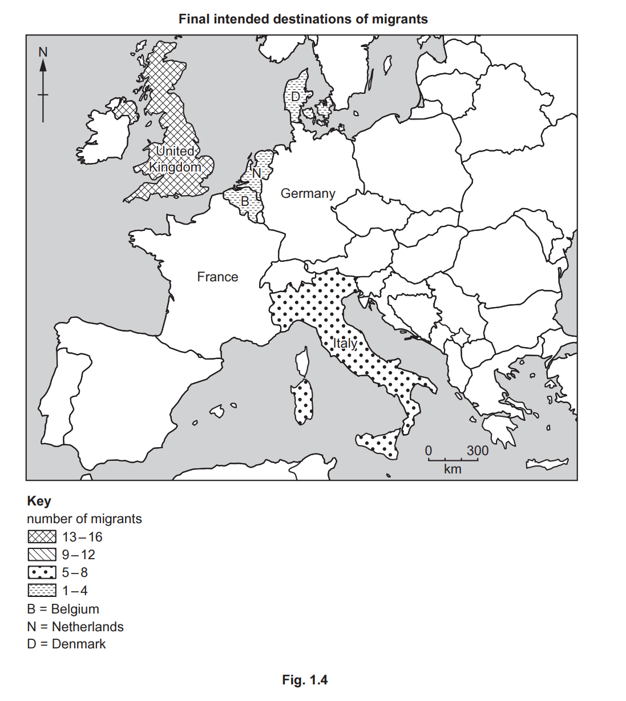

[2]

(ii)

The answers to Question 3 suggest that migration is done in stages. Put the following countries in the correct order in the boxes below to show the stages of a typical migration.

- Italy
- Somalia (shown in Fig. 1.2)
- United Kingdom

[1]

(iii)

Suggest why migration takes place in stages.

[2]

*Source: 2020 4 Q1E*

**Q5** [4 marks]

Give **two **advantages and **two **disadvantages of **immigration **for an MEDC such as Italy.

Advantages

1 ...................................

2 ...................................

Disadvantages

1 ...................................

2 ...................................

[4]

*Source: 2020 4 Q1F*

### Q6 — medium — 17 marks

**Q6** [5 marks]

Students were doing fieldwork in their local town centre. They wanted to find out how the main shopping street had changed and what people who came to shop in the town centre thought about shopping here. They tested the following hypotheses:

**Hypothesis 1: **Shops and services on the main shopping street have changed between 1981 and 2012.

**Hypothesis 2:** Most people in the local area have positive opinions about shopping in the town centre.

First the students completed a land use map along the main shopping street. This map is shown in Fig. 2.1 below.

(i)

Which **one** of the following shops or services occupies building **X** on Fig. 2.1? Tick your choice.

|   | Tick (✓) |
|---|---|
| bookshop |   |
| clothes and shoe shop |   |
| grocery store |   |
| solicitor |   |
| supermarket |   |

[1]

(ii)

On Fig. 2.1, use the key to show a bank at building **Y**.

[1]

(iii)

What type of shop or service is located 58 metres north of the church?

[1]

(iv)

Describe the distribution of houses shown on Fig. 2.1.

[1]

(v)

Identify **one** difference between the distribution of food and specialist non-food shops shown on Fig. 2.1.

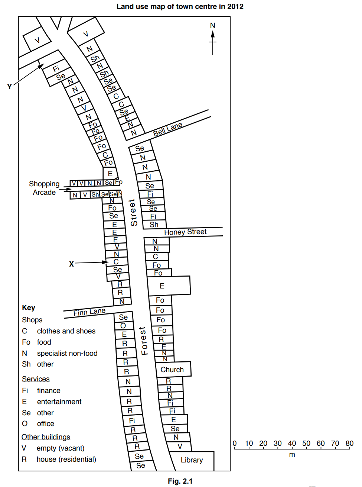

[1]

*Source: Speimen  Paper 2020 0460/04 Q2A*

**Q6** [7 marks]

**Extract:**

Students were doing fieldwork in their local town centre. They wanted to find out how the main shopping street had changed and what people who came to shop in the town centre thought about shopping here. They tested the following hypotheses:

Hypothesis 1: Shops and services on the main shopping street have changed between 1981 and 2012.

Hypothesis 2: Most people in the local area have positive opinions about shopping in the town centre.

To compare the different shops and services in 1981 and 2012 the students produced Table 2.1 below.

**Table 2.1**

**Number of shops, services and other buildings located on the main shopping street**

| **Category** | **1981** | **2012** |
|---|---|---|
| **Shops** |   |   |
| Clothes and shoes | 8 | 5 |
| Food | 20 | 13 |
| Specialist non-food (including bookshop, wool shop, chemist, mobile or cell phones, gift shop) | 29 | 26 |
| Other shops | 3 | 4 |
| **Services** |   |   |
| Finance (including banks) | 9 | 7 |
| Entertainment (including restaurant, café, bar) | 5 | 9 |
| Other services (including doctor’s surgery, estate agent, optician, shoe repairs, solicitor) | 17 | 17 |
| Office | 2 | 1 |
| **Other buildings** |   |   |
| Empty (vacant) building | 4 | 9 |
| House (residential) | 12 | 14 |
| **Total** | **109** | **105** |

(i)

The students obtained the data for 1981 from an old map of the area. Which one of the following is the correct description of this old map? Tick (✓) your choice.

|   | Tick (✓) |
|---|---|
| primary source of data |   |
| secondary source of data |   |
| tertiary source of data |   |

[1]

(ii)

The students used Table 2.1 to draw the graph, Fig. 2.2, below. Complete the graph to show the changes in the number of food shops and entertainment services.

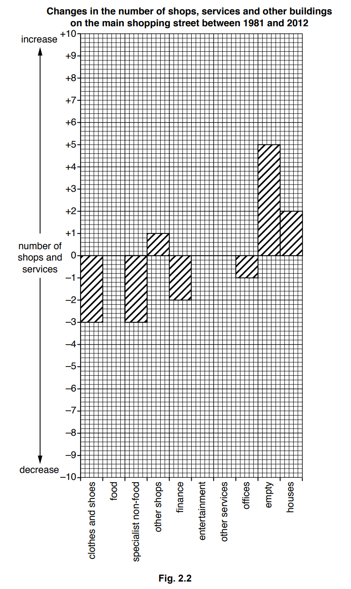

[2]

(iii)

What conclusion would the students make about **Hypothesis 1: **Shops and services on the main shopping street have changed between 1981 and 2012? Support your decision with evidence from Table 2.1 and Fig. 2.2.

[4]

*Source: Speimen  Paper 2020 0460/04 Q2B*

**Q6** [3 marks]

To investigate **Hypothesis 2:** Most people in the local area have positive opinions about shopping in the town centre, the students used a questionnaire with people on the main shopping street. The questionnaire is shown in Fig. 2.3 (below).

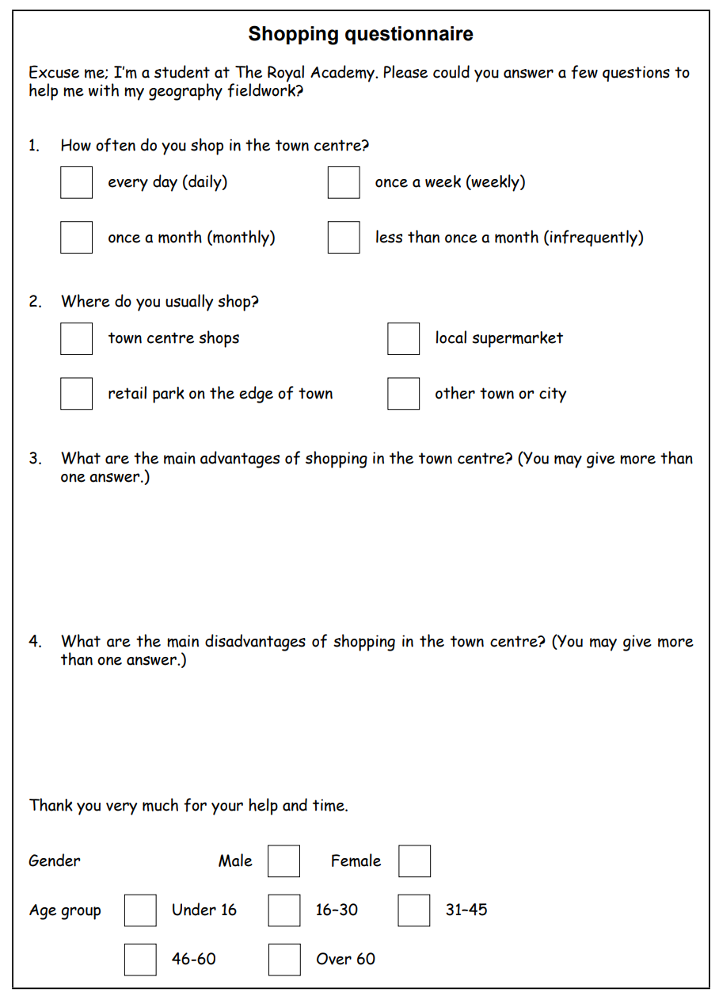

**Fig. 2.3**

(i)

The students asked people to complete their questionnaire between 10.00 hours and 12.00 hours on a working day. The results of the age group survey are shown in Table 2.2 below.

**Table 2.2**

**Ages of people surveyed**

| Age group | Number of people completing the questionnaire |
|---|---|
| under 16 | 0 |
| 16–30 | 14 |
| 31–45 | 11 |
| 46–60 | 33 |
| over 60 | 42 |

Suggest two reasons why the number of people in the different age groups varied.

[2]

(ii)

How could the students have got a more even distribution of age groups to survey?

[1]

*Source: Speimen  Paper 2020 0460/04 Q2C*

**Q6** [2 marks]

(i)

Table 2.3 below shows the results of Question 1 in the questionnaire.

**Table 2.3**

**Results of Question 1: How often do you shop in the town centre?**

| Frequency | Number of answers |
|---|---|
| Every day | 11 |
| Once a week | 52 |
| Once a month | 20 |
| Less than once a month | 17 |

Use the results from Table 2.3 and the key below to complete the pie graph, Fig. 2.4, below.

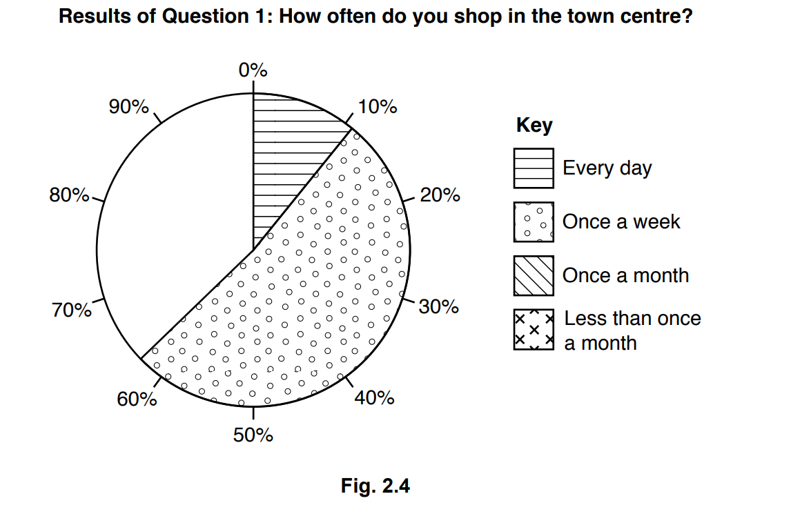

*Source: Speimen  Paper 2020 0460/04 Q2D*

### Q7 — medium — 29 marks

**Q7** [1 mark]

Students from Brazil who lived near Tijuca National Park did some fieldwork to study the tropical rainforest ecosystem. They visited three sites which are described and located in Fig. 1.1

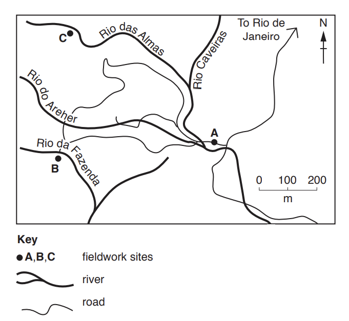

The vegetation in the tropical rainforest adapts to the climate. Use arrows to match the vegetation feature with the reason for its adaptation. One has been completed for you.

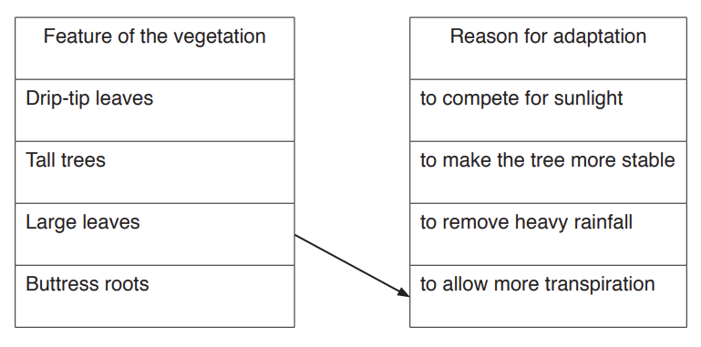

The students decided to investigate the effect of vegetation cover at the three sites. They agreed on the following hypotheses:

**Hypothesis 1**: *Humidity *is greater where there is more vegetation cover. Humidity is the amount of water vapour in the air.

**Hypothesis 2: ***Infiltration *is quicker where there is more vegetation cover.

*Source: 2019 Oct/Nov 0460/43 Q1A*

**Q7** [8 marks]

(i)

To obtain data the students made each of their measurements five times at each site. Explain why this would make their results more reliable.

[2]

(ii)

To measure the amount of vegetation cover the students used the piece of equipment shown in Fig. 1.2

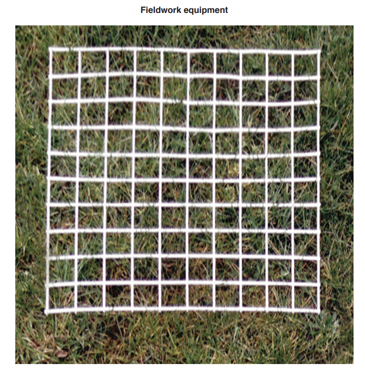

What is this piece of equipment called? Tick (✓) your answer below.

|   | Tick (✓) |
|---|---|
| barometer |   |
| callipers |   |
| clinometer |   |
| quadrat |   |
| ruler |   |

[1]

(iii)

To measure humidity the students did a simple test which a student described in his fieldwork notebook, Fig. 1.3. Suggest one weakness of this test.

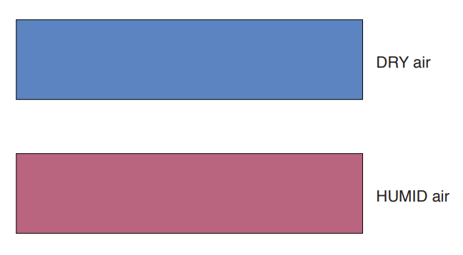

[1]

(iv)

The students also measured the time it took for water to infiltrate (soak into) the ground. Describe a fieldwork method to measure infiltration. Refer to equipment which could be used.

[4]

*Source: 2019 Oct/Nov 0460/43 Q1B*

**Q7** [4 marks]

The results of the students’ measurements are shown in Table 1.1.

**Table 1.1 for Question 1** 
**Results of students’ measurements**

| Measurement 1 | Measurement 2 | Measurement 3 | Measurement 4 | Measurement 5 | Average |
|---|---|---|---|---|---|

**Site A**

| Percentage of vegetation cover | 36 | 20 | 8 | 38 | 19 | 24.2 |
|---|---|---|---|---|---|---|
| Percentage of bare ground | 64 | 80 | 92 | 62 | 81 | 75.8 |
| Humidity measurement (seconds) | 60 | 52 | 46 | 49 | 56 | 52.6 |
| Infiltration time (seconds) | 36 | 40 | 58 | 60 | 44 | 47.6 |

**Site B**

| Percentage of vegetation cover | 65 | 48 | 68 | 28 | 12 | 44.2 |
|---|---|---|---|---|---|---|
| Percentage of bare ground | 35 | 52 | 32 | 72 | 88 | 55.8 |
| Humidity measurement (seconds) | 100 | 175 | 135 | 129 | **125** | 132.8 |
| Infiltration time (seconds) | 25 | 35 | 21 | 48 | 52 |   |

**Site C**

| Percentage of vegetation cover | 72 | 68 | **80** | 57 | 65 | 68.4 |
|---|---|---|---|---|---|---|
| Percentage of bare ground | 28 | 32 | **20** | 43 | 35 | 31.6 |
| Humidity measurement (seconds) | 96 | 90 | 103 | 115 | 84 | 97.6 |
| Infiltration time (seconds) | 20 | 28 | 25 | 22 | **30** | 25.0 |

(i)

Which site has the highest amount of vegetation cover? Circle your answer.

site A    site B    site C

[1]

(ii)

One set of measurement results is shown below.

| *Percentage of vegetation cover = 68*  *Percentage of bare ground = 32*  *Humidity measurement = 90 seconds*  *Infiltration time = 28 seconds* |
|---|

At which site and for which measurement (1–5) were these results recorded? 
Site .............. 
Measurement number ..............

[1]

(iii)

Use the results in Table 1.1 to calculate the average infiltration time at site B. Show your calculation below.

| Answer = ............................ seconds |
|---|

[2]

*Source: 2019 Oct/Nov 0460/43 Q1C*

**Q7** [10 marks]

**Extract:**

The students decided to investigate the effect of vegetation cover at the three sites. They agreed on the following hypotheses:

Hypothesis 1: Humidity is greater where there is more vegetation cover. Humidity is the amount of water vapour in the air.

Hypothesis 2: Infiltration is quicker where there is more vegetation cover.

The results of the students' measurements are shown in Table 1.1.

Table 1.1 for Question 1

Results of students' measurements

| Measurement 1 | Measurement 2 | Measurement 3 | Measurement 4 | Measurement 5 | Average |
Site A

| Percentage of vegetation cover | 36 | 20 | 8 | 38 | 19 | 24.2 |
| Percentage of bare ground | 64 | 80 | 92 | 62 | 81 | 75.8 |
| Humidity measurement (seconds) | 60 | 52 | 46 | 49 | 56 | 52.6 |
| Infiltration time (seconds) | 36 | 40 | 58 | 60 | 44 | 47.6 |
Site B

| Percentage of vegetation cover | 65 | 48 | 68 | 28 | 12 | 44.2 |
| Percentage of bare ground | 35 | 52 | 32 | 72 | 88 | 55.8 |
| Humidity measurement (seconds) | 100 | 175 | 135 | 129 | 125 | 132.8 |
| Infiltration time (seconds) | 25 | 35 | 21 | 48 | 52 |   |
Site C

| Percentage of vegetation cover | 72 | 68 | 80 | 57 | 65 | 68.4 |
| Percentage of bare ground | 28 | 32 | 20 | 43 | 35 | 31.6 |
| Humidity measurement (seconds) | 96 | 90 | 103 | 115 | 84 | 97.6 |
| Infiltration time (seconds) | 20 | 28 | 25 | 22 | 30 | 25.0 |

Using their results from Table 1.1 the students plotted the graphs shown in Fig. 1.4 below.

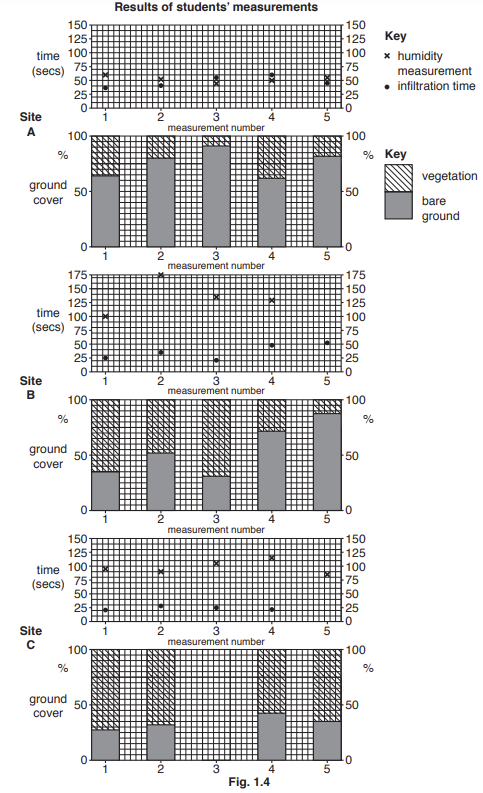

(i)

Use the information in Table 1.1 to plot the following on Fig. 1.4:

• the percentage of vegetation cover and the percentage of bare ground in measurement 3 at site C 
• how long the cobalt chloride paper took to turn pink (humidity measurement) in measurement 5 at site B 
• the infiltration time in measurement 5 at site C.

[3]

(ii) 
Before they made a conclusion to Hypothesis 1 the teacher reminded the students that the less time the paper took to turn pink the greater the humidity of the air. What conclusion would the students make about Hypothesis 1: Humidity is greater where there is more vegetation cover? Support your decision with evidence from Fig. 1.4 and Table 1.1.

[4]

(iii) 
The students decided that Hypothesis 2: Infiltration is quicker where there is more vegetation cover was correct.

What evidence from Fig. 1.4 and Table 1.1 supports their conclusion?

[3]

*Source: 2019 Oct/Nov 0460/43 Q1D*

**Q7** [3 marks]

**Extract:**

Students from Brazil who lived near Tijuca National Park did some fieldwork to study the tropical rainforest ecosystem. They visited three sites which are described and located in Fig. 1.1

Suggest why infiltration times are different at sites A and C. Look again at Fig. 1.1 to help you to answer.

**Fig. 1.1**

*Source: 2019 Oct/Nov 0460/43 Q1E*

**Q7** [3 marks]

**Extract:**

Students from Brazil who lived near Tijuca National Park did some fieldwork to study the tropical rainforest ecosystem. They visited three sites which are described and located in Fig. 1.1

fig-1-1-q1-11-0460-43-2019-163898

Whilst doing their fieldwork the students saw many different plant species in the tropical rainforest. As an extension activity, they returned to their three fieldwork sites and counted the number of different species using the reference sheet shown in Fig. 1.5. Their results are shown in Table 1.2 (below).

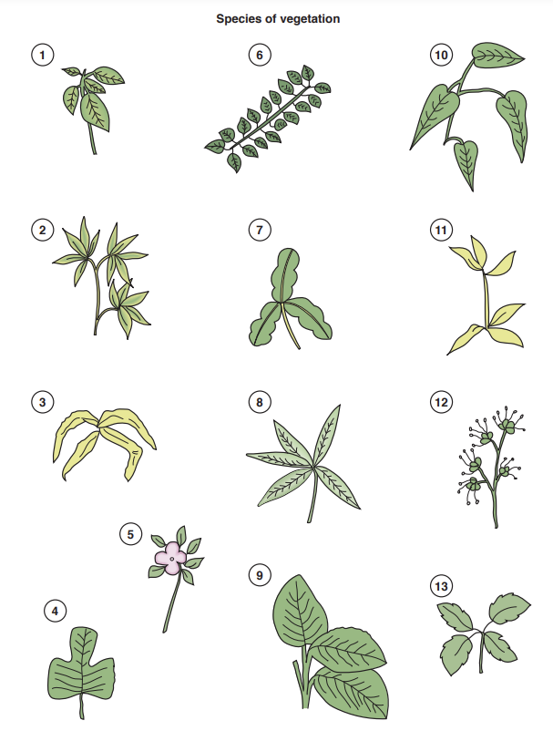

**Table 1.2 for Question 1** 
**Different species* identified by students**

| Species reference number | 1 | 2 | 3 | 4 | 5 | 6 | 7 | 8 | 9 | 10 | 11 | 12 | 13 |
|---|---|---|---|---|---|---|---|---|---|---|---|---|---|
| Site A | ✓ | ✓ |   |   |   | ✓ |   | ✓ |   | ✓ |   | ✓ |   |
| Site B | ✓ | ✓ | ✓ | ✓ | ✓ |   |   |   | ✓ |   | ✓ |   |   |
| Site C | ✓ | ✓ | ✓ | ✓ |   |   | ✓ | ✓ | ✓ |   | ✓ |   | ✓ |

*Species reference number in Fig. 1.5

**Key** ✓ species seen at the site

(i)

One student wanted to show the number of different plant species seen at each site. Which **one **of the following would be suitable to show the information in Table 1.2? Tick (✓) your choice.

|   | Tick (✓) |
|---|---|
| Bar graph |   |
| Flow diagram |   |
| Kite diagram |   |
| Radial graph |   |
| Triangular graph |   |

[1]

(ii)

Suggest two reasons why the number and types of plant species vary between the sites. Look again at Fig. 1.1 to help you  to answer

1.............................................................................................................. 
2..................................................................................................................................

[2]

*Source: 2019 Oct/Nov 0460/43 Q1F*

### Q8 — medium — 30 marks

**Q8** [13 marks]

Geography students from Bantry in south west Ireland did a weather investigation. They wanted to see if there was a link between atmospheric pressure and rainfall, and a link between wind direction and temperature.

The students agreed to investigate the following hypotheses:

**Hypothesis 1:** Rainfall increases when atmospheric pressure rises.

**Hypothesis 2:** Temperature is affected by the direction from which the wind is blowing.

(i)

The students used a computerised weather station to obtain data every three hours over a period of three days. Give **two** advantages of using electronic recording instruments.

[2]

(ii)

Their teacher instructed the students to make some measurements using traditional instruments so they would understand how to use them.

Use arrows to match the weather feature with the correct measuring instrument in the table below. One has been completed for you.

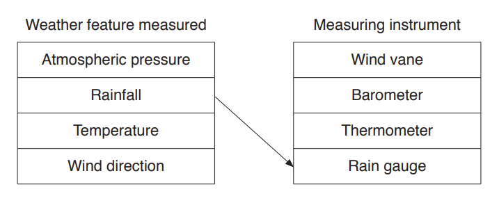

[2]

(iii)

In the box below draw and label a traditional rain gauge.

[3]

(iv)

Describe and explain a good position to put a rain gauge to make sure that the data collected will be accurate.

[4]

(v)

Fig. 2.1 (below) shows a weather instrument. How does this instrument measure wind direction?

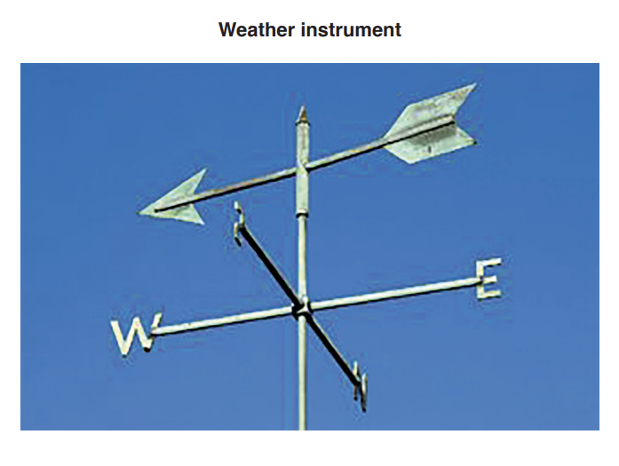

[2]

*Source: Nov 2019 0460/41 Q2A*

**Q8** [6 marks]

The students’ measurements of atmospheric pressure and rainfall are shown in Table 2.1.

**Table 2.1** 
**Atmospheric pressure and rainfall data**

|   | Time | Measurement number | Atmospheric pressure (mb) | Rainfall during last three hours (mm) |
|---|---|---|---|---|
| Day 1 | 10.00 | 1 | 1009 | 0.1 |
|   | 13.00 | 2 | 1008 | 0.5 |
|   | 16.00 | 3 | 1005 | 0.6 |
|   | 19.00 | 4 | 1003 | 0.4 |
|   | 22.00 | 5 | 1002 | 0.2 |
| Day 2 | 01:00 | 6 | 1001 | 3.6 |
|   | 04:00 | 7 | 999 | 1.0 |
|   | 07:00 | 8 | 998 | **2.8** |
|   | 10:00 | 9 | 997 | 0.8 |
|   | 13:00 | 10 | 997 | 4.6 |
|   | 16:00 | 11 | 998 | 3.9 |
|   | 19:00 | 12 | 999 | 2.0 |
|   | 22:00 | 13 | 1002 | 0.1 |
| Day 3 | 01:00 | 14 | 1003 | 0.1 |
|   | 04:00 | 15 | 1004 | 0.1 |
|   | 07:00 | 16 | 1005 | 0.1 |
|   | 10:00 | 17 | 1007 | 0.2 |
|   | 13:00 | 18 | 1010 | 0 |
|   | 16:00 | 19 | 1011 | 0 |
|   | 19:00 | 20 | 1011 | 0 |
|   | 22:00 | 21 | 1013 | 0 |
| Day 4 | 01:00 | 22 | 1016 | 0 |
|   | 04:00 | 23 | 1015 | 0 |
|   | 07:00 | 24 | 1017 | 0 |

(i)

Use data from Table 2.1 **to draw on Fig. 2.2 below the rainfall bar** for 07.00 on day 2 (measurement number 8).

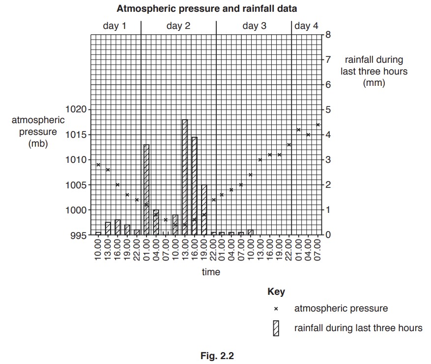

[1]

(ii)

Complete the table below to show the highest and lowest atmospheric pressure measurements recorded by the students.

| Highest atmospheric pressure (mb) | Lowest atmospheric pressure (mb) |
|---|---|
|   |   |

[1]

(iii)

Do the measurements shown in Fig. 2.2 and Table 2.1 support** Hypothesis 1: **Rainfall increases when atmospheric pressure rises?

Support your decision with data.

[4]

*Source: Nov 2019 0460/41 Q2B*

**Q8** [6 marks]

**Extract:**

**Hypothesis 2:** Temperature is affected by the direction from which the wind is blowing.

The students’ measurements of wind direction and temperature are shown in Table 2.2.

**Table 2.2 **
 **Wind direction and temperature data**

|   | Time | Measurement number | Direction wind came from | Temperature to nearest degree (°C) |
|---|---|---|---|---|
| Day 1 | 10:00 | 1 | SE | 11 |
|   | 13:00 | 2 | SE | 13 |
|   | 16:00 | 3 | SE | 11 |
|   | 19:00 | 4 | ESE | **12** |
|   | 22:00 | 5 | ESE | **10** |
| Day 2 | 01:00 | 6 | SSE | 9 |
|   | 04:00 | 7 | S | 10 |
|   | 07:00 | 8 | S | 9 |
|   | 10:00 | 9 | SSE | 10 |
|   | 13.00 | 10 | SSE | 12 |
|   | 16:00 | 11 | NNW | 10 |
|   | 19:00 | 12 | NNW | 9 |
|   | 22:00 | 13 | NW | 7 |
| Day 3 | 01:00 | 14 | NNW | 7 |
|   | 04:00 | 15 | NNW | 6 |
|   | 07:00 | 16 | N | 5 |
|   | 10:00 | 17 | N | 7 |
|   | 13:00 | 18 | NNW | 9 |
|   | 16:00 | 19 | NNW | 8 |
|   | 19:00 | 20 | NNW | 7 |
|   | 22:00 | 21 | N | 4 |
| Day 4 | 01:00 | 22 | N | 4 |
|   | 04:00 | 23 | N | 3 |
|   | 07:00 | 24 | N | 3 |

(i)

Use data from Table 2.2 **to plot on Fig. 2.3 below the temperatures** when the wind came from the east south east (ESE) direction.

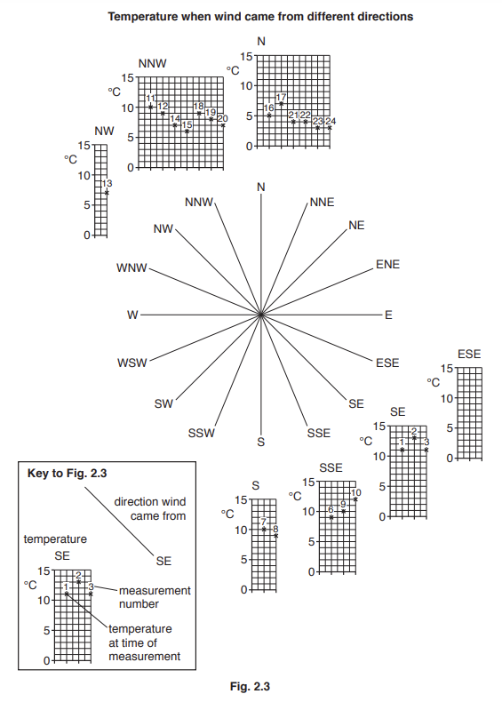

[2]

(ii)

From which direction did the wind blow most frequently?

[1]

(iii)

The students made the conclusion that **Hypothesis 2:** Temperature is affected by the direction from which the wind is blowing is true. Support this conclusion with data from Fig. 2.3 and Table 2.2.

[3]

*Source: Nov 2019 0460/41 Q2C*

**Q8** [5 marks]

**Extract:**

Geography students from Bantry in south west Ireland did a weather investigation. They wanted to see if there was a link between atmospheric pressure and rainfall, and a link between wind direction and temperature.

The students agreed to investigate the following hypotheses:

Hypothesis 1: Rainfall increases when atmospheric pressure rises.

Hypothesis 2: Temperature is affected by the direction from which the wind is blowing.

The students used a computerised weather station to obtain data every three hours over a period of three days.

Give **one** other weather element which the students could have measured to extend their fieldwork. (Do **not** write about temperature, rainfall, atmospheric pressure or wind direction.)

(i)

Weather element

[1]

(ii)

Describe how the students could collect data about the weather element named in **(i)** above.

[4]

*Source: Nov 2019 0460/41 Q2D*

### Q9 — medium — 30 marks

**Q9** [1 mark]

A class of students did fieldwork in their town. They wanted to find out where the boundary of the CBD was located. They had learned in class that this is known as ‘delimiting’ the CBD. They discussed with their teacher several fieldwork methods they could use to delimit the CBD. One group of students also investigated the quality of shops in and around the CBD.

What does CBD stand for? 
C ....................... B ....................... D .......................

The students decided to test the following hypotheses.

**Hypothesis 1: ***Different methods of delimiting the CBD produce the same result.*

**Hypothesis 2:** *The shopping environment in and around the CBD varies.*

*Source: Nov 2019 0460/42 Q1A*

**Q9** [9 marks]

**Extract:**

A class of students did fieldwork in their town. They wanted to find out where the boundary of the CBD was located. They had learned in class that this is known as 'delimiting' the CBD.

The students decided to test the following hypotheses.

Hypothesis 1: Different methods of delimiting the CBD produce the same result.

The students used the following methods to test **Hypothesis 1:** 
• pedestrian counts 
• survey of building heights 
• survey of traffic restrictions (controls)

(i)

The students did pedestrian counts at 30 sites around the town centre. In the space below, draw a recording sheet the students could have used at each site.

[3]

(ii)

Describe an appropriate method to ensure the students obtained reliable results from the pedestrian count.

[4]

The results of the pedestrian count are shown in Fig. 1.1 below. Isolines have been drawn on the map to show the variation in the number of pedestrians.

(iii)

On Fig. 1.1, **complete the isoline** that shows 200 pedestrians.

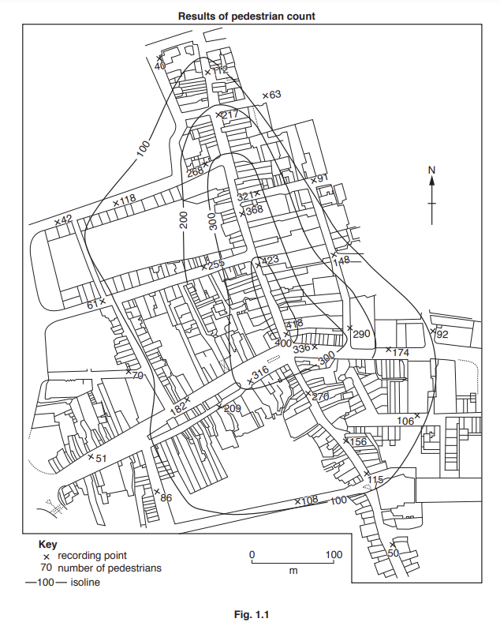

[2]

*Source: Nov 2019 0460/42 Q1B*

**Q9** [2 marks]

To collect data about the height of buildings the students selected five buildings at each of the pedestrian count sites. They then counted the number of storeys of each building and calculated an average. Give **one** advantage and **one** disadvantage of this method of working out the height of buildings.

Advantage ................................................................... Disadvantage ...................................................................

*Source: Nov 2019 0460/42 Q1C*

**Q9** [3 marks]

**Extract:**

A class of students did fieldwork in their town. They wanted to find out where the boundary of the CBD was located. They had learned in class that this is known as 'delimiting' the CBD. They discussed with their teacher several fieldwork methods they could use to delimit the CBD.

The students used the following methods to test Hypothesis 1:
• pedestrian counts
• survey of building heights
• survey of traffic restrictions (controls)

The students marked on a map of the town two examples of traffic restrictions (controls) which they saw. These were a pedestrianised area and an area where there was restricted vehicle access. Give **three** other examples of traffic restrictions they could have recorded.

1 .....................................................

2 .....................................................

3 .....................................................

*Source: Nov 2019 0460/42 Q1D*

**Q9** [2 marks]

Having completed their data collection for **Hypothesis 1 **the students decided to use the following criteria to delimit the area of the CBD:    
• more than 300 pedestrians    
• buildings which are 3 or more storeys high    
• any traffic restrictions

Using these criteria, the students located possible boundaries of the CBD. These are shown on Fig. 1.2.

** Fig. 1.2.**

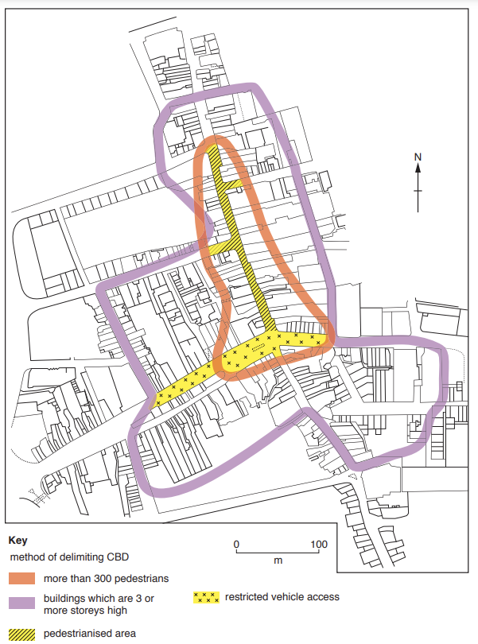

The students decided that** Hypothesis 1**: *Different methods of delimiting the CBD produce the same result, *was false. Give **two** pieces of evidence from Fig. 1.2 to support this decision.

*Source: Nov 2019 0460/42 Q1E*

**Q9** [3 marks]

Another group of students chose a different fieldwork method to delimit the CBD. They drew a land use map of the town centre and using this map they decided where the boundary of the CBD was. Describe how they would carry out these tasks.

*Source: Nov 2019 0460/42 Q1F*

**Q9** [7 marks]

**Extract:**

A class of students did fieldwork in their town. They wanted to find out where the boundary of the CBD was located. They had learned in class that this is known as 'delimiting' the CBD. They discussed with their teacher several fieldwork methods they could use to delimit the CBD. One group of students also investigated the quality of shops in and around the CBD.

The students decided to test the following hypotheses.

Hypothesis 1: Different methods of delimiting the CBD produce the same result.

Hypothesis 2: The shopping environment in and around the CBD varies.

To investigate **Hypothesis 2:** *The shopping environment in and around the CBD varies,* the students did a survey using the shopping environment index shown in Fig. 1.3.

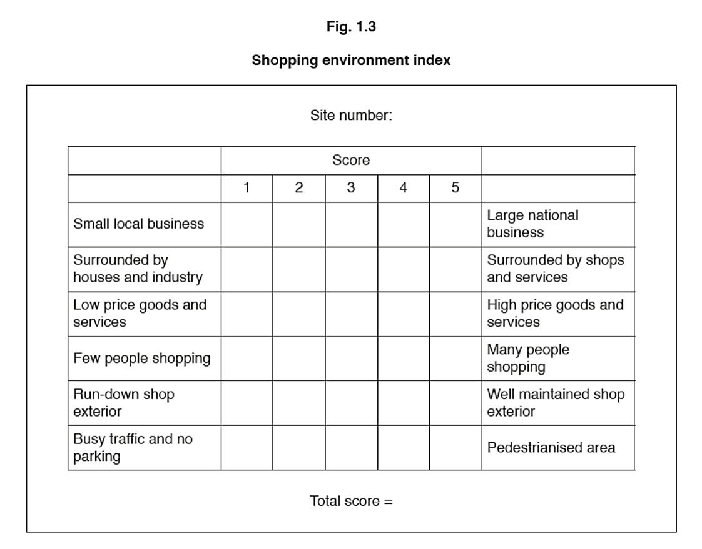

(i)

The results of the survey are shown in Table 1.1.

**Table 1.1 **
**Results of shopping environment survey**

| Site number | Total index score (maximum score = 30) |
|---|---|
| 1 | 14 |
| 2 | 13 |
| 3 | 17 |
| 4 | 19 |
| 5 | 20 |
| 6 | 24 |
| 7 | 25 |
| 8 | 30 |
| 9 | 28 |
| 10 | 21 |
| 11 | 19 |
| 12 | 17 |

**Draw the bar **to show the shopping index score at site 12 in Fig. 1.4 below.

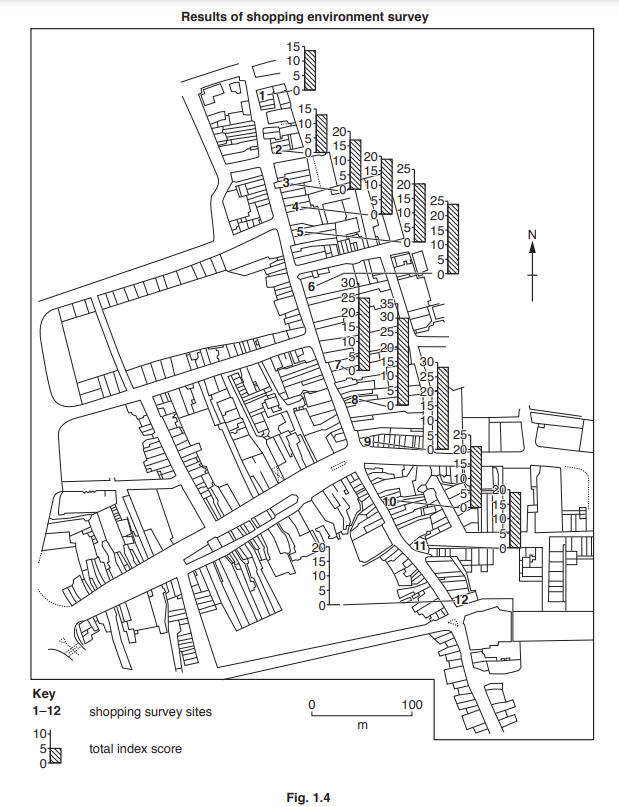

[1]

(ii)

What conclusion would the students make about** Hypothesis 2: ***The shopping environment in and around the CBD varies?* Support your decision with evidence from Fig. 1.4 and Table 1.1.

[4]

(iii)

Suggest two ways that the students could have improved the reliability of their shopping environment survey.

[2]

*Source: Nov 2019 0460/42 Q1G*

**Q9** [3 marks]

After they completed their fieldwork the students discussed with their teacher how the CBD of a town changes over time. Suggest three ways that a CBD might change.

*Source: Nov 2019 0460/42 Q1H*

### Q10 — medium — 30 marks

**Q10** [2 marks]

Students in Portugal went to six sites along a local river to do a fieldwork investigation on changes in the river channel downstream. The river which they studied flows 13km from the Sintra Hills to the Atlantic Ocean.

From the alternatives below choose the correct terms to complete the following sentences.

confluence               mouth            source        tributary          valley

• A river begins at its ..............................

• A river enters the sea at its ..............................

*Source: Speimen  Paper 2020 0460/04 Q1A*

**Q10** [14 marks]

The students investigated the following hypotheses: **Hypothesis 1:** *The area of the cross section of the river channel increases downstream.* **Hypothesis 2:** *Average velocity of river flow increases downstream.*

The students selected six sites along the river approximately 2 kilometres apart to do their fieldwork.

(i)

In pairs they measured the width of the river channel at each site using a tape measure. 
Suggest two things the students could have done to make sure that their results were reliable.

[2]

(ii)

The results of their measurements at each site are shown in **Table 1.1.**

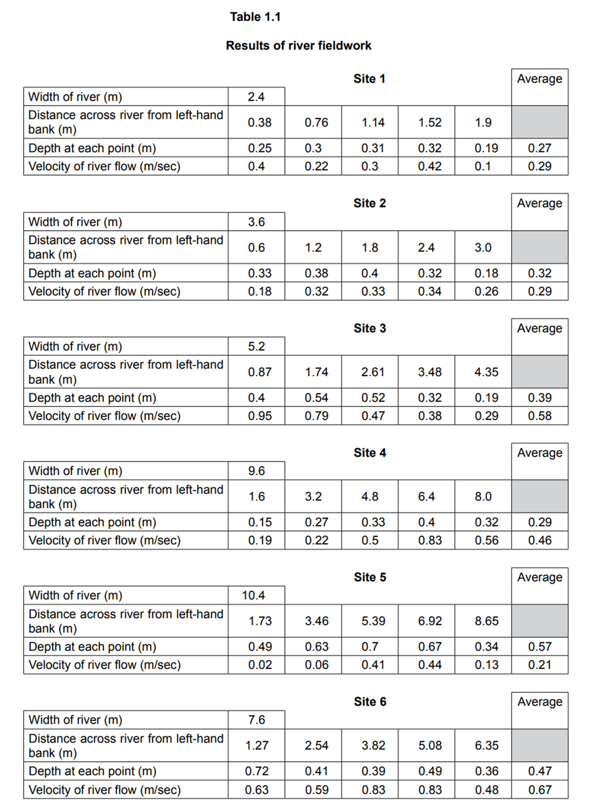

Plot the result for **site 6 on Fig. 1.1**, which shows how the width of the river channel varies downstream.

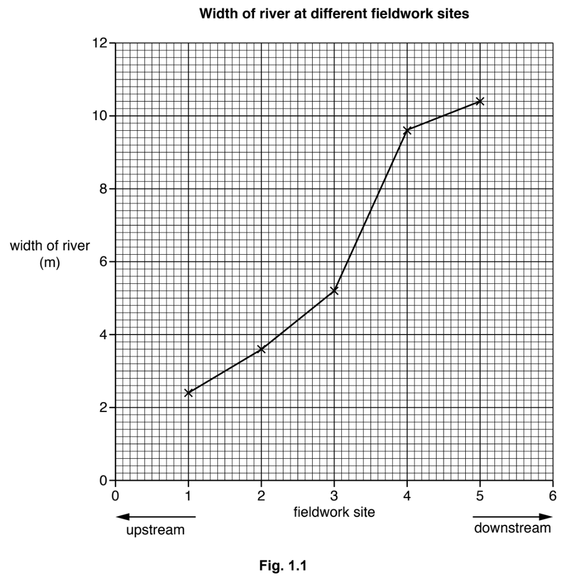

[1]

(iii)

Next, they measured the depth of the river. Draw an **annotated** diagram to explain how they would do this.

[4]

(iv)

At each site the students measured the depth at five points across the channel. The results of their measurements at each site are shown in **Table 1.1 **(above).

The students drew cross sections of the channel at each site. These are shown in **Fig. 1.2.**

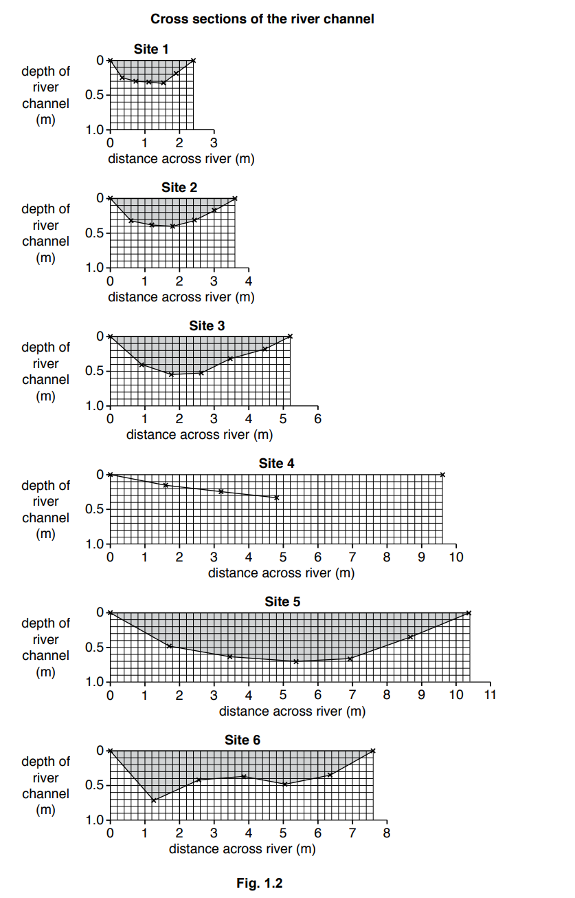

Use the information in **Table 1.1** to complete the cross section and shade in the river channel at **site 4**.

[3]

(v)

The method used to calculate the area of the cross section at each site is shown below.

Insert the correct figures from Table 1.1 in the calculation for site 1 below.

| Calculation of the area of the cross section at site 1  Area of the cross section = width of river (metres) × average depth of river (metres)  = ....................................................................................  = 0.65 sq. metres |
|---|

[1]

(vi)

The results of the students’ calculations of the area of the cross sections are shown in Table 1.2 (below). To what extent do the results support **Hypothesis 1: **T*he area of the cross section of the river channel increases downstream?*

**Circle** your decision below and **support **your decision with evidence from Table 1.2 **and** Fig. 1.2.

completely                    partially                 not at all

**Table 1.2**

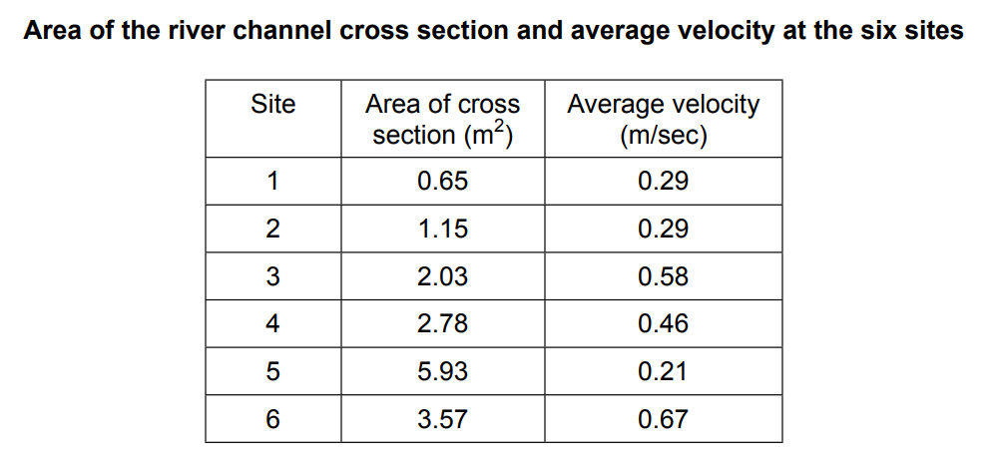

[3]

*Source: Speimen  Paper 2020 0460/04 Q1B*

**Q10** [8 marks]

(i)

To investigate **Hypothesis 2:***** ****Average velocity of river flow increases downstream*, the students measured the velocity at each site using the equipment shown in Fig. 1.3 (below).

Describe how they measured velocity.

**Fig. 1.3**

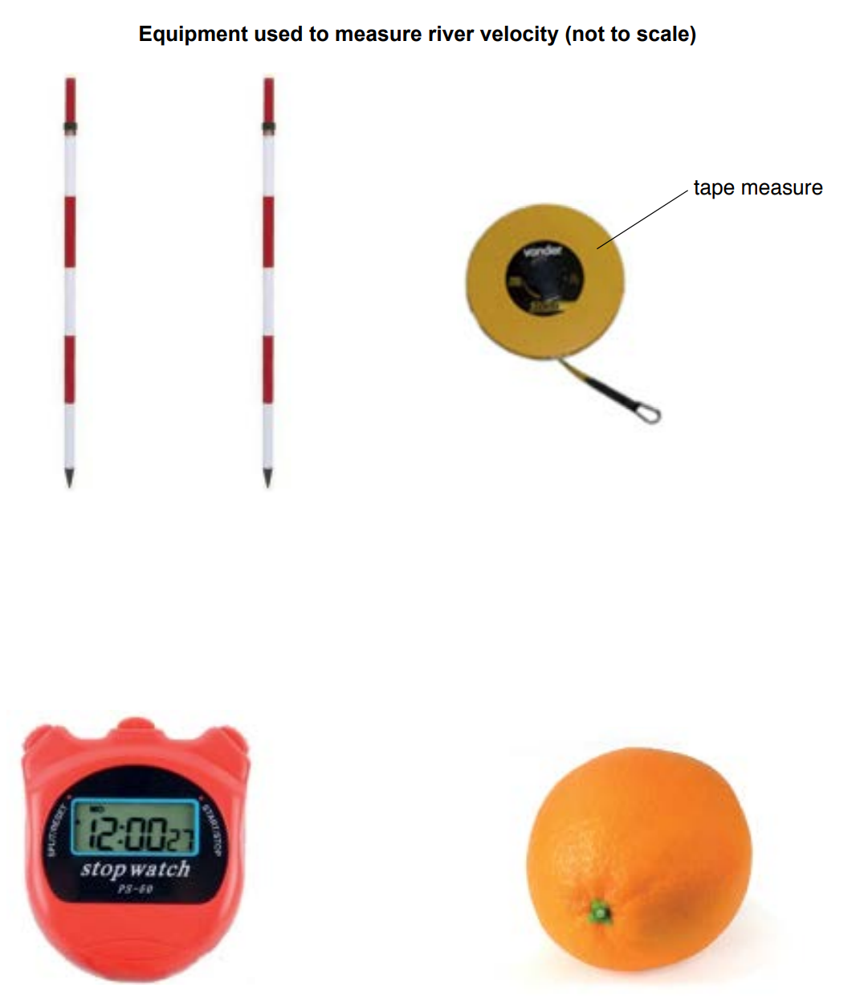

[4]

(ii)

The students calculated the average velocity of flow at each site. Their results are shown in Table 1.2 (below).

**Table 1.2**

**Plot **the result for **site 6** on Fig. 1.4 below.

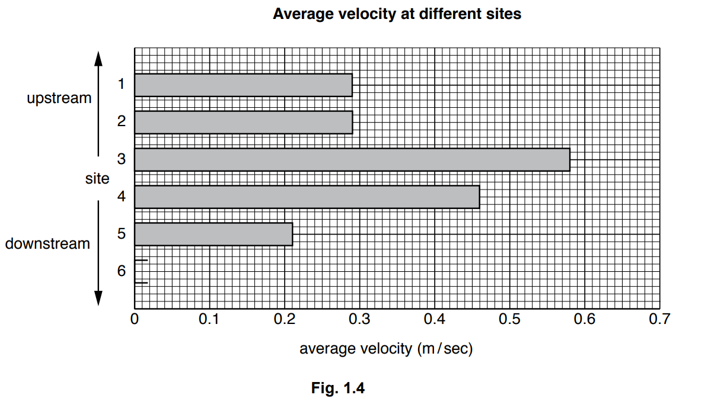

[1]

(iii)

The students’ conclusion was that their results did not support **Hypothesis 2:*** Average velocity of flow increases downstream*. Use evidence from Table 1.2 and Fig. 1.4 to explain why they reached this conclusion.

[3]

*Source: Speimen  Paper 2020 0460/04 Q1C*

**Q10** [6 marks]

(i)

One student wondered if there was any relationship (correlation) between the area of the river channel cross section and average velocity at the six sites. These results are shown in Table 1.2 (below).

**Table 1.2**

The student plotted these results on a scatter graph, Fig. 1.5 below.
Use the data in Table 1.2 to plot the results of site 6 on Fig. 1.5 below.

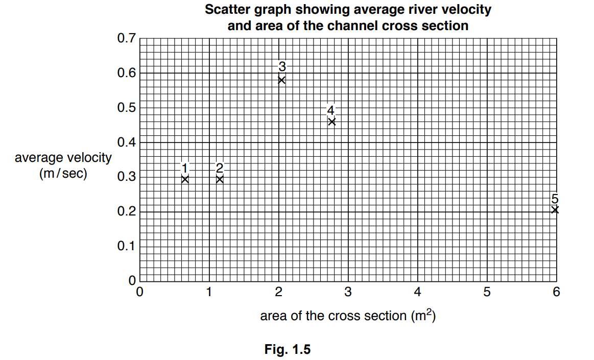

[1]

(ii)

The student decided that there was a partial relationship (correlation) between the area of the river channel cross section and average velocity. Support this decision with evidence from Table 1.2 and Fig. 1.5.

[3]

(iii)

Explain why the area of the river channel cross section may affect average velocity.

[2]

*Source: Speimen  Paper 2020 0460/04 Q1D*

### Q11 — medium — 3 marks

**Q11** [3 marks]

A class of students from a rural area of Wales was studying settlement and service provision.

(i)

In class the students revised ‘hierarchy of services’. Services can be classified as high-order, middle-order and low order.

Table 2.1 below shows examples of different services in the hierarchy of services.

Complete the table by adding the following services:                                bus stop             fire station          airport

**Table 2.1**

| high-order service | middle-order service | low-order service |
|---|---|---|
| hospital | health centre | café |
|   |   |   |

[2]

(ii)

Which one of the following is the correct definition of ‘low-order service’? Tick (✓) your answer.

|   | Tick (✓) |
|---|---|
| a service which is frequently used |   |
| a service which is occasionally used |   |
| a service which is rarely used |   |

[1]

*Source: Nov 2020 0460/42 Q2A*

### Q12 — medium — 30 marks

**Q12** [7 marks]

Students were doing fieldwork along a river near to their school. They chose seven sites to investigate how the river changes downstream.

The students investigated the following hypotheses:

**Hypothesis 1:** *The velocity becomes faster as distance downstream increases.*

**Hypothesis 2: ***The angle of slope of the river bed becomes less steep as distance downstream increases.*

The students used two different methods to measure velocity. In method 1 they used a floating object and in method 2 they used a velocity meter (flowmeter). Fig. 2.1 (Insert) shows their teacher demonstrating how to use a velocity meter.

Describe the two methods the students used to measure velocity.

(i)

Method 1: using a floating object

[4]

(ii)

Method 2: using a velocity meter (flowmeter)

[3]

*Source: Mar 2021 0460/42 Q2A*

**Q12** [8 marks]

**Extract:**

Students were doing fieldwork along a river near to their school. They chose seven sites to investigate how the river changes downstream.

The students investigated the following hypotheses:

Hypothesis 1: The velocity becomes faster as distance downstream increases.

Hypothesis 2: The angle of slope of the river bed becomes less steep as distance downstream increases.

The students used two different methods to measure velocity. In method 1 they used a floating object and in method 2 they used a velocity meter (flowmeter).

The results of the two methods of measuring velocity are shown in Table 2.1 (Insert)..

(i)

Use these results to **plot the average velocity** measured by method 1 (using a floating object) at sites 6 and 7 in Fig. 2.2 below.

[2]

**Average velocity results obtained using the two methods**

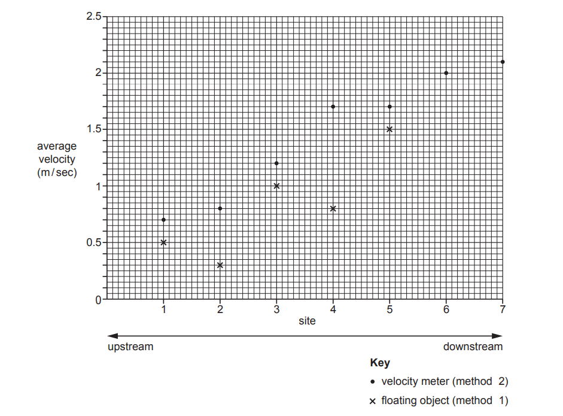

(ii)

Suggest **three** reasons why method 2 (using a velocity meter) may produce more reliable results than method 1 (using a floating object).

[3]

(iii)

What conclusion would the students make about **Hypothesis 1**: The velocity becomes faster as distance downstream increases? Support the conclusion with data evidence from **method 2 **only (using a velocity meter) in Fig. 2.2 and Table 2.1.

[3]

*Source: Mar 2021 0460/42 Q2B*

**Q12** [9 marks]

To test **Hypothesis 2**: The angle of slope of the river bed becomes less steep as *distance downstream increases, t*he students measured the angle of slope of the river bed at the seven fieldwork sites.

(i)

Describe how they would use the equipment shown in Fig. 2.3 (Insert) to measure the angle of slope.

[4]

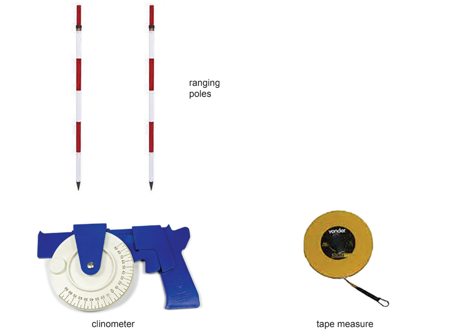

(ii)

The students measured the angle of slope four times at each site. The results of their measurements are shown in Table 2.2 (Insert).

At which site is there the largest variation in measurements? 
Site ..........

[1]

(iii)

Fig. 2.4 below shows a method chosen by one student to present the results in Table 2.2. 
Use this method to show the average angle of slope at site 5 on Fig. 2.4.

**Average angle of slope (gradient) at each fieldwork site**

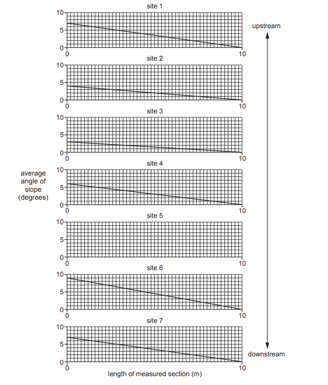

[1]

**Fig. 2.4**

(iv)

What conclusion would the students make about **Hypothesis 2:** The angle of slope of the river bed becomes less steep as distance downstream increases? Support your answer with data from Fig. 2.4 and Table 2.2.

[3]

*Source: March 2021 0460/42 Q2C*

**Q12** [2 marks]

**Extract:**

Students were doing fieldwork along a river near to their school. They chose seven sites to investigate how the river changes downstream.

The students investigated the following hypotheses:

**Hypothesis 1:** *The velocity becomes faster as distance downstream increases.*

**Hypothesis 2: ***The angle of slope of the river bed becomes less steep as distance downstream increases.*

The students compared their average velocity results (using a velocity meter) and angle of slope measurements made at the seven sites by plotting them on a scatter graph. This is shown in Fig. 2.5 below.

**Scatter graph**

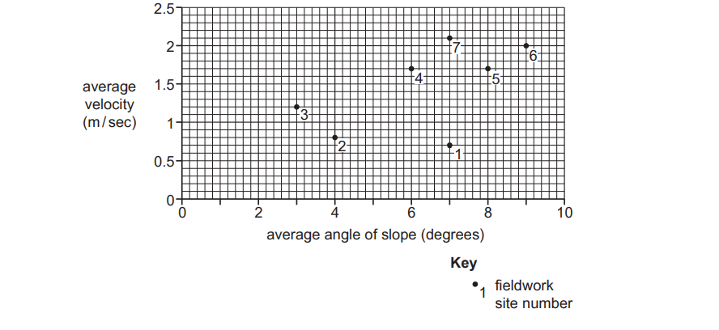

**Fig. 2.5**

What conclusions can be made about the relationship between the angle of slope and average velocity shown in Fig. 2.5? Do** not** use data in your answer.

*Source: March 2021 0460/42 Q2D*

**Q12** [4 marks]

**Extract:**

Students were doing fieldwork along a river near to their school. They chose seven sites to investigate how the river changes downstream.

Channel width also varies downstream. Describe a fieldwork method the students could use to investigate the hypothesis: *The river channel becomes wider downstream.*

*Source: March 2021 0460/42 Q2E*

### Q13 — medium — 30 marks

**Q13** [6 marks]

A class of students investigated a local high technology industrial area. They wanted to find out about the companies located there.

The high technology industrial area is shown in Figs. 1.1 and 1.2 (below). The photograph in Fig. 1.1 shows the area in 2006 and the map in Fig. 1.2 shows it in 2016.

**Fig. 1.1**

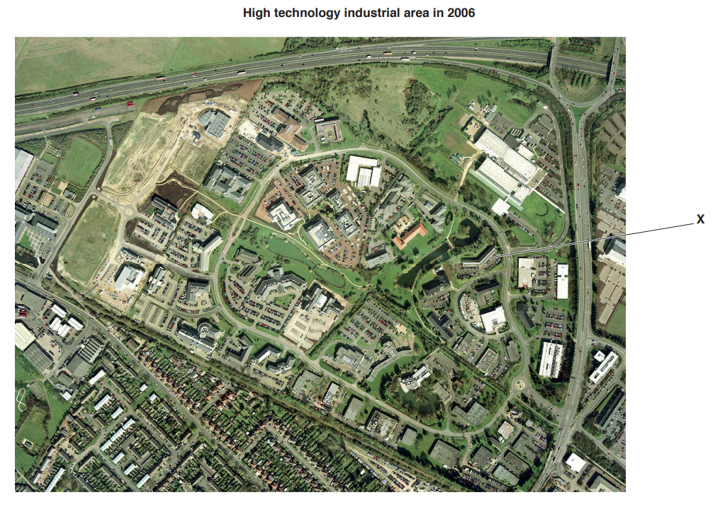

**Fig 1.2**

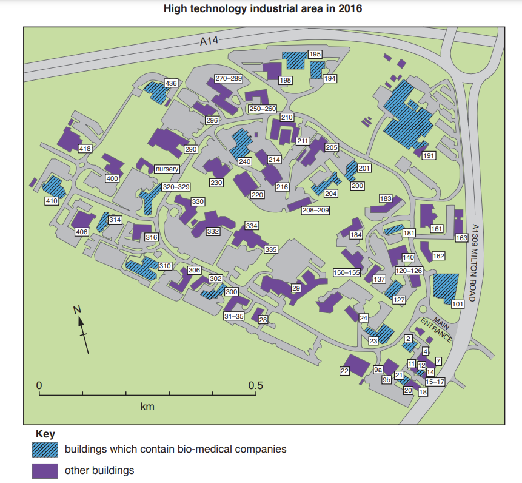

(i)

Identify **two** buildings **in different areas** which have been constructed since 2006. 
Building number ............... 
Building number ...............

[2]

(ii)

What is the number of the building labelled **X **on Fig. 1.1? 
Building number ...............

[1]

(iii)

Figs. 1.3 and 1.4 (below) are photographs which show views of this industrial area. 
Describe **three** features of the industrial area shown in Figs. 1.3 and 1.4.

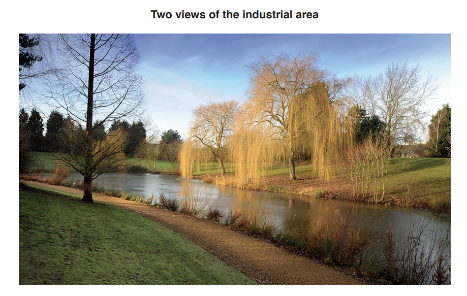

**Fig 1.3**

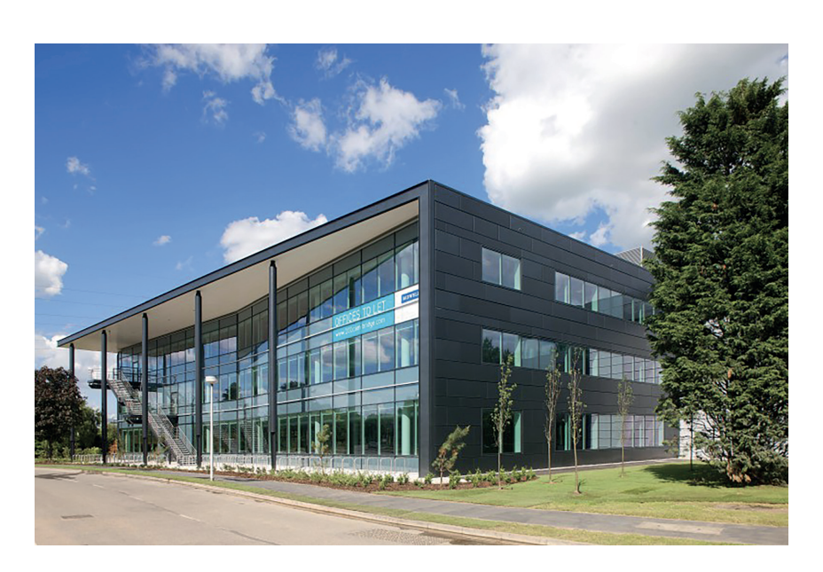

**Fig 1.4**

[3]

*Source: Nov 2019 0460/41 Q1A*

**Q13** [7 marks]

**Extract:**

A class of students investigated a local high technology industrial area. They wanted to find out about the companies located there.

The high technology industrial area is shown in Figs. 1.1 and 1.2 (below). The photograph in Fig. 1.1 shows the area in 2006 and the map in Fig. 1.2 shows it in 2016.

The students identified the following hypotheses:

**Hypothesis 1:** The sectors (types) of high technology industry in the area changed between 2006 and 2016.

**Hypothesis 2:** High technology companies employ a highly skilled workforce.

To investigate **Hypothesis 1** the students did a survey of the companies which occupied some of the buildings shown in Fig. 1.2 (below). They wanted to find out what sector of high technology industry the companies were involved in.

**Fig 1.2**

(i)

Companies involved in the bio-medical sector are shaded on Fig. 1.2. Describe the distribution of these companies.

[2]

(ii)

Explain why high technology companies are usually located near to other similar companies.

[3]

(iii)

Table 1.1 (below) shows the percentage of companies in each industrial sector.

**Table 1.1 ** 
**Companies in each industrial sector**

| High technology industries in the industrial area | Number of companies in 2016 | Percentage of total number of companies |
|---|---|---|
| Bio-medical | 21 | 31 |
| Computer / telecommunications | 17 | 25 |
| Energy | 1 | 2 |
| Environmental | 3 | 5 |
| Financial / business | 6 | 9 |
| Industrial technologies | 7 | 10 |
| Technical consulting | 5 | **8** |
| Other industries | 7 | **10** |
| Total | 67 | 100 |

Use these results **to complete Fig. 1.5 below.**

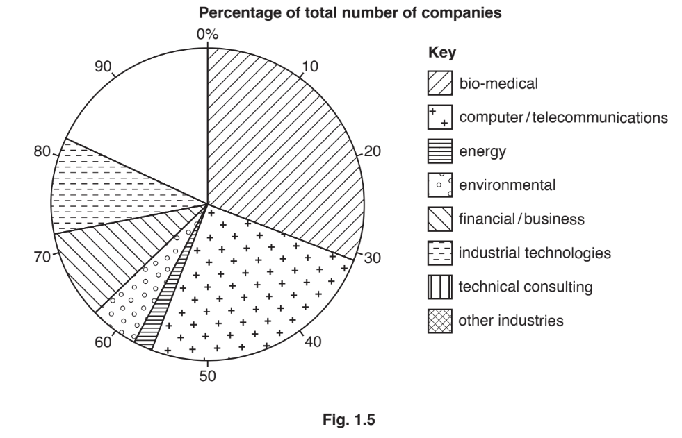

[2]

*Source: Nov 2019 0460/41 Q1B*

**Q13** [8 marks]

To test **Hypothesis 1: **The sectors (types) of high technology industry in the area changed between 2006 and 2016, the students compared the results of their survey with those of a similar survey done 10 years earlier. The results of both surveys are shown in Table 1.2.

**Table 1.2**

**Comparison of numbers of companies in each industrial sector**

| High technology industries in the industrial area | Number of companies in 2006 | Number of companies in 2016 |
|---|---|---|
| Bio-medical | 28 | 21 |
| Computer / telecommunications | 7 | 17 |
| Energy | 4 | 1 |
| Environmental | 26 | 3 |
| Financial / business | 5 | 6 |
| Industrial technologies | 7 | 7 |
| Technical consulting | 6 | 5 |
| Other industries | 10 | 7 |
| Total | 93 | 67 |

(i)

The students used the data in Table 1.2 to draw the graph, Fig. 1.6, below. **Complete the graph** to show the changes in the number of bio-medical and computer/telecommunications companies.

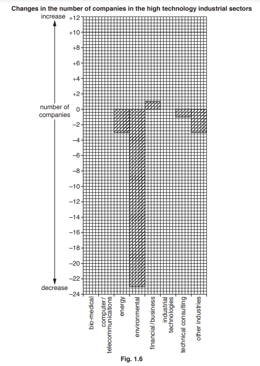

[2]

(ii)

What conclusion would the students make about **Hypothesis 1:** The sectors (types) of high technology industry in the area changed between 2006 and 2016? Support your decision with evidence from Fig. 1.6 and Table 1.2.

[4]

(iii)

Companies in the ‘other industries’ sector shown in Table 1.1 include businesses such as a nursery (childcare centre), restaurant, and health club and gym.

**Table 1.1 ** 
**Companies in each industrial sector**

| High technology industries in the industrial area | Number of companies in 2016 | Percentage of total number of companies |
|---|---|---|
| Bio-medical | 21 | 31 |
| Computer / telecommunications | 17 | 25 |
| Energy | 1 | 2 |
| Environmental | 3 | 5 |
| Financial / business | 6 | 9 |
| Industrial technologies | 7 | 10 |
| Technical consulting | 5 | **8** |
| Other industries | 7 | **10** |
| Total | 67 | 100 |

Suggest **two** advantages for these companies of a location in this industrial area.

[2]

*Source: Nov 2019 0460/41 Q1C*

**Q13** [7 marks]

To investigate **Hypothesis 2:** High technology companies employ a highly skilled workforce, the students used a questionnaire with 50 employees from different high technology companies. Their questionnaire is shown in Fig. 1.7.

(i)

The results of Question 1 (Which one of the following is your highest academic qualification?) are shown in Table 1.3.

**Table 1.3 ** 
**Answers to questionnaire**

Question 1: Which one of the following is your highest academic qualification?

| Qualification | Number of answers |
|---|---|
| School qualification | 1 |
| Higher school qualification | 7 |
| University degree | **23** |
| Higher university degree | **19** |

Question 2: Do you think your job is highly skilled?

| Yes = 45 | No = 5 |
|---|---|

Question 3: Why do you think your job is highly skilled?

| Reason | Number of answers |
|---|---|
| I am able to give advice and support to other people and companies. | 34 |
| I understand how the results of my work can be used in other industries. | 33 |
| I receive a lot of training to understand what I need to do in my work. | 38 |
| I use complex machinery and technology in my work. | 36 |

Use the results **to complete Fig. 1.8** below.

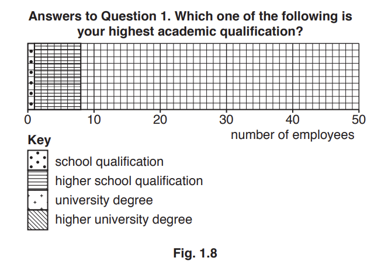

[2]

(ii)

The answers to Question 2 (Do you think your job is highly skilled?) are shown in Table 1.3. The reasons these people gave to answer Question 3 (Why do you think your job is highly skilled?) are also shown in Table 1.3.

The students decided that **Hypothesis 2:** High technology companies employ a highly skilled workforce, was correct. How do the answers to Questions 1, 2 and 3 support this conclusion?

[3]

(iii)

Suggest **two** benefits which employees would give in answering Question 4 (What are the main benefits which you get from your job?).

[2]

*Source: Nov 2019 0460/41 Q1D*

**Q13** [2 marks]

**Extract:**

Explain why high technology companies are usually located near to other similar companies.

Mark scheme: Share information / ideas / opinions
Share research facilities / laboratories / materials / products / inputs for others
Possible location near to universities
(Have the same requirements) – green site / transport links / cheap land / open land/ space for parking / accessibility
Can 'headhunt' staff from other companies more easily

Which **two** of the following are factors which attract high technology industries to an area? 
Tick your choices in the table below.

| Location factor | Tick (✓) |
|---|---|
| Air pollution from the buildings will not affect local residents |   |
| Links to universities in the local area |   |
| Large quantities of raw materials nearby |   |
| Near to the main market for the produce |   |
| Road, rail and air transport links make the area accessible |   |

*Source: Nov 2019 0460/41 Q1E*

### Q14 — medium — 30 marks

**Q14** [5 marks]

Students investigated differences in weather in a city centre square. Fig. 1.1 shows the square which is pedestrianised. They identified five sites in the square where they could measure temperature, wind direction and wind speed at midday (12:00 hours) and in the early evening on eight consecutive days.

**Fig. 1.1 **

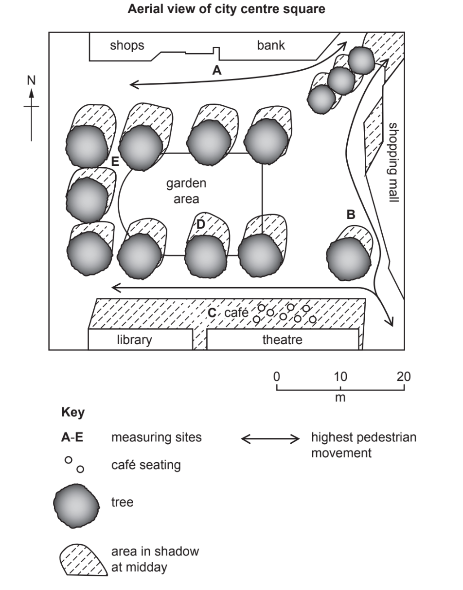

The students investigated the following hypotheses:

**Hypothesis 1:*** Midday temperatures are higher at sites A, B and C than at sites D and E.*

**Hypothesis 2:** *Wind direction and wind speed vary more at site C than at site E.*

To measure the temperature the students considered using a traditional maximum-minimum thermometer at each site.

(i)

Suggest why their teacher thought that it was not a good idea to use a maximum-minimum thermometer in the city centre square when they wanted to make their measurements.

[2]

(ii)

As an alternative method the students decided to use a digital thermometer to measure temperature at each site around midday (12:00 hours) and in the early evening. Give three advantages of using a digital thermometer.

[3]

*Source: 2020 4 Q1A*

**Q14** [6 marks]

**Extract:**

Students investigated differences in weather in a city centre square. Fig. 1.1 shows the square which is pedestrianised. They identified five sites in the square where they could measure temperature, wind direction and wind speed at midday (12:00 hours) and in the early evening on eight consecutive days.

The students investigated the following hypotheses:

Hypothesis 1: Midday temperatures are higher at sites A, B and C than at sites D and E.

Hypothesis 2: Wind direction and wind speed vary more at site C than at site E.

The results of the students’ midday temperature measurements are shown in Table 1.1.

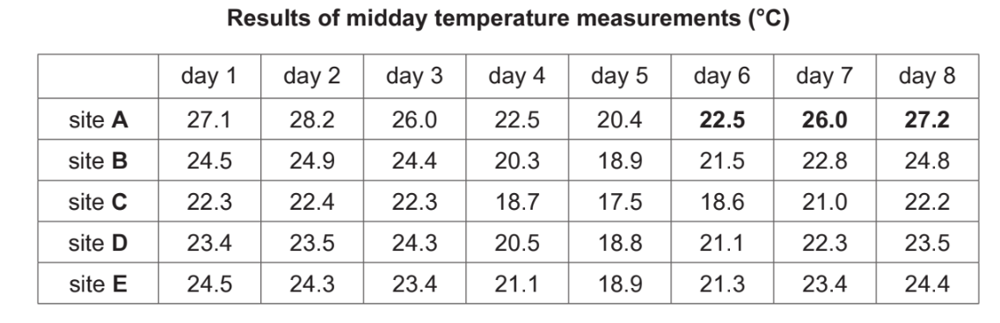

**Table 1.1**

(i)

Use the results in Table 1.1, **complete Fig. 1.2 below, **by plotting the midday temperatures of days 6, 7 and 8 at site A.

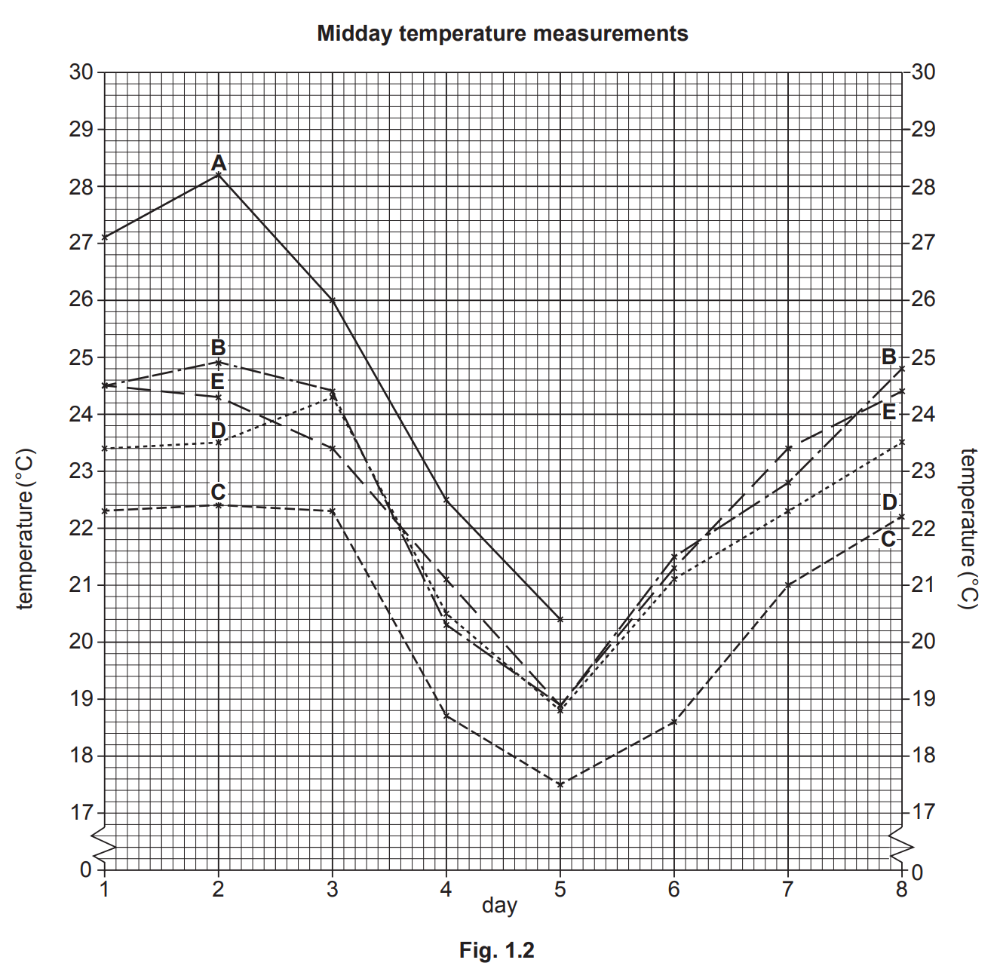

[2]

(ii)

What is your conclusion to **Hypothesis 1:** Midday temperatures are higher at sites A, B and C than at sites D and E? Support your decision with evidence from Fig. 1.2 and Table 1.1.

[4]

*Source: 2020 4 Q1B*

**Q14** [2 marks]

**Extract:**

Students investigated differences in weather in a city centre square. Fig. 1.1 shows the square which is pedestrianised. They identified five sites in the square where they could measure temperature, wind direction and wind speed at midday (12:00 hours) and in the early evening on eight consecutive days.

Early evening temperatures in the square also varied. These temperatures are shown in Fig. 1.3.

**Fig. 1.3.**

Use Fig. 1.3 to:

(i)

Describe one difference in early evening temperatures between the sites. **Do not** use statistics in your answer.

[1]

(ii)

Describe one difference in early evening temperatures during the eight days. **Do not** use statistics in your answer.

[1]

*Source: 2020 4 Q1C*

**Q14** [10 marks]

**Extract:**

Students investigated differences in weather in a city centre square. Fig. 1.1 shows the square which is pedestrianised. They identified five sites in the square where they could measure temperature, wind direction and wind speed at midday (12:00 hours) and in the early evening on eight consecutive days.

Fig. 1.1

fig-1-1-q1-0460_w20_in_43

The students investigated the following hypotheses:

Hypothesis 1: Midday temperatures are higher at sites A, B and C than at sites D and E.

Hypothesis 2: Wind direction and wind speed vary more at site C than at site E.

To investigate **Hypothesis 2:** *Wind direction and wind speed vary more at site C than at site E*, the students took measurements at midday on each day.

(i)

What is the instrument called which is used to measure wind direction? Tick (`✓`) your choice below.

|   | Tick (`✓`) |
|---|---|
| wind dial |   |
| wind gauge |   |
| wind vane |   |

[1]

(ii)

The students’ results of measuring wind direction are shown in Table 1.2 (below). Use these results **to complete the wind directions** at site **B** in Fig. 1.4 below.

**Table 1.2**

[2]

(iii)

Explain how an anemometer, like that shown in Fig. 1.5 (below), measures wind speed.

[2]

(iv)

The students’ results of measuring wind speed are shown in Table 1.3 (below). In Fig. 1.6 below, **plot the wind speed measurements** at site B on days 1 and 7.

**Table 1.3**

[2]

(v)

The students decided that **Hypothesis 2:** *Wind direction and wind speed vary more at site C than at site E*, was partly true. Which part of the hypothesis is **true**? Tick your decision below and support your decision with data from Figs. 1.4 and 1.6 and Tables 1.2 and 1.3.

|   | Tick(`✓`) |
|---|---|
| Wind direction varies more at site C than at site E |   |
| Wind speed varies more at site C than at site E |   |

[3]

*Source: 2020 4 Q1D*

**Q14** [3 marks]

**Extract:**

Students investigated differences in weather in a city centre square. Fig. 1.1 shows the square which is pedestrianised. They identified five sites in the square where they could measure temperature, wind direction and wind speed at midday (12:00 hours) and in the early evening on eight consecutive days.

Look at Fig. 1.1. Suggest reasons why temperatures and wind direction and speed vary between the sites in the city centre square.

[3]

**Fig. 1.1 **

*Source: 2020 4 Q1E*

**Q14** [4 marks]

Another feature of weather which may vary over a small area is relative humidity.

(i)

Which one of the following is the correct definition of relative humidity? Tick your answer.

| Definition | Tick(`✓`) |
|---|---|
| the amount of moisture in the air during the day compared to the night |   |
| the amount of moisture in the air as a percentage of the total moisture it could hold at that temperature |   |
| the maximum amount of moisture in the air when it is warmed up |   |
| the percentage of moisture in the air when it is raining compared to when it stops raining |   |

[1]

(ii)

Relative humidity is calculated by using a wet-and-dry bulb thermometer (hygrometer). This is shown in Fig. 1.7 (below). Explain how the students would use this instrument to work out relative humidity.

[3]

*Source: 2020 4 Q1F*

### Q15 — medium — 21 marks

**Q15** [6 marks]

Students in Mauritius, an island in the Indian Ocean, were studying tourism. Tourism is an important industry in Mauritius and earns much foreign income.

Fig. 2.1 shows the number of international tourists who visited Mauritius between 1995 and 2015.

(i)

How many international tourists visited Mauritius in 2005?

[1]

(ii)

Between which two years was there a decline in the number of international tourists visiting Mauritius?

[1]

(iii)

Suggest four reasons why the number of international tourists visiting LEDCs, such as Mauritius, has increased in the last 30 years.

1.......................................................................................................................................

2........................................................................................................................................

3........................................................................................................................................

4 ........................................................................................................................................

[4]

*Source: 2019 0460/43 Q2A*

**Q15** [4 marks]

The students decided to investigate why international tourists came to Mauritius and what impact tourists had on people who lived on the island. Their two hypotheses were:

Hypothesis 1: The physical landscape attracts more tourists to Mauritius than the human landscape.

Hypothesis 2: Tourism is a good development for the residents of Mauritius.

To investigate Hypothesis 1 the students produced a questionnaire. This is shown in Fig. 2.2

(i)

When they showed their questionnaire to their teacher she suggested that before using the questionnaire they should ask:

‘Are you a tourist or do you live in Mauritius?’

Why do you think the teacher made this suggestion?

(ii)

The answers to Question 1 (Which continent do you come from?) are shown in Table 2.1 below.

**Table 2.1**

**Answers to Question 1**

| Continent | Number of tourists |
|---|---|
| Asia | 17 |
| Africa | 14 |
| Europe | 55 |
| Australia | 2 |
| North America | 11 |
| South America | 1 |
| Total | 100 |

Using Table 2.1, give **two **conclusions about where tourists came from to visit Mauritius. Do not just copy out the statistics.

1........................................................................................................................................

2........................................................................................................................................

[2]

(iii)

The answers to Question 2 (Which of the following physical landscape attractions are you visiting in Mauritius?) and Question 3 (Which of the following human landscape attractions are you visiting in Mauritius?) are shown in Table 2.2.

**Table 2.2 for Question 2**

**Answers to Questions 2 and 3 of the tourist questionnaire**

| **Q2 Physical landscape attractions** | **Number of visits** |
|---|---|
| Black River Gorges National Park | 30 |
| Casela Bird Park | **34** |
| Chamarel coloured earths | 67 |
| Grand Baie beach | 49 |
| Ile aux Cerfs | 51 |
| National Botanical Garden | 38 |
| Rochester Falls | 21 |
| Total | 290 |

| **Q3 Human landscape attractions** | **Number of visits** |
|---|---|
| Cap Malheureux church | 22 |
| Chamarel distillery | 12 |
| Fort Adelaide | 25 |
| Flic-en-Flac | 28 |
| Grand Bassin temples | **45** |
| Le Caudan waterfront | 39 |
| Port Louis market | 33 |
| Total | 204 |

Use this data to **complete the bar graphs** in Fig. 2.3 below, to show the number of visits made to the Casela Bird Park and the Grand Bassin temples.

(iv)

**Complete the pie graph and key** in Fig. 2.4 below to show the answers to Question 4 (Overall which attracted you most to Mauritius?).

|   | Percentage of tourists |
|---|---|
| Physical landscape attractions | 58 |
| Human landscape attractions | 42 |

(v)

What conclusion would the students make to **Hypothesis 1**: The physical landscape attracts more tourists to Mauritius than the human landscape? Support your decision with evidence from Figs. 2.3 and 2.4 and Table 2.2.

[4]

*Source: 2019 May/June 0460/43 Q2B*

**Q15** [3 marks]

The students used a different questionnaire to investigate Hypothesis 2: Tourism is a good development for the residents of Mauritius. The questionnaire is shown in Fig. 2.5.

Name and describe a sampling method to choose people to complete their questionnaire.

[3]

*Source: 2019 Oct/Nov 0460/43 Q2C*

**Q15** [2 marks]

The answers to Question 2 (Which are the three main benefits of tourism in Mauritius?) and Question 3 (Which are the three main disadvantages of tourism in Mauritius?) are shown in Table 2.3.

The students devised this simple index to work out which benefits and disadvantages were most important.

(i) 
The students used the results in Table 2.3 to draw the graph in Fig. 2.6 below. Plot the total index scores for improved transport and air pollution on Fig. 2.6.

**Table 2.3 for Question 2** 
**Results of resident questionnaire**

| Question 2: Main benefits of tourism | First choice | Second choice | Third choice | Total index score |
|---|---|---|---|---|
| More jobs and income | 39 | 25 | 11 | 178 |
| Improved standard of living | 15 | 20 | 28 | 113 |
| More modern services | 4 | 10 | 13 | 45 |
| Cleaner environment | 5 | 2 | 3 | 22 |
| Improved transport | 12 | 10 | 14 | **70** |
| More global awareness | 3 | 19 | 11 | 58 |
| Reduction in crime | 10 | 9 | 7 | 55 |
| More goods in shops | 12 | 5 | 13 | 59 |

| **Question 3: Main** **disadvantages of tourism** | **First choice** | **Second** | **Third choice** | **Total index** **score** |
|---|---|---|---|---|
| Noise pollution | 7 | 12 | 10 | 55 |
| Air pollution | 26 | 16 | 12 | **122** |
| Traffic congestion | 27 | 23 | 18 | 145 |
| More crime | 5 | 7 | 8 | 37 |
| Decline of traditional culture | 11 | 8 | 16 | 65 |
| Destruction of natural environment | 5 | 12 | 15 | 54 |
| More litter | 7 | 14 | 12 | 61 |
| Increase in cost of living | 12 | 8 | 9 | 61 |

| **Question 4: Overall effect of**  **tourism** | **Answers** |
|---|---|
| Benefits | 87 |
| Disadvantages | 13 |

[2]

Using evidence in Table 2.3 **only**, which **one **of the following statements supports

**Hypothesis 2**: *Tourism is a good development for the residents of Mauritius?*

| Statement | Tick (✓) |
|---|---|
| There are more benefits of tourism than disadvantages of tourism. |   |
| The total index score for benefits is greater than the total index score for disadvantages. |   |
| Overall people think the benefits of tourism are greater than the disadvantages. |   |

*Source: 2019 Oct/Nov 0580/43 Q2D*

**Q15** [6 marks]

**Extract:**

The students used a different questionnaire to investigate Hypothesis 2: Tourism is a good development for the residents of Mauritius.

Table 2.3 Results of resident questionnaire

Question 3: Main disadvantages of tourism | First choice | Second choice | Third choice | Total index score
Noise pollution | 7 | 12 | 10 | 55
Air pollution | 26 | 16 | 12 | 122
Traffic congestion | 27 | 23 | 18 | 145
More crime | 5 | 7 | 8 | 37
Decline of traditional culture | 11 | 8 | 16 | 65
Destruction of natural environment | 5 | 12 | 15 | 54
More litter | 7 | 14 | 12 | 61
Increase in cost of living | 12 | 8 | 9 | 61

Local people identified traffic congestion as the main disadvantage of tourism in Mauritius.

(i)

Suggest why tourism is likely to increase traffic congestion.

[2]

(ii)

Describe how the students could carry out fieldwork to investigate the impact of traffic congestion in Mauritius.

[4]

*Source: 2019 Oct/Nov 0460/43 Q2E*

### Q16 — medium — 30 marks

**Q16** [2 marks]

Students were planning fieldwork on a local pebble beach. The students wanted to investigate how pebbles varied in size. The beach, which is divided into sections by groynes, is shown in **Fig. 2.1**.

Fig. 2.2 (below) shows one of the groynes. Describe the groyne.

**Fig. 2.2**

*Source: June 2020 0460/42 Q2A*

**Q16** [4 marks]

When the students arrived at the beach, they saw a safety notice which is shown in Fig. 2.3. Suggest **four** instructions their teacher would give the students to keep them safe whilst they did measurements at the sites shown in Fig. 2.4.

**Fig. 2.3**

**Fig. 2.4**

*Source: June 2020 0460/42 Q2B*

**Q16** [3 marks]

Groups of students worked in the different sections of the beach to investigate the following hypotheses:

**Hypothesis 1: **The pebbles get smaller from the cliff towards the sea.

**Hypothesis 2:** The pebbles get smaller from south to north in the section of the beach between two groynes.

The students collected 20 pebbles at each of nine sites shown in Fig. 2.4. They then measured the length, width and depth of each pebble. An example of this measurement is shown in Fig. 2.5.

**Fig. 2.5**

(i)

Fig. 2.6 (below) shows the actual size of one of the pebbles collected. **Complete the measurements** of this pebble in the table below.

**Fig. 2.6**

| length | 70   mm |
|---|---|
| width | ......   mm |
| depth | ......   mm |

[2]

(ii)

In the space below **calculate the average** of the three measurements.

|   |
|---|

[1]

*Source: June 2020 0460/42 Q2C*

**Q16** [2 marks]

**Extract:**

Groups of students worked in the different sections of the beach to investigate the following hypotheses:

Hypothesis 1: The pebbles get smaller from the cliff towards the sea.

Hypothesis 2: The pebbles get smaller from south to north in the section of the beach between two groynes.

The students collected 20 pebbles at each of nine sites shown in Fig. 2.4. They then measured the length, width and depth of each pebble. An example of this measurement is shown in Fig. 2.5.

Fig. 2.5

(i)

Fig. 2.6 (below) shows the actual size of one of the pebbles collected. Complete the measurements of this pebble in the table below.

Fig. 2.6

| length | 70   mm |
| width | ......   mm |
| depth | ......   mm |

(ii)

In the space below calculate the average of the three measurements.

The results of the students’ measurements at site M2 (on Fig. 2.4) are shown in Fig. 2.7 below.

**Fig. 2.4**

(i)

The average of the three measurements of pebble number 13 is 53mm.** Plot this measurement** in Fig. 2.7.

[1]

(ii)

Which pebble at site M2 has the largest average of the three measurements?

[1]

*Source: June 2020 0460/42 Q2D*

**Q16** [6 marks]

**Extract:**

Groups of students worked in the different sections of the beach to investigate the following hypotheses:

Hypothesis 1: The pebbles get smaller from the cliff towards the sea.

Hypothesis 2: The pebbles get smaller from south to north in the section of the beach between two groynes.

The students collected 20 pebbles at each of nine sites shown in Fig. 2.4.

(i)

The results of the students’ measurements for the nine sites are shown in Fig. 2.4.

Do these results support **Hypothesis 1:** The pebbles get smaller from the cliff towards the sea? Support your decision with evidence from Fig. 2.4.

[3]

**Fig. 2.4.**

(ii)

Explain why the size of pebbles varies in the area between the sea and the cliff.

[3]

*Source: June 2020 0460/42 Q2E*

**Q16** [3 marks]

**Extract:**

Fig. 2.4

(i)

Look at Fig. 2.4.

Which **one** of the following is the correct conclusion to **Hypothesis 2:** The pebbles get smaller from south to north in the section of the beach between two groynes? Tick (3) your decision in the box below.

|   | Tick (✓) |
|---|---|
| The conclusion is true for sites U1, U2 and U3 |   |
| The conclusion is true for sites M1, M2 and M3 |   |
| The conclusion is true for sites L1, L2 and L3 |   |

[1]

(i)

Use data from Fig. 2.4 to support the conclusion you have chosen.

[1]

(iii)

Use data from Fig. 2.4 to show why one of the conclusions you rejected is wrong.

[1]

*Source: June 2020 0460/42 Q2F*

**Q16** [6 marks]

Movement of pebbles along a beach, which was tested in **Hypothesis 2: ***The pebbles get smaller from south to north in the section of the beach between two groynes,* is influenced by longshore drift. The students had learned that longshore drift is usually affected by the prevailing wind direction.

(i)

How could the students have checked the wind direction when they did their fieldwork?

[2]

(ii)

Describe and explain the process of longshore drift which is shown in Fig. 2.8 (below).

[4]

*Source: June 2020 0460/42 Q2G*

**Q16** [4 marks]

As an extension activity the students measured the beach profile from the edge of the sea to the cliff. Describe how they would measure the profile using the following equipment:

• two ranging poles 
• a clinometer 
• a tape measure

*Source: June 2020 0460/42 Q2H*

### Q17 — medium — 30 marks

**Q17** [6 marks]

Students at a school in Seattle, USA, measured atmospheric pressure, temperature and rainfall during 15 days in November. They tested the following hypotheses:

**Hypothesis 1: **Temperatures increase as atmospheric pressure rises and decrease as atmospheric pressure falls. 
**Hypothesis 2: **There is a relationship between atmospheric pressure and daily rainfall totals.

(i)

The students measured the maximum and minimum temperature for each day using a thermometer like the one shown in Fig. 1.1. Explain how the students would use the thermometer to measure temperature.

[4]

(ii)

The results of the students’ measurements of temperature are shown in Table 1.1

**Table 1.1**

Plot the maximum temperature for 13 November on the graph, Fig. 1.2 below.

[1]

(iii)

On which date in November was the largest temperature range?

[1]

*Source: Nov 2020 0460/42 Q1A*

**Q17** [6 marks]

The results of the students’ measurements of atmospheric pressure are shown in Table 1.1 and in Fig.1.2.

**Table 1.1**

(i)

Which one of the following instruments would the students use to measure atmospheric pressure? Circle your answer.

anemometer                     barometer                       hygrometer

[1]

(ii)

To measure atmospheric pressure the students took readings at midday (12:00 hours) each day. Why was it important to take readings at the same time of day?

[1]

(iii)

What conclusion did the students make about **Hypothesis 1:** *Temperatures increase as atmospheric pressure rises and decrease as atmospheric pressure falls?* Refer to both maximum and minimum temperatures and support your answer with evidence from Table 1.1 and Fig. 1.2.

[4]

*Source: Nov 2020 0460/42 Q1B*

**Q17** [11 marks]

(i)

The students used the instrument shown in Fig. 1.3 to measure daily rainfall. Describe how the instrument is used to measure rainfall.

**Fig. 1.3.**

[3]

(ii)

Suggest two factors which the students should consider when choosing a site for the instrument shown in Fig. 1.3. Explain why each factor is important in choosing the site.

Factor 1 
Explanation

Factor 2
Explanation

[4]

(iii)

The results of the rainfall measurements are shown in Table 1.2 (below).

Plot the rainfall for 13 November on Fig.1.4, (below).

**Table 1.2**

**Fig. 1.4.**

[1]

(iv)

The students decided that **Hypothesis 2: ***There is a relationship between atmospheric pressure and daily rainfall totals* was true. Describe the relationship between atmospheric pressure and daily rainfall totals. Use evidence from Fig. 1.4 and Tables 1.1 (below) and 1.2 to support the relationship.

**Table 1.1**

[3]

*Source: Nov 2020 0460/42 Q1C*

**Q17** [7 marks]

(i)

To extend their fieldwork the students measured the wind speed and wind direction at midday (12:00 hours). Describe how they would make these measurements.

Wind speed

Wind direction

[4]

(iii)

The results of their measurements of wind speed and wind direction are shown in Table 1.3.

**Table 1.3.**

**Complete the wind rose diagram, **Fig. 1.5 below), by adding the number of days that the wind direction was from the south.

[1]

(iii)

What evidence from Table 1.3 supports the statement that there is a relationship between wind speed and wind direction (the direction from which the wind is blowing)?

[2]

*Source: Nov 2020 0460/42 Q1D*

### Q18 — medium — 30 marks

**Q18** [8 marks]

Charity workers were doing research into differences in the health of families in Chennai, a city in India. They worked in two densely populated areas of the city which are both shown in Fig. 1.1. One was an area of unplanned housing (squatter settlement) and the other was another area of poor-quality housing which was planned and permanent.

**Fig. 1.1**

The researchers wanted to find out if the following hypotheses were correct:

**Hypothesis 1**: Diseases were more common in the area of unplanned housing than in the area of permanent housing.

**Hypothesis 2: **Most residents in both areas used government health facilities.

To investigate the two hypotheses the researchers used a questionnaire with a representative sample of people who lived in each area. The sample size (number of people who answered the questionnaire) was 100 in each area.

(i)

Why did the researchers need to use a sample of people?

[1]

(ii)

Information which is collected using a questionnaire is known as ‘primary data’. What does ‘primary data’ mean?

[1]

(iii)

The following is a **poor **sampling method which may have been used to get a representative sample of people to answer the questionnaire.

‘Give the questionnaire to all mothers who the researchers met outside the local school.’

Explain why this is a poor method to obtain a representative sample.

[3]

(iv)

Describe a **good** sampling method which the researchers could use to choose a representative sample of people to answer the questionnaire. Explain why this would be a good method to use.

[3]

*Source: June 2020 0460/42 Q1A*

**Q18** [5 marks]

**Extract:**

Charity workers were doing research into differences in the health of families in Chennai, a city in India. They worked in two densely populated areas of the city which are both shown in Fig. 1.1. One was an area of unplanned housing (squatter settlement) and the other was another area of poor-quality housing which was planned and permanent.

The researchers wanted to find out if the following hypotheses were correct:

Hypothesis 1: Diseases were more common in the area of unplanned housing than in the area of permanent housing.

Hypothesis 2: Most residents in both areas used government health facilities.

To investigate the two hypotheses the researchers used a questionnaire with a representative sample of people who lived in each area. The sample size (number of people who answered the questionnaire) was 100 in each area.

The questionnaire is shown in Fig. 1.2. The results of Question 1 in the questionnaire are shown in Table 1.1.

**Fig. 1.2**

**Table 1.1**

(i)

**Plot the results** for typhoid in the unplanned housing area in Fig. 1.3 below.

[1]

(ii)

What conclusion would the researchers make about **Hypothesis 1: **Diseases were more common in the area of unplanned housing than in the area of permanent housing? What evidence in Fig. 1.3 and Table 1.1 supports their conclusion?

[4]

*Source: June 2020 0460/42 Q1B*

**Q18** [5 marks]

**Extract:**

Charity workers were doing research into differences in the health of families in Chennai, a city in India. They worked in two densely populated areas of the city which are both shown in Fig. 1.1. One was an area of unplanned housing (squatter settlement) and the other was another area of poor-quality housing which was planned and permanent.

The researchers wanted to find out if the following hypotheses were correct:

Hypothesis 1: Diseases were more common in the area of unplanned housing than in the area of permanent housing.

Hypothesis 2: Most residents in both areas used government health facilities.

The results of Question 2 in the questionnaire are shown in Table 1.2 below

(i)

Use the results to **complete the pie graph** for the permanent housing area in Fig. 1.4 below.

**Fig. 1.4 **

[2]

(iii)

The researchers agreed a conclusion that **Hypothesis 2:** *Most residents in both areas used government health facilities* was **incorrect**. Support this decision with evidence from Fig. 1.4 and Table 1.2.

[3]

*Source: June 2020 0460/42 Q1C*

**Q18** [4 marks]

**Extract:**

The questionnaire is shown in Fig. 1.2. The results of Question 1 in the questionnaire are shown in Table 1.1.

Fig. 1.2

fig-1-2-q1-0460-s20-insert-42

The results of Question 2 in the questionnaire are shown in Table 1.2 below

table-1-2-q2-0460-s20-insert-42

(i)

The results which the researchers obtained for Question 2 (Where people go for treatment of an illness) were unexpected. One of the researchers suggested that they should have used the questionnaire in a pilot study before doing the main research. How might this have helped?

[2]

(ii)

The researchers returned to the two areas of the city and asked people to answer another question: ‘What is the main reason you chose not to use government health facilities?’

The answers which people gave are shown in **Table 1.3**.

**Complete the graph**, Fig. 1.5 (below), to show the answers given by people in the unplanned housing area.

[2]

*Source: June 2020 0460/42 Q1D*

**Q18** [4 marks]

**Extract:**

Charity workers were doing research into differences in the health of families in Chennai, a city in India. They worked in two densely populated areas of the city which are both shown in Fig. 1.1. One was an area of unplanned housing (squatter settlement) and the other was another area of poor-quality housing which was planned and permanent.

Suggest how the health of residents in poorer areas of the city could be improved.

*Source: June 2020 0460/42 Q1E*

**Q18** [4 marks]

Researchers wanted to extend their study by investigating housing conditions in two areas. Describe how they could collect information about housing conditions. Do **not** include a questionnaire in your answer.

*Source: June 2020 0460/42 Q1F*

### Q19 — medium — 30 marks

**Q19** [1 mark]

Students who lived in a settlement near the edge of a large city in the UK were studying how their town had grown from a small village.

Which **one** of the following describes the area where the town has grown? Tick (**✓**) your choice.

|   | **tick (✓) ** |
|---|---|
| inner city |   |
| inner suburbs |   |
| rural-urban fringe |   |
| transition zone |   |

*Source: June 2021 0460/41 Q2A*

**Q19** [6 marks]

**Extract:**

Students who lived in a settlement near the edge of a large city in the UK were studying how their town had grown from a small village.

Look at Fig. 2.1 (Insert), a map of the settlement.

**Fig.2.1**

(i)

Describe the shape of the original village.

[2]

(ii)

Use evidence from Fig. 2.1 to describe how the settlement has grown since 1980.

[2]

(iii)

Suggest **two** reasons for the expansion of the settlement.

1 ......................................................................................

2 ......................................................................................

[2]

*Source: June 2021 0460/41 Q2B*

**Q19** [2 marks]

The students used the national census website to find information about the population of the settlement. The results are shown in Table 2.1 (Insert).

**Table 2.1** 
**Population growth in the settlement**

| **year ** | **population** |
|---|---|
| 1961 | 2890 |
| 1971 | 3600 |
| 1981 | 4420 |
| 1991 | 6090 |
| 2001 | 7650 |
| 2011 | 8970 |
| **2017** | **9400** |

(i)

Why is the national census website ‘secondary’ data?

[1]

(ii)

Use the data in Table 2.1 to complete Fig. 2.2 below.

[1]

**Fig. 2.2**

*Source: June 2021 0460/41 Q2C*

**Q19** [4 marks]

The students decided to test the following hypotheses:

**Hypothesis 1:** *Most people have lived in the settlement for less than 20 years. *

**Hypothesis 2:** *Most people who live in the settlement travel more than 20km to work.*

To investigate their hypotheses the students made a questionnaire. They decided to stand on the main street and asked people who were in the working age group of 18 to 65 to complete the questionnaire.

(i)

Suggest a suitable day and time for the students to carry out the questionnaire survey.

Day .................................................... Time ...................................................

[1]

(ii)

Give a reason for your answer to **(d)(i)**.

[1]

(iii)

Their teacher suggested some things to do and things not to do while using a questionnaire. **Use the suggestion number** to put the following ideas under the correct headings in Table 2.2 below.

[2]

1. Ask the person’s name
2. Be polite
3. Explain why you are doing the survey before you ask questions
4. Keep the questionnaire short
5. Only ask people who are sitting down
6. Stand in a shop doorway to do the questionnaire

**Table 2.2**

| **things to do** | **things not to do** |
|---|---|
| number ....................... | number ......................... |
| number ......................... | number ......................... |
| number ......................... | number ......................... |

*Source: June 2021 0460/41 Q2D*

**Q19** [2 marks]

**Extract:**

The students decided to test the following hypotheses:

Hypothesis 1: Most people have lived in the settlement for less than 20 years.

Hypothesis 2: Most people who live in the settlement travel more than 20km to work.

To investigate their hypotheses the students made a questionnaire. They decided to stand on the main street and asked people who were in the working age group of 18 to 65 to complete the questionnaire.

The students’ questionnaire is shown in Fig. 2.3 (Insert).

**Resident questionnaire**

| *I am doing this questionnaire as part of my Geography coursework. Please answer the following questions.*  * *  *1. How long have you lived in the town? ....................................................... years *  *2. How far do you travel to your workplace? ....................................................... km *  *3. What is your main reason for living in the town? .................................................................................................................................................... *  *Thank you * |
|---|

(i)

How could the students make sure that they only used their questionnaire with people who lived in the town?

[1]

(ii)

The students asked every tenth person who passed them on the street to complete their questionnaire. Which **one** of the following is the correct term for this sampling method? Tick (**✓**) your answer below.

[1]

|   | **tick (✓)** |
|---|---|
| precise |   |
| simple |   |
| specific |   |
| systematic |   |
| tally |   |

*Source: June 2021 0460/41 Q2E*

**Q19** [8 marks]

**Extract:**

The students decided to test the following hypotheses:

**Hypothesis 1:** *Most people have lived in the settlement for less than 20 years.*

**Hypothesis 2:** *Most people who live in the settlement travel more than 20km to work.*

The results of Question 1 in the questionnaire are shown in Table 2.3 (Insert).

**Table 2.3**

**Answers to Question 1**
 **How long have you lived in the town?**

| **number of years** | **percentage of answers** |
|---|---|
| 0 to 9 | 11 |
| 10 to 19 | 36 |
| 20 to 29 | 28 |
| **30 to 39** | **19** |
| **40 and over** | **6** |

(i)

Use the results in Table 2.3 to** complete the pie graph**, Fig. 2.4, below.

[2]

**Answers to Question 1**

**Fig. 2.4**

(ii)

What conclusion did the students make to **Hypothesis** **1**:* Most people have lived in the settlement for less than 20 years?* Support your answer with evidence from Fig. 2.4 and Table 2.3.

[3]

(iii)

The results of Question 2 in the questionnaire are shown in Table 2.4 (Insert).

**Table 2.4**

**Answers to Question 2** **How far do you travel to your workplace? **

| **distance (km)** | **percentage of answers** |
|---|---|
| 0 to 10 | 21 |
| 11 to 20 | 22 |
| **21 to 30** | **27** |
| 31 to 40 | 20 |
| 41 to 50 | 7 |
| more than 50 | 3 |

Use these results** to complete the histogram**, Fig. 2.5 below, to show the percentage of people who travel between 21 and 30km to get to work.

[1]

**Answers to Question 2**

**Fig.2.5**

(iv)

Do you think** Hypothesis 2**: *Most people who live in the settlement travel more than 20km to work is* **correct?** Support your conclusion with evidence from Fig. 2.5 and Table 2.4.

[2]

*Source: June 2021 0460/41 Q2F*

**Q19** [3 marks]

The students put the answers to Question 3 ‘What is your main reason for living in the town?’ into six groups. These groups are shown in Fig. 2.6 below.

| good access to the motorway |
|---|
| nearby countryside is good for relaxation |
| born in the town |
| low crime rate |
| convenient public transport routes |
| affordable house prices |

**Fig. 2.6**

In which group in Fig. 2.6 would the following answers to Question 3 be included?

The town is a safe place for my family. 
Group .......................................................................................

There is a quick rail link to my workplace in the nearby city. 
Group ........................................................................................

There are plenty of open areas nearby for walking. 
Group .........................................................................................

[3]

*Source: June 2021 0460/41 Q2G*

**Q19** [4 marks]

**Extract:**

Students who lived in a settlement near the edge of a large city in the UK were studying how their town had grown from a small village.

Look at Fig. 2.1 (Insert), a map of the settlement.

Use evidence from Fig. 2.1 to describe how the settlement has grown since 1980.

To the west south west/south of the main road
To the south/south east/south west/north west (of the original village)
To the north/east of woodland
Away from the roads/further out from road/spread out/towards woodland /along the road/on outskirts/around original village

The students used the national census website to find information about the population of the settlement. The results are shown in Table 2.1 (Insert).

Table 2.1
Population growth in the settlement

year | population
1961 | 2890
1971 | 3600
1981 | 4420
1991 | 6090
2001 | 7650
2011 | 8970
2017 | 9400

Suggest how the growth of the settlement has affected local people and the local natural environment.

*Source: June 2021 0460/41 Q2H*

### Q20 — medium — 30 marks

**Q20** [2 marks]

Students were studying land use in cities. They learned that there are parts of a city where one land use is dominant and covers most of the area, and this is called a land use zone. They did fieldwork to investigate land use in their local city.

To collect fieldwork data the students were divided into six groups. Each group went from the city centre outwards along main roads which were used as transect lines.

Suggest **two** reasons why the teacher split the class into groups.

*Source: Speimen  Paper 2020 0460/41 Q2A*

**Q20** [4 marks]

**Extract:**

Students were studying land use in cities. They learned that there are parts of a city where one land use is dominant and covers most of the area, and this is called a land use zone. They did fieldwork to investigate land use in their local city.

To collect fieldwork data the students were divided into six groups. Each group went from the city centre outwards along main roads which were used as transect lines.

The students investigated the following hypotheses:

**Hypothesis 1:** Residential land use is dominant (covers most of the land area) at all distances away from the city centre.

**Hypothesis 2:** The percentage of commercial land use decreases as distance from the city centre increases.

Along each transect line the students used a systematic sampling method to select locations to record the land use. Their teacher told the students to: 
• record the land use every 10 metres 
• only record the ground floor land use 
• only record the land use on one side of the road.

Give **two** advantages and **two** disadvantages of this method.

*Source: June 2020 0460/41 Q2B*

**Q20** [3 marks]

Fig. 2.1 shows the categories of land use which the students used along with examples of different types of land use.

**Fig. 2.1 for Question 2** **Categories of land use**

| Land use category | Example of land use |
|---|---|
| Residential | terraced house, detached house, bungalow |
| Industrial | manufacturing, mining, assembly factory |
| Commercial (shops) | food, take-away, furniture, market, specialist goods |
| Entertainment | hotel, sports centre, theatre, cinema |
| Public buildings | college, hospital, place of worship, police station |
| Open space | farmland, park, unused land, sports field |
| Transport | bus station, car park, railway station |
| Services (offices) | financial, business, dentist, doctor, estate agent |

Complete the table below by putting the types of land use into the correct land use category. One example has been completed for you.

| Type of land use | Land use category |
|---|---|
| department store | commercial |
| concert venue |   |
| apartment |   |
| library |   |

*Source: June 2020 0460/41 Q2C*

**Q20** [2 marks]

**Extract:**

Fig. 2.1 Categories of land use

| Land use category | Example of land use |
| Residential | terraced house, detached house, bungalow |
| Industrial | manufacturing, mining, assembly factory |
| Commercial (shops) | food, take-away, furniture, market, specialist goods |
| Entertainment | hotel, sports centre, theatre, cinema |
| Public buildings | college, hospital, place of worship, police station |
| Open space | farmland, park, unused land, sports field |
| Transport | bus station, car park, railway station |
| Services (offices) | financial, business, dentist, doctor, estate agent |

An example of the students’ completed recording sheet along one section of a transect (201–400m) is shown in Fig. 2.2. Use these results to complete the tally chart, Fig. 2.3 below, which the students used to count the examples in the different land use categories.

**Fig. 2.2**

**Fig. 2.3 Tally chart**

| Section of transect: 201–400 metres |
|---|

| Land use category | Tally | Number |
|---|---|---|
| Residential | //// | 4 |
| Industrial |   | 0 |
| Commercial (shops) |   |   |
| Entertainment |   |   |
| Public buildings |   |   |
| Open space |   |   |
| Transport |   |   |
| Services (offices) |   |   |

*Source: June 2020 0460/41 Q2D*

**Q20** [15 marks]

**Extract:**

The students investigated the following hypotheses:

Hypothesis 1: Residential land use is dominant (covers most of the land area) at all distances away from the city centre.

Hypothesis 2: The percentage of commercial land use decreases as distance from the city centre increases.

Fig. 2.1 shows the categories of land use which the students used along with examples of different types of land use.

Fig. 2.1 for Question 2 Categories of land use

| Land use category | Example of land use |
| Residential | terraced house, detached house, bungalow |
| Industrial | manufacturing, mining, assembly factory |
| Commercial (shops) | food, take-away, furniture, market, specialist goods |
| Entertainment | hotel, sports centre, theatre, cinema |
| Public buildings | college, hospital, place of worship, police station |
| Open space | farmland, park, unused land, sports field |
| Transport | bus station, car park, railway station |
| Services (offices) | financial, business, dentist, doctor, estate agent |

When they had completed their fieldwork, the students returned to school and added up the results from all transects. They used these results to draw the divided bar graphs shown in Fig. 2.4.

**Fig. 2.4**

(i)

Which distance from the city centre is shown in Table 2.1 below? ............................. metres

[1]

**Table 2.1**

| Land use category | Percentage |
|---|---|
| Residential | 65 |
| Industrial | 10 |
| Commercial (shops) | 5 |
| Entertainment | 5 |
| Public buildings | 0 |
| Open space | 5 |
| Transport | 5 |
| Services (offices) | 5 |

(ii)

What percentage of the total land use is residential between 1001 and 1200m from the city centre?

[1]

(iii)

Describe **two** differences between the land use in sections 0 to 200m and 1801 to 2000m away from the city centre. Do **not** use statistics in your answer.

[2]

(iv)

The students made the conclusion that **Hypothesis 1**: Residential land use is dominant (covers most of the land area) at all distances away from the city centre is **false**. Support this decision with evidence from Fig. 2.4 (above).

[3]

(v)

Suggest why the land use changes as distance from the city centre increases.

[4]

(vi)

What is the correct conclusion to **Hypothesis 2**: The percentage of commercial land use decreases as distance from the city centre increases?

Tick (3) your choice below and support your decision with evidence from Fig. 2.4.

|   | Tick (✓) |
|---|---|
| Hypothesis is true |   |
| Hypothesis is partly true |   |
| Hypothesis is false |   |

[4]

*Source: June 2020 0460/41 Q2E*

**Q20** [4 marks]

**Extract:**

Students were studying land use in cities. They learned that there are parts of a city where one land use is dominant and covers most of the area, and this is called a land use zone. They did fieldwork to investigate land use in their local city.

To collect fieldwork data the students were divided into six groups. Each group went from the city centre outwards along main roads which were used as transect lines.

One student wanted to extend his study by investigating if the quality of the environment varied along his transect. Describe a method he could use to do this.

*Source: June 2020 0460/41 Q2F*

### Q21 — medium — 30 marks

**Q21** [1 mark]

A class of students in Nairobi was studying the processes which operate in a drainage basin. They learned that infiltration is affected by factors such as: 
• how steeply the land slopes 
• type of vegetation cover 
• soil moisture content 
• distance from a river or lake 
• amount of human activity. 
They did some fieldwork to investigate infiltration in an area close to Lake Naivasha in Kenya.

Identify the correct definition of infiltration below. Tick (✓) your answer.

|   | Tick (✓) |
|---|---|
| volume of water flowing down a river |   |
| water soaking through bedrock |   |
| water soaking into the soil from the ground |   |
| speed of water flowing down a river |   |
| atmosphere absorbing water from the sea |   |

*Source: June 2020 0460/43 Q2A*

**Q21** [15 marks]

The students tested a variety of hypotheses. The two hypotheses chosen by one group were:

**Hypothesis 1:***** ****The rate of infiltration increases as you go further from the lake.*

**Hypothesis 2:** *The rate of infiltration is greater on steeper sloping land.*

The class of students did their fieldwork along transect lines going down to the shore of the lake. The class was divided into three groups and each group worked on a different transect line. These are shown in Fig. 2.1 (below).

**Fig. 2.1**

(i)

To investigate **Hypothesis 1**, the students identified six fieldwork sites at increasing distances away from the lake. At each site they measured the rate (speed) of infiltration by using the equipment shown in Fig. 2.2.

Describe how the students measured infiltration.

**Fig. 2.2**

[4]

(ii)

The students recorded the water level in the plastic tube every minute for 10 minutes. The results of the measurements along transect line **A** are shown in Table 2.1 (below). Use these results to **complete the measurements** for site 4 on transect **A** in Fig. 2.3 below.

[2]

**Table 2.1**

**Fig. 2.3**

(iii)

Compare the fall in water level for site 1 and site 5 on transect** A.**

[2]

(iv)

The students calculated the infiltration rate at each site. Use the data in Table 2.1 to show the calculation which produced the result for site 2 on transect A in the space below.

| Infiltration rate = $\frac{\mathrm{Fall} \mathrm{in} \mathrm{water} \mathrm{level}(\mathrm{mm})}{\mathrm{Time}}$  =  = 7.2 mm per min |
|---|

[2]

(v)

The measurements of distance from the lake and infiltration rate at the different fieldwork sites on the three transect lines are shown in Table 2.2 (below). The students plotted these results on a graph, Fig. 2.4 below.

**Plot the results** at site 6 on transects **A** and** C**.

**Table 2.2**

[2]

(vi)

Which transect line agrees with **Hypothesis 1**: *The rate of infiltration increases as you go further from the lake?* Tick (✓) your choice below and support your answer with evidence from Fig. 2.4 and Table 2.2.

| transect line | Tick (✓) |
|---|---|
| **A** |   |
| **B** |   |
| **C** |   |

** **[3]

*Source: June 2020 0460/43 Q2B*

**Q21** [8 marks]

**Extract:**

The students tested a variety of hypotheses. The two hypotheses chosen by one group were: 

**Hypothesis 1:** *The rate of infiltration increases as you go further from the lake.* 

**Hypothesis 2:** *The rate of infiltration is greater on steeper sloping land.*

The class of students did their fieldwork along transect lines going down to the shore of the lake. The class was divided into three groups and each group worked on a different transect line. These are shown in Fig. 2.1.

To investigate **Hypothesis 1**, the students identified six fieldwork sites at increasing distances away from the lake. At each site they measured the rate (speed) of infiltration by using the equipment shown in Fig. 2.2.

To investigate **Hypothesis 2:** *The rate of infiltration is greater on steeper sloping land,* the students measured the slope gradient at each site along the transect lines.

(i)

Describe a method to measure the slope gradient. Refer to the equipment the students would use.

[4]

(ii)

The results for transect **C** are shown in Table 2.3. Use this data to **plot the result **at site 6 in Fig. 2.5 below.

[1]

**Table 2.3**

(iii)

What conclusion would the students working on transect C make about Hypothesis 2: *The rate of infiltration is greater on steeper sloping land?* Support your decision with evidence from Fig. 2.5 and Table 2.3.

[3]

*Source: June 2020 0460/43 Q2C*

**Q21** [3 marks]

**Extract:**

The measurements of distance from the lake and infiltration rate at the different fieldwork sites on the three transect lines are shown in Table 2.2 (below).

Table 2.2

| Site | Distance from lake (m) | Infiltration rate (mm per min) Transect A | Infiltration rate (mm per min) Transect B | Infiltration rate (mm per min) Transect C |
| 1 | 0 | 2.5 | 1.5 | 20.0 |
| 2 | 20 | 7.2 | 4.1 | 16.7 |
| 3 | 40 | 4.8 | 6.8 | 15.0 |
| 4 | 60 | 7.2 | 10.0 | 13.3 |
| 5 | 80 | 11.8 | 13.0 | 13.3 |
| 6 | 100 | 3.5 | 17.1 | 15.0 |

Whilst doing their fieldwork, the students also recorded the vegetation found at each measuring site. Their results are shown in Table 2.4. How do these results show that the infiltration rate is affected by vegetation?

**Table 2.4**

*Source: June 2020 0460/43 Q2C*

**Q21** [3 marks]

The area around a lake, where students did their fieldwork, is a popular tourist area. How might people walking in the area affect vegetation infiltration rate? Explain why this would happen.

*Source: June 2020 0460/43 Q2D*

### Q22 — medium — 30 marks

**Q22** [1 mark]

A group of students in The Gambia visited Bafoloto quarry. The location of the quarry is shown in Fig. 2.1 (below).

**Fig. 2.1**

The Gambia is a small country in Africa. It is about 50km wide at the coast and narrows to only 24km wide inland. Use Fig. 2.1 to measure the length of The Gambia from west to east. Tick (`✓`) your answer below.

|   | Tick(`✓`) |
|---|---|
| 300km |   |
| 330km |   |
| 410km |   |
| 460km |   |

*Source: 2020 4 Q2A*

**Q22** [3 marks]

Mining and quarrying contribute a small proportion of the total GDP of The Gambia. This is shown in Table 2.1 below.

**Table 2.1**

| Economic sector | % of GDP |
|---|---|
| Services | 59 |
| Transport | 16 |
| Agriculture | 15 |
| Manufacturing | 4 |
| Construction | 3 |
| Administration | 2 |
| Mining and quarrying | 1 |

GDP is a measurement of the total value of goods and services produced in a country.

(i)

Which one of the following sectors of industry produces the highest percentage of The Gambia’s GDP? Circle your answer below.

Primary                           Secondary                                Tertiary

[1]

(ii)

Use the data in Table 2.1 to complete the pie graph, Fig. 2.2 below.

[2]

*Source: 2020 4 Q2B*

**Q22** [2 marks]

Bafoloto quarry is shown in Fig. 2.3 (below). Laterite, which is used in building, is dug out at the quarry.

Describe **two** features of work at the quarry which are shown in Fig. 2.3.

*Source: 2020 4 Q2C*

**Q22** [13 marks]

The two hypotheses which the students tested were:

**Hypothesis 1:** *Over half of the quarry workers are male and from The Gambia.*

**Hypothesis 2: ***People gained benefits from going to work at Bafoloto quarry.*

To investigate these hypotheses the students used a questionnaire with 50 of the 400 workers at the quarry. This questionnaire is shown in Fig. 2.4 (below).

(i)

Before using the questionnaire, the students thought about the best way to make use of it. Name and describe a suitable sampling method for the students to use to select 50 workers. Explain why you have chosen this method.

Name of sampling method

Description of sampling method

Why this sampling method was chosen

[3]

(ii)

Two age groups are missing from the questionnaire in Fig. 2.4. Add the two missing age groups to the table below.

| Age group |
|---|
| Under 20 |
|   |
|   |
| Over 60 |

[2]

(iii)

Answers to Question 1 in the questionnaire (Which country do you come from?) are shown in Table 2.2 (below). Use this data to plot the numbers of male and female workers from Senegal on Fig. 2.5 below.

**Table 2.2**

**Fig. 2.5**

[2]

(iv)

What conclusion did the students make to Hypothesis 1: Over half of the quarry workers are male and from The Gambia? Support your answer with evidence from Fig. 2.5 and Table 2.2.

[4]

(v)

Answers to Question 2 in the questionnaire (How long have you worked at the quarry?) are shown in Table 2.3 (below). Use these results to complete the divided bar graph in Fig. 2.6 below.

**Table 2.3**

[2]

*Source: 2020 4 Q2D*

**Q22** [3 marks]

To investigate **Hypothesis 2:** People gained benefits from going to work at Bafoloto quarry, the students used the answers to Question 3 in the questionnaire (Why do you work at the quarry?). Some answers to Question 3 are shown in Table 2.4 below.

The students reached the conclusion that **Hypothesis 2:** People gained benefits from going to work at Bafoloto quarry, was generally **true.**

Which **three** answers in Table 2.4 best support their conclusion? Tick (`✓`) your **three** choices below.

**Table 2.4**

**Answers to Question 3** (Why do you work at the quarry?)

| Answers to Question 3 | Tick(`✓`) |
|---|---|
| Quarry work is better paid than farm work |   |
| No skills to do any other job |   |
| Earn money at the quarry (in the dry season) when there is no work to do on the farm |   |
| Relatives already work at the quarry |   |
| Send money to my family back home |   |
| Have paid for a licence to dig in the quarry |   |

*Source: 2020 4 Q2E*

**Q22** [8 marks]

**Extract:**

A group of students in The Gambia visited Bafoloto quarry.

The two hypotheses which the students tested were:

Hypothesis 1: Over half of the quarry workers are male and from The Gambia.

Hypothesis 2: People gained benefits from going to work at Bafoloto quarry.

To investigate these hypotheses the students used a questionnaire with 50 of the 400 workers at the quarry.

To extend their fieldwork the students wanted to find out about working conditions and safety at the quarry.

(i)

Describe how they could collect information. Do **not** include a questionnaire survey in your method.

[4]

(ii)

Suggest why it might be difficult for the students to collect information about working conditions and safety at the quarry.

[2]

(iii)

Suggest **two** possible problems of working at the quarry.

[2]

*Source: 2020 4 Q2F*

### Q23 — medium — 30 marks

**Q23** [8 marks]

Students in Northern Ireland were studying the topic of weather and how to measure and collect weather data. Their school had a variety of instruments to measure elements of weather, including traditional instruments and digital equipment linked to the school’s computer network.

(i)

Fig. 1.1 is a diagram of a traditional weather station. What are the pieces of equipment labelled **A** and **B**?

**A **....................................................... 
**B** .......................................................

[2]

(ii)

Describe **three** features of equipment **A** and explain why each feature is important.

[6]

*Source: June 2020 0460/41 Q1A*

**Q23** [7 marks]

The students noticed that the weather was forecast to change over the next three days, so they decided to take some measurements to investigate these changes.

One pair of students decided to test the following hypotheses:

**Hypothesis 1:** As atmospheric pressure changes rainfall amounts will vary.

**Hypothesis 2:** Atmospheric pressure affects the direction from which the wind blows.

The two students measured atmospheric pressure, rainfall and which direction the wind was blowing from. They took measurements every three hours using a combination of traditional and digital instruments.

(i)

Which one of the following instruments is used to measure atmospheric pressure? Tick (✓) your answer in the box below.

[1]

|   | Tick (✓) |
|---|---|
| anemometer |   |
| barometer |   |
| hygrometer |   |
| thermometer |   |

(ii)

A rain gauge is shown in Fig. 1.1. Explain how it is used to measure rainfall.

**Fig. 1.1**

[4]

(iii)

Explain how a wind vane, which is also shown in Fig. 1.1, is used to show the direction from which the wind is blowing.

[2]

*Source: June 2020 0460/41 Q1B*

**Q23** [3 marks]

**Extract:**

The students noticed that the weather was forecast to change over the next three days, so they decided to take some measurements to investigate these changes.

One pair of students decided to test the following hypotheses:

Hypothesis 1: As atmospheric pressure changes rainfall amounts will vary.

Hypothesis 2: Atmospheric pressure affects the direction from which the wind blows.

The two students measured atmospheric pressure, rainfall and which direction the wind was blowing from. They took measurements every three hours using a combination of traditional and digital instruments.

(c)

The students’ results are shown in Table 1.1 (below). Use information from the table to complete the following tasks in Fig. 1.2 below.

**Table 1.1**

(i)

**Complete the atmospheric pressure line graph** at 16:00, 19:00 and 22:00 hours on Day 3.

[1]

(ii)

**Draw the rainfall bar** at 16:00 hours on Day 2.

[1]

(iii)

On which day and at what time was the following set of results recorded?

| Atmospheric pressure (mb) | 1002 |
|---|---|
| Rainfall during the last three hours (mm) | 0.3 |
| Wind direction | NNW |

Day ...................................... Time ......................................

[1]

*Source: June 2020 0460/41 Q1C*

**Q23** [7 marks]

**Extract:**

Hypothesis 1: As atmospheric pressure changes rainfall amounts will vary.

Hypothesis 2: Atmospheric pressure affects the direction from which the wind blows.

(d)

Using their results, the students made conclusions about their two hypotheses.

(i)

What is your conclusion to **Hypothesis 1:** As atmospheric pressure changes rainfall amounts will vary? Support your conclusion with data from Fig. 1.2 and Table 1.1.

[4]

(iii)

The students decided that **Hypothesis 2:** Atmospheric pressure affects the direction from which the wind blows, was **partly true**. Support their conclusion with evidence from Fig. 1.2 and Table 1.1.

[3]

**Table 1.1**

*Source: June 2020 0460/41 Q1D*

**Q23** [5 marks]

(e)

Another pair of students investigated how the amount of cloud cover and cloud type had changed over the three days.

(i)

Fig. 1.3 (below) shows two examples of the amount of cloud cover they recorded. The students recorded the amounts in oktas (eighths). Choose from the values below and fill in the correct number of oktas for each example.

[2]

Choose from the following: 1 okta              3 oktas             7 oktas              8 oktas

(ii)

Fig. 1.4 shows three different types of cloud recorded by the students. Identify the cloud type in each photograph.

**Fig. 1.4**

Type **A** .....................................................

Type **B** .....................................................

Type **C **.....................................................

[3]

*Source: June 2020 0460/41 Q1E*

### Q24 — medium — 30 marks

**Q24** [2 marks]

Students in Botswana did some fieldwork to investigate the CBD of Gaborone, the capital city of Botswana. (a)

(i)

What does CBD stand for?

C................... B............................ D.....................

[1]

(ii)

Which **one** of the following is **least **likely to be located in the CBD of a city? Tick (3) your choice in the table below.

[1]

|   | tick (`✓`) |
|---|---|
| bank |   |
| concert hall |   |
| government building |   |
| industrial estate |   |
| railway station |   |

The students decided to test the following hypotheses.

**Hypothesis 1**: *Buildings in the CBD are taller than buildings elsewhere in the city.*

**Hypothesis 2:** *The CBD has the best quality of environment in the city.*

*Source: Mar 2021 0460/42 Q1A*

**Q24** [9 marks]

**Extract:**

Hypothesis 1: Buildings in the CBD are taller than buildings elsewhere in the city.

To test **Hypothesis 1** the students agreed to use the number of storeys in each building as a height measurement.

(i)

Fig. 1.1, below, is a student’s sketch map to show the height of buildings in the Mall, which is in the centre of the CBD. Use the key **to show the following information on Fig. 1.1.**

[2]

| **building** | **number of storeys** |
|---|---|
| President Hotel | 6 |
| Tswana House | 2 |

**A student’s sketch map of the Mall**

**Fig. 1.1**

(ii)

The students then went to sites along four transects in different directions away from the Mall. At each site they counted the number of storeys in each of 10 buildings. Their average results are shown in Table 1.1 (Insert).

**Average number of storeys at selected sites**

| **transect** | **in the CBD** | **2km away from** **CBD** | **4km away from** **CBD** |
|---|---|---|---|
| North | 7.5 | 2.6 | 1.0 |
| East | 10.3 | **6.0** | **1.0** |
| South | 6.3 | 1.5 | 1.8 |
| West | 8.2 | 1.4 | 1.6 |

**Complete Fig. 1.2 below** to show the average building heights along the east transect.

[2]

**Average building height (number of storeys)**

**Fig. 1.2**

(iii)

What is your conclusion about **Hypothesis 1**: *Buildings in the CBD are taller than buildings elsewhere in the city? Support your decision with evidence from Fig. 1.2 and Table 1.1*.

[3]

(iv)

Suggest **two** reasons why building height varies in different areas of a city.

1 ...............................................................................................

2 ...............................................................................................

[2]

*Source: Mar 2021 0460/42 Q1B*

**Q24** [8 marks]

To collect data for **Hypothesis 2**: The CBD has the best quality of environment in the city, the students produced a scoring sheet to measure environmental quality. This is shown in Fig. 1.3 (Insert).

**Environmental quality scoring sheet**

| **feature** | **description** | **score** |
|---|---|---|
| Litter and vandalism | No litter or vandalism | 3 |
| Small amount of litter or vandalism | 2 |   |
| Litter or vandalism is common | 1 |   |
| Litter or vandalism is widespread | 0 |   |
| Vegetation (trees and grass) | All vegetation is tidy and good quality | 3 |
| Some vegetation is tidy and good quality | 2 |   |
| Little and/or poor quality vegetation | 1 |   |
| No vegetation | 0 |   |
| Derelict land | No derelict land | 3 |
| Small area of derelict land | 2 |   |
| Large area of derelict land | 1 |   |
| All land is derelict | 0 |   |
| Noise | Very quiet | 3 |
| Quiet | 2 |   |
| Noisy | 1 |   |
| Very noisy | 0 |   |
| Air pollution | No smells or obvious air pollution | 3 |
| Few smells and/or obvious air pollution | 2 |   |
| Some smells and/or obvious air pollution | 1 |   |
| Many smells and/or very obvious air pollution | 0 |   |

(i)

Suggest** two** improvements which the students could have made to their scoring sheet to improve its reliability.

1 .............................................................................................

2 .............................................................................................

[2]

(ii)

The students used their scoring sheet to assess the quality of the environment at their fieldwork sites along each transect. Their results for the east transect are shown in Table 1.2 (Insert).

**Environmental quality scores along the east transect from the CBD**

| **feature** | **in the CBD** | **2km from the CBD** | **4km from the CBD** |
|---|---|---|---|
| Litter and vandalism | 2 | 3 | 1 |
| Vegetation | 2 | 3 | 1 |
| Derelict land | 3 | 2 | 0 |
| Noise | 1 | **2** | 1 |
| Air pollution | 2 | **3** | 1 |
| Total score | 10 | 13 | 4 |

Use these results t**o complete Fig. 1.4 below.**

[2]

**Environmental quality scores along the east transect**

**Fig. 1.4**

(iii)

The total scores of the students’ environmental quality survey are shown in Table 1.3 (Insert).

**Total environmental quality scores along each transect**

| **transect** | **in the CBD** | **2km away from the CBD** | **4km away from the CBD** |
|---|---|---|---|
| North | 9 | 12 | 8 |
| East | 10 | 13 | 4 |
| South | 9 | 11 | 10 |
| West | 10 | 14 | 9 |

What conclusion would the students make about **Hypothesis 2: **The CBD has the best quality of environment in the city? Support your decision with evidence of the total scores from Table 1.3 and the individual feature scores along the east transect from Fig. 1.4 and Table 1.2.

[4]

*Source: Mar 2021 0460/42 Q1C*

**Q24** [7 marks]

To extend their fieldwork some students produced a land use map of the CBD. Part of this map is shown in Fig. 1.5 below.

**Sketch map of land use in part of the CBD**

**Fig. 1.5**

(i)

**Use the key to shade **the bank and hotel on Fig. 1.5.

[2]

(ii)

Suggest why the types of land use shown in Fig. 1.5 are located in the CBD of the city.

[2]

(iii)

The students realised that one weakness of their map was that it only showed land use on the ground floor. Therefore they investigated the uses of the other storeys in two buildings. Their results are shown in Fig. 1.6 (Insert).

Use Fig. 1.6 to describe how these two buildings are different.

[3]

*Source: Mar 2021 0460/42 Q1D*

**Q24** [4 marks]

One way in which the CBD is different from other parts of a city is the number of pedestrians. Describe a fieldwork task to find out the number of pedestrians.

*Source: Mar 2021 0460/42 Q1E*

### Q25 — medium — 27 marks

**Q25** [1 mark]

Students went to do fieldwork at Porlock Bay in south west England. The bay is shown in Fig. 1.1. There is a shingle beach in the bay. The students decided to look for evidence that shingle moved along the coast from south west to north east.

**Fig. 1.1 **

The students worked in pairs to test the following hypotheses: 

**Hypothesis 1:** *Beach shingle generally becomes smaller from south west to north east along the beach. *

**Hypothesis 2:** *Beach shingle becomes more rounded from south west to north east along the beach.*

Which **one** of the features below is labelled **X** on Fig. 1.1 (Insert)? Tick (**✓**) your answer below.

| **feature** | **tick (✓) ** |
|---|---|
| delta |   |
| headland |   |
| natural arch |   |
| spit |   |

[1]

*Source: June 2021 0460/41 Q1A*

**Q25** [3 marks]

The students had learned that longshore drift is important in moving beach material along the coast. 
Which **three** of the following statements about longshore drift are correct? Tick (**✓**) your answers below.

| **statement** | **tick (✓)** |
|---|---|
| Backwash moves material up the beach. |   |
| Longshore drift occurs in deep water. |   |
| Movement of material up and down the beach is repeated with each wave. |   |
| The prevailing wind influences the direction of longshore drift movement. |   |
| Swash moves material down the beach. |   |
| The direction of longshore drift depends on the direction of the tide. |   |
| Waves approach the coastline at an angle |   |

[3]

*Source: June 2021 0460/41 Q1B*

**Q25** [3 marks]

**Extract:**

Students went to do fieldwork at Porlock Bay in south west England. The bay is shown in Fig. 1.1. There is a shingle beach in the bay. The students decided to look for evidence that shingle moved along the coast from south west to north east.

The students worked in pairs to test the following hypotheses:

Hypothesis 1: Beach shingle generally becomes smaller from south west to north east along the beach.

Hypothesis 2: Beach shingle becomes more rounded from south west to north east along the beach.

To investigate the two hypotheses the students collected pieces of shingle at 15 sites along the beach. These sites are shown in Fig. 1.2 (Insert). Describe a sampling method to collect 10 pieces of shingle at **each** site. Refer to equipment the students could use.

**Fig. 1.2**

*Source: June 2021 0460/41 Q1D *

**Q25** [7 marks]

To investigate **Hypothesis 1**: *Beach shingle generally becomes smaller from south west to north east along the beach*, the students used the fieldwork equipment shown in Fig. 1.3 (Insert).

**Fig.1.3**

(i)

Describe how they measured the long axis of each piece of shingle using this equipment.

[2]

(ii)

The results of the students’ measurements at the 15 sites are shown in Table 1.1 (Insert).

**Table 1.1**

**Results of students’ measurements**

| Sampling site | Distance along beach (m) | Mean (average) length of long axis (cm) |
|---|---|---|
| 1 | 0 | 8.4 |
| 2 | 120 | 8.5 |
| 3 | 240 | 7.7 |
| 4 | 360 | 8.1 |
| 5 | 480 | 6.6 |
| **6** | **600** | **6.4** |
| 7 | 720 | 6.2 |
| 8 | 840 | 7.2 |
| 9 | 960 | 6.8 |
| 10 | 1080 | 6.2 |
| 11 | 1200 | 6.5 |
| 12 | 1320 | 5.8 |
| 13 | 1440 | 4.8 |
| 14 | 1560 | 5.0 |
| 15 | 1680 | 5.1 |

**Plot the mean (average) length of the long axis measurement** at site 6 on Fig. 1.4 below.

[1]

**Fig.1.4**

(iii)

**Draw a best-fit line** on Fig. 1.4.

[1]

(iv)

What conclusion would the students make about **Hypothesis 1**: *Beach shingle generally becomes smaller from south west to north east along the beach?* Support your answer with evidence from Fig. 1.4 and Table 1.1.

[3]

*Source: June 2021 0460/41 Q1E*

**Q25** [8 marks]

**Extract:**

To investigate Hypothesis 1: Beach shingle generally becomes smaller from south west to north east along the beach, the students used the fieldwork equipment shown in Fig. 1.3 (Insert).

Fig.1.3

Describe how they measured the long axis of each piece of shingle using this equipment.

To investigate **Hypothesis** **2**: *Beach shingle becomes more rounded from south west to north east along the beach*, each pair of students used the roundness index shown in Fig. 1.5 (Insert). They compared each of the 10 pieces of shingle they collected with the index, and each student gave it a roundness score. A pair of students’ results at site 1 are shown in Table 1.2 below. Student A then calculated a total index score for the site.

**Fig.1.5**

**Table 1.2**

**Student A and Student B’s results of site 1 measurements**

**Student A’s results for site 1**

| **roundness** **class** | **very** **angular** | **angular** | **slightly** **angular** | **slightly** **rounded** | **rounded** | **very** **rounded** |
|---|---|---|---|---|---|---|
| roundness score | 1 | 2 | 3 | 4 | 5 | 6 |
| number of pieces of shingle collected | 2 | 2 | 3 | 1 | 2 | 0 |
| index score | 2 | 4 | 9 | 4 | 10 | 0 |
| total index score    =    29 |   |   |   |   |   |   |

**Student B’s results for site 1**

| **roundness** **class** | **very** **angular** | **angular** | **slightly** **angular** | **slightly** **rounded** | **rounded** | **very** **rounded** |
|---|---|---|---|---|---|---|
| roundness score | 1 | 2 | 3 | 4 | 5 | 6 |
| number of pieces of shingle collected | 3 | 2 | 4 | 0 | 1 | 0 |
| index score |   |   |   |   |   |   |
| total index score    = |   |   |   |   |   |   |

(i)

Student B’s results for the same 10 pieces of shingle at site 1 are also shown in Table 1.2.** Calculate the total index score** for Student B’s results. **Show your calculation by completing the index scores and total index score** in Table 1.2.

[2]

(ii)

Suggest why the students’ roundness index scores may be less reliable than their measurements of the long axis of shingle for Hypothesis 1.

[2]

(iii)

The pair of students discussed and agreed the roundness score for each piece of shingle at the other sites. Their total index results at each site are shown in Table 1.3 (Insert). **Plot the total index score** for site 15 on Fig. 1.6 below.

[1]

**Table 1.3 **
 **Total roundness index scores**

| Sampling site | Distance along beach (m) | Total index score |
|---|---|---|
| 1 | 0 | 27 |
| 2 | 120 | 48 |
| 3 | 240 | 36 |
| 4 | 360 | 58 |
| 5 | 480 | 33 |
| 6 | 600 | 45 |
| 7 | 720 | 31 |
| 8 | 840 | 50 |
| 9 | 960 | 39 |
| 10 | 1080 | 40 |
| 11 | 1200 | 34 |
| 12 | 1320 | 31 |
| 13 | 1440 | 38 |
| 14 | 1560 | 52 |
| **15** | 1680 | **41** |

**Fig. 1.6**

(iv)

Do the results of the fieldwork support **Hypothesis 2**: *Beach shingle becomes more rounded from south west to north east along the beach? *Support your decision with data from Fig. 1.6 and Table 1.3.

[3]

*Source: June 2021 0460/41 Q1F*

**Q25** [2 marks]

**Extract:**

The students had learned that longshore drift is important in moving beach material along the coast.

Which three of the following statements about longshore drift are correct?

Movement of material up and down the beach is repeated with each wave.

The prevailing wind influences the direction of longshore drift movement.

Waves approach the coastline at an angle.

In the west of Porlock Bay the students saw some groynes like the one shown in Fig. 1.7 (Insert). Explain why groynes are built on a beach.

**Fig.1.7**

[2]

*Source: June 2021 0460/41 Q1G*

**Q25** [3 marks]

To extend their fieldwork the students measured wave frequency in Porlock Bay. Describe a method the students could use to measure wave frequency.

*Source: June 2021 0460/41 Q1H*

### Q26 — medium — 30 marks

**Q26** [3 marks]

Students in the UK visited a local company which made electronic products. The company is located in an inner-city area. It employs two main groups of workers, one in research and development of new products and the other in assembly of components to make the products.

Some students decided to investigate where the employees lived and any disadvantages of living there in order to test the following hypotheses:

**Hypothesis 1**: *Research and development employees generally live in different parts of the urban area compared to the assembly work employees.*

**Hypothesis 2**: *Employees think that the journey to work is a main disadvantage of where they live.*

Suggest **three** factors which may affect where people choose to live in an urban area.

*Source: June 2020 0460/43 Q1A*

**Q26** [3 marks]

**Extract:**

Students in the UK visited a local company which made electronic products. The company is located in an inner-city area. It employs two main groups of workers, one in research and development of new products and the other in assembly of components to make the products.

Some students decided to investigate where the employees lived and any disadvantages of living there in order to test the following hypotheses:

Hypothesis 1: Research and development employees generally live in different parts of the urban area compared to the assembly work employees.

Hypothesis 2: Employees think that the journey to work is a main disadvantage of where they live.

(i) 
To collect data to test these hypotheses, the students produced a questionnaire. This is shown in Fig. 1.1

Describe a suitable method of selecting the employees to complete the questionnaire in order to get a fair, representative sample.

[2]

(ii)

Part of the recording sheet which the students used is shown in Fig. 1.2.

What is this method of recording results called?

[1]

*Source: June 2020 0460/43 Q1B*

**Q26** [11 marks]

**Extract:**

Students in the UK visited a local company which made electronic products. The company is located in an inner-city area. It employs two main groups of workers, one in research and development of new products and the other in assembly of components to make the products.

Some students decided to investigate where the employees lived and any disadvantages of living there in order to test the following hypotheses:

Hypothesis 1: Research and development employees generally live in different parts of the urban area compared to the assembly work employees.

Hypothesis 2: Employees think that the journey to work is a main disadvantage of where they live.

To collect data to test these hypotheses, the students produced a questionnaire. This is shown in Fig. 1.1

fig-1-1-q1-0460-s20-in-43

[The questionnaire contains Question 1: In which part of the urban area do you live? with options: Southport, Formby, Liverpool, Kirkby, Prescot]

The results for Question 1 in the questionnaire are shown in Table 1.1.

One student showed the results of Question 1 on two different types of maps.

These are shown in Figs. 1.3 and 1.4

**Fig. 1.3**

**Fig. 1.4**

(i)

**Complete Fig. 1.3** to show the numbers of research and development employees living in Formby and Kirkby.

[2]

(ii)

**Complete Fig. 1.4** to show the number of assembly work employees living in Prescot.

[1]

(iii)

Choose **either** Fig. 1.3 or Fig. 1.4 and circle your choice below. Name the type of map and give **two **advantages of this type of map for showing data.

Fig. 1.3                 Fig. 1.4

Name of type of map .........................................

Advantage 1 ...........................................

Advantage 2 ............................................

[3]

(iv)

Which **one** of the following would be another suitable method to display the results of Question 1 (I*n which part of the urban area do you live?)* on a map of the urban area? Tick (✓) your choice.

|   | Tick (✓) |
|---|---|
| histogram |   |
| kite diagram |   |
| pictogram |   |

[1]

(v)

Do you agree with **Hypothesis 1:** *Research and development employees generally live in different parts of the urban area compared to the assembly work employees? S*upport your conclusion with data from Figs. 1.3 and 1.4 and Table 1.1

[4]

*Source: June 2020 0460/43 Q1C*

**Q26** [7 marks]

**Extract:**

Students in the UK visited a local company which made electronic products. The company is located in an inner-city area. It employs two main groups of workers, one in research and development of new products and the other in assembly of components to make the products.

Some students decided to investigate where the employees lived and any disadvantages of living there in order to test the following hypotheses:

Hypothesis 1: Research and development employees generally live in different parts of the urban area compared to the assembly work employees.

Hypothesis 2: Employees think that the journey to work is a main disadvantage of where they live.

Table 1.2 shows the results of Question 2 in the questionnaire.

**Table 1.2**

(i)

Use the results from Table 1.2 to **complete Fig. 1.5 **below.

[3]

(ii)

Which one of the conclusions below would the students make about **Hypothesis 2:** 
*Employees think that the journey to work is a main disadvantage of where they live?* 
Tick (✓) your choice and support your conclusion with evidence from Fig. 1.5 and Table 1.2.

|   | Tick (✓) |
|---|---|
| The hypothesis is true for both groups of employees. |   |
| The hypothesis is true for one group of employees. |   |
| The hypothesis is true for neither group of employees |   |

[4]

*Source: June 2020 0460/43 Q1D*

**Q26** [6 marks]

Traffic congestion may affect people’s journey to work.

(i)

Suggest **two** other problems which traffic congestion may cause.

1 ..............................................................

2 ..............................................................

[2]

(ii)

Explain why traffic congestion occurs in urban areas.

[4]

*Source: June 2020 0460/43 Q1E*

### Q27 — medium — 30 marks

**Q27** [2 marks]

Students were studying the Bradshaw model which describes how the characteristics of a river change downstream.

The table below summarises some of these characteristics. Add the following characteristics to the correct column in the table.

- amount of load carried by the river
- river discharge
- size of individual load particles

| Increase further downstream | Decrease further downstream |
|---|---|
| channel width and depth | roughness of the channel bed |
|   |   |
|   |   |
|   |   |

*Source: 2020 4 Q2A*

**Q27** [4 marks]

The students decided to investigate two other river characteristics included in the Bradshaw model by testing the following hypotheses:

**Hypothesis 1:*** River velocity increases downstream.* 
**Hypothesis 2: ***The gradient of the river bed decreases downstream.*

The students carried out their fieldwork at six sites along the river.

(i)

Suggest **three **factors the students should have considered in choosing their fieldwork sites.

[3]

(ii)

The students made all their measurements on the same day. Suggest why this was important.

[1]

*Source: 2020 4 Q2B*

**Q27** [9 marks]

(i)

To investigate **Hypothesis 1:** *River velocity increases downstream*, the students used the following equipment:

| float                                  stop-watch  tape measure                  two ranging poles |
|---|

Describe how the students used this equipment to measure river velocity.

[4]

(ii)

The results of the fieldwork are shown in Table 2.1 below.

**Plot the results** for sites 5 and 6 in Fig. 2.1 below.

[2]

(iii)

What conclusion could the students make about **Hypothesis 1:** *River velocity increases downstream?* Support your decision with evidence from Fig. 2.1 and Table 2.1.

[3]

*Source: 2020 4 Q2C*

**Q27** [8 marks]

**Extract:**

The students decided to investigate two other river characteristics included in the Bradshaw model by testing the following hypotheses:

Hypothesis 1: River velocity increases downstream.

Hypothesis 2: The gradient of the river bed decreases downstream.

The students carried out their fieldwork at six sites along the river.

(i)

To test **Hypothesis 2:** *The gradient of the river bed decreases downstream*, the students used the method shown in Fig. 2.2 below. Describe how they measured gradient.

[4]

(ii)

The results of the gradient measurements are shown in Table 2.1 below.

A student used the method in Fig. 2.3 below to draw the gradient at each site.

Use this method **to show the gradient **at site 5.

[1]

(iii)

Which conclusion would the students make about **Hypothesis 2:** *The gradient of the river bed decreases downstream?* Tick (`✓`) your decision below and support it with evidence from Fig. 2.3 and Table 2.1.

|   | Tick (`✓`) |
|---|---|
| Hypothesis 2 is true |   |
| Hypothesis 2 is partly true |   |
| Hypothesis 2 is false |   |

[3]

*Source: 2020 4 Q2D*

**Q27** [3 marks]

**Extract:**

To investigate Hypothesis 1: River velocity increases downstream, the students used the following equipment:

float                                  stop-watch

        tape measure                  two ranging poles

Describe how the students used this equipment to measure river velocity.

To test Hypothesis 2: The gradient of the river bed decreases downstream, the students used the method shown in Fig. 2.2 below. Describe how they measured gradient.

Fig. 2.2
[Method showing: Use tape measure to measure certain distance / 10 m (more than 5 m). Hold / put (ranging) poles at either end of measured distance / 10 m apart. Put two (ranging) poles vertically on river bed. Put measuring tape at same height / top on each pole / use tape to create a line between poles. Holds clinometer / measuring tool / gun next to top / at certain height on (ranging) pole / where tape is on the ranging pole. Line up identified position / top on the other pole / look along the tape measure. Use clinometer to measure angle / read off angle / read off degrees.]

When they returned to school the students evaluated their data collection methods. Suggest **three **improvements they could have made to increase the reliability of the velocity and gradient measurements.

*Source: 2020 4 Q2E*

**Q27** [4 marks]

The students decided to investigate another characteristic included in the Bradshaw model. Describe how they could measure channel size (width and depth) at different sites downstream.

*Source: 2020 4 Q2F*

### Q28 — medium — 30 marks

**Q28** [4 marks]

Students carried out fieldwork at a popular tourist beach in south east England. The cliffs behind the beach are being eroded by the sea, especially where they are unprotected. The area is shown in Fig. 2.1.

Before they began their fieldwork, the students assessed the possible hazards they may come across and how to manage them. Their decisions are shown in Table 2.1 below.

**Table 2.1**

| Hazard | Likelihood | Severity | Risk | Management |
|---|---|---|---|---|
| Slipping, tripping or falling | 4 | 2 | 8 | Wear suitable footwear and avoid slippery surfaces |
| Cliff collapse | 2 | 5 | 10 |   |
| Drowning in the sea | 1 | 5 | 5 | Beware of sea currents and do not go into the sea when it is rough |
| Hypothermia from getting cold and wet | 4 | 3 | 12 |   |
| Sharp pebbles or objects | 3 | 3 | 9 | Be careful when handling objects and do not throw pebbles |
| Getting lost or isolated | 2 | 3 | 6 |   |

Likelihood of encountering hazard: 1 (little chance) to 5 (greatest chance) Severity of hazard: 1 (not likely to be dangerous) to 5 (very dangerous) Risk = likelihood of encountering hazard × severity of hazard** **

(i)

Which **one** of the possible hazards did the students think was the greatest risk?

[1]

(ii)

Suggest different ways to reduce the risk of each of the following hazards during fieldwork:

Cliff collapse ..................................................................... Hypothermia from getting cold and wet ..................................................................... 
Getting lost or isolated

[3]

*Source: Nov 2019 0460/42 Q2A*

**Q28** [5 marks]

The cliffs at X shown in Fig. 2.1 are being eroded by the sea at a rate of two metres per year.

(i)

Use arrows to match the processes of sea erosion with the correct definitions in the table below. One has been completed for you.

[2]

(ii)

Explain why erosion is taking place at **X** but not at **Y** (shown in Fig. 2.1).

[3]

*Source: Nov 2019 0460/42 Q2B*

**Q28** [7 marks]

The students tested the following hypotheses through fieldwork at two areas of the coast shown in Fig. 2.1:

**Hypothesis 1: ***The beach profile is steeper than the wave-cut platform profile.*

* ***Hypothesis 2**:* Infiltration is faster on the beach than on the wave-cut platform.*

To investigate **Hypothesis 1,** the students measured the profile of the beach and the profile of the wave-cut platform. Fig. 2.2 shows a student doing this task.

(i)

Describe how the students would measure the profile.

[4]

(ii)

The students used the results to draw the two profiles shown in Fig. 2.3 What conclusion would the students make about **Hypothesis 1:** *The beach profile is steeper than the wave-cut platform profile?* Use evidence from Fig. 2.3 to support your decision.

[3]

*Source: Nov 2019 0460/42 Q2C*

**Q28** [6 marks]

To investigate **Hypothesis 2:*** Infiltration is faster on the beach than on the wave-cut platform,* the students measured the rate at which water infiltrated (soaked into) the ground. Their method is described in Fig. 2.4

**Fig. 2.4 for Question 2** **How to measure infiltration**

| 1   Use a mallet to hammer a tube into the ground.  2   Pour water into the tube up to a height of 12cm (120mm).  3   Time for one minute.  4   Measure how many millimetres the water level in the tube has fallen.  5   Record the result and repeat the test twice more. |
|---|

(i)

The students made their measurements at four points (A–D) along each profile from the sea to the cliff. To make their results reliable they measured infiltration three times at each point. Their results are shown in Table 2.2.

On Fig. 2.5 below plot the results of measurement 3 at points A and B along the beach profile.

[2]

(ii)

What conclusion would the students make about **Hypothesis 2: *****I****nfiltration is faster on the beach than on the wave-cut platform? *Tick your decision below

| Conclusion | Tick (✓) |
|---|---|
| Hypothesis 2 is correct |   |
| Hypothesis 2 is partially correct |   |
| Hypothesis 2 is incorrect |   |

[1]

(iii)

Use evidence from Fig. 2.5 and Table 2.2 to support your conclusion to **(d)(ii).**

[2]

(iv)

Which **one** of the following pairs correctly explains the difference between the infiltration times on the beach and the wave-cut platform? Look at Fig. 2.1 to help you to answer.

|   |   | Tick (✓) your choice |
|---|---|---|
| Groynes prevent longshore drift so sand and shingle build up a beach which water infiltrates through quickly. | The wave-cut platform made of clay is at the surface due to the removal of beach material, and water infiltrates slowly. |   |
| The beach material is clay which slows water infiltration through the wave-cut platform. | The sand and shingle beach material forms a steep slope which increases infiltration. |   |
| The wave-cut platform is uncovered and water quickly infiltrates into the ground. | The beach builds up behind groynes and prevents infiltration. |   |

[1]

*Source: Nov 2019 0460/42 Q2D*

**Q28** [8 marks]

The students wanted to find out what people thought about coastal protection in the area. They produced a questionnaire which is shown in Fig. 2.6

The results of the questionnaire are shown in Table 2.3

**Table 2.3 ** 
**Results of the questionnaire**

Question 1: Are you aware that the cliffs are being eroded?

| Yes | 85% |
|---|---|
| No | 15% |

Question 2: Do you think that the cliffs should be protected against erosion by the sea?

| Yes | 71% |
|---|---|
| No | 21% |
| Don't know | 8% |

Question 3: Coastal protection is very expensive. Do you think it is worth spending so much money?

| Yes | 67% |
|---|---|
| No | 27% |
| Don't know | 6% |

Question 4: Which one of these protection methods would you prefer to be used?

| Groynes | 38% |
|---|---|
| Breakwater | 20% |
| Rip rap / rock armour | **13%** |
| Sea wall | **29%** |

Question 5: Who do you think should pay for the protection work?

| Local government | 19% |
|---|---|
| National government | 51% |
| Residents of the area | **11%** |
| Visitors to the area | **19%** |

(i)

Use the results of Question 4 to complete the divided bar graph in Fig. 2.7 below.

[2]

(ii)

Use the results of Question 5 to complete the pie graph in Fig. 2.8 below.

[2]

(iii)

Write a report about coastal protection based on what the students found out from their questionnaire. Refer to the results in Table 2.3 but do not copy them out.

[4]

*Source: Nov 2019 0460/42 Q2E*

