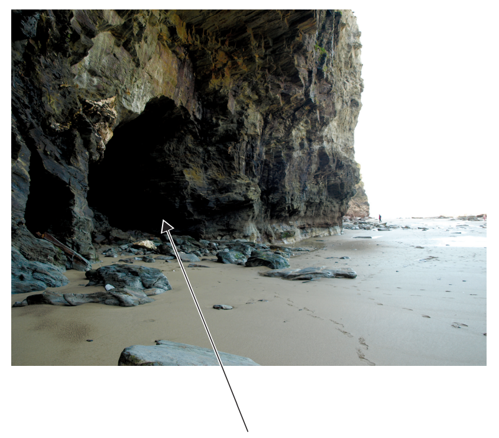
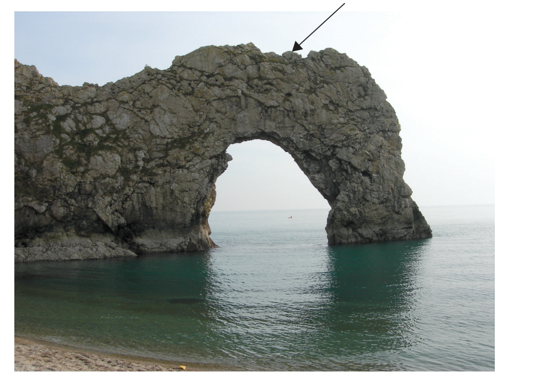
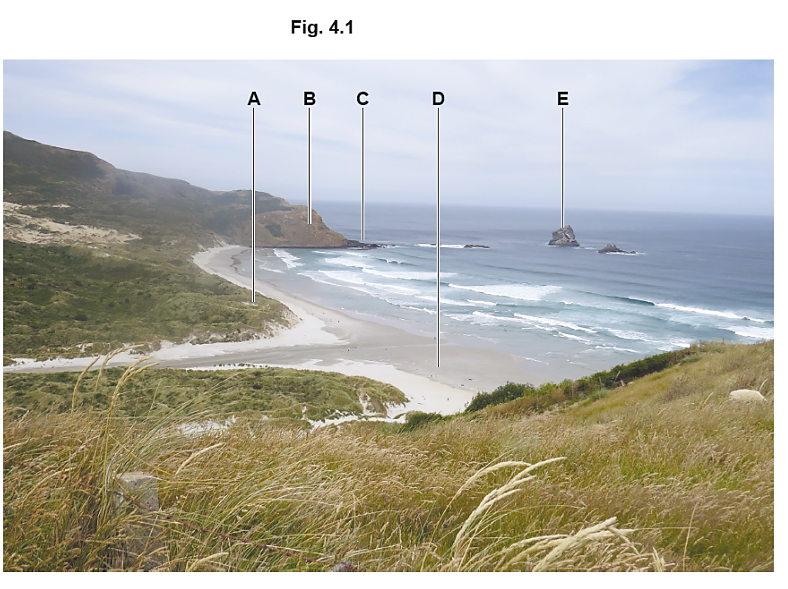
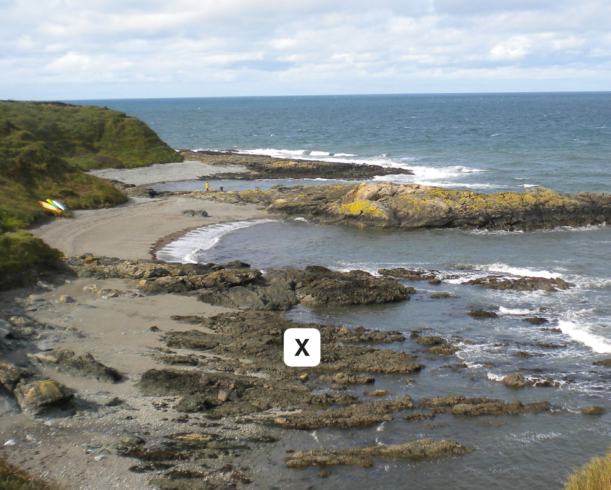

# Exam Questions — Coastal Processes & Landforms
**Changing Coastal Environments** · Cambridge (CIE) IGCSE geography (0460 & 0976)
> Source: [https://www.savemyexams.com/igcse/geography/cie/25/topic-questions/](https://www.savemyexams.com/igcse/geography/cie/25/topic-questions/) · 18 questions across 1 sets

## Exam Questions (18 questions)

### Q1 — hard — 7 marks

**Q1** [7 marks]

Explain how coastal processes lead to the formation of headlands and bays.

### Q2 — medium — 4 marks

**Q2** [4 marks]

Explain how longshore drift affects the formation of coastal landforms.

### Q3 — hard — 7 marks

**Q3** [7 marks]

Study Figs. 4.2, 4.3 and 4.4, which are photographs that show different features formed on a headland.

**Fig. 4.2**

**Fig. 4.3**

**Fig. 4.4 **

Describe how the features shown in Figs. 4.2, 4.3 and 4.4 were formed on a headland.

### Q4 — hard — 7 marks

**Q4** [7 marks]

Explain how wave refraction affects coastal erosion and deposition.

### Q5 — hard — 7 marks

**Q5** [7 marks]

Explain how a sand dune system forms and changes over time.

### Q6 — hard — 7 marks

**Q6** [7 marks]

Explain how caves, arches, stacks, and stumps are formed.

### Q7 — medium — 5 marks

**Q7** [5 marks]

Explain how a spit forms.

### Q8 — medium — 4 marks

**Q8** [4 marks]

Explain how geological structure influences coastal landforms.

### Q9 — medium — 5 marks

**Q9** [5 marks]

Describe how a wave-cut platform forms.

### Q10 — medium — 4 marks

**Q10** [4 marks]

Explain the difference between constructive and destructive waves.

### Q11 — easy — 2 marks

**Q11** [2 marks]

Give two reasons why destructive waves erode coastlines.

### Q12 — easy — 3 marks

**Q12** [3 marks]

Describe how a spit forms.

### Q13 — easy — 1 marks

**Q13** [1 mark]

Identify **one** characteristic of constructive waves.

### Q14 — easy — 2 marks

**Q14** [2 marks]

State two types of coastal erosion.

### Q15 — easy — 1 marks

**Q15** [1 mark]

What is meant by longshore drift?

### Q16 — easy — 5 marks

**Q16** [1 mark]

Fig. 4.1 shows a coastal area in New Zealand. Identify features A–E shown in Fig. 4.1.

Identify feature A.

*Source: June 2024 0460/21 Q4A *

**Q16** [1 mark]

Identify feature B in Fig. 4.1 that shows a coastal area in New Zealand.

*Source: June 2024 0460/21 Q4A *

**Q16** [1 mark]

Identify feature C in Fig. 4.1 that shows a coastal area in New Zealand.

*Source: June 2024 0460/21 Q4A*

**Q16** [1 mark]

Identify feature D in Fig. 4.1 that shows a coastal area in New Zealand.

*Source: June 2024 0460/21 Q4A*

**Q16** [1 mark]

Identify feature E in Fig. 4.1 that shows a coastal area in New Zealand.

*Source: June 2024 0460/21 Q4A*

### Q17 — medium — 4 marks

**Q17** [4 marks]

Explain why bays and headlands form along discordant coastlines.

*Source: Specimen 0460/01 Q2A (IV)*

### Q18 — easy — 6 marks

**Q18** [1 mark]

Study Figure 2.1, a photograph showing a bay at low tide.

Name the coastal landform labelled **X** in Figure 2.1.

*Source: Speciment 0460/01 Q2A I*

**Q18** [2 marks]

**Extract:**

Study Figure 2.1, a photograph showing a bay at low tide.

Name the coastal landform labelled X in Figure 2.1.

The coastal landform is a: Wave-cut platform.

Use Figure 2.1 to identify **two** characteristics of the landform labelled **X**.

*Source: Specimen 0460/01 Q2A II*

**Q18** [3 marks]

**Extract:**

Study Figure 2.1, a photograph showing a bay at low tide.

Use Figure 2.1 to describe the features of the bay. Do **not **refer to landform **X**.

*Source: Specimen 0460/01 Q2A III*

