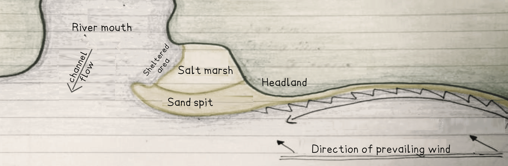

# Mark Schemes — Coasts: Hazards & Opportunities
**Changing Coastal Environments** · Cambridge (CIE) IGCSE geography (0460 & 0976)

## Exam Questions (15 questions)

### Q1
> **[mark-scheme]**
> Any **five **from**:**
> 
> - High salinity / very salty **[1 mark] **
> - Between high and low water mark /  intertidal zone **[1 mark] **
> - Ideal temperature is around 27° / water temperature is higher than 20°C in coldest month **[1 mark] **
> - Seasonal temperature range lower than 5°C / small temperature range **[1 mark] **
> - Gentle wave action / sheltered coastline / delta / estuary / bay **[1 mark] **
> - Low shore gradient, etc. **[1 mark] **
> - High levels of humidity (75–80%) and rainfall per year (1,500–3,000 mm) **[1 mark] **
> 
> The command word ‘**describe**’ means that the answer must state the key environmental  conditions that mangrove swamps need to grow.

### Q2
The sand spit extended further into the Bay of Bengal due to longshore drift moving sediment along the coast from south to north.  **[1]**  The prevailing winds from the south forced the waves to approach the shore at an angle, carrying material in a zigzag motion and depositing sand at the end of the spit.  **[1]**

Over time, more sand was added, and the spit became longer and wider.  **[1]**  It may have been built up by constructive waves, which dropped sediment due to low energy. Some parts of the coastline appear to have been enclosed, possibly forming salt marshes or lagoons in sheltered areas behind the spit.  **[1]**

The change also suggests that deposition became stronger than erosion, allowing the spit to remain stable and grow over time. **[1]**

> **[mark-scheme]**
> **Mark allocation**
> 
> **One mark** will be awarded for each identified stage, to a maximum of 4 marks
> 
> - Process **[1 mark]**
> 
>   - Longshore drift;
>   - Beach materials move from south to north;
> - Wind direction **[1 mark]**
> 
>   - Prevailing/main winds from south/SE;
> - Sequence of development **[1 mark]**
> 
>   - Winds approach at angle;
>   - Swash/waves approach at angle/same angle as wind/from SE;
>   - Backwash at right angles;
>   - Zigzag movement;
> - Final changes **[1 mark]**
> 
>   - Spit becomes longer and wider
>   - Winds/waves from east/wave refraction recurves spit at the end, etc.
>   - Deposition exceeds erosion

> **[exam-tip]**
> - Say **what changed** in the shape or size of the spit.
> - Explain **how it happened** – use terms like longshore drift, deposition, and constructive waves.
> - Say **why** the changes occurred over time.
> - Link the process to the **direction of sediment movement**.
> - **Don’t just describe the map** – explain it using coastal knowledge.

### Q3
The Foreland is made of chalk, which is more resistant than the surrounding clay and sand. **[1]**  Over time, it will be eroded by marine processes such as hydraulic action, where water forces air into cracks, and abrasion, where rocks grind against the cliff. **[1]**

Cracks will be widened, and small caves will be formed on both sides of the headland. **[1]**  These caves may be eroded further until they meet in the middle and form an arch. As erosion continues, the roof of the arch will collapse, leaving a stack. **[1]**

Eventually, the stack will be undercut at the base by waves and collapse to form a stump, which may be seen at low tide. Over time, The Foreland will become narrower and lower as erosion continues. **[1]**

> **[mark-scheme]**
> **Mark allocation**
> 
> **One mark** will be awarded for each step of the process identified.
> 
> - Identify that The Foreland is made of **resistant rock** (chalk).
> - Use correct **erosional processes** (hydraulic action, abrasion).
> - Explain the **sequence**: crack → cave → arch → stack → stump.
> - **Ongoing change**:—stump or worn-down remains.
> - **Final stage**:** **The Foreland will get smaller over time.

> **[exam-tip]**
> - Use the landform sequence clearly and in order.
> - Include correct processes and say what they do.
> - Keep it simple: what happens → what it becomes.
> - Use a diagram if it helps show the sequence.
> - Don’t forget the final stage—stump or worn-down remains.

### Q4
> **[mark-scheme]**
> Any **two **from**:**
> 
> - Seawalls keep waves and high tides from reaching the land behind them, protecting it from erosion and flooding by deflecting wave energy back out to sea. **[1 mark]**
> - Groynes **[1 mark]** reduce longshore drift and this makes the beach wider so it can absorb more of the wave energy before it hits the land. **[1 mark]**
> - Rock armour/riprap  **[1 mark]** are large, irregularly shaped rocks that work by absorbing and deflecting the force of waves, preventing them from directly impacting the shoreline, cliff base, or infrastructure they are placed in front of. **[1 mark]**
> 
> The command word ‘**explain**’ requires you to say how coastal management works.
> 
> **Mark allocation**
> 
> - Two marks will be given for identifying the two sea defences.
> - Two marks for explaining how they work.

> **[exam-tip]**
> You should always comment on the sea defences shown in the photograph.

### Q5
> **[mark-scheme]**
> **F** – gabion/boulders in wire cases, **[1 mark]**
> 
> **G** – rip-rap/boulder barrier/rock armour/pile of boulders/large rocks, **[1 mark]**
> **[mark-scheme]**
> Any **one **from:
> 
> - Absorbs/dissipates/reduces wave energy/power, **[1 mark]**
> 
> **And**
> 
> Any **one **from:
> 
> - Prevents coastal erosion/prevents waves attacking (foot of) cliff/coast, **[1 mark]**
> 
> There must be an explanation as to how the feature works but also where it prevents coastal erosion.
> **[mark-scheme]**
> Any **two **from:
> 
> - Expensive/not cost-effective. **[1 mark]**
> - The coast may not be worth protecting. **[1 mark]**
> - People consider hard engineering as ugly/an eyesore. **[1 mark]**
> - Riprap can be dangerous/can prevent crossing and/or make access to the beach difficult. **[1 mark]**
> - Impacts further along the coast (loss of beach sediment and increased erosion). **[1 mark]**
> - Loss of beach area/habitats. **[1 mark]**

### Q6
> **[mark-scheme]**
> Any **one **from
> 
> - Shingle **[1 mark]**
> - Pebbles **[1 mark]**
> - Gravel **[1 mark]**
> - Stones **[1 mark]**
> - Different coloured stones **[1 mark]**
> - Small rocks **[1 mark]**
> - Cobbles **[1 mark]**
> **[mark-scheme]**
> The wooden structure is reducing longshore drift because:
> 
> - Beach material has built up on one side of the structure or groyne. **[1 mark]**
> 
> **OR**
> 
> - The extent the sea reaches up the beach is different on either side of the structure or groyne. **[1 mark]**
> 
> **OR**
> 
> - The height of the material differs on one side of the structure or groyne from the other. **[1 mark]**

### Q7
> **[mark-scheme]**
> Any **two** from
> 
> - Tourism **[1 mark]**
> - Settlement **[1 mark]**
> - Industry **[1 mark]**
> - Jobs/employment **[1 mark]**
> - Residential/housing **[1 mark]**

### Q8
> **[mark-scheme]**
> Any **two **from:
> 
> - Storm surges from low-pressure storms (like tropical storms) cause a rapid rise in sea level **[1 mark]**
> - Storm tides when there is a combination of a high tide and a low-pressure storm **[1 mark]**
> - Tsunamis caused by underwater earthquakes  **[1 mark]**
> - King tides  **[1 mark]**
> - Sea level rise due to global warming  **[1 mark]**
> - Flooding from high river discharge after a storm  **[1 mark]**

### Q9
Name of coastal area: Jurassic Coast, Dorset, UK.

The Jurassic Coast offers numerous opportunities for people due to its diverse geological features and natural environment. **[KU]** The area offers significant economic, social, and environmental benefits that support local communities and attract visitors from around the world. **[KU]**

Along the Jurassic coastal area of Dorset, tourism is the primary economic opportunity, with over 15 million visitors annually generating £1.2 billion for the local economy. **[KU]** The World Heritage Site status attracts geologists, fossil hunters, and educational groups to locations like Lyme Regis and Charmouth. **[KU]**  Fossil hunting provides income for local guides and shops selling geological specimens and equipment. **[KU]**

Recreational activities create employment opportunities, including surfing schools at Kimmeridge Bay, sailing clubs in Poole Harbour, and coastal walking guides along the South West Coast Path. **[KU]**  These activities support local businesses, including equipment hire, accommodation, and catering services. **[KU]**

Fishing remains important, with Weymouth and Portland providing harbours for commercial fishing fleets to catch crabs, lobsters, and other fish species. **[KU]**  This sector supports processing facilities, fishing markets, and restaurants that specialise in local seafood. **[KU]**

The coast provides residential opportunities, with many settlements like Swanage and Bridport offering attractive living environments that command premium property prices. **[KU]** Retirement communities are particularly drawn to the mild climate and scenic coastal environment. **[KU]**

Educational opportunities include the Jurassic Coast Trust providing learning programs for schools and universities studying geology, geography, and marine biology. **[KU]**  Research stations and field study centres support academic institutions and provide employment for educators and researchers. **[KU]**

These diverse opportunities demonstrate how coastal environments can support sustainable economic development while preserving environmental quality. **[KU]**

> **[mark-scheme]**
> The command word is **'explain,'** which means that the answer must give reasons for how the coast provides opportunities for people in a named coastal area and show the relationships between different factors.
> 
> **Mark allocation**
> 
> - AO2 focus = knowledge and understanding. **[KU]**
> 
> This is a **'level of response'** answer. Each point made in the answer does not equal a mark.
> 
> - A Level 3 answer will use specific examples that demonstrate
> - Knowledge of:
> 
>   - The range of economic opportunities available.
>   - The types of employment created.
>   - The scale and value of different activities.
>   - The social and environmental benefits.
>   - Specific locations and examples.
> - Understanding of:
> 
>   - How coastal features create opportunities.
>   - Why certain activities are suited to coastal locations.
>   - How different opportunities interact and support each other.
>   - The relationship between coastal environment and human activities.
> 
> **Alternative content**
> 
> The answer provided above is just one example of a response to this question and does depend on the case study chosen. Other information that could be used in the answer includes:
> 
> - Renewable energy: 'Offshore wind farms like those planned off the Dorset coast provide opportunities for green energy production and maintenance jobs.'
> - Aquaculture: 'Oyster farming in Poole Harbour creates sustainable food production and employment opportunities.'
> - Conservation work: 'The National Trust and other organisations provide employment in habitat management and visitor education.'

> **[exam-tip]**
> - Always name the place (you won't receive a Level 3 without it).
> - Give details—say where opportunities exist (e.g. Lyme Regis), and include figures (e.g. 15 million visitors).
> - Say how each opportunity works—don't just name it.
> - End with a realistic judgement—show how opportunities can be sustainable.

### Q10
Hurricane Sandy struck the eastern United States in October 2012, causing severe impacts on coastal areas, particularly in New York and New Jersey. **[KU]** The storm brought devastating storm surges, high winds, and heavy rainfall that transformed coastal landscapes. **[KU]**

Storm surge reached 4.3 metres in Staten Island, flooding thousands of homes and businesses along the waterfront. **[KU] **The surge destroyed sections of the famous Coney Island boardwalk and caused extensive damage to coastal infrastructure. **[KU]**

Wave action and storm surge caused severe coastal erosion along the New Jersey shoreline, particularly at Seaside Heights, where the iconic pier was destroyed. **[KU]** Beaches were stripped of sand, with some areas losing over 30 metres of coastline in a single night. **[KU]**

Flooding affected over 300,000 homes across New York City, with areas like the Rockaways experiencing water levels 3 metres above normal. **[KU]** The storm surge overwhelmed sea defences and flooded subway tunnels, causing transport chaos for weeks. **[KU]**

Economic impacts were severe, with total damages estimated at \$65 billion across affected states. **[KU]** The Port of New York and New Jersey was closed for several days, disrupting international trade and supply chains. **[KU]**

Environmental impacts included saltwater contamination of freshwater supplies and destruction of coastal wetlands that normally provide natural flood protection.** [KU]** Over 8.5 million people lost power, with some areas remaining without electricity for weeks. **[KU]**

The storm highlighted the vulnerability of densely populated coastal areas to extreme weather events and led to major changes in coastal management policies. **[KU]**

> **[mark-scheme]**
> The command word is **'describe,'** which means that the answer must state the key points of tropical storm impacts on coastal areas for a named example and provide its characteristics and main features.
> 
> **Mark allocation**
> 
> - AO2 focus = knowledge and understanding. **[KU]**
> 
> This is a **'level of response'** answer. Each point made in the answer does not equal a mark.
> 
> - A Level 3 answer will use specific examples that demonstrate
> - Knowledge of:
> 
>   - The scale and intensity of the tropical storm.
>   - The range of coastal impacts experienced.
>   - Specific locations affected.
>   - Quantified data on damages and effects.
>   - Short-term and longer-term consequences.
> - Understanding of:
> 
>   - How tropical storms generate coastal impacts.
>   - Why certain areas were more vulnerable.
>   - The relationship between storm characteristics and damage patterns.
>   - The wider significance of the impacts.
> 
> **Alternative content**
> 
> The answer provided above is just one example of a response to this question and does depend on the case study chosen. Other information that could be used in the answer includes:
> 
> - Social impacts: 'Over 100 people died, with many coastal communities evacuated for safety.'
> - Infrastructure damage: 'Airports like LaGuardia were flooded, with runways under 2 metres of water.'
> - Recovery efforts: 'Federal disaster relief totalled over \$50 billion for rebuilding coastal defences.'

> **[exam-tip]**
> - Always name the tropical storm (you won't get a Level 3 without it).
> - Give details—say where impacts occurred (e.g. Staten Island), and include figures (e.g. 4.3 metres surge).
> - Explain what each impact involved—don't just list them.
> - End with a realistic judgement—show that impacts were both immediate and long-lasting.

### Q11

*Formation of a sand spit J. Cartwright 2025*

As the diagram above shows, a sand spit is a long, narrow landform that protrudes out into the sea from a headland or across the mouth of a river or bay. **[KU] **It is usually curved or hooked at one end, and the land behind it is often sheltered and low-lying. **[KU] **In the calm waters, dunes may form on top of the spit, and a salt marsh may develop behind it. **[KU]**

Spits are usually formed on coastlines with plenty of sediment and strong longshore drift. **[KU] **Sediment is carried along the coast by longshore drift, which moves material in a zigzag pattern due to the angle of the waves and the direction of the prevailing wind. **[KU] **When there is a sudden change in the shape of the coastline, like a bay or a river mouth, the waves lose energy and deposition takes place. **[KU]**

Over time, more sand and shingle are deposited in the sheltered water, and the spit starts to grow outwards. **[KU] **As it grows longer, the end is often curved due to changes in wind direction or wave refraction. This curved part is sometimes called a hook. **[KU]**

The area behind the spit is sheltered from strong waves, so mud and silt are deposited, and salt marshes can form. **[KU] **The spit itself may be raised above sea level by wind-blown sand, which forms small dunes. **[KU]**

One well-known example is Spurn Head in the UK, which has a curved end with dunes and salt marshes behind it. **[KU]**

> **[mark-scheme]**
> The command words are **'describe **and** explain,' **which means that the answer must say what a spit looks like and then say how the spit is formed.
> 
> **Mark allocation**
> 
> - AO2 focus = knowledge and understanding.  **[KU]**
> 
> This is a **'level of response'** answer. Each point made in the answer does not equal a mark.
> 
> - A Level 3 answer will use specific examples that demonstrate
> - **K**nowledge of:
> 
>   - The **physical features** of a sand spit.
>   - The **location** where a spit forms.
>   - The **processes involved**.
> - **U**nderstanding** **of:
> 
>   - How **sediment **is transported.
>   - Why a** spit develops** outward and curves.
>   - The **connection **between sheltered conditions and salt marsh formation.
> 
> **Common errors**
> 
> - Credit is available for using a labelled diagram and referring to the diagram in the answer.
> - A fully annotated diagram can gain maximum marks.

> **[exam-tip]**
> Using a **named example** like Spurn Head or Hurst Castle Spit is not required but shows strong knowledge.

### Q12
In Nassau County, Florida, coastal erosion has been a serious problem, especially on Amelia Island and around Fernandina Beach. **[KU] **To reduce the impacts, a range of hard and soft engineering methods have been used.** [KU]**

A concrete seawall was built along South Fletcher Avenue after Hurricane Matthew in 2016. This seawall protected the houses and roads that were at risk from flooding. **[KU]**

Rock revetments were installed in front of beach access points near Sadler Road and Seaside Park. **[KU] **These helped absorb wave energy and reduce dunes' erosion. However, they needed regular maintenance and sometimes made erosion worse further along the beach. **[KU]**

Groynes were placed on northern beaches to trap sand moving along the shore. **[KU] **These measures helped widen the beach in those areas but caused erosion further down the coast, where sand could not naturally move. **[KU]**

Beach nourishment projects have also been carried out. In 2020, 700,000 cubic yards of sand were added to beaches on Amelia Island, costing over \$10 million. The work widened the beach and helped protect turtle nesting sites. **[KU]**

To support this, dune restoration was done by planting over 15,000 sea oats with help from local groups. Sand fences were installed in zig-zag patterns to trap sand and rebuild dunes naturally. **[KU]**

These combined efforts have made the coast more resilient, though ongoing maintenance and funding are still needed to manage long-term erosion. **[KU]**

> **[mark-scheme]**
> The command word is **'describe,' **which means that the answer must state the key points of attempts to manage erosion in a named coastal area and provide its characteristics and main features.
> 
> **Mark allocation**
> 
> - AO2 focus = knowledge and understanding.  **[KU]**
> 
> This is a **'level of response'** answer. Each point made in the answer does not equal a mark.
> 
> - A Level 3 answer will use specific examples that demonstrate
> - **K**nowledge of:
> 
>   - Why management is needed.
>   - The range of coastal erosion strategies used.
>   - Their locations.
>   - The scale and cost.
>   - The benefits and limitations.
> - **U**nderstanding** **of:
> 
>   - How each strategy works.
>   - Why different approaches are chosen.
>   - How strategies interact with the natural system.
>   - The need for continued maintenance or adaptation.
> 
> **Alternative** **content**
> 
> The answer provided above is just one example of a response to this question and does depend on the case study chosen. Other information that could be used in the answer includes:
> 
> - Managed retreat: 'In some areas, development has been restricted to allow dunes and wetlands to move naturally. This is seen near Egan’s Creek Greenway.'
> - Zoning laws: 'New buildings must be set back from the shoreline and built on pilings to reduce flood risk.'
> - Community education: 'Groups like Keep Nassau Beautiful have helped educate residents and organise dune planting.'

> **[exam-tip]**
> - Always name the place (you won’t get a Level 3 without it).
> - Give details—say where methods were used (e.g. Seaside Park), and include figures (e.g. 700,000 cubic yards).
> - Say what each method does—don’t just name it.
> - End with a realistic judgement—show that managing erosion is ongoing.

### Q13
The Great Barrier Reef, off the coast of northeast Australia, is important for many reasons. Located off the coast of Queensland, Australia, it is the largest coral reef system in the world. **[KU] **The reef system acts as natural walls that absorb wave energy, protecting coastal towns from erosion and storm damage. **[KU]**

The reef is home to around 9,000 known marine species, so it helps biodiversity. **[KU] **This is important for the fishing industry, as many fish breed and live in the reef, providing jobs and food for local communities. **[KU]**

The reef has cultural significance, as Indigenous Australian groups like the Yirrganydji and Gurang people **[KU]** have cared for it for thousands of years using their traditional ecological knowledge. **[KU]** The reef's diversity has helped scientists to find medicines to treat diseases like cancer and arthritis. **[KU]**

In addition, the reef supports tourism by attracting millions of visitors for diving and snorkelling, **[KU]** which contributes over AU\$6 billion (about US\$4 billion) to the Australian economy each year. **[KU]** The reef, through tourism, recreation, and fishing, supports over 64,000 jobs. **[KU]**

Without the reef, Australia's coast would have less protection, which could potentially result in the loss of many jobs. **[KU]**

> **[mark-scheme]**
> The command word is '**explain**' and answers should say why coral reefs are important and support with detailed evidence in a named area.
> 
> **Mark allocation**
> 
> - AO2 focus = knowledge and understanding.
> 
> This is a **'level of response'** answer. Each point made in the answer does not equal a mark.
> 
> - A Level 3 answer will use specific examples that demonstrate detailed, developed knowledge and understanding **[KU]** of the importance of coral reefs in a specified coastal area.
> 
> **Alternative** **content**
> 
> The answer above is just one example of a response to this question. Other information that could be used in the answer includes:
> 
> - The coast receives protection from tsunamis.
> - Provides sheltered anchorage and harbours.
> - It maintains marine ecosystems and food chains.

> **[exam-tip]**
> - Always name the place (you won’t get a Level 3 without it).
> - Provide comprehensive explanations, rather than just lists, and include reasons why the reef is important.
> - Think of different types of importance: environmental, political, economic, social, and scientific.

### Q14
The impacts of tropical storms may be reduced in various ways. Warning systems, like sirens, weather alerts, and social media, can help people prepare ahead of time. **(1)** Evacuation plans allow people to move to safer places, especially shelters built on high ground.  **(d)**

In HICs, there is more money and technology to predict storms using satellites and radar, so fewer lives are lost. **(1) **However, we cannot stop tropical storms, and poorer countries may lack the necessary resources to warn people or protect their homes. **(d)**

Therefore, a country's success depends on its level of wealth and preparation. **(1)**

> **[mark-scheme]**
> AO3 focus = evaluate and make decisions.
> 
> **Mark allocation**
> 
> - **1 mark** for evaluation/judgement of the management of tropical storm impacts.
> - **1 mark **for a simple point **(1) **x 4 or
> - **2 marks** for a developed point **(2d) ** x 2
> 
> **Alternative content**
> 
> The answer above is just one example of a response to this question. Other information that could be used in the answer includes:
> 
> - Planning and educating people about evacuation.
> - Evacuating people to high ground or further inland.
> - Building defences at at-risk coasts.
> - Poor level of LIC building standards.

> **[exam-tip]**
> Always include evaluation – say what works, but also what doesn’t or what limits exist.
> 
> Use one example in context (e.g. HIC vs LIC) even if not asked – it shows deeper thinking.

### Q15
In November, the east coast sees an average of nine cyclones, while the west coast has two. **[1] **In February, both the east and west coasts had no cyclones. **[1] **Cyclones affect the east coast for 10 months, while the west coast experiences them for 7 months. **[1]**

> **[mark-scheme]**
> The command word is ‘**compare**’; this means the answer needs to identify both similarities and differences between two or more things.
> 
> **Mark allocation**
> 
> AO2: Skills and analysis are assessed.
> 
> - **1 mark** for using data.
> - **2 marks** for comparing the average monthly frequency of tropical cyclones.
> 
> **Alternative content**
> 
> The answer above is just one example of a response to this question. Alternative information that could be used includes:
> 
> - Reference to frequency, which is higher on east coast but lower on west coast
> 
>   - 22 on west coast and 33 on east coast
> - May, June, September, October, November, and December see cyclones on both east and west coasts.

> **[exam-tip]**
> If the question asks for data, a mark or two will be reserved for that data in your answer. Not using the data limits your available marks, no matter how well you wrote the response
