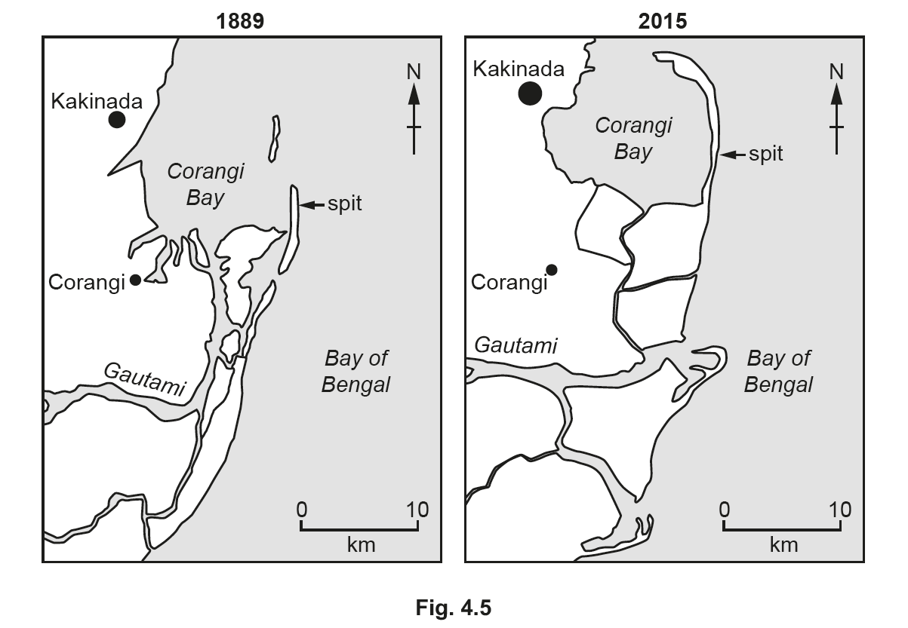
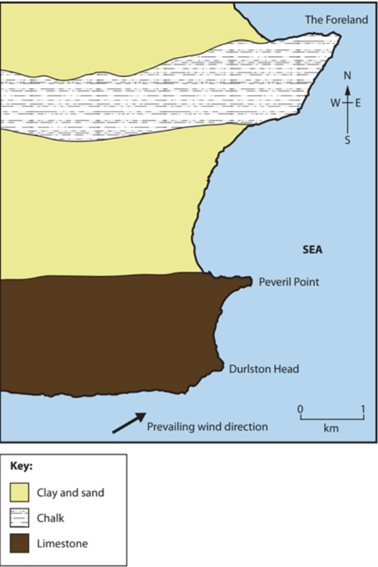
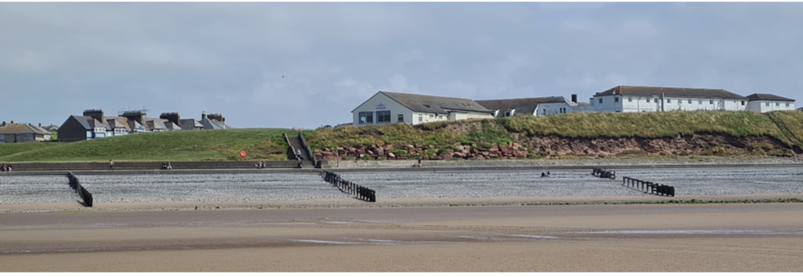
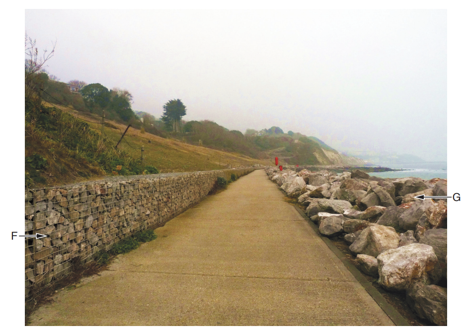
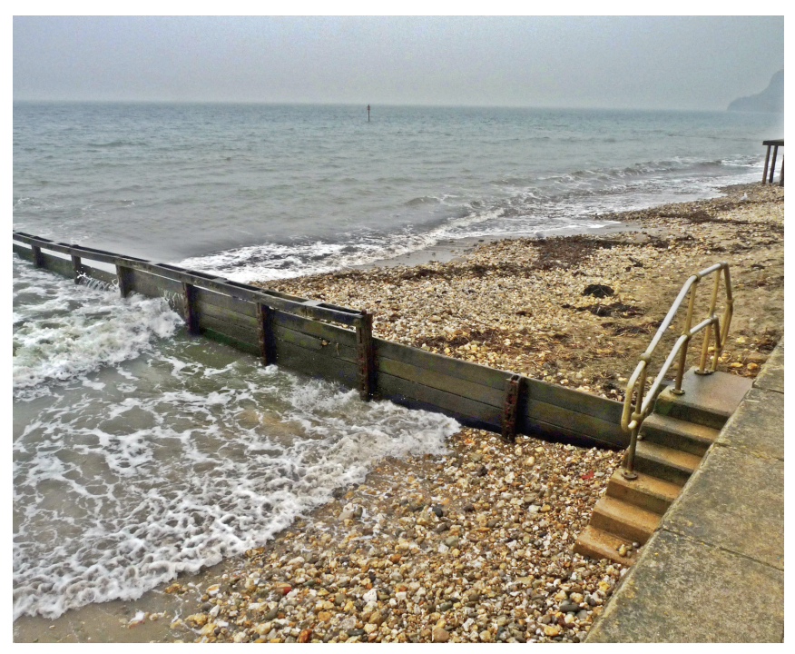
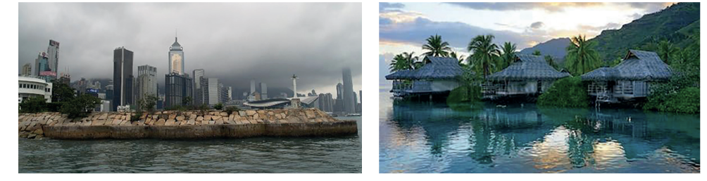
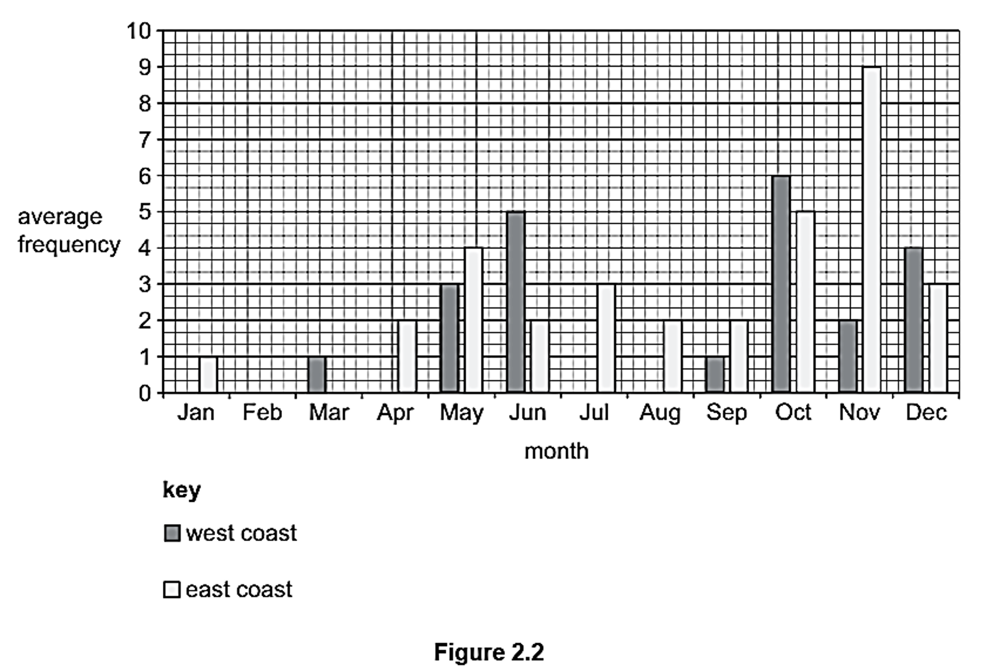

# Exam Questions — Coasts: Hazards & Opportunities
**Changing Coastal Environments** · Cambridge (CIE) IGCSE geography (0460 & 0976)
> Source: [https://www.savemyexams.com/igcse/geography/cie/25/topic-questions/](https://www.savemyexams.com/igcse/geography/cie/25/topic-questions/) · 15 questions across 1 sets

## Exam Questions (15 questions)

### Q1 — medium — 5 marks

**Q1** [5 marks]

Study Fig. 3.2 (below), which is a photograph showing an area of mangroves.

Describe the conditions that are required for the development of mangrove swamps.

*Source: June 2020 0460/12 Q3B*

### Q2 — medium — 5 marks

**Q2** [5 marks]

Study Fig. 4.5, which shows the Godavari sand spit in Andhra Pradesh, India.

Suggest how coastal processes changed the Godavari sand spit between 1889 and 2015.

*Source: 2021 0976/12 Q4B II*

### Q3 — medium — 5 marks

**Q3** [5 marks]

Study Fig. 1, which shows a discordant coastline.

**Fig. 1**

Explain how The Foreland will change over time.  You may include a diagram in your answer.

*Source: June 2020 046/12 Q2AII*

### Q4 — medium — 4 marks

**Q4** [4 marks]

Study Fig. 1, which shows sea defences

**Fig. 1 - Sea defences**

Explain how two of the coastal management strategies shown protect the coast from erosion.

*Source: June 2020 0460/12 Q2AI*

### Q5 — easy — 6 marks

**Q5** [2 marks]

Fig. 3.2 shows two methods of coastal protection, F and G.

**Fig. 3.2**

Describe the structures F and G.

*Source: 2019 Oct/Nov 0460/23 Q3B 1*

**Q5** [2 marks]

**Extract:**

Fig. 3.2 shows two methods of coastal protection, F and G.

F – gabion/boulders in wire cases

G – rip-rap/boulder barrier/rock armour/pile of boulders/large rocks

Explain how structure G protects the coast.

*Source: 2019 Oct/Nov 0460/23 Q3B II*

**Q5** [2 marks]

**Extract:**

Fig. 3.2 shows two methods of coastal protection, F and G.

F – gabion/boulders in wire cases

G – rip-rap/boulder barrier/rock armour/pile of boulders/large rocks

Some people think that the coastal protection methods seen in Fig. 3.2 should not have been built.

Explain why people might be opposed to this coastal protection scheme.

*Source: 2019 Oct/Nov 0460/23 Q3B III*

### Q6 — easy — 2 marks

**Q6** [1 mark]

Study Fig. 3.1, which is a photograph showing a method of coastal protection.

**Fig. 3.1**

Describe the beach material in Fig. 3.1.

*Source: Nov 2019 0460/23 Q3A I*

**Q6** [1 mark]

**Extract:**

Study Fig. 3.1, which is a photograph showing a method of coastal protection.

Fig. 3.1

Describe the evidence in Fig. 3.1 that the wooden structure is reducing longshore drift.

*Source: Nov 2019 0460/23 Q3A II*

### Q7 — easy — 2 marks

**Q7** [2 marks]

Study Fig. 1, which are photographs of two contrasting coastal areas

Using Fig. 1, suggest two opportunities for people that a coastline provides.

### Q8 — easy — 2 marks

**Q8** [2 marks]

Suggest two natural coastal hazards.

### Q9 — hard — 7 marks

**Q9** [7 marks]

For a named coastal area you have studied,  explain how the coast provides opportunities for people.

Name of coastal area...

### Q10 — hard — 7 marks

**Q10** [7 marks]

For a named tropical storm you have studied, describe the impacts on coastal areas.

Name of tropical storm...

### Q11 — hard — 7 marks

**Q11** [7 marks]

Describe the features of a sand spit and explain how it has been formed. You may include a labelled diagram.

*Source: Nov 2020 0460/13 Q3C*

### Q12 — hard — 7 marks

**Q12** [7 marks]

For a named coastal area you have studied, describe attempts to manage erosion.

Name of coastal area...

*Source: Nov 2020 0460/11 Q3C*

### Q13 — hard — 7 marks

**Q13** [7 marks]

Explain the importance of coral reefs to a coastal area you have studied.

*Source: Specimen 0460/01 Q2C*

### Q14 — medium — 5 marks

**Q14** [5 marks]

Evaluate the different ways in which the impacts of tropical storms (cyclones, hurricanes and typhoons) can be managed.

*Source: Specimen 0460/01 Q2B I*

### Q15 — easy — 3 marks

**Q15** [3 marks]

Figure 2.2, shows the average monthly frequency of tropical cyclones affecting India’s west and east coasts.

Use Figure 2.2 to compare the average monthly frequency of tropical cyclones on India’s west and east coasts. Refer to data in your answer.

*Source: Specimen 0460/01 Q2B I*

