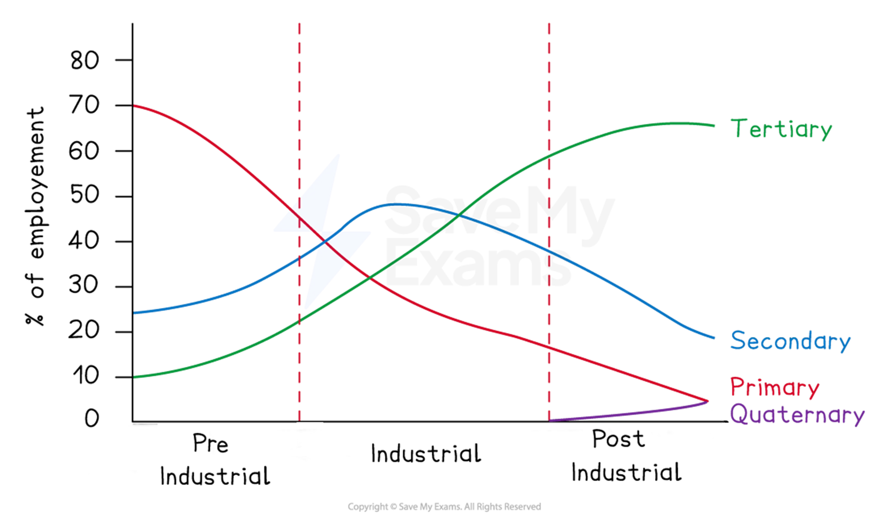
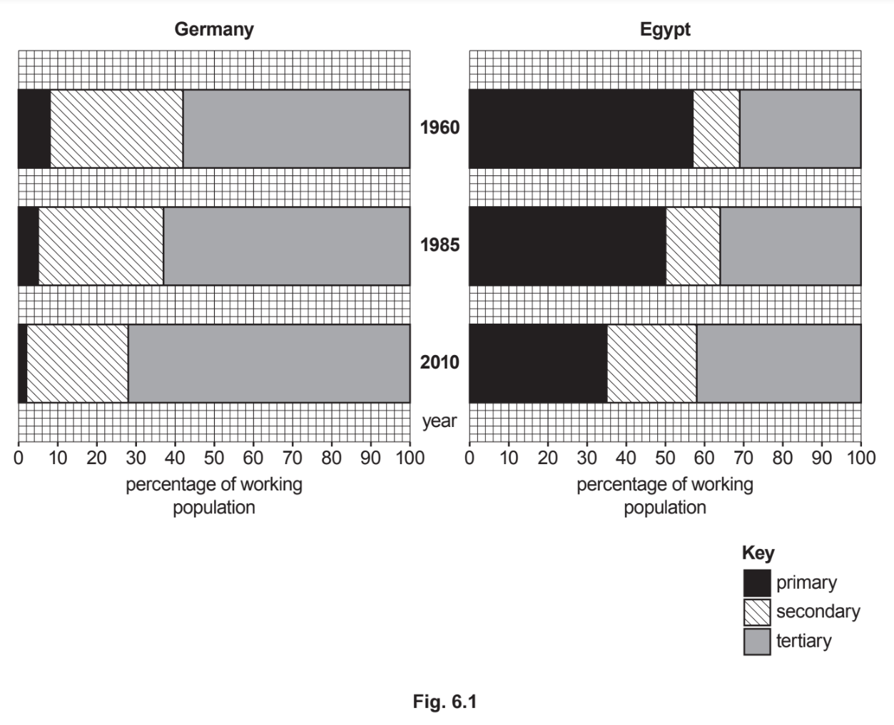
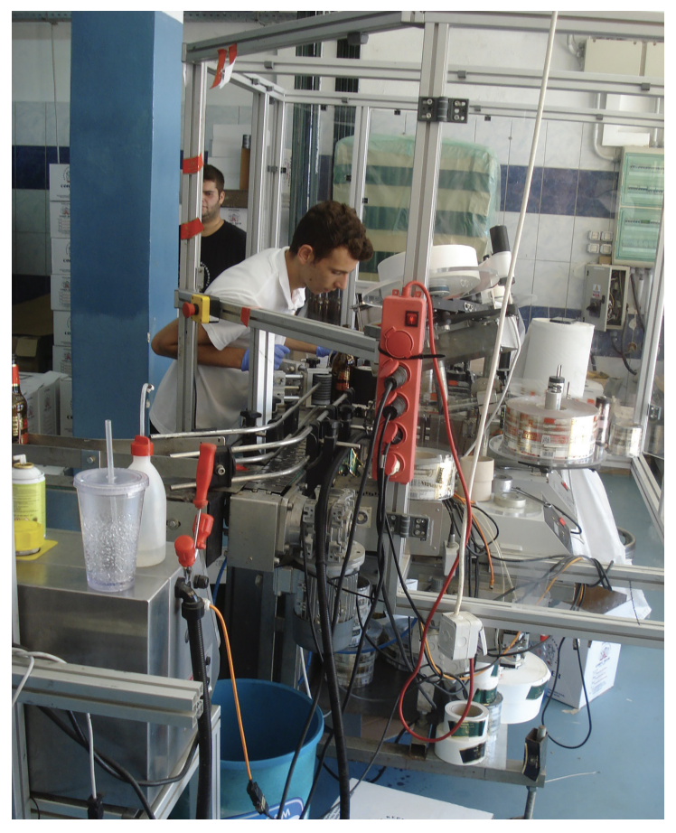
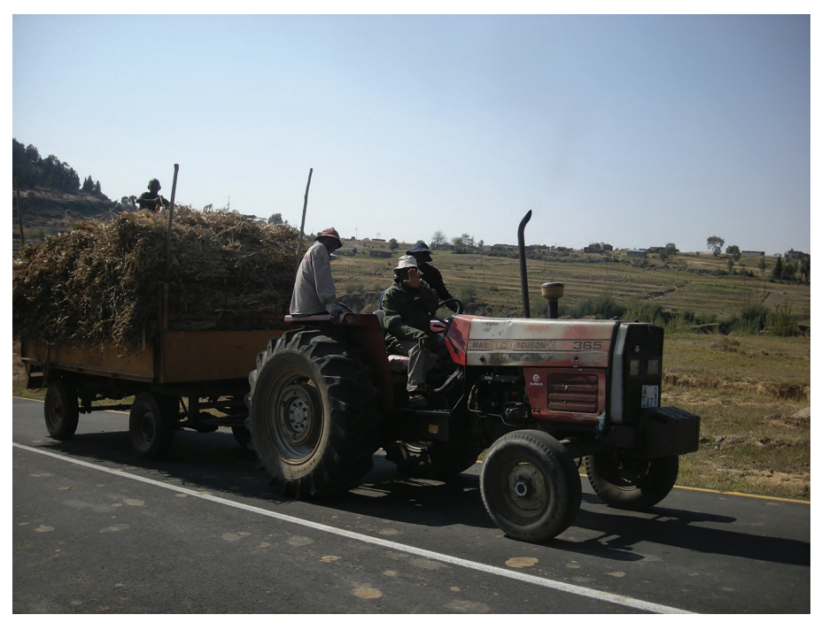

# Exam Questions — Changing Employment Structures
**Changing Economies** · Cambridge (CIE) IGCSE geography (0460 & 0976)
> Source: [https://www.savemyexams.com/igcse/geography/cie/25/topic-questions/](https://www.savemyexams.com/igcse/geography/cie/25/topic-questions/) · 14 questions across 1 sets

## Exam Questions (14 questions)

### Q1 — hard — 7 marks

**Q1** [7 marks]

Evaluate the social and economic impacts of growth in the tertiary and quaternary sectors in HICs.

### Q2 — hard — 7 marks

**Q2** [7 marks]

Evaluate the extent to which globalisation is responsible for changing employment structures in MICs?

### Q3 — hard — 7 marks

**Q3** [7 marks]

Assess the impacts of deindustrialisation on people and places in HICs.

### Q4 — hard — 7 marks

**Q4** [7 marks]

Assess the extent to which mechanisation changes employment structures in LICs and MICs.

### Q5 — medium — 5 marks

**Q5** [5 marks]

Suggest reasons for the decline of secondary industry in many high-income countries (HICs).

### Q6 — medium — 5 marks

**Q6** [5 marks]

Suggest reasons why MICs often experience rapid growth in secondary sector employment.

### Q7 — medium — 4 marks

**Q7** [4 marks]

Explain why employment in the primary sector is high in many low-income countries (LICs).

### Q8 — medium — 4 marks

**Q8** [4 marks]

Study Fig. 1, the Clark-Fisher model.

Using  Fig. 1, describe how employment structure changes as countries develop.

### Q9 — hard — 7 marks

**Q9** [7 marks]

Evaluate the usefulness of employment structure data in showing a country’s level of development.

### Q10 — easy — 2 marks

**Q10** [2 marks]

Identify one physical and one economic factor that affects an industry's location?

### Q11 — easy — 6 marks

**Q11** [1 mark]

Study Fig. 6.1 shows the employment structures of Germany (an HIC) and Egypt (an LIC) in 1960, 1985, and 2010.

What percentage of the working population was employed in the primary sector in Egypt in 1960?

*Source: June 2020 0460/12 Q6A I*

**Q11** [2 marks]

**Extract:**

Study Fig. 6.1 shows the employment structures of Germany (an HIC) and Egypt (an LIC) in 1960, 1985, and 2010.

Identify one similarity and one difference between the employment structures of Germany and Egypt in 2010.

Similarity .......................

Difference .........................

*Source: June 2020 0460/12 Q6AII*

**Q11** [3 marks]

**Extract:**

Study Fig. 6.1 shows the employment structures of Germany (an HIC) and Egypt (an LIC) in 1960, 1985, and 2010.

Suggest reasons for the decline of employment in secondary industry in Germany since 1985.

*Source: June 2020 0460/12 Q6AIII*

### Q12 — easy — 1 marks

**Q12** [1 mark]

Identify what is meant by an economic sector.

### Q13 — medium — 5 marks

**Q13** [5 marks]

Explain why the employment structure of a country is a good indicator of its level of development.

*Source: June 2021 0460/11 Q5B II*

### Q14 — easy — 3 marks

**Q14** [3 marks]

Study Figs. 5.2, 5.3 and 5.4, which are photographs showing different employment sectors.

**Fig. 5.2**

**Fig. 5.3**

**Fig. 5.4**

Identify the employment sectors shown in each of Figs. 5.2, 5.3 and 5.4.

*Source: June 2021 0460/11 Q5B I*

