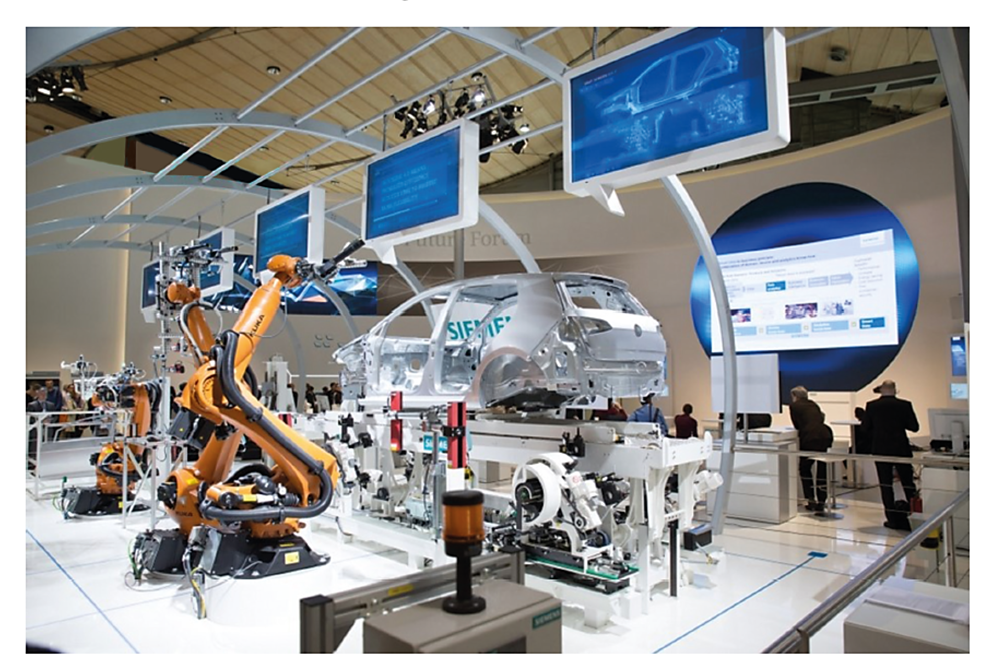
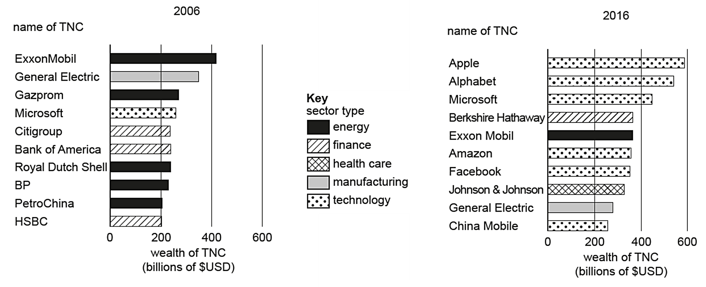
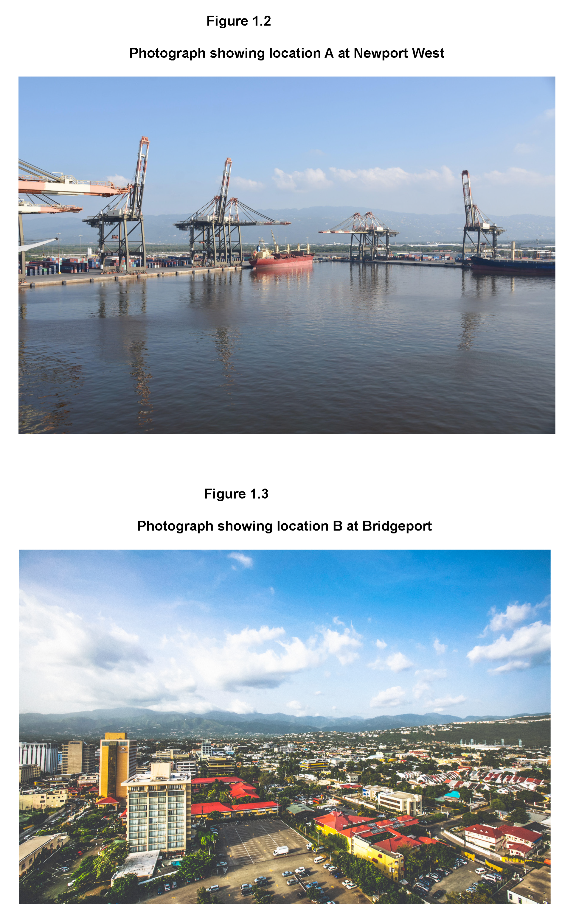

# Exam Questions — Impact of Globalisation & Transnational Corporations (TNCs)
**Changing Economies** · Cambridge (CIE) IGCSE geography (0460 & 0976)
> Source: [https://www.savemyexams.com/igcse/geography/cie/25/topic-questions/](https://www.savemyexams.com/igcse/geography/cie/25/topic-questions/) · 16 questions across 1 sets

## Exam Questions (16 questions)

### Q1 — hard — 7 marks

**Q1** [7 marks]

Assess the extent to which TNCs bring environmental sustainability to host countries?

### Q2 — hard — 7 marks

**Q2** [7 marks]

Assess the extent to which globalisation reduces the development gap.

### Q3 — hard — 7 marks

**Q3** [7 marks]

Assess how globalisation has changed culture in one named place you have studied.

### Q4 — hard — 7 marks

**Q4** [7 marks]

Evaluate the role of a named TNC in driving globalisation.

### Q5 — medium — 5 marks

**Q5** [5 marks]

Using a named example, explain how globalisation has changed employment structures.

### Q6 — medium — 4 marks

**Q6** [4 marks]

Describe two cultural impacts of globalisation.

### Q7 — medium — 4 marks

**Q7** [4 marks]

Explain **two **reasons why globalisation has increased in recent decades.

### Q8 — easy — 1 marks

**Q8** [1 mark]

Identify **one **main factor encouraging the rise of the global economy.

### Q9 — easy — 3 marks

**Q9** [3 marks]

Give **three **positive impacts of globalisation.

### Q10 — easy — 3 marks

**Q10** [3 marks]

Study Fig. 6.3, which shows a high-tech industry.

*Fig. 6.3*

**Describe **the features of the high-tech industry shown in Fig. 6.3.

### Q11 — easy — 3 marks

**Q11** [3 marks]

Study Fig. 6.2, which shows the ten wealthiest transnational corporations (TNCs) in the world in 2006 and 2016.

*Fig. 6.2*

**Complete **the following passage to describe the changes shown between 2006 and 2016 in Fig. 6.2.

In 2006 half of the wealthiest TNCs were in the ........................ sector, whereas in 2016 most of the TNCs were in the ........................ sector. Only ........................ named TNCs were in the top ten for both 2006 and 2016. The overall wealth of TNCs had ........................ in 2016 and all TNCs earned more than \$USD ........................ billion. A new sector, ........................ , joined the top ten in 2016, but no TNCs in this sector were listed in 2006.

*Source: Nov 2023 0460/23 Q6B*

### Q12 — hard — 7 marks

**Q12** [7 marks]

Describe the features and global links of a named transnational corporation (TNC) that you have studied.

*Source: Nov 2024 0460/11 Q5C*

### Q13 — medium — 5 marks

**Q13** [5 marks]

Major urban areas like Beijing, China, and Mumbai, India, are home to many transnational corporations (TNCs).

Suggest the advantages and disadvantages of these transnational corporations for residents of cities like Beijing and Mumbai.

### Q14 — medium — 5 marks

**Q14** [5 marks]

Explain how changes in technology have enabled globalisation to occur.

*Source: June 2020 0460/13 Q6B*

### Q15 — hard — 7 marks

**Q15** [7 marks]

A TNC is considering the following locations for its factory.

Location **A:  **At Newport West, in and around grid square 6748. Figure 1.2  is a photograph of this area.

Location **B: **At Bridgeport, in and around grid square 6244. Figure 1.3  is a photograph of this area.

[Map extract](https://www.cambridgeinternational.org/Images/719016-2027-specimen-paper-survey-map-2.pdf)

Use evidence from the map extract and Figures 1.2 and 1.3 to identify which location you consider to be the most suitable for the TNC to locate the factory.

Refer to Location **A** and **B **when justifying your decision.

*Source: Specimen 0460/02 Q1C II*

### Q16 — easy — 1 marks

**Q16** [1 mark]

Define the term transnational corporation.
