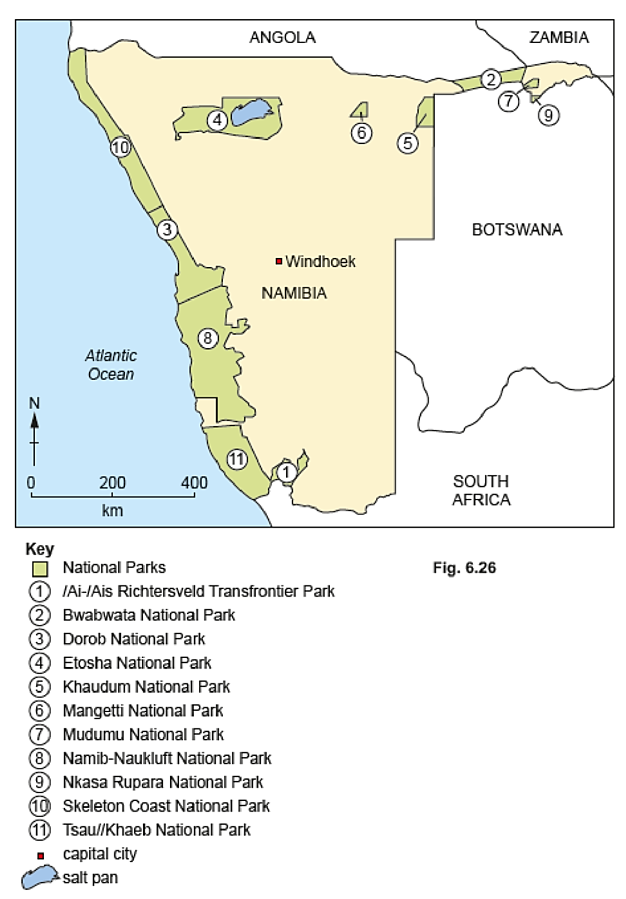
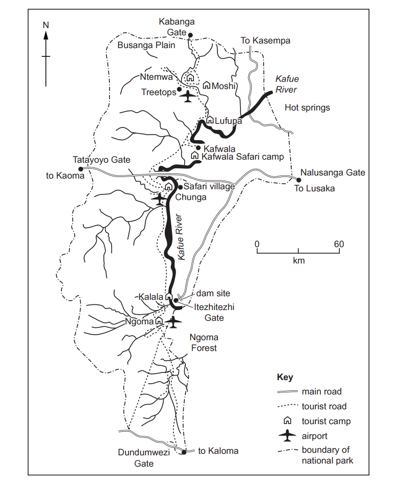
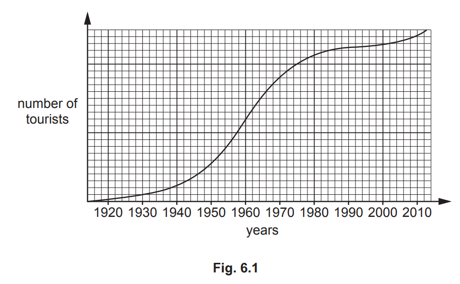
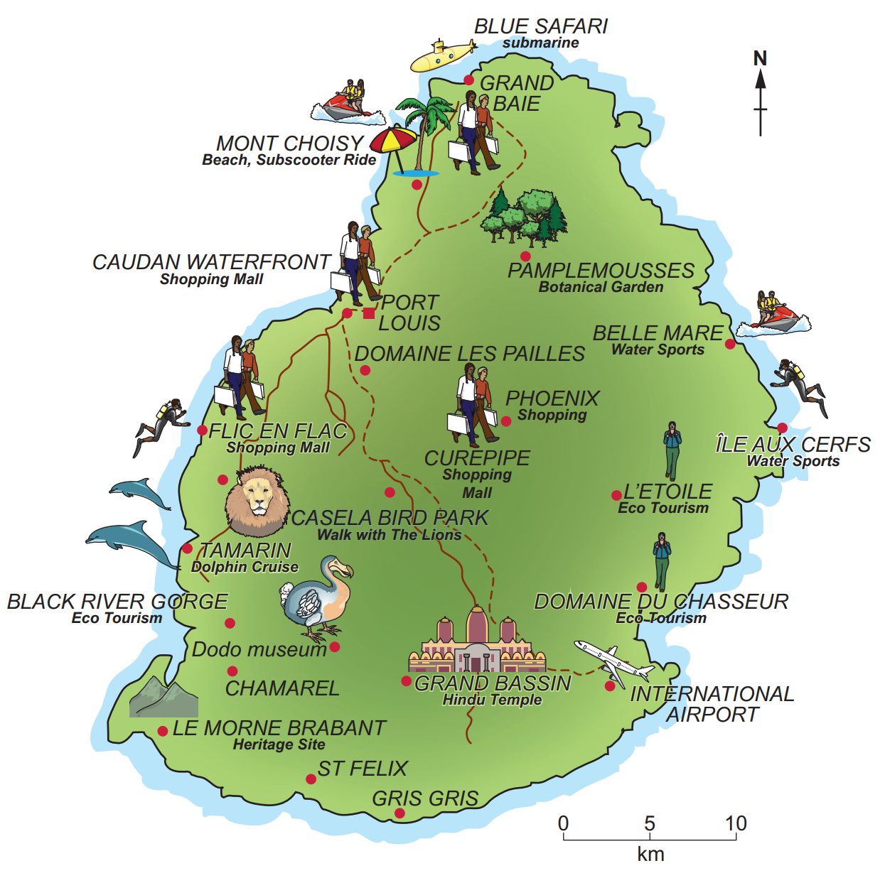
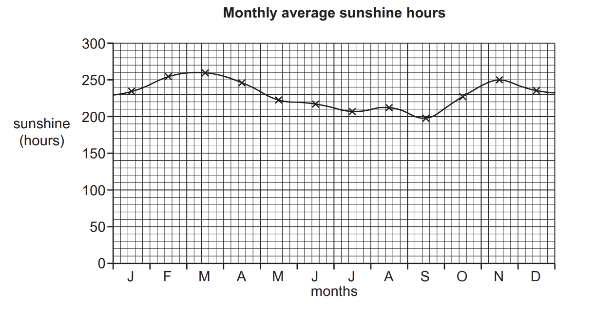
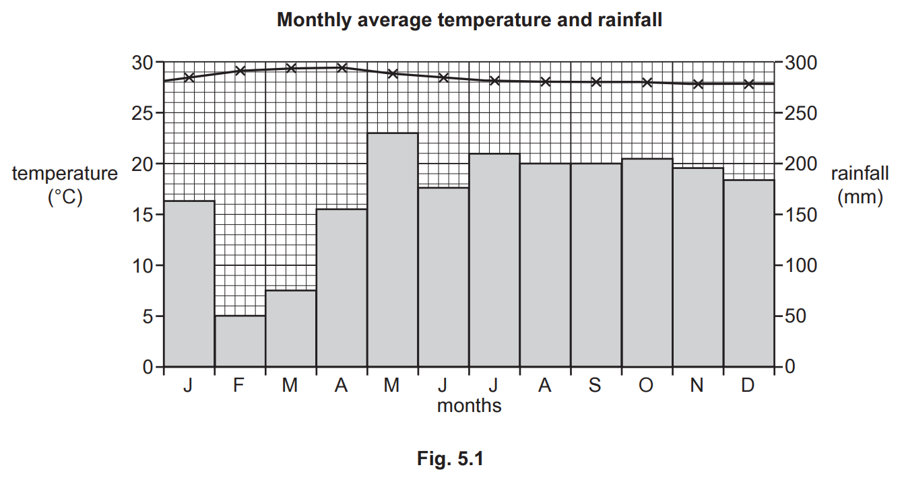

# Exam Questions — Tourism
**Changing Economies** · Cambridge (CIE) IGCSE geography (0460 & 0976)
> Source: [https://www.savemyexams.com/igcse/geography/cie/25/topic-questions/](https://www.savemyexams.com/igcse/geography/cie/25/topic-questions/) · 17 questions across 1 sets

## Exam Questions (17 questions)

### Q1 — hard — 7 marks

**Q1** [7 marks]

Evaluate the extent to which ecotourism is a sustainable solution to tourism growth?

### Q2 — hard — 7 marks

**Q2** [7 marks]

Assess the economic and social impacts of tourism in LICs.

### Q3 — hard — 7 marks

**Q3** [7 marks]

Evaluate the environmental challenges caused by mass tourism.

### Q4 — hard — 7 marks

**Q4** [7 marks]

For a named example of a tourist area you have studied, evaluate how tourism is being managed sustainably.

Name of tourist area studied:

### Q5 — hard — 7 marks

**Q5** [7 marks]

For a named example of a tourist area you have studied, describe the benefits of tourism for local people.

Name of tourist area studied......................

*Source: Nov 2024 0460/11 Q6C*

### Q6 — medium — 5 marks

**Q6** [5 marks]

Study Fig. 6.2 of a map showing national parks in Namibia, an LIC in Africa.

Explain how national parks help reduce risks to the natural environment in areas where tourism is important.

*Source: Nov.2024 0460/11 Q6B II*

### Q7 — easy — 3 marks

**Q7** [3 marks]

Fig. 6.1 is a map of the Meru National Park in Kenya, an LIC in east Africa.

Using Fig. 6.1 **only**, identify **three** tourist attractions that have been provided in Meru National Park.

*Source: Nov 2024 0460/1q Q6A III*

### Q8 — medium — 4 marks

**Q8** [4 marks]

Fig. 6.1 is a map of the Meru National Park in Kenya, an LIC in east Africa.

Suggest what problems the tourist industry may cause for local Kenyan people.

*Source: Nov 2024 0460/11 Q6A IV*

### Q9 — medium — 4 marks

**Q9** [4 marks]

Examine Fig. 6.1, which provides information about Kafue National Park in Zambia, a region where the tourist industry plays a significant role. Zambia is an LIC in Africa.

*Fig. 6.1*

Using Fig. 6.1, suggest reasons why Zambia's government is encouraging tourism.

*Source: June 2021 0460/13 Q6A IV*

### Q10 — easy — 3 marks

**Q10** [3 marks]

Examine Fig. 6.1, which provides information about Kafue National Park in Zambia, a region where the tourist industry plays a significant role. Zambia is an LIC in Africa.

*Fig. 6.1*

Using Fig. 6.1 **only,** identify **three** things that have been done in Kafue National Park to attract tourists.

*Source: June 2021 0460/13 Q6A III*

### Q11 — medium — 4 marks

**Q11** [4 marks]

Study Fig. 5.1, which shows a map of the island of Gran Canaria, a Spanish island off the coast of Africa. Fig. 5.2, is a photograph of the tourist resort of Taurito in Gran Canaria.

*Fig. 5.2*

Suggest two benefits and two disadvantages of tourism for the people who live in Gran Canaria.

*Source: June 2020 0460/12 Q5A IV*

### Q12 — easy — 3 marks

**Q12** [3 marks]

Study Fig. 5.1, which shows a map of the island of Gran Canaria, a Spanish island off the coast of Africa. Fig. 5.2, is a photograph of the tourist resort of Taurito in Gran Canaria.

*Fig. 5.2*

Using Fig. 5.2 only, explain how the natural environment has encouraged the development of a tourist resort at Taurito.

*Source: June 2020 0460/12 Q5A III*

### Q13 — easy — 6 marks

**Q13** [1 mark]

Study Fig. 6.1, which shows how the number of tourists to Acapulco, a tourist destination on the coast of Mexico, has changed between 1920 and 2010.

Of the six tourist attractions in Acapulco listed below, identify the two which are physical attractions.

*Source: 2020 June 0460/11 Q6A I*

**Q13** [2 marks]

Suggest two ways in which the infrastructure of Acapulco is likely to have improved as it developed as a tourist destination.

*Source: 2020 June 0460/11 Q6A II*

**Q13** [3 marks]

Suggest why the growth of tourism in the Acapulco area may have had both positive and negative effects on local fishermen.

*Source: 2020 June 0460/11 Q6A III*

### Q14 — easy — 3 marks

**Q14** [3 marks]

Study **Fig. 5.1**, a map showing tourist attractions in Mauritius, an LIC in the Indian Ocean.

*Fig. 5.1*

Identify three attractions of the human landscape for tourists in Mauritius.

*Source: Nov 2020 0460/13 Q5A III*

### Q15 — medium — 4 marks

**Q15** [4 marks]

Suggest ways in which the tourist industry is likely to benefit local communities on small tropical islands, such as the Maldives.

### Q16 — easy — 3 marks

**Q16** [3 marks]

Describe the characteristics of the **physical landscapes **of small tropical islands that have encouraged the growth of the tourist industry.

### Q17 — easy — 3 marks

**Q17** [1 mark]

Study Fig. 5.1, which is information about the climate of the Maldives (an LIC).

The Maldives is a group of islands on the Equator in the Indian Ocean, which are important for tourism.

Use Fig. 5.1 to estimate the total annual rainfall in the Maldives.

*Source: Nov 2020 0460/11 Q5A I*

**Q17** [2 marks]

Describe the attractions of the climate of the Maldives for tourists.

*Source: Nov 2020 0460/11 Q5A II*

