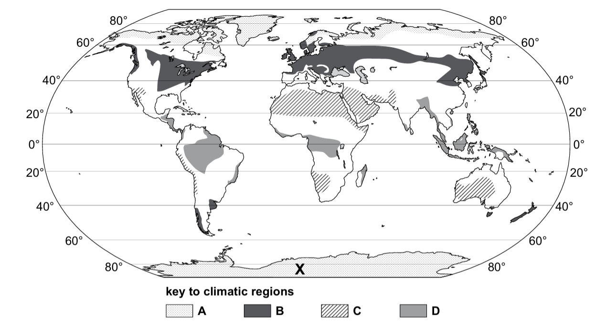

# Exam Questions — Antarctic Ecosystem
**Changing Ecosystems** · Cambridge (CIE) IGCSE geography (0460 & 0976)
> Source: [https://www.savemyexams.com/igcse/geography/cie/25/topic-questions/](https://www.savemyexams.com/igcse/geography/cie/25/topic-questions/) · 16 questions across 1 sets

## Exam Questions (16 questions)

### Q1 — hard — 7 marks

**Q1** [7 marks]

Explain how abiotic factors influence the distribution of organisms in Antarctica.

### Q2 — hard — 7 marks

**Q2** [7 marks]

Explain how the Antarctic ecosystem is managed to ensure sustainability.

### Q3 — hard — 7 marks

**Q3** [7 marks]

Explain the global significance of melting Antarctic ice.

### Q4 — hard — 7 marks

**Q4** [7 marks]

Explain why many people are concerned about overfishing in Antarctic waters.

### Q5 — medium — 4 marks

**Q5** [4 marks]

Explain how international agreements help protect Antarctica’s ecosystem.

### Q6 — medium — 4 marks

**Q6** [4 marks]

Explain why krill are considered a keystone species in the Antarctic ecosystem.

### Q7 — medium — 4 marks

**Q7** [4 marks]

Describe the adaptations of plants that enable them to survive in Antarctica.

### Q8 — medium — 4 marks

**Q8** [4 marks]

Explain how climate change poses a threat to Antarctica’s ecosystem.

### Q9 — easy — 3 marks

**Q9** [3 marks]

Describe how tourism can threaten Antarctica’s ecosystem.

### Q10 — easy — 2 marks

**Q10** [2 marks]

Give two ways that fauna have adapted to survive Antarctica’s cold climate.

### Q11 — easy — 2 marks

**Q11** [2 marks]

Identify two key abiotic factors that limit life in Antarctica.

### Q12 — easy — 1 marks

**Q12** [1 mark]

Name the ocean that surrounds Antarctica.

### Q13 — easy — 1 marks

**Q13** [1 mark]

State one reason why Antarctica is described as a polar desert.

### Q14 — hard — 7 marks

**Q14** [7 marks]

Explain why many people are concerned about the destruction of the Antarctic ecosystem. Refer to examples in your answer.

### Q15 — medium — 4 marks

**Q15** [4 marks]

Explain why temperatures are low in Antarctica.

*Source: Specimen 0460/01 Q3A IV*

### Q16 — easy — 3 marks

**Q16** [1 mark]

Figure 3.1 shows four climatic regions.

*Figure 3.1*

Name the continent marked **X** in Figure 3.1.

*Source: Specimen 0460/1 Q3A I*

**Q16** [2 marks]

**Extract:**

Figure 3.1 shows four climatic regions. 

Zone D on Figure 3.1 has an equatorial climate. Describe the distribution of the regions with an equatorial climate.
