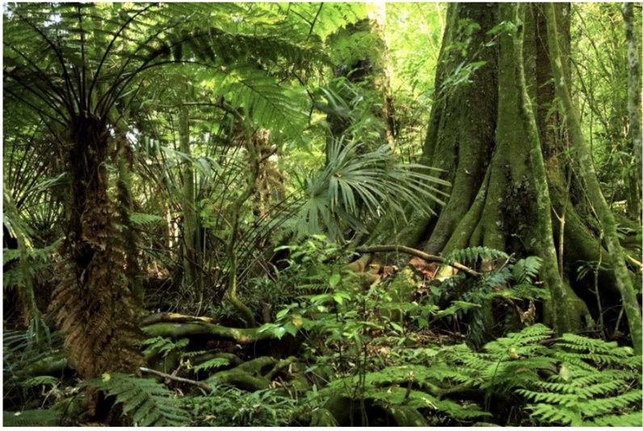
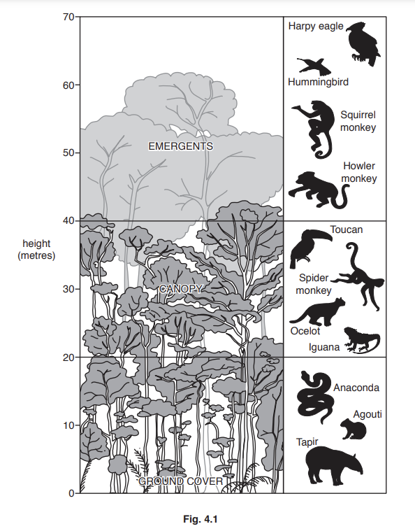
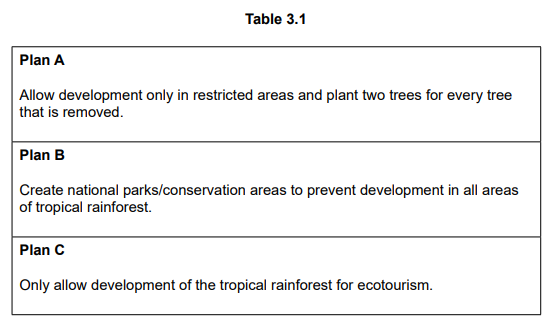
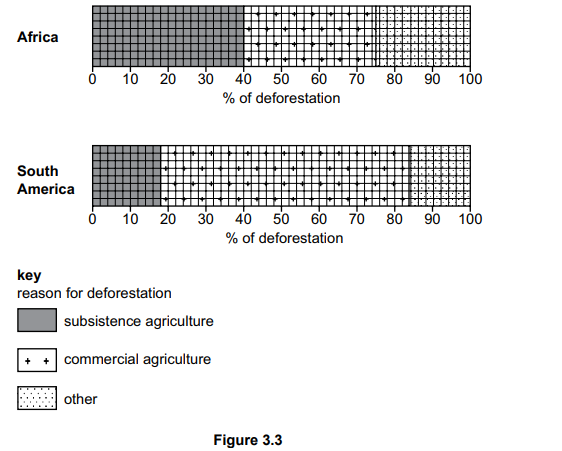
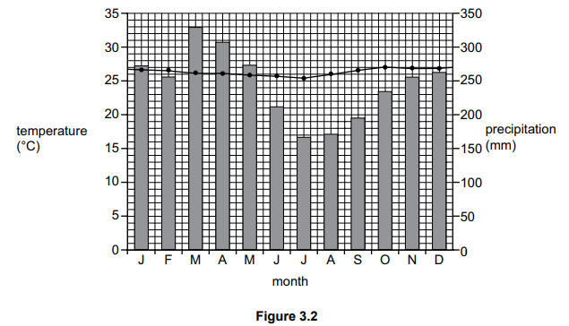
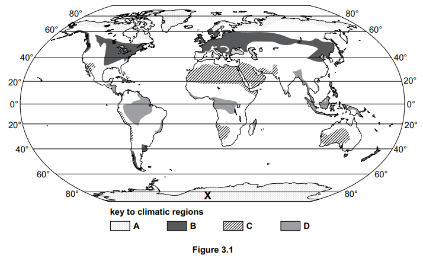

# Exam Questions — Tropical Rainforest Ecosystem
**Changing Ecosystems** · Cambridge (CIE) IGCSE geography (0460 & 0976)
> Source: [https://www.savemyexams.com/igcse/geography/cie/25/topic-questions/](https://www.savemyexams.com/igcse/geography/cie/25/topic-questions/) · 18 questions across 1 sets

## Exam Questions (18 questions)

### Q1 — hard — 7 marks

**Q1** [7 marks]

Assess the success of management strategies used to protect tropical rainforest ecosystems. Refer to examples in your answer.

### Q2 — hard — 7 marks

**Q2** [7 marks]

Explain why many people are concerned about the destruction of the rainforest ecosystem. Refer to examples in your answer.

### Q3 — hard — 7 marks

**Q3** [7 marks]

For a named area you have studied, explain how national strategies have been used to manage the tropical rainforest.

### Q4 — hard — 7 marks

**Q4** [7 marks]

For a named area you have studied, explain the impacts of deforestation on the tropical rainforest.

### Q5 — hard — 7 marks

**Q5** [7 marks]

For a named area  you have studied, explain the threats to the tropical rainforest.

### Q6 — medium — 4 marks

**Q6** [4 marks]

Explain how sustainable management strategies can help protect the tropical rainforest ecosystem from environmental threats.

### Q7 — medium — 4 marks

**Q7** [4 marks]

Explain how deforestation poses an environmental threat to the tropical rainforest ecosystem.

### Q8 — medium — 4 marks

**Q8** [4 marks]

Explain why temperature and rainfall are so high in the tropical rainforest.

### Q9 — medium — 4 marks

**Q9** [4 marks]

Study Fig 1, which shows vegetation in the rainforest.

Explain how vegetation in the Tropical Rainforest has adapted to the climate

**Fig 1 - Tropical rainforest **

### Q10 — easy — 3 marks

**Q10** [3 marks]

Study Fig. 4.2, a map of the Amazon Basin, an area of tropical rainforest.

Using Fig. 4.2 **only**, describe the distribution of the areas where deforestation has taken place in the Amazon Basin.

*Source: Nov 2019 0460/11 Q4B*

### Q11 — easy — 1 marks

**Q11** [1 mark]

Study Fig 1, which shows climate data for an area of tropical rainforest

|   | **Jan** | **Feb** | **Mar** | **Apr** | **May** | **Jun** | **Jul** | **Aug** | **Sep** | **Oct** | **Nov** | **Dec** |
|---|---|---|---|---|---|---|---|---|---|---|---|---|
| **Average monthly temperatures (°C)** | 26 | 27 | 28 | 28 | 29 | 28 | 28 | 28 | 27 | 27 | 27 | 27 |
| **Total monthly rainfall (mm)** | 229 | 175 | 196 | 194 | 173 | 173 | 168 | 198 | 180 | 212 | 257 | 258 |

Calculate the average temperature

### Q12 — easy — 1 marks

**Q12** [1 mark]

Study Fig. 4.1, which shows information about hot deserts and tropical rainforests.

|   | Latitude | Highest monthly average temperature | Lowest monthly average temperature | Annual rainfall | Atmospheric pressure |
|---|---|---|---|---|---|
| Hot deserts |   | 35 °C | 18 °C | Less than 250 mm | High |
| Tropical rainforests |   | 30 °C | 27 °C | Over 2000 mm | Low |

**Fig. 4.1**

(i)

Using Fig. 4.1, calculate the annual average temperature range in tropical rainforests. ............................. °C

*Source: Nov 2020 0460/13 Q4A*

### Q13 — easy — 3 marks

**Q13** [3 marks]

Study Fig. 4.2, which shows information about deforestation of tropical rainforests in South America and South East Asia between 1950 and 2010.

Using Fig. 4.2, compare the change in annual deforestation in South America and South East Asia.

*Source: Nov 2020 0460/13 Q4B*

### Q14 — easy — 3 marks

**Q14** [1 mark]

Study Fig. 4.1, which is a diagram showing information about a tropical rainforest ecosystem in an area of equatorial climate.

State the maximum height of the emergents shown in Fig. 4.1.

.................. metres

**Q14** [2 marks]

**Extract:**

Study Fig. 4.1, which is a diagram showing information about a tropical rainforest ecosystem in an area of equatorial climate.

Identify from Fig. 4.1, one example of:

–    wildlife which lives in the canopy

–    wildlife which lives in the ground cover.

### Q15 — medium — 5 marks

**Q15** [5 marks]

Study Table 3.1, which shows three plans which the government of a country in Africa is considering to sustainably manage the tropical rainforest.

Choose the plan that you think will be the most effective in sustainably managing the tropical rainforest. Justify your decision.

### Q16 — easy — 3 marks

**Q16** [3 marks]

Figure 3.3 shows the reasons for the deforestation of tropical rainforests in Africa and South America.

Use Figure 3.3 to compare the percentage of deforestation in Africa and South America for both types of agriculture. Refer to data in your answer.

*Source: Specimen 0460/01 Q3A (IV)*

### Q17 — easy — 3 marks

**Q17** [3 marks]

Figure 3.2 is a climate graph of an equatorial climate.

Use Figure 3.2 to describe the main features of the equatorial climate. Refer to data in your answer.

*Source: Specimen 0460/01 Q3A (III)*

### Q18 — easy — 2 marks

**Q18** [2 marks]

Figure 3.1 shows four climatic regions

Zone D in Figure 3.1 has an equatorial climate. Describe the distribution of the regions with an equatorial climate.
