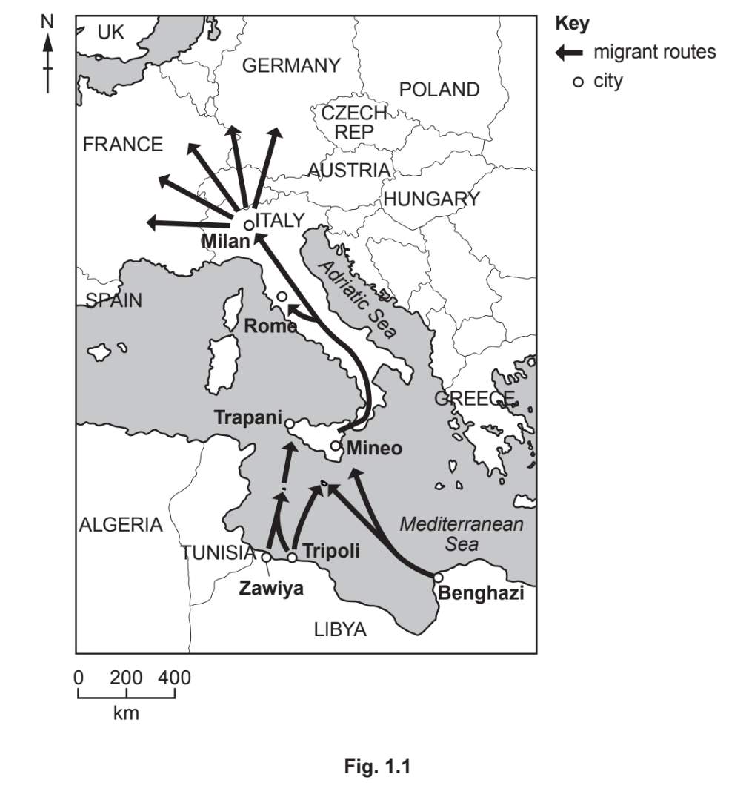

# Exam Questions — Causes & Impacts of International Migration
**Changing Populations** · Cambridge (CIE) IGCSE geography (0460 & 0976)
> Source: [https://www.savemyexams.com/igcse/geography/cie/25/topic-questions/](https://www.savemyexams.com/igcse/geography/cie/25/topic-questions/) · 11 questions across 1 sets

## Exam Questions (11 questions)

### Q1 — medium — 5 marks

**Q1** [5 marks]

Study Fig. 1.3, which is a population pyramid for the United Arab Emirates (UAE), an HIC.

Most of the migration to the UAE is voluntary.

Describe the **pull factors **of HICs, such as the UAE, to migrants from LICs.

*Source: June 2020 0460/12 Q1B*

### Q2 — medium — 5 marks

**Q2** [5 marks]

Study **Fig. 1.2, **which is a map showing information about global net migration.

**Fig 1.2**

Explain the reasons why experience negative net migration.

*Source: Nov 2020 0460/13 Q1B*

### Q3 — medium — 4 marks

**Q3** [4 marks]

Study **Fig. 1.1, **which shows information about migration across the Mediterranean Sea from Libya to Italy between January 2015 and August 2016.

Explain why the arrival of large numbers of migrants across the Mediterranean Sea may cause problems in Italy.

*Source: June 2020 0460/12 Q1A*

### Q4 — medium — 5 marks

**Q4** [5 marks]

Study Fig. 1.2, which shows information about Arlington County, an area in the USA.

| Arlington County is home to the USA’s largest Bolivian community. In Arlington there are apartment buildings filled with people who have migrated from towns in the Cochabamba Valley in Bolivia, hence the nickname ‘Arlibamba’. There are many Bolivian restaurants and food shops, such as Pike Pizza, a converted pizza restaurant that now sells traditional Bolivian food. This is one of many meeting places for the Bolivian community. They are also places to watch the Bolivian national soccer team play games on TV.  Bolivians have formed several football leagues in the Arlington region. Over 2000 players and fans come out each Sunday to participate. Many of the teams are named after towns in Bolivia like Real Santa Cruz.  An aim of one of the Arlington football leagues is to improve life in the small villages in the Esteban Arce province of Bolivia. Most people there live off basic agriculture and remittances from abroad. Teams send their winnings back home to fund schools, infrastructure and churches. It has been estimated that villages in Bolivia received over US \$20000 a year from donations from the league. |
|---|

**Fig. 1.2**

Assess the impact migration to the USA is likely to have on  the small villages in Bolivia and the people who still live there.

### Q5 — medium — 4 marks

**Q5** [4 marks]

Suggest problems that international migrants may face when settling in a new country.

### Q6 — easy — 3 marks

**Q6** [1 mark]

Define forced migration.

**Q6** [2 marks]

**Extract:**

Forced migration is when people have no choice but to relocate due to unsafe conditions or other external factors

Identify **two **causes of forced migration.

### Q7 — easy — 5 marks

**Q7** [1 mark]

Study Fig. 1.1, which shows information about international and internal migration in Bolivia (an LEDC) in South America.

Define international migration.

**Q7** [1 mark]

**Extract:**

Study Fig. 1.1, which shows information about international and internal migration in Bolivia (an LEDC) in South America.

Using Fig 1.1 give an example of international migration.

**Q7** [3 marks]

**Extract:**

Study Fig. 1.1, which shows information about international and internal migration in Bolivia (an LEDC) in South America.

Using Fig. 1.1, suggest three pull factors leading to large amounts of migration to Santa Cruz.

### Q8 — easy — 3 marks

**Q8** [3 marks]

Study Fig. 1.2, which is an extract about a guest worker from the Philippines who is living in Dubai in the UAE.

| Teresa Cruz is one of many millions of adults who have travelled thousands of miles from home to earn money to send back to their families. Teresa lives in Dubai, the UAE’s largest city, 7000 kilometres from her home country, the Philippines. She earns the minimum wage as an assistant at a clothing store in a shopping mall in Dubai. She works six days a week and Friday is her day off.  On Friday at 12:00, it is time for Teresa to see her 11-year-old daughter and 8-year-old son who live with their aunt, who is raising them in the Philippines. As she is an overseas worker, she does this in the modern way. She pulls a stool up to a desk inside the small bedroom she shares with four other people. She logs on to the computer, clicks a video chat button and waits.  Teresa lives in the bedroom with her husband, Luis, who, like Teresa, left the Philippines years ago. They decided that the only way to do the things a parent wants to do—pay for schoolbooks, make sure the grandparents in the Philippines have enough to eat, prepare the children for college one day—is to leave the family behind and find work in a distant country with a different language and culture. |
|---|

**Fig. 1.2**

Identify **three **difficulties Teresa faces as a guest worker in Dubai from Fig. 1.2.

*Source: June 2020 0460/13 Q1B*

### Q9 — easy — 4 marks

**Q9** [1 mark]

Study Fig. 1.1, which shows information about the country of origin of people living in Canada in 1990 and 2015.

How many people from the USA lived in Canada in 2015?

**Q9** [3 marks]

**Extract:**

Study Fig. 1.1, which shows information about the country of origin of people living in Canada in 1990 and 2015.

Using the information from Fig. 1.1.

Describe how the number of people from China and Italy living in Canada changed between 1990 and 2015.
You should use statistics in your answer.

### Q10 — easy — 3 marks

**Q10** [3 marks]

Study **Fig. 1.2, **which is a map showing information about global net migration.

**Fig 1.2**

Describe the distribution of areas with negative net migration.

*Source: Nov 2020 0460/13 Q1B*

### Q11 — hard — 7 marks

**Q11** [7 marks]

Explain why there are large amounts of migration to a country you have studied. Name of country ............................................................

*Source: Specimen 0460/01 Q2C*

