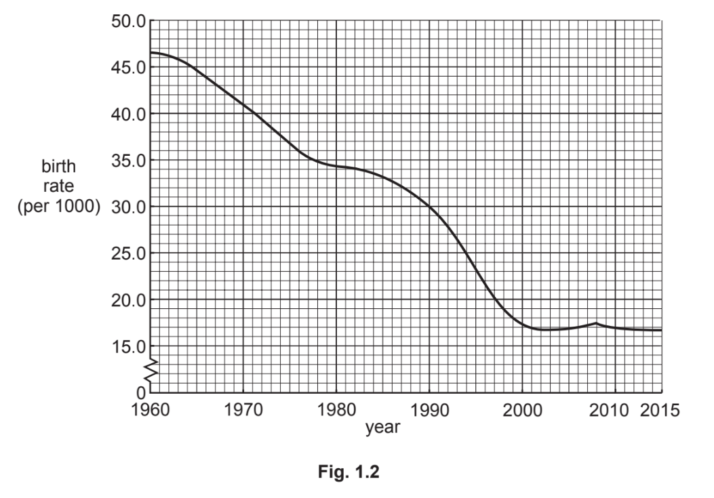
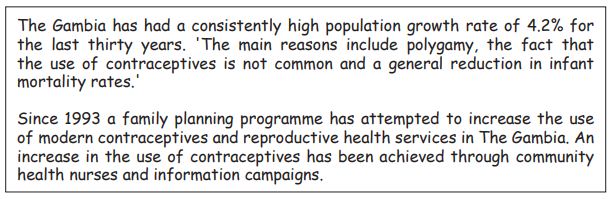
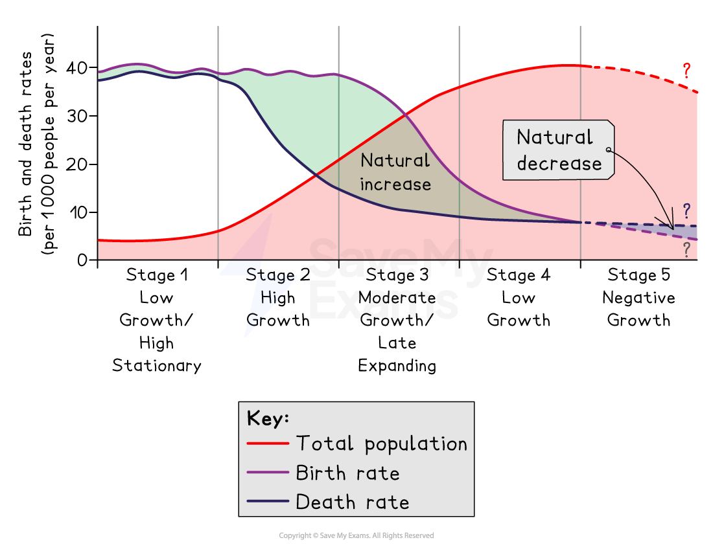
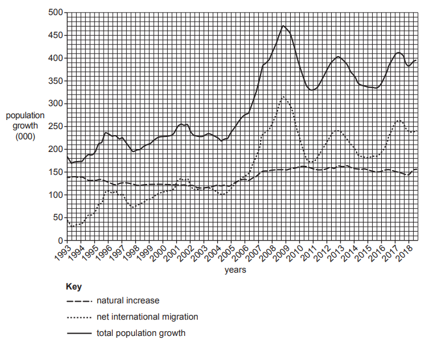
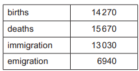
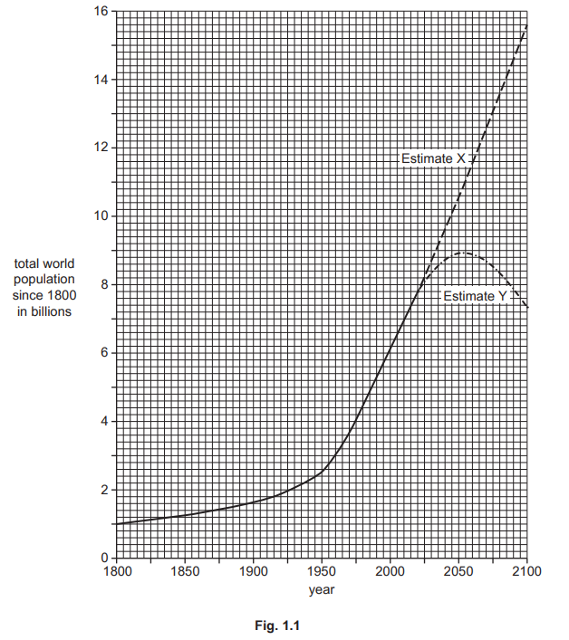
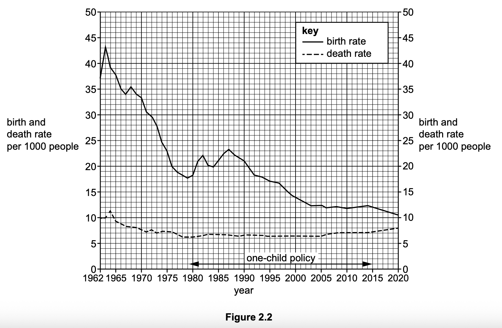
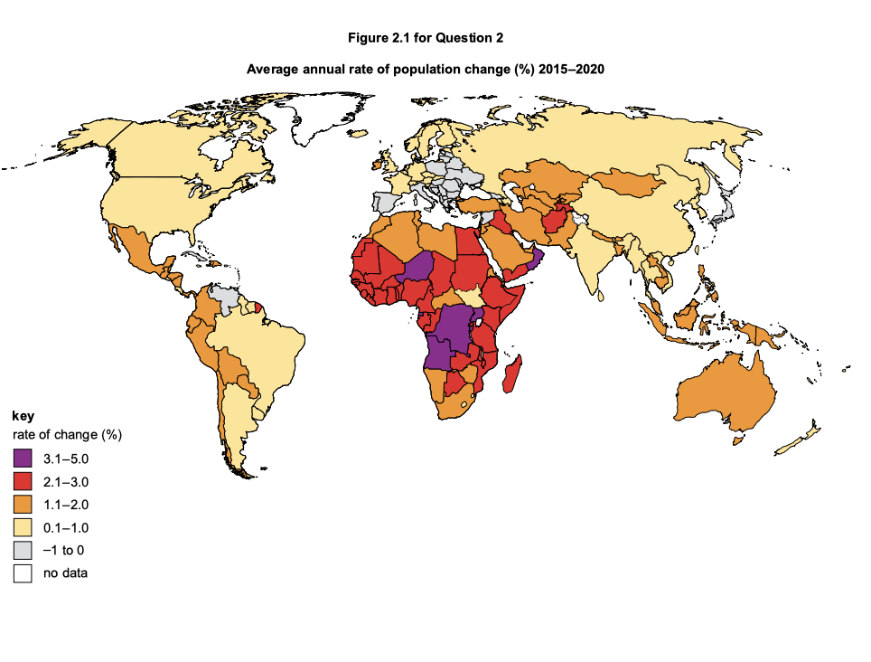

# Exam Questions — Population Change
**Changing Populations** · Cambridge (CIE) IGCSE geography (0460 & 0976)
> Source: [https://www.savemyexams.com/igcse/geography/cie/25/topic-questions/](https://www.savemyexams.com/igcse/geography/cie/25/topic-questions/) · 12 questions across 1 sets

## Exam Questions (12 questions)

### Q1 — medium — 4 marks

**Q1** [4 marks]

Study Figs. 1.2 and 1.3, which show information about birth rates in Vietnam (an MIC in South East Asia).

| The communist government of Vietnam is penalising couples who have more than two children. In the early 1960s it imposed a two-child limit for couples and there have been campaigns to promote contraception and abortion in the country since 1997.  By 2000, the birth rate had been reduced considerably by the use of fines and confiscation of land. The original policy ended in 2003 but was revived in 2008 after an increase in the birth rate.  Villagers in Thua Thien-Hue province are being fined for having more than two children under the government two-child policy. Catherine Pham Thi Thanh, 44, said that since 1996 she has been fined a total of 3800 kilograms of rice for having six children. This is a great loss for the family which makes an annual profit of only 700 kilograms of rice from their farm. |
|---|

Fig 1.3

Suggest how government policies and other factors may have reduced Vietnam's birth rate.

*Source: spec 2020 0460/11 Q1B*

### Q2 — medium — 5 marks

**Q2** [5 marks]

Study Fig. 6.1, which shows information about population growth in The Gambia (an LEDC in Africa).

*Fig 6.1*

Explain why it is difficult to reduce natural population growth rates in LICs, such as The Gambia, even though the use of contraception has recently increased.

### Q3 — easy — 3 marks

**Q3** [3 marks]

Study Fig. 6.1, which shows information about population growth in The Gambia (an LEDC in Africa).

*Fig 6.1*

Suggest three reasons why the use of contraceptives is not common in The Gambia.

### Q4 — easy — 7 marks

**Q4** [1 mark]

Study Fig 5.1, which shows the demographic transition model (DTM).

*The demographic transition model*

The UK is a HIC. Which stage of the demographic transition model is the UK?

**Q4** [3 marks]

**Extract:**

Study Fig 5.1, which shows the demographic transition model (DTM).

What are three population characteristics of a country at stage 2 of the demographic transition model?

**Q4** [3 marks]

**Extract:**

Study Fig 5.1, which shows the demographic transition model (DTM).

State three reasons why the birth rate starts to fall rapidly in stage 3 of the model.

### Q5 — medium — 4 marks

**Q5** [4 marks]

Explain the strengths of the demographic transition model.

### Q6 — medium — 4 marks

**Q6** [4 marks]

Explain the limitations of the demographic transition model.

### Q7 — easy — 2 marks

**Q7** [1 mark]

Study Fig 4.1, which shows information about population growth in Australia (a HIC).

*Fig 4.1*

In which year was total population growth highest in Australia?

*Source: June 2022 0460/12 Q1A (I)*

**Q7** [1 mark]

**Extract:**

Study Fig 4.1, which shows information about population growth in Australia (a HIC).

Line graph showing Australian population growth from 1993 to 2018, including natural increase, net international migration, and total population growth.

How is total population growth calculated?

### Q8 — easy — 3 marks

**Q8** [1 mark]

Study Fig 3.1, which shows information about population change in Estonia (an HIC in Europe) in 2018.

*Fig 3.1*

How is natural population change calculated?

*Source: Nov 2022 0460/13 Q1A (I)*

**Q8** [2 marks]

**Extract:**

Study Fig 3.1, which shows information about population change in Estonia (an HIC in Europe) in 2018.

Table displaying figures: births 14,270; deaths 15,670; immigration 13,030; emigration 6,940.

The total population of Estonia on 1 January 2018 was 1319130. Calculate the total population of Estonia by the end of 2018 using the statistics in Fig. 3.1. You should show your calculations.

*Source: Nov 2022 0460/13 Q1A (II)*

### Q9 — easy — 3 marks

**Q9** [1 mark]

Study Fig. 1.1, which shows information about the total world population since 1800 with estimates up to 2100.

What was the total population of the world in 2020?

*Source: June 2023 0460/11 Q1A (I)*

**Q9** [2 marks]

**Extract:**

Study Fig. 1.1, which shows information about the total world population since 1800 with estimates up to 2100.

Compare the growth of the world’s population from 1800 to 1950 with the growth between 1950 and 2020. Use statistics in your answer.

*Source: June 2023 0460/11 Q1A(II)*

### Q10 — medium — 5 marks

**Q10** [5 marks]

The one-child policy was a strategy used by the government of China to influence natural population growth rates.

Use Figure 2.2 to evaluate the impacts of the one-child policy on population growth in China.

*Source: Specimen 0460/01 Q2B (II)*

### Q11 — easy — 3 marks

**Q11** [3 marks]

Figure 2.2 shows information about birth rates and death rates in China between 1962 and 2020

Which of the following statements are true about birth rates and death rates in China during the period shown in Figure 2.2?

Choose three answers.

| The birth rate has always been higher than the death rate. |   |
|---|---|
| Both the birth rate and the death rate declined overall. |   |
| Natural population growth increased overall. |   |
| The birth rate has fluctuated more than the death rate. |   |
| The death rate has declined every year. |   |
| The death rate was higher than the birth rate in 2020. |   |

*Source: Specimen 0460/02 Q2B (I)*

### Q12 — easy — 6 marks

**Q12** [1 mark]

Insert the following words into the equation to show how overall population change is calculated.

- death rate
- migration
- birth rate

..................... - ....................... + or - .................... = overall population change

*Source: Specimen 0460/02 Q2A*

**Q12** [2 marks]

Use Figure 2.1 to state the average annual rate of population change between 2015 and 2020 of the following countries.

Angola ............................................................%

USA ............................................................%

*Source: Specimen 0460/02 Q2A (II)*

**Q12** [3 marks]

**Extract:**

Use Figure 2.1 to state the average annual rate of population change between 2015 and 2020 of the following countries.

World map showing average annual population change (2015-2020). Various shades indicate rates from -1% to 5%, with highest in Africa, no data in white.

Use Figure 2.1 to compare the rates of population change in Africa and Europe.

*Source: Specimen 0460/02 Q2A (III)*

