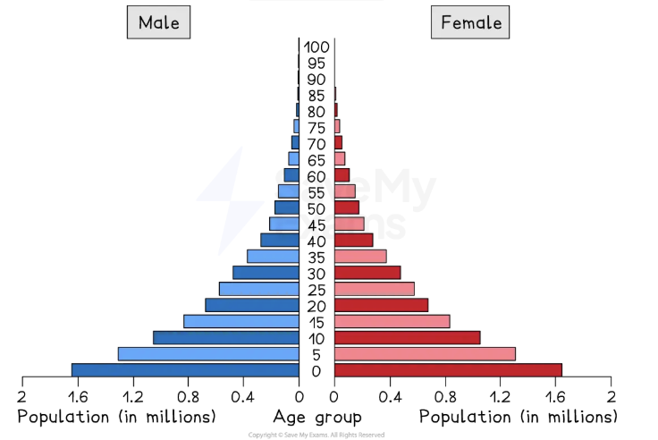
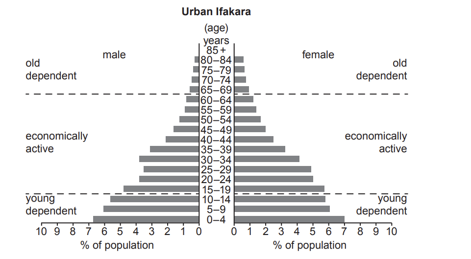
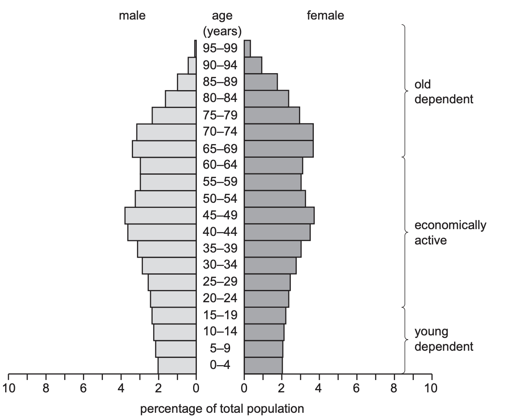
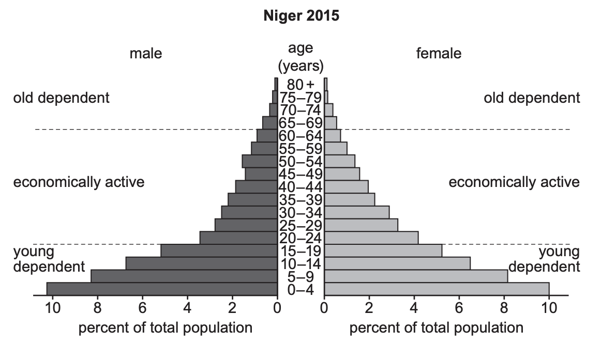
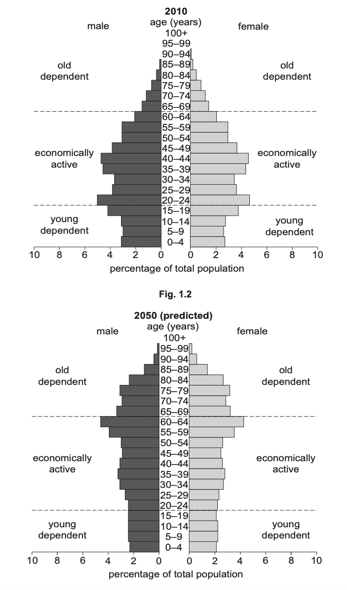
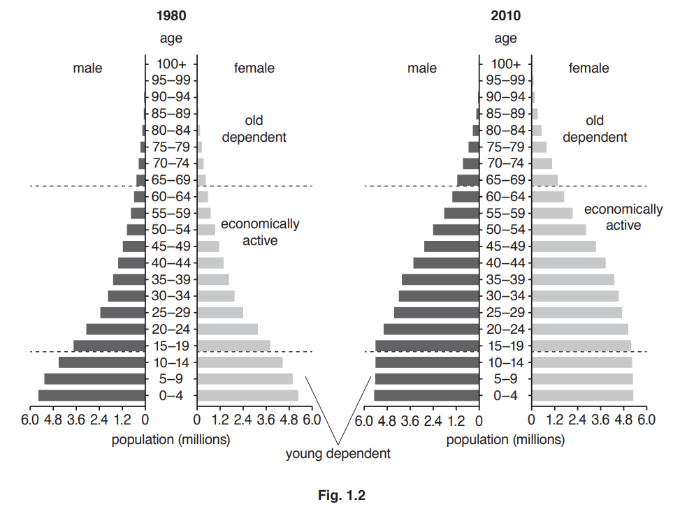

# Exam Questions — Population Structures
**Changing Populations** · Cambridge (CIE) IGCSE geography (0460 & 0976)
> Source: [https://www.savemyexams.com/igcse/geography/cie/25/topic-questions/](https://www.savemyexams.com/igcse/geography/cie/25/topic-questions/) · 16 questions across 1 sets

## Exam Questions (16 questions)

### Q1 — hard — 7 marks

**Q1** [7 marks]

Study Fig 1.1 - Population pyramid showing the age and gender structure of an LIC

Using Fig 1.1 explain how the population structure shown will create challenges for the country.

### Q2 — hard — 7 marks

**Q2** [7 marks]

For a named country you have studied, describe and explain the causes of an ageing population.

### Q3 — hard — 7 marks

**Q3** [7 marks]

For a named country you have studied, explain the impacts of having a high youthful dependent population.

### Q4 — hard — 7 marks

**Q4** [7 marks]

For a named country you have studied, describe the problems which have been caused by rapid population growth or population decline.

### Q5 — medium — 4 marks

**Q5** [4 marks]

Study Figs. 1.1 and 1.2, which show the population structure for a rural and urban area in Tanzania (an LEDC in Africa).

Fig. 1.1 is the population structure of rural Ifakara.

Fig. 1.2 is the population structure of urban Ifakara.

**Fig. 1.1**

**Fig. 1.2**

Suggest reasons why birth rates are high in rural areas of Tanzania.

*Source: June 2021 0460/13 Q1A*

### Q6 — medium — 5 marks

**Q6** [5 marks]

Study Fig. 1.2, which is a population pyramid of Japan (an MIC in Asia).

*Fig 1.2*

Explain why the percentage of young dependents in an LIC is likely to be larger than that of Japan.

### Q7 — medium — 4 marks

**Q7** [4 marks]

Study Fig. 1.1, which shows information about the population structure of Thailand (an LEDC in Southeast Asia) in 1980 and 2015.

**Fig. 1.1**

Suggest reasons for the decrease in the number of young dependents in Thailand between 1980 and 2015.

*Source: June 2021 0460/12 Q1A*

### Q8 — hard — 7 marks

**Q8** [7 marks]

For a named country you have studied, describe the problems caused by a large dependent population.

### Q9 — medium — 5 marks

**Q9** [5 marks]

Study Fig. 1.2, which is a population pyramid for Niger (an LIC in Africa) in 2015.

*Fig 1.2*

Explain why the proportion of old dependents in an MIC is likely to differ from that of Niger.

*Source: June 2022 0460/11 Q1B (II)*

### Q10 — easy — 3 marks

**Q10** [3 marks]

Study Fig. 1.2, which is a population pyramid for Niger (an LIC in Africa) in 2015.

*Fig 1.1*

Describe three features of the population pyramid of Niger which are typical of an LIC.

*Source: June 2022 0460/11 Q1B (I)*

### Q11 — easy — 3 marks

**Q11** [3 marks]

Study Figs. 1.2 and 1.3, which are population pyramids showing the structure of China’s population in 2010 and 2050 (predicted).

*Fig 1.2 and 1.3*

Describe the changes which are predicted in China’s economically active population between 2010 and 2050.

*Source: Nov 2022 0460/11 Q1B (I)*

### Q12 — easy — 6 marks

**Q12** [1 mark]

Study Fig. 1.1, which shows information about the population structure of Thailand (an LEDC in Southeast Asia) in 1980 and 2015.

**Fig. 1.1**

How many of the population of Thailand in 1980 were female and aged 0 to 4?

*Source: June 2021 0460/12 Q1A (I)*

**Q12** [2 marks]

**Extract:**

Study Fig. 1.1, which shows information about the population structure of Thailand (an LEDC in Southeast Asia) in 1980 and 2015.

Fig. 1.1

Describe how the total population of Thailand aged 0 to 4 changed between 1980 and 2015. You should use statistics in your answer.

*Source: June 2021 0460/12 Q1A (II)*

**Q12** [3 marks]

**Extract:**

Study Fig. 1.1, which shows information about the population structure of Thailand (an LEDC in Southeast Asia) in 1980 and 2015.

Fig. 1.1

Describe how the **shape** of Thailand’s population pyramid changed between 1980 and 2015.

*Source: June 2021 0460/12 Q1B (III)*

### Q13 — easy — 3 marks

**Q13** [3 marks]

Study Fig 1.2, which shows population pyramids of the structure of Mexico’s population in 1980 and 2010.

Describe the changes in Mexico’s population structure between 1980 and 2010.

*Source: Nov 2019 0460/13 Q1B*

### Q14 — easy — 3 marks

**Q14** [3 marks]

Study Fig. 1.3, which is a population pyramid for the United Arab Emirates (UAE), an MEDC.

Identify three characteristics of the population pyramid for the UAE which suggest that it attracts many migrants.

*Source: June 2020 0460/12 Q1B*

### Q15 — easy — 2 marks

**Q15** [1 mark]

**Study Fig. 1**, which shows the age structure of a number of countries.

| **Age Group** | **Percentage of Population (%)** |   |   |   |   |   |
|---|---|---|---|---|---|---|
|   | **Country A** | **Country B** | **Country C** | **Country D** | **Country E** | **Country F** |
| **65 and over** | 18.3 | 4.1 | 5.5 | 13.2 | 3.1 | 17.3 |
| **15-64** | 63.0 | 59.1 | 61.6 | 70.3 | 69.3 | 67.6 |
| **0-14** | 18.7 | 36.8 | 32.9 | 16.5 | 27.6 | 15.1 |

**Fig 1**

Identify the country with the highest percentage of population aged 65 and over**.**

**Q15** [1 mark]

**Extract:**

**Study Fig. 1**, which shows the age structure of a number of countries.

| **Age Group** | **Percentage of Population (%)** |
| :---: | :---: |
|   | **Country A** | **Country B** | **Country C** | **Country D** | **Country E** | **Country F** |
| **65 and over** | 18.3 | 4.1 | 5.5 | 13.2 | 3.1 | 17.3 |
| **15-64** | 63.0 | 59.1 | 61.6 | 70.3 | 69.3 | 67.6 |
| **0-14** | 18.7 | 36.8 | 32.9 | 16.5 | 27.6 | 15.1 |

Identify the country with the lowest percentage of dependent population

### Q16 — medium — 4 marks

**Q16** [4 marks]

Describe four challenges for people living in countries where population growth rates are high.
