# Exam Questions — Rivers & Drainage Basin
**Changing River Environments** · Cambridge (CIE) IGCSE geography (0460 & 0976)
> Source: [https://www.savemyexams.com/igcse/geography/cie/25/topic-questions/](https://www.savemyexams.com/igcse/geography/cie/25/topic-questions/) · 20 questions across 1 sets

## Exam Questions (20 questions)

### Q1 — hard — 7 marks

**Q1** [7 marks]

Explain the importance of both erosion and deposition in the formation of oxbow lakes.

### Q2 — hard — 7 marks

**Q2** [7 marks]

Study Fig. 1.1 and explain the river processes involved in the formation of the landform shown at X.

*Fig 1.1*

### Q3 — hard — 7 marks

**Q3** [7 marks]

Explain the river processes involved in the formation of a meander.

### Q4 — hard — 7 marks

**Q4** [7 marks]

Explain the river processes involved in the formation of a waterfall.

### Q5 — medium — 5 marks

**Q5** [5 marks]

Explain how a delta is formed.

*Source: March 2022 0460/12 Q4B (II)*

### Q6 — easy — 3 marks

**Q6** [3 marks]

Explain how the landform labelled X in Fig. 7.1 was formed.

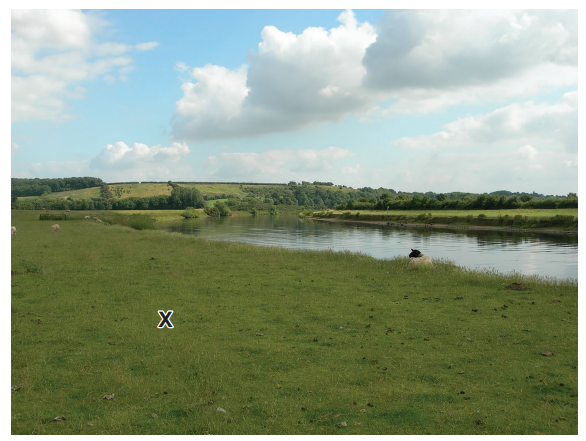

*Fig. 7.1*

*Source: March 2022 0460/12 Q4A (III)*

### Q7 — hard — 7 marks

**Q7** [7 marks]

Describe the changes which occur along a river and its valley from its source to its mouth. You should refer to processes and landforms.

*Source: June 2021 0460/12 Q4C*

### Q8 — medium — 5 marks

**Q8** [5 marks]

Explain how rivers erode their valleys.

*Source: Nov 2020 0460/12 Q3B*

### Q9 — medium — 4 marks

**Q9** [4 marks]

Study Fig. 4.1, which is a photograph of part of a river.

**Figure 4.1 **

Suggest how the course of the river shown in Fig. 4.1 may change in the future as a result of natural processes

*Source: Nov 2019 0460/13 Q4A*

### Q10 — medium — 4 marks

**Q10** [4 marks]

**Extract:**

- Accept "helicoidal/helical flow deposits on the inner bank" or "slower flow on the inside of the meander" for slowing around the inner bend and losing energy.
- Accept "deposition cuts off / seals the meander neck" for the oxbow-neck sealing point.
- Award independently for each valid mechanism; do not require an explicit full causal chain if the deposition mechanism is clear.

Study Fig. 3.1, which shows different parts of a river and its valley.

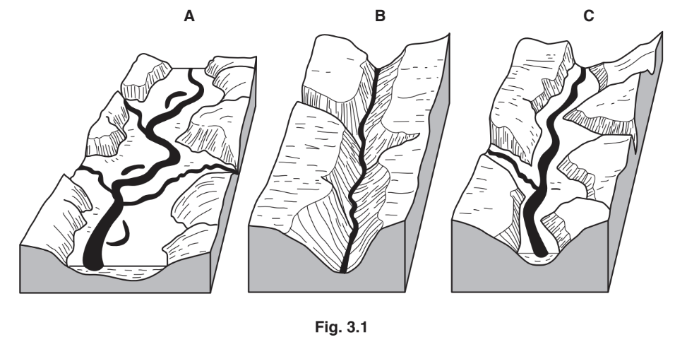

Explain why deposition is likely to take place in the area shown in A in Fig. 3.1.

*Source: Nov 2019 0460/11 Q3A*

### Q11 — medium — 4 marks

**Q11** [4 marks]

Describe the changes in the characteristics of a river from its source to its mouth using the following headings:

width .........................................................................

depth.........................................................................

speed of flow.............................................................

gradient.....................................................................

*Source: June 2020 0460/13 Q3A*

### Q12 — easy — 6 marks

**Q12** [1 mark]

Which river feature is shown in Fig 7.1?

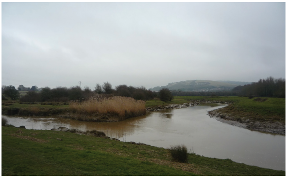

confluence                              oxbow lake                           potholes                          source

*Source: Nov 2022 0460/11 Q4A (I)*

**Q12** [2 marks]

**Extract:**

Which river feature is shown in Fig 7.1?

A winding river, with one river joining another, surrounded by green fields and trees.

What evidence from Fig. 7.1 suggests that:

- the river is carrying a large load in suspension?
- deposition is taking place?

*Source: Nov 2022 0460/11 Q4A (II)*

**Q12** [3 marks]

Another area where a river deposits its load is on its delta. Explain why deposition takes place on a delta.

*Source: Nov 2022 0460/11 Q4A (III)*

### Q13 — easy — 3 marks

**Q13** [3 marks]

Table 6.1 gives the definitions of some terms used in the study of rivers and drainage basins.

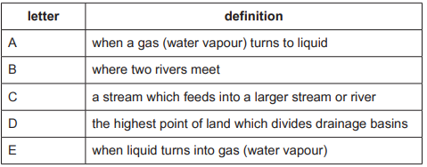

For each of the following terms give the letter for the correct definition from Table 6.1:

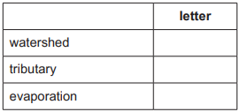

*Source: June 2023 0460/21 Q4A*

### Q14 — easy — 6 marks

**Q14** [1 mark]

**Extract:**

- Correct answer is C; award the mark only for C.
- Do not accept X or Y (these are labels on Fig. 5.2, not location options).

Study Fig. 5.1, which shows a map of an upland area, and Fig. 5.2, which is a photograph of a waterfall.

**Fig. 5.1**

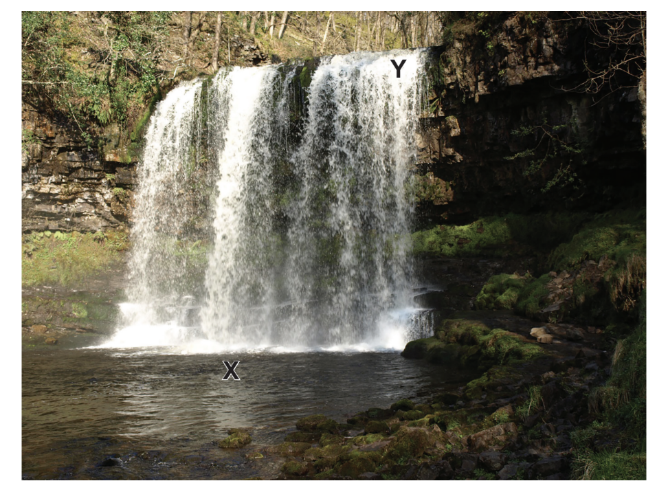

**Fig. 5.2**

Which location **A, B, C** or **D** is the most likely position of the waterfall shown in Fig. 5.2?

*Source: June 2021 0460/12 Q4A (I)*

**Q14** [2 marks]

**Extract:**

Study Fig. 5.1, which shows a map of an upland area, and Fig. 5.2, which is a photograph of a waterfall.

Identify features X and Y in** Fig 5.2.**

*Source: June 2021 0460/12 Q4A (II)*

**Q14** [3 marks]

**Extract:**

Study Fig. 5.1, which shows a map of an upland area, and Fig. 5.2, which is a photograph of a waterfall.

Identify features X and Y in Fig 5.2.
X = plunge pool
Y = overhang/hard rock layer

Explain why a gorge may form downstream of a waterfall.

*Source: June 2021 0460/12 Q4A (III)*

### Q15 — easy — 3 marks

**Q15** [1 mark]

Study Fig. 4, which is a photograph of part of a river.

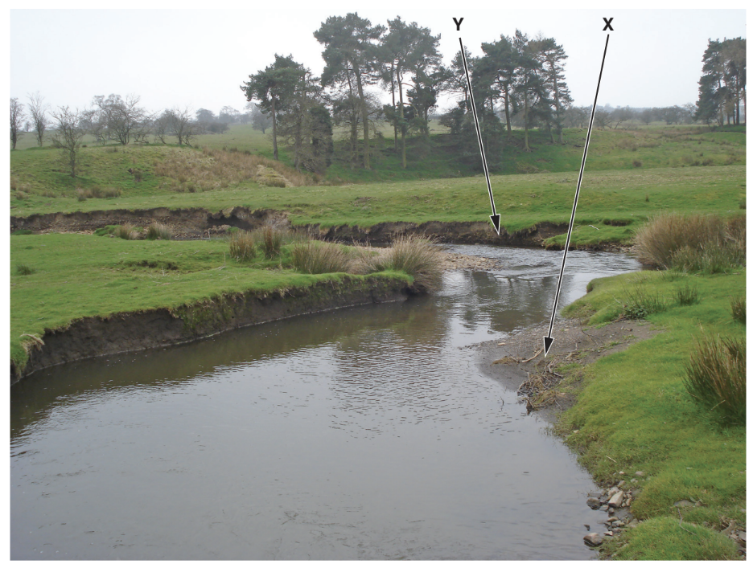

**Fig 4**

What river feature is shown in Fig. 4?

Underline **one** answer in the list below:

confluence    meander    potholes    source

*Source: Nov 2019 0460/13 Q4A (I)*

**Q15** [2 marks]

**Extract:**

Study Fig. 4, which is a photograph of part of a river.

A meandering stream in a grassy landscape with eroded banks and trees in the background, arrows pointing to features marked X and Y.

Fig 4

What river feature is shown in Fig. 4?

Underline one answer in the list below:

confluence    meander    potholes    source

Describe two characteristics of the feature labelled Y on Fig. 4.

### Q16 — easy — 4 marks

**Q16** [1 mark]

Study Fig. 3, which is a flow diagram showing processes in a drainage basin.

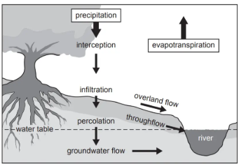

**Fig.3 **

What is a drainage basin?

*Source: June 2020 0460/13 Q3A (I)*

**Q16** [3 marks]

Suggest **three** reasons why overland flow may occur in a drainage basin.

### Q17 — medium — 4 marks

**Q17** [4 marks]

Suggest reasons why the amount of infiltration may vary .

### Q18 — easy — 3 marks

**Q18** [3 marks]

Study Figs. 1.1  and 1.2  which are photographs showing two different rivers and their valleys.

Fig 1.1

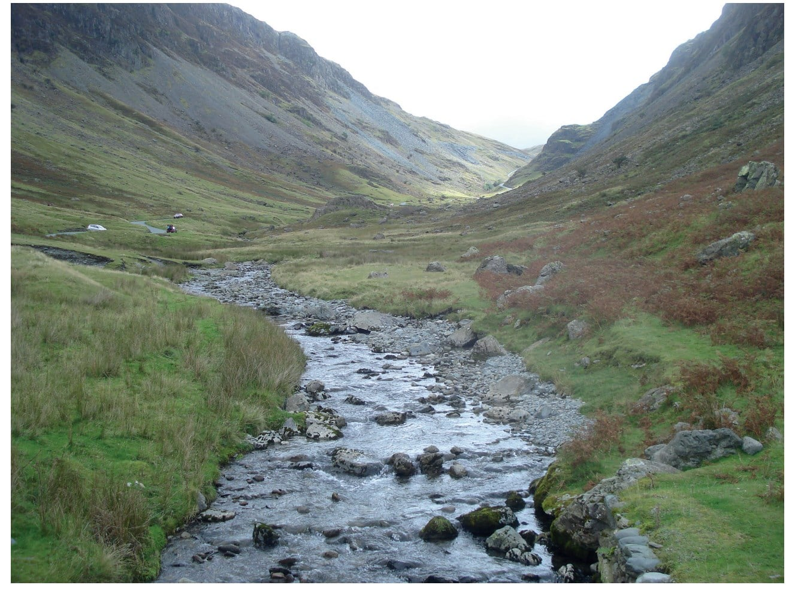

Fig 1.2

Describe the similarities and differences between the rivers shown in Figs. 1.1 and 1.2.

*Source: Nov 2020 0460/12 Q3B*

### Q19 — easy — 6 marks

**Q19** [1 mark]

Study Fig. 3.1, which shows information about flows through a drainage basin.

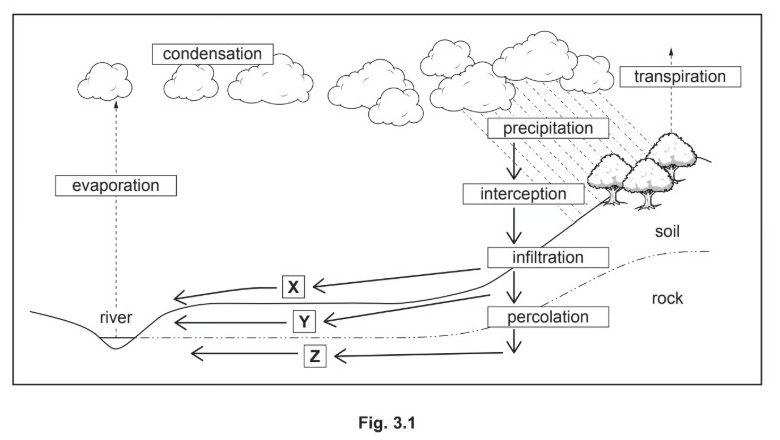

What is meant by transpiration?

*Source: Nov 2020 01460/12 Q3A*

**Q19** [3 marks]

**Extract:**

Study Fig. 3.1, which shows information about flows through a drainage basin.

![Flowchart depicting the water cycle, including evaporation, condensation, precipitation, infiltration, and pathways X, Y, and Z affecting a river.]

Identify the processes which take place at X,Y and Z in Fig  3.1.

*Source: Nov 2020 0460/12 Q3A*

**Q19** [2 marks]

Explain why the amount of interception varies:

- From place to place.
- At different times of the year.

*Source: Nov 2020 0460/12 Q3A*

### Q20 — easy — 3 marks

**Q20** [3 marks]

**Extract:**

- Feature C is a tributary (a smaller channel joining the main channel); accept "tributary" only and do not accept "distributary", "offshoot" or "confluence".

Study Fig. 3.1, which shows a river drainage basin.

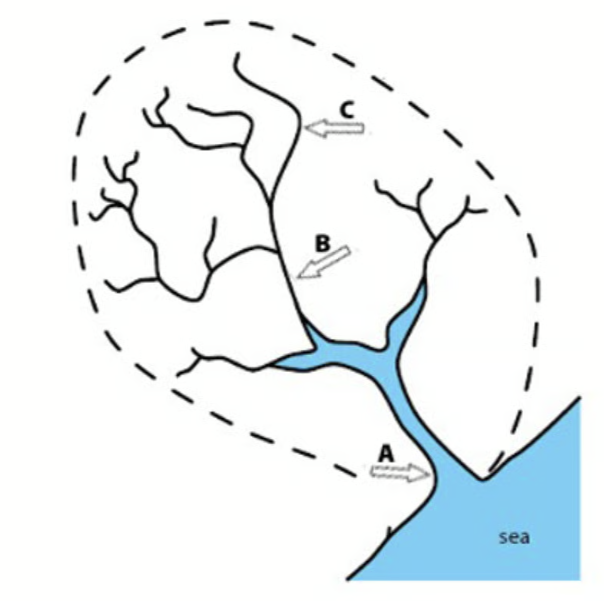

*Fig. 3.1*

Using Fig. 3.1, identify the following the river features A, B and C.
