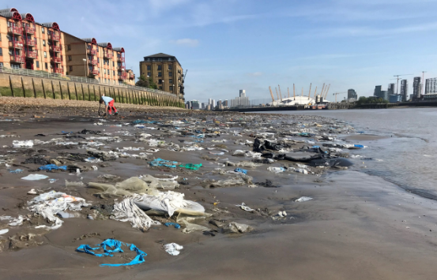
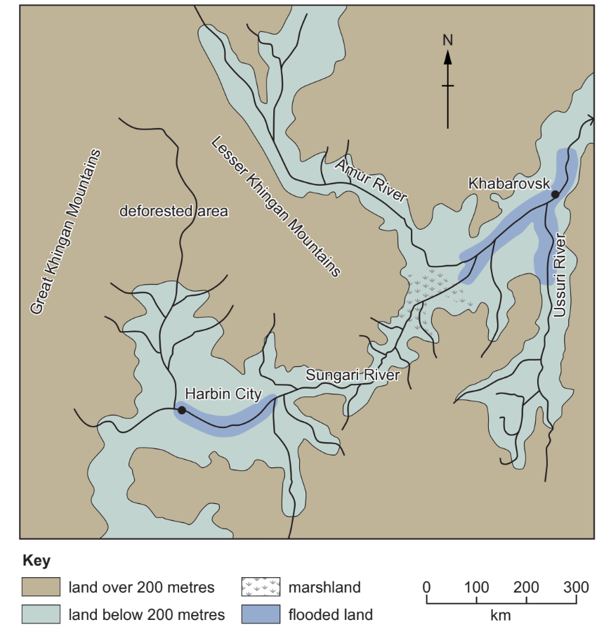
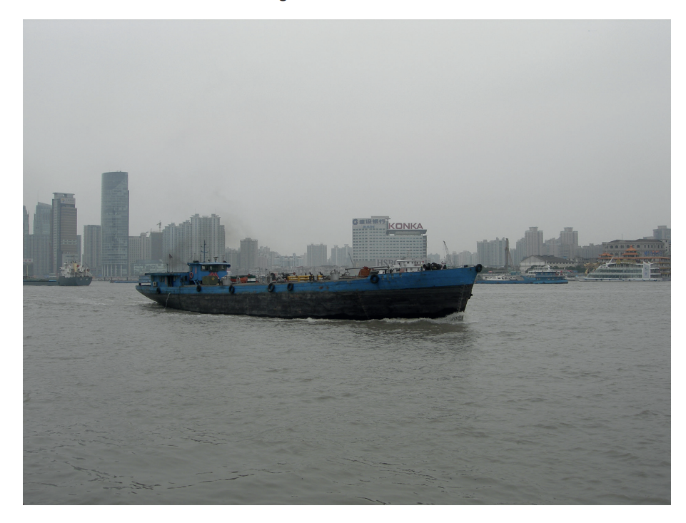
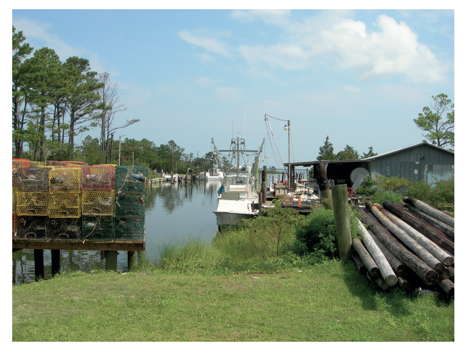
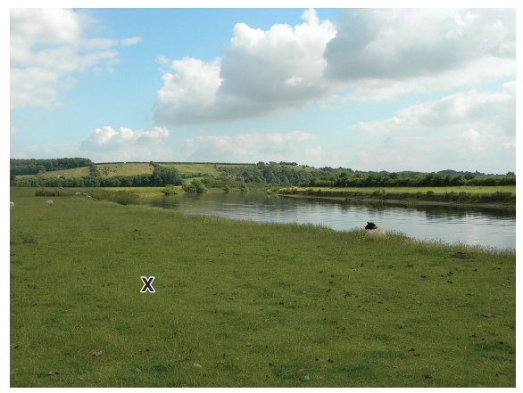
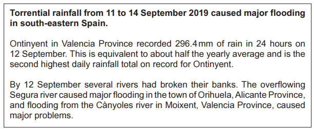
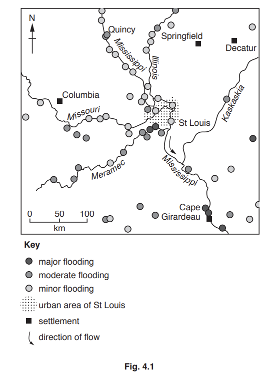

# Exam Questions — Rivers: Hazards & Opportunities
**Changing River Environments** · Cambridge (CIE) IGCSE geography (0460 & 0976)
> Source: [https://www.savemyexams.com/igcse/geography/cie/25/topic-questions/](https://www.savemyexams.com/igcse/geography/cie/25/topic-questions/) · 16 questions across 1 sets

## Exam Questions (16 questions)

### Q1 — hard — 7 marks

**Q1** [7 marks]

For a named river you have studied, describe how pollution is being managed

### Q2 — easy — 3 marks

**Q2** [3 marks]

**Study Fig. 1.1, which shows river pollution in the River Thames, England.**

**Fig. 1.1**

Suggest **three** different problems which may have been caused by the river pollution in areas such as London.

### Q3 — medium — 9 marks

**Q3** [4 marks]

Study Fig. 4.3, which is a map of an area in Asia where river flooding occurred.

**Fig. 4.3**

Suggest reasons why the rivers flooded in the areas shown in Fig. 4.3.

*Source: June 2021 0460/12 Q4B (II)*

**Q3** [5 marks]

**Extract:**

Study Fig. 4.3, which is a map of an area in Asia where river flooding occurred.

Fig. 4.3

Suggest the methods which could be used in the area shown in Fig. 4.3 to prevent flooding.

*Source: June 2021 0460/12 Q4B (III)*

### Q4 — medium — 4 marks

**Q4** [4 marks]

State two different methods to reduce river flooding. For each method explain how it works.

Method 1 .........................................................................................

Explanation ....................................................................................

Method 2 ........................................................................................

Explanation .....................................................................................

### Q5 — medium — 5 marks

**Q5** [5 marks]

Study Figs. 3.2, 3.3 and 3.4, which are photographs of three different rivers.

**Fig 3.2**

**Fig 3.3**

**Fig 3.4**

Explain why living on a delta or near a river may be hazardous for people.

*Source: Nov 2019 0460/11 Q3B (II)*

### Q6 — hard — 7 marks

**Q6** [7 marks]

For a named river you have studied, explain the causes of pollution.

Name of river ..............................

### Q7 — hard — 7 marks

**Q7** [7 marks]

For a named river you have studied, explain the causes of flooding.

Name of river ..............................

*Source: June 2021 0460/11 Q3C*

### Q8 — hard — 7 marks

**Q8** [7 marks]

Describe the hazards provided by a named river you have studied for people who live close to it

Named river ..............

### Q9 — hard — 7 marks

**Q9** [7 marks]

For a named river you have studied, explain how flooding is being managed

### Q10 — medium — 1 marks

**Q10** [1 mark]

Give** two **advantages and** two** disadvantages of living close to a river such as the one shown in Fig. 1.

*Fig. 1*

*Source: March 2022 0460/12 Q4A (IV)*

### Q11 — easy — 3 marks

**Q11** [3 marks]

Study Fig. 4.2, which is information about river flooding in Spain.

Suggest **three** different problems which may have been caused by the river flooding in towns such as Orihuela and Moixent.

*Source: Nov 2022 0460/11 Q4B (I)*

### Q12 — easy — 5 marks

**Q12** [2 marks]

Study Fig. 4.1, which is information about flooding which was predicted for the area around the Mississippi River, USA, in December 2015.

Suggest **two** reasons why most of the major flooding predicted was at Cape Girardeau.

**Q12** [3 marks]

**Extract:**

Study Fig. 4.1, which is information about flooding which was predicted for the area around the Mississippi River, USA, in December 2015.

Describe **three** likely impacts of flooding in the rural areas between St Louis and Cape Girardeau.

*Source: Nov 2019 0460/12 Q4A (III)*

### Q13 — easy — 3 marks

**Q13** [3 marks]

Study Figs. 1.1, 1.2 and 1.3, which are photographs of three different rivers.

**Fig 1.1**

**Fig 1.2**

**Fig 1.3**

Using evidence from Figs. 1.1, 1.2, and 1.3 **only**, describe **three** different benefits of living near a river

*Source: Nov 2019 0460/11 Q3B*

### Q14 — easy — 3 marks

**Q14** [3 marks]

Explain why the building of large settlements on or close to a flood plain increases the discharge of a river after heavy rain.

*Source: June 2020 0460/11 Q4A*

### Q15 — medium — 4 marks

**Q15** [4 marks]

Describe the methods used to manage the impacts of river flooding.

### Q16 — medium — 4 marks

**Q16** [4 marks]

Describe the human causes of flooding.
