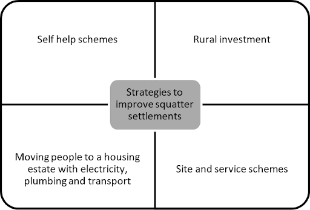

# Exam Questions — Management of Urban Growth
**Changing Towns & Cities** · Cambridge (CIE) IGCSE geography (0460 & 0976)
> Source: [https://www.savemyexams.com/igcse/geography/cie/25/topic-questions/](https://www.savemyexams.com/igcse/geography/cie/25/topic-questions/) · 15 questions across 1 sets

## Exam Questions (15 questions)

### Q1 — hard — 7 marks

**Q1** [7 marks]

Explain why urban planners include green spaces when managing city growth.

### Q2 — hard — 7 marks

**Q2** [7 marks]

Explain how transport strategies can make urban growth more sustainable. Use examples.

### Q3 — hard — 7 marks

**Q3** [7 marks]

For a named urban area you have studied, assess how successful bottom-up strategies are at improving housing in LIC cities.

### Q4 — medium — 5 marks

**Q4** [5 marks]

Explain how transport schemes help reduce urban problems.

### Q5 — medium — 4 marks

**Q5** [4 marks]

Compare top-down and bottom-up housing strategies.

### Q6 — medium — 5 marks

**Q6** [5 marks]

Study Fig. 1, which shows strategies which can be used to improve squatter settlements.

Fig. 1 – Strategies to improve squatter settlements

Which strategy shown in Fig. 1 do you consider to be the best one to improve the lives of people living in squatter settlements?  Justify your answer by referring to the advantages of the strategy you have chosen. Reference to examples may help your answer

### Q7 — medium — 4 marks

**Q7** [4 marks]

Describe **two** problems caused by rapid urban growth in cities.

### Q8 — medium — 4 marks

**Q8** [4 marks]

Explain **two **ways green spaces help manage urban growth.

### Q9 — easy — 2 marks

**Q9** [2 marks]

Explain one way congestion charges help the environment.

### Q10 — easy — 2 marks

**Q10** [2 marks]

Give two benefits of self-help housing schemes.

### Q11 — easy — 1 marks

**Q11** [1 mark]

What is a bottom-up housing scheme?

### Q12 — easy — 1 marks

**Q12** [1 mark]

What is a top-down housing scheme?

### Q13 — easy — 2 marks

**Q13** [2 marks]

Urban areas have many problems.

Fig. 1 - An electric bus

Using Fig. 1, explain how this improves an urban area.

### Q14 — hard — 7 marks

**Q14** [7 marks]

For a named urban area you have studied, describe the strategies used to reduce traffic congestion.

*Source: June 2024 0460/01 Q2C*

### Q15 — hard — 7 marks

**Q15** [7 marks]

For a named urban area you have studied, describe the strategies which have been used to reduce problems caused by urban growth.

Name of urban area:

*Source: Specimen 0460/02 Q4C*

