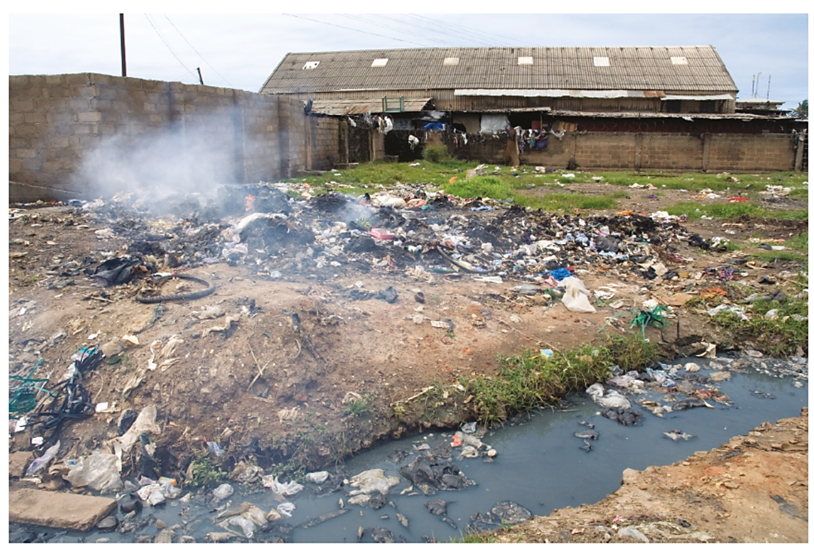
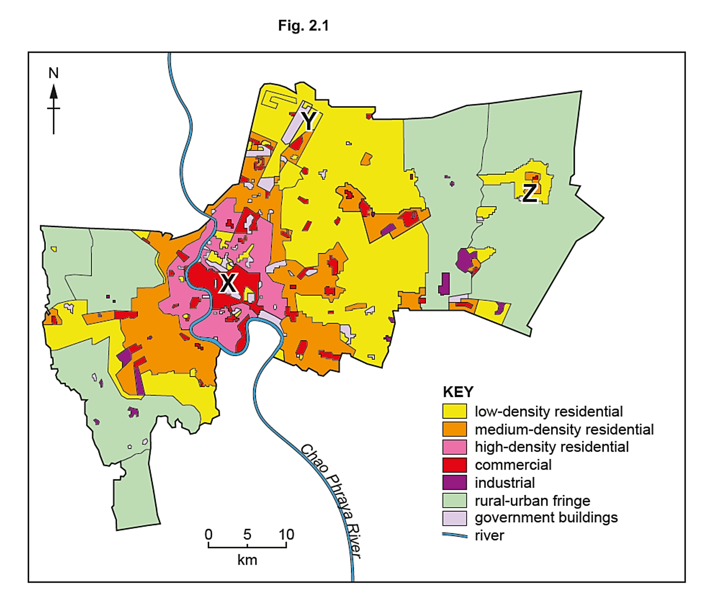
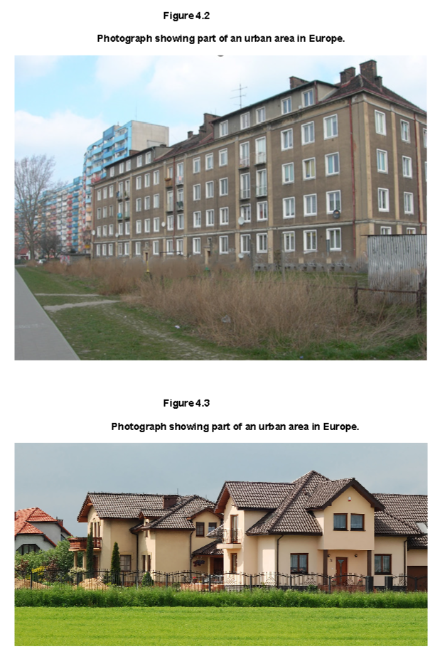

# Exam Questions — Opportunities & Challenges of Urbanisation
**Changing Towns & Cities** · Cambridge (CIE) IGCSE geography (0460 & 0976)
> Source: [https://www.savemyexams.com/igcse/geography/cie/25/topic-questions/](https://www.savemyexams.com/igcse/geography/cie/25/topic-questions/) · 14 questions across 1 sets

## Exam Questions (14 questions)

### Q1 — medium — 4 marks

**Q1** [4 marks]

Explain why access to services is better in urban areas than in rural areas.

### Q2 — easy — 6 marks

**Q2** [1 mark]

State one challenge of rural living.

**Q2** [2 marks]

Describe **one** way in which rural isolation affects people.

**Q2** [3 marks]

Suggest **one** reason why some people choose to remain in rural areas despite the challenges.

### Q3 — easy — 6 marks

**Q3** [1 mark]

State one opportunity of urban living.

**Q3** [2 marks]

Describe **one **way in which urban inequality affects people.

**Q3** [3 marks]

Suggest **one **reason why many people move from rural to urban areas.

### Q4 — hard — 7 marks

**Q4** [7 marks]

Assess the social and economic impacts of inequality in urban areas.

### Q5 — hard — 7 marks

**Q5** [7 marks]

Assess how unplanned settlements create challenges for sustainable urban growth.

### Q6 — hard — 7 marks

**Q6** [7 marks]

Evaluate the extent to which waste management strategies can solve the challenges of urbanisation?

### Q7 — hard — 7 marks

**Q7** [7 marks]

Evaluate the extent to which urbanisation creates more opportunities than challenges in LICs?

### Q8 — hard — 7 marks

**Q8** [7 marks]

Evaluate the impact of transport problems on people’s quality of life in urban areas.

### Q9 — medium — 4 marks

**Q9** [4 marks]

Fig. 4.1 shows pollution in Accra, the capital city of Ghana, a country in Africa.

*Fig. 4.1*

Using Fig. 4.1, describe four types of pollution shown.

*Source: Nov 2023 0460/23 Q4A*

### Q10 — medium — 4 marks

**Q10** [4 marks]

Explain how air pollution causes problems for people who live in urban areas.

*Source: Nov 2019 0460/13 Q2A IV*

### Q11 — medium — 4 marks

**Q11** [4 marks]

Describe the impacts of urban sprawl on the natural environment.

*Source: June 2024 0460/01 Q2A IV*

### Q12 — easy — 6 marks

**Q12** [1 mark]

Study Fig. 2.1, a map showing urban zones in Bangkok, the capital city of Thailand (a country in Asia).

What is the direction from point X in the CBD of Bangkok to the government buildings at Y?

*Source: June 2024 0460/01 Q2A I*

**Q12** [2 marks]

**Extract:**

Study Fig. 2.1, a map showing urban zones in Bangkok, the capital city of Thailand (a country in Asia).

Using Fig. 2.1, describe the location of the high-density residential zones in Bangkok.

*Source: Specimen 0460/02 Q3A II*

**Q12** [3 marks]

**Extract:**

Study Fig. 2.1, a map showing urban zones in Bangkok, the capital city of Thailand (a country in Asia).

The residential area in the rural-urban fringe marked Z on Fig. 2.1 has been recently developed. Give **three **advantages to living on the rural-urban fringe.

*Source: Specimen 0460/01 Q2A III*

### Q13 — medium — 5 marks

**Q13** [5 marks]

Figures 4.2 and 4.3 are photographs of two different parts of an urban area in Europe.

Assess the extent to which inequalities are likely to exist between the people living in the urban areas shown in Figures 4.2 and 4.3.

*Source: Specimen 0460/02 Q4B II*

### Q14 — easy — 3 marks

**Q14** [3 marks]

Figures 4.2 and 4.3 (Insert) are photographs of two different parts of an urban area in Europe.

Compare **three **features of the housing shown in Figures 4.2 and 4.3.

*Source: Specimen 0460/02 Q4B I*

