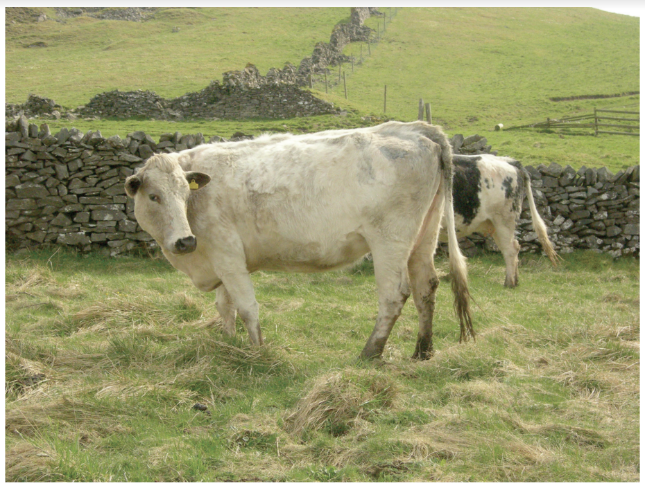
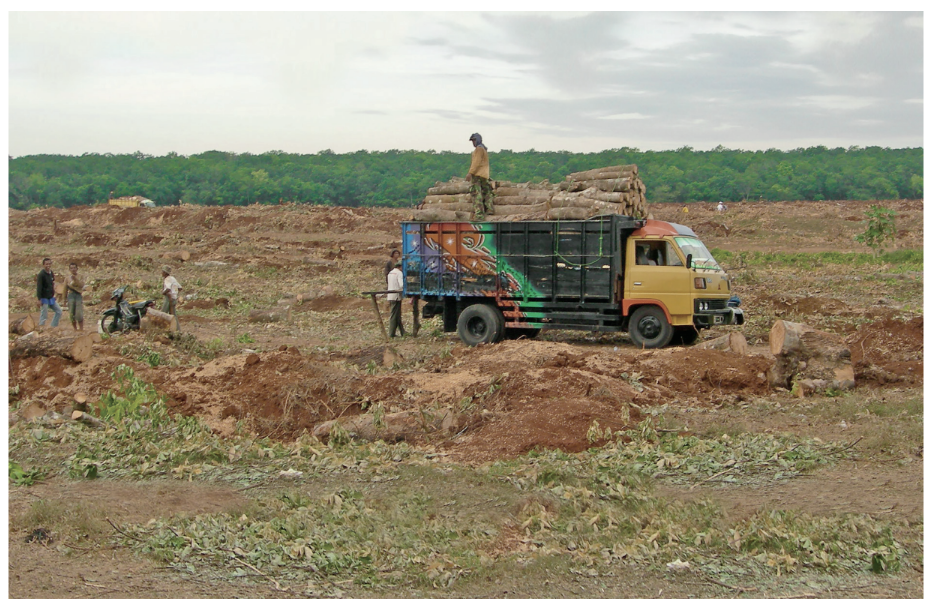
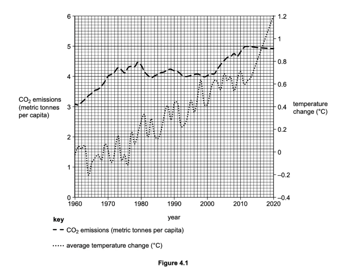
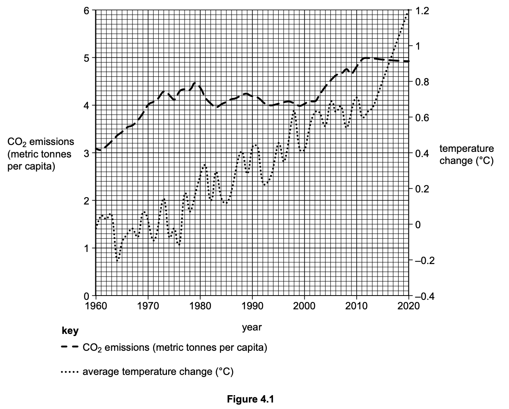

# Exam Questions — Causes & Impacts of Climate Change
**Climate Change** · Cambridge (CIE) IGCSE geography (0460 & 0976)
> Source: [https://www.savemyexams.com/igcse/geography/cie/25/topic-questions/](https://www.savemyexams.com/igcse/geography/cie/25/topic-questions/) · 15 questions across 1 sets

## Exam Questions (15 questions)

### Q1 — hard — 7 marks

**Q1** [7 marks]

For Bangladesh, explain what the impacts of climate change are on both the environment and people.

### Q2 — hard — 7 marks

**Q2** [7 marks]

For a named country you have studied, explain how managing climate change involves both reducing causes (mitigation) and responding to change (adaptation).

### Q3 — hard — 7 marks

**Q3** [7 marks]

To what extent is climate change the result of human actions

### Q4 — hard — 7 marks

**Q4** [7 marks]

To what extent have international agreements been successful in limiting climate change

### Q5 — medium — 5 marks

**Q5** [5 marks]

Study Figs. 6.2, 6.3 and 6.4, which are photographs of economic activities which increase greenhouse gases in the atmosphere.

**Fig 6.2**

**Fig 6.3**

**Fig 6.4**

Explain how an increase in greenhouse gases in the atmosphere is causing global warming.

*Source: Nov 2019 0460/13 Q6B*

### Q6 — medium — 5 marks

**Q6** [5 marks]

To what extent are global health impacts a significant consequence of climate change

### Q7 — easy — 1 marks

**Q7** [1 mark]

State **one **natural cause of changes in global temperatures.

### Q8 — easy — 3 marks

**Q8** [3 marks]

Study Figs. 6.2, 6.3 and 6.4, which are photographs of economic activities which increase greenhouse gases in the atmosphere.

**Fig 6.2 **

**Fig 6.3**

**Fig 6.4**

Explain how each of the economic activities shown in Figs. 6.2, 6.3 and 6.4 increase greenhouse gases in the atmosphere. 
Fig. 6.2 .................................................................................... 
Fig. 6.3 .................................................................................... 
Fig. 6.4 .....................................................................................

### Q9 — medium — 5 marks

**Q9** [5 marks]

Study Fig. 6.2, which shows information about human influence on the greenhouse effect.

Explain why greenhouse gases are building up in the atmosphere.

*Source: Nov 2019 0460/12 Q6B*

### Q10 — easy — 3 marks

**Q10** [3 marks]

Study Fig. 6.2, which shows information about human influence on the greenhouse effect.

Using Fig. 6.2 only, explain how humans are influencing the natural greenhouse effect.

*Source: Nov 2019 0460/12 Q6B*

### Q11 — hard — 7 marks

**Q11** [7 marks]

For a named country you have studied, describe the strategies which have been used to reduce the problems caused by climate change.

*Source: Specimen 0460/01 Q4C*

### Q12 — medium — 5 marks

**Q12** [5 marks]

To what extent is international cooperation essential to slow down the rate of climate change?

*Source: Specimen 0460/01 Q4B (II)*

### Q13 — easy — 3 marks

**Q13** [3 marks]

State **one** reason for each of the following impacts of climate change.

- Rising sea levels
- Prices of food may rise
- Shortages of water

*Source: Specimen 0460/01 Q4B (I)*

### Q14 — medium — 4 marks

**Q14** [4 marks]

Study Figure 4.1, which shows changes in global carbon dioxide (CO2) emissions and average temperature change between 1960 and 2020.

Use evidence in Figure 4.1 to describe the relationship between global CO2 emissions and average temperature change.

*Source: Specimen 0460/01 Q4A (IV)*

### Q15 — easy — 6 marks

**Q15** [1 mark]

Study Figure 4.1, which shows changes in global carbon dioxide (CO2) emissions and average temperature change between 1960 and 2020.

Estimate the increase in global CO2 emissions between 1960 and 2020.

**Q15** [2 marks]

Give two reasons for the increase in global CO2 emissions between 1960 and 2020.

**Q15** [3 marks]

**Extract:**

Study Figure 4.1, which shows changes in global carbon dioxide (CO~2~) emissions and average temperature change between 1960 and 2020.

Use Figure 4.1 to describe the average changes in temperature between 1960 and 2020. Refer to data in your answer.
