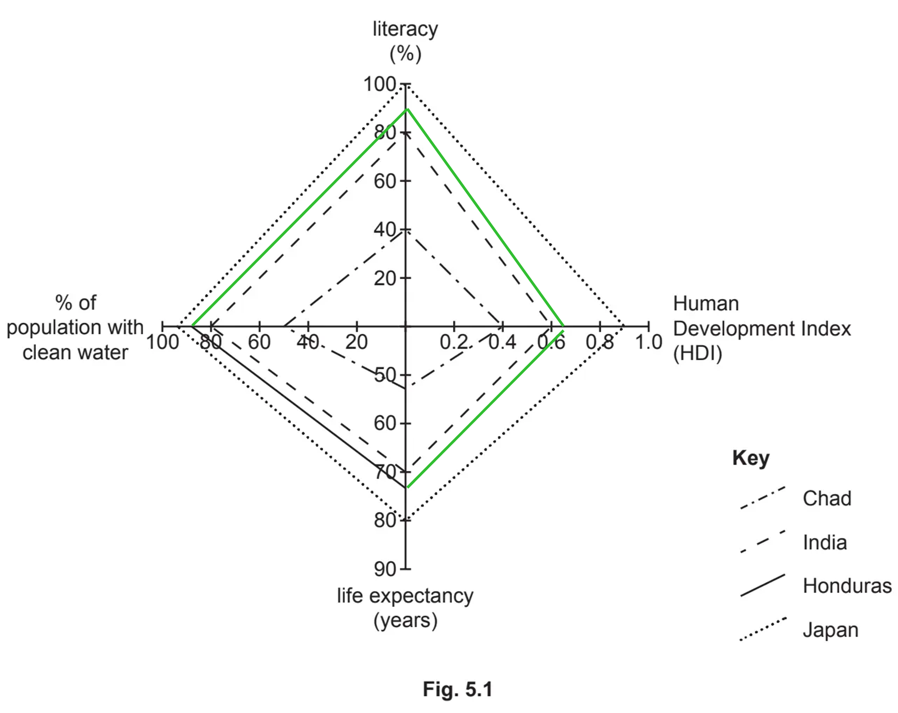

# Mark Schemes — Measuring Development
**Development** · Cambridge (CIE) IGCSE geography (0460 & 0976)

## Exam Questions (16 questions)

### Q1
The literacy rate shows how many people over 15 can read and write. **[1]** A high literacy rate means more people can access education and skilled jobs. **[1]** This points to future economic growth and a higher standard of living. **[d]**  It is a good social indicator of human development. **[1]**

> **[mark-scheme]**
> **Mark allocation**
> 
> - 1 mark **[1]** for a simple point.
> - 1 mark **[d]** for a developed point.
> 
> **Alternative content**
> 
> - A comparison of LICs (65%) and HICs (96%).

> **[exam-tip]**
> Give a definition, then link it to opportunities.

### Q2
GNI per capita includes income from abroad, such as remittances or foreign investment. **[1]** This gives a clearer idea of the total wealth of a country’s people. **[1] **GDP only measures what is produced inside the country and may miss important income sources. **[1] **Therefore, GNI per capita is more widely used by organisations like the World Bank. **[1]**

> **[mark-scheme]**
> **Mark allocation **
> 
> - 1 mark **[1]** per valid point.
> - 1 mark **[d]** for a developed point.
> 
> **Alternative content**
> 
> - The EU uses GNI to set contribution rates.
> 
> **Common errors**
> 
> Students lose marks by not comparing the two indicators.

### Q3
GDP per capita is an average and hides differences in wealth. **[1]** For example, a country may have a high GDP per capita because of a few wealthy people, but others could still live in poverty. **[1]** It also does not show how money is spent, such as whether it improves healthcare or education. **[1]**

> **[mark-scheme]**
> **Mark allocation**
> 
> - 1 mark **[1]** per valid point (up to a maximum of 3 marks).
> 
> **Alternative content**
> 
> - The informal economy is not included. **[1 mark]**
> - Does not have Purchasing Power Parity (PPP) adjustments. **[1 mark]**
> - GDP can rise after disasters without improving quality of life. **[1 mark]**

> **[exam-tip]**
> Always make sure you show why an average can be misleading.

### Q4
GNI per capita measures the average income earned per person, including foreign income. **[KU]** It allows comparison between countries of different population sizes. **[KU]** For example, India’s GNI per capita is lower than the UK’s, even though its total GNI is higher. **[KU]**

However, the purchasing power of \$1 varies by location. **[KU]** In Bangladesh, \$1 buys more than in the USA. **[KU]** That is why GNI per capita at Purchasing Power Parity (PPP) is more accurate. **[E]** It adjusts for differences in cost of living, showing real standards of living. **[KU]**

Without PPP, comparisons may be misleading. **[E]** For example, two countries with the same GNI per capita may have very different living costs and standards of living. **[KU]** PPP therefore makes comparisons fairer, though it still hides inequality. **[E]**

> **[mark-scheme]**
> The command word '**assess'** means that the answer needs to include judgement about the relative value of using GNI per capita at PPP is a better measurement of development than GNI per capita.
> 
> **Mark allocation**
> 
> This answer is assessed using a **'level of response'** approach. Each point made in the answer does not equal a mark.
> 
> AO focus = AO1 **[KU]** + AO3 **[E]**
> 
> - A top-level 3 answer [7 marks] will be a clear, detailed explanation with named examples and a balanced assessment.
> - It should show knowledge and understanding **[KU]** of GNI per capita and PPP to evaluate (judge) **[E]** its usefulness and limits against GNI.
> 
> **Alternative content**
> 
> The above answer is one way to respond to this question. Additional information that could be used in the answer includes:
> 
> - Remittances.
> - Foreign aid is included in GNI.

> **[exam-tip]**
> Remember PPP as a 'cost of living adjustment'.

### Q5
Life expectancy shows average years lived. **[KU] **This measurement reflects aspects of health, healthcare, and nutrition. **[KU]** Infant mortality shows how many babies die before age one. **[KU]** Both are linked to quality of life. **[KU]**

However, data may be unreliable in LICs. **[KU]** Not all infant deaths are reported in remote areas. **[KU] **High infant mortality can also reduce life expectancy figures, even if those who survive live long lives. **[E]** Life expectancy can also vary greatly between urban and rural areas. **[KU]**

For example, Sub-Saharan Africa has very high infant mortality rates compared with Europe. **[KU]** But figures alone do not show inequality within countries or access to healthcare for all groups. **[E]**

Overall, life expectancy and infant mortality are useful but incomplete. **[E]** They should be combined with economic and social indicators, such as HDI, for a clearer picture. **[KU]**

> **[mark-scheme]**
> The command word '**evaluate'** means that the answer needs to include judgement about the relative value of using social indicators as a measurement of development.
> 
> **Mark allocation**
> 
> This answer is assessed using a **'level of response'** approach. Each point made in the answer does not equal a mark.
> 
> AO focus = AO1 **[KU]** + AO3 **[E]**
> 
> - A top-level 3 answer [7 marks] will be a clear, detailed explanation with named examples and a balanced assessment.
> - It should show knowledge and understanding **[KU]** of social indicators with examples to evaluate (judge) **[E]** its usefulness and limits as a measurement of development.
> 
> **Alternative content**
> 
> The above answer is one way to respond to this question. Additional information that could be used in the answer includes:
> 
> - Calorie intake.
> - People per doctor.
> - Access to safe water.

> **[exam-tip]**
> Remember to always show why data in LICs may be inaccurate or incomplete.

### Q6
HDI combines four indicators: life expectancy, mean years of schooling, expected years of schooling, and GNI per capita (PPP). **[KU]** This makes it more reliable than using a single indicator, as it shows health, education, and income together. **[KU]** For example, in 2024 Norway had the highest HDI (0.957), while Niger was the lowest (0.394). **[KU]**

HDI is useful because it avoids the weaknesses of averages like GDP alone. **[E]** It allows countries to be ranked into groups such as Very High, High, Medium, and Low Human Development. **[KU]**

However, HDI has limits. **[KU]** It uses averages and hides inequality within a country. **[E]** It also ignores political freedoms, environment, or happiness. **[KU]** Some argue it is biased towards HICs, where income carries more weight. **[E]**

Overall, HDI provides a broader picture than single indicators, but it is not perfect. **[E]**

> **[mark-scheme]**
> The command word ‘**evaluate’** means that the answer needs to include consideration of the advantages and disadvantages of the Human Development Index (HDI) as a multi-strand indicator and then make a judgement or conclusion based on evidence that it is more realistic compared to single indicators.
> 
> **Mark allocation**
> 
> This answer is assessed using a **'level of response'** approach. Each point made in the answer does not equal a mark.
> 
> AO focus = AO1 **[KU]** + AO3 **[E]**
> 
> - A top-level 3 answer [7 marks] will be a clear, detailed explanation with named examples and a balanced assessment.
> - It should show knowledge and understanding **[KU]** of HDI and its components to evaluate (judge) **[E]** its usefulness and limits against single indicators.
> 
> **Alternative content**
> 
> The above answer is one way to respond to this question. Additional information that could be used in the answer includes:
> 
> - Comparison against GDP, literacy, or life expectancy alone.

> **[exam-tip]**
> Always use the HDI scores to give real figures.

### Q7
The literacy rate shows the percentage of adults who can read and write, which is vital for education, jobs, and quality of life. **[KU]** In HICs, literacy averages 96%, showing widespread education. **[KU]** In LICs, rates may be closer to 65%, limiting opportunities. **[KU]**

However, literacy rate has weaknesses. **[KU]** In LICs, it may be hard to measure, especially in conflict zones or informal settlements. **[KU]** Figures may be unreliable or outdated. **[E]** Literacy alone does not show access to healthcare, income, or housing. **[KU]**

For example, Cuba has high literacy but low income compared to HICs. **[KU]** Therefore, literacy is a good social indicator, but when used alone it gives only a partial view of development. **[E]**

> **[mark-scheme]**
> The command word '**assess'** means that the answer needs to include judgement about the reliability of using literacy rate as a measurement of development.
> 
> **Mark allocation**
> 
> This answer is assessed using a **'level of response'** approach. Each point made in the answer does not equal a mark.
> 
> AO focus = AO1 **[KU]** + AO3 **[E]**
> 
> - A top-level 3 answer [7 marks] will be a clear, detailed explanation with named examples and a balanced assessment.
> - It should show knowledge and understanding **[KU]** of the literacy rate and data to evaluate (judge) **[E]** its usefulness and limits.
> 
> **Alternative content**
> 
> The above answer is one way to respond to this question. Additional information that could be used in the answer includes:
> 
> - Digital literacy.
> - Gender inequality in education.

> **[exam-tip]**
> Link literacy to wider opportunities, not just reading.

### Q8
GDP per capita is widely used because it is simple and allows comparison between countries of different sizes.  **[KU]** For example, dividing GDP by population gives an average wealth figure. **[KU]** This helps compare countries like India and the UK, even though India’s total GDP is higher but its GDP per capita is lower. **[KU]**

However, GDP per capita has limits. **[KU]** It hides inequality, as a few rich people may raise the average while many remain poor.  **[E]** It also ignores quality of life—higher GDP may come from rebuilding after disasters, which does not mean life improved. **[KU]**

GDP does not show government spending priorities. **[KU]** For example, Cuba has a lower GDP but higher literacy and healthcare than many richer countries. **[KU]** Therefore, while GDP per capita is useful for making economic comparisons, it is a weak indicator of overall development.  **[E]**

> **[mark-scheme]**
> The command word '**assess'** means that the answer needs to include judgement about the relative value of using GDP per capita as a measurement of development.
> 
> **Mark allocation**
> 
> This answer is assessed using a **'level of response'** approach. Each point made in the answer does not equal a mark.
> 
> AO focus = AO1 **[KU]** + AO3 **[E]**
> 
> - A top-level 3 answer [7 marks] will be a clear, detailed explanation with named examples and a balanced assessment.
> - It should show knowledge and understanding **[KU]** of GDP per capita and examples to evaluate (judge) **[E]** its usefulness and limits.
> 
> **Alternative content**
> 
> The above answer is one way to respond to this question. Additional information that could be used in the answer includes:
> 
> - Purchasing Power Parity (PPP).
> - The informal economy is a hidden aspect of society.

> **[exam-tip]**
> Always mention inequality when criticising GDP per capita.

### Q9
India has several landlocked **[1]** states that struggle to develop their industries due to difficult access by road, sea, or rail. **[d]** This disadvantage keeps their Gross National Income (GNI) lower. **[d]**

Some states have better healthcare and education systems, which improve life expectancy. **[1]**

> **[mark-scheme]**
> The command word is ‘**suggest**’, which means that the answer must demonstrate what causes these differences in HDI across the states of India.
> 
> There is no need for the statements to be comparative.
> 
> **Mark allocation**
> 
> - Each valid or developed **[d]** point is worth 1 mark **[1]**, with a maximum of 4 marks available.
> 
> **Alternative content**
> 
> The answer above is just one example of how to respond to this question. Additional information that could be used in the answer includes:
> 
> - High GNI/high income/high GDP **[1 mark]**
> - Many hospitals/doctors/ nurses/vaccination/medicines **[1 mark]**
> - High years of schooling/good education/schools/skills/literacy **[1 mark]**
> - Presence/absence of mineral/natural resources or an example **[1 mark]**
> - Energy supplies or an example **[1 mark]**
> - Availability of water supplies (drought/presence of rivers/sufficient rainfall) **[1 mark]**
> - Mainly low-income primary sector agriculture/fishing **[1 mark]**
> - Development of TNCs increase wealth  **[1 mark]**
> - Development of employment increases wealth  (business/commerce/tertiary)  **[1 mark]**
> - Development of tourism **[1 mark]**
> - Historical development/impact of colonialism  **[1 mark]**
> - Fertile soils/improved agriculture/availability of food supplies **[1 mark]**
> - Impacts of trade/exports **[1 mark]**
> - Government/corruption/variation in government funding **[1 mark]**
> - Any other suitable response

> **[exam-tip]**
> There are several explanations as to why there are differences in the HDI between the various states of India. In this case, let the number of available marks guide your decision.
> 
> Remember that if the command word was 'explain', then a developed answer would be necessary to gain the mark.

### Q10
> **[mark-scheme]**
> a) 0.551–0.600
> 
> Any **one** from
> 
> - Uttar Pradesh **[1 mark]**
> - Bihar **[1 mark]**
> - Jharkhand **[1 mark]**
> - Odisha **[1 mark]**
> - Chhattisgarh **[1 mark]**
> - Madhya Pradesh **[1 mark]**
> - New Delhi **[1 mark]**
> 
> b) A state in the east 0.651 – 0.700
> 
> Any **one** from
> 
> - Nagaland **[1 mark]**
> - Manipur **[1 mark]**
> - Tripura **[1 mark]**
> - Mizoram **[1 mark]**
> - Arunachal Pradesh **[1 mark]**

### Q11
> **[mark-scheme]**
> **Human Development Index** **[1 mark]**
> **[mark-scheme]**
> Any **three **from:
> 
> - Expected years of schooling **[1 mark]**
> - Gross National Income (GNI) per capita/person **[1 mark]**
> - Life expectancy at birth **[1 mark]**
> - Mean (average) number of years of schooling **[1 mark]**

### Q12
> **[mark-scheme]**
> The correct answer is **Chad ****[1 mark]**
> **[mark-scheme]**
> 
> 
> 2 correct plots **[1 mark]** 
> 3 lines **[1 mark]**
> **[mark-scheme]**
> Any **three **from:
> 
> - 0 to 1 index is used **[1 mark]**
> - It is a composite indicator/looks at different/many/3/all/the important measurements/aspects/factors **[1 mark] **
> - It incorporates information on:
> 
>   - life expectancy
>   - income
>   - GNI and education
>   - years of schooling** [MAX 2 marks]**

### Q13
> **[mark-scheme]**
> Any **one **from:
> 
> - teacher **[1 mark]**
> - nurse **[1 mark]**
> - worker in a shop **[1 mark]**
> - banker **[1 mark]**
> - driver **[1 mark]**
> - office worker **[1 mark]**
> - cleaner **[1 mark]**
> - Any other suitable response
> **[mark-scheme]**
> - **1 mark** for dividing line (at 30/75 – 1% tolerance)
> - **1 mark **for correct shading, in the correct order.
There is more primary employment in Cameroon than in Italy

**OR **

There is less primary employment in Italy than in Cameroon **[1 mark]**

More secondary employment in Italy

**OR**

There is less secondary employment in Cameroon **[1 mark]**

More tertiary in Italy

**OR**

less tertiary in Cameroon **[1 mark]**

Primary is largest in Cameroon and tertiary is largest in Italy **[1 mark]**

Primary is smallest in Italy and tertiary is smallest in Cameroon. **[1 mark]**

### Q14
> **[mark-scheme]**
> **1st – Canada  **
> **2nd – Brazil **
> **3rd – China **
> **4th – Sudan ****[1 mark]**
> 
> **All four** are needed in the correct order for one mark.
> **[mark-scheme]**
> HDI is generally higher in North America **[1 mark]** 
> There is more variation in HDI in South America than in North America. **[1 mark]**
> **[mark-scheme]**
> Any **three **from:
> 
> - It takes into account a variety of factors/uses more than one indicator **[1 mark]**
> - The life expectancy/education (numbers of years in school) are used to give a better index of development than income alone **[1 mark]**
> - It is easy to carry out statistical comparisons between countries/change over time, etc. **[1 mark]**
> - Any other suitable response.

### Q15
Thailand is the most developed country. **[1]** This is because Thailand has the highest Human Development Index (HDI) **[1] **and Gross National Product (GNP) per capita. **[1] **Also, its literacy rate is the third highest, after Indonesia and the Philippines.  **[1]**

> **[mark-scheme]**
> There are two command words here:
> 
> - **Identify **the country.
> - **Justify**, based on the data from the resource, why you chose that country.
> 
> **Mark allocation**
> 
> AO focus = AO2 skills and analysis
> 
> - 1 mark for Thailand **[1]**
> - 1 mark per valid justification **[1] x3**
> - NB: A maximum of one mark is available if you choose:
> 
>   - The Philippines and Indonesia only have higher literacy rates than other countries.
>   - Sri Lanka only has the highest life expectancy.
> 
> **Alternative content**
> 
> The answer above is just one example of a response to this question. Other information that could be used in the answer includes:
> 
> - Energy use per person is highest.
> - Life expectancy is second highest.
> - Life expectancy is just below Sri Lanka, which is the highest.

### Q16
Either **Sri Lanka** **[1]** or **Thailand**** ****[1]**
GNI per capita is the total value of goods and services produced within a country, plus income from abroad, divided by its population. **[1]**

Literacy rate is the percentage of people aged 15 years and over who can read and write. **[1]**

**Alternative responses**

GNI is the income of a country divided by its population** [1]**

GNI is the value of a country's production per person **[1]**
Overall, there is a positive relationship between HDI and energy use per person. **[1]** Thailand has the highest energy use per person at 1926 kg oil equivalent with an HDI of 0.800, and Pakistan has the lowest use at 431 kg oil equivalent with an HDI of 0.544. **[d]**

However, there are some anomalies, like Indonesia, which has a lower HDI than Sri Lanka despite using 365 kg more oil equivalent per person. **[1]**

> **[mark-scheme]**
> The command word is **'describe'**; this means that the answer needs to state the main features of the graph, giving overall characteristics and any anomalies.
> 
> **Mark allocation**
> 
> AO focus = AO2 skills and analysis
> 
> - 1 mark per valid point **[1]** x 2
> - 1 mark for a comparing data **[d]**

> **[exam-tip]**
> When asked to describe in an exam, always
> 
> - **Identify** the main high and low feature
> - **Provide details** about the key aspects
> - **Use examples** from the resource
> - **Do not explain** why things are the way they are or how they happen
