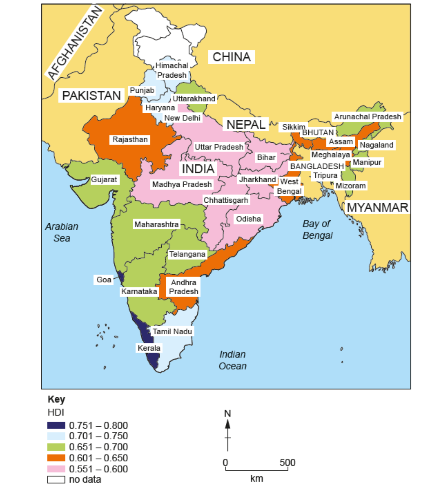
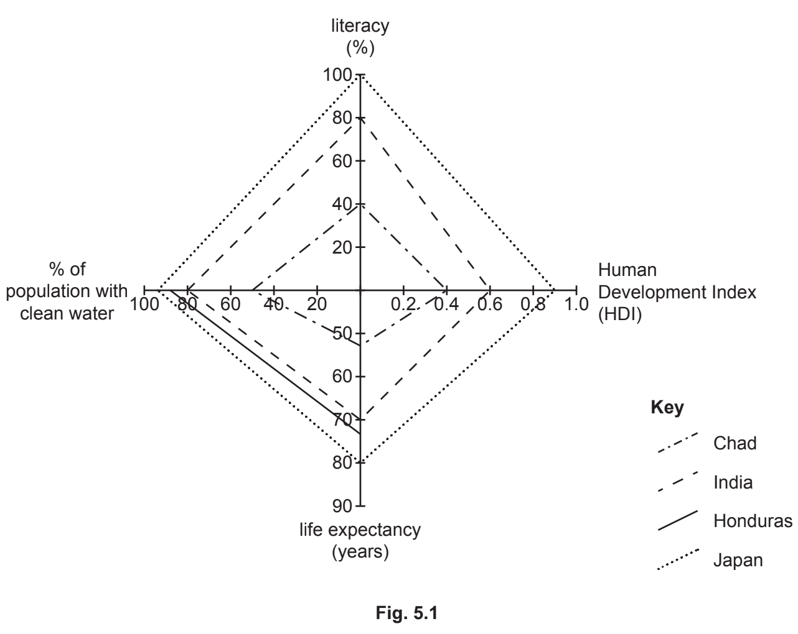
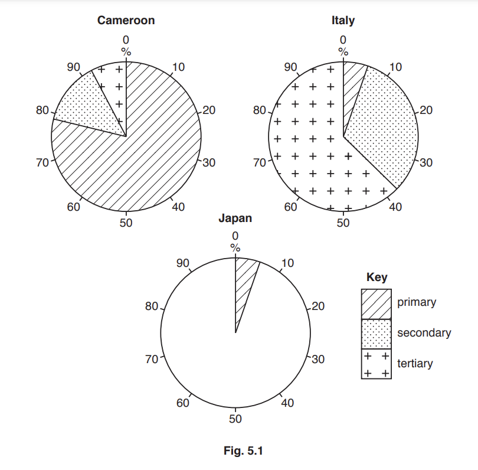
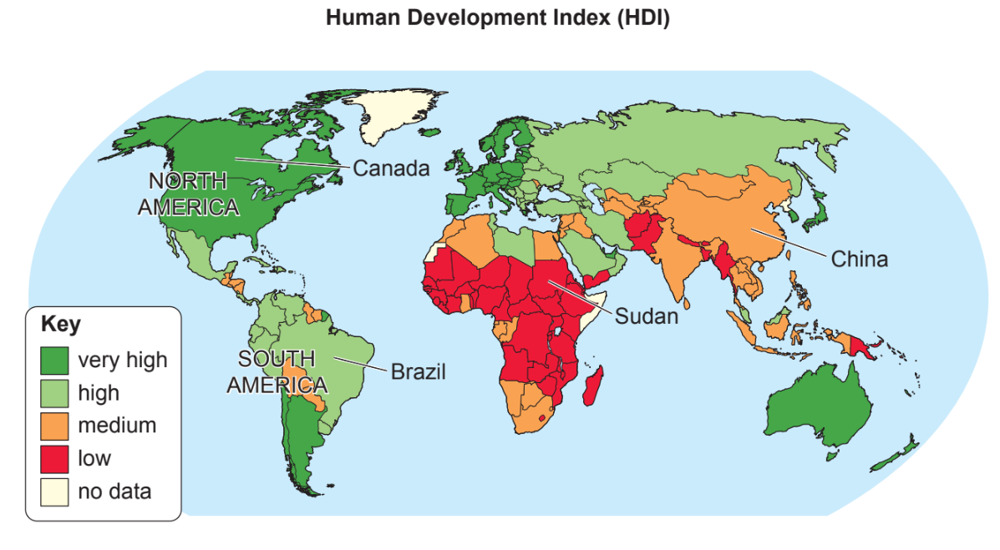
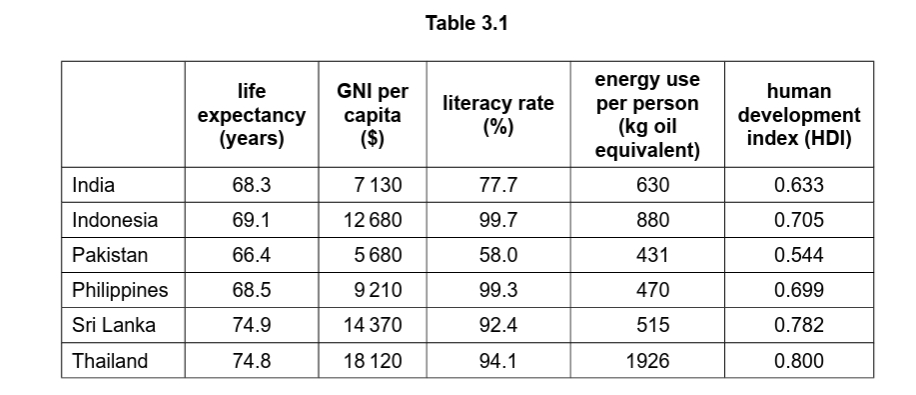
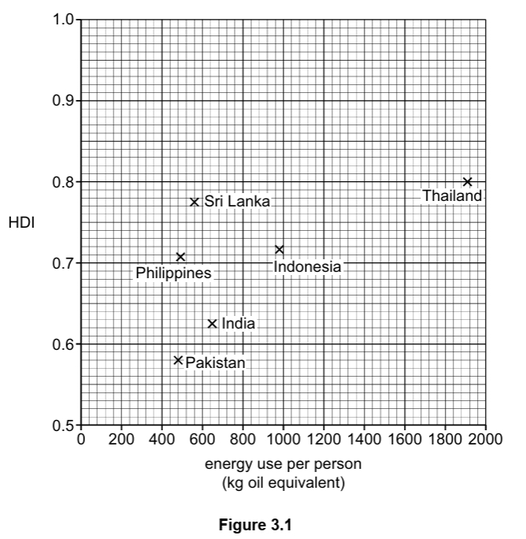

# Exam Questions — Measuring Development
**Development** · Cambridge (CIE) IGCSE geography (0460 & 0976)
> Source: [https://www.savemyexams.com/igcse/geography/cie/25/topic-questions/](https://www.savemyexams.com/igcse/geography/cie/25/topic-questions/) · 16 questions across 1 sets

## Exam Questions (16 questions)

### Q1 — medium — 4 marks

**Q1** [4 marks]

Suggest how literacy rates can be useful in measuring development.

### Q2 — medium — 4 marks

**Q2** [4 marks]

Explain why GNI per capita is a better measure of development than GDP per capita.

### Q3 — medium — 3 marks

**Q3** [3 marks]

Explain **one** weakness of using GDP per capita as a measure of development.

### Q4 — hard — 7 marks

**Q4** [7 marks]

Assess why GNI per capita at PPP may be a better measure of development than GNI per capita.

### Q5 — hard — 7 marks

**Q5** [7 marks]

Evaluate the problems of using social indicators such as life expectancy and infant mortality to measure development.

### Q6 — hard — 7 marks

**Q6** [7 marks]

Evaluate the usefulness of the Human Development Index (HDI) compared with single indicators of development.

### Q7 — hard — 7 marks

**Q7** [7 marks]

Assess the extent to which literacy rate is a reliable indicator of development?

### Q8 — hard — 7 marks

**Q8** [7 marks]

Assess the strengths and weaknesses of using GDP per capita to measure development.

### Q9 — medium — 4 marks

**Q9** [4 marks]

Study Fig. 5.1, a map showing the HDI of India’s states. India is an LIC in South Asia.

*Fig. 5.1 HDI of India’s states*

Suggest why some states in India have a higher HDI than other states.

*Source: Nov 2024 0460/11 Q5A I*

### Q10 — easy — 2 marks

**Q10** [2 marks]

Study Fig. 5.1, a map showing the HDI of India’s states. India is an LIC in South Asia.

*Fig. 5.1 HDI of India’s states*

Using Fig. 5.1, name

a) an Indian state with an HDI of 0.551–0.600

b) a state in the east of India with an HDI of 0.651–0.700.

*Source: Nov 2024 0460/11 Q5A II*

### Q11 — easy — 4 marks

**Q11** [1 mark]

What do the initials HDI mean?

*Source: Nov 2024 0460/11 Q5A I*

**Q11** [3 marks]

**Extract:**

What do the initials HDI mean?
Human Development Index

Name **three **indicators which are used to calculate the HDI.

*Source: Nov 2024 0460/11 Q5A III*

### Q12 — easy — 6 marks

**Q12** [1 mark]

Study Fig. 5.1, which is a diagram showing development indicators for four countries.

Identify the country shown in Fig. 5.1 which has the shortest life expectancy.

*Source: Nov 2020 0460/01 Q5A I*

**Q12** [2 marks]

**Extract:**

Study Fig. 5.1, which is a diagram showing development indicators for four countries.

Complete Fig. 5.1 by plotting the following information:

- 90% of the population of Honduras are literate.
- The Human Development Index (HDI) of Honduras is 0.63.

*Source: Nov 2020 0460/01 Q5A II*

**Q12** [3 marks]

Explain why the Human Development Index (HDI) is a good method of comparing development between countries.

*Source: Nov 2020 0460/01 Q5A III*

### Q13 — easy — 6 marks

**Q13** [1 mark]

Study Fig. 5.1, which shows information about the employment structure of Cameroon, Italy and Japan.

Give **one** example of a worker in the tertiary sector.

*Source: 2019 0460/11 Q5A I*

**Q13** [2 marks]

**Extract:**

Study Fig. 5.1, which shows information about the employment structure of Cameroon, Italy and Japan.

Key: striped for primary, dotted for secondary, crossed for tertiary.

**Complete the pie graph** in Fig. 5.1 to show the following information for Japan:

Secondary employment = 25%

Tertiary employment = 70%

*Source: 2019 0460/11 Q5A II*

**Q13** [3 marks]

**Extract:**

Study Fig. 5.1, which shows information about the employment structure of Cameroon, Italy and Japan.

Key: striped for primary, dotted for secondary, crossed for tertiary.

Describe **three** differences between the employment structure of Cameroon and Italy.

### Q14 — easy — 6 marks

**Q14** [1 mark]

Study Fig. 5.1, a map showing the Human Development Index (HDI).

Put the following countries in rank order according to their HDI.

| Brazil |   |
|---|---|
| Canada |   |
| China |   |
| Sudan |   |

*Source: 2020 0460/01 Q5A I*

**Q14** [2 marks]

**Extract:**

Study Fig. 5.1, a map showing the Human Development Index (HDI).

![World map showing Human Development Index by country: very high (dark green), high (green), medium (orange), low (red), and no data (grey).]

Describe the main differences in HDI between North and South America.

*Source: 2020 0460/01 Q5A II*

**Q14** [3 marks]

Explain why HDI is a good measure of development.

*Source: 2020 0460/01 Q5A III*

### Q15 — medium — 4 marks

**Q15** [4 marks]

Use Table 3.1 to identify the country which you consider to be the most developed. Justify your answer.

*Source: Specimen 0460/02 Q3A IV*

### Q16 — easy — 6 marks

**Q16** [1 mark]

Study Table 3.1, which shows indicators of development for six countries in Asia.

Identify one country listed in Table 3.1 with a life expectancy greater than 70 years.

*Source: Specimen 0460/02 Q3A I*

**Q16** [2 marks]

Define the following terms:

- GNI per capita
- Literacy rate

*Source: Specimen 0460/02 Q3A II*

**Q16** [3 marks]

**Extract:**

Study Table 3.1, which shows indicators of development for six countries in Asia.

Study **Figure 3.1**, a scatter graph showing information about the human development index (HDI) **and **energy use per person in the six countries listed in **Table 3.1**.

Describe the relationship between HDI and energy use per person. Use data to support your answer.

*Source: Specimen 2020 0460/02 Q3A III*

