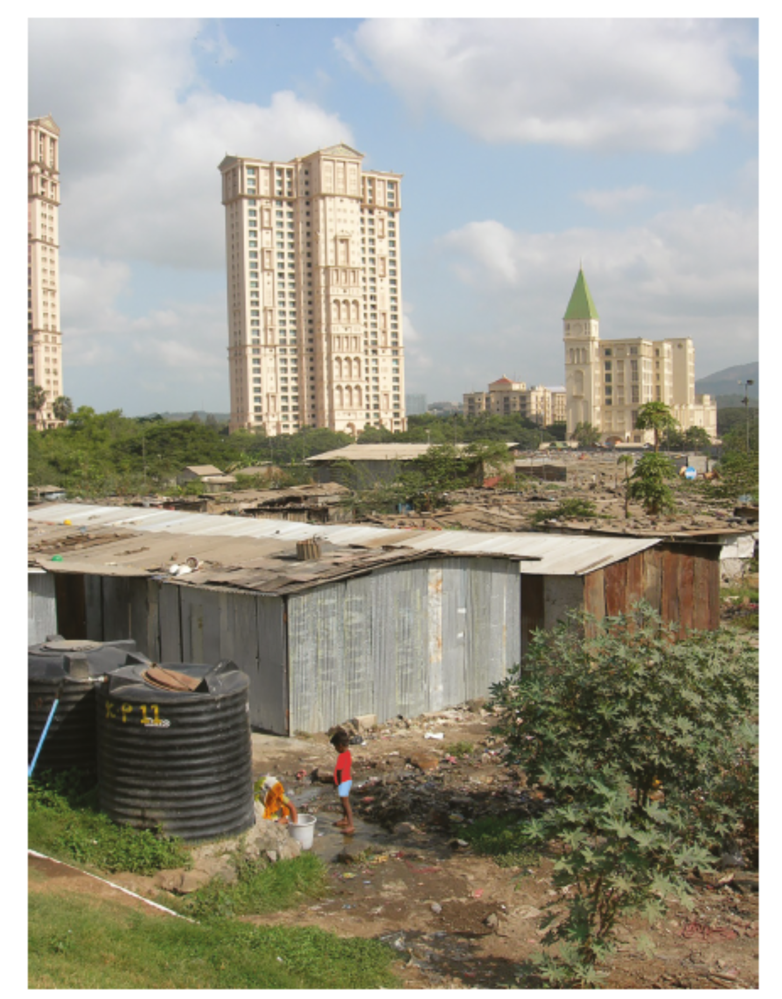

# Exam Questions — Uneven Development
**Development** · Cambridge (CIE) IGCSE geography (0460 & 0976)
> Source: [https://www.savemyexams.com/igcse/geography/cie/25/topic-questions/](https://www.savemyexams.com/igcse/geography/cie/25/topic-questions/) · 19 questions across 1 sets

## Exam Questions (19 questions)

### Q1 — medium — 1 marks

**Q1** [1 mark]

Explain **one **reason why classifying countries only by income can be misleading.

### Q2 — medium — 4 marks

**Q2** [4 marks]

Suggest **one **reason why some countries move from LIC to MIC status.

### Q3 — medium — 4 marks

**Q3** [4 marks]

Describe **two **social factors that can widen the development gap.

### Q4 — medium — 4 marks

**Q4** [4 marks]

Explain how being landlocked can affect a country’s development.

### Q5 — easy — 3 marks

**Q5** [3 marks]

Study Fig. 5.2, which shows indicators of development for selected countries in Africa.

| Country | Life expectancy (years) | Energy use per person (kg of oil equivalent) | Number of doctors (per 100 000 people) | Adult literacy (%) |
|---|---|---|---|---|
| Angola | 55 | 606 | 8 | 67 |
| Egypt | 73 | 735 | 212 | 58 |
| Ethiopia | 61 | 299 | 3 | 43 |
| Kenya | 64 | 494 | 13 | 85 |
| South Africa | 50 | 2587 | 69 | 87 |
| Tanzania | 61 | 465 | 2 | 78 |
| Uganda | 54 | 776 | 5 | 70 |

**Fig. 5.2**

Identify the country which:

1. Has the lowest percentage of people who can read and write.
2. Is likely to have the poorest access to a doctor.
3. Has the lowest energy use per person.

*Source: Specimen Paper/20 0460/01 Q5B I*

### Q6 — easy — 1 marks

**Q6** [1 mark]

What is meant by the term 'development gap'?

### Q7 — easy — 2 marks

**Q7** [2 marks]

Give **two** environmental reasons why some countries develop more slowly.

### Q8 — easy — 2 marks

**Q8** [2 marks]

Identify **two **features of low-income countries (LICs).

### Q9 — easy — 3 marks

**Q9** [3 marks]

Describe **three **problems caused by the development gap.

### Q10 — hard — 7 marks

**Q10** [7 marks]

Assess how the choice of development indicators can affect how the global development gap is understood.

### Q11 — hard — 7 marks

**Q11** [7 marks]

Assess how environmental factors can contribute to uneven development.

### Q12 — hard — 7 marks

**Q12** [7 marks]

Assess why global classifications of LICs, MICs, and HICs are often contested.

### Q13 — hard — 7 marks

**Q13** [7 marks]

Evaluate the role of colonial history in creating uneven development today.

### Q14 — hard — 7 marks

**Q14** [7 marks]

Evaluate how economic factors widen the development gap between LICs and HICs.

### Q15 — hard — 7 marks

**Q15** [7 marks]

Assess the extent to which social factors explain uneven development between countries?

### Q16 — easy — 3 marks

**Q16** [3 marks]

Study Fig. 5.2, a photograph taken in Mumbai, India.

*Fig. 5.2 *

Using evidence from Fig. 5.2, suggest what inequalities exist in Mumbai.

*Source: Nov 2024 0460/11 Q5B I*

### Q17 — medium — 5 marks

**Q17** [5 marks]

Study Fig. 5.2, which shows indicators of development for selected countries in Africa.

| Country | Life expectancy (years) | Energy use per person (kg of oil equivalent) | Number of doctors (per 100 000 people) | Adult literacy (%) |
|---|---|---|---|---|
| Angola | 55 | 606 | 8 | 67 |
| Egypt | 73 | 735 | 212 | 58 |
| Ethiopia | 61 | 299 | 3 | 43 |
| Kenya | 64 | 494 | 13 | 85 |
| South Africa | 50 | 2587 | 69 | 87 |
| Tanzania | 61 | 465 | 2 | 78 |
| Uganda | 54 | 776 | 5 | 70 |

**Fig. 5.2**

Which country, listed in Fig. 5.2, do you consider to have the highest level of development?

Justify your answer.

*Source: Specimen Paper/20 0460/01 Q5B II*

### Q18 — medium — 5 marks

**Q18** [5 marks]

Explain why there are inequalities in wealth between countries.

### Q19 — medium — 4 marks

**Q19** [4 marks]

Explain why there may be inequalities in levels of development within a country.

*Source: Nov 2020 0460/12 Q5A IV*

