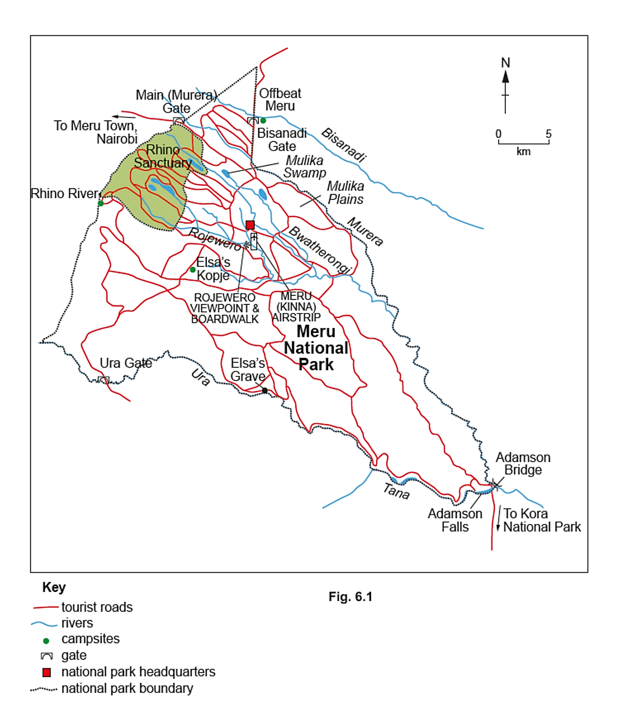
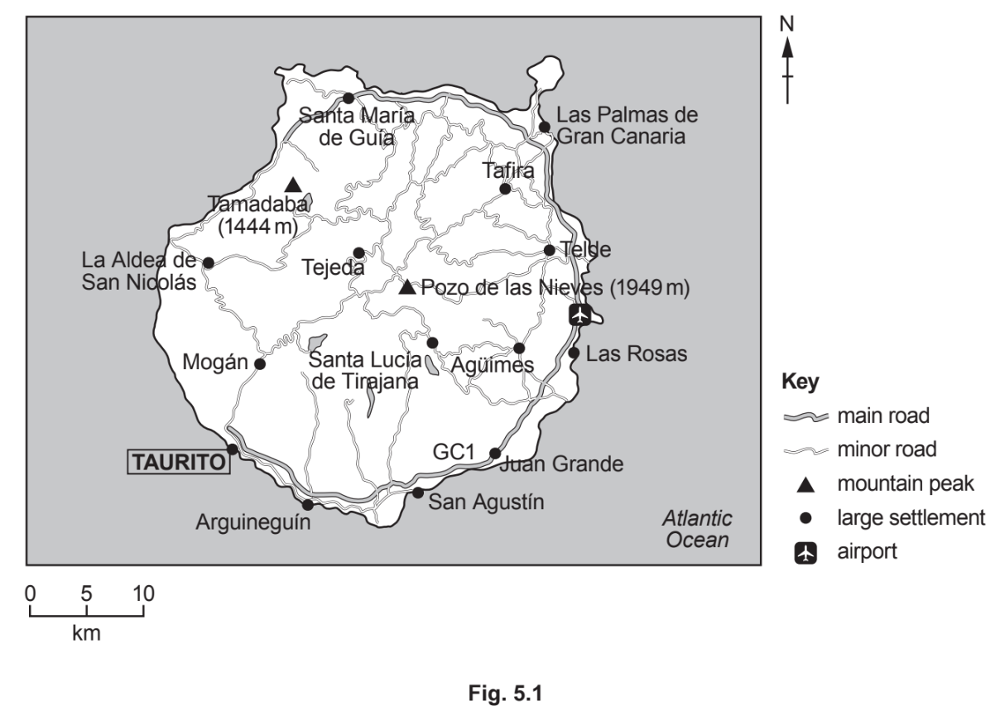
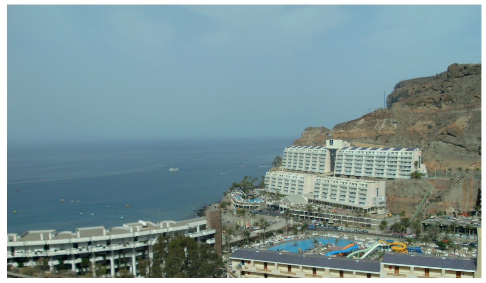

# Exam Questions — Cartographic Skills
**Geographical Skills** · Cambridge (CIE) IGCSE geography (0460 & 0976)
> Source: [https://www.savemyexams.com/igcse/geography/cie/25/topic-questions/](https://www.savemyexams.com/igcse/geography/cie/25/topic-questions/) · 7 questions across 1 sets

## Exam Questions (7 questions)

### Q1 — easy — 3 marks

**Q1** [3 marks]

Study Fig. 6.2 of a map showing national parks in Namibia, an LIC in Africa.

Describe the location of the following three national parks in Namibia.

1. Dorob
2. Bwabwata
3. Etosha

*Source: Nov. 2024 0460/11 Q6B I*

### Q2 — easy — 3 marks

**Q2** [1 mark]

Study Fig. 6.1, a map of the Meru National Park in Kenya, an LIC in east Africa.

Estimate the area of Meru National Park in square kilometres.

*Source: Nov 2024 0460/11 Q6A I*

**Q2** [2 marks]

What is the straight-line distance and direction from Ura Gate to the National Park Headquarters?

Distance ..................................................... km

Compass direction .....................................

*Source: Nov 2024 0460/11 Q6A II*

### Q3 — easy — 3 marks

**Q3** [1 mark]

Study Fig. 6.1, which shows information about the Kafue National Park in Zambia, an area where the tourist industry is important. Zambia is an LIC in Africa.

*Fig. 6.1*

Estimate the area of Kafue National Park in square kilometres.

*Source: June 2021 0460/13 Q6A I*

**Q3** [2 marks]

Many tourists enter Kafue National Park at Nalusanga Gate and drive through it to Tatayoyo Gate.

What is the distance and direction along the main road from Nalusanga Gate to Tatayoyo Gate?

Distance ............................................... km

Direction ..............................................

*Source: June 2021 0460/13 Q5A II*

### Q4 — easy — 3 marks

**Q4** [1 mark]

Study **Fig. 5.1**, a map showing tourist attractions in Mauritius, an LIC in the Indian Ocean.

*Fig. 5.1*

Name the river gorge in the southwest of Mauritius.

*Source: Nov 2020 0460/13 Q5A I*

**Q4** [2 marks]

**Extract:**

Study **Fig. 5.1**, a map showing tourist attractions in Mauritius, an LIC in the Indian Ocean.

Describe the location of the tourist resort of Grand Baie.

*Source: Nov 2020 0460/13 Q5A II*

### Q5 — easy — 3 marks

**Q5** [1 mark]

Study Fig. 5.1, which shows a map of the island of Gran Canaria, a Spanish island off the coast of Africa. Fig. 5.2, is a photograph of the tourist resort of Taurito in Gran Canaria.

*Fig. 5.2*

What is the compass direction from the airport to Taurito?

*Source: June 2020 0460/12 Q5A I*

**Q5** [2 marks]

**Extract:**

Study Fig. 5.1, which shows a map of the island of Gran Canaria, a Spanish island off the coast of Africa. Fig. 5.2, is a photograph of the tourist resort of Taurito in Gran Canaria.

Use the scale to measure the distance along the GC1 road from the airport to Taurito.

.........................km

*Source: June 2020 0460/12 Q5A II*

### Q6 — medium — 4 marks

**Q6** [4 marks]

Study the map extract showing part of Kingston, Jamaica (scale 1:50 000). Jamaica is an LIC.

[Map extract](https://www.cambridgeinternational.org/Images/719016-2027-specimen-paper-survey-map-2.pdf)

Using map evidence, suggest **two **advantages and **two **disadvantages of the location of Norman Manley International Airport.

*Source: Specimen 0460/02 Q1A VI*

### Q7 — easy — 7 marks

**Q7** [2 marks]

Study the map extract showing part of Kingston, Jamaica (scale 1:50 000). Jamaica is an LIC.

[Map extract](https://www.cambridgeinternational.org/Images/719016-2027-specimen-paper-survey-map-2.pdf)

Many people work in Kingston. Identify the places where people work using the following grid references.

1. 693472
2. 743466

*Source: Specimen 0460/02 Q1A II*

**Q7** [1 mark]

**Extract:**

Study the map extract showing part of Kingston, Jamaica (scale 1:50 000). Jamaica is an LIC.

[Map extract](https://www.cambridgeinternational.org/Images/719016-2027-specimen-paper-survey-map-2.pdf)

The runway of Norman Manley International Airport is located in and around grid square 7242.

Measure the length of the runway.

...................................................... km

*Source: Specimen 0460/02 Q1A III*

**Q7** [2 marks]

**Extract:**

Study the map extract showing part of Kingston, Jamaica (scale 1:50 000). Jamaica is an LIC.

[Map extract](https://www.cambridgeinternational.org/Images/719016-2027-specimen-paper-survey-map-2.pdf)

Describe the route of the road from the airport to Port Royal, to the west of the airport.

*Source: Specimen 0460/02 Q1A IV*

**Q7** [2 marks]

**Extract:**

Study the map extract showing part of Kingston, Jamaica (scale 1:50 000). Jamaica is an LIC.

[Map extract](https://www.cambridgeinternational.org/Images/719016-2027-specimen-paper-survey-map-2.pdf)

Identify **two **services which are located in Port Royal.

*Source: Specimen 0460/02 Q1A V*

