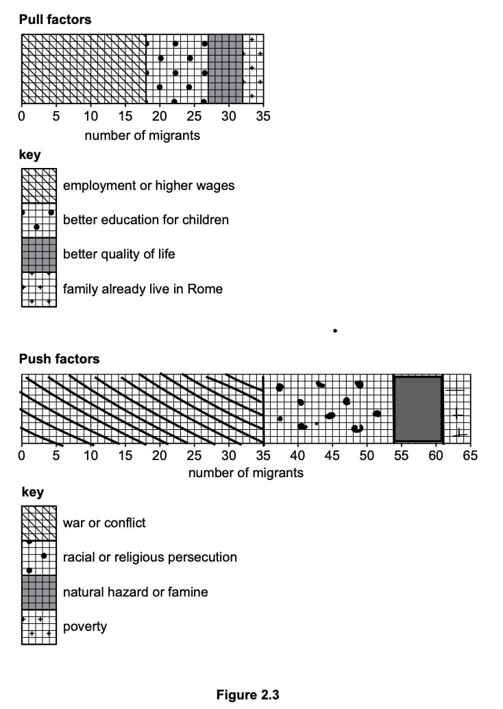
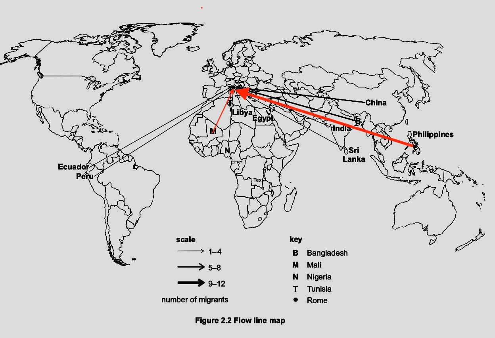
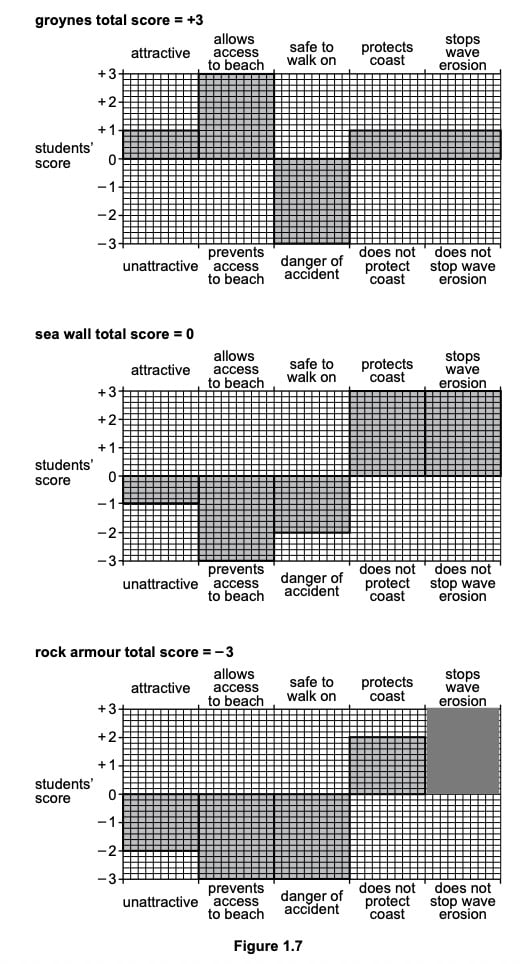
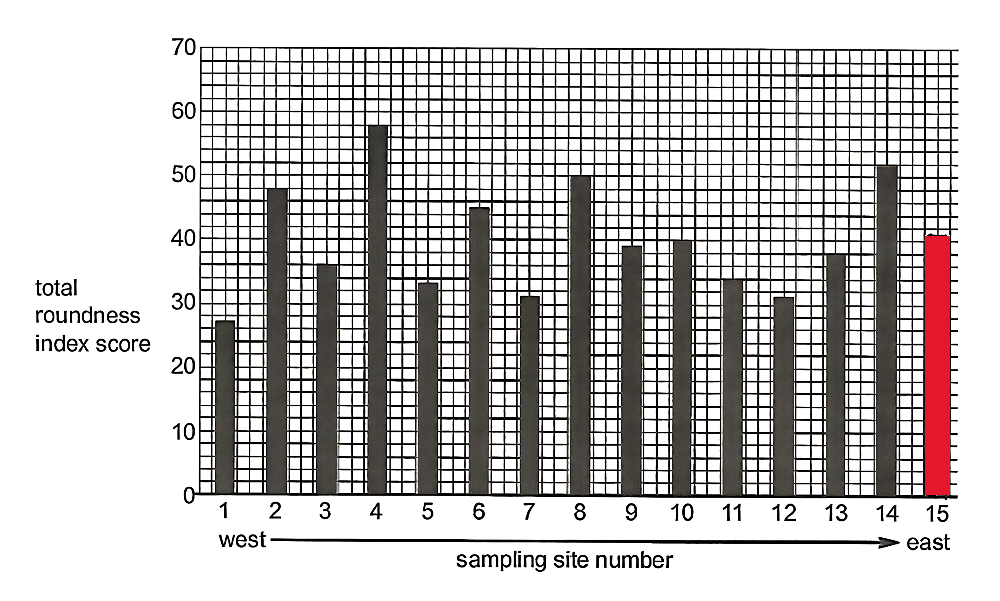
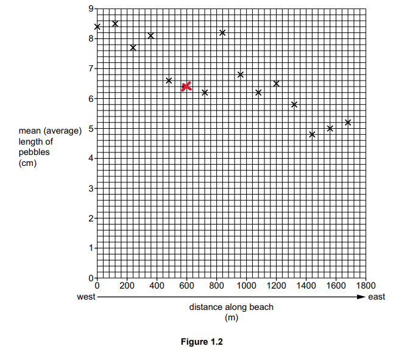

# Mark Schemes — Fieldwork
**Geographical Skills** · Cambridge (CIE) IGCSE geography (0460 & 0976)

## Exam Questions (10 questions)

### Q1
The migrants’ move to Rome was only partly successful **[E]**. Table 2.3 shows that there were more problems (420 answers) than benefits (280 answers), suggesting many migrants faced difficulties** [E].** The most common problem was the high cost of living, mentioned 92 times, which is much higher than the most common benefit – the opportunity to work (67 answers) **[E].**

Other major problems included racial and religious intolerance (74 answers) and low paid jobs or exploitation (69 answers). These are serious issues that affect quality of life and show that many migrants struggled after moving** [E]**.

However, there were still some positives. Many migrants said their children could go to school (64 answers), they had access to good healthcare (53 answers), and could meet with local communities and family (48 answers) **[E].**

Overall, while there are some important benefits, the number and seriousness of the problems mean that the move to Rome was not a complete success for many migrants **[E].** The data suggests more people faced difficulties than gained advantages.

> **[mark-scheme]**
> The command word is **‘justify’; **this means the answer needs to include valid reasons to support the point of view given regarding the benefits and problems of migration.
> 
> **Mark allocation**
> 
> This is a 'level of response' answer. Each point made in the answer does not equal a mark.
> 
> AO focus = AO3** [E]**
> 
> - A top-level 3 (6 mark) answer will use specific examples that demonstrate evaluation and decision making
> 
> **Alternative content**
> 
> The answer above is just one example of how to respond to this question. Additional information that could be used in the answer includes:
> 
> - Don’t agree because (many) migrants regretted their decision to move to Rome
> - The three main problems were all higher scoring than the main benefit, e.g. 92, 74, 69 answers compared with 67 answers
> - Decision should be made based on and supported by evidence in Table 2.3.
> - Reference is made to benefits and problems identified in Table 2.3.
> - Comparison between the number of benefits and problems in Table 2.3.

### Q2
The hypothesis is true** [1] **there are  54 migrants from Europe and 46 come from Africa, Asia and South America. **[1]**

> **[mark-scheme]**
> The command word is **‘what’; **this means the answer needs to include valid reasons to support the conclusion.
> 
> **Mark allocation**
> 
> - 1 mark for correct judgement on the hypothesis** [1]**
> - 1 mark for a valid point **[1]**
> 
> **Common errors**
> 
> - Common errors where students lose marks include:
> 
>   - Incorrect assessment of the hypothesis
>   - Lack of evidence from Table 2.1
> 
> **Alternative content**
> 
> The answer above is just one example of a response to this question. Other information that could be used in the answer includes:
> 
> - 54 out of 100/54% come from Europe.

> **[mark-scheme]**
> The command word is **'plot'**, which means the answer needs to accurately complete the **divided bar graph for push factors** in Figure 2.3, using the key.
> 
> **Mark allocation**
> 
> - 1 mark for a dividing line at 35 **[1]**
> - 1 mark for dividing lines at 54 and 61 **[1]**
> - 1 mark for correct shading using the key **[1]**
The hypothesis is false** [1] ** Push factors are more important** [1]**. The total push factors = 65 and total pull factors = 35.** [1]**

> **[mark-scheme]**
> The command word is **‘justify’; **this means the answer needs to include valid reasons to support the point of view given.
> 
> **Mark allocation**
> 
> - 1 mark for correct judgement on the hypothesis** [1]**
> - 1 mark for a valid point **[1]**
> - 1 mark for evidence **[1]**
> 
> **Common errors**
> 
> - Common errors where students lose marks include:
> 
>   - Incorrect assessment of the hypothesis
>   - Lack of evidence from figures 2.3 and Table 2.2
> 
> **Alternative content**
> 
> The answer above is just one example of a response to this question. Other information that could be used in the answer includes:
> 
> - Push factors total **65** compared with **35** for pull factors, so the hypothesis is not supported.
> - The largest single reason is **conflict (35)** — a push factor — greater than any pull factor.
> - Conflict and persecution together (**54**) outweigh all the pull factors combined (**35**).
> - Some pull factors do attract migrants (e.g. employment, **18**), but they are outweighed by push factors overall.

### Q3
Use a random number generator **[1 mark] **to select people in the sequence identified**.[1 mark]**

> **[mark-scheme]**
> The command word is **'describe'**; this means that the answer needs to state the main features of random sampling.
> 
> **Mark allocation**
> 
> - 1 mark for each valid point.** [1]**
> 
> **Alternative content**
> 
> The answer above is just one example of how to respond to this question. Additional information that could be used in the answer includes:
> 
> - Use random number tables.
> - Pick numbers from a hat.
> - Ask anyone using no pattern.
To find out whether the people are migrants from abroad **[1] **to make sure that they are asking people who were immigrants to Rome and not people born there.** [1]**

> **[mark-scheme]**
> The command word is ‘**suggest**’ this means that the answer needs to apply knowledge and understanding to consider the reasons for the questions asked.
> 
> **Mark allocation**
> 
> - 1 mark for each valid point. **[1]**
> 
> **Alternative content**
> 
> The answer above is just one example of how to respond to this question. Additional information that could be used in the answer includes:
> 
> - There is no need to continue with the questionnaire if person is not a migrant.
> - The results will be unreliable if non-migrants are included.
> - To make sure that answers are relevant to hypothesis.
**Introduce yourself to interviewees.** **[1 mark]**

**Don't block pavements.** **[1 mark]**

> **[mark-scheme]**
> The command word is ‘**suggest**’ this means that the answer needs to apply knowledge and understanding to consider other possible advice for carrying out questionnaires.
> 
> **Mark allocation**
> 
> - 1 mark for each valid point. **[1]**
> 
> **Alternative content**
> 
> The answer above is just one example of how to respond to this question. Additional information that could be used in the answer includes:
> 
> - Work in pairs.
> - Be polite.
> - Ask if people are willing to answer.
> - Choose a time when there will be people around.

> **[mark-scheme]**
> The lines should be added to the map using a ruler and should be the correct thickness as shown in the scale.
> 
> **Mark allocation**
> 
> - 1 mark for each correctly plotted line**. [1]**
> 
> **Common errors**
> 
> Common errors where students lose marks include:
> 
> - Not checking the scale to ensure that the line is the correct width.
A flow line map uses arrows to show where migrants come from** [1]** it also indicates the numbers of people from each place.** [1]**

> **[mark-scheme]**
> The command word is ‘**why**’ this means that the answer needs to give reasons that a flow line map is the best method of data presentation for this information.
> 
> **Mark allocation**
> 
> - 1 mark for each valid point. **[1]**
> 
> **Alternative content**
> 
> The answer above is just one example of how to respond to this question. Additional information that could be used in the answer includes:
> 
> - The width of the arrow shows the numbers of people from each country.

### Q4
The students could agree on what each score means.** [1] **They could circle the type of defence they were examining, such as rock armour on the recording sheet. **[1] **Mark the score for each of the features by putting a tick under the score on their form.** [1] **

> **[mark-scheme]**
> The command word is **'describe'**; this means that the answer needs to state the actions students will take to complete the survey.
> 
> **Mark allocation**
> 
> - 1 mark for each valid point. **[1]**
> 
> **Alternative content**
> 
> The answer above is just one example of a response to this question. Other information that could be used in the answer includes:
> 
> - Add up the total.
> - Decide on a score before recording it.
> - Complete a recording sheet for each defence/groyne, sea wall or rock armour.

> **[mark-scheme]**
> The command word is **'plot'**, which means the answer needs to accurately mark on the graph the score for how well the **rock armour stops wave erosion**, using the results from Table 1.4.
> 
> **Mark allocation**
> 
> - 1 mark for an accurate plot of **+3** (the score for how well the rock armour stops wave erosion). **[1]**

### Q5
Total roundness index score = **25**** [1]**

*2 + 6 + 12 + 5 = 25*

> **[mark-scheme]**
> To calculate the total roundness index score, take the score for each category and add them together.
> 
> For example, 4 stones were slightly angular, which gives an index score of 12.
> 
> The index scores are then totalled to give the answer.
Why the results are different – **index scores are subjective** **[1]**

How to agree a total roundness score – **average the scores from both students ****[1]**

> **[mark-scheme]**
> **Mark allocation**
> 
> - 1 mark for each valid point **[1]**
> 
> **Alternative content**
> 
> - Students are using the roundness index diagram and their interpretation may be different.
> - The judgement is by eye.
> - They could discuss the scores and reach an agreement.

> **[mark-scheme]**
> The command word is '**plot**', which means the answer needs to accurately mark on the graph the data for site 15 which is 41.
> 
> **Mark allocation**
> 
> - 1 mark for an accurate plot of the data.** [1]**
The hypothesis is false.** [1] ** There is no clear correlation between the distance along the beach and pebble roundness. **[1] **This is shown in the following sites: site 4/360 m = 58 and site 12/1320 m = 31 and site 14/1560 m = 52. **[1]**

> **[mark-scheme]**
> The command word is **‘justify’; **this means the answer needs to include valid reasons to support the point of view given.
> 
> **Mark allocation**
> 
> - 1 mark for correct judgement on the hypothesis** [1]**
> - 1 mark for a valid point **[1]**
> - 1 mark for evidence **[1]**
> 
> **Common errors**
> 
> - Common errors where students lose marks include:
> 
>   - Incorrect assessment of the hypothesis
>   - Lack of evidence from figures 1.4 and Table 1.1
> 
> **Alternative content**
> 
> The answer above is just one example of a response to this question. Other information that could be used in the answer includes:
> 
> - There is no clear pattern/trend.
> - Total roundness index scores vary or fluctuate along beach.

### Q6
The students would place the quadrat on the beach **[1]** and then sample pebbles within the quadrat **[1]**. They could use random sampling to identify which squares to select pebbles from.** [1]**

> **[mark-scheme]**
> The command word is **'describe'**; this means that the answer needs to state the actions that the students would take to sample the pebbles.
> 
> **Mark allocation**
> 
> - 1 mark for each valid point **[1]**
> 
> **Alternative content**
> 
> The answer above is just one example of a response to this question. Other information that could be used in the answer includes:
> 
> - Place the quadrat on the ground.
> - Pick pebbles from different squares within the quadrat.

> **[exam-tip]**
> Students will often only gain two marks for this type of question. It is important for a three-mark question that you make three valid points. In this case, the point that students often miss is the type of sampling used or the selection of pebbles from different squares.
The student would place the pebble between the teeth of the callipers **[1], **tighten the two arms**, **and then read the number shown on the scale to give the length. **[1]**

> **[mark-scheme]**
> The command word is **'describe'**; this means that the answer needs to state the process the student would follow to use the callipers.
> 
> **Mark allocation**
> 
> - 1 mark for each valid point. **[1]**
> 
> **Alternative content**
> 
> The answer above is just one example of a response to this question. Other information that could be used in the answer includes:
> 
> - Adjust the callipers to hold the pebble. **[1]**
> - Measure the length of the gap between the 'teeth' with a ruler.** [1]**

> **[exam-tip]**
> Many students forget to explain that the two arms of the callipers need to be tightened around the pebble.
> 
> You will lose marks if you don't describe how to get the length of the pebble. It is not enough to say, ‘use the scale’ or ‘get the size of the pebble.’ There must be a reference to reading the length of the pebble based on the measurement shown on the scale.

**[1 mark]**

> **[mark-scheme]**
> The command word is '**plot**', which means the answer needs to accurately mark on the graph the data from site 6, which is 600m and 6.4cm.
> 
> **Mark allocation**
> 
> - 1 mark for an accurate plot of the data.** [1]**

> **[exam-tip]**
> Always bring a ruler to your geography exam. Even if you do not need it to measure scale, you can use it on questions such as this to accurately follow the lines.
If we analyse the data from site 1, which has an average pebble size of 8.4 cm (0 m along the beach), and then move east to site 15 (1680 m), where the average pebble size is 5.1 cm, it would support the hypothesis that pebbles decrease in size. **[1]**

However, it is the anomalies that support the conclusion, which is **generally true.** This is because at site 8 (840 m along the beach), the average pebble size is 8.2 cm, which is larger than at site 7 (720 m), where the average pebble size is 6.2 cm. This pattern shows an increase, not a decrease, in pebble size. **[1]**

> **[mark-scheme]**
> The command word is '**give**', which means that the answer needs to come from a given source.
> 
> **Mark allocation**
> 
> - 1 mark **[1] **for paired data to show a decrease in length.
> - 1 mark **[1] **for identifying an anomaly to a general decrease in length.
> - No credit for the hypothesis conclusion.

> **[exam-tip]**
> Where a question states, '**a hypothesis is generally true**', there will be results that do not fit the general pattern (anomalies).
> 
> Don't waste time repeating the hypothesis conclusion or suggesting a new incorrect conclusion; there is no credit for this.
> 
> It is important to give two pairs of figures to support the conclusion, including both the pebble size and distance along the beach.

### Q7
Make sure that their phone is fully charged so that they are able to call if they needed help. **[1 mark]**

Do not go into the sea because there is a danger of drowning.** [1 mark]**

> **[mark-scheme]**
> The command word is **‘explain’**; this means the answer needs to give a reason for the advice.
> 
> **Mark allocation**
> 
> - 1 mark for each valid point **[1]**
> 
> **Alternative content**
> 
> The answer above is just one example of a response to this question. Other information that could be used in the answer includes:
> 
> - Could communicate if they got lost or were in an emergency.
> - Due to dangerous currents.
> - Due to rough seas.

### Q8
The best coastal defence based on Figure 1.7 and Table 1.4 is groynes, with the highest total score of +3. **[E]** They scored positively in four out of five categories, including +3 for allowing access to the beach, much higher than sea wall and rock armour, which both scored –3 for this feature. **[E] **Groynes also received +1 for attractiveness, compared to –1 for sea wall and –2 for rock armour.

While groynes scored only +1 for protecting the coast and stopping wave erosion, they still performed reasonably well. **[E] **Sea walls and rock armour were more effective in those categories, both scoring +3, but they had lower or negative scores elsewhere. For example, rock armour had the lowest total score (–3) and was rated –3 in three different categories, including safety and access.** [E]**

All three defences scored poorly for safety, but groynes balanced this with more public-friendly features. **[E]**

Overall, groynes are the best option because they combine reasonable protection with better beach access and visual appeal, giving them the highest total and the most balanced performance. **[E]**

> **[mark-scheme]**
> The command word is **‘justify’; **this means the answer needs to include valid reasons to support the point of view given regarding the best choice for coastal defence.
> 
> **Mark allocation**
> 
> This is a 'level of response' answer. Each point made in the answer does not equal a mark.
> 
> AO focus = AO3** [E]**
> 
> - A top-level 3 (6 mark) answer will use specific examples that demonstrate evaluation and decision making
> 
> **Alternative content**
> 
> The answer above is just one example of how to respond to this question. Additional information that could be used in the answer includes:
> 
> - Reference is made to advantages and disadvantages of each coastal defence:
> 
>   - Sea wall and/or rock armour protects coast from erosion the most (+3)
>   - Groynes only score +1 for coastal protection
> - Comparison between the positive and negative scores for the three defences:
> 
>   - Groynes score positively for four features and sea wall/rock armour score positively for two features
> - Consideration of the different importance given to individual features of each defence
> - Some evaluative comment as to which coastal defence is best with justification.

### Q9
**Economic migrant **– a person who travels from one country or area to another in order to improve their standard of living/for jobs/for more money.** [1 mark]**

**Refugee **– a person who leaves their country of origin because of fear or persecution and asks for permission to stay in a different country. **[1 mark]**

> **[mark-scheme]**
> The command word is** ‘define’** this means that the answer needs to give the precise meaning of the word(s).
> 
> **Mark allocation**
> 
> - 1 mark for each valid definition.
Push factors are negative factors which encourage people to leave an area.** [1 mark] **

Pull factors are positive factors which make people want to come to an area.**[1 mark]**

> **[mark-scheme]**
> The command word is '**explain**', which means that the answer needs to give reasons for why something happens.
> 
> **Mark allocation**
> 
> - 1 mark for each valid point.
> 
> **Alternative responses**
> 
> The answer above is just one example of how to respond to this question. Additional information that could be used in the answer includes:
> 
> - Push factors are reasons which make people emigrate.
> - Pull factors are reasons which make people immigrate.
The correct answer is** C  ****[1 mark]**

The alternative answers are incorrect because:

**A.** Line graphs are used to show continuous data such as temperature.

**B.** Population pyramids are used to show population structure.

**D.** Scatter graphs are used to show the relationships between two sets of data.

**E.** Triangular graphs are used to show three sets of data
**Secondary data**** [1 mark]**

### Q10
- Movement of material up and down the beach is repeated with each wave. **[1]**
- The prevailing wind influences the direction of longshore drift movement.** [1] **
- Waves approach the coastline at an angle. **[1]**

> **[mark-scheme]**
> **Mark allocation**
> 
> - 1 mark for each valid answer
> - 4 selected answers (maximum 2 marks)
> - 5 selected answers (maximum 1 mark)
> - 6 selected answers (0 marks)
