# Exam Questions — Fieldwork
**Geographical Skills** · Cambridge (CIE) IGCSE geography (0460 & 0976)
> Source: [https://www.savemyexams.com/igcse/geography/cie/25/topic-questions/](https://www.savemyexams.com/igcse/geography/cie/25/topic-questions/) · 10 questions across 1 sets

## Exam Questions (10 questions)

### Q1 — hard — 6 marks

**Q1** [6 marks]

To find out more about what the migrants thought about their decision to migrate to Rome, the students asked Question 3 in the questionnaire: What do you think are the benefits and problems of living in Rome?

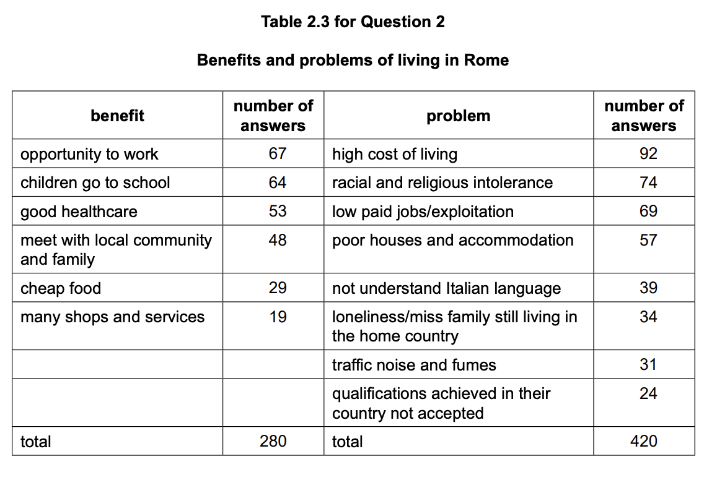

The results are shown in Table 2.3.

Use the data in Table 2.3 to explain to what extent was the migrants’ move to Rome a success for the migrants.

Include statistics from Table 2.3 to justify your answer.

*Source: Specimen 0460/04 Q2F*

### Q2 — easy — 8 marks

**Q2** [2 marks]

What conclusion should the students make about **Hypothesis 1:** Most international migrants who live in Rome were born in Europe?

**Hypothesis 1: **Most international migrants who live in Rome were born in Europe.

**Hypothesis 2: **Pull factors affected the decision to migrate to Rome more than push factors.

Support your answer with data from Table 2.1

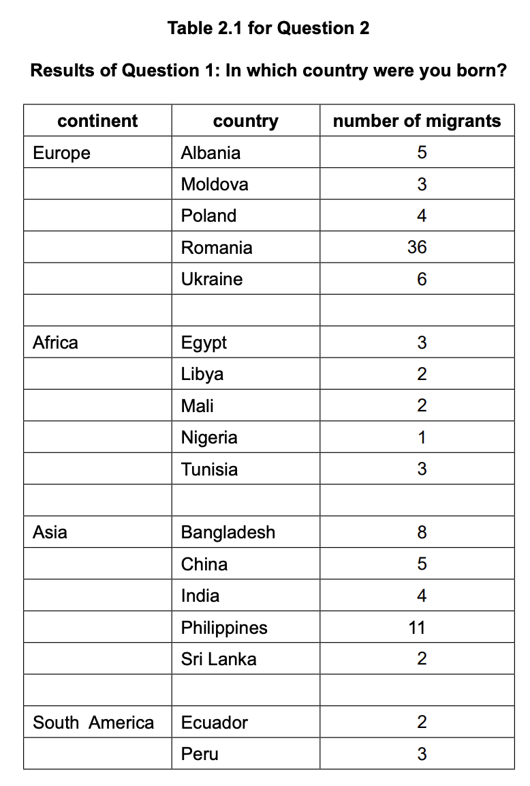

*Source: Specimen 0460/04 Q2D (III)*

**Q2** [3 marks]

Use the key to plot the results for push factors on the divided bar graph in Figure 2.3.

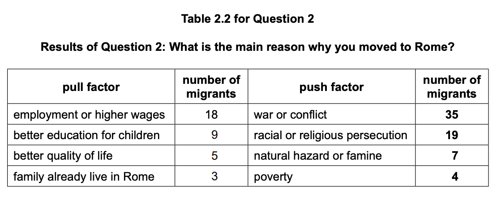

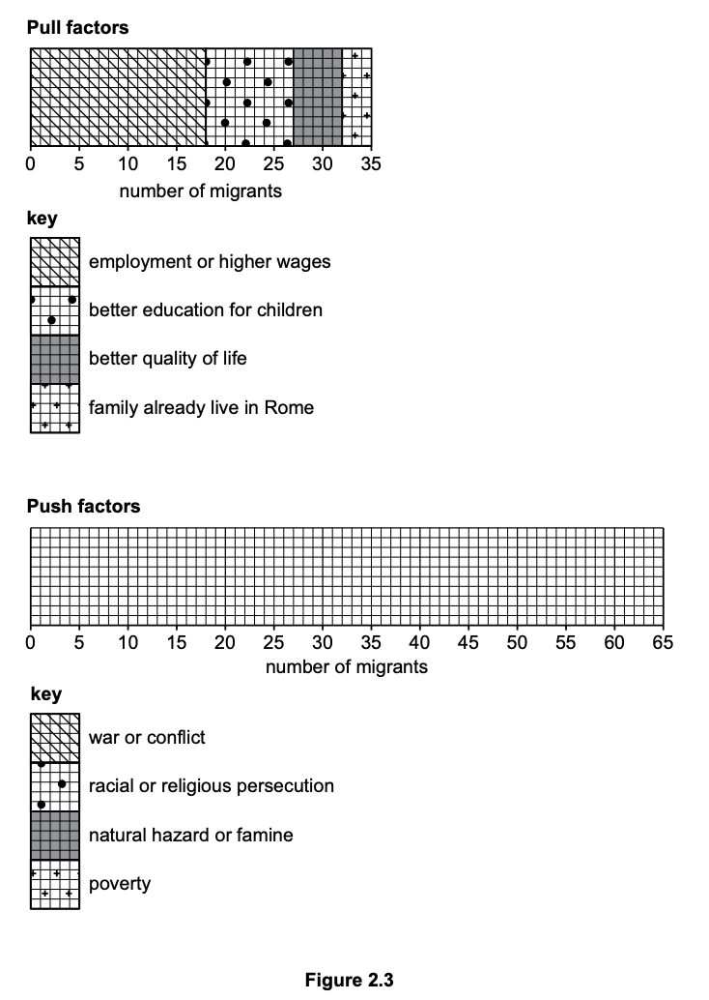

*Source: Specimen 0460/04 Q2E (I)*

**Q2** [3 marks]

**Extract:**

Hypothesis 2: Pull factors affected the decision to migrate to Rome more than push factors.

Table showing reasons for migration to Rome: employment (18), education (9), quality of life (5), family (3), conflict (35), persecution (19), hazards (7), poverty (4).

Does the data support** Hypothesis 2:**Pull factors affected the decision to migrate to Rome more than push factors?

Use evidence from Figure 2.3 and Table 2.2 to justify your decision.

*Source: Specimen 0460/04 Q2E II*

### Q3 — easy — 10 marks

**Q3** [2 marks]

The students wanted to test the following hypotheses.

**Hypothesis 1: **Most international migrants who live in Rome were born in Europe.

**Hypothesis 2: **Pull factors affected the decision to migrate to Rome more than push factors.

The students went to a district of Rome near the main railway station where many migrant families lived.

They used the questionnaire shown in Figure 2.1

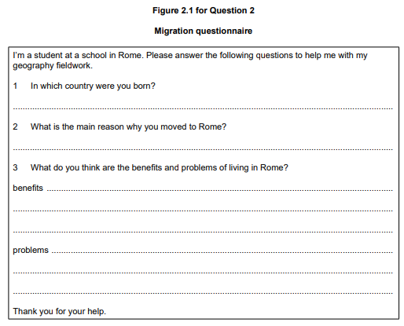

Describe how the students could use a random sampling method to select 100 people to complete their questionnaire.

*Source: Specimen 0460/04 Q2C (I)*

**Q3** [2 marks]

**Extract:**

The students wanted to test the following hypotheses.

Hypothesis 1: Most international migrants who live in Rome were born in Europe.

Hypothesis 2: Pull factors affected the decision to migrate to Rome more than push factors.

The students went to a district of Rome near the main railway station where many migrant families lived.

They used the questionnaire shown in Figure 2.1

Suggest why the students asked people ‘Have you moved to live in Rome from abroad?’ before beginning the questionnaire.

*Source: Specimen 0460/04 Q2C (II)*

**Q3** [2 marks]

**Extract:**

The students wanted to test the following hypotheses.

Hypothesis 1: Most international migrants who live in Rome were born in Europe.

Hypothesis 2: Pull factors affected the decision to migrate to Rome more than push factors.

The students went to a district of Rome near the main railway station where many migrant families lived.

They used the questionnaire shown in Figure 2.1

Suggest two other pieces of advice the teacher could give the students about how to use the questionnaire.

*Source: Specimen 0460/04 Q2C (III)*

**Q3** [2 marks]

**Extract:**

The students wanted to test the following hypotheses.

Hypothesis 1: Most international migrants who live in Rome were born in Europe.

Hypothesis 2: Pull factors affected the decision to migrate to Rome more than push factors.

The students went to a district of Rome near the main railway station where many migrant families lived.

They used the questionnaire shown in Figure 2.1

The students used the answers to Question 1 in the questionnaire (In which country were you born?) to investigate **Hypothesis 1**: Most international migrants who live in Rome were born in Europe.

Figure 2.2, a flow line map, shows the countries in Africa, Asia and South America where migrants were born.

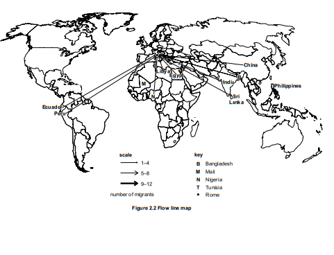

On Figure 2.2, use the following data to plot the number of migrants born in Mali and the Philippines.

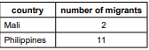

*Source: Specimen 0460/04 Q2D (I)*

**Q3** [2 marks]

**Extract:**

The students used the answers to Question 1 in the questionnaire (In which country were you born?) to investigate Hypothesis 1: Most international migrants who live in Rome were born in Europe.

Figure 2.2, a flow line map, shows the countries in Africa, Asia and South America where migrants were born.

Why is a flow line map an appropriate method to show the data from Question 1 of the questionnaire?

*Source: Specimen 0460/04 Q2D (II)*

### Q4 — easy — 4 marks

**Q4** [3 marks]

To extend their fieldwork, the students studied three coastal defences on the coastline.

Groynes are shown in Figure 1.5 and a sea wall and rock armour are shown in Figure 1.6.

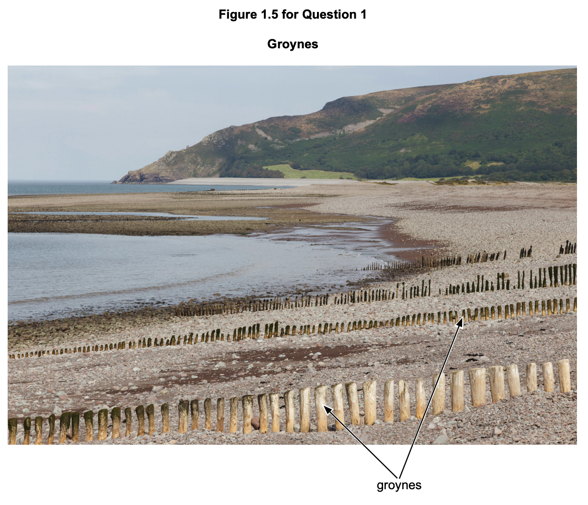

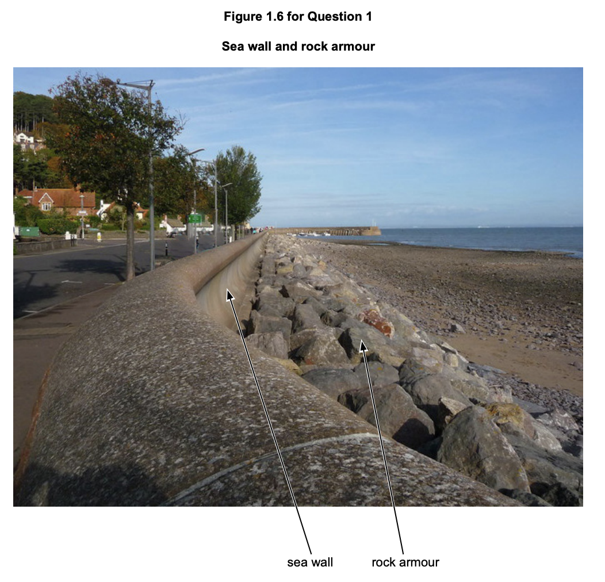

To compare the **three **coastal defences, the students completed a bi-polar survey by looking at each defence and recording their decision on the form shown in Table 1.3.

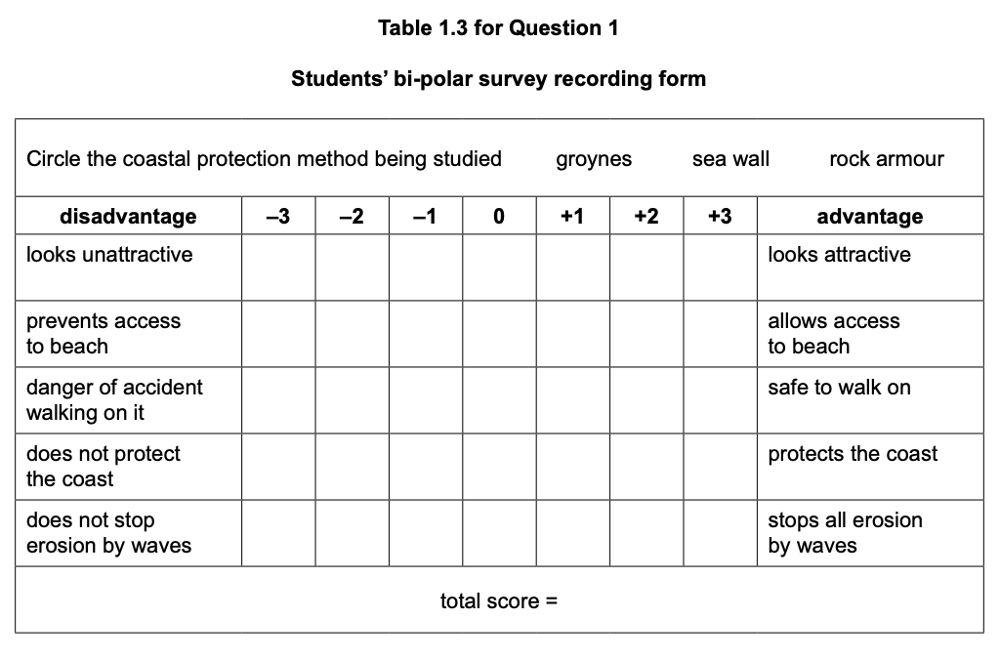

Describe how the students could complete their bi-polar survey.

*Source: Specimen 0460/04 Q1F 1*

**Q4** [1 mark]

The results of the students’ bi-polar survey are shown in Figure 1.7 and Table 1.4.

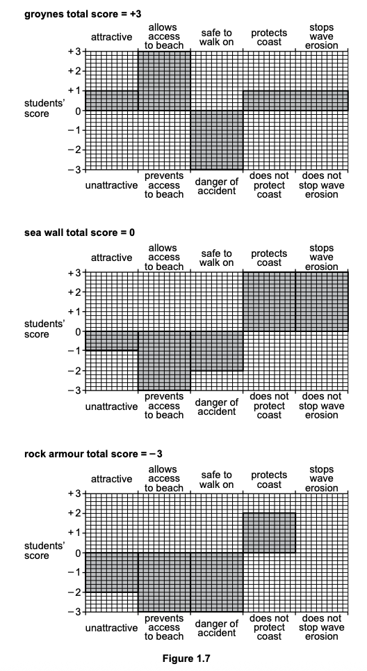

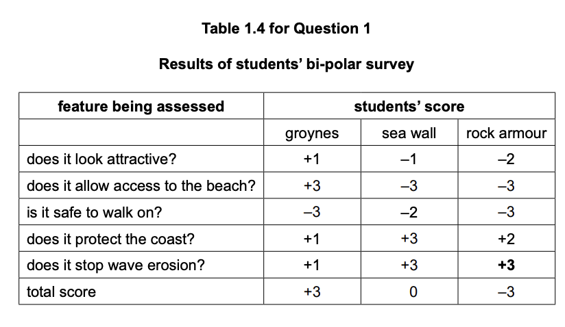

On Figure 1.7, plot the score for how well the rock armour stops wave erosion using the results from Table 1.4.

*Source: Specimen 0460/04 Q1F II*

### Q5 — easy — 8 marks

**Q5** [2 marks]

Two students did fieldwork on a local coastline where there is a pebble beach in a bay. The students investigated the effect of pebbles being moved along the beach from west to east.

To investigate **Hypothesis 2:** Pebbles become rounder from west to east along the beach, the two students used the roundness index shown in Figure 1.3.

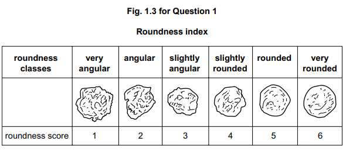

They compared each pebble they had collected with the index and gave it a roundness score.

Their results at site 1 are shown in Table 1.2.

Student A then calculated a total roundness index score for the site.

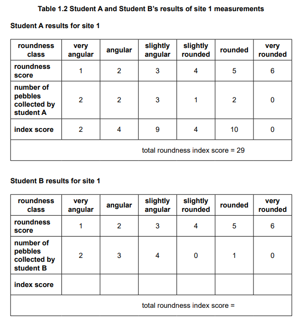

Student B’s results for the same 10 pebbles at site 1 are also shown in Table 1.2.

Calculate the total roundness index score for student B’s results and write the answer on Table 1.2

*Source: Specimen 0460/04 Q1E I*

**Q5** [2 marks]

**Extract:**

Two students did fieldwork on a local coastline where there is a pebble beach in a bay. The students investigated the effect of pebbles being moved along the beach from west to east.

To investigate Hypothesis 2: Pebbles become rounder from west to east along the beach, the two students used the roundness index shown in Figure 1.3.

They compared each pebble they had collected with the index and gave it a roundness score.

Their results at site 1 are shown in Table 1.2.

Student A then calculated a total roundness index score for the site.

Student B's results for the same 10 pebbles at site 1 are also shown in Table 1.2.

Suggest why the two students’ results of using the roundness index are different and how they could agree on a total roundness index score for each site.

*Source: Specimen 0460/04 Q1E II*

**Q5** [1 mark]

The students agreed the total roundness index scores at each site.

Their results are shown in Table 1.1

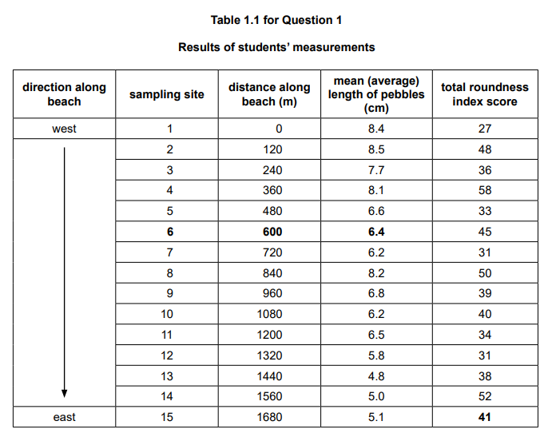

Figure 1.4 shows the students’ total roundness index results.

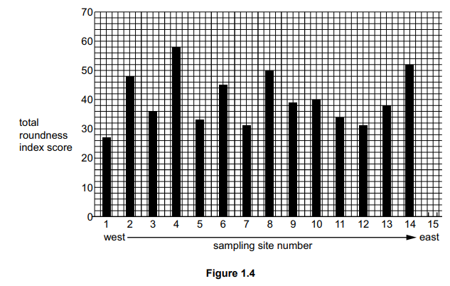

On Figure 1.4, plot the total roundness index score for site 15.

*Source: Specimen 0460/04 Q1E III*

**Q5** [3 marks]

**Extract:**

The students agreed the total roundness index scores at each site. 

Their results are shown in Table 1.1 

Figure 1.4 shows the students' total roundness index results.

What conclusion should the students make about **Hypothesis 2**: Pebbles become rounder from west to east along the beach?

Justify your decision with evidence from Figure 1.4 and Table 1.1.

*Source: Specimen 0460/04 Q1E IV*

### Q6 — easy — 8 marks

**Q6** [3 marks]

To investigate hypotheses 1 and 2, the students collected 10 pebbles at each of 15 sites along the beach.

**Hypothesis 1: **Pebbles become smaller from west to east along the beach.

**Hypothesis 2: **Pebbles become rounder from west to east along the beach.

Describe how they could use a quadrat to select pebbles at each site.

*Source: Specimen 0460/04 Q1C*

**Q6** [2 marks]

To investigate **Hypothesis 1:** Pebbles become smaller from west to east along the beach, the students used the fieldwork equipment shown in Figure 1.1.

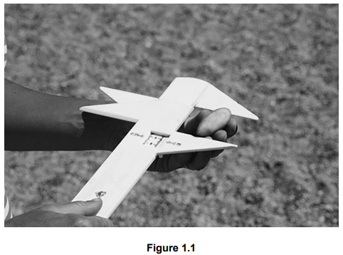

Describe how they could use this equipment to measure the length of each pebble.

*Source: Specimen 0460/04 Q1D I*

**Q6** [1 mark]

The results of the students’ measurements at the 15 sites are shown in Table 1.1.

Figure 1.2 shows the results of the students’ pebble measurements.

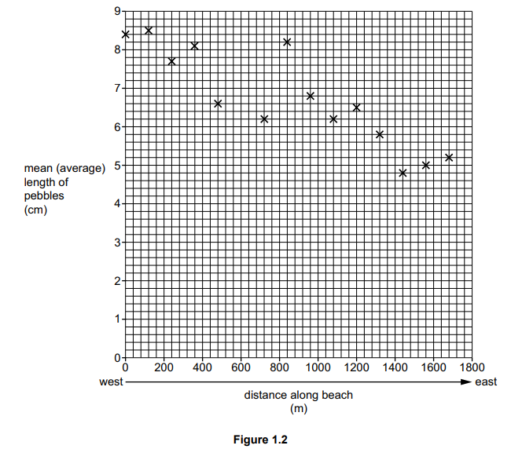

On Figure 1.2, plot the mean (average) length of the pebbles at site 6

*Source: Specimen 0460/04 Q1D II*

**Q6** [2 marks]

**Extract:**

Hypothesis 1: Pebbles become smaller from west to east along the beach.

The results of the students' measurements at the 15 sites are shown in Table 1.1.

Figure 1.2 shows the results of the students' pebble measurements.

The students made the conclusion that **Hypothesis 1: **Pebbles become smaller from west to east along the beach was generally true.

Give evidence from Figure 1.2 and Table 1.1 above to explain their conclusion.

*Source: Specimen 0460/04 Q1D III*

### Q7 — easy — 2 marks

**Q7** [2 marks]

Two students did fieldwork on a local coastline where there is a pebble beach in a bay. The students investigated the effect of pebbles being moved along the beach from west to east.

Two students tested the following hypotheses.

**Hypothesis 1: **Pebbles become smaller from west to east along the beach.

**Hypothesis 2: **Pebbles become rounder from west to east along the beach.

Explain why their teacher gave the following advice about doing fieldwork safely on the beach.

- Make sure that their phone is fully charged.
- Do not go into the sea.

*Source: Specimen 0460/04 Q1B*

### Q8 — hard — 6 marks

**Q8** [6 marks]

Use Figure 1.7 and Table 1.4 to decide which coastal defence is the best. Use data to justify your decision.

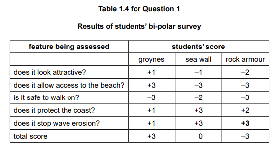

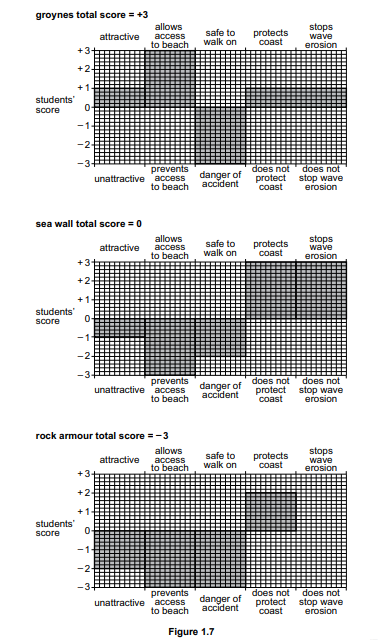

*Source: specimen 0460/04 Q1F (III)*

### Q9 — easy — 6 marks

**Q9** [2 marks]

Students at a school in Rome, Italy (an HIC in Europe), were studying international migration. They did a fieldwork investigation about migration to Rome.

They revised key terms about migration.

Define the following terms.

- Economic migrant
- Refugee

*Source: Specimen 0460/04 Q2A (I)*

**Q9** [2 marks]

Explain what is meant by push and pull factors. Do **not** give examples.

*Source: Specimen 0460/04 Q2A (II)*

**Q9** [1 mark]

Before they began their fieldwork, the students used an internet search and found that 12% of the people living in Rome were migrants from other countries and 88% were born in Italy.

Which of the following methods would be suitable to show this data?

*Source: Specimen 0460/04 Q2B (I)*

**Q9** [1 mark]

What name is given to the type of data or information researched from the internet or another source, and not collected by the students themselves?

*Source: Specimen 0460/04 Q2B (II)*

### Q10 — easy — 3 marks

**Q10** [3 marks]

Two students did fieldwork on a local coastline where there is a pebble beach in a bay. The students investigated the effect of pebbles being moved along the beach from west to east.

The students had learned that pebbles are moved along the beach by longshore drift.

Which of the following statements are true about longshore drift?

Tick **three **answers.

*Source: Specimen 0460/04 Q1A*

