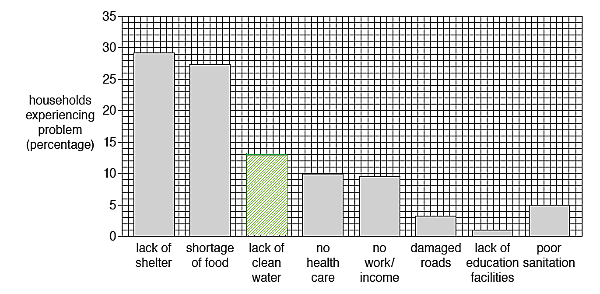
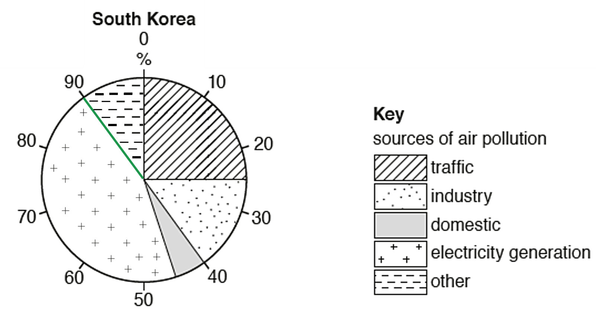

# Mark Schemes — Graphical Skills
**Geographical Skills** · Cambridge (CIE) IGCSE geography (0460 & 0976)

## Exam Questions (8 questions)

### Q1
> **[mark-scheme]**
> The base is wide **[1]**, showing high birth rates.  **[1]** The pyramid narrows quickly **[1]**, showing fewer older people. **[1]** This suggests the country is an LIC with a youthful population** [1]**.
> 
> **Mark allocation**
> 
> - 1 mark **[1]** per valid observation up to a maximum of 4 marks.
> - 1 mark **[1]** for overall judgement (LIC/youthful population).

> **[exam-tip]**
> Start with shape and then explain what it means.

### Q2
Production of both rice and wheat has increased over time. ** **In 1980, 430 million tonnes of wheat were produced, which was more than rice at 260 million tonnes. The result is a 49% difference between the two products. **[1]**

Both rice and wheat production fluctuate; however, wheat production shows the greatest instability over the time period. **[1]**

By 2013, the world had produced 79% more rice, totalling 465 million tonnes. Even though wheat production was still higher than rice at 660 million tonnes, this was only a 54% increase overall. **[1]**

> **[mark-scheme]**
> **Mark allocation**
> 
> - Each valid point is worth **1 mark [1]**, with a maximum of 3 marks available.
> - **1 mark** is reserved for supporting statistics which must refer to ‘million tonnes’ somewhere in the answer.

### Q3
> **[mark-scheme]**
> Between 1980 and 2010 there were more economically active/working/15–64-year-old people. **[1 mark]**
> 
> There was an increase in the number of elderly dependents over 65. **[1 mark]**
> 
> The number of young dependants increases, with a more even distribution of sexes up to age 19. **[1 mark]**

more even,

### Q4
> **[mark-scheme]**
> **1 mark** for the completed graph. No requirement to shade.
> 
> 
> 
> *Fig. 3.1 answer*

> **[exam-tip]**
> Although there is no requirement to shade in this instance, it is good practice (and safer) to do so.

### Q5

*Fig. 2.1 answer*

> **[mark-scheme]**
> - **1 mark** for dividing line (at either 55° or 90° with a 1% tolerance)
> - **1 mark** for the correct shading in the correct order.

### Q6
**C** **[1 mark]** and **D** **[1 mark]** are the correct answers.

### Q7
Up until 1940, there was slow growth. **[1]** From 1940 to 1970, the trend increased steeply **[1]** and then levelled off until 2000,** [1]** when it began to increase again. **[1]**

> **[mark-scheme]**
> The command word is **'describe'**; this means that the answer needs to state the points of a topic/give characteristics and main features of the graph.
> 
> **Mark allocation**
> 
> **1 mark [1]** per valid point (up to a maximum of 4).

> **[exam-tip]**
> To explain graphs in an exam, look for overall trends like increasing, decreasing, or staying constant. Make sure to mention notable data points or anomalies.

### Q8
Up until 1966, the value of imports and exports are similar. The value of imported and exported goods has increased since 1966. **[1]**

In 2021, \$6 trillion of goods were imported, while \$1.4 trillion were exported, an increase of \$0.9 trillion since 1960. **[1]**

The gap between imports and exports continues to widen over time, with imports growing at a faster rate than exports. **[1]**

Since both have declined in some years, they do not grow at the same rate. This situation occurred in both 2009 and 2016. **[1]**

2008 saw the highest level of imports and exports during that time. **[1]**

> **[mark-scheme]**
> The focus of AO2 is on skills and analysis.
> 
> **Mark allocation**
> 
> - All valid material will be credited.
> - 5 marks (or development points) for making valid **comparisons** between the values of imports and exports.
> - The question does not require the use of statistics.
> - If supporting statistics are used, there is a maximum of 2 marks available.

> **[exam-tip]**
> Always look at the overall trend when interpreting line graphs showing change over time. Writing about each yearly change wastes time and usually doesn't earn many marks, especially with questions that need a comparison. Comparing the two lines with comparative words is more effective than discussing each line on its own.
