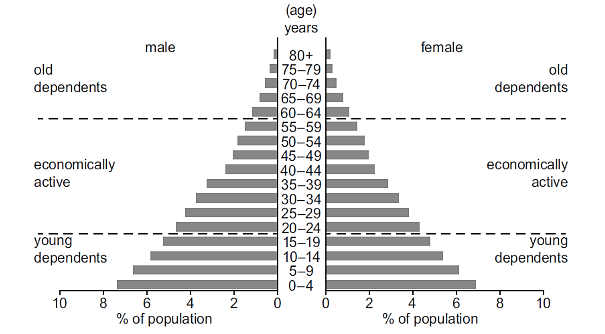
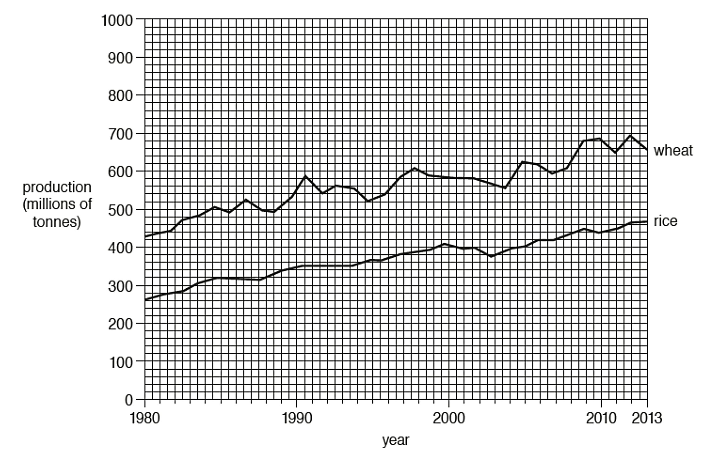
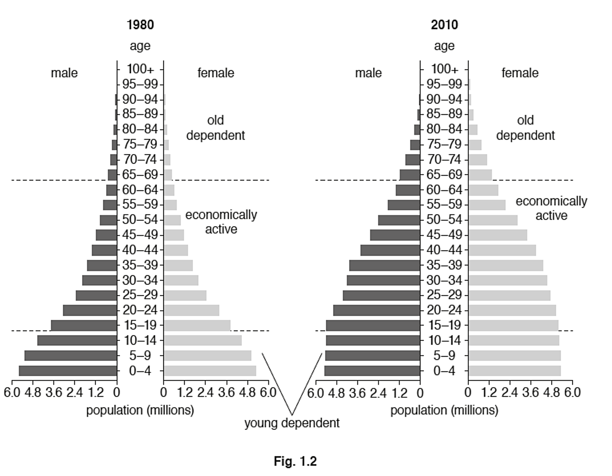
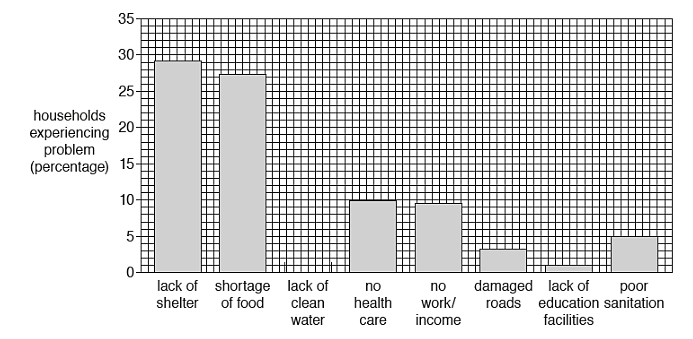
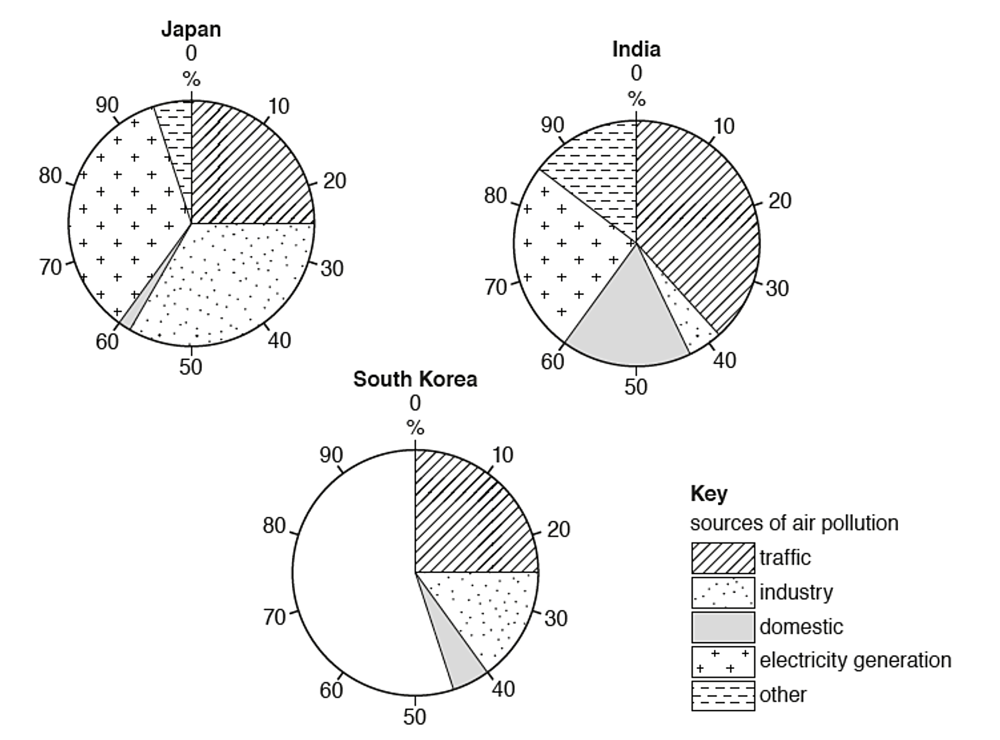
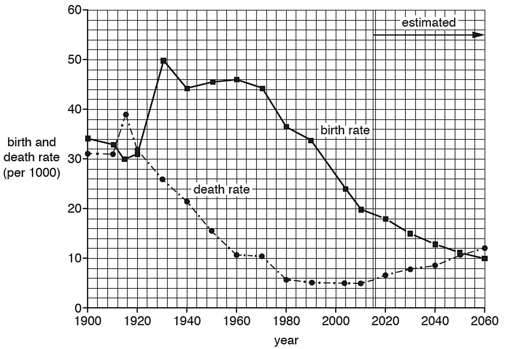
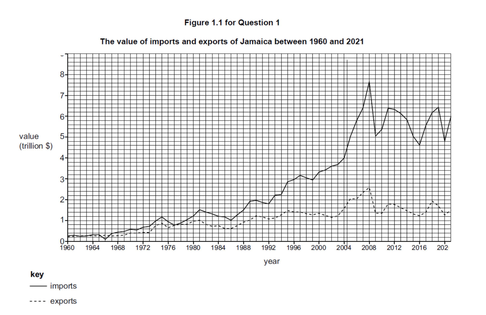

# Exam Questions — Graphical Skills
**Geographical Skills** · Cambridge (CIE) IGCSE geography (0460 & 0976)
> Source: [https://www.savemyexams.com/igcse/geography/cie/25/topic-questions/](https://www.savemyexams.com/igcse/geography/cie/25/topic-questions/) · 8 questions across 1 sets

## Exam Questions (8 questions)

### Q1 — medium — 5 marks

**Q1** [5 marks]

Study the population pyramid for Country X.

Describe what it shows about the country’s population structure.

### Q2 — easy — 3 marks

**Q2** [3 marks]

Study Fig. 5.2, which is a graph showing information about the world production of wheat and rice between 1980 and 2013.

*Fig. 5.2*

Compare the world production of wheat and rice between 1980 and 2013.

You should use statistics in your answer.

*Source: Nov 2019 0460/13 Q5B I*

### Q3 — easy — 3 marks

**Q3** [3 marks]

Study Fig. 1.2, which shows population pyramids of the structure of Mexico’s population in 1980 and 2010.

Describe the changes in Mexico’s population structure between 1980 and 2010.

### Q4 — easy — 1 marks

**Q4** [1 mark]

Study Fig. 3.1, which shows information about the problems faced by households after an earthquake in Port-au-Prince, Haiti.

*Fig. 3.1 Nov 2019*

Complete Fig. 3.1 by plotting the following information:

- 13% of households were affected by lack of clean water after the earthquake.

*Source: Nov 2019 0460/13 Q3A I*

### Q5 — easy — 1 marks

**Q5** [1 mark]

Study Fig. 2.1, which shows information about the sources of air pollution in urban areas in Japan, India and South Korea.

*Fig. 2.1*

Complete the graph for South Korea by plotting the following information:

- electricity generation = 45 %
- other = 10 %

### Q6 — easy — 2 marks

**Q6** [2 marks]

Study Fig. 1.1, which shows information about birth rates and death rates in Mexico (an LIC) between 1900 and 2060 (estimated).

*Fig. 1.1*

Which **two** of the following statements are true about birth and death rates in Mexico?

*Source: Nov 2019 0460/13 Q1A II*

### Q7 — medium — 4 marks

**Q7** [4 marks]

Using only Fig. 6.1, describe the changes in the number of tourists in Acapulco between 1920 and 2010.

*Source: June 2020  0460/11 Q6A IV*

### Q8 — medium — 5 marks

**Q8** [5 marks]

Figure 1.1 is a graph showing the value of imports and exports of Jamaica between 1960 and 2021.

*Figure 1.1*

Use Figure 1.1 to compare the value of imports and exports of Jamaica between 1960 and 2021.

*Source: Specimen 0460/02 Q1B*

